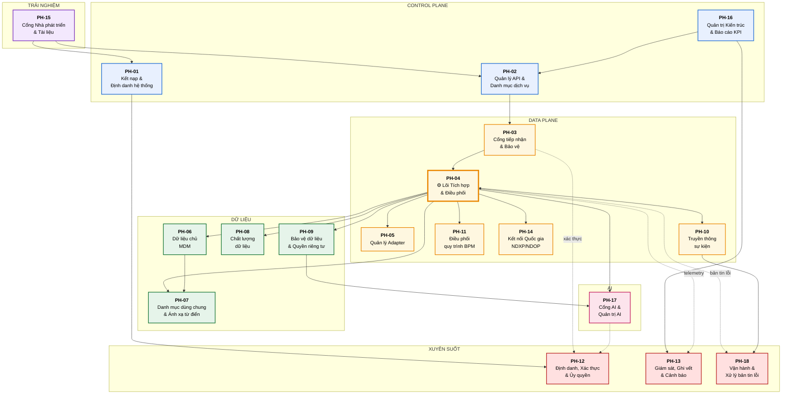
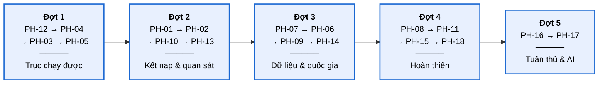

# 07 — Danh mục phân hệ phần mềm và Bộ tài liệu SRS

> **Vai trò tài liệu**: nguồn sự thật về **ranh giới phân hệ**, quan hệ phụ thuộc và chỉ mục tới SRS chi tiết từng phân hệ.
> Kiến trúc tổng thể → [02-architecture](../02-architecture/README.md). Luồng nghiệp vụ → [03-flows](../03-flows/README.md). Tuân thủ → [01-legal](../01-legal/README.md), [06-impact](../06-impact/README.md).

---

## 1. Nguyên tắc phân rã phân hệ

Việc chia phân hệ **không theo lớp kiến trúc** mà theo **ranh giới nghiệp vụ và nhịp thay đổi** — mỗi phân hệ là một đơn vị có thể phát triển, kiểm thử, triển khai và mở rộng độc lập.

| # | Nguyên tắc | Diễn giải |
|---|---|---|
| **PR-01** | Một phân hệ — một trách nhiệm nghiệp vụ | Không gộp hai miền nghiệp vụ khác nhau vào một phân hệ |
| **PR-02** | Sở hữu dữ liệu riêng | Mỗi phân hệ có schema riêng; không phân hệ nào truy cập trực tiếp CSDL của phân hệ khác |
| **PR-03** | Giao tiếp qua hợp đồng | Chỉ qua API công bố (OpenAPI) hoặc sự kiện (schema đăng ký) |
| **PR-04** | Triển khai độc lập | Nâng cấp một phân hệ không buộc triển khai lại phân hệ khác |
| **PR-05** | Mở rộng độc lập | Mỗi phân hệ có chính sách mở rộng riêng theo đặc tính tải |
| **PR-06** | Ranh giới lỗi | Sự cố một phân hệ không lan sang phân hệ khác (circuit breaker, bulkhead) |

---

## 2. Danh mục phân hệ

### 2.1. Bảng tổng hợp

| Mã | Tên phân hệ | Nhóm | Trạng thái | Ưu tiên | SRS |
|---|---|---|---|---|---|
| **PH-01** | Quản trị Kết nạp & Định danh hệ thống | Control Plane | Bắt buộc | 1 | [SRS-PH-01](SRS-PH-01-onboarding.md) |
| **PH-02** | Quản lý API & Danh mục dịch vụ | Control Plane | Bắt buộc | 1 | [SRS-PH-02](SRS-PH-02-api-catalog.md) |
| **PH-03** | Cổng tiếp nhận & Bảo vệ (API Gateway) | Data Plane | Bắt buộc | 1 | [SRS-PH-03](SRS-PH-03-gateway.md) |
| **PH-04** | Lõi Tích hợp & Điều phối (Camel) | Data Plane | Bắt buộc | 1 | [SRS-PH-04](SRS-PH-04-integration-core.md) |
| **PH-05** | Quản lý Adapter & Kết nối hệ thống | Data Plane | Bắt buộc | 1 | [SRS-PH-05](SRS-PH-05-adapter.md) |
| **PH-06** | Quản lý Dữ liệu chủ (MDM) | Dữ liệu | Bắt buộc | 2 | [SRS-PH-06](SRS-PH-06-mdm.md) |
| **PH-07** | Danh mục dùng chung & Ánh xạ từ điển | Dữ liệu | Bắt buộc | 2 | [SRS-PH-07](SRS-PH-07-rdm.md) |
| **PH-08** | Chất lượng dữ liệu | Dữ liệu | Bắt buộc | 3 | [SRS-PH-08](SRS-PH-08-dq.md) |
| **PH-09** | Bảo vệ dữ liệu & Quyền riêng tư | Dữ liệu | Bắt buộc | 2 | [SRS-PH-09](SRS-PH-09-privacy.md) |
| **PH-10** | Truyền thông sự kiện & Đồng bộ | Data Plane | Bắt buộc | 2 | [SRS-PH-10](SRS-PH-10-event.md) |
| **PH-11** | Điều phối quy trình nghiệp vụ (BPM) | Data Plane | Bắt buộc | 3 | [SRS-PH-11](SRS-PH-11-bpm.md) |
| **PH-12** | Định danh, Xác thực & Ủy quyền | Xuyên suốt | Bắt buộc | 1 | [SRS-PH-12](SRS-PH-12-iam.md) |
| **PH-13** | Giám sát, Ghi vết & Cảnh báo | Xuyên suốt | Bắt buộc | 2 | [SRS-PH-13](SRS-PH-13-observability.md) |
| **PH-14** | Kết nối Quốc gia (NDXP/NDOP) | Data Plane | Bắt buộc | 2 | [SRS-PH-14](SRS-PH-14-national.md) |
| **PH-15** | Cổng Nhà phát triển & Tài liệu | Trải nghiệm | Bắt buộc | 3 | [SRS-PH-15](SRS-PH-15-portal.md) |
| **PH-16** | Quản trị Kiến trúc & Báo cáo KPI | Tuân thủ | Bắt buộc | 3 | [SRS-PH-16](SRS-PH-16-nas-kpi.md) |
| **PH-17** | Cổng AI & Quản trị AI | AI | Cao | 4 | [SRS-PH-17](SRS-PH-17-ai.md) |
| **PH-18** | Vận hành & Xử lý bản tin lỗi | Vận hành | Bắt buộc | 3 | [SRS-PH-18](SRS-PH-18-ops.md) |

**Tổng: 18 phân hệ runtime.** Trong đó 17 bắt buộc, 1 mức ưu tiên cao (PH-17 — theo định hướng AI First của TTQGS).

### 2.1.1. Tài liệu xuyên suốt (không phải phân hệ runtime)

| Mã | Tên | Nhóm | Mức | SRS |
|---|---|---|---|---|
| **SRS-00** | Từ điển dữ liệu dùng chung toàn hệ thống | Xuyên suốt | Cần có | [SRS-00-data-dictionary](SRS-00-data-dictionary.md) |
| **SRS-19** | Ma trận phân quyền toàn hệ thống (Role × Permission × PH) | Xuyên suốt | Bắt buộc | [SRS-19-rbac-matrix](SRS-19-rbac-matrix.md) |

> **SRS-00** là nguồn sự thật cho **thực thể chia sẻ giữa các phân hệ** (`DD-01…12`), kiểu dữ liệu chuẩn, trường ngữ cảnh bắt buộc và quy ước đặt tên. Nguyên tắc: *một khái niệm — một chủ quản*; phân hệ tiêu thụ tham chiếu bằng định danh chứ không sao chép nội dung. Đọc trước khi định nghĩa bất kỳ `EN-{PH}-{nn}` mới nào.

> **SRS-19** là nguồn sự thật định nghĩa vai trò chuẩn và ma trận quyền cho PH-01…18. **Không** triển khai microservice riêng. [PH-12](SRS-PH-12-iam.md) thực thi (Keycloak + OPA); các phân hệ khác là PEP. Mã vai trò chuẩn dùng `INTEGRATION_REVIEWER` (alias tương thích: `INTEGRATION_APPROVER`).

### 2.2. Sơ đồ quan hệ phân hệ

### 2.3. Thuyết minh quan hệ phân hệ

**PH-04 là trung tâm hội tụ.** Lõi tích hợp là phân hệ duy nhất giao tiếp với hầu hết phân hệ khác. Đây là chủ đích: mọi luồng dữ liệu đi qua một điểm có kiểm soát, thay vì các phân hệ gọi chéo nhau tự do. Hệ quả cho phát triển: PH-04 phải được xây dựng và ổn định trước, các phân hệ khác tích hợp dần vào.

**Ba phân hệ xuyên suốt không nằm trên đường dữ liệu chính.** PH-12 (IAM), PH-13 (giám sát), PH-18 (vận hành) được gọi bằng nét đứt — nghĩa là chúng phục vụ mọi phân hệ nhưng sự cố của chúng **không chặn** luồng dữ liệu:
- PH-12 sập → token đang hiệu lực vẫn dùng được, chỉ đăng nhập mới bị ảnh hưởng.
- PH-13 sập → mất khả năng quan sát nhưng dữ liệu vẫn chảy.
- PH-18 sập → bản tin lỗi dồn trong DLQ, xử lý sau.

Đây là hiện thực nguyên tắc PR-06 (ranh giới lỗi).

**Thứ tự phụ thuộc khi xây dựng:**

**Lý do thứ tự này.** Đợt 1 tạo ra "trục tối thiểu chạy được" — đủ để một HTTT gọi một HTTT khác qua trục. Mỗi đợt sau bổ sung năng lực nhưng luôn giữ hệ thống ở trạng thái chạy được, cho phép kiểm chứng sớm thay vì chờ đến cuối.

### 2.4. Ma trận phân hệ ↔ luồng nghiệp vụ

| Phân hệ | F-01 | F-02 | F-03 | F-04 | F-05 | F-06 | F-07 | F-08 | F-09 | F-10 | F-11 | F-12 |
|---|:-:|:-:|:-:|:-:|:-:|:-:|:-:|:-:|:-:|:-:|:-:|:-:|
| PH-01 Kết nạp | ● | ○ | | | | | | | | | | |
| PH-02 API & Catalog | ○ | ● | ○ | | | | | | | | | |
| PH-03 Gateway | ○ | ○ | ● | ● | | ○ | ○ | ● | | | | |
| PH-04 Lõi tích hợp | | ○ | ● | ● | ● | ● | ● | | ● | ● | | |
| PH-05 Adapter | | | ● | ○ | ● | ○ | ○ | | ○ | | | |
| PH-06 MDM | | | ○ | | ● | | | | ● | | ○ | |
| PH-07 RDM | | | ○ | | ○ | | | | ● | | ● | |
| PH-08 DQ | | | | | ● | | | | ○ | | ● | |
| PH-09 Privacy | | | ● | ● | | | | | | | | |
| PH-10 Sự kiện | | | | | ● | ● | | | ○ | ● | | |
| PH-11 BPM | | | | | | | ● | | | | | |
| PH-12 IAM | ● | | ● | ○ | | | | ● | | | | |
| PH-13 Giám sát | | | ○ | ○ | ○ | ○ | ○ | ○ | | ● | | ● |
| PH-14 Quốc gia | | ○ | | ● | | ○ | | ○ | ○ | | | |
| PH-15 Portal | ● | ● | | | | | | | | | | |
| PH-16 NAS/KPI | | ○ | | | | | | | | | ○ | ● |
| PH-17 AI | | | | | | | ○ | | ○ | | ○ | |
| PH-18 Vận hành | | | | | ○ | | | | | ● | | ○ |

**Chú thích:** ● tham gia chính · ○ tham gia phụ trợ

**Cách dùng ma trận.** Khi kiểm thử một luồng nghiệp vụ, tra cột để biết phải chuẩn bị những phân hệ nào. Khi thay đổi một phân hệ, tra hàng để biết luồng nào cần kiểm thử hồi quy.

---

## 3. Quy ước chung cho mọi SRS

### 3.1. Cấu trúc tài liệu SRS

Mọi SRS trong bộ này tuân theo cấu trúc thống nhất (dựa trên IEEE 830 có điều chỉnh cho kiến trúc microservice):

| Mục | Nội dung |
|---|---|
| 1. Giới thiệu | Mục đích, phạm vi, ranh giới trách nhiệm |
| 2. Mô tả tổng quan | Vị trí trong hệ thống, tác nhân, giả định, ràng buộc |
| 3. Yêu cầu chức năng | Đặc tả từng chức năng: mã, mô tả, đầu vào, xử lý, đầu ra, ngoại lệ |
| 4. Mô hình dữ liệu | Thực thể, thuộc tính, quan hệ, ràng buộc |
| 5. Giao diện API | Endpoint, phương thức, tham số, mã lỗi |
| 6. Giao diện người dùng | Màn hình, thành phần, quy tắc tương tác |
| 7. Yêu cầu phi chức năng | Hiệu năng, sẵn sàng, bảo mật, khả năng mở rộng |
| 8. Quy tắc nghiệp vụ | Ràng buộc logic bắt buộc |
| 9. Tuân thủ | Ánh xạ CMP |
| 10. Kiểm thử chấp nhận | Tiêu chí nghiệm thu |

### 3.2. Quy ước đánh mã

| Loại | Định dạng | Ví dụ |
|---|---|---|
| Yêu cầu chức năng | `FR-{PH}-{nnn}` | `FR-04-012` |
| Yêu cầu phi chức năng | `NFR-{PH}-{nnn}` | `NFR-04-003` |
| Quy tắc nghiệp vụ | `BR-{PH}-{nnn}` | `BR-06-005` |
| Thực thể dữ liệu | `EN-{PH}-{nn}` | `EN-06-01` |
| Thực thể **chia sẻ** giữa các PH | `DD-{nn}` → [SRS-00](SRS-00-data-dictionary.md) | `DD-01` |
| Kiểu dữ liệu chuẩn | `T-{TÊN}` → [SRS-00 §2](SRS-00-data-dictionary.md#2-kiểu-dữ-liệu-chuẩn) | `T-TRACE` |
| Màn hình | `UI-{PH}-{nn}` | `UI-01-03` |
| Kiểm thử chấp nhận | `AT-{PH}-{nnn}` | `AT-04-007` |

### 3.3. Mức độ ưu tiên yêu cầu

| Mức | Ký hiệu | Ý nghĩa |
|---|---|---|
| Bắt buộc | **M** (Must) | Không có thì phân hệ không dùng được / vi phạm quy định |
| Cần có | **S** (Should) | Ảnh hưởng đáng kể chất lượng, có thể lùi sang đợt sau |
| Nên có | **C** (Could) | Cải thiện trải nghiệm, không chặn nghiệm thu |

### 3.4. Ngăn xếp công nghệ áp dụng chung

Mọi phân hệ tuân theo lựa chọn tại [05-adr](../05-adr/README.md). Bảng dưới là quy chiếu nhanh:

| Hạng mục | Công nghệ | Áp dụng cho |
|---|---|---|
| Ngôn ngữ & runtime | Java 21 + Quarkus (native) | PH-01…PH-18 (dịch vụ backend) |
| Engine tích hợp | Apache Camel 4.x | PH-04, PH-05, PH-14 |
| Trình thiết kế luồng | Kaoto làm mẫu ([ADR-015](../05-adr/README.md#adr-015)); canvas XYFlow / React Flow ([ADR-017](../05-adr/README.md#adr-017)) | PH-04 |
| Gateway | Apache APISIX | PH-03, PH-17 |
| IAM | Keycloak + OPA | PH-12 (thực thi); ma trận quyền → [SRS-19](SRS-19-rbac-matrix.md) |
| Sự kiện | Kafka (Strimzi) + Apicurio | PH-10 |
| BPM | Flowable | PH-11 |
| CSDL | PostgreSQL (CloudNativePG) | PH-01, 02, 06, 07, 08, 11, 16 |
| Object storage | MinIO | PH-13 (audit WORM), PH-06 |
| Cache | Valkey | PH-03, PH-04, PH-07 |
| Giao diện | React 18 + TypeScript + Vite; Ant Design v6 tinh chỉnh theo phong cách shadcn, có chế độ sáng/tối ([ADR-016](../05-adr/README.md#adr-016)) | PH-15 và các console quản trị |
| Quan sát | OpenTelemetry + Prometheus + Loki + Tempo + Grafana | PH-13 |
| AI | MLflow + Evidently + camel-langchain4j | PH-17 |

---

## 4. Mockup giao diện

Bộ mockup HTML minh họa các màn hình quan trọng, có liên kết điều hướng thực tế:

| Mockup | Phân hệ minh họa | Đường dẫn |
|---|---|---|
| Trang chủ / Bảng điều khiển | Tổng quan | [`mockup/index.html`](../../mockup/index.html) |
| Kết nạp hệ thống thành viên | PH-01 | [`mockup/pages/onboarding.html`](../../mockup/pages/onboarding.html) |
| Danh mục dịch vụ & Quản lý API | PH-02 | [`mockup/pages/catalog.html`](../../mockup/pages/catalog.html) |
| Danh sách và giám sát luồng tích hợp | PH-04 | [`mockup/pages/routes.html`](../../mockup/pages/routes.html) |
| Thiết kế, chạy thử và duyệt luồng | PH-04 | [`mockup/pages/designer/index.html`](../../mockup/pages/designer/index.html) — một app React duy nhất, ba tab qua neo URL: `#design` kéo thả XYFlow · `#test` chạy thử · `#review` duyệt |
| Quản lý dữ liệu chủ | PH-06 | [`mockup/pages/mdm.html`](../../mockup/pages/mdm.html) |
| Giám sát & Truy vết | PH-13 | [`mockup/pages/monitoring.html`](../../mockup/pages/monitoring.html) |
| Xử lý bản tin lỗi (DLQ) | PH-18 | [`mockup/pages/dlq.html`](../../mockup/pages/dlq.html) |
| Báo cáo KPI tuân thủ | PH-16 | [`mockup/pages/kpi.html`](../../mockup/pages/kpi.html) |

Chi tiết đặc tả màn hình nằm trong mục 6 của từng SRS.

Hệ thống thiết kế dùng chung nằm ở [`mockup/css/app.css`](../../mockup/css/app.css): ba lớp token — token gốc trích từ gói `antd@6.5.3`, thang trung tính và hình khối theo phong cách shadcn, rồi lớp vai trò ngữ nghĩa. Nút chuyển **sáng/tối** nằm trên thanh đỉnh mọi trang, lựa chọn được ghi nhớ và mặc định bám theo thiết lập hệ điều hành ([`mockup/js/theme.js`](../../mockup/js/theme.js)). Cơ sở của lựa chọn này và các ngoại lệ tương phản đã áp: [ADR-016](../05-adr/README.md#adr-016).

---

## Liên kết

- Kiến trúc tổng thể → [02-architecture](../02-architecture/README.md)
- Luồng nghiệp vụ → [03-flows](../03-flows/README.md)
- Quyết định công nghệ → [05-adr](../05-adr/README.md)
- Tác động TTQGS → [06-impact](../06-impact/README.md)
- Ma trận phân quyền toàn hệ thống → [SRS-19](SRS-19-rbac-matrix.md)
