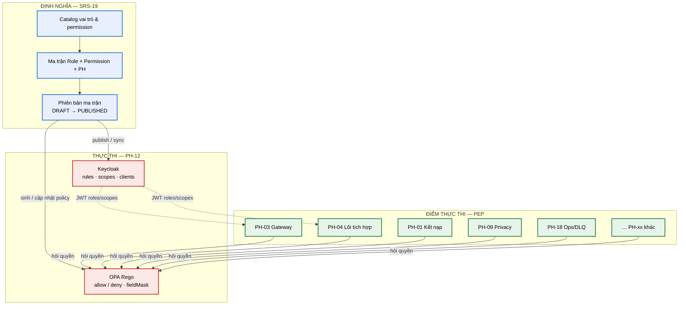
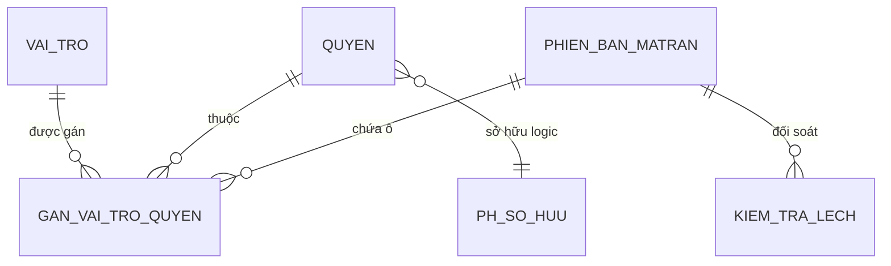

# SRS-19 — Ma trận phân quyền toàn hệ thống

| Thuộc tính | Giá trị |
|---|---|
| **Mã tài liệu** | SRS-19 |
| **Tên** | Ma trận phân quyền toàn hệ thống |
| **Nhóm** | Xuyên suốt |
| **Mức bắt buộc** | M — Bắt buộc |
| **Phiên bản** | v1.0 |
| **Ngày** | 03/8/2026 |
| **Công nghệ chủ đạo** | Keycloak roles + OPA Rego (thực thi qua PH-12) |

> **Lưu ý phân loại.** Đây là **tài liệu xuyên suốt** (cross-cutting), **không** phải phân hệ runtime PH-19. Không có service riêng mang mã PH-19. Định nghĩa Role × Permission × PH nằm ở đây; **PH-12** là nơi thực thi (Keycloak + OPA); các phân hệ PH-01…18 là **PEP** (Policy Enforcement Point) — hỏi quyết định và áp dụng `allow`/`deny`.

---

## M1. Giới thiệu

### 1.1. Mục đích

SRS-19 là **một nguồn sự thật** (single source of truth) về phân quyền toàn nền tảng LGSP: **Role × Permission × Phân hệ**.

Khi một SRS phân hệ nêu "cần vai trò `OPERATOR`" hoặc "cần quyền `ops.dlq.replay`", tài liệu này là chỗ đối chiếu: quyền đó thuộc vai trò nào, phân hệ nào thực thi, và phiên bản ma trận nào đang hiệu lực.

Hai câu hỏi tách biệt:

| Câu hỏi | Tài liệu / phân hệ trả lời |
|---|---|
| **"Anh là ai?" / "Anh được làm gì?" (runtime)** | [SRS-PH-12](SRS-PH-12-iam.md) — Keycloak xác thực, OPA đánh giá |
| **"Các vai trò chuẩn và ô quyền trên toàn hệ thống là gì?" (định nghĩa)** | **SRS-19** (tài liệu này) |

### 1.2. Phạm vi

**SRS-19 chịu trách nhiệm (định nghĩa):**

| # | Trách nhiệm |
|---|---|
| 1 | Định nghĩa bộ **vai trò chuẩn** toàn nền tảng (mã, mô tả, phạm vi tiêu biểu) |
| 2 | Định nghĩa quy ước **permission code** `{domain}.{resource}.{action}` |
| 3 | Công bố **ma trận phân quyền theo từng phân hệ** PH-01…PH-18 |
| 4 | **Phiên bản hóa** ma trận; quy trình soạn thảo → duyệt → phát hành → đồng bộ Keycloak/OPA |
| 5 | Quy tắc **đặc quyền tối thiểu** và **bốn mắt** (four-eyes) xuyên suốt các ô nguy hiểm |
| 6 | Kiểm tra **lệch** giữa ma trận SRS-19 và chính sách đang chạy trên PH-12 / khai báo trong SRS PH |
| 7 | Xuất báo cáo RBAC phục vụ kiểm toán và rà soát định kỳ |

**SRS-19 KHÔNG chịu trách nhiệm:**

| # | Không làm | Thuộc |
|---|---|---|
| 1 | Xác thực, MFA, cấp/thu hồi token, JWKS | [PH-12](SRS-PH-12-iam.md) |
| 2 | Đánh giá Rego runtime, đệm quyết định PDP | PH-12 (OPA) |
| 3 | Thực thi PEP trên đường dữ liệu (chặn/cho qua bản tin) | PH-03, PH-04 và các PEP khác |
| 4 | Che / giả danh / ẩn danh dữ liệu | [PH-09](SRS-PH-09-privacy.md) |
| 5 | Lưu nhật ký kiểm toán bất biến | PH-13 |
| 6 | Quản lý bí mật client trong Vault | Vault ([ADR-012](../05-adr/README.md#adr-012)) |

**Ranh giới cốt lõi.** SRS-19 = **catalog định nghĩa**. PH-12 = **PDP thực thi**. PEP = **điểm áp dụng**. Tách ba lớp cho phép sửa ô ma trận có kiểm soát mà không lẫn với luồng đăng nhập, và cho phép kiểm thử hồi quy quyền độc lập với thuật toán che dữ liệu.

### 1.3. Tài liệu tham chiếu

| Mã | Tài liệu |
|---|---|
| [SRS] | [PH-12 IAM](SRS-PH-12-iam.md), [PH-01](SRS-PH-01-onboarding.md)…[PH-18](SRS-PH-18-ops.md), [README danh mục](README.md), [CHECKLIST](CHECKLIST.md) |
| [ADR] | [ADR-004 Keycloak + OPA](../05-adr/README.md#adr-004) |
| [PL] | [Ma trận CMP](../01-legal/README.md) — CMP-06, CMP-07, CMP-08, CMP-13, CMP-23, CMP-28 |
| [KT] | [Kiến trúc ATTT](../02-architecture/README.md#8-kiến-trúc-an-toàn-thông-tin) |
| [CV631] | Công văn 631 — SSO, MFA, XACML 2.0/3.0 |

---

## M2. Mô tả tổng quan

### 2.1. Vị trí trong kiến trúc



**Thuyết minh.** Mũi tên **SRS-19 → PH-12** là đồng bộ định nghĩa (publish). Mũi tên **PEP → OPA** là quyết định runtime. PEP **không** đọc trực tiếp file SRS-19; chúng chỉ tin JWT + quyết định OPA. Vì vậy mọi thay đổi ma trận chỉ có hiệu lực sau khi **phát hành** qua PH-12.

### 2.2. Bộ vai trò chuẩn

| Mã vai trò | Viết tắt cột ma trận | Mô tả | Phạm vi tiêu biểu |
|---|---|---|---|
| `PLATFORM_ADMIN` | **PA** | Quản trị viên nền tảng | Toàn quyền quản trị kỹ thuật, trừ duyệt chính sách ATTT độc lập |
| `IAM_ADMIN` | **IAM** | Quản trị định danh | Người dùng, vai trò, client, MFA reset |
| `SECURITY_OFFICER` | **SO** | Cán bộ an toàn thông tin | Duyệt chính sách OPA, ngoại lệ WAF, chứng thư, audit an ninh |
| `INTEGRATION_DEV` | **ID** | Cán bộ phát triển tích hợp | Tạo/sửa luồng, adapter, chạy thử |
| `INTEGRATION_REVIEWER` | **IR** | Người duyệt luồng tích hợp | Phê duyệt phát hành luồng (bốn mắt với ID) |
| `DATA_STEWARD` | **DS** | Cán bộ quản trị dữ liệu | MDM đối sánh, danh mục RDM, cấu hình nguồn |
| `OPERATOR` | **OP** | Cán bộ vận hành | Giám sát, DLQ, sức khỏe, cảnh báo vận hành |
| `VIEWER` | **VW** | Chỉ xem | Dashboard, danh mục, báo cáo chỉ đọc |
| `LEGAL_REVIEWER` | **LR** | Cán bộ pháp chế | Thẩm định căn cứ pháp lý kết nạp / chia sẻ dữ liệu |
| `DATA_OWNER` | **DO** | Chủ quản dữ liệu / CSDL | Công bố API, phê duyệt phạm vi dữ liệu miền mình |
| `DQ_ANALYST` | **DQ** | Cán bộ chất lượng dữ liệu | Luật DQ, quét, ticket, báo cáo chất lượng |
| `ARCHITECT` | **AR** | Cán bộ kiến trúc | Registry thành phần, mức tuân thủ NAS |
| `AI_GOVERNOR` | **AG** | Quản trị AI | Đăng ký mô hình, ACL, chống bypass HITL |
| `LEADERSHIP` | **LD** | Lãnh đạo | Phê duyệt kết nạp, KPI OFFICIAL, quyết định cấp cao |

**Alias tương thích.** Trong [SRS-PH-12](SRS-PH-12-iam.md) và một số tài liệu cũ dùng `INTEGRATION_APPROVER`. **Mã chuẩn từ v1.0 trở đi là `INTEGRATION_REVIEWER`**. Keycloak phải giữ alias `INTEGRATION_APPROVER` → map sang `INTEGRATION_REVIEWER` trong thời gian chuyển đổi (BR-19-003).

### 2.3. Quy ước permission code

Định dạng bắt buộc:

```text
{domain}.{resource}.{action}
```

| Thành phần | Quy tắc | Ví dụ |
|---|---|---|
| `domain` | Khớp miền phân hệ / nghiệp vụ, chữ thường | `ops`, `privacy`, `route`, `iam`, `ai` |
| `resource` | Tài nguyên hoặc nhóm thao tác | `dlq`, `policy`, `client`, `model` |
| `action` | Động từ ngắn; có thể lồng cấp | `read`, `replay`, `approve`, `payload.read` |

**Ví dụ đã dùng trong SRS phân hệ:**

| Permission | Nguồn |
|---|---|
| `ops.dlq.replay` · `ops.dlq.triage` · `ops.dlq.skip` · `ops.dlq.payload.read` | [PH-18](SRS-PH-18-ops.md) |
| `privacy.deanonymize` | [PH-09](SRS-PH-09-privacy.md) |
| `ai.invoke` · `ai.manage` · `ai.approve` · `ai.audit.read` | [PH-17](SRS-PH-17-ai.md) |
| `portal.catalog.read` · `portal.try-api` · `portal.admin` | [PH-15](SRS-PH-15-portal.md) |
| `catalog.read` | [PH-02](SRS-PH-02-api-catalog.md) |
| `dq.admin` · `dq.steward` · `dq.viewer` · `dq.domain_owner` | [PH-08](SRS-PH-08-dq.md) |

### 2.4. Ký hiệu ô ma trận

| Ký hiệu | Nghĩa |
|---|---|
| **C** | Tạo (create) |
| **R** | Đọc / xem (read) |
| **U** | Sửa (update) |
| **D** | Xóa / thu hồi cứng (delete) |
| **X** | Thực thi thao tác nguy hiểm / vận hành (execute) |
| **A** | Phê duyệt (approve) — thường kèm bốn mắt |
| **-** | Không có quyền |

Một ô có thể ghi kết hợp ngắn (ví dụ `RU`) khi cùng một permission bao phủ nhiều hành động CRUD trên cùng hàng. Với hành động nguy hiểm ưu tiên một ký hiệu rõ (`X` hoặc `A`).

### 2.5. Tác nhân

| Tác nhân | Loại | Tương tác với SRS-19 |
|---|---|---|
| IAM_ADMIN / SECURITY_OFFICER | Người | Soạn, duyệt, phát hành ma trận; xem diff |
| PLATFORM_ADMIN | Người | Đọc ma trận; không tự duyệt chính sách ATTT độc lập |
| PEP (PH-xx) | Hệ thống | Không đọc SRS-19; hỏi OPA |
| PH-12 | Hệ thống | Nhận bản PUBLISHED, đồng bộ role/scope/Rego |
| Kiểm toán / thanh tra | Người | Xuất báo cáo RBAC theo phiên bản |

### 2.6. Giả định

| Mã | Giả định |
|---|---|
| GD-01 | PH-12 đã triển khai Keycloak + OPA theo [ADR-004](../05-adr/README.md#adr-004) |
| GD-02 | Mọi PEP gọi PDP (hoặc sidecar OPA) theo nguyên tắc fail-closed |
| GD-03 | Mã vai trò trong JWT khớp bảng §2.2 (kể cả alias chuyển đổi) |
| GD-04 | Mỗi SRS PH khai báo quyền nhạy cảm bằng permission code ổn định |
| GD-05 | Thay đổi ma trận đi kèm ca kiểm thử AT tương ứng trước khi PUBLISHED |

### 2.7. Ràng buộc

| Mã | Ràng buộc | Nguồn |
|---|---|---|
| RB-01 | Phân quyền theo XACML 2.0/3.0 (qua OPA + adapter) | CMP-08, CV 631 |
| RB-02 | Đặc quyền tối thiểu — không cấp quyền rộng hơn nhu cầu đã duyệt | NĐ 47, nguyên tắc ATTT |
| RB-03 | Thao tác nguy hiểm yêu cầu bốn mắt hoặc MFA (theo PH-12) | CMP-07, BR nội bộ |
| RB-04 | Mọi quyết định deny/allow ghi vết được | CMP-28 |
| RB-05 | Không hard-code bảng quyền trong từng microservice ngoài OPA | ADR-004 |
| RB-06 | Ma trận hiệu lực phải có số phiên bản và ngày phát hành | Kiểm toán |

### 2.8. Phụ thuộc phân hệ

| Phụ thuộc | Loại | Hành vi khi không khả dụng |
|---|---|---|
| PH-12 | **Cứng** (thực thi) | Không publish/sync được; ma trận chỉ còn là tài liệu |
| SRS PH-01…18 | **Mềm** (đối soát) | Diff vẫn chạy trên bản đã nạp; cảnh báo thiếu nguồn SRS |
| PH-13 | **Mềm** | Mất dashboard audit RBAC; quyết định runtime vẫn ghi local/Kafka khi cấu hình |
| Git (policy-as-code) | **Cứng** khi publish | Từ chối phát hành nếu không ghi được commit/tag |

---

## M3. Yêu cầu chức năng

### 3.0. Quy ước nhóm FR

| Nhóm | Phạm vi | Ghi chú |
|---|---|---|
| **A** | Quản lý catalog, phiên bản ma trận, đồng bộ, diff, báo cáo | Bắt buộc cho SRS-19 |
| **B** | Xác thực / đăng nhập | **Không** lặp lại — thuộc PH-12 |

---

### 3.1. Nhóm A — Quản lý ma trận RBAC

#### FR-19-001 — Quản lý catalog vai trò chuẩn · **M**

| Mục | Nội dung |
|---|---|
| **Mô tả** | Duy trì danh mục vai trò §2.2 (mã, mô tả, trạng thái, alias) |
| **Tác nhân** | IAM_ADMIN, SECURITY_OFFICER |
| **Tiền điều kiện** | Đã đăng nhập SSO; có quyền quản trị RBAC |
| **Đầu vào** | Mã vai trò · tên · mô tả · alias · trạng thái ACTIVE/DEPRECATED |
| **Xử lý** | 1. Tạo/sửa/thu hồi mềm vai trò trong catalog SRS-19<br>2. Cấm xóa cứng vai trò đã từng PUBLISHED (chỉ DEPRECATED)<br>3. Đồng bộ mã sang Keycloak realm role khi publish<br>4. Ghi vết thay đổi |
| **Đầu ra** | Bản ghi vai trò phiên bản hóa |
| **Ngoại lệ** | E1: Trùng mã → `409`<br>E2: Đổi mã vai trò đã phát hành → từ chối; tạo vai trò mới + alias |
| **Ưu tiên** | M |

#### FR-19-002 — Quản lý catalog permission · **M**

| Mục | Nội dung |
|---|---|
| **Mô tả** | Duy trì danh mục permission code theo quy ước `{domain}.{resource}.{action}` |
| **Tác nhân** | IAM_ADMIN, SECURITY_OFFICER |
| **Tiền điều kiện** | Như FR-19-001 |
| **Đầu vào** | Code · mô tả · phân hệ sở hữu · mức nhạy cảm (LOW/MED/HIGH/CRITICAL) · tham chiếu FR/UI |
| **Xử lý** | 1. Kiểm tra cú pháp code<br>2. Gán phân hệ sở hữu (PH-xx)<br>3. Đánh dấu CRITICAL cho thao tác nguy hiểm (secret, replay, deanonymize, HITL, OFFICIAL, NAS sync)<br>4. Xuất scope Keycloak / input Rego khi publish |
| **Đầu ra** | Permission trong catalog |
| **Ngoại lệ** | E1: Code không khớp regex → `400`<br>E2: Đổi semantics code đã PUBLISHED → yêu cầu permission mới |
| **Ưu tiên** | M |

#### FR-19-003 — Soạn thảo ma trận Role × Permission × PH · **M**

| Mục | Nội dung |
|---|---|
| **Mô tả** | Chỉnh ô quyền (C/R/U/D/X/A/-) theo từng phân hệ trong bản DRAFT |
| **Tác nhân** | IAM_ADMIN (soạn), SECURITY_OFFICER (soạn + duyệt) |
| **Tiền điều kiện** | Có phiên bản DRAFT mở hoặc tạo DRAFT từ PUBLISHED gần nhất |
| **Đầu vào** | `matrixVersion` · `phCode` · `permission` · `role` · `symbol` |
| **Xử lý** | 1. Chỉ cho sửa DRAFT<br>2. Validate ký hiệu §2.4<br>3. Cảnh báo nếu ô CRITICAL gán cho VW hoặc tự duyệt bốn mắt bị vi phạm<br>4. Lưu diff so với bản cha |
| **Đầu ra** | Ma trận DRAFT cập nhật |
| **Ngoại lệ** | E1: Sửa bản PUBLISHED → `409`, yêu cầu fork DRAFT<br>E2: Vi phạm BR bốn mắt → cảnh báo chặn publish |
| **Ưu tiên** | M |

#### FR-19-004 — Phiên bản hóa và phát hành ma trận · **M**

| Mục | Nội dung |
|---|---|
| **Mô tả** | Vòng đời `DRAFT` → `IN_REVIEW` → `PUBLISHED` → `SUPERSEDED` |
| **Tác nhân** | Người soạn (IAM_ADMIN/SO); người duyệt (SO; PA không đủ nếu thiếu SO cho thay đổi CRITICAL) |
| **Tiền điều kiện** | DRAFT nhất quán; bộ AT liên quan đã chạy (hoặc được miễn có lý do) |
| **Đầu vào** | `matrixVersion` · ghi chú phát hành · danh sách thay đổi CRITICAL |
| **Xử lý** | 1. Chuyển IN_REVIEW<br>2. Người duyệt **khác** người soạn (bốn mắt)<br>3. Gắn tag Git + số phiên bản ngữ nghĩa<br>4. Kích hoạt đồng bộ PH-12 (FR-19-005)<br>5. Bản PUBLISHED cũ → SUPERSEDED |
| **Đầu ra** | Ma trận PUBLISHED hiệu lực |
| **Ngoại lệ** | E1: Người duyệt = người soạn → `403`<br>E2: Sync PH-12 thất bại → giữ IN_REVIEW, không tuyên bố PUBLISHED |
| **Ưu tiên** | M |

#### FR-19-005 — Đồng bộ Keycloak roles/scopes và OPA Rego · **M**

| Mục | Nội dung |
|---|---|
| **Mô tả** | Đẩy bản PUBLISHED vào PH-12: realm roles, client scopes, bundle Rego |
| **Tác nhân** | Hệ thống (sau approve); giám sát bởi SO/IAM |
| **Tiền điều kiện** | PH-12 khả dụng; Git policy repo ghi được |
| **Đầu vào** | Artifact ma trận PUBLISHED |
| **Xử lý** | 1. Upsert realm roles + alias<br>2. Upsert scopes = permission codes<br>3. Sinh/ cập nhật Rego từ ma trận (hoặc patch có kiểm soát)<br>4. Nạp nóng PDP; ghi `policyBundleVersion`<br>5. Gửi sự kiện audit tới PH-13 |
| **Đầu ra** | `syncStatus=OK` kèm bundle version |
| **Ngoại lệ** | E1: Keycloak lỗi → retry; không đánh dấu xong<br>E2: Rego test fail → rollback bundle, cảnh báo P1 |
| **Ưu tiên** | M |

#### FR-19-006 — Kiểm tra lệch với SRS phân hệ và runtime · **M**

| Mục | Nội dung |
|---|---|
| **Mô tả** | So sánh ma trận PUBLISHED với (a) khai báo quyền trong SRS PH, (b) roles/scopes/Rego đang chạy trên PH-12 |
| **Tác nhân** | SECURITY_OFFICER, IAM_ADMIN |
| **Tiền điều kiện** | Có bản PUBLISHED; có quyền đọc cấu hình PH-12 |
| **Đầu vào** | `baseVersion` · nguồn đối soát (SRS dump / live PH-12) |
| **Xử lý** | 1. Trích permission/role từ SRS PH (và catalog nội bộ)<br>2. Lấy snapshot live từ PH-12<br>3. Phân loại lệch: THIEU_TREN_RUNTIME · THUA_TREN_RUNTIME · SAI_O · THIEU_TRONG_SRS<br>4. Xuất báo cáo diff |
| **Đầu ra** | Báo cáo lệch (UI-19-02 / API diff) |
| **Ngoại lệ** | E1: PH-13/PH chưa có SRS (PH-10, PH-13) → đánh dấu nguồn `TAM_CHECKLIST`<br>E2: Không đọc được live → diff chỉ phía tài liệu |
| **Ưu tiên** | M |

#### FR-19-007 — Xuất báo cáo RBAC · **M**

| Mục | Nội dung |
|---|---|
| **Mô tả** | Xuất ma trận và lịch sử phiên bản phục vụ kiểm toán |
| **Tác nhân** | SO, IAM, PA, LD (chỉ đọc) |
| **Đầu vào** | `matrixVersion` · định dạng JSON/CSV/PDF tóm tắt · lọc theo PH |
| **Xử lý** | 1. Render từ bản đã khóa (PUBLISHED/SUPERSEDED)<br>2. Kèm chữ ký thời gian và người phát hành<br>3. Không bao gồm bí mật client |
| **Đầu ra** | Tệp báo cáo |
| **Ngoại lệ** | E1: Version không tồn tại → `404` |
| **Ưu tiên** | M |

#### FR-19-008 — Gán quyền CRITICAL và nhãn bốn mắt · **M**

| Mục | Nội dung |
|---|---|
| **Mô tả** | Đánh dấu permission CRITICAL và yêu cầu ràng buộc bốn mắt / MFA tại metadata ma trận |
| **Tác nhân** | SECURITY_OFFICER |
| **Xử lý** | 1. Gắn cờ `requiresFourEyes`, `requiresMfa`, `sensitivity`<br>2. OPA/PH-12 đọc metadata khi đánh giá<br>3. UI ẩn nút nếu thiếu điều kiện |
| **Đầu ra** | Metadata permission cập nhật |
| **Ưu tiên** | M |

#### FR-19-009 — Rà soát truy cập định kỳ theo ma trận · **S**

| Mục | Nội dung |
|---|---|
| **Mô tả** | Hỗ trợ chiến dịch rà soát: liệt kê user×role lệch với nhu cầu (phối hợp FR-01-013, FR-12-001) |
| **Tác nhân** | SO, IAM |
| **Xử lý** | 1. Lấy gán role hiện tại từ Keycloak<br>2. Đối chiếu với ma trận + hoạt động gần đây (nếu có từ PH-13)<br>3. Đề xuất thu hẹp quyền |
| **Đầu ra** | Danh sách đề xuất thu hồi/giảm quyền |
| **Ưu tiên** | S |

### 3.2. Nhóm B — Xác thực

Không định nghĩa FR đăng nhập/MFA/token trong SRS-19. Toàn bộ thuộc [FR-12-005…011](SRS-PH-12-iam.md). Ma trận chỉ **giả định** subject đã có JWT hợp lệ với roles/scopes.

### 3.3. Bảng tổng hợp FR

| Nhóm | Mã | Tên | Mức |
|---|---|---|---|
| A | FR-19-001 | Catalog vai trò chuẩn | M |
| A | FR-19-002 | Catalog permission | M |
| A | FR-19-003 | Soạn thảo ma trận | M |
| A | FR-19-004 | Phiên bản hóa và phát hành | M |
| A | FR-19-005 | Đồng bộ Keycloak / OPA | M |
| A | FR-19-006 | Kiểm tra lệch | M |
| A | FR-19-007 | Xuất báo cáo RBAC | M |
| A | FR-19-008 | Nhãn CRITICAL / bốn mắt / MFA | M |
| A | FR-19-009 | Rà soát truy cập định kỳ | S |
| B | — | (ủy quyền cho PH-12) | — |

---

### 3.4. Ma trận theo phân hệ

> **Cách đọc cột.** PA IAM SO ID IR DS OP VW + cột chuyên biệt khi cần (LR DO DQ AR AG LD). Ô trống trong bảng rút gọn dùng `-`. Permission **CRITICAL** in đậm ý nghĩa nghiệp vụ (không đổi ký hiệu ô).

#### 3.4.1. PH-01 — Kết nạp & Định danh hệ thống

Nguồn: [SRS-PH-01](SRS-PH-01-onboarding.md). PEP: PH-01 (+ gọi PH-12 khi cấp client).

| Hành động | Permission code | UI/API tham chiếu | PA | IAM | SO | ID | IR | DS | OP | VW | LR | LD |
|---|---|---|---|---|---|---|---|---|---|---|---|---|
| Tạo hồ sơ kết nạp | `onboard.application.create` | UI-01-01 / FR-01-001 | C | - | - | C | - | - | - | - | - | - |
| Xem tiến độ hồ sơ | `onboard.application.read` | UI-01-02 / FR-01-007 | R | R | R | R | - | - | R | R | R | R |
| Thẩm định pháp lý | `onboard.legal.review` | UI-01-04 / FR-01-004 | - | - | R | - | - | - | - | - | A | - |
| Thẩm định kỹ thuật | `onboard.tech.review` | UI-01-03 / FR-01-005 | A | - | R | A | - | - | - | - | - | - |
| Phê duyệt kết nạp | `onboard.application.approve` | UI-01-03 / FR-01-006 | - | - | - | - | - | - | - | - | - | A |
| Cấp danh tính (gọi PH-12) | `onboard.identity.provision` | FR-01-008 | X | X | - | - | - | - | - | - | - | - |
| **Bàn giao client secret** | `onboard.secret.handover` | UI-01-07 / FR-01-009 | X | X | R | - | - | - | - | - | - | - |
| Tạm ngừng / khôi phục | `onboard.member.suspend` | UI-01-05 / FR-01-011 | X | - | X | - | - | - | - | - | - | A |
| **Thu hồi kết nạp** | `onboard.member.revoke` | FR-01-012 | X | - | X | - | - | - | - | - | - | A |
| Rà soát quyền định kỳ | `onboard.access.review` | UI-01-06 / FR-01-013 | R | R | X | - | - | - | - | R | - | R |

#### 3.4.2. PH-02 — Quản lý API & Danh mục dịch vụ

Nguồn: [SRS-PH-02](SRS-PH-02-api-catalog.md).

| Hành động | Permission code | UI/API tham chiếu | PA | IAM | SO | ID | IR | DS | OP | VW | DO | LD |
|---|---|---|---|---|---|---|---|---|---|---|---|---|
| Đọc danh mục | `catalog.read` | UI-02-01 | R | R | R | R | R | R | R | R | R | R |
| Công bố dịch vụ (soạn) | `catalog.service.write` | UI-02-03 / FR-02 | U | - | - | U | - | - | - | - | C | - |
| Kiểm tra đặc tả | `catalog.spec.validate` | UI-02-04 | X | - | - | X | - | - | - | - | X | - |
| **Phê duyệt phát hành** | `catalog.service.publish` | UI-02-06 | A | - | R | - | A | - | - | - | - | A |
| Quản lý phiên bản / deprecate | `catalog.version.manage` | UI-02-05 | U | - | - | U | A | - | - | - | U | - |
| Xem tuân thủ SLA | `catalog.sla.read` | UI-02-07 | R | - | R | R | - | - | R | R | R | R |
| Đồng bộ danh mục lên Bộ | `catalog.sync.execute` | UI-02-08 | X | - | - | - | - | - | X | - | - | - |

#### 3.4.3. PH-03 — Cổng tiếp nhận & Bảo vệ

Nguồn: [SRS-PH-03](SRS-PH-03-gateway.md).

| Hành động | Permission code | UI/API tham chiếu | PA | IAM | SO | ID | IR | DS | OP | VW |
|---|---|---|---|---|---|---|---|---|---|---|
| Xem tổng quan lưu lượng | `gateway.traffic.read` | UI-03-01 | R | - | R | R | - | - | R | R |
| Cấu hình route | `gateway.route.write` | UI-03-02 | U | - | R | U | A | - | - | - |
| Cấu hình hạn mức | `gateway.quota.write` | UI-03-03 | U | - | R | U | - | - | R | - |
| Xem nhật ký WAF | `gateway.waf.read` | UI-03-04 | R | - | R | - | - | - | R | - |
| **Tạo ngoại lệ WAF** | `gateway.waf.exception` | UI-03-04 | - | - | A | - | - | - | - | - |
| Xem sức khỏe hạ nguồn | `gateway.upstream.read` | UI-03-05 | R | - | R | R | - | - | R | R |

#### 3.4.4. PH-04 — Lõi tích hợp & Điều phối

Nguồn: [SRS-PH-04](SRS-PH-04-integration-core.md). Bốn mắt ID ≠ IR bắt buộc khi duyệt luồng.

| Hành động | Permission code | UI/API tham chiếu | PA | IAM | SO | ID | IR | DS | OP | VW |
|---|---|---|---|---|---|---|---|---|---|---|
| Xem danh sách luồng | `route.definition.read` | UI-04-01 | R | - | R | R | R | - | R | R |
| Thiết kế / sửa luồng | `route.definition.write` | UI-04-07 / FR-04-026 | U | - | - | CU | - | - | - | - |
| Chạy thử luồng | `route.test.execute` | UI-04-08 | X | - | - | X | R | - | - | - |
| **Trình / duyệt phát hành luồng** | `route.deploy.approve` | UI-04-09 / FR-04-030 | - | - | R | - | A | - | - | - |
| Cấu hình xử lý lỗi | `route.error.write` | UI-04-03 | U | - | - | U | A | - | R | - |
| Xem thống kê luồng | `route.metrics.read` | UI-04-04 | R | - | R | R | R | - | R | R |
| Xem trạng thái ngắt mạch | `route.breaker.read` | UI-04-06 | R | - | R | R | - | - | R | R |

#### 3.4.5. PH-05 — Adapter & Kết nối

Nguồn: [SRS-PH-05](SRS-PH-05-adapter.md).

| Hành động | Permission code | UI/API tham chiếu | PA | IAM | SO | ID | IR | DS | OP | VW |
|---|---|---|---|---|---|---|---|---|---|---|
| Xem danh sách / sức khỏe | `adapter.instance.read` | UI-05-01 | R | - | R | R | R | - | R | R |
| Đăng ký / cấu hình adapter | `adapter.instance.write` | UI-05-02 | U | - | - | CU | A | - | - | - |
| Kiểm thử kết nối | `adapter.connection.test` | UI-05-03 | X | - | - | X | - | - | R | - |
| Ánh xạ trường | `adapter.mapping.write` | UI-05-04 | U | - | - | CU | A | U | - | - |
| Giám sát CDC | `adapter.cdc.read` | UI-05-05 | R | - | R | R | - | - | R | R |
| Quản lý thư viện Kamelet | `adapter.kamelet.manage` | UI-05-06 | U | - | - | CU | A | - | - | - |

#### 3.4.6. PH-06 — Dữ liệu chủ (MDM)

Nguồn: [SRS-PH-06](SRS-PH-06-mdm.md).

| Hành động | Permission code | UI/API tham chiếu | PA | IAM | SO | ID | IR | DS | OP | VW | DO | LD |
|---|---|---|---|---|---|---|---|---|---|---|---|---|
| Tra cứu bản ghi vàng | `mdm.golden.read` | UI-06-01 | R | - | R | - | - | R | R | R | R | R |
| Đối sánh thủ công / hợp nhất | `mdm.match.decide` | UI-06-02, UI-06-03 | - | - | R | - | - | XA | - | - | R | - |
| Truy vết nguồn gốc thuộc tính | `mdm.lineage.read` | UI-06-04 | R | - | R | - | - | R | R | R | R | R |
| Cấu hình ưu tiên nguồn | `mdm.source.priority` | UI-06-05 | U | - | R | - | - | U | - | - | A | A |
| Đồng bộ quốc gia / xử lý lệch | `mdm.national.sync` | UI-06-06 | X | - | R | - | - | X | R | - | R | - |

#### 3.4.7. PH-07 — Danh mục dùng chung & Ánh xạ

Nguồn: [SRS-PH-07](SRS-PH-07-rdm.md).

| Hành động | Permission code | UI/API tham chiếu | PA | IAM | SO | ID | IR | DS | OP | VW | LD |
|---|---|---|---|---|---|---|---|---|---|---|---|
| Đọc danh mục | `rdm.catalog.read` | UI-07-01 | R | R | R | R | R | R | R | R | R |
| Sửa mục / phiên bản | `rdm.entry.write` | UI-07-02 | U | - | - | - | - | CU | - | - | - |
| **Phát hành thay đổi lớn** | `rdm.release.approve` | UI-07-03 | - | - | R | - | - | - | - | - | A |
| Đồng bộ danh mục quốc gia | `rdm.national.sync` | UI-07-04 | X | - | - | - | - | X | R | - | - |
| Ánh xạ từ điển | `rdm.mapping.write` | UI-07-05 | U | - | - | U | - | CU | - | - | - |
| Báo cáo độ phủ | `rdm.coverage.read` | UI-07-06 | R | - | R | R | - | R | R | R | R |

#### 3.4.8. PH-08 — Chất lượng dữ liệu

Nguồn: [SRS-PH-08](SRS-PH-08-dq.md). Cột DQ = `DQ_ANALYST`.

| Hành động | Permission code | UI/API tham chiếu | PA | SO | DS | OP | VW | DQ | DO | LD |
|---|---|---|---|---|---|---|---|---|---|---|
| Xem tổng quan DQ | `dq.dashboard.read` / `dq.viewer` | UI-08-01 | R | R | R | R | R | R | R | R |
| Quản lý luật kiểm tra | `dq.rule.write` / `dq.admin` | UI-08-02 | U | R | U | - | - | CU | R | - |
| Cấu hình trọng số / ngưỡng | `dq.threshold.write` | UI-08-03 | U | R | U | - | - | U | A | - |
| Chạy job quét | `dq.scan.execute` | UI-08-04 | X | - | X | - | - | X | - | - |
| Xem / xử lý findings | `dq.finding.manage` / `dq.steward` | UI-08-05 | R | R | U | R | R | U | U | R |
| Báo cáo & so kỳ | `dq.report.read` | UI-08-06 | R | R | R | R | R | R | R | R |
| Ticket khắc phục | `dq.ticket.manage` / `dq.domain_owner` | UI-08-07 | R | - | U | - | - | U | XA | - |

#### 3.4.9. PH-09 — Bảo vệ dữ liệu & Quyền riêng tư

Nguồn: [SRS-PH-09](SRS-PH-09-privacy.md).

| Hành động | Permission code | UI/API tham chiếu | PA | IAM | SO | ID | IR | DS | OP | VW | LD |
|---|---|---|---|---|---|---|---|---|---|---|---|
| Phân loại mức nhạy cảm | `privacy.classification.write` | UI-09-01 | U | - | CU | - | - | U | - | - | - |
| Cấu hình ẩn danh hóa | `privacy.anonymize.config` | UI-09-02 | U | - | CU | - | - | R | - | - | - |
| Đánh giá rủi ro tái định danh | `privacy.risk.assess` | UI-09-03 | R | - | XA | - | - | R | - | - | R |
| Quản lý khóa giả danh | `privacy.pseudo.key` | UI-09-04 | - | - | X | - | - | - | - | - | - |
| **Khôi phục danh tính (deanonymize)** | `privacy.deanonymize` | UI-09-05 / FR-09-005 | - | - | X | - | - | - | - | - | A |
| Xem nhật ký khôi phục | `privacy.deanonymize.audit` | UI-09-05 | R | - | R | - | - | - | - | - | R |
| Báo cáo tuân thủ privacy | `privacy.compliance.read` | UI-09-06 | R | - | R | - | - | R | R | R | R |

> `privacy.deanonymize` là CRITICAL: MFA bắt buộc (PH-12), ghi vết mở rộng, thông báo SO (BR-09-009).

#### 3.4.10. PH-10 — Truyền thông sự kiện & Đồng bộ

> **Tạm — theo README kiến trúc / CHECKLIST.** SRS-PH-10 chưa hoàn thành (CHECKLIST mục 2.3). Ma trận tối thiểu dựa [README kiến trúc](../02-architecture/README.md) (Kafka/Strimzi, Schema Registry, consumer lag).

| Hành động | Permission code | UI/API tham chiếu | PA | SO | ID | IR | OP | VW |
|---|---|---|---|---|---|---|---|---|
| Xem topic / consumer lag | `event.topic.read` | *(tạm)* monitoring/event UI | R | R | R | R | R | R |
| Tạo / cấu hình topic | `event.topic.write` | *(tạm)* | CU | R | CU | A | - | - |
| Đăng ký schema | `event.schema.write` | Apicurio *(tạm)* | U | R | CU | A | - | - |
| **Xóa / reset offset** | `event.offset.reset` | *(tạm)* | - | A | - | - | X | - |
| Xem DLQ sự kiện (nếu tách) | `event.dlq.read` | *(tạm)* | R | R | R | - | R | R |

#### 3.4.11. PH-11 — Điều phối quy trình BPM

Nguồn: [SRS-PH-11](SRS-PH-11-bpm.md).

| Hành động | Permission code | UI/API tham chiếu | PA | SO | ID | IR | DS | OP | VW | LR | LD |
|---|---|---|---|---|---|---|---|---|---|---|---|
| Quản lý định nghĩa BPMN | `bpm.definition.write` | UI-11-01 | U | R | CU | A | - | - | - | - | - |
| Ánh xạ service task / bù trừ | `bpm.mapping.write` | UI-11-02 | U | R | CU | A | - | - | - | - | - |
| Xử lý user task | `bpm.task.complete` | UI-11-03, UI-11-04 | - | - | - | - | X | - | - | X | X |
| Xem tiến độ instance | `bpm.instance.read` | UI-11-05 | R | R | R | R | R | R | R | R | R |
| Giám sát tắc nghẽn / Saga | `bpm.monitor.read` | UI-11-06 | R | R | R | - | - | R | R | - | R |

#### 3.4.12. PH-12 — Định danh, Xác thực & Ủy quyền

Nguồn: [SRS-PH-12](SRS-PH-12-iam.md). PH-12 vừa là PDP vừa có UI quản trị.

| Hành động | Permission code | UI/API tham chiếu | PA | IAM | SO | ID | IR | OP | VW | LD |
|---|---|---|---|---|---|---|---|---|---|---|
| Quản lý người dùng | `iam.user.manage` | UI-12-02 / FR-12-001 | U | CU | R | - | - | - | - | - |
| Quản lý client hệ thống | `iam.client.manage` | UI-12-03 / FR-12-002 | U | CU | R | - | - | - | - | - |
| **Xoay client secret** | `iam.client.rotate-secret` | API rotate-secret | X | X | R | - | - | - | - | - |
| Quản lý vai trò / scope | `iam.role.manage` | UI-12-04 / FR-12-003 | U | CU | A | - | - | - | - | - |
| Soạn chính sách OPA | `iam.policy.write` | UI-12-05 / FR-12-014 | - | U | CU | - | - | - | - | - |
| **Duyệt / phát hành chính sách** | `iam.policy.approve` | UI-12-05 | - | - | A | - | - | - | - | - |
| Tra cứu quyết định ủy quyền | `iam.decision.read` | UI-12-06 / FR-12-018 | R | R | R | R | - | R | - | - |
| Cảnh báo an ninh IAM | `iam.alert.manage` | UI-12-07 / FR-12-019 | R | R | XA | - | - | R | - | - |
| Thu hồi truy cập tức thời | `iam.access.revoke` | FR-12-011 | X | X | X | - | - | - | - | - |
| Đọc / publish ma trận SRS-19 | `rbac.matrix.manage` | UI-19-01…04 | R | XA | XA | - | - | - | R | R |

#### 3.4.13. PH-13 — Giám sát, Ghi vết & Cảnh báo

> **Tạm — theo mockup/checklist.** SRS-PH-13 chưa xong (CHECKLIST 2.4). Dựa [`monitoring.html`](../../mockup/pages/monitoring.html): dashboard sức khỏe, tra cứu `traceId`, danh sách cảnh báo.

| Hành động | Permission code | UI/API tham chiếu | PA | IAM | SO | ID | OP | VW | LD |
|---|---|---|---|---|---|---|---|---|---|
| Xem dashboard sức khỏe | `obs.dashboard.read` | monitoring.html *(tạm)* | R | R | R | R | R | R | R |
| Tra cứu theo traceId | `obs.trace.read` | monitoring.html#trace *(tạm)* | R | R | R | R | R | R | - |
| Xem cảnh báo vận hành | `obs.alert.read` | monitoring.html#alerts *(tạm)* | R | - | R | R | R | R | R |
| Acknowledge / đóng cảnh báo | `obs.alert.ack` | *(tạm)* | X | - | X | - | X | - | - |
| Đọc audit log WORM | `obs.audit.read` | *(tạm)* | R | R | R | - | R | - | R |
| **Xuất / xóa mềm audit** | `obs.audit.export` | *(tạm)* | - | - | X | - | - | - | A |
| Cấu hình rule cảnh báo | `obs.alert.rule` | *(tạm)* | U | - | U | - | U | - | - |

#### 3.4.14. PH-14 — Kết nối Quốc gia (NDXP/NDOP)

Nguồn: [SRS-PH-14](SRS-PH-14-national.md).

| Hành động | Permission code | UI/API tham chiếu | PA | SO | ID | IR | OP | VW | LD |
|---|---|---|---|---|---|---|---|---|---|
| Tổng quan kết nối quốc gia | `national.status.read` | UI-14-01 | R | R | R | - | R | R | R |
| Cấu hình định tuyến NDXP/NDOP | `national.route.write` | UI-14-02 | U | R | U | A | - | - | - |
| Theo dõi hạn mức truy vấn | `national.quota.read` | UI-14-03 | R | R | R | - | R | R | R |
| **Nạp / xoay chứng thư số** | `national.cert.manage` | UI-14-04 | - | X | - | - | - | - | - |
| Tra cứu / đối soát giao dịch | `national.tx.read` | UI-14-05 | R | R | R | - | R | R | - |
| Đồng bộ danh mục quốc gia | `national.catalog.sync` | UI-14-06 | X | R | - | - | X | - | - |

#### 3.4.15. PH-15 — Cổng Nhà phát triển

Nguồn: [SRS-PH-15](SRS-PH-15-portal.md).

| Hành động | Permission code | UI/API tham chiếu | PA | ID | OP | VW | DO | LD |
|---|---|---|---|---|---|---|---|---|
| Đọc catalog portal | `portal.catalog.read` | UI-15-02, UI-15-03 | R | R | R | R | R | R |
| Try-it API | `portal.try-api` | UI-15-04 / FR-15-007 | X | X | - | - | X | - |
| Đọc TechDocs | `portal.docs.read` | UI-15-05 | R | R | R | R | R | R |
| Nộp hồ sơ F-01 | `portal.onboarding.submit` | UI-15-06 | - | C | - | - | C | - |
| Nộp công bố F-02 | `portal.publish.submit` | UI-15-07 | - | - | - | - | C | - |
| Trigger sync admin | `portal.admin` | — | X | - | X | - | - | - |

#### 3.4.16. PH-16 — Quản trị Kiến trúc & KPI

Nguồn: [SRS-PH-16](SRS-PH-16-nas-kpi.md). Cột AR = `ARCHITECT`.

| Hành động | Permission code | UI/API tham chiếu | PA | SO | OP | VW | AR | LD |
|---|---|---|---|---|---|---|---|---|
| Quản lý Registry thành phần | `arch.registry.write` | UI-16-01 / FR-16-001 | U | R | - | - | CU | R |
| Gắn mức tuân thủ | `arch.compliance.assess` | FR-16-004 | U | R | - | - | XA | A |
| **Đồng bộ NAS** | `arch.nas.sync` | UI-16-02 / FR-16-006 | X | R | X | - | X | - |
| Xem log đồng bộ NAS | `arch.nas.log.read` | UI-16-02 / FR-16-008 | R | R | R | R | R | R |
| Cấu hình công thức KPI | `kpi.config.write` | UI-16-04 / FR-16-010 | U | R | - | - | U | R |
| Chạy tổng hợp KPI | `kpi.aggregate.execute` | FR-16-011 | X | - | X | - | X | - |
| Xem dashboard KPI | `kpi.dashboard.read` | UI-16-03 | R | R | R | R | R | R |
| **Phê duyệt KPI OFFICIAL** | `kpi.report.approve` | UI-16-05 / FR-16-019 | - | R | - | - | - | A |
| Đối soát Registry ↔ NAS | `arch.reconcile.read` | UI-16-06 | R | R | R | - | R | R |

#### 3.4.17. PH-17 — Cổng AI & Quản trị AI

Nguồn: [SRS-PH-17](SRS-PH-17-ai.md). Cột AG = `AI_GOVERNOR`.

| Hành động | Permission code | UI/API tham chiếu | PA | SO | ID | OP | VW | AG | LD |
|---|---|---|---|---|---|---|---|---|---|
| Gọi suy luận qua Gateway | `ai.invoke` | FR-17-003 | X | - | X | - | - | X | - |
| Quản lý / đăng ký mô hình | `ai.manage` | FR-17-006, 007 | U | R | U | - | - | CU | - |
| **Phê duyệt HITL** | `ai.approve` | FR-17-012 | - | R | - | - | - | - | A |
| Đọc nhật ký quyết định AI | `ai.audit.read` | FR-17-010 | R | R | R | R | - | R | R |
| Cấu hình ACL mô hình | `ai.acl.write` | FR-17-003 | U | A | - | - | - | U | - |
| Giám sát drift | `ai.drift.read` | FR-17-008 | R | R | R | R | R | R | R |

> Không tồn tại quyền “auto-approve HITL” — BR chống bypass (FR-17-013 / CMP-37).

#### 3.4.18. PH-18 — Vận hành & DLQ

Nguồn: [SRS-PH-18](SRS-PH-18-ops.md).

| Hành động | Permission code | UI/API tham chiếu | PA | IAM | SO | ID | IR | DS | OP | VW |
|---|---|---|---|---|---|---|---|---|---|---|
| Xem danh sách DLQ | `ops.dlq.read` | UI-18-01 | R | - | R | R | - | - | R | R |
| Triage bản tin lỗi | `ops.dlq.triage` | UI-18-02 / FR-18 | R | - | R | R | - | - | X | - |
| Đọc payload đầy đủ | `ops.dlq.payload.read` | UI-18-02 | R | - | R | R | - | - | X | - |
| **Phát lại bản tin DLQ** | `ops.dlq.replay` | UI-18-03 / FR-18-009 | - | - | - | - | - | - | X | - |
| **Phát lại hàng loạt** | `ops.dlq.replay.batch` | UI-18-04 | - | - | A | - | - | - | X | - |
| Bỏ qua có lý do | `ops.dlq.skip` | UI-18-05 | - | - | R | - | - | - | X | - |
| Bỏ qua hàng loạt | `ops.dlq.skip.batch` | UI-18-05 | - | - | A | - | - | - | X | - |
| Mở lại bản tin đã bỏ qua | `ops.dlq.reopen` | FR-18 | - | - | R | - | - | - | X | - |
| Xem thống kê DLQ | `ops.dlq.stats.read` | UI-18-06 | R | - | R | R | - | - | R | R |

---

### 3.5. Ô CRITICAL xuyên suốt (tóm tắt ưu tiên kiểm thử)

| Permission | Phân hệ | Vai trò thực thi chính | Bốn mắt / MFA |
|---|---|---|---|
| `onboard.secret.handover` / `iam.client.rotate-secret` | PH-01 / PH-12 | IAM, PA | MFA; liên kết một lần |
| `route.deploy.approve` | PH-04 | IR ≠ ID | Bốn mắt bắt buộc |
| `ops.dlq.replay` (+ batch) | PH-18 | OP (+ SO duyệt batch) | Xác nhận UI; batch hai bước |
| `privacy.deanonymize` | PH-09 | SO (+ LD khi hàng loạt) | MFA + audit mở rộng |
| `ai.approve` | PH-17 | LD (HITL) | Không auto-approve |
| `kpi.report.approve` | PH-16 | LD | Chỉ khi đủ nguồn cứng |
| `arch.nas.sync` | PH-16 | AR / OP / PA | Ghi log CMP-33 |
| `gateway.waf.exception` | PH-03 | SO | MFA |
| `national.cert.manage` | PH-14 | SO | MFA |
| `iam.policy.approve` | PH-12 | SO | Bốn mắt với người soạn |
| `rbac.matrix.manage` (publish) | SRS-19 via PH-12 | IAM hoặc SO | Bốn mắt publish |

---

## M4. Mô hình dữ liệu

> Thực thể dưới đây là **mô hình logic** của catalog ma trận. Lưu trữ vật lý ưu tiên qua PH-12 (realm, policy store, Git). **Không bắt buộc** CSDL riêng cho SRS-19; nếu có store phụ chỉ là bản chiếu để UI diff/báo cáo.

### 4.1. Quan hệ thực thể



### 4.2. EN-19-01 — VAI_TRO

| Thuộc tính | Kiểu | Bắt buộc | Mô tả |
|---|---|---|---|
| `roleCode` | VARCHAR(64) | ✓ | PK — mã §2.2 |
| `displayName` | VARCHAR(128) | ✓ | Tên hiển thị tiếng Việt |
| `description` | TEXT | ✓ | Mô tả phạm vi |
| `aliases` | TEXT[] | | Ví dụ `INTEGRATION_APPROVER` |
| `status` | ENUM | ✓ | ACTIVE / DEPRECATED |
| `createdAt` / `updatedAt` | TIMESTAMPTZ | ✓ | |

### 4.3. EN-19-02 — QUYEN

| Thuộc tính | Kiểu | Bắt buộc | Mô tả |
|---|---|---|---|
| `permissionCode` | VARCHAR(128) | ✓ | PK — `{domain}.{resource}.{action}` |
| `description` | TEXT | ✓ | |
| `ownerPh` | VARCHAR(8) | ✓ | PH-01…PH-18 hoặc `XT` (xuyên suốt) |
| `sensitivity` | ENUM | ✓ | LOW / MED / HIGH / CRITICAL |
| `requiresFourEyes` | BOOLEAN | ✓ | Mặc định true nếu CRITICAL |
| `requiresMfa` | BOOLEAN | ✓ | |
| `srsRefs` | TEXT[] | | FR/UI tham chiếu |
| `status` | ENUM | ✓ | ACTIVE / DEPRECATED |

### 4.4. EN-19-03 — GAN_VAI_TRO_QUYEN

| Thuộc tính | Kiểu | Bắt buộc | Mô tả |
|---|---|---|---|
| `matrixVersion` | VARCHAR(32) | ✓ | FK logic → PHIEN_BAN_MATRAN |
| `roleCode` | VARCHAR(64) | ✓ | |
| `permissionCode` | VARCHAR(128) | ✓ | |
| `phCode` | VARCHAR(8) | ✓ | Phân hệ áp dụng ô |
| `symbol` | VARCHAR(4) | ✓ | C/R/U/D/X/A/- hoặc tổ hợp |
| `note` | TEXT | | Điều kiện bổ sung (ví dụ ID ≠ IR) |

Khóa logic: (`matrixVersion`, `roleCode`, `permissionCode`, `phCode`).

### 4.5. EN-19-04 — PHIEN_BAN_MATRAN

| Thuộc tính | Kiểu | Bắt buộc | Mô tả |
|---|---|---|---|
| `matrixVersion` | VARCHAR(32) | ✓ | PK — semver hoặc `YYYY.MM.DD-n` |
| `status` | ENUM | ✓ | DRAFT / IN_REVIEW / PUBLISHED / SUPERSEDED |
| `basedOn` | VARCHAR(32) | | Phiên bản cha |
| `authoredBy` | VARCHAR(128) | ✓ | |
| `approvedBy` | VARCHAR(128) | | Bắt buộc khi PUBLISHED |
| `approvedAt` | TIMESTAMPTZ | | |
| `gitTag` | VARCHAR(64) | | |
| `opaBundleVersion` | VARCHAR(64) | | Sau sync |
| `releaseNotes` | TEXT | | |

### 4.6. EN-19-05 — KIEM_TRA_LECH

| Thuộc tính | Kiểu | Bắt buộc | Mô tả |
|---|---|---|---|
| `diffId` | UUID | ✓ | PK |
| `matrixVersion` | VARCHAR(32) | ✓ | |
| `source` | ENUM | ✓ | SRS_PH / LIVE_KEYCLOAK / LIVE_OPA |
| `findingType` | ENUM | ✓ | THIEU_TREN_RUNTIME / THUA_TREN_RUNTIME / SAI_O / THIEU_TRONG_SRS |
| `permissionCode` | VARCHAR(128) | | |
| `roleCode` | VARCHAR(64) | | |
| `detail` | TEXT | ✓ | |
| `detectedAt` | TIMESTAMPTZ | ✓ | |
| `resolved` | BOOLEAN | ✓ | Mặc định false |

### 4.7. Chính sách lưu giữ

| Thực thể | Lưu giữ |
|---|---|
| PHIEN_BAN_MATRAN PUBLISHED/SUPERSEDED | ≥ 5 năm (bằng chứng kiểm toán) |
| KIEM_TRA_LECH | ≥ 2 năm sau khi resolved |
| Bản DRAFT bỏ | 90 ngày |

---

## M5. Giao diện API

API quản trị ma trận **đi qua PH-12 admin** (không mở service PH-19). Quyền gọi: `IAM_ADMIN` **hoặc** `SECURITY_OFFICER` (permission `rbac.matrix.manage`).

### 5.1. Quy ước chung

| Mục | Giá trị |
|---|---|
| Base path | `/api/admin/v1/rbac` |
| Xác thực | Bearer JWT (OIDC) |
| Content-Type | `application/json` |
| Fail-closed | Thiếu role → `403` |

### 5.2. GET `/api/admin/v1/rbac/matrix`

Trả ma trận theo phiên bản (mặc định bản PUBLISHED hiện hành).

**Tham số query:** `version?` · `ph?` · `sensitivity?`

**Phản hồi 200 (rút gọn):**

```json
{
  "matrixVersion": "1.0.0",
  "status": "PUBLISHED",
  "approvedBy": "so.nguyen",
  "approvedAt": "2026-08-03T10:00:00+07:00",
  "roles": ["PLATFORM_ADMIN", "IAM_ADMIN", "OPERATOR"],
  "cells": [
    {
      "phCode": "PH-18",
      "permissionCode": "ops.dlq.replay",
      "roleCode": "OPERATOR",
      "symbol": "X",
      "srsRefs": ["UI-18-03", "FR-18-009"]
    }
  ]
}
```

### 5.3. PUT `/api/admin/v1/rbac/matrix`

Cập nhật bản DRAFT (toàn phần hoặc theo `ph`).

**Thân:** `matrixVersion`, `cells[]`, `releaseNotes?`

**Mã lỗi:** `409` không phải DRAFT · `422` ký hiệu/ô bốn mắt không hợp lệ · `403` thiếu quyền.

### 5.4. GET `/api/admin/v1/rbac/matrix/diff`

Đối soát lệch (FR-19-006).

**Tham số:** `version` · `against=live|srs` · `ph?`

**Phản hồi 200:**

```json
{
  "matrixVersion": "1.0.0",
  "against": "live",
  "findings": [
    {
      "findingType": "THIEU_TREN_RUNTIME",
      "permissionCode": "ops.dlq.replay",
      "roleCode": "OPERATOR",
      "detail": "Scope chưa có trên client realm lgsp"
    }
  ],
  "summary": { "total": 1, "critical": 1 }
}
```

### 5.5. POST `/api/admin/v1/rbac/matrix/publish`

Chuyển IN_REVIEW → PUBLISHED và kích hoạt sync Keycloak/OPA (FR-19-004, FR-19-005).

**Thân:**

```json
{
  "matrixVersion": "1.0.1",
  "approvalComment": "Bổ sung ops.dlq.replay.batch cho SO đồng duyệt"
}
```

**Mã lỗi:** `403` người duyệt trùng người soạn · `424` sync PH-12 thất bại · `422` còn finding CRITICAL chưa xử lý (nếu chính sách chặn).

### 5.6. Endpoint bổ trợ (khuyến nghị)

| Phương thức | Đường dẫn | Mô tả |
|---|---|---|
| `GET` | `/api/admin/v1/rbac/roles` | Catalog vai trò |
| `GET` | `/api/admin/v1/rbac/permissions` | Catalog permission |
| `GET` | `/api/admin/v1/rbac/matrix/versions` | Lịch sử phiên bản |
| `POST` | `/api/admin/v1/rbac/matrix/{version}/export` | Xuất báo cáo (FR-19-007) |

---

## M6. Giao diện người dùng

UI gắn vào [`iam.html`](../../mockup/pages/iam.html) dưới dạng tab bổ sung (kế hoạch) — không tạo portal riêng.

| Mã | Màn hình | Mục đích | Mockup |
|---|---|---|---|
| **UI-19-01** | Ma trận phân quyền | Xem/lọc ô Role × Permission theo PH; chỉnh DRAFT | `iam.html` tab **Ma trận** *(kế hoạch)* |
| **UI-19-02** | So lệch | Hiển thị findings diff SRS ↔ runtime | `iam.html` tab **So lệch** *(kế hoạch)* |
| **UI-19-03** | Catalog vai trò / permission | CRUD logic catalog (trạng thái, alias, sensitivity) | `iam.html` tab **Catalog RBAC** *(kế hoạch)* |
| **UI-19-04** | Lịch sử phiên bản ma trận | Timeline PUBLISHED/SUPERSEDED, người duyệt, git tag | `iam.html` tab **Phiên bản ma trận** *(kế hoạch)* |

### 6.1. UI-19-01 — Ma trận

| Mục | Nội dung |
|---|---|
| **Mục đích** | Một lưới đọc được theo PH; nhấn mạnh ô CRITICAL |
| **Thành phần** | Bộ lọc PH · vai trò · sensitivity; bảng ký hiệu C/R/U/D/X/A/-; chế độ chỉ đọc khi PUBLISHED; nút Fork DRAFT |
| **Quy tắc tương tác** | Click ô CRITICAL → hiện ràng buộc MFA/bốn mắt; VW không thấy nút Sửa |
| **Trạng thái** | Đang tải / DRAFT / PUBLISHED / lỗi sync |
| **Liên kết** | Tab Ma trận trên `iam.html` |

### 6.2. UI-19-02 — So lệch

| Mục | Nội dung |
|---|---|
| **Mục đích** | Giúp SO/IAM đóng gap trước audit |
| **Thành phần** | Chọn `against`; bảng finding; lọc CRITICAL; deep-link permission |
| **Quy tắc** | Finding CRITICAL mặc định mở; đánh dấu resolved có lý do |
| **Trạng thái** | Không lệch / có lệch / không lấy được live |

### 6.3. UI-19-03 — Catalog

| Mục | Nội dung |
|---|---|
| **Mục đích** | Quản lý EN-19-01/02 trước khi gán ô |
| **Thành phần** | Hai bảng Roles & Permissions; form tạo; badge DEPRECATED |
| **Quy tắc** | Không xóa cứng mã đã PUBLISHED |

### 6.4. UI-19-04 — Lịch sử phiên bản

| Mục | Nội dung |
|---|---|
| **Mục đích** | Truy vết ai phê duyệt ma trận nào |
| **Thành phần** | Timeline; diff giữa hai version; nút xuất báo cáo |
| **Quy tắc** | Chỉ SO/IAM publish; PA đọc |

---

## M7. Yêu cầu phi chức năng

### 7.1. Hiệu năng & quy mô

| Mã | Yêu cầu | Chỉ tiêu |
|---|---|---|
| **NFR-19-001** | Đọc ma trận PUBLISHED qua API | P95 ≤ 300ms với ≤ 5.000 ô |
| **NFR-19-002** | Diff against live | P95 ≤ 5s với snapshot Keycloak + OPA |
| **NFR-19-003** | Publish + sync | ≤ 60s tới mọi PDP (không kể phê duyệt người) |
| **NFR-19-004** | Số vai trò chuẩn hỗ trợ | ≥ 30 (dự phòng mở rộng) |
| **NFR-19-005** | Số permission hỗ trợ | ≥ 2.000 |

### 7.2. Sẵn sàng

| Mã | Yêu cầu | Chỉ tiêu |
|---|---|---|
| **NFR-19-006** | API admin RBAC | Bám sẵn sàng PH-12 admin (≥ 99,9%) |
| **NFR-19-007** | Mất store chiếu SRS-19 | Vẫn đọc được artifact từ Git/PH-12 |
| **NFR-19-008** | Publish gián đoạn giữa chừng | Không tuyên bố PUBLISHED; giữ bundle cũ |

### 7.3. Bảo mật

| Mã | Yêu cầu |
|---|---|
| **NFR-19-009** | Chỉ IAM_ADMIN hoặc SECURITY_OFFICER được PUT/publish |
| **NFR-19-010** | Mọi thay đổi ô CRITICAL ghi audit (ai, cũ → mới) |
| **NFR-19-011** | Không đưa secret/token vào export ma trận |
| **NFR-19-012** | Truyền API admin qua TLS 1.2+ (CMP-13) |
| **NFR-19-013** | Publish yêu cầu bốn mắt (người duyệt ≠ người soạn) |
| **NFR-19-014** | Bản SUPERSEDED bất biến |

### 7.4. Quan sát & vận hành

| Mã | Yêu cầu |
|---|---|
| **NFR-19-015** | Chỉ số: `rbac_matrix_publish_total`, `rbac_sync_fail_total`, `rbac_diff_findings{severity}` |
| **NFR-19-016** | Cảnh báo P1 khi sync fail sau approve |
| **NFR-19-017** | Cảnh báo P2 khi diff CRITICAL > 0 quá 24h |
| **NFR-19-018** | Trace publish gắn `traceId` xuyên PH-12 |

### 7.5. Khả năng bảo trì

| Mã | Yêu cầu |
|---|---|
| **NFR-19-019** | Artifact ma trận dạng JSON/YAML trong Git, review được |
| **NFR-19-020** | Mỗi PH có subsection ma trận ổn định để SRS PH viện dẫn |
| **NFR-19-021** | Alias vai trò cũ được ánh xạ có thời hạn, có ngày hết hạn ghi trong catalog |

---

## M8. Quy tắc nghiệp vụ

| Mã | Quy tắc | Lý do | Cách thực thi | Khi vi phạm |
|---|---|---|---|---|
| **BR-19-001** | SRS-19 là nguồn sự thật Role × Permission × PH | Tránh mỗi PH tự bịa role | FR-19-001…003; review SRS | Diff THIEU_TRONG_SRS |
| **BR-19-002** | Runtime chỉ tin Keycloak/OPA, không đọc file SRS | Tách định nghĩa / thực thi | ADR-004, PH-12 | Lỗi thiết kế |
| **BR-19-003** | `INTEGRATION_REVIEWER` là mã chuẩn; `INTEGRATION_APPROVER` là alias | Thống nhất từ v1.0 | Catalog alias | Cảnh báo DEPRECATED |
| **BR-19-004** | Đặc quyền tối thiểu — VW không có X/A trên CRITICAL | Giảm bề mặt tấn công | Validate publish | Chặn publish |
| **BR-19-005** | Bốn mắt: người duyệt luồng ≠ người tạo (ID ≠ IR) | BR-04-016 | OPA + UI-04-09 | `403` |
| **BR-19-006** | Bốn mắt publish ma trận: approver ≠ author | Kiểm soát thay đổi quyền | FR-19-004 | `403` |
| **BR-19-007** | Permission CRITICAL mặc định `requiresMfa` hoặc `requiresFourEyes` | Thao tác nguy hiểm | FR-19-008 | Cảnh báo / chặn |
| **BR-19-008** | Không cấp `privacy.deanonymize` cho OP/ID/VW | PH-09 | Ma trận §3.4.9 | `403` + alert |
| **BR-19-009** | Không tồn tại permission auto-approve HITL | CMP-37 / PH-17 | FR-17-013 | Chặn cấu hình |
| **BR-19-010** | KPI OFFICIAL chỉ LEADERSHIP (A) | FR-16-019 | Ma trận §3.4.16 | `403` |
| **BR-19-011** | DLQ replay mặc định chỉ OPERATOR; batch cần SO đồng kiểm | PH-18 | Ma trận §3.4.18 | `403` |
| **BR-19-012** | Mọi deny vượt quyền trả `403`, ghi audit | CMP-28 | PEP + PH-12 | — |
| **BR-19-013** | Không xóa cứng role/permission đã PUBLISHED | Kiểm toán | FR-19-001 E2 | Từ chối |

---

## M9. Tuân thủ CMP

| Mã CMP | Yêu cầu | Cách SRS-19 đáp ứng | Kiểm chứng |
|---|---|---|---|
| **CMP-06** | SSO SAML2/OIDC | Không thay; giả định subject từ PH-12 | Gián tiếp qua PH-12 |
| **CMP-07** | MFA | Metadata `requiresMfa` trên CRITICAL | AT deanonymize / rotate-secret |
| **CMP-08** | Phân quyền XACML | Ma trận → OPA/XACML adapter | Diff live + AT 403 |
| **CMP-13** | TLS 1.2+ | NFR-19-012 API admin | Quét TLS |
| **CMP-23** | Không chia sẻ dữ liệu mật | Ô quyền không vượt `privacy.*` / classification | AT kết hợp PH-09 |
| **CMP-28** | Ghi vết truy cập | Publish/sync/diff/deny ghi audit | Đối chiếu log PH-13 |

**Ánh xạ bổ sung:** CMP-33/34 (NAS/KPI) qua ô `arch.nas.sync`, `kpi.report.approve`; CMP-37 (HITL) qua `ai.approve` và BR-19-009.

---

## M10. Kiểm thử chấp nhận

| Mã | Kịch bản | Dữ liệu thử | Kết quả mong đợi | Tiêu chí đạt |
|---|---|---|---|---|
| **AT-19-001** | Đọc ma trận PUBLISHED | User IAM | `200` + `status=PUBLISHED` | FR-19-003/API GET |
| **AT-19-002** | VIEWER gọi PUT matrix | User VW | `403` | NFR-19-009 |
| **AT-19-003** | Tạo DRAFT từ PUBLISHED | IAM | DRAFT `basedOn` đúng | FR-19-003 |
| **AT-19-004** | Sửa ô trên PUBLISHED | IAM | `409` yêu cầu fork | FR-19-003 E1 |
| **AT-19-005** | Publish tự duyệt | Cùng user soạn+duyệt | `403` | BR-19-006 |
| **AT-19-006** | Publish hợp lệ | Author IAM, approver SO | PUBLISHED + sync OK | FR-19-004/005 |
| **AT-19-007** | Sync Keycloak có role chuẩn | Sau publish | Realm có `INTEGRATION_REVIEWER` | FR-19-005 |
| **AT-19-008** | Alias APPROVER map REVIEWER | Token cũ | OPA chấp nhận tương đương | BR-19-003 |
| **AT-19-009** | Diff phát hiện thiếu scope live | Xóa scope thử | Finding THIEU_TREN_RUNTIME | FR-19-006 |
| **AT-19-010** | Export báo cáo không chứa secret | Version 1.0.0 | File không chứa `clientSecret` | FR-19-007 |
| **AT-19-011** | Ô `ops.dlq.replay` — OP được X | OP + UI-18-03 | Replay `202`/`2xx` | Ma trận PH-18 |
| **AT-19-012** | Ô `ops.dlq.replay` — VW bị chặn | VW | `403` | Ma trận PH-18 |
| **AT-19-013** | `ops.dlq.replay.batch` thiếu SO | Chỉ OP | Chặn hoặc yêu cầu A | Ma trận + BR-19-011 |
| **AT-19-014** | `privacy.deanonymize` — SO + MFA | SO | Khôi phục OK + audit | PH-09 / AT-09-009 |
| **AT-19-015** | `privacy.deanonymize` — OP | OP | `403` + cảnh báo | BR-19-008 |
| **AT-19-016** | Duyệt luồng ID = IR | Cùng user | `403` | BR-19-005 |
| **AT-19-017** | Duyệt luồng ID ≠ IR | Hai user | APPROVED | PH-04 |
| **AT-19-018** | `iam.client.rotate-secret` — VW | VW | `403` | Ma trận PH-12 |
| **AT-19-019** | `kpi.report.approve` — không phải LD | AR | `403` | BR-19-010 |
| **AT-19-020** | `kpi.report.approve` — LD đủ nguồn | LD | OFFICIAL | FR-16-019 |
| **AT-19-021** | `ai.approve` HITL | LD | Phiếu duyệt đóng | FR-17-012 |
| **AT-19-022** | Cấu hình auto-approve HITL | AG thử | Bị từ chối | BR-19-009 |
| **AT-19-023** | `arch.nas.sync` — VW | VW | `403` | Ma trận PH-16 |
| **AT-19-024** | `gateway.waf.exception` — ID | ID | `403` | Chỉ SO |
| **AT-19-025** | `onboard.secret.handover` liên kết một lần | Đầu mối hợp lệ | Hiển thị 1 lần rồi vô hiệu | FR-01-009 |
| **AT-19-026** | Permission code sai cú pháp | `Ops.DLQ` | `400` khi tạo catalog | FR-19-002 |
| **AT-19-027** | PH-10/PH-13 nguồn tạm | Diff against srs | Finding gắn `TAM_CHECKLIST` | FR-19-006 E1 |
| **AT-19-028** | Fail sync sau approve | OPA down | Không PUBLISHED; bundle cũ | FR-19-004 E2 |
| **AT-19-029** | VW đọc UI-19-01 | VW | Chỉ đọc, không Fork | UI-19-01 |
| **AT-19-030** | SO đóng finding CRITICAL | Diff UI-19-02 | resolved=true + lý do | UI-19-02 |

---

## Liên kết

| Tài liệu | Quan hệ |
|---|---|
| [SRS-PH-12 IAM](SRS-PH-12-iam.md) | PDP thực thi; API admin RBAC; bộ vai trò gốc (bổ sung alias REVIEWER) |
| [README danh mục phân hệ](README.md) | Danh sách PH-01…18; PH-10/PH-13 khi chưa có SRS |
| [CHECKLIST](CHECKLIST.md) | Theo dõi SRS còn thiếu (PH-10, PH-13) ảnh hưởng độ chín ma trận |
| [ADR-004 Keycloak + OPA](../05-adr/README.md#adr-004) | Tách xác thực / ủy quyền; policy-as-code |
| [Ma trận CMP](../01-legal/README.md) | CMP-06/07/08/13/23/28 |
| SRS PH-01…18 | Nguồn hành động & permission đã viện dẫn trong §3.4 |
| Mockup [`iam.html`](../../mockup/pages/iam.html) | Chỗ gắn UI-19-01…04 (kế hoạch) |
| Mockup [`monitoring.html`](../../mockup/pages/monitoring.html) | Cơ sở tạm ma trận PH-13 |
| Mockup [`dlq.html`](../../mockup/pages/dlq.html) · [`privacy.html`](../../mockup/pages/privacy.html) · [`kpi.html`](../../mockup/pages/kpi.html) · [`ai.html`](../../mockup/pages/ai.html) | Đối chiếu ô CRITICAL |

---

*Hết SRS-19 v1.0 — Ma trận phân quyền toàn hệ thống.*
