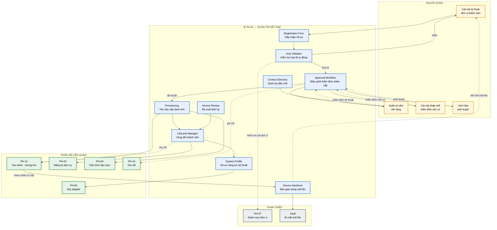
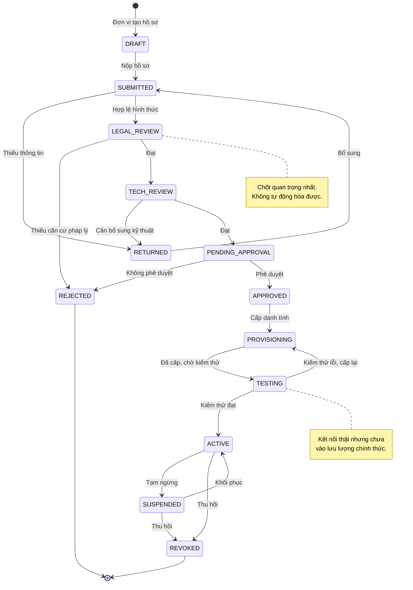
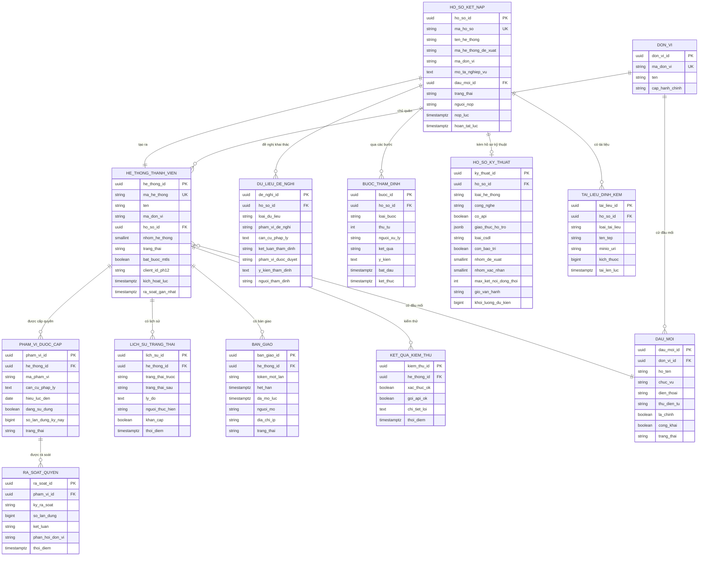

# SRS — PH-01: Quản trị Kết nạp & Định danh hệ thống

| Thuộc tính | Giá trị |
|---|---|
| **Mã phân hệ** | PH-01 |
| **Tên** | Quản trị Kết nạp & Định danh hệ thống (System Onboarding) |
| **Nhóm** | Control Plane |
| **Mức bắt buộc** | M — Bắt buộc |
| **Phiên bản** | 1.0 |
| **Ngày** | 03/8/2026 |
| **Công nghệ chủ đạo** | Quarkus + PostgreSQL + quy trình phê duyệt |

---

## M1. Giới thiệu

### 1.1. Mục đích

PH-01 là **cửa vào duy nhất** để một hệ thống thông tin trở thành thành viên của trục LGSP. Phân hệ này quản lý toàn bộ hành trình: từ lúc đơn vị nộp hồ sơ đăng ký, qua thẩm định căn cứ pháp lý, cấp danh tính kỹ thuật, tới khi kết nối hoạt động và cả khi cần thu hồi.

Điểm cốt lõi: đây là nơi **con người thẩm định** trước khi máy cấp quyền. Câu hỏi "đơn vị này có quyền khai thác dữ liệu này theo văn bản nào?" không tự động hóa được — và cũng không được phép tự động hóa.

### 1.2. Phạm vi

**PH-01 chịu trách nhiệm:**

| # | Trách nhiệm |
|---|---|
| 1 | Tiếp nhận và quản lý hồ sơ đăng ký kết nạp hệ thống thành viên |
| 2 | Kiểm tra tính hợp lệ hồ sơ tự động trước khi trình thẩm định |
| 3 | Điều phối quy trình thẩm định và phê duyệt nhiều cấp |
| 4 | Yêu cầu PH-12 cấp danh tính OAuth2 và chứng thư mTLS |
| 5 | Bàn giao thông tin kết nối an toàn qua kênh dùng một lần |
| 6 | Quản lý vòng đời thành viên: hoạt động, tạm ngừng, thu hồi |
| 7 | Quản lý hồ sơ năng lực kỹ thuật của từng hệ thống thành viên |
| 8 | Theo dõi cam kết dịch vụ và trách nhiệm hai bên |
| 9 | Rà soát định kỳ quyền truy cập đã cấp |
| 10 | Cung cấp danh bạ đầu mối kỹ thuật theo NĐ 47 |

**PH-01 KHÔNG chịu trách nhiệm:**

| # | Không làm | Thuộc phân hệ |
|---|---|---|
| 1 | Tạo và lưu trữ credential kỹ thuật — chỉ *yêu cầu* PH-12 tạo | PH-12 |
| 2 | Xây dựng adapter kết nối cho hệ thống | PH-05 |
| 3 | Công bố dịch vụ chia sẻ dữ liệu của hệ thống | PH-02 |
| 4 | Kiểm soát truy cập lúc chạy | PH-03, PH-12 |
| 5 | Cấu hình luồng tích hợp | PH-04 |

**Ranh giới số 1 — điểm quan trọng.** PH-01 quản lý **quy trình hành chính**; PH-12 quản lý **danh tính kỹ thuật**. Tách hai vai trò vì chúng có vòng đời khác nhau: hồ sơ kết nạp là sự kiện một lần, còn danh tính kỹ thuật tồn tại và thay đổi liên tục sau đó.

### 1.3. Tài liệu tham chiếu

| Mã | Tài liệu |
|---|---|
| [KT] | [Kiến trúc ứng dụng — Control Plane](../02-architecture/README.md#4-kiến-trúc-ứng-dụng--phân-rã-thành-phần) |
| [LT] | [F-01 Đăng ký và kết nạp HTTT thành viên](../03-flows/README.md#f-01--đăng-ký-và-kết-nạp-httt-thành-viên) |
| [PL] | [Ma trận CMP](../01-legal/README.md) — NĐ 47/2020 (đầu mối, nguyên tắc chia sẻ) |
| [KH] | [Kế hoạch triển khai Bước 1, Bước 10, Bước 18](../04-deployment/README.md) |
| [ADR] | [ADR-014 Tách Control/Data Plane](../05-adr/README.md#adr-014) |
| [SRS] | [PH-12 IAM](SRS-PH-12-iam.md), [PH-02 API & Catalog](SRS-PH-02-api-catalog.md), [PH-05 Adapter](SRS-PH-05-adapter.md) |

---

## M2. Mô tả tổng quan

### 2.1. Vị trí trong kiến trúc



**Thuyết minh sơ đồ.** Ba nhánh thẩm định song song từ khối `WORKFLOW` phản ánh thực tế: kết nạp một hệ thống cần ba loại đánh giá khác nhau, do ba vai trò khác nhau thực hiện.

| Loại thẩm định | Người thực hiện | Câu hỏi trả lời |
|---|---|---|
| **Pháp lý** | Cán bộ pháp chế | Đơn vị có quyền khai thác dữ liệu này theo văn bản nào? |
| **Kỹ thuật** | Quản trị viên nền tảng | Hệ thống đủ năng lực kết nối chưa? Cần adapter nhóm nào? |
| **Thẩm quyền** | Lãnh đạo | Có phê duyệt cho phép kết nạp không? |

Gộp ba loại vào một người sẽ dẫn tới đánh giá hời hợt ở khía cạnh không thuộc chuyên môn của họ.

**Điểm thiết kế: bàn giao dùng một lần.** Khối `HANDOVER` không gửi bí mật qua thư điện tử. Nó sinh một liên kết dùng một lần, hết hạn sau 24 giờ, cán bộ kỹ thuật mở để lấy thông tin. Sau khi mở, liên kết vô hiệu vĩnh viễn.

### 2.2. Trạng thái hồ sơ kết nạp



**Thuyết minh.** Trạng thái `TESTING` là bước đệm có chủ đích: hệ thống đã có credential thật, kết nối được, nhưng chưa nhận lưu lượng nghiệp vụ. Giai đoạn này cho phép phát hiện lỗi cấu hình mà không ảnh hưởng dịch vụ đang chạy — phù hợp với nguyên tắc "chạy song song" tại [Bước 10 kế hoạch triển khai](../04-deployment/README.md#bước-10--kết-nối-các-httt-thí-điểm).

### 2.3. Tác nhân

| Tác nhân | Loại | Tương tác |
|---|---|---|
| Cán bộ kỹ thuật đơn vị thành viên | Người | Nộp hồ sơ, nhận credential, kiểm thử kết nối |
| Lãnh đạo đơn vị đề nghị | Người | Ký xác nhận hồ sơ đăng ký |
| Cán bộ pháp chế | Người | Thẩm định căn cứ pháp lý khai thác dữ liệu |
| Quản trị viên nền tảng | Người | Thẩm định kỹ thuật, cấu hình hạn mức |
| Lãnh đạo phụ trách CNTT | Người | Phê duyệt kết nạp |
| Cán bộ ATTT | Người | Rà soát quyền định kỳ, xử lý thu hồi khẩn |
| PH-12 IAM | Hệ thống | Nhận yêu cầu tạo/thu hồi danh tính |
| PH-02, PH-03, PH-05 | Hệ thống | Nhận thông tin hệ thống đã kết nạp |

### 2.4. Giả định

| Mã | Giả định |
|---|---|
| GD-01 | Có văn bản chỉ đạo của lãnh đạo bộ/tỉnh yêu cầu các đơn vị kết nối vào trục |
| GD-02 | Mỗi đơn vị có ít nhất một cán bộ kỹ thuật đầu mối được chỉ định |
| GD-03 | Danh mục đơn vị hành chính từ PH-07 đầy đủ và cập nhật |
| GD-04 | Quy trình phê duyệt và thẩm quyền từng cấp đã được quy định bằng văn bản |
| GD-05 | Danh mục dữ liệu và mức độ mật đã xác định tại Bước 1 kế hoạch triển khai |

### 2.5. Ràng buộc

| Mã | Ràng buộc | Nguồn |
|---|---|---|
| RB-01 | Mỗi CQNN phải cử đầu mối phụ trách kết nối, chia sẻ dữ liệu | NĐ 47/2020 |
| RB-02 | Công khai số điện thoại, thư điện tử, họ tên, chức vụ đầu mối | NĐ 47/2020 |
| RB-03 | Chia sẻ dữ liệu giữa CQNN không thu phí | NĐ 47/2020 |
| RB-04 | Mọi khai thác dữ liệu phải có căn cứ pháp lý | NĐ 47/2020 |
| RB-05 | Nguyên tắc đặc quyền tối thiểu khi cấp phạm vi quyền | Nguyên tắc bảo mật |
| RB-06 | Không gửi bí mật qua kênh không an toàn | Nguyên tắc bảo mật |
| RB-07 | Toàn bộ công nghệ mã nguồn mở | Yêu cầu dự án |

### 2.6. Phụ thuộc phân hệ

| Phụ thuộc | Loại | Hành vi khi không khả dụng |
|---|---|---|
| PH-12 | **Cứng** khi cấp danh tính | Hồ sơ giữ trạng thái `APPROVED`, chờ; không mất tiến trình |
| Vault | **Cứng** khi bàn giao | Không sinh liên kết bàn giao; hồ sơ chờ |
| PH-07 | **Mềm** | Dùng danh mục đệm; cảnh báo nếu mã đơn vị không tra được |
| PH-13 | **Mềm** | Đệm bản ghi kiểm toán cục bộ |
| PH-02, PH-05 | **Mềm** | Kết nạp vẫn hoàn tất; các bước sau thực hiện độc lập |

---

## M3. Yêu cầu chức năng

### 3.1. Nhóm A — Tiếp nhận hồ sơ

#### FR-01-001 — Tạo hồ sơ đăng ký kết nạp · **M**

| Mục | Nội dung |
|---|---|
| **Mô tả** | Đơn vị thành viên khởi tạo hồ sơ đề nghị kết nối hệ thống vào trục |
| **Tác nhân** | Cán bộ kỹ thuật đơn vị thành viên |
| **Tiền điều kiện** | Người nộp có tài khoản trên nền tảng, thuộc một đơn vị hợp lệ |
| **Đầu vào** | Tên hệ thống · mã hệ thống đề xuất · đơn vị chủ quản · mô tả nghiệp vụ · người đầu mối kỹ thuật · thông tin kỹ thuật hệ thống · danh sách dữ liệu đề nghị khai thác · dữ liệu sẵn sàng chia sẻ · căn cứ pháp lý |
| **Xử lý** | 1. Sinh mã hồ sơ theo định dạng `HS-KN-{năm}-{số thứ tự}`<br>2. Lưu hồ sơ ở trạng thái `DRAFT`<br>3. Cho phép lưu tạm và tiếp tục sau<br>4. Đính kèm được văn bản đề nghị có chữ ký lãnh đạo đơn vị<br>5. Ghi sự kiện tạo hồ sơ |
| **Đầu ra** | Hồ sơ trạng thái `DRAFT` |
| **Ngoại lệ** | E1: Mã hệ thống đề xuất đã tồn tại → cảnh báo, đề nghị đổi<br>E2: Đơn vị chủ quản không có trong danh mục → `422`, hướng dẫn liên hệ quản trị<br>E3: Người nộp không thuộc đơn vị khai báo → cảnh báo, yêu cầu xác nhận |

#### FR-01-002 — Kiểm tra hợp lệ tự động · **M**

| Mục | Nội dung |
|---|---|
| **Mô tả** | Kiểm tra hồ sơ đủ điều kiện trước khi chuyển thẩm định — lọc bỏ hồ sơ thiếu sót sớm |
| **Tiền điều kiện** | Hồ sơ ở trạng thái `DRAFT`, người dùng bấm nộp |
| **Đầu vào** | Toàn bộ hồ sơ |
| **Xử lý** | Kiểm tra theo danh sách:<br>1. Đủ trường bắt buộc<br>2. Mã đơn vị tồn tại trong danh mục PH-07<br>3. Có văn bản đề nghị đính kèm<br>4. Người đầu mối có thư điện tử công vụ hợp lệ<br>5. Mỗi mục dữ liệu đề nghị khai thác **có căn cứ pháp lý** kèm theo<br>6. Thông tin kỹ thuật đủ để phân loại nhóm hệ thống<br>7. Không trùng hồ sơ đang xử lý cho cùng hệ thống |
| **Đầu ra** | Kết quả kiểm tra: đạt, hoặc danh sách thiếu sót |
| **Ngoại lệ** | E1: Thiếu trường → trả danh sách **đầy đủ** các thiếu sót, không dừng ở lỗi đầu<br>E2: Thiếu căn cứ pháp lý cho một mục dữ liệu → chỉ rõ mục nào<br>E3: Đã có hồ sơ đang xử lý cho hệ thống này → `409` kèm mã hồ sơ đó |

**Ghi chú về bước 5.** Đây là kiểm tra quan trọng nhất và cũng khác biệt với hệ thống thương mại: mỗi mục dữ liệu đề nghị khai thác phải viện dẫn văn bản cho phép. Không có căn cứ thì không được khai thác, dù về kỹ thuật hoàn toàn làm được (RB-04).

#### FR-01-003 — Khai báo hồ sơ năng lực kỹ thuật · **M**

| Mục | Nội dung |
|---|---|
| **Mô tả** | Thu thập thông tin kỹ thuật để xác định chiến lược kết nối |
| **Đầu vào** | Loại hệ thống · công nghệ · có API không · giao thức hỗ trợ · loại CSDL · tình trạng bảo trì · năng lực chịu tải · giờ vận hành |
| **Xử lý** | 1. Thu thập theo biểu mẫu có hướng dẫn<br>2. **Tự động đề xuất phân nhóm** (1–4) dựa trên câu trả lời<br>3. Quản trị viên xác nhận hoặc điều chỉnh nhóm khi thẩm định<br>4. Với nhóm 3 (di sản): thu thập thêm thông tin CSDL để cấu hình CDC<br>5. Ghi nhận số kết nối đồng thời tối đa hệ thống chịu được |
| **Đầu ra** | Hồ sơ năng lực kỹ thuật kèm đề xuất phân nhóm |
| **Ngoại lệ** | E1: Không đủ thông tin để phân nhóm → yêu cầu bổ sung hoặc đề nghị khảo sát trực tiếp<br>E2: Hệ thống thuộc nhóm 4 (sắp thay thế) → cảnh báo, đề nghị cân nhắc chờ hệ thống mới |

**Ghi chú.** Thông tin "số kết nối đồng thời tối đa" ở bước 5 sẽ được dùng để cấu hình nhóm kết nối tại PH-05 ([BR-05-009](SRS-PH-05-adapter.md#m8-quy-tắc-nghiệp-vụ)) — tránh việc LGSP mở rộng làm quá tải chính hệ thống đang tích hợp.

### 3.2. Nhóm B — Thẩm định và phê duyệt

#### FR-01-004 — Thẩm định căn cứ pháp lý · **M**

| Mục | Nội dung |
|---|---|
| **Mô tả** | Xác minh đơn vị có quyền khai thác từng loại dữ liệu đề nghị |
| **Tác nhân** | Cán bộ pháp chế |
| **Tiền điều kiện** | Hồ sơ ở trạng thái `LEGAL_REVIEW` |
| **Đầu vào** | Danh sách dữ liệu đề nghị · căn cứ pháp lý kèm theo |
| **Xử lý** | 1. Với **từng mục dữ liệu**, cán bộ đánh giá: căn cứ có hợp lệ không, phạm vi có tương xứng không<br>2. Ba kết luận cho mỗi mục: **chấp thuận** · **chấp thuận thu hẹp** · **từ chối**<br>3. Với "chấp thuận thu hẹp": ghi rõ phạm vi được duyệt<br>4. Ghi ý kiến thẩm định cho từng mục<br>5. Nếu toàn bộ bị từ chối → hồ sơ chuyển `REJECTED`<br>6. Nếu có ít nhất một mục được duyệt → chuyển `TECH_REVIEW` |
| **Đầu ra** | Danh sách dữ liệu được duyệt kèm phạm vi |
| **Ngoại lệ** | E1: Căn cứ không rõ ràng → trả hồ sơ yêu cầu bổ sung, nêu cụ thể cần gì<br>E2: Dữ liệu thuộc mức mật → **từ chối tuyệt đối**, ghi rõ lý do<br>E3: Cần ý kiến chuyên môn khác → chuyển tham vấn, tạm dừng đếm thời hạn |

**Ghi chú về bước 2 — "chấp thuận thu hẹp".** Lựa chọn này quan trọng trong thực tế: đơn vị thường đề nghị rộng hơn nhu cầu thật. Cán bộ pháp chế có thể duyệt một phần thay vì từ chối toàn bộ, vừa đáp ứng nhu cầu chính đáng vừa giữ nguyên tắc đặc quyền tối thiểu (RB-05).

#### FR-01-005 — Thẩm định kỹ thuật · **M**

| Mục | Nội dung |
|---|---|
| **Mô tả** | Đánh giá năng lực kết nối và xác định phương án kỹ thuật |
| **Tác nhân** | Quản trị viên nền tảng |
| **Đầu vào** | Hồ sơ năng lực kỹ thuật · danh sách dữ liệu đã được duyệt pháp lý |
| **Xử lý** | 1. Xác nhận hoặc điều chỉnh phân nhóm hệ thống<br>2. Xác định loại adapter cần xây (chuyển thông tin cho PH-05)<br>3. Đề xuất hạn mức truy cập ban đầu dựa trên khối lượng dự kiến<br>4. Đánh giá tác động tới hạn mức quốc gia nếu hệ thống khai thác CSDLQG<br>5. Xác định yêu cầu bảo mật: có bắt buộc mTLS không<br>6. Ước tính công sức tích hợp |
| **Đầu ra** | Phương án kỹ thuật kèm hạn mức đề xuất |
| **Ngoại lệ** | E1: Hệ thống không đủ năng lực kết nối → trả hồ sơ, nêu điều kiện cần đáp ứng<br>E2: Khối lượng dự kiến vượt hạn mức quốc gia còn lại → cảnh báo, đề nghị điều chỉnh hoặc xin nâng hạn mức<br>E3: Hệ thống nhóm 3 nhưng không cấp được quyền đọc nhật ký giao dịch → đề nghị phương án thay thế |

**Ghi chú về bước 4.** Đây là kiểm tra thường bị bỏ sót: hạn mức khai thác CSDLQG là tài nguyên chung của cả tỉnh ([FR-14-009](SRS-PH-14-national.md#m3-yêu-cầu-chức-năng)). Kết nạp một hệ thống có nhu cầu lớn mà không tính toán trước có thể làm cạn hạn mức, ảnh hưởng mọi hệ thống khác.

#### FR-01-006 — Phê duyệt kết nạp · **M**

| Mục | Nội dung |
|---|---|
| **Mô tả** | Quyết định cuối cùng cho phép hệ thống gia nhập trục |
| **Tác nhân** | Lãnh đạo phụ trách CNTT |
| **Tiền điều kiện** | Đã qua thẩm định pháp lý và kỹ thuật |
| **Đầu vào** | Hồ sơ đầy đủ · ý kiến hai cấp thẩm định |
| **Xử lý** | 1. Hiển thị tóm tắt: hệ thống, đơn vị, dữ liệu được duyệt, phương án kỹ thuật<br>2. Lãnh đạo phê duyệt hoặc từ chối, kèm ý kiến<br>3. Nếu phê duyệt → chuyển `APPROVED`, kích hoạt cấp danh tính<br>4. Ghi kiểm toán kèm người phê duyệt và thời điểm |
| **Đầu ra** | Quyết định phê duyệt |
| **Ngoại lệ** | E1: Từ chối → chuyển `REJECTED`, thông báo đơn vị kèm lý do<br>E2: Yêu cầu bổ sung → trả về cấp thẩm định tương ứng<br>E3: Quá thời hạn phê duyệt (mặc định 10 ngày làm việc) → nhắc tự động, leo thang sau 15 ngày |

#### FR-01-007 — Theo dõi tiến độ hồ sơ · **S**

| Mục | Nội dung |
|---|---|
| **Mô tả** | Cho đơn vị nộp biết hồ sơ đang ở đâu |
| **Xử lý** | 1. Hiển thị trạng thái hiện tại và các bước đã qua<br>2. Hiển thị thời gian đã ở mỗi bước<br>3. Thông báo tự động khi hồ sơ chuyển trạng thái<br>4. Với hồ sơ bị trả lại: nêu rõ cần bổ sung gì |
| **Đầu ra** | Tiến độ hồ sơ |
| **Ngoại lệ** | — |

**Ghi chú.** Minh bạch tiến độ giảm đáng kể số lượt hỏi thăm qua điện thoại — vấn đề thực tế khi triển khai với hàng chục đơn vị.

### 3.3. Nhóm C — Cấp danh tính và bàn giao

#### FR-01-008 — Yêu cầu cấp danh tính kỹ thuật · **M**

| Mục | Nội dung |
|---|---|
| **Mô tả** | Đề nghị PH-12 tạo client OAuth2 và chứng thư cho hệ thống |
| **Tiền điều kiện** | Hồ sơ ở trạng thái `APPROVED` |
| **Đầu vào** | Mã hệ thống · đơn vị · danh sách phạm vi quyền **đã được duyệt** · loại xác thực |
| **Xử lý** | 1. Chuyển danh sách dữ liệu được duyệt thành phạm vi quyền tương ứng<br>2. Gọi PH-12 tạo client với **đúng** phạm vi được duyệt, không rộng hơn (RB-05)<br>3. Nếu thẩm định yêu cầu mTLS → yêu cầu cấp chứng thư<br>4. Gọi PH-03 cấu hình hạn mức theo phương án kỹ thuật<br>5. Nhận tham chiếu bí mật từ PH-12<br>6. Chuyển hồ sơ sang `PROVISIONING` |
| **Đầu ra** | Danh tính đã cấp; tham chiếu bí mật |
| **Ngoại lệ** | E1: PH-12 không khả dụng → giữ `APPROVED`, hàng chờ, thử lại<br>E2: Mã hệ thống trùng ở PH-12 → cảnh báo, yêu cầu quản trị viên xử lý<br>E3: Phạm vi quyền yêu cầu chưa tồn tại → tạo mới hoặc báo lỗi cấu hình |

#### FR-01-009 — Bàn giao thông tin kết nối an toàn · **M**

| Mục | Nội dung |
|---|---|
| **Mô tả** | Chuyển credential cho đơn vị mà không gửi bí mật qua kênh không an toàn |
| **Đầu vào** | Tham chiếu bí mật · thông tin người đầu mối |
| **Xử lý** | 1. Sinh liên kết bàn giao **dùng một lần**, hiệu lực 24 giờ<br>2. Gửi liên kết tới thư điện tử công vụ của người đầu mối<br>3. Người đầu mối mở liên kết, xác thực bằng tài khoản của mình<br>4. Hiển thị: `clientId`, `clientSecret`, điểm cuối, hướng dẫn kết nối, chứng thư (nếu có)<br>5. Sau khi hiển thị → liên kết **vô hiệu vĩnh viễn**<br>6. Ghi vết thời điểm nhận bàn giao |
| **Đầu ra** | Thông tin kết nối đã bàn giao |
| **Ngoại lệ** | E1: Liên kết hết hạn chưa mở → cho phép sinh lại, ghi vết<br>E2: Người mở không phải đầu mối đã khai báo → từ chối, cảnh báo an ninh<br>E3: Đơn vị làm mất bí mật → dùng chức năng xoay bí mật, không sinh lại liên kết cũ |

**Ghi chú về bước 5.** Vô hiệu sau lần mở đầu tiên khiến bí mật không tồn tại ở dạng đọc lại được ở bất kỳ đâu. Nếu đơn vị làm mất, phải xoay bí mật mới — an toàn hơn là cho phép xem lại nhiều lần.

#### FR-01-010 — Kiểm thử kết nối trước khi kích hoạt · **M**

| Mục | Nội dung |
|---|---|
| **Mô tả** | Xác nhận hệ thống kết nối được trước khi vào lưu lượng chính thức |
| **Tiền điều kiện** | Hồ sơ ở trạng thái `TESTING` |
| **Xử lý** | 1. Đơn vị thực hiện gọi thử qua điểm cuối kiểm thử<br>2. Hệ thống ghi nhận: xác thực thành công chưa, gọi API được chưa<br>3. Hiển thị kết quả kiểm thử cho cả hai bên<br>4. Khi đạt đủ tiêu chí → cho phép chuyển `ACTIVE`<br>5. Quản trị viên xác nhận kích hoạt |
| **Đầu ra** | Kết quả kiểm thử; hệ thống chuyển `ACTIVE` |
| **Ngoại lệ** | E1: Kiểm thử thất bại → giữ `TESTING`, hiển thị lỗi cụ thể và hướng dẫn<br>E2: Quá 30 ngày chưa kiểm thử đạt → cảnh báo, xem xét thu hồi credential<br>E3: Xác thực lỗi liên tục → nghi vấn bí mật bị lộ hoặc cấu hình sai, đề nghị xoay bí mật |

### 3.4. Nhóm D — Quản lý vòng đời thành viên

#### FR-01-011 — Tạm ngừng và khôi phục · **M**

| Mục | Nội dung |
|---|---|
| **Mô tả** | Tạm dừng quyền truy cập mà không xóa danh tính |
| **Tác nhân** | Quản trị viên nền tảng, Cán bộ ATTT |
| **Đầu vào** | Mã hệ thống · lý do · thời hạn dự kiến |
| **Xử lý** | 1. Gọi PH-12 vô hiệu client tạm thời<br>2. Chuyển hồ sơ sang `SUSPENDED`<br>3. Thông báo đơn vị chủ quản kèm lý do<br>4. Giữ nguyên cấu hình để khôi phục nhanh<br>5. Khôi phục: kích hoạt lại client, chuyển `ACTIVE` |
| **Đầu ra** | Trạng thái đã cập nhật |
| **Ngoại lệ** | E1: Lý do bắt buộc nhập → từ chối nếu để trống<br>E2: Hệ thống thuộc nhóm thiết yếu → cảnh báo tác động trước khi thực hiện |

**Các lý do tạm ngừng thường gặp:**

| Lý do | Thường do ai đề nghị |
|---|---|
| Nghi vấn lộ bí mật | Cán bộ ATTT |
| Hệ thống gây quá tải trục | Quản trị viên nền tảng |
| Đơn vị đề nghị tạm dừng để nâng cấp | Đơn vị chủ quản |
| Hết hiệu lực căn cứ pháp lý | Cán bộ pháp chế |

#### FR-01-012 — Thu hồi kết nạp · **M**

| Mục | Nội dung |
|---|---|
| **Mô tả** | Chấm dứt vĩnh viễn tư cách thành viên |
| **Tác nhân** | Quản trị viên nền tảng (có phê duyệt), Cán bộ ATTT (khẩn cấp) |
| **Đầu vào** | Mã hệ thống · lý do · căn cứ |
| **Xử lý** | 1. Gọi PH-12 thu hồi client và toàn bộ token<br>2. Gọi PH-03 gỡ cấu hình định tuyến và hạn mức<br>3. Thông báo PH-02 ngừng dịch vụ hệ thống này công bố<br>4. Chuyển hồ sơ `REVOKED`, **giữ toàn bộ lịch sử**<br>5. Thông báo đơn vị chủ quản<br>6. Ghi kiểm toán chi tiết |
| **Đầu ra** | Tư cách thành viên đã chấm dứt |
| **Ngoại lệ** | E1: Hệ thống đang có dịch vụ được hệ thống khác phụ thuộc → cảnh báo, liệt kê, yêu cầu xác nhận<br>E2: Thu hồi khẩn cấp bởi ATTT → thực hiện ngay, bổ sung phê duyệt sau trong 24 giờ<br>E3: Còn giao dịch đang xử lý → chờ hoàn tất tối đa 5 phút rồi cắt |

**Ghi chú về E2 — thu hồi khẩn cấp.** Khi phát hiện lộ bí mật hoặc hệ thống bị xâm nhập, chờ quy trình phê duyệt đầy đủ là quá chậm. Cán bộ ATTT được quyền thu hồi ngay, nhưng phải bổ sung phê duyệt sau — cân bằng giữa tốc độ phản ứng và kiểm soát.

#### FR-01-013 — Rà soát quyền định kỳ · **M**

| Mục | Nội dung |
|---|---|
| **Mô tả** | Kiểm tra định kỳ xem quyền đã cấp còn cần thiết và hợp lệ không |
| **Tác nhân** | Cán bộ ATTT, Quản trị viên |
| **Xử lý** | 1. Chạy định kỳ (mặc định 6 tháng một lần)<br>2. Với mỗi hệ thống, tổng hợp: phạm vi quyền đang có, mức sử dụng thực tế từng phạm vi<br>3. Đánh dấu phạm vi **không sử dụng** trong kỳ rà soát<br>4. Gửi danh sách cho đơn vị chủ quản xác nhận còn cần hay không<br>5. Đơn vị không phản hồi trong 30 ngày → đề xuất thu hẹp phạm vi<br>6. Kiểm tra căn cứ pháp lý còn hiệu lực |
| **Đầu ra** | Báo cáo rà soát kèm đề xuất điều chỉnh |
| **Ngoại lệ** | E1: Căn cứ pháp lý hết hiệu lực → tạm ngừng phạm vi tương ứng, thông báo<br>E2: Phạm vi không dùng > 12 tháng → đề xuất thu hồi phạm vi đó |

**Ghi chú về giá trị thực tiễn.** Quyền cấp ra thường tích tụ mà không ai thu lại — sau vài năm một hệ thống có thể giữ nhiều quyền không còn dùng, làm tăng bề mặt tấn công. Rà soát định kỳ dựa trên **mức sử dụng thực tế** giúp phát hiện điều này khách quan.

#### FR-01-014 — Cập nhật hồ sơ thành viên · **S**

| Mục | Nội dung |
|---|---|
| **Mô tả** | Sửa thông tin hệ thống đã kết nạp |
| **Xử lý** | Phân loại thay đổi:<br>· **Không cần duyệt**: đổi người đầu mối, cập nhật mô tả<br>· **Cần duyệt kỹ thuật**: đổi điểm cuối, nâng hạn mức<br>· **Cần duyệt đầy đủ**: mở rộng phạm vi dữ liệu khai thác → quay lại quy trình thẩm định |
| **Đầu ra** | Hồ sơ cập nhật |
| **Ngoại lệ** | E1: Mở rộng phạm vi dữ liệu → bắt buộc qua thẩm định pháp lý lại |

#### FR-01-015 — Quản lý danh bạ đầu mối · **M**

| Mục | Nội dung |
|---|---|
| **Mô tả** | Duy trì và công khai danh bạ đầu mối kết nối, chia sẻ dữ liệu theo NĐ 47 |
| **Đầu vào** | Đơn vị · họ tên · chức vụ · số điện thoại · thư điện tử |
| **Xử lý** | 1. Mỗi đơn vị có ít nhất một đầu mối (RB-01)<br>2. Công khai thông tin đầu mối trong phạm vi CQNN (RB-02)<br>3. Nhắc cập nhật khi đầu mối chuyển công tác<br>4. Cung cấp API tra cứu cho các phân hệ khác |
| **Đầu ra** | Danh bạ đầu mối |
| **Ngoại lệ** | E1: Đơn vị không có đầu mối → cảnh báo tuân thủ, không cho kết nạp hệ thống mới<br>E2: Thư điện tử đầu mối không hoạt động → cảnh báo, đề nghị cập nhật |

### 3.5. Bảng tổng hợp yêu cầu chức năng

| Nhóm | Mã | Tên | Ưu tiên |
|---|---|---|:-:|
| A | FR-01-001 | Tạo hồ sơ đăng ký kết nạp | M |
| A | FR-01-002 | Kiểm tra hợp lệ tự động | M |
| A | FR-01-003 | Khai báo hồ sơ năng lực kỹ thuật | M |
| B | FR-01-004 | Thẩm định căn cứ pháp lý | M |
| B | FR-01-005 | Thẩm định kỹ thuật | M |
| B | FR-01-006 | Phê duyệt kết nạp | M |
| B | FR-01-007 | Theo dõi tiến độ hồ sơ | S |
| C | FR-01-008 | Yêu cầu cấp danh tính kỹ thuật | M |
| C | FR-01-009 | Bàn giao thông tin kết nối an toàn | M |
| C | FR-01-010 | Kiểm thử kết nối trước khi kích hoạt | M |
| D | FR-01-011 | Tạm ngừng và khôi phục | M |
| D | FR-01-012 | Thu hồi kết nạp | M |
| D | FR-01-013 | Rà soát quyền định kỳ | M |
| D | FR-01-014 | Cập nhật hồ sơ thành viên | S |
| D | FR-01-015 | Quản lý danh bạ đầu mối | M |

**Tổng: 15 yêu cầu chức năng** — 13 bắt buộc (M), 2 cần có (S).

---

## M4. Mô hình dữ liệu

### 4.1. Sơ đồ thực thể



### 4.2. Đặc tả thực thể

#### EN-01-01 — HO_SO_KET_NAP

| Trường | Kiểu | Bắt buộc | Ràng buộc | Mô tả |
|---|---|:-:|---|---|
| `ho_so_id` | UUID | ✓ | PK | |
| `ma_ho_so` | VARCHAR(40) | ✓ | UNIQUE, `HS-KN-{năm}-{số}` | Mã tra cứu cho đơn vị |
| `ten_he_thong` | VARCHAR(200) | ✓ | | |
| `ma_he_thong_de_xuat` | VARCHAR(80) | ✓ | `^[A-Z0-9-]+$` | Mã kỹ thuật đề xuất |
| `ma_don_vi` | VARCHAR(20) | ✓ | Tồn tại trong danh mục PH-07 | |
| `mo_ta_nghiep_vu` | TEXT | ✓ | | Để cán bộ thẩm định hiểu ngữ cảnh |
| `dau_moi_id` | UUID | ✓ | FK | Người nhận bàn giao credential |
| `trang_thai` | VARCHAR(24) | ✓ | Theo máy trạng thái mục 2.2 | |
| `nguoi_nop` | VARCHAR(100) | ✓ | | |

#### EN-01-02 — DU_LIEU_DE_NGHI

| Trường | Kiểu | Bắt buộc | Mô tả |
|---|---|:-:|---|
| `de_nghi_id` | UUID | ✓ | PK |
| `ho_so_id` | UUID | ✓ | FK |
| `loai_du_lieu` | VARCHAR(80) | ✓ | Loại dữ liệu đề nghị khai thác |
| `pham_vi_de_nghi` | VARCHAR(200) | ✓ | Phạm vi đơn vị đề nghị |
| `can_cu_phap_ly` | TEXT | ✓ | **Bắt buộc** — văn bản cho phép (RB-04) |
| `ket_luan_tham_dinh` | VARCHAR(24) | | ∈ {`CHAP_THUAN`,`THU_HEP`,`TU_CHOI`} |
| `pham_vi_duoc_duyet` | VARCHAR(200) | | Bắt buộc khi kết luận là `THU_HEP` |
| `y_kien_tham_dinh` | TEXT | | Bắt buộc khi `TU_CHOI` hoặc `THU_HEP` |

**Ghi chú.** Đây là bảng cốt lõi của phân hệ: mỗi dòng là một quyền khai thác cụ thể, có căn cứ pháp lý riêng và kết luận thẩm định riêng. Cấp quyền theo dòng thay vì theo hồ sơ cho phép "chấp thuận thu hẹp" (FR-01-004).

#### EN-01-03 — HO_SO_KY_THUAT

| Trường | Kiểu | Bắt buộc | Mô tả |
|---|---|:-:|---|
| `ky_thuat_id` | UUID | ✓ | PK |
| `ho_so_id` | UUID | ✓ | FK, UNIQUE |
| `co_api` | BOOLEAN | ✓ | Yếu tố chính xác định nhóm |
| `giao_thuc_ho_tro` | JSONB | ✓ | Danh sách giao thức |
| `loai_csdl` | VARCHAR(40) | | Cần cho nhóm 3 (CDC) |
| `con_bao_tri` | BOOLEAN | ✓ | Còn nhà thầu bảo trì không |
| `nhom_de_xuat` | SMALLINT | ✓ | 1–4, hệ thống tự đề xuất |
| `nhom_xac_nhan` | SMALLINT | | Quản trị viên xác nhận khi thẩm định |
| `max_ket_noi_dong_thoi` | INTEGER | ✓ | Dùng cấu hình nhóm kết nối tại PH-05 |
| `khoi_luong_du_kien` | BIGINT | ✓ | Lượt gọi/ngày dự kiến — đánh giá tác động hạn mức |

#### EN-01-04 — HE_THONG_THANH_VIEN

| Trường | Kiểu | Bắt buộc | Ràng buộc | Mô tả |
|---|---|:-:|---|---|
| `he_thong_id` | UUID | ✓ | PK | |
| `ma_he_thong` | VARCHAR(80) | ✓ | UNIQUE | Mã chính thức, dùng ở PH-12, PH-05 |
| `ma_don_vi` | VARCHAR(20) | ✓ | | |
| `ho_so_id` | UUID | ✓ | FK | Hồ sơ kết nạp gốc |
| `nhom_he_thong` | SMALLINT | ✓ | 1–4 | Quyết định chiến lược adapter |
| `trang_thai` | VARCHAR(20) | ✓ | ∈ {`TESTING`,`ACTIVE`,`SUSPENDED`,`REVOKED`} | |
| `client_id_ph12` | VARCHAR(80) | | | Tham chiếu tới danh tính ở PH-12 |
| `ra_soat_gan_nhat` | TIMESTAMPTZ | | | Cơ sở nhắc rà soát định kỳ |

#### EN-01-05 — BAN_GIAO

| Trường | Kiểu | Bắt buộc | Mô tả |
|---|---|:-:|---|
| `ban_giao_id` | UUID | ✓ | PK |
| `he_thong_id` | UUID | ✓ | FK |
| `token_mot_lan` | VARCHAR(120) | ✓ | Băm của token, **không lưu token gốc** |
| `het_han` | TIMESTAMPTZ | ✓ | Mặc định 24 giờ sau khi sinh |
| `da_mo_luc` | TIMESTAMPTZ | | Rỗng = chưa mở |
| `nguoi_mo` / `dia_chi_ip` | VARCHAR | | Ghi vết ai mở, từ đâu |
| `trang_thai` | VARCHAR(20) | ✓ | ∈ {`PENDING`,`OPENED`,`EXPIRED`,`REVOKED`} |

**Ràng buộc.** Sau khi `da_mo_luc` có giá trị, trạng thái chuyển `OPENED` và không mở lại được (FR-01-009 bước 5).

#### EN-01-06 — PHAM_VI_DUOC_CAP

| Trường | Kiểu | Bắt buộc | Mô tả |
|---|---|:-:|---|
| `pham_vi_id` | UUID | ✓ | PK |
| `he_thong_id` | UUID | ✓ | FK |
| `ma_pham_vi` | VARCHAR(80) | ✓ | Khớp phạm vi ở PH-12 |
| `can_cu_phap_ly` | TEXT | ✓ | **Bắt buộc** |
| `hieu_luc_den` | DATE | | Rỗng = không thời hạn |
| `dang_su_dung` | BOOLEAN | ✓ | Cập nhật từ số liệu thực tế |
| `so_lan_dung_ky_nay` | BIGINT | ✓ | Đầu vào cho rà soát định kỳ |

### 4.3. Chính sách lưu giữ

| Thực thể | Thời hạn | Ghi chú |
|---|---|---|
| HO_SO_KET_NAP, DU_LIEU_DE_NGHI, BUOC_THAM_DINH | **Vĩnh viễn** | Bằng chứng thẩm định và phê duyệt |
| TAI_LIEU_DINH_KEM | Vĩnh viễn | Lưu trên MinIO, mã hóa |
| HE_THONG_THANH_VIEN | Vĩnh viễn | Giữ cả hệ thống đã thu hồi |
| LICH_SU_TRANG_THAI | Vĩnh viễn | Truy vết mọi thay đổi |
| BAN_GIAO | 3 năm | Bằng chứng đã bàn giao credential |
| RA_SOAT_QUYEN | 5 năm | Bằng chứng tuân thủ rà soát |
| KET_QUA_KIEM_THU | 1 năm | |

---

## M5. Giao diện API

### 5.1. Nguyên tắc chung

| Khía cạnh | Quy định |
|---|---|
| Đường dẫn đơn vị nộp | `/api/v1/onboarding` |
| Đường dẫn thẩm định | `/api/admin/v1/onboarding` |
| Đường dẫn danh bạ | `/api/v1/directory` |
| Xác thực | Bearer JWT; thẩm định cần vai trò tương ứng |
| Mã lỗi | RFC 9457 Problem Details |

### 5.2. Điểm cuối cho đơn vị nộp hồ sơ

| Phương thức | Đường dẫn | Chức năng | FR |
|---|---|---|---|
| `POST` | `/api/v1/onboarding/applications` | Tạo hồ sơ | FR-01-001 |
| `PUT` | `/api/v1/onboarding/applications/{id}` | Cập nhật hồ sơ nháp | FR-01-001 |
| `POST` | `/api/v1/onboarding/applications/{id}/validate` | Kiểm tra hợp lệ (không nộp) | FR-01-002 |
| `POST` | `/api/v1/onboarding/applications/{id}/submit` | Nộp hồ sơ | FR-01-002 |
| `GET` | `/api/v1/onboarding/applications/{id}/status` | Tra tiến độ | FR-01-007 |
| `POST` | `/api/v1/onboarding/applications/{id}/attachments` | Tải tài liệu đính kèm | FR-01-001 |
| `GET` | `/api/v1/onboarding/handover/{token}` | Mở liên kết bàn giao | FR-01-009 |
| `POST` | `/api/v1/onboarding/systems/{code}/test` | Ghi nhận kiểm thử kết nối | FR-01-010 |

### 5.3. Điểm cuối thẩm định và quản trị

| Phương thức | Đường dẫn | Chức năng | FR |
|---|---|---|---|
| `GET` | `/api/admin/v1/onboarding/queue` | Hàng đợi hồ sơ chờ xử lý | FR-01-004…006 |
| `GET` | `/api/admin/v1/onboarding/applications/{id}` | Chi tiết hồ sơ | — |
| `POST` | `/api/admin/v1/onboarding/applications/{id}/legal-review` | Thẩm định pháp lý | FR-01-004 |
| `POST` | `/api/admin/v1/onboarding/applications/{id}/tech-review` | Thẩm định kỹ thuật | FR-01-005 |
| `POST` | `/api/admin/v1/onboarding/applications/{id}/approve` | Phê duyệt | FR-01-006 |
| `POST` | `/api/admin/v1/onboarding/applications/{id}/reject` | Từ chối | FR-01-006 |
| `POST` | `/api/admin/v1/onboarding/applications/{id}/return` | Trả bổ sung | FR-01-004, 005 |
| `POST` | `/api/admin/v1/onboarding/applications/{id}/provision` | Cấp danh tính | FR-01-008 |
| `POST` | `/api/admin/v1/onboarding/systems/{code}/activate` | Kích hoạt | FR-01-010 |
| `POST` | `/api/admin/v1/onboarding/systems/{code}/suspend` | Tạm ngừng | FR-01-011 |
| `POST` | `/api/admin/v1/onboarding/systems/{code}/resume` | Khôi phục | FR-01-011 |
| `POST` | `/api/admin/v1/onboarding/systems/{code}/revoke` | Thu hồi | FR-01-012 |
| `GET` | `/api/admin/v1/onboarding/systems` | Danh sách thành viên | — |
| `POST` | `/api/admin/v1/onboarding/access-review` | Kích hoạt rà soát quyền | FR-01-013 |
| `GET` | `/api/admin/v1/onboarding/access-review/{cycle}` | Kết quả rà soát | FR-01-013 |

### 5.4. Điểm cuối danh bạ

| Phương thức | Đường dẫn | Chức năng | FR |
|---|---|---|---|
| `GET` | `/api/v1/directory/contacts` | Danh bạ đầu mối (công khai trong CQNN) | FR-01-015 |
| `GET` | `/api/v1/directory/contacts/{maDonVi}` | Đầu mối của một đơn vị | FR-01-015 |
| `PUT` | `/api/admin/v1/directory/contacts/{id}` | Cập nhật đầu mối | FR-01-015 |

### 5.5. Đặc tả chi tiết điểm cuối chính

#### 5.5.1. `POST /api/v1/onboarding/applications/{id}/validate` — Kiểm tra hợp lệ

**Phản hồi khi hồ sơ thiếu sót `200 OK`:**

```json
{
  "hopLe": false,
  "soLoi": 3,
  "thieuSot": [
    {
      "muc": "canCuPhapLy",
      "viTri": "duLieuDeNghi[1]",
      "moTa": "Mục đề nghị khai thác 'Thông tin thửa đất' chưa có căn cứ pháp lý",
      "huongDan": "Bổ sung số và ngày văn bản cho phép đơn vị khai thác dữ liệu đất đai"
    },
    {
      "muc": "taiLieuDinhKem",
      "moTa": "Chưa đính kèm văn bản đề nghị có chữ ký lãnh đạo đơn vị",
      "huongDan": "Tải lên văn bản đề nghị theo mẫu tại phần Hướng dẫn"
    },
    {
      "muc": "hoSoKyThuat.maxKetNoiDongThoi",
      "moTa": "Chưa khai báo số kết nối đồng thời tối đa hệ thống chịu được",
      "huongDan": "Liên hệ đơn vị vận hành hệ thống để lấy thông số này"
    }
  ]
}
```

**Ghi chú thiết kế.** Mỗi thiếu sót có **hướng dẫn khắc phục cụ thể**, không chỉ báo lỗi. Cán bộ kỹ thuật đơn vị thường không quen thủ tục, cần biết chính xác phải làm gì và hỏi ai.

#### 5.5.2. `POST /api/admin/v1/onboarding/applications/{id}/legal-review` — Thẩm định pháp lý

**Yêu cầu:**

```json
{
  "ketLuanTungMuc": [
    {
      "deNghiId": "a1b2c3d4-...",
      "loaiDuLieu": "THONG_TIN_CONG_DAN",
      "ketLuan": "THU_HEP",
      "phamViDuocDuyet": "Chỉ tra cứu phục vụ giải quyết TTHC, không bao gồm thông tin sức khỏe",
      "yKien": "Căn cứ pháp lý hợp lệ nhưng phạm vi đề nghị rộng hơn nhu cầu nghiệp vụ thực tế"
    },
    {
      "deNghiId": "b2c3d4e5-...",
      "loaiDuLieu": "THONG_TIN_THUA_DAT",
      "ketLuan": "TU_CHOI",
      "yKien": "Chưa có văn bản cho phép đơn vị khai thác dữ liệu đất đai"
    }
  ],
  "yKienChung": "Đề nghị đơn vị bổ sung căn cứ cho mục dữ liệu đất đai nếu thực sự cần"
}
```

**Phản hồi `200 OK`:**

```json
{
  "maHoSo": "HS-KN-2026-0042",
  "trangThaiMoi": "TECH_REVIEW",
  "tomTat": { "chapThuan": 0, "thuHep": 1, "tuChoi": 1 },
  "phamViSeDuocCap": ["congdan.read"],
  "buocTiepTheo": "Chuyển thẩm định kỹ thuật"
}
```

#### 5.5.3. `GET /api/v1/onboarding/handover/{token}` — Mở liên kết bàn giao

**Phản hồi `200 OK`** (chỉ hiển thị được **một lần**):

```json
{
  "maHeThong": "HT-GIAODUC",
  "tenHeThong": "Hệ thống quản lý giáo dục",
  "thongTinKetNoi": {
    "clientId": "HT-GIAODUC",
    "clientSecret": "•••• hiển thị một lần ••••",
    "diemCuoi": "https://lgsp.tinh.gov.vn/api/v1",
    "diemCuoiToken": "https://lgsp.tinh.gov.vn/realms/lgsp/protocol/openid-connect/token",
    "phamViDuocCap": ["congdan.read"],
    "batBuocMtls": false,
    "hanMuc": { "gioiHan": 5000, "chuKy": "DAY" }
  },
  "canhBao": "Thông tin này chỉ hiển thị MỘT LẦN. Hãy lưu vào nơi an toàn ngay. Nếu làm mất, phải đề nghị xoay bí mật.",
  "huongDan": "https://lgsp.tinh.gov.vn/docs/huong-dan-ket-noi",
  "lienKetDaVoHieu": true
}
```

**Phản hồi khi liên kết đã dùng `410 Gone`:**

```json
{
  "type": "https://lgsp.local/errors/handover-already-opened",
  "title": "Liên kết bàn giao đã được sử dụng",
  "status": 410,
  "detail": "Liên kết này đã được mở lúc 03/8/2026 14:20. Mỗi liên kết chỉ dùng được một lần.",
  "huongDan": "Nếu chưa nhận được thông tin, liên hệ quản trị viên nền tảng để xoay bí mật và sinh liên kết mới."
}
```

---

## M6. Giao diện người dùng

### 6.1. Danh mục màn hình

| Mã | Tên màn hình | Đối tượng | Mockup |
|---|---|---|---|
| **UI-01-01** | Biểu mẫu đăng ký kết nạp | Cán bộ kỹ thuật đơn vị | [`onboarding.html`](../../mockup/pages/onboarding.html) |
| **UI-01-02** | Theo dõi tiến độ hồ sơ | Cán bộ kỹ thuật đơn vị | [`onboarding.html`](../../mockup/pages/onboarding.html) (tab Tiến độ) |
| **UI-01-03** | Hàng đợi thẩm định | Cán bộ pháp chế, Quản trị viên | [`onboarding.html`](../../mockup/pages/onboarding.html) (tab Hàng đợi) |
| **UI-01-04** | Màn thẩm định pháp lý | Cán bộ pháp chế | [`onboarding.html`](../../mockup/pages/onboarding.html) (tab Thẩm định) |
| **UI-01-05** | Danh sách hệ thống thành viên | Quản trị viên nền tảng | [`onboarding.html`](../../mockup/pages/onboarding.html) (tab Thành viên) |
| **UI-01-06** | Rà soát quyền định kỳ | Cán bộ ATTT | [`onboarding.html`](../../mockup/pages/onboarding.html) (tab Rà soát) |
| **UI-01-07** | Bàn giao thông tin kết nối | Cán bộ kỹ thuật đơn vị | Trang riêng, không nằm trong menu |

### 6.2. UI-01-01 — Biểu mẫu đăng ký kết nạp

**Mục đích.** Thu thập đủ thông tin cho ba loại thẩm định, đồng thời không làm nản lòng người nộp.

| Thành phần | Mô tả |
|---|---|
| Thanh bước | 4 bước: Thông tin chung → Năng lực kỹ thuật → Dữ liệu đề nghị → Xác nhận |
| Phần thông tin chung | Tên hệ thống · mã đề xuất · đơn vị · mô tả nghiệp vụ · người đầu mối |
| Phần năng lực kỹ thuật | Biểu mẫu có hướng dẫn, tự đề xuất phân nhóm khi điền xong |
| Bảng dữ liệu đề nghị | Mỗi dòng: loại dữ liệu · phạm vi · **căn cứ pháp lý** · nút xóa |
| Khu tải tài liệu | Kéo thả văn bản đề nghị, giới hạn định dạng |
| Nút kiểm tra | Chạy kiểm tra hợp lệ mà chưa nộp |
| Lưu tạm | Tự lưu nháp mỗi 30 giây |

**Quy tắc tương tác:**

| # | Quy tắc |
|---|---|
| 1 | Dòng dữ liệu đề nghị thiếu căn cứ pháp lý → tô đỏ, không cho nộp |
| 2 | Sau khi điền năng lực kỹ thuật → hiển thị nhóm được đề xuất kèm giải thích |
| 3 | Nhóm 4 (sắp thay thế) → hiện cảnh báo đề nghị cân nhắc chờ hệ thống mới |
| 4 | Nút Nộp chỉ bật khi kiểm tra hợp lệ đạt |
| 5 | Có mẫu văn bản đề nghị tải xuống được |

**Trạng thái màn hình:** nháp mới · đang điền · đã kiểm tra hợp lệ · đã nộp · bị trả lại (hiển thị rõ cần bổ sung gì).

### 6.3. UI-01-04 — Màn thẩm định pháp lý

**Mục đích.** Cho cán bộ pháp chế đánh giá **từng mục dữ liệu** thay vì phê duyệt cả gói.

| Thành phần | Mô tả |
|---|---|
| Tóm tắt hồ sơ | Hệ thống, đơn vị, mô tả nghiệp vụ — ngữ cảnh để đánh giá |
| Bảng dữ liệu đề nghị | Mỗi dòng có ba nút: Chấp thuận · Thu hẹp · Từ chối |
| Ô phạm vi được duyệt | Hiện khi chọn "Thu hẹp", bắt buộc nhập |
| Ô ý kiến | Bắt buộc khi Thu hẹp hoặc Từ chối |
| Xem tài liệu đính kèm | Mở văn bản đề nghị ngay trong màn hình |
| Tra cứu văn bản | Liên kết tới hệ thống văn bản pháp luật để kiểm chứng căn cứ |
| Chỉ báo tiến độ | Đã đánh giá bao nhiêu / tổng số mục |
| Nút hoàn tất | Chỉ bật khi đã đánh giá hết các mục |

**Quy tắc tương tác:**

| # | Quy tắc |
|---|---|
| 1 | Không cho hoàn tất khi còn mục chưa đánh giá |
| 2 | Chọn "Thu hẹp" hoặc "Từ chối" → bắt buộc nhập ý kiến |
| 3 | Toàn bộ mục bị từ chối → cảnh báo hồ sơ sẽ chuyển `REJECTED` |
| 4 | Dữ liệu mức mật → nút Chấp thuận bị vô hiệu kèm giải thích |
| 5 | Có nút "Trả bổ sung" kèm ô nêu rõ cần gì |

### 6.4. UI-01-05 — Danh sách hệ thống thành viên

| Thành phần | Mô tả |
|---|---|
| Thẻ tổng quan | Tổng thành viên · đang hoạt động · tạm ngừng · đang kiểm thử |
| Bộ lọc | Trạng thái · nhóm hệ thống · đơn vị · cần rà soát |
| Bảng danh sách | Mã · Tên · Đơn vị · Nhóm · Trạng thái · Phạm vi quyền · Lượt gọi 30 ngày · Rà soát gần nhất |
| Chỉ báo cảnh báo | Hệ thống quá hạn rà soát · chưa dùng quyền được cấp · kiểm thử quá lâu |
| Thao tác dòng | Xem · Tạm ngừng/Khôi phục · Thu hồi · Xoay bí mật |

**Quy tắc tương tác:**

| # | Quy tắc |
|---|---|
| 1 | Tạm ngừng và thu hồi đều yêu cầu nhập lý do bắt buộc |
| 2 | Thu hồi hiển thị cảnh báo nếu có hệ thống khác phụ thuộc dịch vụ của hệ thống này |
| 3 | Hệ thống quá hạn rà soát > 6 tháng → tô vàng |
| 4 | Hệ thống ở `TESTING` quá 30 ngày → tô đỏ, gợi ý liên hệ đơn vị |

### 6.5. UI-01-06 — Rà soát quyền định kỳ

**Mục đích.** Phát hiện quyền đã cấp nhưng không còn dùng hoặc không còn căn cứ.

| Thành phần | Mô tả |
|---|---|
| Chọn kỳ rà soát | Danh sách các kỳ đã chạy |
| Bảng phạm vi quyền | Hệ thống · Phạm vi · Số lần dùng trong kỳ · Căn cứ · Hiệu lực · Đề xuất |
| Nhãn cảnh báo | "Không dùng trong kỳ" · "Căn cứ hết hiệu lực" · "Đơn vị chưa phản hồi" |
| Thao tác hàng loạt | Chọn nhiều phạm vi để thu hồi cùng lúc |
| Gửi xác nhận | Gửi danh sách cho đơn vị chủ quản xác nhận còn cần hay không |
| Theo dõi phản hồi | Đơn vị nào đã phản hồi, đơn vị nào chưa |

**Quy tắc tương tác:**

| # | Quy tắc |
|---|---|
| 1 | Phạm vi không dùng > 12 tháng → tự động đánh dấu đề xuất thu hồi |
| 2 | Căn cứ pháp lý hết hiệu lực → hiển thị đỏ, đề xuất tạm ngừng ngay |
| 3 | Đơn vị không phản hồi sau 30 ngày → chuyển sang đề xuất thu hẹp |
| 4 | Thu hồi phạm vi yêu cầu xác nhận và ghi lý do |

---

## M7. Yêu cầu phi chức năng

### 7.1. Hiệu năng

| Mã | Yêu cầu | Chỉ tiêu | Cách đo |
|---|---|---|---|
| **NFR-01-001** | Độ trễ kiểm tra hợp lệ hồ sơ | P99 ≤ 2 giây | Đo tại API |
| **NFR-01-002** | Độ trễ tải danh sách thành viên | P99 ≤ 1 giây với 500 hệ thống | — |
| **NFR-01-003** | Thời gian cấp danh tính sau phê duyệt | ≤ 5 phút (tự động) | Từ phê duyệt tới sinh liên kết bàn giao |
| **NFR-01-004** | Tải tài liệu đính kèm | Hỗ trợ tệp đến 20MB | — |

**Ghi chú.** PH-01 không nằm trên đường dữ liệu nên yêu cầu hiệu năng thấp hơn nhiều so với PH-03, PH-04 — đây là phân hệ Control Plane theo [ADR-014](../05-adr/README.md#adr-014).

### 7.2. Tính sẵn sàng

| Mã | Yêu cầu | Chỉ tiêu |
|---|---|---|
| **NFR-01-005** | Tỷ lệ sẵn sàng | ≥ 99,5% giờ hành chính |
| **NFR-01-006** | Sự cố PH-01 | **Không ảnh hưởng** luồng dữ liệu của thành viên đang hoạt động |
| **NFR-01-007** | Số replica tối thiểu | 2 |
| **NFR-01-008** | Khôi phục dữ liệu | RPO ≤ 1 giờ · RTO ≤ 4 giờ |

**Ghi chú về NFR-01-006.** Đây là hệ quả trực tiếp của việc tách Control Plane: PH-01 sập thì không kết nạp được hệ thống mới, nhưng các hệ thống đã kết nạp vẫn hoạt động bình thường vì credential đã ở PH-12 và cấu hình đã ở PH-03.

### 7.3. Bảo mật

| Mã | Yêu cầu |
|---|---|
| **NFR-01-009** | Không lưu bí mật client trong CSDL PH-01 — chỉ tham chiếu Vault |
| **NFR-01-010** | Liên kết bàn giao dùng một lần, hết hạn 24 giờ, lưu dạng băm |
| **NFR-01-011** | Không gửi bí mật qua thư điện tử (RB-06) |
| **NFR-01-012** | Tài liệu đính kèm mã hóa khi lưu trên MinIO |
| **NFR-01-013** | Thao tác thu hồi và tạm ngừng yêu cầu xác thực lại MFA |
| **NFR-01-014** | Mọi quyết định thẩm định, phê duyệt được ghi kiểm toán vĩnh viễn |

### 7.4. Khả năng sử dụng

| Mã | Yêu cầu |
|---|---|
| **NFR-01-015** | Biểu mẫu đăng ký hoàn thành được trong ≤ 30 phút với người lần đầu |
| **NFR-01-016** | Mọi thông báo lỗi kèm hướng dẫn khắc phục cụ thể |
| **NFR-01-017** | Hồ sơ nháp tự lưu, không mất khi mất kết nối |
| **NFR-01-018** | Có mẫu văn bản và tài liệu hướng dẫn tải xuống được |

**Ghi chú về NFR-01-015.** Chỉ tiêu này quan trọng hơn vẻ ngoài: nếu biểu mẫu quá phức tạp, các đơn vị sẽ trì hoãn kết nạp, ảnh hưởng trực tiếp tới tiến độ [Bước 18 mở rộng diện kết nối](../04-deployment/README.md#bước-18--mở-rộng-diện-kết-nối).

### 7.5. Khả năng quan sát

| Mã | Yêu cầu |
|---|---|
| **NFR-01-019** | Phát chỉ số: `onboarding_applications_total{status}`, `onboarding_duration_days{stage}`, `onboarding_members_total{status,group}`, `onboarding_scope_unused_total`, `onboarding_review_overdue_total` |
| **NFR-01-020** | Cảnh báo khi hồ sơ chờ thẩm định > 10 ngày làm việc |
| **NFR-01-021** | Cảnh báo khi hệ thống ở `TESTING` > 30 ngày |
| **NFR-01-022** | Cảnh báo khi hệ thống quá hạn rà soát quyền > 6 tháng |

---

## M8. Quy tắc nghiệp vụ

| Mã | Quy tắc | Lý do | Cách thực thi | Khi vi phạm |
|---|---|---|---|---|
| **BR-01-001** | Mỗi mục dữ liệu đề nghị khai thác phải có căn cứ pháp lý | RB-04, NĐ 47 | FR-01-002 bước 5 | Không cho nộp hồ sơ |
| **BR-01-002** | Thẩm định pháp lý là bắt buộc, không tự động hóa | Đánh giá thẩm quyền cần con người | Quy trình FR-01-004 | Lỗi thiết kế |
| **BR-01-003** | Cấp phạm vi quyền đúng bằng phạm vi được duyệt, không rộng hơn | Đặc quyền tối thiểu (RB-05) | FR-01-008 bước 2 | Từ chối cấp |
| **BR-01-004** | Dữ liệu mức mật bị từ chối tuyệt đối | CMP-23 | FR-01-004 E2 | Từ chối |
| **BR-01-005** | Không gửi bí mật qua thư điện tử | RB-06 | Bàn giao qua liên kết một lần | Lỗi thiết kế |
| **BR-01-006** | Liên kết bàn giao chỉ mở được một lần | Bí mật không tồn tại ở dạng đọc lại được | FR-01-009 bước 5 | — |
| **BR-01-007** | Không lưu bí mật client trong CSDL PH-01 | Giảm điểm rò rỉ | NFR-01-009 | Lỗi thiết kế |
| **BR-01-008** | Hệ thống phải qua `TESTING` trước khi `ACTIVE` | Phát hiện lỗi cấu hình trước khi vào lưu lượng thật | Máy trạng thái | Chặn kích hoạt |
| **BR-01-009** | Tạm ngừng và thu hồi bắt buộc nhập lý do | Truy vết và giải trình | Trường bắt buộc | Từ chối thao tác |
| **BR-01-010** | Thu hồi khẩn cấp được thực hiện ngay, bổ sung phê duyệt trong 24 giờ | Tốc độ phản ứng khi có sự cố an ninh | FR-01-012 E2 | — |
| **BR-01-011** | Giữ toàn bộ hồ sơ và lịch sử kể cả sau khi thu hồi | Bằng chứng thẩm định, phục vụ thanh tra | Chính sách lưu giữ | Mất bằng chứng |
| **BR-01-012** | Mở rộng phạm vi dữ liệu phải qua thẩm định pháp lý lại | Không cho phép mở rộng quyền lén lút | FR-01-014 E1 | Từ chối |
| **BR-01-013** | Mỗi đơn vị phải có ít nhất một đầu mối | RB-01, NĐ 47 | FR-01-015 E1 | Không cho kết nạp hệ thống mới |
| **BR-01-014** | Rà soát quyền định kỳ tối thiểu 6 tháng một lần | Ngăn tích tụ quyền không dùng | FR-01-013 | Cảnh báo tuân thủ |
| **BR-01-015** | Căn cứ pháp lý hết hiệu lực → tạm ngừng phạm vi tương ứng | Không khai thác dữ liệu khi hết cơ sở | FR-01-013 E1 | Tạm ngừng tự động |
| **BR-01-016** | Đánh giá tác động hạn mức quốc gia khi thẩm định kỹ thuật | Hạn mức là tài nguyên chung của cả tỉnh | FR-01-005 bước 4 | Rủi ro cạn hạn mức |

---

## M9. Tuân thủ

### 9.1. Ánh xạ yêu cầu pháp lý

| Mã CMP | Yêu cầu | FR/NFR đáp ứng | Cách kiểm chứng |
|---|---|---|---|
| **CMP-01** | Mọi chia sẻ dữ liệu qua dịch vụ chia sẻ, không điểm-điểm | FR-01-008, 010 | Chỉ hệ thống đã kết nạp mới có credential gọi trục |
| **CMP-28** | Ghi vết truy cập dữ liệu | NFR-01-014 | Mọi quyết định thẩm định có kiểm toán |
| **CMP-23** | Không chia sẻ dữ liệu mật | FR-01-004 E2; BR-01-004 | Thử đề nghị khai thác dữ liệu mật → phải bị từ chối |
| — | Đầu mối kết nối, chia sẻ dữ liệu (NĐ 47) | FR-01-015; BR-01-013 | Danh bạ đầy đủ, công khai trong CQNN |
| — | Căn cứ pháp lý cho khai thác (NĐ 47) | FR-01-002 bước 5; BR-01-001 | Không hồ sơ nào được duyệt mà thiếu căn cứ |

### 9.2. Ánh xạ nguyên tắc TTQGS

| Nguyên tắc | Cách PH-01 đáp ứng |
|---|---|
| **Security by Design** | Đặc quyền tối thiểu, bàn giao một lần, rà soát định kỳ, MFA cho thao tác nhạy cảm |
| **Quản trị dựa trên kết quả** | Rà soát quyền dựa trên **mức sử dụng thực tế**, không dựa cảm tính |
| **API First** | Toàn bộ quy trình có API; đơn vị tích hợp được vào hệ thống của mình |
| **Modular Design** | Tách quy trình hành chính (PH-01) khỏi danh tính kỹ thuật (PH-12) |

---

## M10. Kiểm thử chấp nhận

### 10.1. Kiểm thử chức năng

| Mã | Kịch bản | Dữ liệu thử | Kết quả mong đợi | Tiêu chí đạt |
|---|---|---|---|---|
| **AT-01-001** | Nộp hồ sơ đầy đủ | Hồ sơ có đủ căn cứ pháp lý | Chuyển `LEGAL_REVIEW` | FR-01-002 |
| **AT-01-002** | Chặn hồ sơ thiếu căn cứ pháp lý | Một mục dữ liệu không có căn cứ | Không cho nộp, chỉ rõ mục nào | BR-01-001 |
| **AT-01-003** | Liệt kê đầy đủ thiếu sót | Hồ sơ có 3 lỗi | Trả **đủ 3 lỗi** kèm hướng dẫn | FR-01-002 E1 |
| **AT-01-004** | Tự đề xuất phân nhóm | Hệ thống không API, còn CSDL Oracle | Đề xuất nhóm 3 | FR-01-003 |
| **AT-01-005** | Thẩm định thu hẹp phạm vi | Duyệt 1 mục thu hẹp, từ chối 1 mục | Chỉ cấp phạm vi được duyệt | FR-01-004 |
| **AT-01-006** | Từ chối dữ liệu mật | Đề nghị khai thác dữ liệu mức `MAT` | Nút Chấp thuận vô hiệu; từ chối | BR-01-004 |
| **AT-01-007** | Chặn hoàn tất khi còn mục chưa đánh giá | Đánh giá 2/3 mục | Không cho hoàn tất thẩm định | UI-01-04 quy tắc 1 |
| **AT-01-008** | Cảnh báo tác động hạn mức quốc gia | Khối lượng dự kiến vượt hạn mức còn lại | Cảnh báo khi thẩm định kỹ thuật | BR-01-016 |
| **AT-01-009** | Cấp danh tính đúng phạm vi được duyệt | Duyệt 1 phạm vi, đề nghị 3 | PH-12 tạo client chỉ với 1 phạm vi | BR-01-003 |
| **AT-01-010** | Bàn giao dùng một lần | Mở liên kết bàn giao | Hiển thị credential, liên kết vô hiệu | BR-01-006 |
| **AT-01-011** | Chặn mở liên kết lần hai | Mở lại liên kết đã dùng | `410 Gone` kèm hướng dẫn | FR-01-009 bước 5 |
| **AT-01-012** | Chặn người không phải đầu mối mở | Người khác mở liên kết | Từ chối, cảnh báo an ninh | FR-01-009 E2 |
| **AT-01-013** | Liên kết hết hạn sinh lại được | Liên kết quá 24 giờ | Cho sinh lại, ghi vết | FR-01-009 E1 |
| **AT-01-014** | Không lưu bí mật trong CSDL PH-01 | Truy vấn trực tiếp CSDL | Chỉ thấy tham chiếu Vault | BR-01-007 |
| **AT-01-015** | Phải qua kiểm thử mới kích hoạt | Kích hoạt hệ thống chưa kiểm thử | Chặn | BR-01-008 |
| **AT-01-016** | Tạm ngừng cần lý do | Tạm ngừng không nhập lý do | Từ chối | BR-01-009 |
| **AT-01-017** | Thu hồi cảnh báo phụ thuộc | Thu hồi hệ thống có dịch vụ đang được dùng | Cảnh báo, liệt kê, yêu cầu xác nhận | FR-01-012 E1 |
| **AT-01-018** | Thu hồi khẩn cấp bởi ATTT | Cán bộ ATTT thu hồi ngay | Thực hiện ngay, tạo yêu cầu phê duyệt sau | BR-01-010 |
| **AT-01-019** | Rà soát phát hiện quyền không dùng | Phạm vi 0 lượt dùng trong kỳ | Đánh dấu, đề xuất thu hồi | FR-01-013 |
| **AT-01-020** | Căn cứ hết hiệu lực tạm ngừng phạm vi | Căn cứ hết hạn | Tạm ngừng phạm vi tương ứng, thông báo | BR-01-015 |
| **AT-01-021** | Mở rộng phạm vi cần thẩm định lại | Đề nghị thêm loại dữ liệu mới | Quay lại quy trình thẩm định pháp lý | BR-01-012 |
| **AT-01-022** | Đơn vị không có đầu mối không kết nạp được | Đơn vị chưa cử đầu mối | Chặn nộp hồ sơ, hướng dẫn | BR-01-013 |
| **AT-01-023** | Giữ lịch sử sau thu hồi | Thu hồi một hệ thống | Hồ sơ, thẩm định, lịch sử vẫn tra được | BR-01-011 |
| **AT-01-024** | Danh bạ đầu mối công khai | Tra danh bạ | Trả đủ họ tên, chức vụ, điện thoại, thư điện tử | RB-02 |

### 10.2. Kiểm thử phi chức năng

| Mã | Kịch bản | Tiêu chí đạt |
|---|---|---|
| **AT-01-025** | PH-01 sự cố | Hệ thống thành viên đang hoạt động **không bị ảnh hưởng** (NFR-01-006) |
| **AT-01-026** | Thời gian cấp danh tính | ≤ 5 phút từ phê duyệt tới sinh liên kết bàn giao |
| **AT-01-027** | Tải danh sách 500 thành viên | P99 ≤ 1 giây |
| **AT-01-028** | Thời gian hoàn thành biểu mẫu | Người lần đầu hoàn thành ≤ 30 phút (kiểm thử với người dùng thật) |
| **AT-01-029** | Hồ sơ nháp không mất khi mất kết nối | Ngắt mạng giữa lúc điền → khôi phục được |
| **AT-01-030** | Tài liệu đính kèm mã hóa | Kiểm tra tệp trên MinIO đã mã hóa |
| **AT-01-031** | MFA cho thao tác thu hồi | Thu hồi yêu cầu xác thực lại |
| **AT-01-032** | Kiểm toán vĩnh viễn | Truy được mọi quyết định thẩm định từ 1 năm trước |

### 10.3. Điều kiện nghiệm thu phân hệ

| # | Điều kiện |
|---|---|
| 1 | 13/13 yêu cầu mức **M** được cài đặt và kiểm chứng |
| 2 | 32/32 kịch bản kiểm thử chấp nhận đạt |
| 3 | Toàn bộ chỉ tiêu phi chức năng đạt ngưỡng |
| 4 | 5/5 mục tuân thủ tại M9 có bằng chứng được chấp nhận |
| 5 | **Kết nạp thành công ít nhất một hệ thống thật** đi trọn quy trình |
| 6 | Danh bạ đầu mối đầy đủ cho mọi đơn vị trong bộ/tỉnh |
| 7 | Quy trình thẩm định và thẩm quyền phê duyệt đã được ban hành bằng văn bản |
| 8 | Mẫu văn bản đề nghị và tài liệu hướng dẫn đã công bố |
| 9 | Cán bộ pháp chế đã được hướng dẫn sử dụng màn thẩm định |

---

## Liên kết

- Danh mục phân hệ → [README.md](README.md)
- Luồng nghiệp vụ → [F-01 Đăng ký và kết nạp HTTT thành viên](../03-flows/README.md#f-01--đăng-ký-và-kết-nạp-httt-thành-viên)
- Kế hoạch triển khai → [Bước 1 khảo sát](../04-deployment/README.md#bước-1--khảo-sát-hiện-trạng-và-lập-danh-mục-tích-hợp), [Bước 10 kết nối thí điểm](../04-deployment/README.md#bước-10--kết-nối-các-httt-thí-điểm), [Bước 18 mở rộng](../04-deployment/README.md#bước-18--mở-rộng-diện-kết-nối)
- Phân hệ liên quan → [PH-12 IAM](SRS-PH-12-iam.md), [PH-02 API & Catalog](SRS-PH-02-api-catalog.md), [PH-05 Adapter](SRS-PH-05-adapter.md), [PH-14 Kết nối quốc gia](SRS-PH-14-national.md)
- Quyết định công nghệ → [ADR-014 Tách Control/Data Plane](../05-adr/README.md#adr-014)
