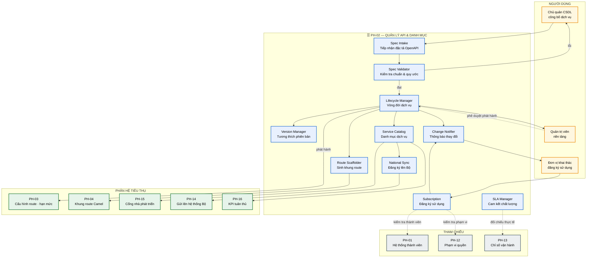
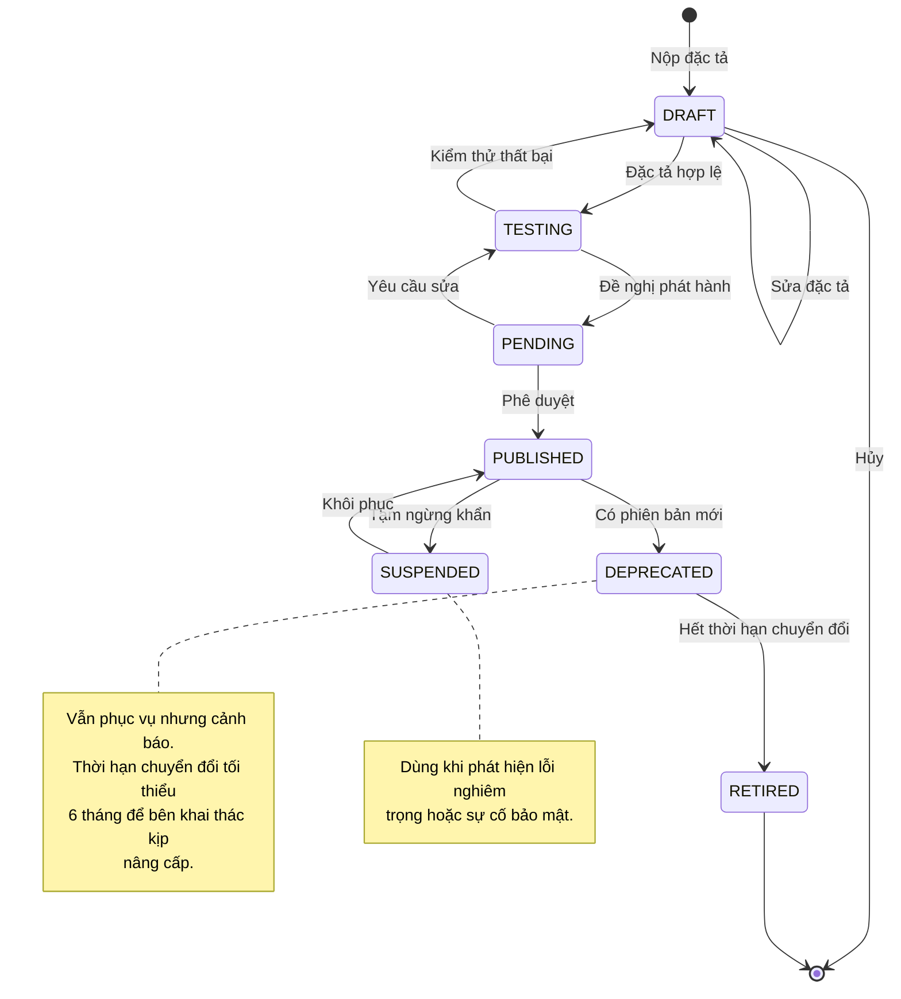
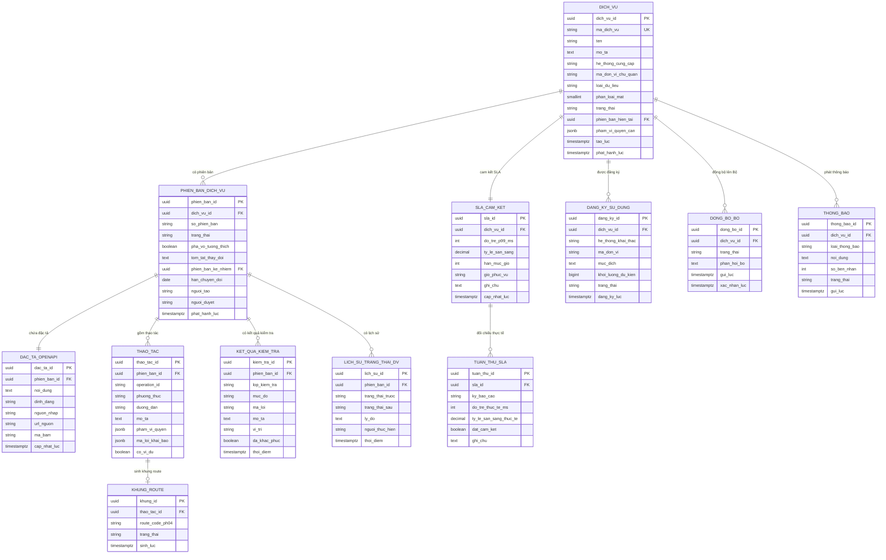

# SRS — PH-02: Quản lý API & Danh mục dịch vụ

| Thuộc tính | Giá trị |
|---|---|
| **Mã phân hệ** | PH-02 |
| **Tên** | Quản lý API & Danh mục dịch vụ (API Management & Service Catalog) |
| **Nhóm** | Control Plane |
| **Mức bắt buộc** | M — Bắt buộc |
| **Phiên bản** | 1.0 |
| **Ngày** | 03/8/2026 |
| **Công nghệ chủ đạo** | Quarkus + PostgreSQL + OpenAPI 3.1 toolchain |

---

## M1. Giới thiệu

### 1.1. Mục đích

PH-02 quản lý **hợp đồng** giữa bên cung cấp và bên khai thác dữ liệu. Mỗi dịch vụ chia sẻ dữ liệu trên trục có một đặc tả OpenAPI công bố công khai; PH-02 giữ đặc tả đó, điều phối vòng đời từ bản nháp tới khi ngừng dùng, và đăng ký danh mục lên hệ thống trung ương.

Đây là phân hệ đáp ứng trực tiếp ba nghĩa vụ tại NĐ 47/2020:

| Điều | Nghĩa vụ | Đáp ứng |
|---|---|---|
| Điều 24 | Chủ quản CSDL **thiết lập và công bố** dịch vụ chia sẻ dữ liệu kèm tài liệu kỹ thuật | CMP-02 |
| Điều 25 | **Công khai** thông tin về dịch vụ chia sẻ dữ liệu | CMP-02 |
| Điều 26 | Đăng ký lên **Hệ thống quản lý dịch vụ chia sẻ dữ liệu** của Bộ | CMP-03 |

### 1.2. Phạm vi

**PH-02 chịu trách nhiệm:**

| # | Trách nhiệm |
|---|---|
| 1 | Tiếp nhận và kiểm tra đặc tả OpenAPI 3.1 của dịch vụ |
| 2 | Điều phối vòng đời dịch vụ: nháp → thử nghiệm → phát hành → ngừng dùng |
| 3 | Quản lý phiên bản API và kiểm tra tương thích khi nâng phiên bản |
| 4 | Sinh khung route Camel từ đặc tả cho PH-04 |
| 5 | Đẩy cấu hình định tuyến và hạn mức xuống PH-03 |
| 6 | Duy trì danh mục dịch vụ tra cứu được trong phạm vi CQNN |
| 7 | Đồng bộ danh mục lên hệ thống của Bộ qua PH-14 |
| 8 | Quản lý cam kết chất lượng dịch vụ (SLA) và theo dõi tuân thủ |
| 9 | Quản lý đăng ký sử dụng dịch vụ giữa các hệ thống thành viên |
| 10 | Thông báo thay đổi và ngừng dùng cho bên khai thác |

**PH-02 KHÔNG chịu trách nhiệm:**

| # | Không làm | Thuộc phân hệ |
|---|---|---|
| 1 | Thực thi định tuyến và hạn mức lúc chạy | PH-03 |
| 2 | Xử lý bản tin, chuyển đổi dữ liệu | PH-04 |
| 3 | Kết nạp hệ thống thành viên | PH-01 |
| 4 | Cấp danh tính và phạm vi quyền | PH-12 |
| 5 | Hiển thị tài liệu cho lập trình viên | PH-15 |
| 6 | Đo lường và báo cáo chỉ số vận hành | PH-13 |

**Ranh giới số 5 — phân vai với PH-15.** PH-02 là **nguồn dữ liệu** về dịch vụ (đặc tả, trạng thái, SLA); PH-15 là **giao diện trình bày** cho lập trình viên. Tách hai vai trò cho phép thay đổi cách trình bày mà không đụng tới dữ liệu gốc, và ngược lại.

### 1.3. Tài liệu tham chiếu

| Mã | Tài liệu |
|---|---|
| [KT] | [Kiến trúc ứng dụng — Control Plane](../02-architecture/README.md#4-kiến-trúc-ứng-dụng--phân-rã-thành-phần) |
| [LT] | [F-02 Công bố và đăng ký dịch vụ chia sẻ dữ liệu](../03-flows/README.md#f-02--công-bố-và-đăng-ký-dịch-vụ-chia-sẻ-dữ-liệu) |
| [PL] | [Ma trận CMP](../01-legal/README.md) — NĐ 47/2020 Điều 24, 25, 26 |
| [ADR] | [ADR-014 Tách Control/Data Plane](../05-adr/README.md#adr-014), [ADR-003 APISIX](../05-adr/README.md#adr-003) |
| [SRS] | [PH-01](SRS-PH-01-onboarding.md), [PH-03](SRS-PH-03-gateway.md), [PH-04](SRS-PH-04-integration-core.md), [PH-14](SRS-PH-14-national.md) |

---

## M2. Mô tả tổng quan

### 2.1. Vị trí trong kiến trúc



**Thuyết minh sơ đồ.** PH-02 là **nguồn phát cấu hình** cho ba phân hệ Data Plane: PH-03 nhận cấu hình định tuyến và hạn mức, PH-04 nhận khung route, PH-15 nhận dữ liệu hiển thị. Đây là hiện thực [ADR-014](../05-adr/README.md#adr-014): PH-02 định nghĩa "cái gì được phép", Data Plane thực thi.

Hệ quả về tính sẵn sàng: PH-02 sập thì không phát hành được dịch vụ mới, nhưng dịch vụ đang chạy **không bị ảnh hưởng** vì cấu hình đã ở etcd và Camel.

**Khối `SCAFFOLD` — điểm thiết kế đáng chú ý.** PH-02 không sinh mã hoàn chỉnh mà sinh **khung route theo template chuẩn chín bước** của PH-04. Chủ quản chỉ điền phần logic riêng. Cách này bảo đảm mọi dịch vụ đều có kiểm tra quyền, ghi vết, xử lý lỗi — không thể "quên" ([BR-04-001](SRS-PH-04-integration-core.md#m8-quy-tắc-nghiệp-vụ)).

### 2.2. Vòng đời dịch vụ



**Thuyết minh về `DEPRECATED`.** Đây là trạng thái quan trọng nhất về mặt vận hành. Ngừng một API đang được nhiều hệ thống dùng mà không báo trước sẽ gây gián đoạn dây chuyền. Thời hạn chuyển đổi tối thiểu 6 tháng cho bên khai thác thời gian nâng cấp, đồng thời hệ thống chủ động cảnh báo mỗi lần gọi API đã lỗi thời.

### 2.3. Tác nhân

| Tác nhân | Loại | Tương tác |
|---|---|---|
| Chủ quản CSDL | Người | Công bố dịch vụ, cập nhật đặc tả, quản lý phiên bản |
| Quản trị viên nền tảng | Người | Phê duyệt phát hành, rà soát SLA |
| Đơn vị khai thác | Người/Hệ thống | Tra cứu danh mục, đăng ký sử dụng dịch vụ |
| Cán bộ phát triển tích hợp | Người | Hoàn thiện route từ khung sinh tự động |
| PH-03, PH-04, PH-15 | Hệ thống | Nhận cấu hình và dữ liệu từ PH-02 |
| PH-14 | Hệ thống | Chuyển tiếp đăng ký danh mục lên Bộ |

### 2.4. Giả định

| Mã | Giả định |
|---|---|
| GD-01 | Hệ thống cung cấp dịch vụ đã kết nạp thành công tại PH-01 |
| GD-02 | Chủ quản CSDL có năng lực viết đặc tả OpenAPI hoặc được hỗ trợ |
| GD-03 | Hệ thống quản lý dịch vụ chia sẻ dữ liệu của Bộ có API tiếp nhận đăng ký |
| GD-04 | Lược đồ CDM tương ứng đã đăng ký tại Schema Registry |
| GD-05 | Quy ước đặt tên API đã được thống nhất và ban hành |

### 2.5. Ràng buộc

| Mã | Ràng buộc | Nguồn |
|---|---|---|
| RB-01 | Mỗi dịch vụ phải có tài liệu kỹ thuật công bố | NĐ 47 Điều 24, CMP-02 |
| RB-02 | Thông tin dịch vụ phải công khai trong phạm vi CQNN | NĐ 47 Điều 25 |
| RB-03 | Đăng ký danh mục lên hệ thống của Bộ | NĐ 47 Điều 26, CMP-03 |
| RB-04 | Đặc tả theo chuẩn OpenAPI 3.1 | Nguyên tắc API First |
| RB-05 | Chia sẻ dữ liệu giữa CQNN không thu phí | NĐ 47 |
| RB-06 | Thay đổi phá vỡ tương thích phải qua phiên bản mới | Nguyên tắc hợp đồng API |
| RB-07 | Toàn bộ công nghệ mã nguồn mở | Yêu cầu dự án |

### 2.6. Phụ thuộc phân hệ

| Phụ thuộc | Loại | Hành vi khi không khả dụng |
|---|---|---|
| PostgreSQL | **Cứng** | Không quản lý được vòng đời; dịch vụ đang chạy không ảnh hưởng |
| PH-03 | **Cứng** khi phát hành | Giữ trạng thái `PENDING`, thử lại |
| PH-04 | **Mềm** | Sinh khung route sau; không chặn phát hành |
| PH-14 | **Mềm** | Đồng bộ lên Bộ vào hàng chờ, thử lại |
| PH-01 | **Mềm** | Dùng danh sách thành viên đã đệm |
| PH-13 | **Mềm** | Chưa đối chiếu được SLA thực tế |

---

## M3. Yêu cầu chức năng

### 3.1. Nhóm A — Tiếp nhận và kiểm tra đặc tả

#### FR-02-001 — Đăng ký dịch vụ mới · **M**

| Mục | Nội dung |
|---|---|
| **Mô tả** | Chủ quản CSDL công bố một dịch vụ chia sẻ dữ liệu |
| **Tác nhân** | Chủ quản CSDL |
| **Tiền điều kiện** | Hệ thống cung cấp đã kết nạp và ở trạng thái `ACTIVE` tại PH-01 |
| **Đầu vào** | Mã dịch vụ · tên · mô tả nghiệp vụ · hệ thống cung cấp · loại dữ liệu · phân loại mật · đặc tả OpenAPI 3.1 · SLA cam kết |
| **Xử lý** | 1. Kiểm tra hệ thống cung cấp tồn tại và `ACTIVE`<br>2. Kiểm tra mã dịch vụ chưa tồn tại<br>3. Lưu đặc tả OpenAPI<br>4. Chạy kiểm tra đặc tả (FR-02-002)<br>5. Tạo dịch vụ ở trạng thái `DRAFT`<br>6. Ghi sự kiện đăng ký |
| **Đầu ra** | Dịch vụ trạng thái `DRAFT` |
| **Ngoại lệ** | E1: Hệ thống cung cấp chưa kết nạp → `422`, hướng dẫn kết nạp trước<br>E2: Mã dịch vụ trùng → `409`<br>E3: Đặc tả sai cú pháp OpenAPI → `422` kèm vị trí lỗi cụ thể |

#### FR-02-002 — Kiểm tra đặc tả OpenAPI · **M**

| Mục | Nội dung |
|---|---|
| **Mô tả** | Kiểm tra đặc tả đúng chuẩn và tuân thủ quy ước nền tảng |
| **Đầu vào** | Tài liệu OpenAPI 3.1 |
| **Xử lý** | Kiểm tra hai lớp:<br>**Lớp 1 — chuẩn OpenAPI:**<br>· Cú pháp hợp lệ theo lược đồ OpenAPI 3.1<br>· Mọi tham chiếu `$ref` giải được<br>**Lớp 2 — quy ước nền tảng:**<br>· Mọi thao tác có `operationId` duy nhất<br>· Mọi thao tác có mô tả tiếng Việt<br>· Mọi tham số và trường có mô tả<br>· Khai báo đủ mã lỗi: `400`, `401`, `403`, `404`, `429`, `500`<br>· Kiểu dữ liệu ánh xạ được về CDM<br>· Đường dẫn theo quy ước đặt tên<br>· Khai báo phạm vi quyền cần thiết<br>· Có ví dụ cho mọi yêu cầu và phản hồi |
| **Đầu ra** | Kết quả kiểm tra: đạt, cảnh báo, hoặc lỗi |
| **Ngoại lệ** | E1: Lỗi lớp 1 → **chặn**, không cho tiếp tục<br>E2: Lỗi lớp 2 mức nghiêm trọng → chặn<br>E3: Lỗi lớp 2 mức cảnh báo → cho tiếp tục nhưng ghi nhận, hiển thị trong danh mục |

**Ghi chú về Lớp 2.** Kiểm tra chuẩn OpenAPI thôi chưa đủ — một đặc tả hợp lệ về cú pháp vẫn có thể vô dụng nếu thiếu mô tả hoặc không có ví dụ. Yêu cầu mô tả **tiếng Việt** vì người đọc là cán bộ kỹ thuật các sở, không phải lập trình viên quốc tế.

#### FR-02-003 — Nhập đặc tả từ tệp hoặc URL · **S**

| Mục | Nội dung |
|---|---|
| **Mô tả** | Hỗ trợ nhiều cách đưa đặc tả vào hệ thống |
| **Xử lý** | 1. Tải lên tệp YAML/JSON<br>2. Hoặc nhập URL tới đặc tả (hệ thống tự tải)<br>3. Hoặc dán trực tiếp nội dung<br>4. Với URL: kiểm tra định kỳ xem đặc tả nguồn có thay đổi không |
| **Đầu ra** | Đặc tả đã nhập |
| **Ngoại lệ** | E1: URL không truy cập được → báo lỗi rõ<br>E2: Đặc tả nguồn thay đổi → thông báo chủ quản, đề nghị cập nhật |

### 3.2. Nhóm B — Vòng đời và phiên bản

#### FR-02-004 — Chuyển trạng thái dịch vụ · **M**

| Mục | Nội dung |
|---|---|
| **Mô tả** | Điều khiển vòng đời theo máy trạng thái tại mục 2.2 |
| **Tác nhân** | Chủ quản CSDL (đề nghị), Quản trị viên (phê duyệt) |
| **Đầu vào** | Mã dịch vụ · trạng thái đích · lý do |
| **Xử lý** | 1. Kiểm tra chuyển trạng thái hợp lệ theo máy trạng thái<br>2. Kiểm tra điều kiện của trạng thái đích<br>3. Thực hiện hành động kèm theo (đẩy cấu hình, thông báo)<br>4. Ghi lịch sử kèm người thực hiện |
| **Đầu ra** | Trạng thái mới |
| **Ngoại lệ** | E1: Chuyển trạng thái không hợp lệ → `422` kèm các trạng thái cho phép<br>E2: Chưa đủ điều kiện → `422` kèm danh sách còn thiếu |

**Điều kiện chuyển sang từng trạng thái:**

| Trạng thái đích | Điều kiện |
|---|---|
| `TESTING` | Đặc tả qua kiểm tra lớp 1 và lớp 2 nghiêm trọng |
| `PENDING` | Đã kiểm thử thành công trên môi trường thử |
| `PUBLISHED` | Có phê duyệt của quản trị viên; SLA đã khai báo; PH-03 nhận cấu hình thành công |
| `DEPRECATED` | Đã có phiên bản kế nhiệm ở trạng thái `PUBLISHED` |
| `RETIRED` | Hết thời hạn chuyển đổi; hoặc không còn bên khai thác nào |

#### FR-02-005 — Phê duyệt phát hành · **M**

| Mục | Nội dung |
|---|---|
| **Mô tả** | Rà soát trước khi dịch vụ được công bố chính thức |
| **Tác nhân** | Quản trị viên nền tảng |
| **Đầu vào** | Dịch vụ ở trạng thái `PENDING` |
| **Xử lý** | 1. Hiển thị đặc tả, kết quả kiểm tra, kết quả kiểm thử<br>2. Rà soát: phân loại mật, SLA có hợp lý, chính sách truy cập<br>3. Kiểm tra không trùng lặp chức năng với dịch vụ đã có<br>4. Phê duyệt hoặc trả lại kèm ý kiến<br>5. Nếu phê duyệt: đẩy cấu hình xuống PH-03, ghi vào danh mục, kích hoạt đồng bộ lên Bộ |
| **Đầu ra** | Dịch vụ `PUBLISHED` |
| **Ngoại lệ** | E1: Phát hiện trùng lặp chức năng → cảnh báo, đề nghị dùng dịch vụ đã có<br>E2: Phân loại mật là `MAT` → **từ chối** phát hành (CMP-23)<br>E3: PH-03 nhận cấu hình thất bại → giữ `PENDING`, thử lại |

**Ghi chú về bước 3.** Kiểm tra trùng lặp chức năng là biện pháp chống lãng phí: nhiều đơn vị có thể cùng công bố dịch vụ tra cứu thông tin công dân. Phát hiện sớm giúp gom về một dịch vụ dùng chung — đúng tinh thần "tránh trùng lặp, lãng phí" của TTQGS.

#### FR-02-006 — Quản lý phiên bản API · **M**

| Mục | Nội dung |
|---|---|
| **Mô tả** | Tạo phiên bản mới và kiểm tra tương thích |
| **Đầu vào** | Mã dịch vụ · đặc tả phiên bản mới |
| **Xử lý** | 1. So sánh đặc tả mới với phiên bản đang phát hành<br>2. Phân loại thay đổi:<br>&nbsp;&nbsp;· **Tương thích ngược**: thêm trường tùy chọn, thêm thao tác, mở rộng enum phản hồi<br>&nbsp;&nbsp;· **Phá vỡ tương thích**: xóa trường, đổi kiểu, thêm trường bắt buộc, đổi mã lỗi<br>3. Thay đổi tương thích → cho phép cập nhật cùng phiên bản chính<br>4. Thay đổi phá vỡ → **bắt buộc** tăng phiên bản chính (RB-06)<br>5. Sinh báo cáo khác biệt cho chủ quản xem trước |
| **Đầu ra** | Phiên bản mới; báo cáo khác biệt |
| **Ngoại lệ** | E1: Thay đổi phá vỡ mà giữ nguyên phiên bản → **chặn**, giải thích lý do<br>E2: Không xác định được loại thay đổi → yêu cầu chủ quản xác nhận thủ công |

**Ghi chú về bước 2 — tại sao phân loại tự động.** Chủ quản thường không nhận ra thay đổi nào phá vỡ tương thích. Thêm một trường bắt buộc vào yêu cầu trông vô hại nhưng làm hỏng mọi bên khai thác hiện tại. Phân loại tự động phát hiện điều này trước khi gây sự cố.

#### FR-02-007 — Ngừng dùng dịch vụ · **M**

| Mục | Nội dung |
|---|---|
| **Mô tả** | Chuyển dịch vụ sang trạng thái ngừng dùng có lộ trình |
| **Đầu vào** | Mã dịch vụ · phiên bản kế nhiệm · thời hạn chuyển đổi · lý do |
| **Xử lý** | 1. Kiểm tra có phiên bản kế nhiệm đang `PUBLISHED`<br>2. Thời hạn chuyển đổi tối thiểu **6 tháng**<br>3. Chuyển sang `DEPRECATED`<br>4. Thông báo **tất cả** bên đang khai thác kèm hướng dẫn chuyển đổi<br>5. Cấu hình PH-03 thêm tiêu đề cảnh báo vào mọi phản hồi<br>6. Nhắc lại định kỳ khi gần hết thời hạn<br>7. Hết thời hạn → chuyển `RETIRED` nếu không còn ai dùng; nếu còn → cảnh báo, hoãn |
| **Đầu ra** | Dịch vụ `DEPRECATED` với lộ trình rõ ràng |
| **Ngoại lệ** | E1: Không có phiên bản kế nhiệm → cảnh báo, yêu cầu xác nhận (ngừng hẳn dịch vụ)<br>E2: Thời hạn < 6 tháng → yêu cầu phê duyệt cấp cao hơn<br>E3: Hết hạn nhưng còn bên khai thác → **không tự động** `RETIRED`, thông báo và chờ xử lý |

**Ghi chú về E3.** Tự động ngừng khi còn người dùng sẽ gây sự cố. Thiết kế chọn cảnh báo và chờ can thiệp — chậm hơn nhưng an toàn hơn.

### 3.3. Nhóm C — Danh mục và công bố

#### FR-02-008 — Duy trì danh mục dịch vụ · **M**

| Mục | Nội dung |
|---|---|
| **Mô tả** | Cung cấp danh mục dịch vụ tra cứu được theo NĐ 47 Điều 25 |
| **Đầu vào** | Điều kiện tìm kiếm |
| **Xử lý** | 1. Danh mục chứa mọi dịch vụ `PUBLISHED` và `DEPRECATED`<br>2. Mỗi mục gồm: mã, tên, mô tả, chủ quản, loại dữ liệu, phân loại mật, SLA, phạm vi quyền cần thiết, trạng thái, phiên bản<br>3. Hỗ trợ tìm theo tên, mô tả, loại dữ liệu, chủ quản<br>4. Hỗ trợ lọc theo trạng thái, phân loại mật<br>5. Trả kèm liên kết tới tài liệu chi tiết |
| **Đầu ra** | Danh mục dịch vụ |
| **Ngoại lệ** | E1: Không tìm thấy → trả rỗng kèm gợi ý từ khóa tương tự |

#### FR-02-009 — Đăng ký danh mục lên hệ thống của Bộ · **M**

| Mục | Nội dung |
|---|---|
| **Mô tả** | Thực hiện nghĩa vụ tại NĐ 47 Điều 26 |
| **Tiền điều kiện** | Có dịch vụ ở trạng thái `PUBLISHED` |
| **Xử lý** | 1. Chuyển danh sách dịch vụ sang định dạng quy định của Bộ<br>2. Gọi PH-14 gửi lên hệ thống quản lý dịch vụ chia sẻ dữ liệu<br>3. Nhận xác nhận, cập nhật trạng thái đồng bộ từng dịch vụ<br>4. Chạy tự động khi phát hành dịch vụ mới và định kỳ hằng ngày<br>5. Ghi nhật ký đồng bộ |
| **Đầu ra** | Danh mục đã đăng ký trung ương |
| **Ngoại lệ** | E1: Hệ thống Bộ không khả dụng → hàng chờ, thử lại<br>E2: Quá 7 ngày chưa đồng bộ được → **cảnh báo tuân thủ** (CMP-03)<br>E3: Bộ từ chối một dịch vụ → ghi lý do, thông báo chủ quản dịch vụ |

**Ghi chú.** Đây là nghĩa vụ pháp lý thường bị bỏ sót trong triển khai thực tế vì không ảnh hưởng vận hành hằng ngày. Đưa vào luồng tự động và có cảnh báo tuân thủ để không phụ thuộc việc ai đó nhớ làm.

#### FR-02-010 — Sinh khung route cho PH-04 · **M**

| Mục | Nội dung |
|---|---|
| **Mô tả** | Tạo khung route Camel từ đặc tả, theo template chuẩn |
| **Tiền điều kiện** | Dịch vụ chuyển sang `TESTING` |
| **Đầu vào** | Đặc tả OpenAPI · thông tin hệ thống cung cấp |
| **Xử lý** | 1. Với mỗi thao tác trong đặc tả, sinh một route<br>2. Áp dụng **template chuẩn chín bước** của PH-04<br>3. Điền sẵn: điểm cuối tiếp nhận, lược đồ kiểm tra, phạm vi quyền, đích đến<br>4. Để trống phần logic riêng để cán bộ hoàn thiện<br>5. Gửi khung route sang PH-04 ở trạng thái nháp |
| **Đầu ra** | Khung route trong PH-04 |
| **Ngoại lệ** | E1: Không suy được đích đến → để trống, đánh dấu cần điền<br>E2: PH-04 không khả dụng → hàng chờ, không chặn vòng đời dịch vụ |

### 3.4. Nhóm D — Đăng ký sử dụng và SLA

#### FR-02-011 — Đăng ký sử dụng dịch vụ · **M**

| Mục | Nội dung |
|---|---|
| **Mô tả** | Đơn vị khai thác đăng ký dùng một dịch vụ cụ thể |
| **Tác nhân** | Đơn vị khai thác |
| **Đầu vào** | Mã dịch vụ · hệ thống khai thác · mục đích sử dụng · khối lượng dự kiến |
| **Xử lý** | 1. Kiểm tra hệ thống khai thác đã kết nạp (PH-01)<br>2. Kiểm tra hệ thống có phạm vi quyền tương ứng (PH-12)<br>3. Nếu chưa có phạm vi → hướng dẫn đề nghị cấp qua PH-01<br>4. Ghi nhận đăng ký, dùng để thông báo khi dịch vụ thay đổi<br>5. Cấu hình hạn mức riêng nếu khối lượng lớn |
| **Đầu ra** | Đăng ký sử dụng đã ghi nhận |
| **Ngoại lệ** | E1: Chưa có phạm vi quyền → `403` kèm hướng dẫn quy trình xin cấp<br>E2: Dịch vụ ở trạng thái `DEPRECATED` → cảnh báo, đề nghị dùng phiên bản mới<br>E3: Khối lượng vượt năng lực dịch vụ → cảnh báo, đề nghị thảo luận với chủ quản |

**Ghi chú về giá trị của đăng ký.** Không có danh sách bên khai thác thì khi cần ngừng dịch vụ hoặc báo thay đổi, không biết báo cho ai. Đây là điều kiện để FR-02-007 (ngừng dùng có lộ trình) hoạt động được.

#### FR-02-012 — Quản lý cam kết chất lượng dịch vụ · **M**

| Mục | Nội dung |
|---|---|
| **Mô tả** | Khai báo và theo dõi SLA của từng dịch vụ |
| **Đầu vào** | Mã dịch vụ · độ trễ cam kết · tỷ lệ sẵn sàng · hạn mức · giờ phục vụ |
| **Xử lý** | 1. Chủ quản khai báo SLA khi công bố dịch vụ<br>2. Đối chiếu định kỳ với chỉ số thực tế từ PH-13<br>3. Tính tỷ lệ tuân thủ SLA theo tháng<br>4. Cảnh báo chủ quản khi không đạt cam kết<br>5. Hiển thị SLA cam kết và thực tế trong danh mục |
| **Đầu ra** | Báo cáo tuân thủ SLA |
| **Ngoại lệ** | E1: Không đạt SLA 3 tháng liên tiếp → cảnh báo quản trị viên, xem xét rà soát dịch vụ<br>E2: Chưa có đủ dữ liệu thống kê → hiển thị "chưa đủ dữ liệu", không kết luận |

**Ghi chú.** Hiển thị **SLA thực tế bên cạnh SLA cam kết** là cơ chế minh bạch quan trọng: bên khai thác biết được dịch vụ có đáng tin không trước khi phụ thuộc vào nó.

#### FR-02-013 — Thông báo thay đổi dịch vụ · **M**

| Mục | Nội dung |
|---|---|
| **Mô tả** | Báo cho bên khai thác khi dịch vụ thay đổi |
| **Xử lý** | Phát thông báo trong các trường hợp:<br>· Phiên bản mới phát hành<br>· Dịch vụ chuyển `DEPRECATED` kèm lộ trình<br>· Dịch vụ tạm ngừng khẩn cấp<br>· Thay đổi SLA<br>· Thay đổi phá vỡ tương thích<br>Kênh: thư điện tử đầu mối, thông báo trên cổng, sự kiện Kafka |
| **Đầu ra** | Thông báo đã gửi |
| **Ngoại lệ** | E1: Không gửi được → hàng chờ, thử lại; hiển thị trên cổng vẫn hoạt động |

#### FR-02-014 — Thống kê sử dụng dịch vụ · **S**

| Mục | Nội dung |
|---|---|
| **Mô tả** | Cung cấp số liệu về mức độ sử dụng từng dịch vụ |
| **Xử lý** | Lấy chỉ số từ PH-13, tổng hợp theo dịch vụ: số lượt gọi, số bên khai thác, tỷ lệ lỗi, độ trễ, xu hướng |
| **Đầu ra** | Báo cáo sử dụng |
| **Ngoại lệ** | E1: PH-13 không khả dụng → hiển thị dữ liệu gần nhất kèm thời điểm |

**Ghi chú.** Dữ liệu này là đầu vào cho quyết định quản lý: dịch vụ không ai dùng có nên duy trì? Dịch vụ quá tải có cần nâng cấp?

### 3.5. Bảng tổng hợp yêu cầu chức năng

| Nhóm | Mã | Tên | Ưu tiên |
|---|---|---|:-:|
| A | FR-02-001 | Đăng ký dịch vụ mới | M |
| A | FR-02-002 | Kiểm tra đặc tả OpenAPI | M |
| A | FR-02-003 | Nhập đặc tả từ tệp hoặc URL | S |
| B | FR-02-004 | Chuyển trạng thái dịch vụ | M |
| B | FR-02-005 | Phê duyệt phát hành | M |
| B | FR-02-006 | Quản lý phiên bản API | M |
| B | FR-02-007 | Ngừng dùng dịch vụ | M |
| C | FR-02-008 | Duy trì danh mục dịch vụ | M |
| C | FR-02-009 | Đăng ký danh mục lên hệ thống của Bộ | M |
| C | FR-02-010 | Sinh khung route cho PH-04 | M |
| D | FR-02-011 | Đăng ký sử dụng dịch vụ | M |
| D | FR-02-012 | Quản lý cam kết chất lượng dịch vụ | M |
| D | FR-02-013 | Thông báo thay đổi dịch vụ | M |
| D | FR-02-014 | Thống kê sử dụng dịch vụ | S |

**Tổng: 14 yêu cầu chức năng** — 12 bắt buộc (M), 2 cần có (S).

---

## M4. Mô hình dữ liệu

### 4.1. Sơ đồ thực thể



### 4.2. Đặc tả thực thể

#### EN-02-01 — DICH_VU

| Trường | Kiểu | Bắt buộc | Ràng buộc | Mô tả |
|---|---|:-:|---|---|
| `dich_vu_id` | UUID | ✓ | PK | |
| `ma_dich_vu` | VARCHAR(80) | ✓ | UNIQUE, `^[a-z0-9-]+$` | Mã dùng trong đường dẫn API |
| `ten` | VARCHAR(200) | ✓ | | Tên tiếng Việt |
| `mo_ta` | TEXT | ✓ | | **Bắt buộc** — công khai theo Điều 25 |
| `he_thong_cung_cap` | VARCHAR(80) | ✓ | Tồn tại tại PH-01, trạng thái `ACTIVE` | |
| `ma_don_vi_chu_quan` | VARCHAR(20) | ✓ | | Đơn vị chịu trách nhiệm dữ liệu |
| `loai_du_lieu` | VARCHAR(80) | ✓ | | Phục vụ tìm kiếm và phân loại |
| `phan_loai_mat` | SMALLINT | ✓ | ∈ {0,1,2,3} | Khớp thang của PH-09 |
| `trang_thai` | VARCHAR(20) | ✓ | Theo máy trạng thái mục 2.2 | |
| `pham_vi_quyen_can` | JSONB | ✓ | | Phạm vi quyền bên khai thác cần có |

**Ràng buộc bảng.** Dịch vụ có `phan_loai_mat = 3` (MẬT) **không được** chuyển sang `PUBLISHED` (FR-02-005 E2, CMP-23).

#### EN-02-02 — PHIEN_BAN_DICH_VU

| Trường | Kiểu | Bắt buộc | Mô tả |
|---|---|:-:|---|
| `phien_ban_id` | UUID | ✓ | PK |
| `dich_vu_id` | UUID | ✓ | FK |
| `so_phien_ban` | VARCHAR(20) | ✓ | Dạng ngữ nghĩa: `1.0.0`, `2.0.0` |
| `trang_thai` | VARCHAR(20) | ✓ | ∈ {`DRAFT`,`TESTING`,`PENDING`,`PUBLISHED`,`DEPRECATED`,`SUSPENDED`,`RETIRED`} |
| `pha_vo_tuong_thich` | BOOLEAN | ✓ | Kết quả phân tích tại FR-02-006 |
| `tom_tat_thay_doi` | TEXT | | Báo cáo khác biệt so với phiên bản trước |
| `phien_ban_ke_nhiem` | UUID | | FK — bắt buộc khi `DEPRECATED` |
| `han_chuyen_doi` | DATE | | Bắt buộc khi `DEPRECATED`, tối thiểu 6 tháng |
| `nguoi_duyet` | VARCHAR(100) | | Bắt buộc khi `PUBLISHED` |

**Ràng buộc.** Trạng thái `DEPRECATED` bắt buộc có `phien_ban_ke_nhiem` và `han_chuyen_doi` ≥ ngày hiện tại + 6 tháng (FR-02-007).

#### EN-02-03 — DAC_TA_OPENAPI

| Trường | Kiểu | Bắt buộc | Mô tả |
|---|---|:-:|---|
| `dac_ta_id` | UUID | ✓ | PK |
| `phien_ban_id` | UUID | ✓ | FK, UNIQUE |
| `noi_dung` | TEXT | ✓ | Đặc tả đầy đủ |
| `dinh_dang` | VARCHAR(10) | ✓ | ∈ {`YAML`,`JSON`} |
| `nguon_nhap` | VARCHAR(20) | ✓ | ∈ {`UPLOAD`,`URL`,`PASTE`} |
| `url_nguon` | VARCHAR(500) | | Khi nhập từ URL — để kiểm tra thay đổi |
| `ma_bam` | VARCHAR(64) | ✓ | Phát hiện đặc tả nguồn thay đổi |

#### EN-02-04 — KET_QUA_KIEM_TRA

| Trường | Kiểu | Bắt buộc | Mô tả |
|---|---|:-:|---|
| `kiem_tra_id` | UUID | ✓ | PK |
| `phien_ban_id` | UUID | ✓ | FK |
| `lop_kiem_tra` | VARCHAR(20) | ✓ | ∈ {`OPENAPI_STANDARD`,`PLATFORM_CONVENTION`} |
| `muc_do` | VARCHAR(16) | ✓ | ∈ {`ERROR`,`WARNING`,`INFO`} |
| `ma_loi` | VARCHAR(40) | ✓ | Mã để tra cứu hướng dẫn khắc phục |
| `vi_tri` | VARCHAR(300) | | Đường dẫn JSON tới vị trí lỗi |
| `da_khac_phuc` | BOOLEAN | ✓ | Theo dõi tiến độ sửa |

#### EN-02-05 — SLA_CAM_KET và TUAN_THU_SLA

| Trường (CAM_KET) | Kiểu | Bắt buộc | Mô tả |
|---|---|:-:|---|
| `do_tre_p99_ms` | INTEGER | ✓ | Cam kết độ trễ P99 |
| `ty_le_san_sang` | DECIMAL(5,4) | ✓ | Ví dụ `0.9950` = 99,5% |
| `han_muc_gio` | INTEGER | ✓ | Số lượt gọi tối đa mỗi giờ |
| `gio_phuc_vu` | VARCHAR(60) | ✓ | Ví dụ `24/7` hoặc `07:30-17:30 T2-T6` |

| Trường (TUAN_THU) | Kiểu | Bắt buộc | Mô tả |
|---|---|:-:|---|
| `ky_bao_cao` | VARCHAR(20) | ✓ | Ví dụ `2026-07` |
| `do_tre_thuc_te_ms` | INTEGER | ✓ | Lấy từ PH-13 |
| `ty_le_san_sang_thuc_te` | DECIMAL(5,4) | ✓ | |
| `dat_cam_ket` | BOOLEAN | ✓ | So sánh thực tế với cam kết |

#### EN-02-06 — DANG_KY_SU_DUNG

| Trường | Kiểu | Bắt buộc | Mô tả |
|---|---|:-:|---|
| `dang_ky_id` | UUID | ✓ | PK |
| `dich_vu_id` | UUID | ✓ | FK |
| `he_thong_khai_thac` | VARCHAR(80) | ✓ | Tồn tại tại PH-01 |
| `muc_dich` | TEXT | ✓ | **Bắt buộc** — phục vụ rà soát |
| `khoi_luong_du_kien` | BIGINT | ✓ | Lượt/ngày — đầu vào cấu hình hạn mức |
| `trang_thai` | VARCHAR(20) | ✓ | ∈ {`ACTIVE`,`SUSPENDED`,`CANCELLED`} |

**Ràng buộc.** UNIQUE trên `(dich_vu_id, he_thong_khai_thac)` khi `trang_thai = ACTIVE`.

### 4.3. Chính sách lưu giữ

| Thực thể | Thời hạn | Ghi chú |
|---|---|---|
| DICH_VU, PHIEN_BAN_DICH_VU, DAC_TA_OPENAPI | **Vĩnh viễn** | Giữ cả phiên bản đã ngừng — bằng chứng hợp đồng API |
| THAO_TAC, KET_QUA_KIEM_TRA | Vĩnh viễn | |
| LICH_SU_TRANG_THAI_DV | Vĩnh viễn | Truy vết quyết định phát hành |
| DANG_KY_SU_DUNG | Vĩnh viễn | Bằng chứng ai dùng dịch vụ nào |
| SLA_CAM_KET | Vĩnh viễn | Giữ lịch sử cam kết |
| TUAN_THU_SLA | 3 năm | Báo cáo chất lượng |
| DONG_BO_BO | 5 năm | Bằng chứng tuân thủ Điều 26 |
| THONG_BAO | 2 năm | |

---

## M5. Giao diện API

### 5.1. Nguyên tắc chung

| Khía cạnh | Quy định |
|---|---|
| Đường dẫn danh mục (công khai CQNN) | `/api/v1/catalog` |
| Đường dẫn quản lý dịch vụ | `/api/v1/services` |
| Đường dẫn quản trị | `/api/admin/v1/services` |
| Xác thực | Bearer JWT; danh mục cần phạm vi `catalog.read` |
| Mã lỗi | RFC 9457 Problem Details |

### 5.2. Điểm cuối danh mục

| Phương thức | Đường dẫn | Chức năng | FR |
|---|---|---|---|
| `GET` | `/api/v1/catalog/services` | Danh mục dịch vụ, hỗ trợ tìm và lọc | FR-02-008 |
| `GET` | `/api/v1/catalog/services/{code}` | Chi tiết dịch vụ | FR-02-008 |
| `GET` | `/api/v1/catalog/services/{code}/openapi` | Tải đặc tả OpenAPI | CMP-02 |
| `GET` | `/api/v1/catalog/services/{code}/versions` | Danh sách phiên bản | FR-02-006 |
| `GET` | `/api/v1/catalog/services/{code}/sla` | SLA cam kết và thực tế | FR-02-012 |
| `GET` | `/api/v1/catalog/search?q=` | Tìm kiếm toàn văn | FR-02-008 |

### 5.3. Điểm cuối quản lý dịch vụ

| Phương thức | Đường dẫn | Chức năng | FR |
|---|---|---|---|
| `POST` | `/api/v1/services` | Đăng ký dịch vụ mới | FR-02-001 |
| `POST` | `/api/v1/services/{code}/versions` | Tạo phiên bản mới | FR-02-006 |
| `POST` | `/api/v1/services/validate-spec` | Kiểm tra đặc tả không lưu | FR-02-002 |
| `GET` | `/api/v1/services/{code}/versions/{v}/diff` | Báo cáo khác biệt phiên bản | FR-02-006 |
| `POST` | `/api/v1/services/{code}/versions/{v}/submit` | Đề nghị phát hành | FR-02-004 |
| `POST` | `/api/v1/services/{code}/deprecate` | Ngừng dùng có lộ trình | FR-02-007 |
| `POST` | `/api/v1/services/{code}/subscribe` | Đăng ký sử dụng | FR-02-011 |
| `DELETE` | `/api/v1/services/{code}/subscribe` | Hủy đăng ký | FR-02-011 |
| `GET` | `/api/v1/services/{code}/subscribers` | Danh sách bên khai thác | FR-02-011 |
| `GET` | `/api/v1/services/{code}/usage` | Thống kê sử dụng | FR-02-014 |

### 5.4. Điểm cuối quản trị

| Phương thức | Đường dẫn | Chức năng | FR |
|---|---|---|---|
| `GET` | `/api/admin/v1/services/pending` | Hàng đợi chờ phê duyệt | FR-02-005 |
| `POST` | `/api/admin/v1/services/{code}/versions/{v}/approve` | Phê duyệt phát hành | FR-02-005 |
| `POST` | `/api/admin/v1/services/{code}/versions/{v}/reject` | Trả lại | FR-02-005 |
| `POST` | `/api/admin/v1/services/{code}/suspend` | Tạm ngừng khẩn | FR-02-004 |
| `POST` | `/api/admin/v1/services/sync-ministry` | Đồng bộ lên Bộ | FR-02-009 |
| `GET` | `/api/admin/v1/services/sync-status` | Trạng thái đồng bộ | FR-02-009 |
| `GET` | `/api/admin/v1/services/sla-compliance` | Báo cáo tuân thủ SLA | FR-02-012 |
| `GET` | `/api/admin/v1/services/duplicates` | Phát hiện dịch vụ trùng chức năng | FR-02-005 |

### 5.5. Đặc tả chi tiết điểm cuối chính

#### 5.5.1. `POST /api/v1/services/validate-spec` — Kiểm tra đặc tả

**Phản hồi có lỗi và cảnh báo `200 OK`:**

```json
{
  "hopLe": false,
  "tomTat": { "loi": 2, "canhBao": 3, "thongTin": 1 },
  "ketQua": [
    {
      "lop": "OPENAPI_STANDARD",
      "mucDo": "ERROR",
      "maLoi": "OAS-REF-UNRESOLVED",
      "viTri": "$.paths['/cong-dan/{id}'].get.responses.200.content.schema.$ref",
      "moTa": "Tham chiếu '#/components/schemas/CongDan' không tồn tại",
      "huongDan": "Định nghĩa lược đồ CongDan trong phần components.schemas"
    },
    {
      "lop": "PLATFORM_CONVENTION",
      "mucDo": "ERROR",
      "maLoi": "CONV-MISSING-ERROR-CODES",
      "viTri": "$.paths['/cong-dan/{id}'].get.responses",
      "moTa": "Thiếu khai báo mã lỗi bắt buộc: 403, 429",
      "huongDan": "Mọi thao tác phải khai báo đủ 400, 401, 403, 404, 429, 500"
    },
    {
      "lop": "PLATFORM_CONVENTION",
      "mucDo": "WARNING",
      "maLoi": "CONV-NO-EXAMPLE",
      "viTri": "$.paths['/cong-dan/{id}'].get.responses.200",
      "moTa": "Phản hồi chưa có ví dụ",
      "huongDan": "Bổ sung ví dụ giúp bên khai thác hiểu nhanh cấu trúc dữ liệu"
    },
    {
      "lop": "PLATFORM_CONVENTION",
      "mucDo": "WARNING",
      "maLoi": "CONV-DESC-NOT-VIETNAMESE",
      "viTri": "$.paths['/cong-dan/{id}'].get.description",
      "moTa": "Mô tả nên viết bằng tiếng Việt",
      "huongDan": "Người đọc là cán bộ kỹ thuật các sở, ngành"
    }
  ],
  "coTheTiepTuc": false
}
```

**Ghi chú thiết kế.** Mỗi kết quả có `maLoi` tra cứu được và `huongDan` cụ thể. Kiểm tra đặc tả mà chỉ báo "không hợp lệ" thì chủ quản không biết sửa gì.

#### 5.5.2. `GET /api/v1/services/{code}/versions/{v}/diff` — Báo cáo khác biệt

```json
{
  "maDichVu": "tra-cuu-cong-dan",
  "soSanh": { "tu": "1.2.0", "den": "2.0.0" },
  "phaVoTuongThich": true,
  "phienBanDeXuat": "2.0.0",
  "lyDoPhaVo": "Có thay đổi phá vỡ tương thích nên bắt buộc tăng phiên bản chính",
  "thayDoi": {
    "phaVoTuongThich": [
      { "loai": "REMOVED_FIELD", "viTri": "response.soCMND",
        "moTa": "Xóa trường soCMND", "tacDong": "Bên khai thác đang đọc trường này sẽ lỗi" },
      { "loai": "REQUIRED_ADDED", "viTri": "request.mucDichSuDung",
        "moTa": "Thêm tham số bắt buộc mucDichSuDung", "tacDong": "Lời gọi cũ không có tham số này sẽ bị từ chối" }
    ],
    "tuongThichNguoc": [
      { "loai": "FIELD_ADDED", "viTri": "response.ngheNghiep", "moTa": "Thêm trường tùy chọn ngheNghiep" },
      { "loai": "OPERATION_ADDED", "viTri": "GET /cong-dan/{id}/lich-su", "moTa": "Thêm thao tác mới" }
    ]
  },
  "benKhaiThacBiAnhHuong": [
    { "heThong": "CONG-DVC", "donVi": "Văn phòng UBND tỉnh", "luotGoi30Ngay": 184320 },
    { "heThong": "HT-YTE", "donVi": "Sở Y tế", "luotGoi30Ngay": 27630 }
  ],
  "khuyenNghi": "Phát hành phiên bản 2.0.0 song song, chuyển 1.2.0 sang DEPRECATED với thời hạn chuyển đổi 6 tháng"
}
```

**Ghi chú.** Trường `benKhaiThacBiAnhHuong` là thông tin quyết định: chủ quản thấy rõ ai sẽ bị ảnh hưởng và mức độ, thay vì thay đổi trong vô thức.

#### 5.5.3. `GET /api/v1/catalog/services/{code}` — Chi tiết dịch vụ

```json
{
  "maDichVu": "tra-cuu-cong-dan",
  "ten": "Tra cứu thông tin công dân",
  "moTa": "Cung cấp thông tin định danh cơ bản của công dân phục vụ giải quyết thủ tục hành chính",
  "heThongCungCap": "NDXP-DANCU",
  "donViChuQuan": "Văn phòng UBND tỉnh",
  "loaiDuLieu": "THONG_TIN_CONG_DAN",
  "phanLoaiMat": "NOI_BO",
  "trangThai": "PUBLISHED",
  "phienBanHienTai": "2.0.0",
  "phamViQuyenCan": ["congdan.read"],
  "sla": {
    "camKet": { "doTreP99Ms": 3000, "tyLeSanSang": 0.995, "hanMucGio": 5000, "gioPhucVu": "24/7" },
    "thucTe": { "ky": "2026-07", "doTreP99Ms": 2800, "tyLeSanSang": 0.9982, "datCamKet": true }
  },
  "thongKe": { "soBenKhaiThac": 12, "luotGoi30Ngay": 4820100 },
  "phienBanKhac": [
    { "soPhienBan": "1.2.0", "trangThai": "DEPRECATED", "hanChuyenDoi": "2027-02-03" }
  ],
  "_links": {
    "openapi": "/api/v1/catalog/services/tra-cuu-cong-dan/openapi",
    "taiLieu": "https://lgsp.tinh.gov.vn/portal/services/tra-cuu-cong-dan",
    "dangKySuDung": "/api/v1/services/tra-cuu-cong-dan/subscribe"
  }
}
```

---

## M6. Giao diện người dùng

### 6.1. Danh mục màn hình

| Mã | Tên màn hình | Đối tượng | Mockup |
|---|---|---|---|
| **UI-02-01** | Danh mục dịch vụ | Mọi người dùng CQNN | [`catalog.html`](../../mockup/pages/catalog.html) |
| **UI-02-02** | Chi tiết dịch vụ và đặc tả | Cán bộ kỹ thuật | [`catalog.html`](../../mockup/pages/catalog.html) (tab Chi tiết) |
| **UI-02-03** | Công bố dịch vụ mới | Chủ quản CSDL | [`catalog.html`](../../mockup/pages/catalog.html) (tab Công bố) |
| **UI-02-04** | Kết quả kiểm tra đặc tả | Chủ quản CSDL | [`catalog.html`](../../mockup/pages/catalog.html) (tab Kiểm tra) |
| **UI-02-05** | So sánh phiên bản | Chủ quản CSDL, Quản trị viên | [`catalog.html`](../../mockup/pages/catalog.html) (tab Phiên bản) |
| **UI-02-06** | Hàng đợi phê duyệt phát hành | Quản trị viên nền tảng | [`catalog.html`](../../mockup/pages/catalog.html) (tab Phê duyệt) |
| **UI-02-07** | Theo dõi tuân thủ SLA | Quản trị viên, Chủ quản | [`catalog.html`](../../mockup/pages/catalog.html) (tab SLA) |
| **UI-02-08** | Trạng thái đồng bộ lên Bộ | Quản trị viên | [`catalog.html`](../../mockup/pages/catalog.html) (tab Đồng bộ) |

### 6.2. UI-02-01 — Danh mục dịch vụ

**Mục đích.** Hiện thực nghĩa vụ công khai thông tin dịch vụ tại NĐ 47 Điều 25.

| Thành phần | Mô tả |
|---|---|
| Ô tìm kiếm | Tìm theo tên, mô tả, loại dữ liệu |
| Bộ lọc | Đơn vị chủ quản · loại dữ liệu · trạng thái · phân loại mật |
| Thẻ dịch vụ | Tên · mô tả ngắn · chủ quản · nhãn trạng thái · SLA · số bên khai thác |
| Nhãn trạng thái | Đang dùng (xanh) · Sắp ngừng (vàng) · Tạm ngừng (đỏ) |
| Chỉ báo SLA | Đạt hay không đạt cam kết kỳ gần nhất |
| Nút hành động | Xem chi tiết · Tải đặc tả · Đăng ký sử dụng |

**Quy tắc tương tác:**

| # | Quy tắc |
|---|---|
| 1 | Dịch vụ `DEPRECATED` hiển thị rõ hạn chuyển đổi và phiên bản thay thế |
| 2 | Dịch vụ không đạt SLA 3 kỳ liên tiếp → nhãn cảnh báo |
| 3 | Nút "Đăng ký sử dụng" chỉ hiện với người thuộc hệ thống đã kết nạp |
| 4 | Hiển thị rõ phạm vi quyền cần có để dùng dịch vụ |

### 6.3. UI-02-03 — Công bố dịch vụ mới

| Thành phần | Mô tả |
|---|---|
| Thanh bước | 3 bước: Thông tin dịch vụ → Đặc tả OpenAPI → Cam kết SLA |
| Phần thông tin | Mã · tên · mô tả · loại dữ liệu · phân loại mật |
| Khu nhập đặc tả | Ba lựa chọn: tải tệp · nhập URL · dán nội dung |
| Trình soạn thảo | Tô màu cú pháp YAML/JSON, kiểm tra trực tiếp khi gõ |
| Nút kiểm tra | Chạy kiểm tra hai lớp, hiện kết quả ngay |
| Biểu mẫu SLA | Độ trễ cam kết · tỷ lệ sẵn sàng · hạn mức · giờ phục vụ |
| Xem trước danh mục | Hiển thị dịch vụ sẽ trông thế nào trong danh mục |

**Quy tắc tương tác:**

| # | Quy tắc |
|---|---|
| 1 | Phân loại mật `MAT` → cảnh báo ngay: dịch vụ này không thể phát hành |
| 2 | Kiểm tra đặc tả có lỗi mức `ERROR` → không cho chuyển bước |
| 3 | Cảnh báo mức `WARNING` → cho tiếp tục nhưng hiển thị nhắc nhở |
| 4 | Có mẫu đặc tả OpenAPI tải xuống được |
| 5 | Phát hiện dịch vụ trùng chức năng → cảnh báo, gợi ý dịch vụ đã có |

### 6.4. UI-02-04 — Kết quả kiểm tra đặc tả

**Mục đích.** Giúp chủ quản sửa đặc tả nhanh, không phải đoán.

| Thành phần | Mô tả |
|---|---|
| Thẻ tổng hợp | Số lỗi · cảnh báo · thông tin |
| Danh sách kết quả | Nhóm theo mức độ, mỗi mục có mã lỗi, vị trí, mô tả, hướng dẫn |
| Khung đặc tả | Hiển thị đặc tả, tô sáng dòng có lỗi |
| Nhảy tới lỗi | Nhấn một lỗi → cuộn tới đúng vị trí trong đặc tả |
| Nút kiểm tra lại | Chạy lại sau khi sửa |
| Theo dõi tiến độ | Số lỗi đã khắc phục / tổng |

**Quy tắc tương tác:** mỗi lỗi có nút "Xem hướng dẫn" mở tài liệu chi tiết về quy ước tương ứng; lỗi đã khắc phục chuyển sang màu xám thay vì biến mất, để chủ quản thấy tiến độ.

### 6.5. UI-02-05 — So sánh phiên bản

| Thành phần | Mô tả |
|---|---|
| Chọn hai phiên bản | Danh sách thả xuống |
| Cảnh báo phá vỡ tương thích | Banner đỏ nếu có, nêu rõ bắt buộc tăng phiên bản chính |
| Bảng thay đổi | Hai nhóm: **Phá vỡ tương thích** (đỏ) và **Tương thích ngược** (xanh) |
| Chi tiết từng thay đổi | Loại · vị trí · mô tả · **tác động tới bên khai thác** |
| Bảng bên bị ảnh hưởng | Hệ thống · đơn vị · lượt gọi 30 ngày |
| Khuyến nghị | Gợi ý lộ trình phát hành |
| Xem đặc tả song song | Hai cột, tô sáng khác biệt |

**Quy tắc tương tác:**

| # | Quy tắc |
|---|---|
| 1 | Có thay đổi phá vỡ mà giữ nguyên phiên bản chính → chặn lưu, giải thích |
| 2 | Hiển thị số bên khai thác bị ảnh hưởng nổi bật |
| 3 | Nút "Tạo lộ trình ngừng dùng" tạo sẵn kế hoạch chuyển đổi 6 tháng |

### 6.6. UI-02-07 — Theo dõi tuân thủ SLA

| Thành phần | Mô tả |
|---|---|
| Bảng tuân thủ | Dịch vụ · SLA cam kết · Thực tế kỳ này · Đạt/Không đạt · Xu hướng |
| Biểu đồ theo kỳ | Độ trễ và tỷ lệ sẵn sàng theo tháng, có đường cam kết |
| Cảnh báo | Dịch vụ không đạt liên tiếp nhiều kỳ |
| Chi tiết dịch vụ | Phân tích nguyên nhân không đạt, liên kết sang PH-13 |

**Quy tắc tương tác:** dịch vụ không đạt 3 kỳ liên tiếp hiển thị nổi bật và gợi ý hành động (điều chỉnh cam kết cho thực tế, hoặc cải thiện hệ thống cung cấp).

---

## M7. Yêu cầu phi chức năng

### 7.1. Hiệu năng

| Mã | Yêu cầu | Chỉ tiêu | Cách đo |
|---|---|---|---|
| **NFR-02-001** | Độ trễ tra cứu danh mục | P99 ≤ 500ms với 1.000 dịch vụ | Đo tại API |
| **NFR-02-002** | Độ trễ kiểm tra đặc tả | ≤ 5 giây với đặc tả 5.000 dòng | — |
| **NFR-02-003** | Độ trễ sinh báo cáo khác biệt | ≤ 3 giây | — |
| **NFR-02-004** | Thời gian đẩy cấu hình xuống PH-03 sau phê duyệt | ≤ 30 giây | Từ phê duyệt tới API hoạt động |
| **NFR-02-005** | Đệm danh mục | `ETag` cho phép bên gọi đệm 1 giờ | — |

### 7.2. Tính sẵn sàng

| Mã | Yêu cầu | Chỉ tiêu |
|---|---|---|
| **NFR-02-006** | Tỷ lệ sẵn sàng danh mục (đọc) | ≥ 99,9% |
| **NFR-02-007** | Tỷ lệ sẵn sàng quản trị | ≥ 99,5% giờ hành chính |
| **NFR-02-008** | Sự cố PH-02 | **Không ảnh hưởng** dịch vụ đang chạy (cấu hình đã ở PH-03) |
| **NFR-02-009** | Số replica tối thiểu | 2 |
| **NFR-02-010** | Khôi phục dữ liệu | RPO ≤ 1 giờ · RTO ≤ 4 giờ |

### 7.3. Khả năng mở rộng

| Mã | Yêu cầu |
|---|---|
| **NFR-02-011** | Số dịch vụ hỗ trợ ≥ 1.000 |
| **NFR-02-012** | Số phiên bản mỗi dịch vụ ≥ 50 |
| **NFR-02-013** | Kích thước đặc tả tối đa 10MB |
| **NFR-02-014** | Số đăng ký sử dụng ≥ 10.000 |

### 7.4. Bảo mật

| Mã | Yêu cầu |
|---|---|
| **NFR-02-015** | Chỉ chủ quản dịch vụ và quản trị viên sửa được dịch vụ đó |
| **NFR-02-016** | Phê duyệt phát hành yêu cầu vai trò riêng, khác vai trò công bố |
| **NFR-02-017** | Đặc tả không được chứa thông tin nhạy cảm (khóa, mật khẩu trong ví dụ) — có kiểm tra tự động |
| **NFR-02-018** | Mọi thay đổi vòng đời dịch vụ được ghi kiểm toán |

**Ghi chú về NFR-02-017.** Đây là lỗi thực tế phổ biến: lập trình viên để token thật trong ví dụ của đặc tả, rồi đặc tả được công bố công khai. Kiểm tra tự động phát hiện chuỗi giống khóa hoặc token.

### 7.5. Khả năng quan sát

| Mã | Yêu cầu |
|---|---|
| **NFR-02-019** | Phát chỉ số: `catalog_services_total{status}`, `catalog_spec_validation_total{result}`, `catalog_ministry_sync_status`, `catalog_sla_compliance_ratio`, `catalog_deprecated_in_use_total` |
| **NFR-02-020** | Cảnh báo khi đồng bộ lên Bộ thất bại > 7 ngày |
| **NFR-02-021** | Cảnh báo khi dịch vụ `DEPRECATED` sắp hết hạn mà còn bên khai thác |
| **NFR-02-022** | Cảnh báo khi dịch vụ chờ phê duyệt > 5 ngày làm việc |

---

## M8. Quy tắc nghiệp vụ

| Mã | Quy tắc | Lý do | Cách thực thi | Khi vi phạm |
|---|---|---|---|---|
| **BR-02-001** | Mỗi dịch vụ phải có đặc tả OpenAPI 3.1 và mô tả | NĐ 47 Điều 24, CMP-02 | FR-02-002 | Không cho phát hành |
| **BR-02-002** | Mô tả dịch vụ và thao tác viết bằng tiếng Việt | Người đọc là cán bộ các sở | Kiểm tra lớp 2 | Cảnh báo |
| **BR-02-003** | Thay đổi phá vỡ tương thích bắt buộc tăng phiên bản chính | RB-06 — bảo vệ bên khai thác | FR-02-006 E1 | Chặn |
| **BR-02-004** | Ngừng dùng phải có thời hạn chuyển đổi tối thiểu 6 tháng | Bên khai thác cần thời gian nâng cấp | FR-02-007 bước 2 | Chặn hoặc cần phê duyệt cấp cao |
| **BR-02-005** | Ngừng dùng phải có phiên bản kế nhiệm hoặc xác nhận ngừng hẳn | Tránh bỏ rơi bên khai thác | FR-02-007 E1 | Yêu cầu xác nhận |
| **BR-02-006** | Không tự động `RETIRED` khi còn bên khai thác | Tránh gây sự cố dây chuyền | FR-02-007 E3 | Chờ can thiệp |
| **BR-02-007** | Dịch vụ phân loại `MAT` không được phát hành | CMP-23 | FR-02-005 E2 | Từ chối |
| **BR-02-008** | Người phê duyệt phát hành khác người công bố | Nguyên tắc bốn mắt | NFR-02-016 | Từ chối phê duyệt |
| **BR-02-009** | Danh mục dịch vụ phải đăng ký lên hệ thống của Bộ | NĐ 47 Điều 26, CMP-03 | FR-02-009 tự động | Cảnh báo tuân thủ |
| **BR-02-010** | Sinh khung route theo template chuẩn của PH-04 | Bảo đảm mọi route có kiểm quyền và ghi vết | FR-02-010 bước 2 | Route thiếu kiểm soát |
| **BR-02-011** | Chỉ hệ thống đã kết nạp mới đăng ký sử dụng được | Kiểm soát ai dùng gì | FR-02-011 bước 1 | Từ chối |
| **BR-02-012** | Đăng ký sử dụng yêu cầu khai báo mục đích | Phục vụ rà soát quyền định kỳ | Trường bắt buộc | Từ chối |
| **BR-02-013** | Hiển thị SLA thực tế bên cạnh cam kết | Minh bạch cho bên khai thác | FR-02-012 bước 5 | — |
| **BR-02-014** | Giữ vĩnh viễn mọi phiên bản đặc tả kể cả đã ngừng | Bằng chứng hợp đồng API | Chính sách lưu giữ | Mất bằng chứng |
| **BR-02-015** | Kiểm tra đặc tả không chứa bí mật trong ví dụ | Đặc tả được công bố công khai | NFR-02-017 | Chặn phát hành |

---

## M9. Tuân thủ

### 9.1. Ánh xạ yêu cầu pháp lý

| Mã CMP | Yêu cầu | FR/NFR đáp ứng | Cách kiểm chứng |
|---|---|---|---|
| **CMP-02** | Công bố dịch vụ kèm tài liệu kỹ thuật | FR-02-001, 002, 008; BR-02-001 | Mỗi dịch vụ `PUBLISHED` có đặc tả OpenAPI tải xuống được |
| **CMP-03** | Đăng ký danh mục lên hệ thống của Bộ | FR-02-009; BR-02-009 | Nhật ký đồng bộ thành công; đối chiếu số dịch vụ |
| **CMP-05** | Quản lý vòng đời API | FR-02-004, 005, 006, 007 | Kiểm thử chuyển trạng thái đầy đủ vòng đời |
| **CMP-23** | Không chia sẻ dữ liệu mật | BR-02-007 | Thử phát hành dịch vụ mức `MAT` → phải bị từ chối |
| **CMP-34** | Cung cấp dữ liệu KPI | FR-02-012, 014 | Chỉ số được PH-16 thu thập |

**Ghi chú về CMP-02 — điểm cần lưu ý khi nghiệm thu.** NĐ 47 Điều 24 yêu cầu công bố "tài liệu kỹ thuật cần thiết phục vụ mục đích truy cập dữ liệu". Đặc tả OpenAPI 3.1 kèm ví dụ và mô tả tiếng Việt đáp ứng yêu cầu này. Cần thuyết minh rõ điểm này trong hồ sơ nghiệm thu.

### 9.2. Ánh xạ nguyên tắc TTQGS

| Nguyên tắc | Cách PH-02 đáp ứng |
|---|---|
| **API First** | Đặc tả OpenAPI là artifact bắt buộc **trước khi** viết mã; quản lý vòng đời, phân quyền, phiên bản, truy vết |
| **Tránh trùng lặp, lãng phí** | Phát hiện dịch vụ trùng chức năng khi phê duyệt (FR-02-005 bước 3) |
| **Open Standard** | OpenAPI 3.1, JSON Schema, HTTP caching — chuẩn mở |
| **Modular Design** | Tách nguồn dữ liệu (PH-02) khỏi trình bày (PH-15) và thực thi (PH-03) |
| **Quản trị dựa trên kết quả** | Theo dõi SLA thực tế, thống kê sử dụng thực tế |

---

## M10. Kiểm thử chấp nhận

### 10.1. Kiểm thử chức năng

| Mã | Kịch bản | Dữ liệu thử | Kết quả mong đợi | Tiêu chí đạt |
|---|---|---|---|---|
| **AT-02-001** | Đăng ký dịch vụ với đặc tả hợp lệ | OpenAPI 3.1 đầy đủ | Tạo dịch vụ `DRAFT` | FR-02-001 |
| **AT-02-002** | Chặn đặc tả sai cú pháp | YAML lỗi cú pháp | `422` kèm vị trí lỗi | FR-02-002 E1 |
| **AT-02-003** | Phát hiện tham chiếu không giải được | `$ref` trỏ lược đồ không tồn tại | Lỗi mức `ERROR` kèm đường dẫn | FR-02-002 |
| **AT-02-004** | Phát hiện thiếu mã lỗi bắt buộc | Đặc tả thiếu `403`, `429` | Lỗi lớp 2 mức nghiêm trọng | FR-02-002 lớp 2 |
| **AT-02-005** | Cảnh báo thiếu ví dụ | Phản hồi không có ví dụ | Cảnh báo, vẫn cho tiếp tục | FR-02-002 E3 |
| **AT-02-006** | Chặn đặc tả chứa bí mật | Ví dụ có token thật | Chặn phát hành | BR-02-015 |
| **AT-02-007** | Từ chối phát hành dịch vụ mật | Dịch vụ `phanLoaiMat = MAT` | Từ chối | BR-02-007 |
| **AT-02-008** | Bốn mắt khi phê duyệt | Người công bố tự phê duyệt | Từ chối | BR-02-008 |
| **AT-02-009** | Phát hiện thay đổi phá vỡ tương thích | Xóa một trường phản hồi | Đánh dấu phá vỡ, yêu cầu tăng phiên bản chính | BR-02-003 |
| **AT-02-010** | Phát hiện thêm trường bắt buộc là phá vỡ | Thêm tham số bắt buộc | Đánh dấu phá vỡ | FR-02-006 bước 2 |
| **AT-02-011** | Thay đổi tương thích cho phép cùng phiên bản chính | Thêm trường tùy chọn | Cho phép `1.2.0` → `1.3.0` | FR-02-006 bước 3 |
| **AT-02-012** | Báo cáo bên khai thác bị ảnh hưởng | Thay đổi phá vỡ | Liệt kê đủ hệ thống đang dùng kèm lượt gọi | FR-02-006 |
| **AT-02-013** | Ngừng dùng cần thời hạn ≥ 6 tháng | Đặt hạn 3 tháng | Yêu cầu phê duyệt cấp cao hơn | BR-02-004 |
| **AT-02-014** | Ngừng dùng thông báo bên khai thác | Chuyển `DEPRECATED` | Tất cả bên đăng ký nhận thông báo | FR-02-007 bước 4 |
| **AT-02-015** | Không tự `RETIRED` khi còn người dùng | Hết hạn chuyển đổi, còn 2 bên dùng | Cảnh báo, **không** tự ngừng | BR-02-006 |
| **AT-02-016** | Phát hành đẩy cấu hình xuống PH-03 | Phê duyệt phát hành | API hoạt động trong ≤ 30 giây | NFR-02-004 |
| **AT-02-017** | Sinh khung route theo template | Chuyển `TESTING` | PH-04 nhận khung route đủ 9 bước | BR-02-010 |
| **AT-02-018** | Đồng bộ danh mục lên Bộ | Phát hành dịch vụ mới | Đồng bộ tự động, nhận xác nhận | CMP-03 |
| **AT-02-019** | Cảnh báo đồng bộ quá hạn | Chặn hệ thống Bộ 8 ngày | Cảnh báo tuân thủ | NFR-02-020 |
| **AT-02-020** | Đăng ký sử dụng cần phạm vi quyền | Hệ thống chưa có phạm vi | `403` kèm hướng dẫn xin cấp | FR-02-011 E1 |
| **AT-02-021** | Chặn đăng ký từ hệ thống chưa kết nạp | Hệ thống không có ở PH-01 | Từ chối | BR-02-011 |
| **AT-02-022** | Đối chiếu SLA thực tế | Sau 1 tháng vận hành | Hiển thị cam kết và thực tế, kết luận đạt/không | FR-02-012 |
| **AT-02-023** | Cảnh báo không đạt SLA nhiều kỳ | 3 kỳ liên tiếp không đạt | Cảnh báo quản trị viên | FR-02-012 E1 |
| **AT-02-024** | Phát hiện dịch vụ trùng chức năng | Công bố dịch vụ tương tự đã có | Cảnh báo khi phê duyệt | FR-02-005 bước 3 |
| **AT-02-025** | Tải đặc tả từ danh mục | Tra dịch vụ `PUBLISHED` | Tải được đặc tả OpenAPI đầy đủ | CMP-02 |

### 10.2. Kiểm thử phi chức năng

| Mã | Kịch bản | Tiêu chí đạt |
|---|---|---|
| **AT-02-026** | PH-02 sự cố | Dịch vụ đang chạy **không bị ảnh hưởng** (NFR-02-008) |
| **AT-02-027** | Tra danh mục 1.000 dịch vụ | P99 ≤ 500ms |
| **AT-02-028** | Kiểm tra đặc tả 5.000 dòng | ≤ 5 giây |
| **AT-02-029** | Đệm danh mục hoạt động | `304 Not Modified` khi chưa đổi |
| **AT-02-030** | Chỉ chủ quản sửa được dịch vụ | Người khác sửa → `403` |
| **AT-02-031** | Kiểm toán thay đổi vòng đời | Truy được mọi chuyển trạng thái kèm người thực hiện |
| **AT-02-032** | Khôi phục dữ liệu | RPO ≤ 1 giờ, RTO ≤ 4 giờ |

### 10.3. Điều kiện nghiệm thu phân hệ

| # | Điều kiện |
|---|---|
| 1 | 12/12 yêu cầu mức **M** được cài đặt và kiểm chứng |
| 2 | 32/32 kịch bản kiểm thử chấp nhận đạt |
| 3 | Toàn bộ chỉ tiêu phi chức năng đạt ngưỡng |
| 4 | 5/5 mục CMP tại M9 có bằng chứng được chấp nhận |
| 5 | **Công bố thành công ít nhất 5 dịch vụ thật** đi trọn vòng đời tới `PUBLISHED` |
| 6 | Đồng bộ danh mục lên hệ thống của Bộ thành công (CMP-03) |
| 7 | Quy ước đặt tên và viết đặc tả API đã ban hành |
| 8 | Mẫu đặc tả OpenAPI và tài liệu hướng dẫn đã công bố |
| 9 | Thuyết minh CMP-02 được hội đồng nghiệm thu chấp thuận |

---

## Liên kết

- Danh mục phân hệ → [README.md](README.md)
- Luồng nghiệp vụ → [F-02 Công bố và đăng ký dịch vụ chia sẻ dữ liệu](../03-flows/README.md#f-02--công-bố-và-đăng-ký-dịch-vụ-chia-sẻ-dữ-liệu)
- Phân hệ liên quan → [PH-01 Kết nạp](SRS-PH-01-onboarding.md), [PH-03 Gateway](SRS-PH-03-gateway.md), [PH-04 Lõi tích hợp](SRS-PH-04-integration-core.md), [PH-14 Kết nối quốc gia](SRS-PH-14-national.md)
- Quyết định công nghệ → [ADR-014 Tách Control/Data Plane](../05-adr/README.md#adr-014), [ADR-003 APISIX](../05-adr/README.md#adr-003)
