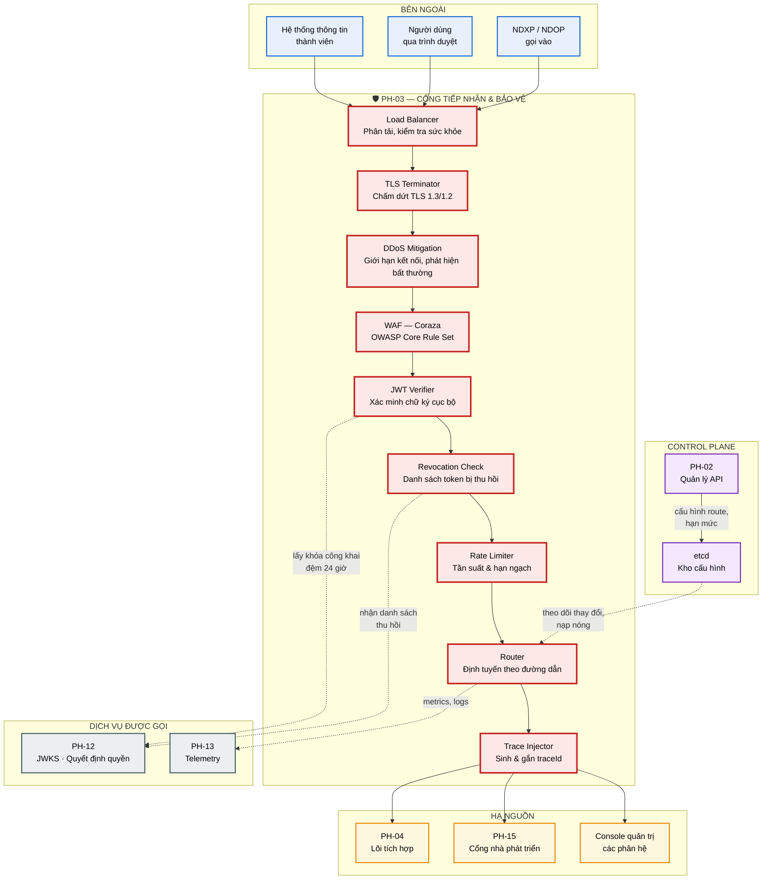
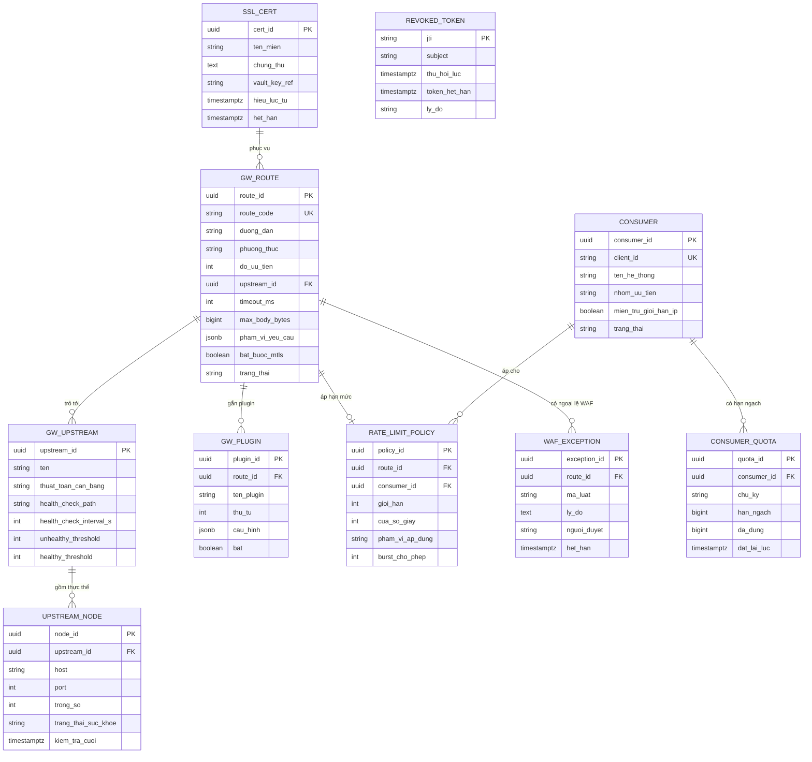

# SRS — PH-03: Cổng tiếp nhận & Bảo vệ (API Gateway)

| Thuộc tính | Giá trị |
|---|---|
| **Mã phân hệ** | PH-03 |
| **Tên** | Cổng tiếp nhận & Bảo vệ (API Gateway) |
| **Nhóm** | Data Plane |
| **Mức bắt buộc** | M — Bắt buộc |
| **Phiên bản** | 1.0 |
| **Ngày** | 03/8/2026 |
| **Công nghệ chủ đạo** | Apache APISIX + Coraza WAF (OWASP CRS) |

---

## M1. Giới thiệu

### 1.1. Mục đích

PH-03 là **điểm vào duy nhất** của mọi lưu lượng từ bên ngoài vào LGSP. Phân hệ này đứng ở vị trí chịu tấn công trực diện và có ba nhiệm vụ then chốt: chấm dứt TLS, chặn lưu lượng độc hại, và chỉ cho những yêu cầu hợp lệ đi tiếp vào lõi.

Đây là phân hệ hiện thực yêu cầu "quản lý API" tại CV 631: quản lý vòng đời API, xác thực OAuth2, giới hạn tần suất, chống tấn công từ chối dịch vụ.

### 1.2. Phạm vi

**PH-03 chịu trách nhiệm:**

| # | Trách nhiệm |
|---|---|
| 1 | Chấm dứt TLS và bắt buộc phiên bản giao thức tối thiểu |
| 2 | Xác minh chữ ký JWT cục bộ bằng khóa công khai từ PH-12 |
| 3 | Kiểm tra danh sách token bị thu hồi |
| 4 | Giới hạn tần suất và hạn ngạch theo từng bên gọi |
| 5 | Chặn tấn công tầng ứng dụng qua WAF |
| 6 | Giảm thiểu tấn công từ chối dịch vụ |
| 7 | Định tuyến yêu cầu tới đúng dịch vụ hạ nguồn |
| 8 | Sinh và gắn `traceId` cho mọi yêu cầu |
| 9 | Chuyển đổi giao thức cơ bản (gRPC ↔ REST, WebSocket) |
| 10 | Nạp nóng cấu hình route và chính sách không gián đoạn dịch vụ |
| 11 | Phát telemetry về lưu lượng, độ trễ, mã trạng thái |

**PH-03 KHÔNG chịu trách nhiệm:**

| # | Không làm | Thuộc phân hệ |
|---|---|---|
| 1 | Cấp và làm mới token; quản lý danh tính | PH-12 |
| 2 | Ra quyết định ủy quyền chi tiết theo tài nguyên | PH-12 |
| 3 | Chuyển đổi bản tin, chuẩn hóa CDM, làm giàu dữ liệu | PH-04 |
| 4 | Kết nối trực tiếp hệ thống thông tin thành viên | PH-05 |
| 5 | Quản lý vòng đời API ở mức nghiệp vụ (soạn, duyệt, phát hành) | PH-02 |
| 6 | Lưu trữ nhật ký và hiển thị dashboard | PH-13 |

**Ghi chú về ranh giới 2.** PH-03 thực hiện **kiểm soát truy cập thô** (token hợp lệ? có phạm vi cần thiết?) — đủ để loại bỏ sớm lưu lượng rác. **Kiểm soát chi tiết** theo tài nguyên cụ thể, phân loại mật và mục đích sử dụng do PH-04 gọi PH-12 thực hiện. Chia hai tầng như vậy vì Gateway không có ngữ cảnh nghiệp vụ của bản tin.

### 1.3. Tài liệu tham chiếu

| Mã | Tài liệu |
|---|---|
| [KT] | [Kiến trúc an toàn thông tin](../02-architecture/README.md#8-kiến-trúc-an-toàn-thông-tin), [Kiến trúc phân lớp](../02-architecture/README.md#3-kiến-trúc-phân-lớp-tổng-thể) |
| [LT] | [F-03](../03-flows/README.md#f-03--khai-thác-dữ-liệu-đồng-bộ-nội-bộ), [F-04](../03-flows/README.md#f-04--khai-thác-dữ-liệu-từ-csdl-quốc-gia-qua-ndxp), [F-08](../03-flows/README.md#f-08--xác-thực-người-dùng-qua-vneid-sso) |
| [PL] | [Ma trận CMP](../01-legal/README.md) |
| [ADR] | [ADR-003 APISIX](../05-adr/README.md#adr-003), [ADR-014 Tách Control/Data Plane](../05-adr/README.md#adr-014) |
| [SRS] | [PH-12 IAM](SRS-PH-12-iam.md), [PH-04 Lõi tích hợp](SRS-PH-04-integration-core.md) |
| [CV631] | Công văn 631/THH-THHT — quản lý API, throttling, OAuth2 |

---

## M2. Mô tả tổng quan

### 2.1. Vị trí trong kiến trúc



**Thuyết minh sơ đồ.** Chuỗi chín chốt kiểm soát được sắp xếp theo nguyên tắc **chi phí tăng dần**: các bước rẻ đặt trước để loại bỏ lưu lượng xấu sớm nhất có thể.

| Thứ tự | Chốt | Chi phí xử lý | Loại bỏ được gì |
|---|---|---|---|
| 1 | Giới hạn kết nối | Rất thấp | Tấn công cạn kiệt kết nối |
| 2 | TLS | Thấp | Kết nối không mã hóa |
| 3 | WAF | Trung bình | Chèn mã, kịch bản chéo trang |
| 4 | Xác minh JWT | Thấp (cục bộ) | Token giả, hết hạn |
| 5 | Kiểm tra thu hồi | Rất thấp | Token đã bị thu hồi |
| 6 | Giới hạn tần suất | Rất thấp | Lạm dụng, quá tải |

Nếu đảo thứ tự — ví dụ đặt WAF sau xác minh JWT — thì mọi yêu cầu độc hại vẫn phải qua bước mã hóa tốn kém trước khi bị chặn.

**Điểm thiết kế then chốt: xác minh JWT cục bộ.** Bước `AUTHN` **không** gọi PH-12 cho mỗi yêu cầu. APISIX lấy khóa công khai từ JWKS một lần, đệm 24 giờ, rồi tự xác minh chữ ký. Hệ quả: PH-12 không trở thành nút thắt cổ chai và sự cố Keycloak không làm sập trục ([NFR-12-011](SRS-PH-12-iam.md#m7-yêu-cầu-phi-chức-năng)).

**Nạp nóng cấu hình từ etcd.** Mũi tên đứt từ etcd tới Router thể hiện [ADR-014](../05-adr/README.md#adr-014): Gateway đọc cấu hình từ etcd và đệm tại chỗ. Khi PH-02 phát hành API mới, cấu hình lan tới Gateway trong vài giây mà **không cần khởi động lại** — điều kiện bắt buộc để đạt 24/7 (CMP-15). Ngược lại, nếu Control Plane sự cố, Gateway vẫn phục vụ bằng cấu hình đã đệm.

### 2.2. Tác nhân

| Tác nhân | Loại | Tương tác |
|---|---|---|
| Hệ thống thông tin thành viên | Hệ thống | Gọi API qua Gateway kèm token và mTLS |
| Người dùng qua trình duyệt | Người | Truy cập cổng nhà phát triển, console quản trị |
| NDXP/NDOP | Hệ thống ngoài | Gọi vào LGSP (chiều ngược) |
| Quản trị viên nền tảng | Người | Cấu hình route, hạn mức, xem lưu lượng |
| Cán bộ an toàn thông tin | Người | Cấu hình luật WAF, xử lý sự cố tấn công |
| PH-02 Quản lý API | Hệ thống | Đẩy cấu hình route và hạn mức |
| PH-12 IAM | Hệ thống | Cung cấp JWKS và danh sách thu hồi |

### 2.3. Giả định

| Mã | Giả định |
|---|---|
| GD-01 | Chứng thư TLS do đơn vị có thẩm quyền cấp, còn hiệu lực và được gia hạn tự động |
| GD-02 | Hệ thống thông tin thành viên hỗ trợ TLS 1.2 trở lên |
| GD-03 | PH-12 công bố JWKS ổn định; khóa xoay vòng có giai đoạn chồng lấn 24 giờ |
| GD-04 | etcd triển khai HA cùng cụm K8s |
| GD-05 | Có thiết bị hoặc dịch vụ chống DDoS ở tầng mạng phía trước (lớp 3/4) |

### 2.4. Ràng buộc

| Mã | Ràng buộc | Nguồn |
|---|---|---|
| RB-01 | Bắt buộc TLS 1.2 trở lên | CV 631, CMP-13 |
| RB-02 | Hỗ trợ xác thực OAuth2 | CV 631 |
| RB-03 | Có cơ chế giới hạn tần suất (throttling) | CV 631 |
| RB-04 | Có biện pháp giảm thiểu DDoS | CV 631, CMP-19 |
| RB-05 | Hỗ trợ HTTP, HTTPS, WebSocket | CV 631 |
| RB-06 | Sẵn sàng IPv6 | CV 631, CMP-14 |
| RB-07 | Hoạt động 24/7, thay đổi cấu hình không gián đoạn | CV 631, CMP-15 |
| RB-08 | Toàn bộ công nghệ mã nguồn mở | Yêu cầu dự án |

### 2.5. Phụ thuộc phân hệ

| Phụ thuộc | Loại | Hành vi khi không khả dụng |
|---|---|---|
| PH-12 (JWKS) | **Mềm** | Dùng khóa công khai đã đệm; nếu đệm hết hạn → từ chối token mới |
| PH-12 (danh sách thu hồi) | **Mềm** | Dùng danh sách đã nhận gần nhất; ghi cảnh báo |
| etcd | **Mềm** | Giữ cấu hình đã đệm, không nhận cấu hình mới |
| PH-04 | **Cứng** | Trả `503` kèm thông báo thân thiện |
| PH-13 | **Mềm** | Đệm telemetry cục bộ, gửi lại sau |

---

## M3. Yêu cầu chức năng

### 3.1. Nhóm A — Tiếp nhận và bảo vệ tầng truyền tải

#### FR-03-001 — Chấm dứt TLS · **M**

| Mục | Nội dung |
|---|---|
| **Mô tả** | Nhận kết nối mã hóa, giải mã và chuyển tiếp nội bộ qua mTLS |
| **Đầu vào** | Kết nối TLS từ bên gọi |
| **Xử lý** | 1. Ưu tiên TLS 1.3, chấp nhận tối thiểu TLS 1.2<br>2. Chỉ dùng bộ mã hóa mạnh, ưu tiên chuyển tiếp bí mật hoàn hảo<br>3. Tắt nén TLS và các tính năng đã lỗi thời<br>4. Với kênh yêu cầu mTLS: xác minh chứng thư phía khách<br>5. Chuyển tiếp nội bộ qua mTLS của Istio |
| **Đầu ra** | Yêu cầu đã giải mã, có thông tin chứng thư khách nếu có |
| **Ngoại lệ** | E1: Bên gọi chỉ hỗ trợ TLS < 1.2 → từ chối bắt tay (RB-01)<br>E2: Chứng thư khách hết hạn hoặc bị thu hồi → `403`, ghi cảnh báo an ninh<br>E3: Chứng thư máy chủ sắp hết hạn (< 30 ngày) → cảnh báo vận hành |

#### FR-03-002 — Giảm thiểu tấn công từ chối dịch vụ · **M**

| Mục | Nội dung |
|---|---|
| **Mô tả** | Bảo vệ nền tảng trước lưu lượng bất thường ở tầng ứng dụng |
| **Đầu vào** | Luồng kết nối và yêu cầu |
| **Xử lý** | Áp dụng nhiều lớp:<br>1. Giới hạn số kết nối đồng thời theo địa chỉ nguồn (mặc định 100)<br>2. Giới hạn tốc độ yêu cầu theo địa chỉ nguồn<br>3. Giới hạn kích thước thân yêu cầu (mặc định 10MB)<br>4. Đặt thời hạn chờ đọc/ghi để chống tấn công kết nối chậm<br>5. Phát hiện đột biến: tốc độ tăng > 10 lần mức nền trong 1 phút → siết hạn mức tự động<br>6. Danh sách chặn tạm thời địa chỉ vi phạm liên tục |
| **Đầu ra** | Lưu lượng đã lọc |
| **Ngoại lệ** | E1: Vượt ngưỡng → `429` kèm tiêu đề `Retry-After`<br>E2: Địa chỉ trong danh sách chặn → `403`, không phản hồi chi tiết<br>E3: Địa chỉ thuộc danh sách tin cậy (hệ thống nội bộ, NDXP) → miễn trừ giới hạn theo địa chỉ, vẫn áp hạn mức theo client |

**Ghi chú thiết kế.** Ngoại lệ E3 quan trọng trong thực tế: nhiều hệ thống thành viên đi qua NAT nên có chung một địa chỉ nguồn. Nếu chỉ giới hạn theo địa chỉ, một sở có lưu lượng cao sẽ vô tình chặn các sở khác. Vì vậy hạn mức chính phải theo **danh tính client**, giới hạn theo địa chỉ chỉ là lớp bảo vệ ngoài cùng.

#### FR-03-003 — Tường lửa ứng dụng web · **M**

| Mục | Nội dung |
|---|---|
| **Mô tả** | Phát hiện và chặn tấn công tầng ứng dụng |
| **Đầu vào** | Yêu cầu HTTP đã giải mã |
| **Xử lý** | 1. Áp dụng OWASP Core Rule Set qua Coraza<br>2. Kiểm tra: chèn mã SQL, kịch bản chéo trang, duyệt đường dẫn, chèn lệnh, chèn XML ngoài thực thể<br>3. Kiểm tra kích thước và số lượng tham số<br>4. Chấm điểm bất thường; vượt ngưỡng thì chặn<br>5. Ghi chi tiết luật khớp phục vụ điều tra |
| **Đầu ra** | Yêu cầu sạch hoặc bị chặn |
| **Ngoại lệ** | E1: Khớp luật chặn → `403`, ghi cảnh báo an ninh kèm mã luật<br>E2: Cảnh báo giả — cho phép khai báo ngoại lệ theo route và mã luật, có thời hạn và người phê duyệt<br>E3: WAF quá tải → chuyển sang chế độ chỉ ghi nhận (không chặn), cảnh báo nghiêm trọng |

**Ghi chú về E3.** Đây là đánh đổi có chủ đích: nếu WAF trở thành nút thắt và chặn cả lưu lượng hợp lệ, thiệt hại lớn hơn rủi ro bỏ lọt trong thời gian ngắn. Chuyển sang chế độ ghi nhận đi kèm cảnh báo nghiêm trọng để đội ATTT xử lý ngay.

### 3.2. Nhóm B — Xác thực và kiểm soát truy cập thô

#### FR-03-004 — Xác minh chữ ký JWT · **M**

| Mục | Nội dung |
|---|---|
| **Mô tả** | Xác minh token cục bộ, không gọi PH-12 cho từng yêu cầu |
| **Tiền điều kiện** | Đã lấy được JWKS từ PH-12 |
| **Đầu vào** | Tiêu đề `Authorization: Bearer <token>` |
| **Xử lý** | 1. Trích token, giải mã phần tiêu đề lấy `kid`<br>2. Tìm khóa công khai tương ứng trong JWKS đã đệm<br>3. Nếu `kid` chưa có → làm mới JWKS một lần (có giới hạn tần suất để tránh bị lợi dụng)<br>4. Xác minh chữ ký<br>5. Kiểm tra `exp`, `nbf`, `iss`, `aud`<br>6. Trích `sub`, `scope`, `client_id` đưa vào ngữ cảnh yêu cầu |
| **Đầu ra** | Ngữ cảnh yêu cầu có thông tin danh tính đã xác minh |
| **Ngoại lệ** | E1: Thiếu token → `401` kèm `WWW-Authenticate`<br>E2: Chữ ký sai → `401`, ghi cảnh báo an ninh<br>E3: Token hết hạn → `401` kèm mã lỗi phân biệt để bên gọi biết cần làm mới<br>E4: `kid` không tồn tại sau khi làm mới JWKS → `401`<br>E5: JWKS không lấy được và đệm đã hết hạn → `503` |

#### FR-03-005 — Kiểm tra token bị thu hồi · **M**

| Mục | Nội dung |
|---|---|
| **Mô tả** | Chặn token đã bị thu hồi dù chưa hết hạn |
| **Đầu vào** | Định danh token (`jti`) hoặc `sub` |
| **Xử lý** | 1. Nhận danh sách thu hồi từ PH-12 qua cơ chế đẩy<br>2. Lưu trong bộ nhớ dùng cấu trúc tra cứu nhanh<br>3. Tra `jti` và `sub` với mỗi yêu cầu<br>4. Loại bỏ mục đã quá hạn tự nhiên khỏi danh sách |
| **Đầu ra** | Cho qua hoặc chặn |
| **Ngoại lệ** | E1: Token trong danh sách thu hồi → `401` kèm lý do<br>E2: Không nhận được cập nhật danh sách > 5 phút → ghi cảnh báo, tiếp tục dùng bản cũ |

**Ghi chú.** Cơ chế này thu hẹp cửa sổ rủi ro của JWT từ 5 phút (thời hạn token) xuống gần như tức thì — bổ trợ cho [FR-12-011](SRS-PH-12-iam.md#m3-yêu-cầu-chức-năng).

#### FR-03-006 — Kiểm tra phạm vi quyền thô · **M**

| Mục | Nội dung |
|---|---|
| **Mô tả** | Loại bỏ sớm yêu cầu thiếu phạm vi quyền cơ bản |
| **Đầu vào** | `scope` từ token · phạm vi yêu cầu của route |
| **Xử lý** | 1. Đối chiếu `scope` trong token với phạm vi khai báo của route<br>2. Nếu thiếu → chặn ngay, không chuyển tiếp<br>3. Nếu đủ → chuyển tiếp; **kiểm soát chi tiết** do PH-04 gọi PH-12 thực hiện |
| **Đầu ra** | Cho qua hoặc chặn |
| **Ngoại lệ** | E1: Thiếu phạm vi → `403` kèm tên phạm vi còn thiếu |

**Ghi chú về ranh giới.** Bước này chỉ kiểm tra "client có phạm vi `congdan.read` không", chưa xét "client có được đọc **công dân cụ thể này** với **mục đích này** không" — câu hỏi thứ hai cần ngữ cảnh nghiệp vụ mà Gateway không có.

#### FR-03-007 — Xác thực bằng chứng thư mTLS · **S**

| Mục | Nội dung |
|---|---|
| **Mô tả** | Hỗ trợ xác thực hệ thống bằng chứng thư thay vì bí mật |
| **Đầu vào** | Chứng thư khách trong bắt tay TLS |
| **Xử lý** | 1. Xác minh chuỗi tin cậy tới CA nội bộ<br>2. Kiểm tra chứng thư chưa bị thu hồi<br>3. Trích `CN` hoặc `SAN` để xác định `clientId`<br>4. Đối chiếu với đăng ký tại PH-12 |
| **Đầu ra** | Danh tính client đã xác minh |
| **Ngoại lệ** | E1: Chứng thư không thuộc chuỗi tin cậy → `403`<br>E2: `clientId` không khớp đăng ký → `403`, cảnh báo an ninh |

### 3.3. Nhóm C — Giới hạn tần suất và hạn ngạch

#### FR-03-008 — Giới hạn tần suất theo client · **M**

| Mục | Nội dung |
|---|---|
| **Mô tả** | Áp hạn mức số yêu cầu theo đơn vị thời gian cho từng bên gọi |
| **Đầu vào** | `clientId` · route · cấu hình hạn mức |
| **Xử lý** | 1. Dùng thuật toán cửa sổ trượt để tránh hiện tượng đột biến ở ranh giới cửa sổ<br>2. Áp hạn mức nhiều tầng: theo client, theo cặp client-route, theo toàn cục<br>3. Trạng thái bộ đếm lưu ở Valkey để mọi thực thể Gateway cùng thấy<br>4. Trả tiêu đề thông tin hạn mức trong mọi phản hồi |
| **Đầu ra** | Cho qua hoặc `429`; tiêu đề `X-RateLimit-Limit`, `X-RateLimit-Remaining`, `X-RateLimit-Reset` |
| **Ngoại lệ** | E1: Vượt hạn mức → `429` kèm `Retry-After`<br>E2: Valkey không khả dụng → chuyển sang đếm cục bộ theo thực thể, ghi cảnh báo (hạn mức thực tế nới rộng theo số replica) |

**Ghi chú về E2.** Đây là đánh đổi có chủ đích: mất Valkey thì hạn mức kém chính xác còn hơn từ chối toàn bộ lưu lượng. Cảnh báo giúp đội vận hành biết hạn mức đang không chính xác.

#### FR-03-009 — Hạn ngạch theo chu kỳ · **S**

| Mục | Nội dung |
|---|---|
| **Mô tả** | Giới hạn tổng số lượt gọi theo ngày/tháng cho từng client |
| **Xử lý** | 1. Đếm tích lũy theo chu kỳ khai báo<br>2. Cảnh báo cho chủ quản khi đạt 80% hạn ngạch<br>3. Chặn khi vượt 100%<br>4. Đặt lại bộ đếm đầu chu kỳ mới |
| **Đầu ra** | Cho qua hoặc `429` kèm thông tin hạn ngạch |
| **Ngoại lệ** | E1: Vượt hạn ngạch → `429`, thông báo rõ chu kỳ đặt lại<br>E2: Client thuộc nhóm ưu tiên (dịch vụ công thiết yếu) → cho phép vượt kèm cảnh báo thay vì chặn |

**Ghi chú.** Chia sẻ dữ liệu giữa cơ quan nhà nước không thu phí (NĐ 47), nên hạn ngạch ở đây phục vụ **bảo vệ hệ thống và thống kê**, không phải tính tiền.

#### FR-03-010 — Điều tiết theo tình trạng hạ nguồn · **S**

| Mục | Nội dung |
|---|---|
| **Mô tả** | Chủ động giảm lưu lượng khi hạ nguồn quá tải |
| **Đầu vào** | Chỉ số sức khỏe từ PH-04 |
| **Xử lý** | 1. Theo dõi tỷ lệ lỗi và độ trễ hạ nguồn<br>2. Vượt ngưỡng → giảm dần hạn mức cho các client ưu tiên thấp<br>3. Giữ nguyên hạn mức cho client thuộc nhóm thiết yếu<br>4. Khôi phục dần khi hạ nguồn ổn định |
| **Đầu ra** | Hạn mức được điều chỉnh động |
| **Ngoại lệ** | E1: Hạ nguồn hoàn toàn không phản hồi → chuyển sang trả lỗi nhanh, không chờ hết thời hạn |

### 3.4. Nhóm D — Định tuyến và chuyển tiếp

#### FR-03-011 — Định tuyến yêu cầu · **M**

| Mục | Nội dung |
|---|---|
| **Mô tả** | Chuyển yêu cầu tới dịch vụ hạ nguồn đúng |
| **Đầu vào** | Đường dẫn · phương thức · tiêu đề · cấu hình route |
| **Xử lý** | 1. So khớp theo thứ tự ưu tiên: đường dẫn chính xác → tiền tố → biểu thức<br>2. Cân bằng tải giữa các thực thể hạ nguồn (mặc định vòng tròn có trọng số)<br>3. Loại bỏ thực thể không qua kiểm tra sức khỏe<br>4. Đặt thời hạn chờ theo cấu hình route |
| **Đầu ra** | Yêu cầu đã chuyển tiếp |
| **Ngoại lệ** | E1: Không route nào khớp → `404`<br>E2: Không thực thể hạ nguồn nào khỏe mạnh → `503`<br>E3: Quá hạn chờ hạ nguồn → `504` |

#### FR-03-012 — Sinh và gắn định danh truy vết · **M**

| Mục | Nội dung |
|---|---|
| **Mô tả** | Bảo đảm mọi yêu cầu có `traceId` từ điểm vào |
| **Xử lý** | 1. Nhận `traceparent` theo chuẩn W3C Trace Context nếu bên gọi có gửi<br>2. Nếu không có → sinh mới<br>3. Gắn vào tiêu đề chuyển tiếp hạ nguồn<br>4. Trả `X-Trace-Id` trong phản hồi để bên gọi lưu lại |
| **Đầu ra** | Yêu cầu và phản hồi mang `traceId` |
| **Ngoại lệ** | E1: `traceparent` sai định dạng → sinh mới, ghi cảnh báo nhẹ |

**Ghi chú.** Trả `traceId` về cho bên gọi là chi tiết quan trọng trong thực tế: khi một sở báo lỗi, họ cung cấp `traceId` và đội vận hành tra được ngay thay vì phải dò theo thời gian.

#### FR-03-013 — Chuyển đổi giao thức · **S**

| Mục | Nội dung |
|---|---|
| **Mô tả** | Hỗ trợ bên gọi và hạ nguồn dùng giao thức khác nhau |
| **Xử lý** | Hỗ trợ: REST ↔ gRPC · WebSocket đi qua · nén và giải nén tự động<br>Với WebSocket: giữ kết nối, áp dụng thời hạn nhàn rỗi |
| **Đầu ra** | Yêu cầu đúng giao thức hạ nguồn |
| **Ngoại lệ** | E1: Không hỗ trợ cặp chuyển đổi → `501` |

#### FR-03-014 — Xử lý CORS · **S**

| Mục | Nội dung |
|---|---|
| **Mô tả** | Cho phép ứng dụng trình duyệt gọi API an toàn |
| **Xử lý** | 1. Chỉ cho phép nguồn gốc trong danh sách khai báo — **không** dùng ký tự đại diện<br>2. Xử lý yêu cầu kiểm tra trước<br>3. Khai báo rõ phương thức và tiêu đề được phép |
| **Đầu ra** | Tiêu đề CORS phù hợp |
| **Ngoại lệ** | E1: Nguồn gốc không được phép → không trả tiêu đề CORS |

### 3.5. Nhóm E — Quản lý cấu hình và quan sát

#### FR-03-015 — Nạp nóng cấu hình · **M**

| Mục | Nội dung |
|---|---|
| **Mô tả** | Cập nhật route, hạn mức, chính sách mà không gián đoạn dịch vụ |
| **Tác nhân** | PH-02, Quản trị viên nền tảng |
| **Xử lý** | 1. Theo dõi thay đổi trên etcd<br>2. Kiểm tra tính hợp lệ cấu hình mới trước khi áp dụng<br>3. Áp dụng nguyên tử — không có trạng thái nửa vời<br>4. Yêu cầu đang xử lý dùng cấu hình cũ; yêu cầu mới dùng cấu hình mới<br>5. Ghi sự kiện thay đổi cấu hình |
| **Đầu ra** | Cấu hình mới có hiệu lực |
| **Ngoại lệ** | E1: Cấu hình mới không hợp lệ → giữ cấu hình cũ, cảnh báo<br>E2: Mất kết nối etcd → giữ cấu hình đã đệm, tiếp tục phục vụ |

#### FR-03-016 — Kiểm tra sức khỏe hạ nguồn · **M**

| Mục | Nội dung |
|---|---|
| **Mô tả** | Chỉ chuyển lưu lượng tới thực thể hạ nguồn khỏe mạnh |
| **Xử lý** | 1. Kiểm tra chủ động định kỳ (mặc định 5 giây) tới `/readyz`<br>2. Kiểm tra thụ động: theo dõi tỷ lệ lỗi thực tế<br>3. Loại thực thể sau 3 lần kiểm tra liên tiếp thất bại<br>4. Đưa lại sau 2 lần thành công liên tiếp |
| **Đầu ra** | Danh sách thực thể khả dụng |
| **Ngoại lệ** | E1: Toàn bộ thực thể bị loại → giữ lại thực thể có tỷ lệ lỗi thấp nhất (tránh mất hoàn toàn dịch vụ), cảnh báo nghiêm trọng |

#### FR-03-017 — Phát telemetry · **M**

| Mục | Nội dung |
|---|---|
| **Mô tả** | Cung cấp dữ liệu quan sát cho PH-13 |
| **Xử lý** | Phát chỉ số: `gw_requests_total{route,client,status}`, `gw_request_duration_seconds{route}`, `gw_upstream_duration_seconds`, `gw_ratelimit_rejected_total{client}`, `gw_waf_blocked_total{rule}`, `gw_auth_failed_total{reason}`, `gw_active_connections`<br>Ghi nhật ký truy cập dạng cấu trúc kèm `traceId`<br>Phát span OpenTelemetry cho mỗi yêu cầu |
| **Đầu ra** | Telemetry theo chuẩn OpenTelemetry |
| **Ngoại lệ** | E1: Bộ thu thập không khả dụng → đệm cục bộ, bỏ điểm cũ nhất khi đầy |

**Ghi chú quan trọng về nhật ký.** Nhật ký truy cập **không** được ghi thân bản tin vì có thể chứa dữ liệu cá nhân. Chỉ ghi siêu dữ liệu: đường dẫn, mã trạng thái, kích thước, thời gian, `clientId`, `traceId`.

### 3.6. Bảng tổng hợp yêu cầu chức năng

| Nhóm | Mã | Tên | Ưu tiên |
|---|---|---|:-:|
| A | FR-03-001 | Chấm dứt TLS | M |
| A | FR-03-002 | Giảm thiểu tấn công từ chối dịch vụ | M |
| A | FR-03-003 | Tường lửa ứng dụng web | M |
| B | FR-03-004 | Xác minh chữ ký JWT | M |
| B | FR-03-005 | Kiểm tra token bị thu hồi | M |
| B | FR-03-006 | Kiểm tra phạm vi quyền thô | M |
| B | FR-03-007 | Xác thực bằng chứng thư mTLS | S |
| C | FR-03-008 | Giới hạn tần suất theo client | M |
| C | FR-03-009 | Hạn ngạch theo chu kỳ | S |
| C | FR-03-010 | Điều tiết theo tình trạng hạ nguồn | S |
| D | FR-03-011 | Định tuyến yêu cầu | M |
| D | FR-03-012 | Sinh và gắn định danh truy vết | M |
| D | FR-03-013 | Chuyển đổi giao thức | S |
| D | FR-03-014 | Xử lý CORS | S |
| E | FR-03-015 | Nạp nóng cấu hình | M |
| E | FR-03-016 | Kiểm tra sức khỏe hạ nguồn | M |
| E | FR-03-017 | Phát telemetry | M |

**Tổng: 17 yêu cầu chức năng** — 12 bắt buộc (M), 5 cần có (S).

---

## M4. Mô hình dữ liệu

### 4.1. Sơ đồ thực thể



### 4.2. Đặc tả thực thể

#### EN-03-01 — GW_ROUTE (Cấu hình định tuyến)

| Trường | Kiểu | Bắt buộc | Ràng buộc | Mô tả |
|---|---|:-:|---|---|
| `route_id` | UUID | ✓ | PK | |
| `route_code` | VARCHAR(80) | ✓ | UNIQUE | Khớp mã API tại PH-02 |
| `duong_dan` | VARCHAR(300) | ✓ | | Mẫu đường dẫn, hỗ trợ tham số |
| `phuong_thuc` | VARCHAR(60) | ✓ | Danh sách phương thức HTTP | |
| `do_uu_tien` | SMALLINT | ✓ | mặc định 0 | Cao hơn xét trước khi so khớp |
| `upstream_id` | UUID | ✓ | FK | |
| `timeout_ms` | INTEGER | ✓ | ≤ 30000 | Không vượt trần CV 631 |
| `max_body_bytes` | BIGINT | ✓ | mặc định 10.485.760 | |
| `pham_vi_yeu_cau` | JSONB | | | Danh sách scope bắt buộc (FR-03-006) |
| `bat_buoc_mtls` | BOOLEAN | ✓ | mặc định false | |
| `trang_thai` | VARCHAR(20) | ✓ | ∈ {`ACTIVE`,`DISABLED`} | |

#### EN-03-02 — CONSUMER (Bên gọi)

| Trường | Kiểu | Bắt buộc | Mô tả |
|---|---|:-:|---|
| `consumer_id` | UUID | ✓ | PK |
| `client_id` | VARCHAR(80) | ✓ | UNIQUE, khớp client tại PH-12 |
| `ten_he_thong` | VARCHAR(200) | ✓ | |
| `nhom_uu_tien` | VARCHAR(20) | ✓ | ∈ {`ESSENTIAL`,`NORMAL`,`LOW`} — quyết định thứ tự bị điều tiết |
| `mien_tru_gioi_han_ip` | BOOLEAN | ✓ | Dành cho hệ thống sau NAT (FR-03-002 E3) |
| `trang_thai` | VARCHAR(20) | ✓ | ∈ {`ACTIVE`,`SUSPENDED`,`BLOCKED`} |

#### EN-03-03 — RATE_LIMIT_POLICY

| Trường | Kiểu | Bắt buộc | Mô tả |
|---|---|:-:|---|
| `policy_id` | UUID | ✓ | PK |
| `route_id` | UUID | | FK — rỗng nghĩa là áp cho mọi route |
| `consumer_id` | UUID | | FK — rỗng nghĩa là áp cho mọi consumer |
| `gioi_han` | INTEGER | ✓ | Số yêu cầu tối đa |
| `cua_so_giay` | INTEGER | ✓ | Độ dài cửa sổ trượt |
| `pham_vi_ap_dung` | VARCHAR(20) | ✓ | ∈ {`CONSUMER`,`CONSUMER_ROUTE`,`GLOBAL`,`IP`} |
| `burst_cho_phep` | INTEGER | ✓ | Dung sai đột biến ngắn |

**Thứ tự áp dụng khi nhiều chính sách cùng khớp:** chính sách cụ thể hơn thắng — `CONSUMER_ROUTE` > `CONSUMER` > `IP` > `GLOBAL`.

#### EN-03-04 — REVOKED_TOKEN

| Trường | Kiểu | Bắt buộc | Mô tả |
|---|---|:-:|---|
| `jti` | VARCHAR(64) | ✓ | PK — định danh token |
| `subject` | VARCHAR(120) | ✓ | Người dùng hoặc client |
| `thu_hoi_luc` | TIMESTAMPTZ | ✓ | |
| `token_het_han` | TIMESTAMPTZ | ✓ | Sau thời điểm này có thể xóa khỏi danh sách |
| `ly_do` | VARCHAR(200) | ✓ | Phục vụ điều tra |

**Ghi chú.** Lưu trên Valkey với TTL bằng `token_het_han` để danh sách tự thu gọn, không phình vô hạn.

#### EN-03-05 — WAF_EXCEPTION

| Trường | Kiểu | Bắt buộc | Mô tả |
|---|---|:-:|---|
| `exception_id` | UUID | ✓ | PK |
| `route_id` | UUID | ✓ | FK |
| `ma_luat` | VARCHAR(40) | ✓ | Mã luật OWASP CRS được miễn |
| `ly_do` | TEXT | ✓ | **Bắt buộc** — phục vụ rà soát |
| `nguoi_duyet` | VARCHAR(100) | ✓ | Phải có vai trò `SECURITY_OFFICER` |
| `het_han` | TIMESTAMPTZ | ✓ | **Bắt buộc có hạn** — tối đa 90 ngày |

**Ghi chú thiết kế.** Ngoại lệ WAF là lỗ hổng có chủ đích, nên bắt buộc có thời hạn và người duyệt. Không cho phép ngoại lệ vĩnh viễn — hết hạn thì phải rà soát lại xem còn cần không.

### 4.3. Chính sách lưu giữ

| Dữ liệu | Thời hạn | Ghi chú |
|---|---|---|
| Cấu hình route, upstream, consumer | Vĩnh viễn | Lưu trong etcd + sao lưu |
| Bộ đếm hạn mức | Bằng độ dài cửa sổ | Valkey, tự hết hạn |
| Danh sách token thu hồi | Tới khi token hết hạn tự nhiên | Valkey, TTL tự động |
| Nhật ký truy cập | 1 năm (tại PH-13) | Không chứa thân bản tin |
| Nhật ký WAF chặn | 1 năm | Phục vụ điều tra an ninh |

---

## M5. Giao diện API

### 5.1. Nguyên tắc chung

| Khía cạnh | Quy định |
|---|---|
| Đường dẫn dữ liệu | Do route định nghĩa động, thường `/api/v1/*` |
| Đường dẫn quản trị Gateway | `/api/admin/v1/gateway` |
| Xác thực quản trị | Bearer JWT, vai trò `PLATFORM_ADMIN` hoặc `SECURITY_OFFICER` |
| Mã lỗi | RFC 9457 Problem Details |
| Tiêu đề chuẩn trả về | `X-Trace-Id`, `X-RateLimit-*` |

### 5.2. Mã lỗi chuẩn của Gateway

| Mã | Tình huống | Tiêu đề kèm theo | Bên gọi nên làm gì |
|---|---|---|---|
| `400` | Yêu cầu sai cú pháp | — | Sửa yêu cầu |
| `401` | Thiếu/sai/hết hạn token | `WWW-Authenticate` | Lấy token mới |
| `403` | Thiếu phạm vi quyền, bị WAF chặn, bị chặn địa chỉ | — | Liên hệ quản trị |
| `404` | Không có route khớp | — | Kiểm tra đường dẫn |
| `413` | Thân yêu cầu quá lớn | — | Giảm kích thước |
| `429` | Vượt hạn mức hoặc hạn ngạch | `Retry-After`, `X-RateLimit-*` | Chờ rồi thử lại |
| `500` | Lỗi nội bộ Gateway | — | Báo vận hành |
| `502` | Hạ nguồn trả phản hồi không hợp lệ | — | Báo vận hành |
| `503` | Không có hạ nguồn khỏe mạnh | `Retry-After` | Thử lại sau |
| `504` | Hạ nguồn quá hạn chờ | — | Thử lại; báo nếu lặp lại |

**Ví dụ phản hồi `429`:**

```http
HTTP/1.1 429 Too Many Requests
Content-Type: application/problem+json
Retry-After: 12
X-RateLimit-Limit: 1000
X-RateLimit-Remaining: 0
X-RateLimit-Reset: 1754212345
X-Trace-Id: 4bf92f3577b34da6a3ce929d0e0e4736
```

```json
{
  "type": "https://lgsp.local/errors/rate-limit-exceeded",
  "title": "Vượt hạn mức truy cập",
  "status": 429,
  "detail": "Hệ thống CONG-DVC đã dùng hết 1000 lượt gọi trong cửa sổ 60 giây cho dịch vụ tra-cuu-cong-dan",
  "traceId": "4bf92f3577b34da6a3ce929d0e0e4736",
  "retryAfterSeconds": 12,
  "limit": 1000,
  "windowSeconds": 60
}
```

### 5.3. Điểm cuối quản trị

| Phương thức | Đường dẫn | Chức năng | FR |
|---|---|---|---|
| `GET` | `/api/admin/v1/gateway/routes` | Danh sách route đang phục vụ | FR-03-011 |
| `POST` | `/api/admin/v1/gateway/routes` | Tạo route | FR-03-011, 015 |
| `PUT` | `/api/admin/v1/gateway/routes/{code}` | Cập nhật route (nạp nóng) | FR-03-015 |
| `DELETE` | `/api/admin/v1/gateway/routes/{code}` | Gỡ route | FR-03-015 |
| `POST` | `/api/admin/v1/gateway/routes/validate` | Kiểm tra cấu hình không áp dụng | FR-03-015 |
| `GET` | `/api/admin/v1/gateway/upstreams` | Danh sách hạ nguồn kèm sức khỏe | FR-03-016 |
| `GET` | `/api/admin/v1/gateway/consumers` | Danh sách bên gọi | FR-03-008 |
| `PUT` | `/api/admin/v1/gateway/consumers/{clientId}/limits` | Đặt hạn mức | FR-03-008 |
| `GET` | `/api/admin/v1/gateway/consumers/{clientId}/usage` | Mức sử dụng và hạn ngạch | FR-03-009 |
| `POST` | `/api/admin/v1/gateway/consumers/{clientId}/block` | Chặn tạm bên gọi | FR-03-002 |
| `GET` | `/api/admin/v1/gateway/waf/blocked` | Nhật ký bị WAF chặn | FR-03-003 |
| `POST` | `/api/admin/v1/gateway/waf/exceptions` | Tạo ngoại lệ WAF có thời hạn | FR-03-003 |
| `GET` | `/api/admin/v1/gateway/certificates` | Chứng thư và ngày hết hạn | FR-03-001 |
| `POST` | `/api/admin/v1/gateway/revocations` | Nhận danh sách token thu hồi từ PH-12 | FR-03-005 |
| `GET` | `/api/admin/v1/gateway/stats` | Thống kê lưu lượng theo route và client | FR-03-017 |
| `GET` | `/healthz`, `/readyz` | Kiểm tra sức khỏe Gateway | — |

### 5.4. Ví dụ cấu hình route

```json
{
  "routeCode": "tra-cuu-cong-dan",
  "duongDan": "/api/v1/cong-dan/*",
  "phuongThuc": ["GET"],
  "doUuTien": 10,
  "upstream": "ph04-integration-core",
  "timeoutMs": 10000,
  "maxBodyBytes": 1048576,
  "phamViYeuCau": ["congdan.read"],
  "batBuocMtls": true,
  "plugins": {
    "jwt-auth": { "enabled": true },
    "revocation-check": { "enabled": true },
    "limit-count": {
      "enabled": true,
      "count": 1000,
      "timeWindow": 60,
      "keyType": "consumer",
      "policy": "redis",
      "rejectedCode": 429
    },
    "coraza-waf": {
      "enabled": true,
      "ruleSet": "OWASP-CRS-4",
      "paranoiaLevel": 2,
      "anomalyThreshold": 5
    },
    "opentelemetry": {
      "enabled": true,
      "sampler": { "name": "parent_base", "options": { "fraction": 0.05 } }
    },
    "cors": {
      "enabled": false
    }
  }
}
```

**Thuyết minh cấu hình.** `batBuocMtls: true` áp dụng cho route truy cập dữ liệu công dân — hai lớp xác thực (mTLS + JWT) cho dữ liệu nhạy cảm. `paranoiaLevel: 2` là mức cân bằng: đủ chặt để bắt tấn công phổ biến, chưa quá nhiều cảnh báo giả. Lấy mẫu trace 5% áp dụng cho yêu cầu thành công; yêu cầu lỗi luôn được giữ 100%.

---

## M6. Giao diện người dùng

### 6.1. Danh mục màn hình

| Mã | Tên màn hình | Đối tượng | Mockup |
|---|---|---|---|
| **UI-03-01** | Tổng quan lưu lượng | Vận hành, Quản trị viên | [`gateway.html`](../../mockup/pages/gateway.html) |
| **UI-03-02** | Cấu hình route Gateway | Quản trị viên nền tảng | [`gateway.html`](../../mockup/pages/gateway.html) (tab Route) |
| **UI-03-03** | Hạn mức và hạn ngạch | Quản trị viên nền tảng | [`gateway.html`](../../mockup/pages/gateway.html) (tab Hạn mức) |
| **UI-03-04** | Nhật ký WAF và ngoại lệ | Cán bộ ATTT | [`gateway.html`](../../mockup/pages/gateway.html) (tab Bảo vệ) |
| **UI-03-05** | Sức khỏe hạ nguồn | Vận hành | [`gateway.html`](../../mockup/pages/gateway.html) (tab Hạ nguồn) |

### 6.2. UI-03-01 — Tổng quan lưu lượng

| Thành phần | Mô tả |
|---|---|
| Thẻ chỉ số | Yêu cầu/giây · Tỷ lệ lỗi · Độ trễ P99 · Kết nối đang mở |
| Biểu đồ lưu lượng | Theo thời gian, phân tách theo mã trạng thái (2xx/4xx/5xx) |
| Bảng xếp hạng bên gọi | Top client theo lưu lượng, kèm mức dùng so với hạn mức |
| Bảng xếp hạng route | Top route theo lưu lượng và độ trễ |
| Thẻ bị chặn | Số lượt bị WAF chặn · bị vượt hạn mức · xác thực thất bại |

**Quy tắc tương tác:** nhấn một client → lọc toàn bộ biểu đồ theo client đó; nhấn cột lỗi trong biểu đồ → mở danh sách yêu cầu lỗi kèm `traceId` để tra tiếp tại PH-13.

### 6.3. UI-03-03 — Hạn mức và hạn ngạch

| Thành phần | Mô tả |
|---|---|
| Bảng hạn mức | Bên gọi · Route · Giới hạn · Cửa sổ · Phạm vi · Mức dùng hiện tại |
| Thanh tiến trình | Trực quan hóa mức dùng so với hạn mức, đổi màu khi vượt 80% |
| Biểu mẫu chỉnh hạn mức | Giới hạn · cửa sổ · dung sai đột biến · nhóm ưu tiên |
| Cảnh báo sắp chạm hạn ngạch | Danh sách client đạt trên 80% hạn ngạch chu kỳ |

**Quy tắc tương tác:**

| # | Quy tắc |
|---|---|
| 1 | Thay đổi hạn mức có hiệu lực ngay, không cần triển khai lại |
| 2 | Cảnh báo khi đặt hạn mức thấp hơn lưu lượng trung bình hiện tại của client |
| 3 | Client thuộc nhóm `ESSENTIAL` hiển thị nhãn riêng, cảnh báo khi giảm hạn mức |

### 6.4. UI-03-04 — Nhật ký WAF và ngoại lệ

| Thành phần | Mô tả |
|---|---|
| Bảng nhật ký chặn | Thời điểm · Địa chỉ nguồn · Route · Mã luật · Điểm bất thường · Đoạn khớp |
| Bộ lọc | Theo mã luật, route, khoảng thời gian, địa chỉ |
| Bảng ngoại lệ đang có hiệu lực | Route · Mã luật · Lý do · Người duyệt · Ngày hết hạn |
| Biểu mẫu tạo ngoại lệ | Route · mã luật · lý do bắt buộc · thời hạn (tối đa 90 ngày) |

**Quy tắc tương tác:**

| # | Quy tắc |
|---|---|
| 1 | Tạo ngoại lệ yêu cầu vai trò `SECURITY_OFFICER` và xác nhận lại MFA |
| 2 | Không cho đặt thời hạn quá 90 ngày |
| 3 | Ngoại lệ còn 7 ngày hết hạn → hiển thị cảnh báo để rà soát |
| 4 | Nhấn một dòng nhật ký → hiển thị đầy đủ yêu cầu bị chặn (đã che dữ liệu nhạy cảm) |

---

## M7. Yêu cầu phi chức năng

### 7.1. Hiệu năng

| Mã | Yêu cầu | Chỉ tiêu | Cách đo |
|---|---|---|---|
| **NFR-03-001** | Độ trễ thêm vào của Gateway | P50 ≤ 3ms · P95 ≤ 8ms · P99 ≤ 15ms | Hiệu số giữa độ trễ tổng và độ trễ hạ nguồn |
| **NFR-03-002** | Thông lượng mỗi replica | ≥ 3.000 yêu cầu/giây | Kiểm thử tải |
| **NFR-03-003** | Thông lượng toàn cụm | ≥ 10.000 yêu cầu/giây | Kiểm thử tải |
| **NFR-03-004** | Độ trễ xác minh JWT | ≤ 2ms (cục bộ, không gọi mạng) | Đo tại plugin |
| **NFR-03-005** | Độ trễ kiểm tra hạn mức | ≤ 3ms | Đo tại plugin |
| **NFR-03-006** | Chi phí WAF | ≤ 5ms với yêu cầu ≤ 32KB | Đo có/không bật WAF |
| **NFR-03-007** | Số kết nối đồng thời | ≥ 20.000 mỗi replica | Kiểm thử |

### 7.2. Tính sẵn sàng

| Mã | Yêu cầu | Chỉ tiêu |
|---|---|---|
| **NFR-03-008** | Tỷ lệ sẵn sàng | ≥ 99,95% (điểm vào duy nhất nên yêu cầu cao hơn mức chung) |
| **NFR-03-009** | Số replica tối thiểu | 3, phân bố trên ≥ 2 vùng sẵn sàng |
| **NFR-03-010** | Nạp cấu hình mới | 0 yêu cầu lỗi trong lúc nạp (CMP-15) |
| **NFR-03-011** | Mất kết nối etcd | Tiếp tục phục vụ bằng cấu hình đã đệm ≥ 24 giờ |
| **NFR-03-012** | Tắt an toàn | Hoàn tất yêu cầu đang xử lý trong ≤ 30 giây |
| **NFR-03-013** | Gia hạn chứng thư TLS | Tự động, không gián đoạn |

### 7.3. Bảo mật

| Mã | Yêu cầu |
|---|---|
| **NFR-03-014** | Chỉ chấp nhận TLS 1.2 trở lên; quét SSL đạt mức A (CMP-13) |
| **NFR-03-015** | Không lộ thông tin phiên bản phần mềm trong tiêu đề phản hồi |
| **NFR-03-016** | Không ghi thân bản tin vào nhật ký truy cập |
| **NFR-03-017** | Khóa riêng của chứng thư lưu trong Vault, không nằm trong ảnh container |
| **NFR-03-018** | Chạy container không phải root, hệ thống tệp gốc chỉ đọc |
| **NFR-03-019** | Tiêu đề bảo mật bắt buộc trên phản hồi giao diện web: `Strict-Transport-Security`, `X-Content-Type-Options`, `Content-Security-Policy` |
| **NFR-03-020** | Ngoại lệ WAF bắt buộc có thời hạn và người duyệt |

### 7.4. Khả năng mở rộng

| Mã | Yêu cầu |
|---|---|
| **NFR-03-021** | Mở rộng ngang tự động theo CPU, ngưỡng 70%, từ 3 đến 10 replica |
| **NFR-03-022** | Không lưu trạng thái phiên trong Gateway — mọi trạng thái ở Valkey |
| **NFR-03-023** | Số route đồng thời ≥ 1.000 mà không suy giảm quá 10% độ trễ so khớp |
| **NFR-03-024** | Sẵn sàng IPv6 dual-stack (CMP-14) |

### 7.5. Khả năng quan sát

| Mã | Yêu cầu |
|---|---|
| **NFR-03-025** | 100% yêu cầu mang `traceId`; trả về bên gọi qua `X-Trace-Id` |
| **NFR-03-026** | Nhật ký truy cập dạng JSON có cấu trúc |
| **NFR-03-027** | Giữ 100% trace của yêu cầu lỗi; lấy mẫu 5% yêu cầu thành công |
| **NFR-03-028** | Độ trễ chỉ số lên dashboard ≤ 15 giây (CMP-10) |

---

## M8. Quy tắc nghiệp vụ

| Mã | Quy tắc | Lý do | Cách thực thi | Khi vi phạm |
|---|---|---|---|---|
| **BR-03-001** | Mọi lưu lượng vào LGSP phải qua Gateway | Kiểm soát tập trung, không có cửa sau | Chính sách mạng K8s chặn truy cập trực tiếp | Chặn ở tầng mạng |
| **BR-03-002** | Không chấp nhận TLS dưới 1.2 | CMP-13, CV 631 | Cấu hình TLS; kiểm thử tự động | Từ chối bắt tay |
| **BR-03-003** | Xác minh JWT thực hiện cục bộ, không gọi PH-12 mỗi yêu cầu | Tránh nút thắt cổ chai và phụ thuộc cứng | Đệm JWKS 24 giờ | Rà soát khi kiểm thử hiệu năng |
| **BR-03-004** | Hạn mức chính áp theo `clientId`, không theo địa chỉ IP | Nhiều hệ thống chung một địa chỉ qua NAT | FR-03-008 phạm vi `CONSUMER` | Cấu hình sai gây chặn nhầm |
| **BR-03-005** | Ngoại lệ WAF bắt buộc có lý do, người duyệt và thời hạn ≤ 90 ngày | Ngoại lệ là lỗ hổng có chủ đích, phải rà soát định kỳ | Ràng buộc CSDL + kiểm tra API | Từ chối tạo |
| **BR-03-006** | Không ghi thân bản tin vào nhật ký | Thân bản tin có thể chứa dữ liệu cá nhân | Cấu hình nhật ký; rà soát mã | Vi phạm bảo vệ dữ liệu |
| **BR-03-007** | Gateway chỉ kiểm soát truy cập thô; kiểm soát chi tiết thuộc PH-04+PH-12 | Gateway không có ngữ cảnh nghiệp vụ | Phân định trong thiết kế | Lỗi thiết kế |
| **BR-03-008** | Client nhóm `ESSENTIAL` được ưu tiên khi điều tiết | Dịch vụ công thiết yếu không được gián đoạn trước | FR-03-010 bước 3 | — |
| **BR-03-009** | Thay đổi cấu hình phải nạp nóng, không khởi động lại | CMP-15 — hoạt động 24/7 | FR-03-015 | Vi phạm cam kết sẵn sàng |
| **BR-03-010** | Khi toàn bộ hạ nguồn không khỏe, giữ lại thực thể tốt nhất thay vì chặn hết | Mất một phần dịch vụ tốt hơn mất toàn bộ | FR-03-016 E1 | — |
| **BR-03-011** | Không dùng ký tự đại diện cho nguồn gốc CORS | Ngăn ứng dụng lạ gọi API từ trình duyệt | FR-03-014 bước 1 | Từ chối cấu hình |
| **BR-03-012** | Không lộ phiên bản phần mềm trong tiêu đề phản hồi | Giảm thông tin cho kẻ tấn công dò lỗ hổng | Cấu hình; kiểm thử tự động | Rà soát khi quét bảo mật |

---

## M9. Tuân thủ

### 9.1. Ánh xạ yêu cầu pháp lý

| Mã CMP | Yêu cầu | FR/NFR đáp ứng | Cách kiểm chứng |
|---|---|---|---|
| **CMP-05** | Quản lý vòng đời API + throttling | FR-03-008, FR-03-009, FR-03-015 | Kiểm thử hạn mức; kiểm thử nạp nóng route |
| **CMP-13** | TLS 1.2 trở lên | FR-03-001; NFR-03-014 | Quét SSL đạt mức A; thử kết nối TLS 1.1 phải bị từ chối |
| **CMP-19** | Chống DDoS | FR-03-002, FR-03-003 | Kiểm thử tải bất thường; kiểm thử WAF với OWASP payload |
| **CMP-14** | Sẵn sàng IPv6 | NFR-03-024 | Truy cập thành công qua địa chỉ IPv6 |
| **CMP-15** | Hoạt động 24/7 | NFR-03-008…013; BR-03-009 | Nạp cấu hình dưới tải, đo số lỗi = 0 |
| **CMP-10** | Giám sát thời gian thực | FR-03-017; NFR-03-028 | Đo độ trễ chỉ số lên dashboard |
| **CMP-01** | Không kết nối điểm-điểm | BR-03-001 | Kiểm tra chính sách mạng; rà soát nhật ký kết nối |
| **CMP-11** | Hỗ trợ HTTP, HTTPS, WebSocket | FR-03-013; RB-05 | Kiểm thử từng giao thức |

### 9.2. Ánh xạ nguyên tắc TTQGS

| Nguyên tắc | Cách PH-03 đáp ứng |
|---|---|
| **Security by Design** | Chín chốt kiểm soát theo chi phí tăng dần; WAF, mTLS, ngoại lệ có thời hạn |
| **API First** | Toàn bộ cấu hình qua API quản trị có hợp đồng |
| **Cloud First** | Không trạng thái, mở rộng ngang tự động trên K8s |
| **Open Standard** | HTTP, TLS, JWT, JWKS, W3C Trace Context, OWASP CRS |
| **Modular Design** | Kiến trúc plugin — bật/tắt từng năng lực theo route |

---

## M10. Kiểm thử chấp nhận

### 10.1. Kiểm thử chức năng

| Mã | Kịch bản | Dữ liệu thử | Kết quả mong đợi | Tiêu chí đạt |
|---|---|---|---|---|
| **AT-03-001** | Yêu cầu hợp lệ đi qua đầy đủ | Token hợp lệ, trong hạn mức | `200`, chuyển tới PH-04 | Có `X-Trace-Id` trong phản hồi |
| **AT-03-002** | Từ chối TLS 1.1 | Bắt tay bằng TLS 1.1 | Bắt tay thất bại | CMP-13, BR-03-002 |
| **AT-03-003** | Token thiếu | Không có `Authorization` | `401` kèm `WWW-Authenticate` | — |
| **AT-03-004** | Token chữ ký sai | Token bị sửa nội dung | `401`, có cảnh báo an ninh | — |
| **AT-03-005** | Token hết hạn | `exp` trong quá khứ | `401` phân biệt được với chữ ký sai | Bên gọi biết cần làm mới |
| **AT-03-006** | Token bị thu hồi | Thu hồi rồi gọi ngay | Bị chặn trong ≤ 10 giây | FR-03-005 |
| **AT-03-007** | Thiếu phạm vi quyền | Token không có `congdan.read` | `403` nêu rõ phạm vi thiếu | FR-03-006 |
| **AT-03-008** | Vượt hạn mức | Gọi vượt 1.000 lần/60 giây | `429` kèm `Retry-After` và `X-RateLimit-*` | FR-03-008 |
| **AT-03-009** | Hạn mức theo client không theo IP | Hai client chung một địa chỉ IP | Hạn mức tính riêng từng client | BR-03-004 |
| **AT-03-010** | WAF chặn chèn mã SQL | Tham số chứa payload SQL injection | `403`, ghi mã luật khớp | CMP-19 |
| **AT-03-011** | WAF chặn kịch bản chéo trang | Payload XSS | `403` | CMP-19 |
| **AT-03-012** | Ngoại lệ WAF có hiệu lực | Tạo ngoại lệ cho mã luật cụ thể | Yêu cầu tương ứng đi qua | Ngoại lệ đúng phạm vi route |
| **AT-03-013** | Ngoại lệ WAF quá 90 ngày bị từ chối | Đặt hạn 120 ngày | Từ chối tạo | BR-03-005 |
| **AT-03-014** | Nạp nóng route không gián đoạn | Thêm route mới khi đang có tải 2.000 rps | Route mới hoạt động; **0 yêu cầu lỗi** | CMP-15, NFR-03-010 |
| **AT-03-015** | Mất etcd vẫn phục vụ | Dừng etcd | Gateway tiếp tục phục vụ bằng cấu hình đệm | NFR-03-011 |
| **AT-03-016** | Loại thực thể hạ nguồn không khỏe | Dừng 1/3 pod PH-04 | Lưu lượng chuyển sang pod còn lại, không lỗi | FR-03-016 |
| **AT-03-017** | Toàn bộ hạ nguồn không khỏe | Dừng toàn bộ PH-04 | `503` kèm thông báo thân thiện, có `Retry-After` | FR-03-011 E2 |
| **AT-03-018** | Chặn thân yêu cầu quá lớn | Gửi 50MB khi giới hạn 10MB | `413` | FR-03-002 |
| **AT-03-019** | Truyền `traceId` xuyên suốt | Gửi yêu cầu có `traceparent` | PH-04 nhận đúng `traceId` đó | FR-03-012 |
| **AT-03-020** | JWKS không khả dụng | Dừng PH-12 | Token hiện tại vẫn qua bằng khóa đệm | BR-03-003 |
| **AT-03-021** | Không ghi thân bản tin vào nhật ký | Gửi yêu cầu chứa dữ liệu cá nhân | Nhật ký chỉ có siêu dữ liệu | BR-03-006 |
| **AT-03-022** | mTLS bắt buộc trên route nhạy cảm | Gọi không kèm chứng thư khách | `403` | FR-03-007 |

### 10.2. Kiểm thử phi chức năng

| Mã | Kịch bản | Tiêu chí đạt |
|---|---|---|
| **AT-03-023** | Tải 10.000 rps trong 30 phút | P99 độ trễ thêm vào ≤ 15ms; tỷ lệ lỗi < 0,05% |
| **AT-03-024** | Đo độ trễ thêm vào của Gateway | P99 ≤ 15ms (NFR-03-001) |
| **AT-03-025** | Tải đột biến gấp 10 lần trong 30 giây | Cơ chế chống DDoS kích hoạt; dịch vụ không sập |
| **AT-03-026** | Quét SSL | Đạt mức A trở lên (CMP-13) |
| **AT-03-027** | Truy cập qua IPv6 | Thành công (CMP-14) |
| **AT-03-028** | Kiểm thử xâm nhập | Không lỗ hổng mức Cao trở lên |
| **AT-03-029** | Kiểm tra tiêu đề phản hồi | Không lộ phiên bản; có đủ tiêu đề bảo mật |
| **AT-03-030** | Tắt an toàn | Yêu cầu đang xử lý hoàn tất; 0 kết nối bị cắt đột ngột |
| **AT-03-031** | Mất một vùng sẵn sàng | Dịch vụ tiếp tục, độ trễ tăng ≤ 50% |
| **AT-03-032** | Gia hạn chứng thư tự động | Không gián đoạn dịch vụ |

### 10.3. Điều kiện nghiệm thu phân hệ

| # | Điều kiện |
|---|---|
| 1 | 12/12 yêu cầu mức **M** được cài đặt và kiểm chứng |
| 2 | 32/32 kịch bản kiểm thử chấp nhận đạt |
| 3 | Toàn bộ chỉ tiêu phi chức năng đạt ngưỡng |
| 4 | 8/8 mục CMP tại M9 có bằng chứng được chấp nhận |
| 5 | Quét SSL đạt mức A; kiểm thử xâm nhập không có lỗ hổng Cao |
| 6 | Kiểm chứng nạp nóng cấu hình với 0 lỗi dưới tải thật |
| 7 | Bộ luật WAF đã được cán bộ ATTT rà soát và phê duyệt |
| 8 | Runbook xử lý sự cố Gateway đã bàn giao |

---

## Liên kết

- Danh mục phân hệ → [README.md](README.md)
- Kiến trúc an toàn thông tin → [02-architecture mục 8](../02-architecture/README.md#8-kiến-trúc-an-toàn-thông-tin)
- Phân hệ liên quan → [PH-12 IAM](SRS-PH-12-iam.md), [PH-04 Lõi tích hợp](SRS-PH-04-integration-core.md)
- Luồng nghiệp vụ → [F-03](../03-flows/README.md#f-03--khai-thác-dữ-liệu-đồng-bộ-nội-bộ), [F-04](../03-flows/README.md#f-04--khai-thác-dữ-liệu-từ-csdl-quốc-gia-qua-ndxp)
- Quyết định công nghệ → [ADR-003](../05-adr/README.md#adr-003), [ADR-014](../05-adr/README.md#adr-014)
