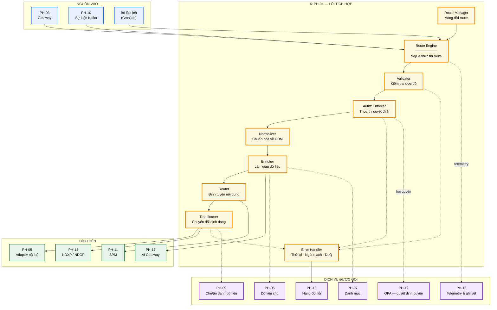
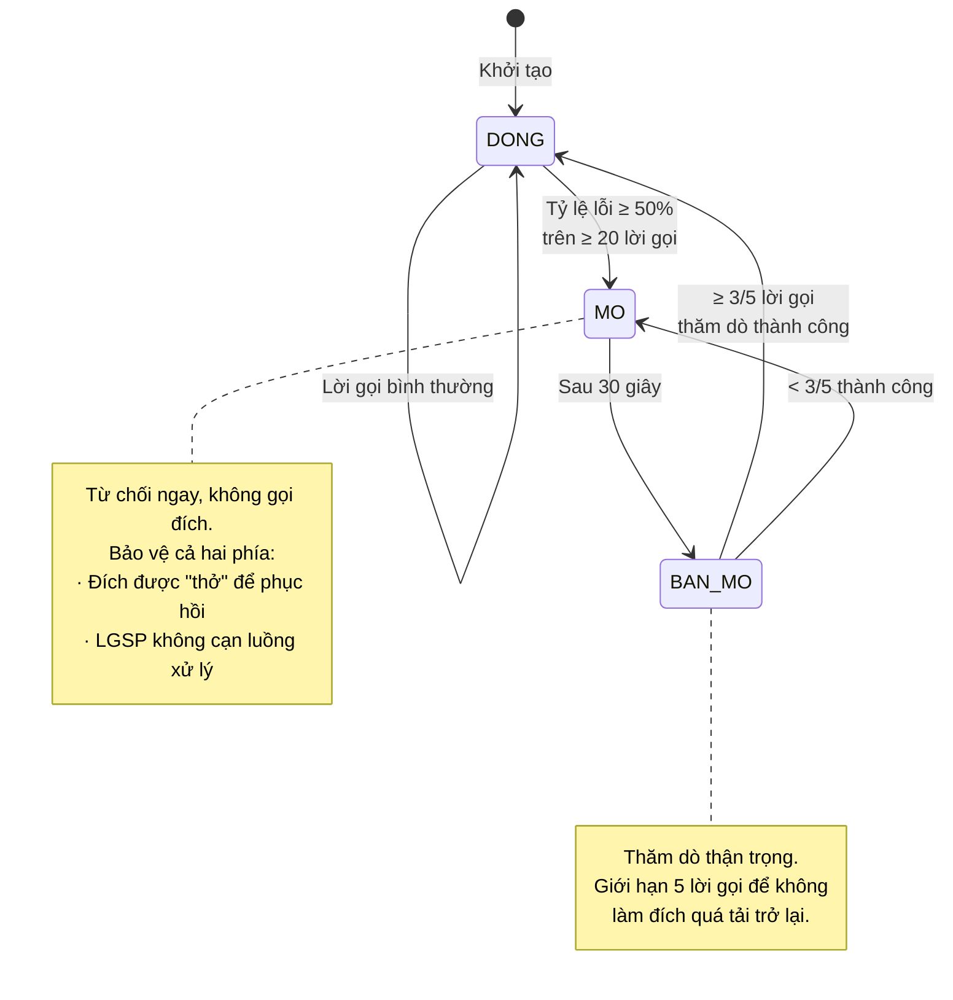
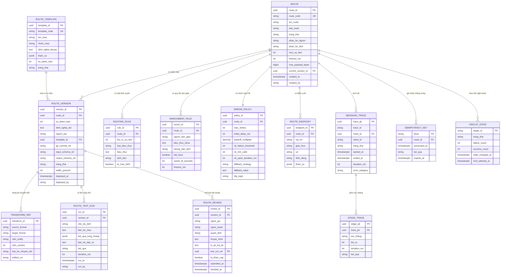

# SRS — PH-04: Lõi Tích hợp & Điều phối

| Thuộc tính | Giá trị |
|---|---|
| **Mã phân hệ** | PH-04 |
| **Tên** | Lõi Tích hợp & Điều phối (Integration Core) |
| **Nhóm** | Data Plane |
| **Mức bắt buộc** | M — Bắt buộc |
| **Phiên bản** | 1.0 |
| **Ngày** | 03/8/2026 |
| **Công nghệ chủ đạo** | Apache Camel 4.x trên Quarkus (native); trình thiết kế luồng Kaoto ([ADR-015](../05-adr/README.md#adr-015)) |

---

## M1. Giới thiệu

### 1.1. Mục đích

PH-04 là **engine xử lý bản tin** của LGSP — nơi mọi yêu cầu trao đổi dữ liệu giữa các hệ thống thông tin được tiếp nhận, kiểm tra, chuẩn hóa, làm giàu, định tuyến và chuyển giao. Đây là phân hệ hiện thực trực tiếp yêu cầu "trục tích hợp (ESB)" tại CV 631/THH-THHT.

Tài liệu này đặc tả đầy đủ yêu cầu chức năng, dữ liệu, giao diện và chất lượng của PH-04 ở mức đủ chi tiết để thi công và nghiệm thu.

### 1.2. Phạm vi

**PH-04 chịu trách nhiệm:**

| # | Trách nhiệm |
|---|---|
| 1 | Tiếp nhận bản tin từ Gateway (PH-03) và từ hàng đợi sự kiện (PH-10) |
| 2 | Kiểm tra tính hợp lệ cấu trúc bản tin theo lược đồ |
| 3 | Gọi kiểm tra quyền tập trung và thực thi quyết định |
| 4 | Chuẩn hóa bản tin về Mô hình dữ liệu chuẩn (CDM) |
| 5 | Làm giàu bản tin bằng dữ liệu chủ và danh mục dùng chung |
| 6 | Định tuyến theo nội dung, theo cấu hình, theo trạng thái hệ thống đích |
| 7 | Chuyển đổi định dạng sang chuẩn hệ thống đích |
| 8 | Thực thi chiến lược xử lý lỗi ba tầng và đẩy bản tin lỗi vào DLQ |
| 9 | Phát sinh dữ liệu ghi vết và telemetry cho mỗi bản tin |
| 10 | Quản lý vòng đời route: nạp, kích hoạt, tạm dừng, gỡ bỏ |
| 11 | Cung cấp năng lực **thiết kế luồng bằng giao diện trực quan**, không bắt buộc viết Camel DSL bằng tay |
| 12 | Chạy thử luồng trên môi trường thử nghiệm và điều hành quy trình duyệt trước khi triển khai |

**PH-04 KHÔNG chịu trách nhiệm:**

| # | Không làm | Thuộc phân hệ |
|---|---|---|
| 1 | Xác thực người dùng, cấp và xác minh token | PH-12 |
| 2 | Ra quyết định cho phép/từ chối truy cập (chỉ *gọi* và *thực thi*) | PH-12 |
| 3 | Chấm dứt TLS, chống DDoS, giới hạn tần suất | PH-03 |
| 4 | Giao tiếp kỹ thuật trực tiếp với hệ thống bên ngoài | PH-05, PH-14 |
| 5 | Lưu trữ và quản lý dữ liệu chủ, danh mục | PH-06, PH-07 |
| 6 | Lưu trữ và hiển thị nhật ký, chỉ số | PH-13 |
| 7 | Giao diện xử lý bản tin lỗi | PH-18 |
| 8 | Điều phối quy trình nghiệp vụ dài hạn có tác vụ người dùng | PH-11 |
| 9 | Đưa định nghĩa luồng đã duyệt ra môi trường chạy | Argo CD ([ADR-010](../05-adr/README.md#adr-010)) |

### 1.3. Tài liệu tham chiếu

| Mã | Tài liệu |
|---|---|
| [KT] | [Kiến trúc hệ thống — mục 5 Kiến trúc tích hợp](../02-architecture/README.md#5-kiến-trúc-tích-hợp--lõi-apache-camel) |
| [LT] | [Luồng nghiệp vụ F-03, F-04, F-05, F-06, F-10](../03-flows/README.md) |
| [PL] | [Cơ sở pháp lý và ma trận CMP](../01-legal/README.md) |
| [ADR] | [ADR-001 Camel](../05-adr/README.md#adr-001), [ADR-002 Quarkus](../05-adr/README.md#adr-002), [ADR-010 GitOps](../05-adr/README.md#adr-010), [ADR-013 CDM](../05-adr/README.md#adr-013), [ADR-015 Kaoto](../05-adr/README.md#adr-015), [ADR-017 XYFlow](../05-adr/README.md#adr-017) |
| [UX] | Mẫu tương tác cấu hình kiểu [n8n](https://n8n.io/) — xem §3.6.1 và UI-04-07 / UI-04-10; **không** nhúng engine n8n |
| [TT] | [Tác động TTQGS](../06-impact/README.md) |
| [CV631] | Công văn 631/THH-THHT ngày 21/5/2020 — yêu cầu chức năng LGSP |

---

## M2. Mô tả tổng quan

### 2.1. Vị trí trong kiến trúc



**Thuyết minh sơ đồ.** PH-04 nhận bản tin từ ba nguồn có đặc tính khác nhau: Gateway (đồng bộ, cần phản hồi ngay), Kafka (bất đồng bộ, chịu tải cao), bộ lập lịch (theo chu kỳ). Cả ba đi vào cùng một Route Engine và chảy qua cùng chuỗi xử lý — đây là chủ đích để mọi bản tin, bất kể nguồn, đều chịu cùng mức kiểm soát.

Đường nét đứt tới nhóm "dịch vụ được gọi" thể hiện quan hệ *tham vấn*: PH-04 hỏi PH-12 về quyền nhưng **PH-04 mới là nơi thực thi** quyết định. Phân vai này quan trọng — nếu PH-12 sập, PH-04 áp dụng chính sách mặc định từ chối thay vì cho qua.

### 2.2. Tác nhân

| Tác nhân | Loại | Tương tác với PH-04 |
|---|---|---|
| Hệ thống thông tin thành viên | Hệ thống | Gửi yêu cầu qua PH-03; nhận yêu cầu từ PH-04 |
| Cán bộ phát triển tích hợp | Người | Dựng luồng bằng trình thiết kế trực quan hoặc viết DSL, chạy thử, gửi duyệt |
| Người duyệt luồng tích hợp | Người | Rà soát và phê duyệt hoặc trả lại luồng trước khi triển khai; **không được** là người thiết kế ra luồng đó |
| Quản trị viên nền tảng | Người | Kích hoạt/tạm dừng route, xem tình trạng |
| Cán bộ vận hành | Người | Theo dõi, xử lý sự cố route |
| PH-03 Gateway | Hệ thống | Chuyển tiếp yêu cầu đã xác thực |
| PH-10 Kafka | Hệ thống | Cung cấp sự kiện; nhận sự kiện phát ra |
| PH-12 IAM/OPA | Hệ thống | Trả quyết định cho phép/từ chối |
| PH-06/PH-07 | Hệ thống | Cung cấp dữ liệu làm giàu |
| PH-13 | Hệ thống | Nhận telemetry và bản ghi kiểm toán |
| PH-18 | Hệ thống | Nhận bản tin lỗi; yêu cầu phát lại |

### 2.3. Giả định

| Mã | Giả định |
|---|---|
| GD-01 | Mọi bản tin vào PH-04 từ Gateway đã được xác thực; PH-04 không xác thực lại danh tính |
| GD-02 | PH-05 và PH-14 che giấu hoàn toàn đặc thù kỹ thuật của hệ thống bên ngoài |
| GD-03 | Lược đồ CDM đã được đăng ký tại Schema Registry trước khi route sử dụng |
| GD-04 | Hệ thống đích chấp nhận ngữ nghĩa "ít nhất một lần" và xử lý idempotent |
| GD-05 | Đồng hồ các node được đồng bộ NTP, sai lệch dưới 100ms |

### 2.4. Ràng buộc

| Mã | Ràng buộc | Nguồn |
|---|---|---|
| RB-01 | Phải hỗ trợ HTTP, HTTPS, WebSocket, POP, IMAP, SMTP, JMS, AMQP, MQTT | CV 631 |
| RB-02 | Phải hỗ trợ JSON, XML, SOAP | CV 631 |
| RB-03 | Thời gian phản hồi tối đa 30 giây | CV 631 |
| RB-04 | Hoạt động 24/7 liên tục | CV 631 |
| RB-05 | Kiến trúc SOA, module hóa, thành phần độc lập | CV 631 |
| RB-06 | Hỗ trợ cluster xử lý song song | CV 631 |
| RB-07 | Toàn bộ công nghệ phải là mã nguồn mở | Yêu cầu dự án |
| RB-08 | Triển khai trên Kubernetes, mở rộng ngang | Cloud First — TTQGS |
| RB-09 | Không được lưu trữ dữ liệu nghiệp vụ lâu dài | Nguyên tắc kiến trúc |
| RB-10 | Định nghĩa luồng chỉ ra môi trường chạy qua kho Git và Argo CD; trình thiết kế **không** được ghi thẳng vào cụm | [ADR-010](../05-adr/README.md#adr-010), [ADR-015](../05-adr/README.md#adr-015) |
| RB-11 | Định nghĩa luồng do trình thiết kế sinh ra phải là Camel YAML DSL chuẩn, đọc và sửa lại được bằng tay | [ADR-015](../05-adr/README.md#adr-015) |

### 2.5. Phụ thuộc phân hệ

| Phụ thuộc | Loại | Hành vi khi phụ thuộc không khả dụng |
|---|---|---|
| PH-12 (OPA) | **Cứng** | Từ chối bản tin (fail-closed) — an toàn hơn cho qua |
| PH-05, PH-14 | **Cứng** | Ngắt mạch, trả lỗi thân thiện, đẩy DLQ nếu bất đồng bộ |
| PH-06, PH-07 | **Mềm** | Bỏ qua bước làm giàu, gắn cờ `enriched=false`, tiếp tục |
| PH-09 | **Cứng** với dữ liệu nhạy cảm | Từ chối trả dữ liệu chưa qua xử lý che/ẩn danh |
| PH-10 (Kafka) | **Mềm** với luồng đồng bộ | Luồng đồng bộ vẫn chạy; luồng sự kiện tạm dừng |
| PH-13 | **Mềm** | Ghi telemetry vào bộ đệm cục bộ, gửi lại sau |
| PH-18 (DLQ) | **Cứng** | Nếu không ghi được DLQ thì không được xác nhận bản tin |

**Nguyên tắc phân biệt cứng/mềm.** Phụ thuộc **cứng** là thứ mà thiếu nó bản tin sẽ sai về an toàn hoặc mất dữ liệu. Phụ thuộc **mềm** chỉ làm giảm chất lượng kết quả. Cách phân loại này quyết định hành vi suy giảm — hiện thực nguyên tắc NT-08 tại [KT].

---

## M3. Yêu cầu chức năng

### 3.1. Nhóm A — Tiếp nhận và kiểm tra bản tin

#### FR-04-001 — Tiếp nhận bản tin đồng bộ · **M**

| Mục | Nội dung |
|---|---|
| **Mô tả** | Tiếp nhận yêu cầu HTTP đã được PH-03 xác thực và chuyển tiếp |
| **Tác nhân** | PH-03 Gateway |
| **Tiền điều kiện** | Route ở trạng thái `ACTIVE`; yêu cầu mang token hợp lệ và `traceId` |
| **Đầu vào** | Phương thức HTTP · đường dẫn · tiêu đề (`Authorization`, `X-Trace-Id`, `X-Client-Id`, `Content-Type`) · thân bản tin |
| **Xử lý** | 1. Trích `traceId`; nếu thiếu thì sinh mới và ghi cảnh báo<br>2. Đưa vào ngữ cảnh trao đổi (Exchange) các thuộc tính: `traceId`, `clientId`, `routeId`, `receivedAt`<br>3. Ghi chỉ số `messages_received_total` theo nhãn route và client<br>4. Chuyển sang bước kiểm tra lược đồ |
| **Đầu ra** | Exchange đã khởi tạo với đầy đủ thuộc tính ngữ cảnh |
| **Ngoại lệ** | E1: `Content-Type` không được hỗ trợ → `415`<br>E2: Thân bản tin vượt kích thước tối đa → `413`<br>E3: Route không tồn tại hoặc không `ACTIVE` → `404` |

#### FR-04-002 — Tiếp nhận bản tin bất đồng bộ từ Kafka · **M**

| Mục | Nội dung |
|---|---|
| **Mô tả** | Tiêu thụ sự kiện từ chủ đề Kafka do PH-10 quản lý |
| **Tác nhân** | PH-10 |
| **Tiền điều kiện** | Route kiểu `EVENT` ở trạng thái `ACTIVE`; nhóm tiêu thụ đã đăng ký |
| **Đầu vào** | Khóa bản ghi · giá trị · tiêu đề Kafka (chứa `traceId`, `schemaId`, `eventType`) · phân vùng · offset |
| **Xử lý** | 1. Giải mã giá trị theo `schemaId` lấy từ Schema Registry<br>2. Kiểm tra bản tin đã xử lý chưa qua **kho khóa idempotent** (khóa = `eventType + businessKey + version`)<br>3. Nếu đã xử lý → bỏ qua, xác nhận offset, ghi chỉ số `messages_duplicate_total`<br>4. Nếu chưa → đưa vào chuỗi xử lý<br>5. Chỉ xác nhận offset **sau khi** xử lý thành công hoặc đã ghi DLQ |
| **Đầu ra** | Exchange khởi tạo; offset được xác nhận đúng thời điểm |
| **Ngoại lệ** | E1: Không giải mã được theo lược đồ → DLQ, xác nhận offset<br>E2: Schema Registry không phản hồi → tạm dừng tiêu thụ, thử lại theo backoff<br>E3: Kho khóa idempotent lỗi → xử lý tiếp nhưng gắn cờ `idempotencyUnchecked=true` |

**Ghi chú thiết kế FR-04-002.** Bước 5 là điểm cốt lõi bảo đảm không mất bản tin: xác nhận offset trước khi xử lý xong sẽ mất bản tin nếu pod chết giữa chừng. Đổi lại, ngữ nghĩa trở thành "ít nhất một lần" nên bước 2 (kiểm tra trùng) là bắt buộc, không tùy chọn.

#### FR-04-003 — Kiểm tra tính hợp lệ cấu trúc · **M**

| Mục | Nội dung |
|---|---|
| **Mô tả** | Kiểm tra bản tin đúng lược đồ đã đăng ký trước khi xử lý tiếp |
| **Tiền điều kiện** | Route có khai báo `inputSchemaRef` |
| **Đầu vào** | Thân bản tin · tham chiếu lược đồ (JSON Schema Draft 2020-12 hoặc XSD 1.1) |
| **Xử lý** | 1. Nạp lược đồ từ bộ nhớ đệm cục bộ; nếu thiếu thì lấy từ Schema Registry và lưu đệm<br>2. Kiểm tra bản tin theo lược đồ<br>3. Gom **toàn bộ** lỗi vi phạm (không dừng ở lỗi đầu tiên)<br>4. Nếu hợp lệ → chuyển bước tiếp |
| **Đầu ra** | Bản tin đã kiểm chứng, hoặc danh sách lỗi có đường dẫn trường |
| **Ngoại lệ** | E1: Không hợp lệ → `400` kèm danh sách lỗi `{path, message, rejectedValue}`; **không thử lại**<br>E2: Không tải được lược đồ → dùng bản đệm gần nhất; nếu không có → `503` |

#### FR-04-004 — Kiểm tra kích thước và định dạng đính kèm · **S**

| Mục | Nội dung |
|---|---|
| **Mô tả** | Với bản tin có tệp đính kèm, kiểm tra kích thước, phần mở rộng và quét mã độc |
| **Đầu vào** | Danh sách tệp đính kèm hoặc URI tham chiếu |
| **Xử lý** | 1. Kiểm tra tổng kích thước ≤ hạn mức route<br>2. Kiểm tra phần mở rộng thuộc danh sách cho phép<br>3. Gọi dịch vụ quét mã độc<br>4. Nếu tệp > 10MB → áp dụng mẫu **Claim Check**: lưu MinIO, thay bằng URI |
| **Đầu ra** | Bản tin với đính kèm đã kiểm chứng hoặc thay bằng URI |
| **Ngoại lệ** | E1: Vượt kích thước → `413`<br>E2: Phần mở rộng không cho phép → `415`<br>E3: Phát hiện mã độc → `422`, ghi **cảnh báo an ninh** cho PH-13, chặn bản tin |

### 3.2. Nhóm B — Ủy quyền

#### FR-04-005 — Gọi kiểm tra quyền và thực thi quyết định · **M**

| Mục | Nội dung |
|---|---|
| **Mô tả** | Hỏi PH-12 (OPA) về quyền truy cập và thực thi kết quả |
| **Tiền điều kiện** | Bản tin đã qua kiểm tra lược đồ |
| **Đầu vào** | `clientId` · vai trò và phạm vi từ token · mã tài nguyên · hành động (`read`/`write`) · phân loại mật của dữ liệu · mục đích sử dụng |
| **Xử lý** | 1. Dựng yêu cầu quyết định gửi OPA<br>2. Tra bộ nhớ đệm quyết định (khóa = băm của đầu vào, thời hạn 60 giây)<br>3. Nếu trượt đệm → gọi OPA (thời hạn chờ 200ms)<br>4. Nhận `{allow, reason, fieldMask, privacyMode}`<br>5. Nếu `allow=false` → dừng, ghi vết truy cập bị từ chối<br>6. Nếu `allow=true` → lưu `fieldMask` và `privacyMode` vào ngữ cảnh để dùng ở bước xuất |
| **Đầu ra** | Quyết định cho phép kèm mặt nạ trường và chế độ bảo vệ dữ liệu |
| **Ngoại lệ** | E1: `allow=false` → `403` kèm lý do<br>E2: OPA quá hạn chờ hoặc lỗi → **từ chối** (`503`), **không** cho qua<br>E3: Dữ liệu phân loại `MAT` → từ chối tuyệt đối, không phụ thuộc kết quả OPA |

**Ghi chú thiết kế FR-04-005.** Ngoại lệ E2 áp dụng nguyên tắc *fail-closed*. Cho qua khi không kiểm tra được quyền là lỗi bảo mật nghiêm trọng — thà từ chối dịch vụ còn hơn rò rỉ dữ liệu. E3 là chốt chặn độc lập cho CMP-23: ngay cả khi chính sách OPA bị cấu hình sai, dữ liệu mật vẫn không đi ra được.

### 3.3. Nhóm C — Chuẩn hóa, làm giàu, chuyển đổi

#### FR-04-006 — Chuẩn hóa về Mô hình dữ liệu chuẩn · **M**

| Mục | Nội dung |
|---|---|
| **Mô tả** | Chuyển bản tin từ định dạng hệ thống nguồn về CDM nội bộ |
| **Đầu vào** | Bản tin định dạng nguồn · tham chiếu bộ chuyển đổi (`transformRef`) |
| **Xử lý** | 1. Chọn bộ chuyển đổi theo cặp `(sourceFormat, cdmEntity, version)`<br>2. Áp dụng chuyển đổi (XSLT 3.0 cho XML, JSLT cho JSON, ánh xạ bean cho POJO)<br>3. Bổ sung khối `_metadata`: `nguonDuLieu`, `thoiDiemCapNhat`, `mucDoTinCay`, `phanLoaiMat`<br>4. Kiểm tra kết quả đúng lược đồ CDM |
| **Đầu ra** | Bản tin CDM hợp lệ có khối `_metadata` đầy đủ |
| **Ngoại lệ** | E1: Không tìm thấy bộ chuyển đổi → `500`, cảnh báo cấu hình<br>E2: Chuyển đổi lỗi → DLQ kèm bản tin gốc<br>E3: Kết quả không đúng lược đồ CDM → DLQ, cảnh báo lỗi bộ chuyển đổi |

#### FR-04-007 — Ánh xạ sang Từ điển dữ liệu dùng chung quốc gia · **M**

| Mục | Nội dung |
|---|---|
| **Mô tả** | Ánh xạ trường CDM sang từ điển dữ liệu quốc gia trước khi gửi lên cấp quốc gia |
| **Tiền điều kiện** | Bản tin có đích đến là NDXP/NDOP |
| **Đầu vào** | Bản tin CDM · bảng ánh xạ từ PH-07 |
| **Xử lý** | 1. Lấy bảng ánh xạ theo thực thể và phiên bản từ điển<br>2. Ánh xạ tên trường và giá trị mã danh mục<br>3. Kiểm tra **độ phủ ánh xạ**: mọi trường bắt buộc phải ánh xạ được<br>4. Ghi chỉ số `mapping_coverage_ratio` |
| **Đầu ra** | Bản tin theo từ điển quốc gia |
| **Ngoại lệ** | E1: Trường bắt buộc không ánh xạ được → **chặn**, `422`, cảnh báo cho quản trị dữ liệu<br>E2: Bảng ánh xạ chưa ban hành → dùng ánh xạ tạm, gắn cờ `mappingProvisional=true`, ghi cảnh báo |

**Ghi chú.** Yêu cầu này đáp ứng CMP-30 phát sinh từ TTQGS ([TT] mục 3.3). Ngoại lệ E2 xử lý tình huống thực tế là từ điển quốc gia chưa công bố chi tiết — cho phép vận hành nhưng đánh dấu rõ để rà soát sau.

#### FR-04-008 — Làm giàu bản tin · **M**

| Mục | Nội dung |
|---|---|
| **Mô tả** | Bổ sung dữ liệu từ dữ liệu chủ (PH-06) và danh mục dùng chung (PH-07) |
| **Đầu vào** | Bản tin CDM · danh sách quy tắc làm giàu của route |
| **Xử lý** | 1. Với mỗi quy tắc: tra bộ nhớ đệm cục bộ → đệm chia sẻ (Valkey) → gọi dịch vụ nguồn<br>2. Gọi song song các quy tắc độc lập nhau<br>3. Gộp kết quả vào bản tin theo đường dẫn khai báo<br>4. Thời hạn đệm theo loại: danh mục 24 giờ, dữ liệu chủ 15 phút |
| **Đầu ra** | Bản tin đã làm giàu |
| **Ngoại lệ** | E1: Nguồn làm giàu lỗi và quy tắc `required=false` → bỏ qua, gắn `enrichmentPartial=true`, tiếp tục<br>E2: Nguồn lỗi và `required=true` → xử lý theo chiến lược lỗi của route<br>E3: Quá hạn chờ (mặc định 300ms) → như E1 |

#### FR-04-009 — Áp dụng che, giả danh hóa, ẩn danh hóa · **M**

| Mục | Nội dung |
|---|---|
| **Mô tả** | Áp dụng bảo vệ dữ liệu theo `privacyMode` và `fieldMask` nhận từ FR-04-005 |
| **Đầu vào** | Bản tin CDM · `fieldMask` · `privacyMode` (`none`/`mask`/`pseudonymize`/`anonymize`) |
| **Xử lý** | 1. Nếu `privacyMode = none` và `fieldMask` rỗng → bỏ qua<br>2. Ngược lại gọi PH-09 với bản tin và tham số<br>3. Nhận bản tin đã xử lý<br>4. Ghi vết: trường nào bị che, chế độ nào áp dụng |
| **Đầu ra** | Bản tin đã áp dụng bảo vệ dữ liệu |
| **Ngoại lệ** | E1: PH-09 lỗi và bản tin chứa trường nhạy cảm → **từ chối** (`503`)<br>E2: PH-09 lỗi và bản tin không chứa trường nhạy cảm → tiếp tục, ghi cảnh báo |

#### FR-04-010 — Chuyển đổi sang định dạng hệ thống đích · **M**

| Mục | Nội dung |
|---|---|
| **Mô tả** | Chuyển bản tin CDM sang định dạng mà hệ thống đích chấp nhận |
| **Đầu vào** | Bản tin CDM · đặc tả định dạng đích |
| **Xử lý** | 1. Chọn bộ chuyển đổi theo `(cdmEntity, targetFormat, version)`<br>2. Áp dụng chuyển đổi<br>3. Với đích SOAP: dựng phong bì SOAP đúng đặc tả WSDL<br>4. Với đích cần ký số: chuyển PH-14 xử lý ký |
| **Đầu ra** | Bản tin định dạng đích |
| **Ngoại lệ** | E1: Không có bộ chuyển đổi → `500`, cảnh báo cấu hình<br>E2: Chuyển đổi lỗi → theo chiến lược lỗi |

### 3.4. Nhóm D — Định tuyến

#### FR-04-011 — Định tuyến theo nội dung · **M**

| Mục | Nội dung |
|---|---|
| **Mô tả** | Chọn đích đến dựa trên nội dung bản tin (Content-Based Router) |
| **Đầu vào** | Bản tin CDM · tập luật định tuyến của route |
| **Xử lý** | 1. Duyệt luật theo thứ tự ưu tiên giảm dần<br>2. Với mỗi luật, đánh giá biểu thức điều kiện (JSONPath / XPath / Simple)<br>3. Luật đầu tiên khớp quyết định đích đến<br>4. Nếu không luật nào khớp → dùng đích mặc định |
| **Đầu ra** | Định danh đích đến |
| **Ngoại lệ** | E1: Không luật nào khớp và không có đích mặc định → DLQ, cảnh báo cấu hình<br>E2: Biểu thức điều kiện lỗi cú pháp → `500`, cảnh báo, không nạp route |

#### FR-04-012 — Tách và gộp bản tin · **S**

| Mục | Nội dung |
|---|---|
| **Mô tả** | Tách bản tin lô thành nhiều bản tin đơn (Splitter) và gộp phản hồi (Aggregator) |
| **Đầu vào** | Bản tin lô · biểu thức tách · chiến lược gộp · điều kiện kết thúc gộp |
| **Xử lý** | 1. Tách theo biểu thức, giữ `correlationId` chung<br>2. Xử lý song song với mức song song cấu hình được (mặc định 10)<br>3. Gộp theo `correlationId`<br>4. Kết thúc gộp khi: đủ số phần tử **hoặc** quá hạn chờ (mặc định 30 giây) |
| **Đầu ra** | Bản tin gộp chứa toàn bộ kết quả và danh sách phần tử lỗi |
| **Ngoại lệ** | E1: Quá hạn gộp → trả kết quả một phần, đánh dấu `partial=true`<br>E2: Một phần tử lỗi → không hủy cả lô; ghi vào danh sách lỗi của kết quả |

#### FR-04-013 — Gọi song song nhiều hệ thống · **S**

| Mục | Nội dung |
|---|---|
| **Mô tả** | Gửi cùng một yêu cầu tới nhiều hệ thống, gộp kết quả (Scatter-Gather) |
| **Đầu vào** | Bản tin · danh sách đích · chiến lược gộp |
| **Xử lý** | 1. Nhân bản bản tin cho từng đích<br>2. Gọi song song, mỗi đích có thời hạn chờ riêng<br>3. Gộp phản hồi theo chiến lược khai báo |
| **Đầu ra** | Bản tin gộp |
| **Ngoại lệ** | E1: Một đích lỗi → gộp phần còn lại, đánh dấu đích lỗi<br>E2: Toàn bộ đích lỗi → theo chiến lược lỗi của route |

#### FR-04-014 — Phát sự kiện ra Kafka · **M**

| Mục | Nội dung |
|---|---|
| **Mô tả** | Phát sự kiện thay đổi ra chủ đề Kafka cho các bên đăng ký |
| **Đầu vào** | Bản tin CDM · chủ đề đích · biểu thức khóa phân vùng |
| **Xử lý** | 1. Tính khóa phân vùng theo **định danh thực thể** (số định danh cá nhân, mã doanh nghiệp)<br>2. Gắn tiêu đề: `traceId`, `schemaId`, `eventType`, `producedAt`, `sourceRoute`<br>3. Gửi với `acks=all`<br>4. Chờ xác nhận trước khi coi là thành công |
| **Đầu ra** | Sự kiện đã ghi vào Kafka |
| **Ngoại lệ** | E1: Không gửi được → thử lại theo backoff; sau 3 lần → DLQ<br>E2: Không tính được khóa phân vùng → dùng khóa ngẫu nhiên, ghi **cảnh báo** (rủi ro sai thứ tự) |

**Ghi chú.** Bước 1 quyết định tính đúng đắn về thứ tự sự kiện: mọi thay đổi của cùng một công dân phải vào cùng phân vùng, nếu không sẽ xảy ra hiện tượng cập nhật cũ ghi đè cập nhật mới (xem [LT] F-05).

### 3.5. Nhóm E — Xử lý lỗi

#### FR-04-015 — Phân loại lỗi · **M**

| Mục | Nội dung |
|---|---|
| **Mô tả** | Phân loại lỗi để chọn đúng chiến lược xử lý |
| **Đầu vào** | Ngoại lệ phát sinh · mã trạng thái HTTP (nếu có) · ngữ cảnh |
| **Xử lý** | Áp dụng bảng phân loại:<br>· **Tạm thời**: quá hạn chờ, mất kết nối, `502`, `503`, `504` → thử lại<br>· **Nghiệp vụ**: `400`, `404`, `409`, `422`, lỗi lược đồ, lỗi chuyển đổi → **không** thử lại<br>· **Bảo mật**: `401`, `403` → không thử lại, ghi cảnh báo an ninh<br>· **Không xác định** → xử lý như tạm thời nhưng giới hạn 1 lần thử lại |
| **Đầu ra** | Nhãn phân loại lỗi |
| **Ngoại lệ** | Không có — mọi lỗi đều được phân loại vào một trong bốn nhóm |

#### FR-04-016 — Thử lại có độ trễ tăng dần · **M**

| Mục | Nội dung |
|---|---|
| **Mô tả** | Thử lại lỗi tạm thời với khoảng chờ tăng theo cấp số nhân |
| **Đầu vào** | Bản tin · lần thử hiện tại · cấu hình thử lại của route |
| **Xử lý** | 1. Mặc định: tối đa 3 lần, chờ ban đầu 1000ms, hệ số nhân 2, có nhiễu ngẫu nhiên ±20%<br>2. Trước mỗi lần thử, kiểm tra ngân sách thời gian còn lại của bản tin<br>3. Nếu thời gian đã dùng + khoảng chờ > 30 giây → dừng thử lại ngay |
| **Đầu ra** | Kết quả thành công, hoặc chuyển sang bước DLQ |
| **Ngoại lệ** | E1: Hết số lần thử → DLQ<br>E2: Hết ngân sách thời gian → DLQ với lý do `TIMEOUT_BUDGET_EXCEEDED` |

**Ghi chú.** Nhiễu ngẫu nhiên ở bước 1 tránh hiện tượng đồng loạt thử lại cùng lúc gây "bão yêu cầu" khi hệ thống đích vừa phục hồi. Bước 3 bảo đảm không vi phạm trần 30 giây của CV 631 (RB-03).

#### FR-04-017 — Ngắt mạch bảo vệ · **M**

| Mục | Nội dung |
|---|---|
| **Mô tả** | Ngừng gọi hệ thống đích khi phát hiện hỏng kéo dài |
| **Đầu vào** | Thống kê lời gọi tới đích trong cửa sổ trượt |
| **Xử lý** | Máy trạng thái ba trạng thái:<br>· **ĐÓNG** → **MỞ** khi tỷ lệ lỗi ≥ 50% trên tối thiểu 20 lời gọi<br>· **MỞ**: từ chối ngay, không gọi đích, giữ 30 giây<br>· **MỞ** → **BÁN MỞ** sau 30 giây, cho phép tối đa 5 lời gọi thăm dò<br>· **BÁN MỞ** → **ĐÓNG** nếu ≥ 3/5 lời gọi thành công; ngược lại quay lại **MỞ** |
| **Đầu ra** | Cho phép gọi, hoặc kích hoạt phương án dự phòng |
| **Ngoại lệ** | E1: Mạch **MỞ** và luồng đồng bộ → `503` kèm thông báo thân thiện<br>E2: Mạch **MỞ** và luồng bất đồng bộ → DLQ trực tiếp, không thử vô ích<br>E3: Chuyển sang **MỞ** → phát cảnh báo mức **NGHIÊM TRỌNG** cho PH-13 |



#### FR-04-018 — Đẩy bản tin lỗi vào DLQ · **M**

| Mục | Nội dung |
|---|---|
| **Mô tả** | Ghi bản tin không xử lý được vào hàng đợi lỗi kèm đầy đủ ngữ cảnh |
| **Đầu vào** | Bản tin gốc · ngoại lệ · ngữ cảnh xử lý |
| **Xử lý** | Dựng bản ghi DLQ gồm **bắt buộc đủ**: `dlqId`, `traceId`, `routeId`, `originalPayload`, `currentPayload`, `errorClass`, `errorMessage`, `stackTraceHash`, `attemptCount`, `firstFailedAt`, `lastFailedAt`, `sourceSystem`, `targetSystem`, `errorCategory`, `replayable`<br>Ghi vào chủ đề DLQ tương ứng và thông báo PH-18 |
| **Đầu ra** | Bản ghi DLQ đã lưu bền vững |
| **Ngoại lệ** | E1: Không ghi được DLQ → **không xác nhận** offset Kafka để bản tin được xử lý lại; với luồng đồng bộ trả `500`<br>E2: Bản tin vượt kích thước tối đa của DLQ → lưu thân bản tin vào MinIO, DLQ giữ URI |

**Ghi chú.** Danh sách trường ở cột "Xử lý" là **tối thiểu bắt buộc** — thiếu bất kỳ trường nào thì cán bộ vận hành không chẩn đoán được và bản tin lỗi trở thành rác không xử lý được (xem [LT] F-10).

#### FR-04-019 — Phương án dự phòng · **S**

| Mục | Nội dung |
|---|---|
| **Mô tả** | Trả kết quả thay thế khi đích không khả dụng |
| **Đầu vào** | Cấu hình dự phòng của route |
| **Xử lý** | Theo thứ tự ưu tiên: 1) Trả dữ liệu từ đệm dù đã hết hạn (gắn `stale=true`); 2) Trả giá trị mặc định khai báo; 3) Trả lỗi có cấu trúc kèm hướng dẫn |
| **Đầu ra** | Phản hồi dự phòng |
| **Ngoại lệ** | E1: Không cấu hình dự phòng → trả `503` chuẩn |

### 3.6. Nhóm F — Thiết kế và quản lý vòng đời route

Nhóm này bao trùm toàn bộ đời của một luồng, từ lúc được dựng ra đến lúc ngừng dùng. Mã yêu cầu được cấp theo thứ tự bổ sung tài liệu, **không** theo thứ tự thực hiện. Trình tự nghiệp vụ thực tế là:

```
FR-04-026 thiết kế → FR-04-027 kiểm tra hợp lệ → FR-04-028 chạy thử
→ FR-04-029 duyệt → FR-04-020 nạp và kích hoạt → FR-04-022 chuyển lưu lượng
→ FR-04-021 tạm dừng / gỡ bỏ
```

`FR-04-030` (thư viện mẫu luồng) là đầu vào tùy chọn cho bước thiết kế.

#### FR-04-020 — Nạp và kích hoạt route · **M**

| Mục | Nội dung |
|---|---|
| **Mô tả** | Nạp định nghĩa route và đưa vào hoạt động không cần khởi động lại |
| **Tác nhân** | Quản trị viên nền tảng, PH-02 |
| **Đầu vào** | Định nghĩa route (Camel YAML DSL) · siêu dữ liệu route |
| **Xử lý** | 1. Kiểm tra cú pháp định nghĩa<br>2. Kiểm tra tham chiếu: lược đồ, bộ chuyển đổi, đích đến có tồn tại<br>3. Nạp vào ngữ cảnh Camel<br>4. Chuyển trạng thái sang `ACTIVE`<br>5. Ghi sự kiện thay đổi cấu hình cho PH-13 |
| **Đầu ra** | Route hoạt động, tiếp nhận bản tin |
| **Ngoại lệ** | E1: Cú pháp sai → từ chối, trả lỗi kèm vị trí dòng<br>E2: Tham chiếu không tồn tại → từ chối, liệt kê tham chiếu thiếu<br>E3: Trùng `routeId` đang hoạt động → từ chối, yêu cầu dùng chức năng cập nhật |

#### FR-04-021 — Tạm dừng, tiếp tục, gỡ bỏ route · **M**

| Mục | Nội dung |
|---|---|
| **Mô tả** | Điều khiển trạng thái route trong lúc vận hành |
| **Tác nhân** | Quản trị viên nền tảng |
| **Đầu vào** | `routeId` · hành động (`suspend`/`resume`/`remove`) |
| **Xử lý** | · **Tạm dừng**: ngừng nhận bản tin mới, **hoàn tất** bản tin đang xử lý (chờ tối đa 30 giây)<br>· **Tiếp tục**: nhận bản tin trở lại<br>· **Gỡ bỏ**: tạm dừng rồi loại khỏi ngữ cảnh<br>Ghi sự kiện kèm người thực hiện và lý do |
| **Đầu ra** | Route ở trạng thái mới |
| **Ngoại lệ** | E1: Route không tồn tại → `404`<br>E2: Còn bản tin đang xử lý sau 30 giây → buộc dừng, đẩy các bản tin đó vào DLQ |

#### FR-04-022 — Triển khai route theo phiên bản · **S**

| Mục | Nội dung |
|---|---|
| **Mô tả** | Chạy song song hai phiên bản route, chuyển lưu lượng dần |
| **Đầu vào** | `routeId` · phiên bản mới · tỷ lệ lưu lượng |
| **Xử lý** | 1. Nạp phiên bản mới song song phiên bản hiện tại<br>2. Chia lưu lượng theo tỷ lệ khai báo<br>3. Theo dõi tỷ lệ lỗi phiên bản mới<br>4. Tự động quay lui nếu tỷ lệ lỗi phiên bản mới > 2 lần phiên bản cũ |
| **Đầu ra** | Lưu lượng phân chia theo tỷ lệ |
| **Ngoại lệ** | E1: Phiên bản mới lỗi vượt ngưỡng → quay lui tự động, cảnh báo |

#### FR-04-026 — Thiết kế luồng bằng giao diện trực quan · **M**

| Mục | Nội dung |
|---|---|
| **Mô tả** | Dựng và sửa định nghĩa luồng bằng thao tác đồ họa, không bắt buộc gõ Camel DSL. Hệ thống sinh ra Camel YAML DSL tương đương |
| **Tác nhân** | Cán bộ phát triển tích hợp |
| **Tiền điều kiện** | Người dùng có vai trò `INTEGRATION_DEV`; đã chọn mẫu luồng hoặc tạo luồng trống |
| **Đầu vào** | Thao tác trên trình thiết kế: chọn điểm tiếp nhận, thêm/xóa/sắp xếp các chặng xử lý, chọn mẫu EIP, cấu hình tham số từng chặng, khai báo bộ chuyển đổi và điểm đến · hoặc dán sẵn một định nghĩa YAML để mở lại bằng đồ họa |
| **Xử lý** | 1. Nạp danh mục thành phần khả dụng: component, Kamelet, mẫu EIP, bộ chuyển đổi đã đăng ký, danh sách đích hợp lệ qua PH-05/PH-14<br>2. Dựng sơ đồ theo khung chín bước chuẩn tại [KT]; chặng bắt buộc (kiểm tra lược đồ, ủy quyền, ghi vết) hiển thị sẵn và **không cho gỡ**<br>3. Canvas và panel cấu hình tuân thủ nguyên tắc UX §3.6.1 (học n8n): trái→phải, cấu hình một nút, không secret trên node (FR-04-031…037)<br>4. Sinh Camel YAML DSL sau mỗi thay đổi, hiển thị song song với sơ đồ<br>5. Kiểm tra hợp lệ tức thời (FR-04-027)<br>6. Lưu thành phiên bản `DRAFT` kèm `nguon_tao = DESIGNER`<br>7. Ghi sự kiện thay đổi cấu hình cho PH-13 |
| **Đầu ra** | Phiên bản route ở trạng thái `DRAFT` với `dinh_nghia_dsl` là Camel YAML DSL hợp lệ |
| **Ngoại lệ** | E1: Định nghĩa dán vào không phải Camel YAML hợp lệ → báo lỗi kèm vị trí dòng, giữ nguyên bản đang soạn<br>E2: Định nghĩa dùng cấu trúc trình thiết kế chưa hiển thị được → mở ở chế độ soạn văn bản, cảnh báo rõ thay vì hiển thị sai<br>E3: Mất kết nối khi đang soạn → giữ bản nháp cục bộ, khôi phục khi vào lại<br>E4: Hai người sửa cùng một phiên bản `DRAFT` → người lưu sau bị từ chối, được xem khác biệt và tự quyết định gộp |

**Ghi chú về E2.** Trình thiết kế đồ họa không bao giờ phủ hết được mọi cấu trúc Camel. Nguyên tắc ở đây là **thà từ chối hiển thị còn hơn hiển thị sai**: một sơ đồ vẽ thiếu một nhánh xử lý sẽ khiến người dùng tin rằng nhánh đó không tồn tại, và họ sẽ lưu đè mất nó. Đây là hiện thực RB-11.

#### FR-04-027 — Kiểm tra hợp lệ luồng khi thiết kế · **M**

| Mục | Nội dung |
|---|---|
| **Mô tả** | Phát hiện lỗi ngay trong lúc soạn thảo, trước khi luồng được gửi chạy thử hoặc gửi duyệt |
| **Tác nhân** | Cán bộ phát triển tích hợp (tự động kích hoạt) |
| **Đầu vào** | Định nghĩa luồng đang soạn |
| **Xử lý** | Kiểm tra bốn tầng, gắn kết quả vào đúng chặng trên sơ đồ:<br>· **Cú pháp** — định nghĩa là Camel YAML DSL đúng dạng<br>· **Tham chiếu** — lược đồ, bộ chuyển đổi, danh mục, đích đến đều tồn tại và người dùng có quyền dùng<br>· **Quy tắc nghiệp vụ** — đủ chặng bắt buộc (BR-04-001); không gọi thẳng hệ thống ngoài (BR-04-002); `timeout_ms ≤ 30.000` (BR-04-003); tổng thời gian thử lại không vượt hạn chờ (BR-04-004); tối đa một luật định tuyến mặc định (BR-04-014)<br>· **Cảnh báo chất lượng** — chặng không bao giờ đạt tới, luật định tuyến không vét cạn, thiếu chính sách lỗi, đặt tên không theo quy ước |
| **Đầu ra** | Danh sách phát hiện, mỗi mục gồm mức độ (`ERROR`/`WARNING`), chặng liên quan, mô tả và gợi ý sửa |
| **Ngoại lệ** | E1: Không tra được danh mục tham chiếu → hạ cấp xuống kiểm tra cú pháp và quy tắc, nêu rõ phần chưa kiểm được<br>E2: Định nghĩa quá lớn khiến kiểm tra vượt hạn chờ → chỉ kiểm tra phần vừa thay đổi, kiểm tra đầy đủ khi lưu |

**Phân biệt `ERROR` và `WARNING`.** `ERROR` chặn gửi duyệt, `WARNING` thì không. Ranh giới là: vi phạm quy tắc nghiệp vụ hoặc tham chiếu sai luôn là `ERROR` vì chúng chắc chắn gây lỗi khi chạy; các vấn đề về chất lượng thiết kế là `WARNING` vì người thiết kế có thể có lý do chính đáng, và người duyệt sẽ là chốt cuối.

#### FR-04-028 — Chạy thử luồng trên môi trường thử nghiệm · **M**

| Mục | Nội dung |
|---|---|
| **Mô tả** | Cho luồng chạy với dữ liệu mẫu trên môi trường tách biệt để kiểm chứng kết quả trước khi gửi duyệt |
| **Tác nhân** | Cán bộ phát triển tích hợp |
| **Tiền điều kiện** | Phiên bản `DRAFT` không còn phát hiện mức `ERROR` |
| **Đầu vào** | `routeId` · số phiên bản · bản tin mẫu (nhập tay, chọn từ bộ mẫu, hoặc lấy từ một `traceId` đã xảy ra) · chế độ đích: giả lập hoặc hệ thống thử nghiệm thật |
| **Xử lý** | 1. Nạp phiên bản vào ngữ cảnh Camel **tách biệt**, không thuộc cụm phục vụ<br>2. Chuyển route sang trạng thái `TESTING`<br>3. Chạy bản tin mẫu qua đủ các chặng<br>4. Ghi lại đầu vào và đầu ra **của từng chặng**, thời gian mỗi chặng, nhánh định tuyến đã chọn<br>5. Với chế độ giả lập: thay mọi lời gọi ra ngoài bằng phản hồi mẫu đã khai báo<br>6. Lưu kết quả thành bản ghi chạy thử (EN-04-10), giữ 30 ngày<br>7. Gỡ ngữ cảnh thử nghiệm sau khi chạy xong |
| **Đầu ra** | Bản ghi chạy thử: kết quả từng chặng, bản tin đầu ra cuối cùng, thời gian, lỗi nếu có |
| **Ngoại lệ** | E1: Luồng vượt hạn chờ khi chạy thử → dừng, ghi chặng đang treo<br>E2: Chế độ đích thật nhưng hệ thống thử nghiệm không khả dụng → báo lỗi, gợi ý chuyển sang giả lập<br>E3: Bản tin mẫu lấy từ `traceId` có chứa dữ liệu cá nhân → **bắt buộc** đi qua PH-09 để giả danh hóa trước khi dùng làm dữ liệu thử |

**Ghi chú về E3.** Lấy lại bản tin thật từ nhật ký là cách thử hiệu quả nhất vì nó phản ánh đúng dữ liệu ngoài đời, nhưng cũng là con đường ngắn nhất để dữ liệu cá nhân rò rỉ vào môi trường thử nghiệm vốn có kiểm soát lỏng hơn. Giả danh hóa bắt buộc là điều kiện để giữ được cách thử này mà không vi phạm CMP-32.

#### FR-04-029 — Duyệt luồng trước khi triển khai · **M**

| Mục | Nội dung |
|---|---|
| **Mô tả** | Chốt kiểm soát bắt buộc: luồng chỉ được triển khai sau khi một người khác người thiết kế phê duyệt |
| **Tác nhân** | Cán bộ phát triển tích hợp (gửi duyệt) · Người duyệt luồng tích hợp (quyết định) |
| **Tiền điều kiện** | Phiên bản `DRAFT` không còn phát hiện mức `ERROR`; đã có ít nhất một lần chạy thử đạt |
| **Đầu vào** | `routeId` · số phiên bản · thuyết minh thay đổi · kết quả chạy thử tham chiếu |
| **Xử lý** | 1. Chuyển phiên bản sang `PENDING_REVIEW`, khóa không cho sửa tiếp<br>2. Xác định người duyệt hợp lệ: có vai trò `INTEGRATION_REVIEWER` và **khác** người tạo phiên bản (BR-04-016)<br>3. Trình cho người duyệt: sơ đồ luồng, khác biệt so với phiên bản đang chạy, danh sách cảnh báo còn tồn, kết quả chạy thử<br>4. Người duyệt chọn **phê duyệt** hoặc **trả lại** kèm lý do bắt buộc<br>5. Nếu phê duyệt: sinh commit định nghĩa vào kho Git, chuyển phiên bản sang `APPROVED`, chờ Argo CD đồng bộ (RB-10)<br>6. Nếu trả lại: quay về `DRAFT`, mở khóa sửa<br>7. Ghi bản ghi duyệt (EN-04-09) và sự kiện kiểm toán cho PH-13, giữ vĩnh viễn |
| **Đầu ra** | Phiên bản ở `APPROVED` kèm mã commit, hoặc quay về `DRAFT` kèm lý do trả lại |
| **Ngoại lệ** | E1: Người gửi duyệt tự duyệt luồng của mình → từ chối, ghi cảnh báo an ninh<br>E2: Không sinh được commit vào Git → giữ nguyên `PENDING_REVIEW`, cảnh báo quản trị viên; **không** chuyển sang `APPROVED`<br>E3: Phiên bản đang chạy đã đổi kể từ lúc gửi duyệt → cảnh báo người duyệt về khác biệt mới, yêu cầu xác nhận lại<br>E4: Cần triển khai khẩn cấp ngoài giờ → cho phép quy trình rút gọn với người duyệt trực, nhưng ghi nhãn `EMERGENCY` và bắt buộc rà soát bổ sung trong 24 giờ |

**Vì sao chốt duyệt nằm ở PH-04 chứ không ở công cụ thiết kế.** Giao diện đồ họa làm việc dựng luồng trở nên dễ, và cái dễ thứ hai đi kèm là dựng ra luồng sai rồi đẩy thẳng lên chạy. Đặt chốt duyệt trong phân hệ — chứ không trong công cụ — bảo đảm luồng dựng bằng giao diện và luồng viết tay chịu **cùng một mức kiểm soát**, kể cả khi sau này thay công cụ thiết kế khác.

#### FR-04-030 — Thư viện mẫu luồng dùng lại · **S**

| Mục | Nội dung |
|---|---|
| **Mô tả** | Cung cấp bộ mẫu luồng đã chuẩn hóa để dựng luồng mới từ điểm xuất phát đúng thay vì từ trang trắng |
| **Tác nhân** | Cán bộ phát triển tích hợp · Quản trị viên nền tảng (quản lý bộ mẫu) |
| **Đầu vào** | Chọn mẫu · giá trị cho các tham số mà mẫu khai báo (hệ thống nguồn, hệ thống đích, thực thể CDM, lược đồ) |
| **Xử lý** | 1. Liệt kê mẫu theo nhóm: tra cứu đồng bộ, đồng bộ theo sự kiện, chuyển tiếp có lọc, gọi lên cấp quốc gia, xử lý theo lô<br>2. Sinh định nghĩa luồng từ mẫu với tham số đã điền<br>3. Đánh dấu luồng sinh ra là dẫn xuất của mẫu và ghi phiên bản mẫu đã dùng<br>4. Cho phép quản trị viên tạo mẫu mới từ một luồng đang chạy tốt |
| **Đầu ra** | Phiên bản `DRAFT` sinh từ mẫu, sẵn sàng tinh chỉnh |
| **Ngoại lệ** | E1: Thiếu tham số bắt buộc → chặn sinh, chỉ rõ tham số còn thiếu<br>E2: Mẫu tham chiếu thành phần đã ngừng dùng → cảnh báo và gợi ý mẫu thay thế |

**Ghi chú.** Bộ mẫu là cách rẻ nhất để giữ chất lượng thiết kế khi mở quyền dựng luồng cho nhiều người: thay vì trông chờ mọi người nhớ khung chín bước, khung đó nằm sẵn trong mẫu. Đây cũng là biện pháp giảm thiểu đã nêu tại [ADR-015](../05-adr/README.md#adr-015).

### 3.6.1. Nguyên tắc UX học từ n8n (áp cho trình thiết kế)

> **Phân vai mẫu tham chiếu.** [Kaoto](https://kaoto.io/) ([ADR-015](../05-adr/README.md#adr-015)) = catalog Camel + ngữ nghĩa YAML DSL. [n8n](https://n8n.io/) = mẫu **tương tác cấu hình** (canvas và panel một nút) — thuận tiện cho người không phải chuyên gia Camel. Động cơ sơ đồ = XYFlow ([ADR-017](../05-adr/README.md#adr-017)). **Không** chạy workflow bằng runtime n8n; **không** lưu secret trong trình thiết kế (Vault / PH-05).

| Điểm hay của n8n | Áp vào LGSP | Yêu cầu |
|---|---|---|
| Canvas trái→phải, node thẻ có màu theo nhóm, cạnh cong, chèn giữa cạnh bằng `＋` | Sơ đồ PH-04 | UI-04-07 |
| Palette tìm kiếm + kéo thả | Bảng thành phần | UI-04-07 |
| Panel cấu hình một nút: nhóm trường, bắt buộc rõ, mặc định hợp lý | Panel thuộc tính chặng | UI-04-10, FR-04-037 |
| Expression editor + xem trước trên dữ liệu mẫu | Camel Simple / JSONPath / XPath | FR-04-031 |
| Credential / connection picker — không dán secret vào node | Chọn adapter PH-05, đích PH-14, tham chiếu Vault | FR-04-032 |
| Pin data — gắn payload mẫu vào node để thử | Pin bản tin mẫu theo chặng | FR-04-033 |
| Badge “chưa cấu hình đủ” trên node | Required / incomplete | FR-04-034 |
| Highlight đường chạy / kết quả từng node sau execute | Sau chạy thử FR-04-028 | FR-04-035 |
| Biến môi trường `$env` | Biến theo môi trường DEV/UAT/PROD | FR-04-036 |
| IF/Switch thân thiện (thêm nhánh, mặc định) | UI cho `choice` | FR-04-038 |
| Sticky notes trên canvas | Ghi chú nghiệp vụ khi duyệt | FR-04-039 |
| Sub-workflow | Gọi luồng con / `direct:` | FR-04-040 |

#### FR-04-031 — Trình soạn biểu thức với gợi ý và xem trước · **M**

| Mục | Nội dung |
|---|---|
| **Mô tả** | Mọi trường cấu hình dạng biểu thức (Camel Simple, JSONPath, XPath, header/property) được soạn trong editor có gợi ý và xem trước kết quả trên dữ liệu mẫu — thay vì chỉ ô text thuần |
| **Tác nhân** | Cán bộ phát triển tích hợp |
| **Đầu vào** | Trường biểu thức · ngữ cảnh chặng · bản tin mẫu đã pin (FR-04-033) hoặc mẫu chạy thử |
| **Xử lý** | 1. Gợi ý tự động: header đã biết, thuộc tính Exchange, đường dẫn JSON từ lược đồ/CDM đã gắn<br>2. Kiểm tra cú pháp biểu thức tức thời<br>3. Nút **Xem trước**: đánh giá biểu thức trên bản tin mẫu, hiện kết quả hoặc lỗi<br>4. Lưu giá trị đã chuẩn hóa vào định nghĩa YAML |
| **Đầu ra** | Biểu thức hợp lệ gắn vào tham số chặng; bản xem trước (không lưu vào Git trừ khi người dùng chọn) |
| **Ngoại lệ** | E1: Không có dữ liệu mẫu → vẫn cho sửa biểu thức, tắt xem trước kèm gợi ý pin dữ liệu<br>E2: Biểu thức lỗi → `WARNING` trên chặng, chặn gửi duyệt nếu trường đó `required` |

#### FR-04-032 — Chọn kết nối / credential thay vì nhập secret · **M**

| Mục | Nội dung |
|---|---|
| **Mô tả** | Các tham số “đích”, “adapter”, “broker”, “HTTP auth” được chọn từ danh mục kết nối đã đăng ký — không dán `clientSecret`, mật khẩu hay chuỗi kết nối thô vào node |
| **Tác nhân** | Cán bộ phát triển tích hợp |
| **Tiền điều kiện** | Kết nối đã tồn tại ở PH-05 / cấu hình đích PH-14 / tham chiếu Vault theo quyền người dùng |
| **Đầu vào** | Loại kết nối cần · bộ lọc theo miền / môi trường |
| **Xử lý** | 1. Liệt kê kết nối người dùng được dùng (theo SRS-19 / PH-12)<br>2. Người dùng chọn một kết nối; hệ thống ghi **tham chiếu** (`connectionRef` / `secretRef`) vào YAML<br>3. Runtime PH-04 resolve tham chiếu khi chạy — không materialize secret lên UI sau lần chọn<br>4. Cho phép “chỉ URI nội bộ đã whitelist” (ví dụ `direct:`, `seda:`) không cần connection |
| **Đầu ra** | Tham số chặng chứa ref, không chứa secret |
| **Ngoại lệ** | E1: Không có kết nối phù hợp → hướng dẫn tạo/đăng ký ở PH-05, không cho bypass bằng ô secret tự do<br>E2: Kết nối bị thu hồi sau khi thiết kế → FR-04-027 đánh `ERROR` tham chiếu |

#### FR-04-033 — Gắn dữ liệu mẫu (pin) theo chặng · **M**

| Mục | Nội dung |
|---|---|
| **Mô tả** | Mỗi chặng có thể gắn một bản tin mẫu (pin) dùng cho xem trước biểu thức và chạy thử từng bước — tương tự pin data của n8n |
| **Tác nhân** | Cán bộ phát triển tích hợp |
| **Đầu vào** | JSON/XML mẫu · hoặc lấy từ kết quả chạy thử trước · hoặc từ `traceId` đã giả danh hóa (FR-04-028 E3) |
| **Xử lý** | 1. Lưu pin gắn `versionId` + `stageId` (không lẫn vào DSL production trừ khi đánh dấu “dùng làm mẫu chạy thử mặc định”)<br>2. Pin hiển thị badge trên node<br>3. FR-04-031 và FR-04-035 ưu tiên dùng pin của chặng; nếu thiếu thì dùng pin chặng trước đó trên đường đi |
| **Đầu ra** | Pin theo chặng; tùy chọn đặt làm payload mặc định cho lần chạy thử |
| **Ngoại lệ** | E1: Pin chứa dữ liệu cá nhân thật → bắt buộc giả danh hóa qua PH-09 trước khi lưu<br>E2: Pin vượt kích thước cho phép → từ chối, gợi ý rút gọn |

#### FR-04-034 — Báo hiệu chặng cấu hình chưa đủ · **M**

| Mục | Nội dung |
|---|---|
| **Mô tả** | Node trên canvas thể hiện rõ trạng thái cấu hình: đủ / thiếu trường bắt buộc / lỗi tham chiếu — để người dùng sửa trước khi chạy thử hoặc gửi duyệt |
| **Tác nhân** | Hệ thống (tự động) · Cán bộ phát triển tích hợp |
| **Xử lý** | 1. Với mỗi chặng, đối chiếu lược đồ tham số (`required`) + FR-04-027<br>2. Badge trên node: thiếu bắt buộc · lỗi · cảnh báo<br>3. Panel thuộc tính cuộn tới trường lỗi đầu tiên khi mở chặng<br>4. Tổng số chặng “chưa sẵn sàng” hiện trên thanh trạng thái |
| **Đầu ra** | Trạng thái cấu hình từng chặng đồng bộ với bảng phát hiện |
| **Ngoại lệ** | E1: Schema catalog thiếu `required` → chỉ báo lỗi tham chiếu/cú pháp, không bịa trường bắt buộc |

#### FR-04-035 — Làm nổi kết quả chạy thử trên sơ đồ · **M**

| Mục | Nội dung |
|---|---|
| **Mô tả** | Sau FR-04-028, sơ đồ tô trạng thái từng chặng (thành công / lỗi / bỏ qua) và cho xem nhanh input/output — giống highlight execution path của n8n |
| **Tác nhân** | Cán bộ phát triển tích hợp |
| **Tiền điều kiện** | Có bản ghi chạy thử (EN-04-10) |
| **Xử lý** | 1. Map kết quả từng chặng lên node tương ứng<br>2. Tô cạnh đã đi qua; nhánh `choice` không chọn làm mờ<br>3. Click node → panel hiện body vào/ra, thời gian, lỗi<br>4. Nút “Xóa highlight” để trở lại chế độ thiết kế |
| **Đầu ra** | Lớp phủ kết quả trên UI-04-07 / UI-04-08 |
| **Ngoại lệ** | E1: Định nghĩa đã đổi sau lần chạy → cảnh báo “kết quả có thể lệch sơ đồ hiện tại” |

#### FR-04-036 — Biến cấu hình theo môi trường · **S**

| Mục | Nội dung |
|---|---|
| **Mô tả** | Cho phép tham chiếu biến môi trường / cấu hình triển khai trong tham số chặng (ví dụ host UAT vs PROD) thay vì hard-code |
| **Tác nhân** | Cán bộ phát triển tích hợp · Quản trị viên nền tảng (khai báo biến) |
| **Xử lý** | 1. Catalog biến theo môi trường (DEV/UAT/PROD), giá trị thật chỉ resolve lúc triển khai<br>2. Cú pháp thống nhất trong YAML (ví dụ placeholder được runtime/GitOps thay)<br>3. Editor gợi ý tên biến; xem trước chỉ hiện ở môi trường đang chọn trên UI |
| **Đầu ra** | Định nghĩa dùng biến; không chứa secret |
| **Ngoại lệ** | E1: Biến chưa khai báo cho môi trường đích → `ERROR` khi gửi duyệt triển khai môi trường đó |

#### FR-04-037 — Panel cấu hình một chặng theo chuẩn tương tác n8n · **M**

| Mục | Nội dung |
|---|---|
| **Mô tả** | Khi chọn một node, panel phải cấu hình được nhanh: nhóm trường, ẩn nâng cao, mô tả ngắn, mặc định an toàn, liên kết tài liệu thành phần |
| **Tác nhân** | Cán bộ phát triển tích hợp |
| **Xử lý** | 1. Nhóm trường theo schema (`common` mở, `advanced` gập)<br>2. Trường bắt buộc đánh dấu; validate inline<br>3. Trường kiểu biểu thức → FR-04-031; kiểu kết nối → FR-04-032<br>4. Hỗ trợ DataMapper khi chặng là ánh xạ (đã có)<br>5. Không bao giờ hiện lại secret đã lưu<br>6. Đổi tham số cập nhật YAML sống và badge FR-04-034 |
| **Đầu ra** | Cấu hình chặng đồng bộ sơ đồ + DSL |
| **Ngoại lệ** | E1: Schema không render được → fallback JSON thô kèm cảnh báo |

#### FR-04-038 — Giao diện định tuyến `choice` thân thiện · **S**

| Mục | Nội dung |
|---|---|
| **Mô tả** | Cấu hình nhánh `when` / `otherwise` bằng thao tác UI (thêm nhánh, đặt mặc định, sửa điều kiện bằng FR-04-031) thay vì chỉ sửa cạnh thủ công |
| **Xử lý** | 1. Trên node `choice`: danh sách nhánh kéo sắp xếp được<br>2. Nút thêm nhánh / đặt một nhánh là mặc định (đúng một `otherwise` — BR-04-014)<br>3. Đồng bộ cạnh trên canvas |
| **Đầu ra** | Các cạnh `choice` đủ điều kiện hoặc có nhánh mặc định |
| **Ngoại lệ** | E1: Hai nhánh mặc định → chặn lưu |

#### FR-04-039 — Ghi chú dán trên sơ đồ (sticky note) · **C**

| Mục | Nội dung |
|---|---|
| **Mô tả** | Cho phép gắn ghi chú nghiệp vụ trên canvas (không ảnh hưởng runtime) để hỗ trợ duyệt và bảo trì |
| **Xử lý** | Lưu note trong metadata phiên bản (ngoài DSL Camel hoặc trong extension được bỏ qua khi nạp runtime) |
| **Đầu ra** | Note hiển thị trên UI-04-07 / UI-04-09 |
| **Ngoại lệ** | E1: Note chứa dữ liệu cá nhân → cảnh báo khi lưu |

#### FR-04-040 — Luồng con / tái sử dụng đoạn xử lý · **S**

| Mục | Nội dung |
|---|---|
| **Mô tả** | Cho phép một chặng gọi lại một luồng/đoạn đã chuẩn hóa (map Camel `direct:` / route phụ) thay vì copy-paste nhiều chặng |
| **Xử lý** | 1. Catalog “luồng con” được phép gọi<br>2. Chọn luồng con + ánh xạ tham số<br>3. Sinh bước gọi tương ứng trong YAML; kiểm tra vòng gọi (cấm chu trình) |
| **Đầu ra** | Tham chiếu luồng con trong định nghĩa |
| **Ngoại lệ** | E1: Phát hiện chu trình gọi → `ERROR`<br>E2: Luồng con chưa `ACTIVE`/`APPROVED` → cảnh báo hoặc chặn theo chính sách môi trường |

### 3.7. Nhóm G — Ghi vết và telemetry

#### FR-04-023 — Sinh và lan truyền traceId · **M**

| Mục | Nội dung |
|---|---|
| **Mô tả** | Bảo đảm mọi bản tin mang định danh truy vết xuyên suốt |
| **Xử lý** | 1. Nhận `traceId` từ PH-03 hoặc tiêu đề Kafka<br>2. Nếu thiếu → sinh mới theo chuẩn W3C Trace Context<br>3. Truyền vào **mọi** lời gọi đi ra: tiêu đề HTTP, tiêu đề Kafka, ngữ cảnh nhật ký<br>4. Sinh `spanId` riêng cho từng chặng xử lý |
| **Đầu ra** | Bản tin và mọi lời gọi phái sinh mang `traceId` thống nhất |
| **Ngoại lệ** | E1: Đích không hỗ trợ tiêu đề tùy chỉnh → ghi ánh xạ `traceId ↔ định danh nghiệp vụ` vào nhật ký |

#### FR-04-024 — Ghi vết truy cập bất đồng bộ · **M**

| Mục | Nội dung |
|---|---|
| **Mô tả** | Ghi bản ghi kiểm toán cho mọi truy cập dữ liệu mà không làm chậm phản hồi |
| **Đầu vào** | Ngữ cảnh xử lý bản tin |
| **Xử lý** | 1. Dùng mẫu **Wire Tap** — sao chép sang nhánh xử lý song song<br>2. Dựng bản ghi: `traceId`, `clientId`, `subjectId` (người/tổ chức bị tra cứu), `resource`, `action`, `purpose`, `decision`, `fieldsAccessed`, `privacyMode`, `timestamp`, `sourceIp`<br>3. Gửi tới PH-13 qua Kafka<br>4. **Không chờ** xác nhận trên đường phản hồi chính |
| **Đầu ra** | Bản ghi kiểm toán đã gửi |
| **Ngoại lệ** | E1: Không gửi được → ghi vào bộ đệm cục bộ bền vững, gửi lại sau; **không** chặn bản tin chính<br>E2: Bộ đệm đầy → ghi cảnh báo mức nghiêm trọng; với dữ liệu nhạy cảm thì **chặn** bản tin |

**Ghi chú.** E2 là ngoại lệ có chủ đích cho nguyên tắc "ghi vết không chặn": với dữ liệu nhạy cảm, không ghi được vết là vi phạm CMP-28, nên thà từ chối phục vụ.

#### FR-04-025 — Phát chỉ số vận hành · **M**

| Mục | Nội dung |
|---|---|
| **Mô tả** | Phát chỉ số cho PH-13 phục vụ giám sát và tính KPI |
| **Xử lý** | Phát tối thiểu các chỉ số:<br>· `lgsp_messages_total{route,client,status}` — bộ đếm<br>· `lgsp_message_duration_seconds{route,stage}` — biểu đồ phân phối<br>· `lgsp_enrichment_cache_hits_total{source,result}` — bộ đếm<br>· `lgsp_circuit_breaker_state{target}` — đo lường (0 đóng, 1 bán mở, 2 mở)<br>· `lgsp_dlq_messages_total{route,category}` — bộ đếm<br>· `lgsp_mapping_coverage_ratio{entity}` — đo lường<br>· `lgsp_route_active_count` — đo lường |
| **Đầu ra** | Chỉ số theo chuẩn OpenTelemetry |
| **Ngoại lệ** | E1: Bộ thu thập không khả dụng → đệm cục bộ tối đa 10.000 điểm, sau đó bỏ điểm cũ nhất |

### 3.8. Bảng tổng hợp yêu cầu chức năng

| Nhóm | Mã | Tên | Ưu tiên |
|---|---|---|:-:|
| A | FR-04-001 | Tiếp nhận bản tin đồng bộ | M |
| A | FR-04-002 | Tiếp nhận bản tin bất đồng bộ từ Kafka | M |
| A | FR-04-003 | Kiểm tra tính hợp lệ cấu trúc | M |
| A | FR-04-004 | Kiểm tra kích thước và định dạng đính kèm | S |
| B | FR-04-005 | Gọi kiểm tra quyền và thực thi quyết định | M |
| C | FR-04-006 | Chuẩn hóa về CDM | M |
| C | FR-04-007 | Ánh xạ Từ điển dữ liệu quốc gia | M |
| C | FR-04-008 | Làm giàu bản tin | M |
| C | FR-04-009 | Che, giả danh hóa, ẩn danh hóa | M |
| C | FR-04-010 | Chuyển đổi sang định dạng đích | M |
| D | FR-04-011 | Định tuyến theo nội dung | M |
| D | FR-04-012 | Tách và gộp bản tin | S |
| D | FR-04-013 | Gọi song song nhiều hệ thống | S |
| D | FR-04-014 | Phát sự kiện ra Kafka | M |
| E | FR-04-015 | Phân loại lỗi | M |
| E | FR-04-016 | Thử lại có độ trễ tăng dần | M |
| E | FR-04-017 | Ngắt mạch bảo vệ | M |
| E | FR-04-018 | Đẩy bản tin lỗi vào DLQ | M |
| E | FR-04-019 | Phương án dự phòng | S |
| F | FR-04-020 | Nạp và kích hoạt route | M |
| F | FR-04-021 | Tạm dừng, tiếp tục, gỡ bỏ route | M |
| F | FR-04-022 | Triển khai route theo phiên bản | S |
| F | FR-04-026 | Thiết kế luồng bằng giao diện trực quan | M |
| F | FR-04-027 | Kiểm tra hợp lệ luồng khi thiết kế | M |
| F | FR-04-028 | Chạy thử luồng trên môi trường thử nghiệm | M |
| F | FR-04-029 | Duyệt luồng trước khi triển khai | M |
| F | FR-04-030 | Thư viện mẫu luồng dùng lại | S |
| F | FR-04-031 | Trình soạn biểu thức + xem trước (UX n8n) | M |
| F | FR-04-032 | Chọn kết nối / credential (không dán secret) | M |
| F | FR-04-033 | Pin dữ liệu mẫu theo chặng | M |
| F | FR-04-034 | Badge cấu hình chưa đủ trên node | M |
| F | FR-04-035 | Highlight kết quả chạy thử trên sơ đồ | M |
| F | FR-04-036 | Biến cấu hình theo môi trường | S |
| F | FR-04-037 | Panel cấu hình một chặng kiểu n8n | M |
| F | FR-04-038 | UI định tuyến `choice` thân thiện | S |
| F | FR-04-039 | Sticky note trên sơ đồ | C |
| F | FR-04-040 | Luồng con / tái sử dụng đoạn xử lý | S |
| G | FR-04-023 | Sinh và lan truyền traceId | M |
| G | FR-04-024 | Ghi vết truy cập bất đồng bộ | M |
| G | FR-04-025 | Phát chỉ số vận hành | M |

**Tổng: 40 yêu cầu chức năng** — 31 bắt buộc (M), 8 cần có (S), 1 nên có (C).

---

## M4. Mô hình dữ liệu

### 4.1. Sơ đồ thực thể



### 4.2. Đặc tả thực thể

#### EN-04-01 — ROUTE (Định nghĩa luồng tích hợp)

| Trường | Kiểu | Bắt buộc | Ràng buộc | Mô tả |
|---|---|:-:|---|---|
| `route_id` | UUID | ✓ | PK | Định danh nội bộ |
| `route_code` | VARCHAR(80) | ✓ | UNIQUE, `^[a-z0-9-]+$` | Mã route dùng trong cấu hình và nhật ký |
| `ten_route` | VARCHAR(255) | ✓ | | Tên hiển thị tiếng Việt |
| `loai_route` | VARCHAR(20) | ✓ | ∈ {`SYNC`,`EVENT`,`SCHEDULED`,`BATCH`} | Kiểu kích hoạt |
| `trang_thai` | VARCHAR(20) | ✓ | ∈ {`DRAFT`,`TESTING`,`ACTIVE`,`SUSPENDED`,`RETIRED`} | Trạng thái vòng đời |
| `phan_he_nguon` | VARCHAR(80) | ✓ | | Hệ thống khởi phát |
| `phan_he_dich` | VARCHAR(80) | | | Hệ thống đích chính |
| `muc_uu_tien` | SMALLINT | ✓ | 1–10, mặc định 5 | Ưu tiên khi tài nguyên hạn chế |
| `timeout_ms` | INTEGER | ✓ | 1000–30000, mặc định 10000 | Ngân sách thời gian (RB-03) |
| `max_payload_bytes` | BIGINT | ✓ | mặc định 10.485.760 | Kích thước tối đa |
| `current_version_id` | UUID | | FK → ROUTE_VERSION | Phiên bản đang phục vụ |
| `created_at` | TIMESTAMPTZ | ✓ | | Thời điểm tạo |
| `created_by` | VARCHAR(100) | ✓ | | Người tạo |

**Ràng buộc bảng:** `timeout_ms ≤ 30000` (không được vượt trần CV 631); route ở `ACTIVE` bắt buộc có `current_version_id`.

#### EN-04-02 — ROUTE_VERSION (Phiên bản route)

| Trường | Kiểu | Bắt buộc | Ràng buộc | Mô tả |
|---|---|:-:|---|---|
| `version_id` | UUID | ✓ | PK | |
| `route_id` | UUID | ✓ | FK | |
| `so_phien_ban` | INTEGER | ✓ | UNIQUE cùng `route_id` | Tăng dần từ 1 |
| `dinh_nghia_dsl` | TEXT | ✓ | | Camel YAML DSL |
| `nguon_tao` | VARCHAR(20) | ✓ | ∈ {`DESIGNER`,`DSL`,`TEMPLATE`,`IMPORT`} | Cách phiên bản được tạo ra (FR-04-026, 030) |
| `template_id` | UUID | | FK → ROUTE_TEMPLATE | Mẫu gốc nếu sinh từ mẫu |
| `git_commit_ref` | VARCHAR(64) | | | Mã commit chứa định nghĩa đã duyệt (RB-10) |
| `input_schema_ref` | VARCHAR(200) | | | Tham chiếu lược đồ đầu vào |
| `output_schema_ref` | VARCHAR(200) | | | Tham chiếu lược đồ đầu ra |
| `trang_thai` | VARCHAR(20) | ✓ | ∈ {`DRAFT`,`TESTING`,`PENDING_REVIEW`,`APPROVED`,`CANARY`,`ACTIVE`,`ROLLED_BACK`,`ARCHIVED`} | |
| `traffic_percent` | SMALLINT | ✓ | 0–100, mặc định 100 | Tỷ lệ lưu lượng (FR-04-022) |
| `deployed_at` | TIMESTAMPTZ | | | |
| `deployed_by` | VARCHAR(100) | | | |

**Ràng buộc:** tổng `traffic_percent` của các phiên bản `ACTIVE`/`CANARY` cùng route phải bằng 100; phiên bản ở `APPROVED` trở đi bắt buộc có `git_commit_ref` (RB-10); chỉ phiên bản ở `DRAFT` mới cho sửa `dinh_nghia_dsl`.

**Vòng đời phiên bản:**

```
DRAFT ⇄ TESTING → PENDING_REVIEW → APPROVED → CANARY → ACTIVE → ARCHIVED
  ↑                      │                                 │
  └── trả lại ───────────┘                    ROLLED_BACK ─┘
```

#### EN-04-03 — ROUTING_RULE (Luật định tuyến)

| Trường | Kiểu | Bắt buộc | Ràng buộc | Mô tả |
|---|---|:-:|---|---|
| `rule_id` | UUID | ✓ | PK | |
| `route_id` | UUID | ✓ | FK | |
| `thu_tu_uu_tien` | SMALLINT | ✓ | UNIQUE cùng `route_id` | Nhỏ hơn = xét trước |
| `loai_bieu_thuc` | VARCHAR(20) | ✓ | ∈ {`JSONPATH`,`XPATH`,`SIMPLE`,`HEADER`} | |
| `bieu_thuc` | TEXT | ✓ | | Biểu thức điều kiện |
| `dich_den` | VARCHAR(200) | ✓ | | URI đích |
| `la_mac_dinh` | BOOLEAN | ✓ | mặc định false | Luật vét cạn |

**Ràng buộc:** tối đa **một** luật `la_mac_dinh = true` cho mỗi route.

#### EN-04-04 — ENRICHMENT_RULE (Quy tắc làm giàu)

| Trường | Kiểu | Bắt buộc | Ràng buộc | Mô tả |
|---|---|:-:|---|---|
| `enrich_id` | UUID | ✓ | PK | |
| `route_id` | UUID | ✓ | FK | |
| `nguon_lam_giau` | VARCHAR(50) | ✓ | ∈ {`MDM`,`RDM`,`CACHE`,`EXTERNAL`} | Phân hệ cung cấp |
| `bieu_thuc_khoa` | TEXT | ✓ | | Cách trích khóa tra cứu |
| `duong_dan_dich` | VARCHAR(200) | ✓ | | Vị trí gộp kết quả trong CDM |
| `bat_buoc` | BOOLEAN | ✓ | mặc định false | Quyết định hành vi khi lỗi (FR-04-008) |
| `cache_ttl_seconds` | INTEGER | ✓ | mặc định 900 | Thời hạn đệm |
| `timeout_ms` | INTEGER | ✓ | mặc định 300 | Hạn chờ |

#### EN-04-05 — ERROR_POLICY (Chính sách xử lý lỗi)

| Trường | Kiểu | Bắt buộc | Mặc định | Mô tả |
|---|---|:-:|---|---|
| `policy_id` | UUID | ✓ | | PK |
| `route_id` | UUID | ✓ | | FK, UNIQUE |
| `max_retries` | SMALLINT | ✓ | 3 | Số lần thử lại tối đa |
| `initial_delay_ms` | INTEGER | ✓ | 1000 | Khoảng chờ ban đầu |
| `backoff_multiplier` | DECIMAL(3,1) | ✓ | 2.0 | Hệ số nhân |
| `cb_failure_threshold` | SMALLINT | ✓ | 50 | Ngưỡng % lỗi mở mạch |
| `cb_min_calls` | SMALLINT | ✓ | 20 | Số lời gọi tối thiểu để xét |
| `cb_open_duration_ms` | INTEGER | ✓ | 30000 | Thời gian giữ mạch mở |
| `fallback_strategy` | VARCHAR(20) | ✓ | `ERROR` | ∈ {`NONE`,`STALE_CACHE`,`DEFAULT_VALUE`,`ERROR`} |
| `fallback_value` | TEXT | | | Giá trị dự phòng |
| `dlq_topic` | VARCHAR(120) | ✓ | | Chủ đề DLQ |

#### EN-04-06 — MESSAGE_TRACE (Vết xử lý bản tin)

| Trường | Kiểu | Bắt buộc | Mô tả |
|---|---|:-:|---|
| `trace_pk` | UUID | ✓ | PK |
| `trace_id` | VARCHAR(64) | ✓ | Định danh W3C Trace Context, có chỉ mục |
| `route_id` | UUID | ✓ | FK |
| `client_id` | VARCHAR(80) | ✓ | Hệ thống gọi |
| `trang_thai` | VARCHAR(20) | ✓ | ∈ {`SUCCESS`,`FAILED`,`RETRIED`,`DLQ`,`REJECTED`} |
| `started_at` / `ended_at` | TIMESTAMPTZ | ✓ | Thời điểm bắt đầu/kết thúc |
| `duration_ms` | INTEGER | ✓ | Tổng thời gian |
| `error_category` | VARCHAR(30) | | ∈ {`TRANSIENT`,`BUSINESS`,`SECURITY`,`UNKNOWN`} |

**Chính sách lưu giữ:** phân vùng theo ngày, giữ **90 ngày** rồi chuyển sang lưu trữ lạnh trên MinIO.

#### EN-04-07 — IDEMPOTENCY_KEY (Khóa chống trùng)

| Trường | Kiểu | Bắt buộc | Mô tả |
|---|---|:-:|---|
| `khoa` | VARCHAR(255) | ✓ | PK — `eventType:businessKey:version` |
| `route_id` | UUID | ✓ | FK |
| `processed_at` | TIMESTAMPTZ | ✓ | Thời điểm xử lý lần đầu |
| `ket_qua` | VARCHAR(20) | ✓ | Kết quả lần xử lý đầu |
| `expires_at` | TIMESTAMPTZ | ✓ | Mặc định `processed_at + 7 ngày` |

**Ghi chú.** Lưu trên Valkey với TTL tự động; sao lưu PostgreSQL để chịu được mất cache. Tác vụ dọn dẹp chạy hằng ngày xóa bản ghi quá hạn.

#### EN-04-08 — CIRCUIT_STATE (Trạng thái ngắt mạch)

| Trường | Kiểu | Bắt buộc | Mô tả |
|---|---|:-:|---|
| `target_id` | VARCHAR(120) | ✓ | PK — định danh hệ thống đích |
| `trang_thai` | VARCHAR(12) | ✓ | ∈ {`CLOSED`,`OPEN`,`HALF_OPEN`} |
| `failure_count` / `success_count` | INTEGER | ✓ | Đếm trong cửa sổ trượt |
| `state_changed_at` | TIMESTAMPTZ | ✓ | Thời điểm đổi trạng thái |
| `next_attempt_at` | TIMESTAMPTZ | | Thời điểm cho phép thăm dò |

**Ghi chú.** Lưu trên Valkey để mọi replica cùng nhìn thấy một trạng thái — nếu mỗi pod giữ trạng thái riêng thì mạch sẽ mở không đồng bộ và bảo vệ kém hiệu quả.

#### EN-04-09 — ROUTE_REVIEW (Bản ghi duyệt luồng)

| Trường | Kiểu | Bắt buộc | Ràng buộc | Mô tả |
|---|---|:-:|---|---|
| `review_id` | UUID | ✓ | PK | |
| `version_id` | UUID | ✓ | FK → ROUTE_VERSION | Phiên bản được duyệt |
| `nguoi_gui` | VARCHAR(100) | ✓ | | Người gửi duyệt |
| `nguoi_duyet` | VARCHAR(100) | | | Người ra quyết định |
| `quyet_dinh` | VARCHAR(20) | ✓ | ∈ {`PENDING`,`APPROVED`,`REJECTED`} | |
| `thuyet_minh` | TEXT | ✓ | | Người gửi mô tả thay đổi và lý do |
| `ly_do_tra_lai` | TEXT | | | Bắt buộc khi `quyet_dinh = REJECTED` |
| `test_run_ref` | UUID | ✓ | FK → ROUTE_TEST_RUN | Lần chạy thử làm bằng chứng |
| `la_khan_cap` | BOOLEAN | ✓ | mặc định false | Đánh dấu quy trình rút gọn (FR-04-029 E4) |
| `submitted_at` | TIMESTAMPTZ | ✓ | | |
| `decided_at` | TIMESTAMPTZ | | | |

**Ràng buộc bảng:** `nguoi_duyet ≠ nguoi_gui` (BR-04-016); `quyet_dinh = REJECTED` bắt buộc có `ly_do_tra_lai`; mỗi `version_id` có tối đa một bản ghi `PENDING` tại một thời điểm.

**Chính sách lưu giữ.** Giữ **vĩnh viễn**. Đây là bằng chứng ai cho phép luồng nào chạy — cần cho kiểm định an toàn thông tin và cho việc truy nguyên khi sự cố xảy ra nhiều tháng sau.

#### EN-04-10 — ROUTE_TEST_RUN (Lần chạy thử luồng)

| Trường | Kiểu | Bắt buộc | Ràng buộc | Mô tả |
|---|---|:-:|---|---|
| `run_id` | UUID | ✓ | PK | |
| `version_id` | UUID | ✓ | FK → ROUTE_VERSION | |
| `che_do_dich` | VARCHAR(20) | ✓ | ∈ {`MOCK`,`TEST_SYSTEM`} | Đích giả lập hay hệ thống thử nghiệm thật |
| `ban_tin_mau` | TEXT | ✓ | | Đầu vào dùng để thử, **đã qua giả danh hóa** nếu lấy từ dữ liệu thật |
| `ket_qua_tung_chang` | JSONB | ✓ | | Đầu vào, đầu ra, thời gian và kết quả của mỗi chặng |
| `ban_tin_dau_ra` | TEXT | | | Kết quả cuối cùng |
| `ket_qua` | VARCHAR(20) | ✓ | ∈ {`PASSED`,`FAILED`,`TIMEOUT`} | |
| `duration_ms` | INTEGER | ✓ | | Tổng thời gian |
| `run_at` | TIMESTAMPTZ | ✓ | | |
| `run_by` | VARCHAR(100) | ✓ | | |

**Chính sách lưu giữ.** Giữ **30 ngày** rồi xóa. Bản ghi chạy thử chứa nội dung bản tin nên không giữ lâu; riêng bản ghi được một lần duyệt tham chiếu tới thì giữ cùng thời hạn với bản ghi duyệt, nhưng **chỉ giữ phần tóm tắt kết quả**, xóa nội dung bản tin.

#### EN-04-11 — ROUTE_TEMPLATE (Mẫu luồng)

| Trường | Kiểu | Bắt buộc | Ràng buộc | Mô tả |
|---|---|:-:|---|---|
| `template_id` | UUID | ✓ | PK | |
| `template_code` | VARCHAR(80) | ✓ | UNIQUE | Mã mẫu |
| `ten_mau` | VARCHAR(255) | ✓ | | Tên hiển thị tiếng Việt |
| `nhom_mau` | VARCHAR(40) | ✓ | ∈ {`TRA_CUU`,`SU_KIEN`,`CHUYEN_TIEP`,`QUOC_GIA`,`THEO_LO`} | Nhóm phân loại |
| `dinh_nghia_khung` | TEXT | ✓ | | Camel YAML DSL có chỗ trống cho tham số |
| `tham_so` | JSONB | ✓ | | Danh sách tham số: tên, kiểu, bắt buộc, mô tả, giá trị mặc định |
| `so_phien_ban` | INTEGER | ✓ | | Phiên bản mẫu, tăng dần |
| `trang_thai` | VARCHAR(20) | ✓ | ∈ {`ACTIVE`,`DEPRECATED`} | Mẫu ngừng dùng vẫn giữ để truy nguyên luồng đã sinh ra từ nó |

### 4.3. Chính sách lưu giữ dữ liệu

| Thực thể | Thời hạn | Sau khi hết hạn |
|---|---|---|
| ROUTE, ROUTE_VERSION | Vĩnh viễn | — (giữ lịch sử cấu hình) |
| ROUTE_REVIEW | Vĩnh viễn | — (bằng chứng phê duyệt, phục vụ kiểm định) |
| ROUTE_TEMPLATE | Vĩnh viễn | — (truy nguyên luồng sinh từ mẫu) |
| ROUTE_TEST_RUN | 30 ngày | Xóa; giữ lại phần tóm tắt nếu được bản ghi duyệt tham chiếu |
| MESSAGE_TRACE, STAGE_TRACE | 90 ngày | Chuyển MinIO, nén |
| IDEMPOTENCY_KEY | 7 ngày | Xóa tự động |
| CIRCUIT_STATE | Không lưu lâu dài | Chỉ tồn tại trong Valkey |
| Bản tin đang xử lý | Vòng đời một Exchange | Xóa ngay sau khi xử lý (RB-09) |

---

## M5. Giao diện API

### 5.1. Nguyên tắc chung

| Khía cạnh | Quy định |
|---|---|
| Đường dẫn gốc quản trị | `/api/admin/v1` |
| Đường dẫn gốc dữ liệu | `/api/v1` (do route định nghĩa động) |
| Xác thực | Bearer JWT do PH-12 cấp; API quản trị yêu cầu vai trò `PLATFORM_ADMIN` hoặc `INTEGRATION_DEV` |
| Định dạng | JSON (`application/json`) mặc định; hỗ trợ XML, SOAP theo route |
| Tiêu đề bắt buộc | `X-Trace-Id` (tự sinh nếu thiếu), `X-Client-Id` |
| Phiên bản | Trên đường dẫn (`/v1`) |
| Mã lỗi | Theo RFC 9457 Problem Details |

### 5.2. Cấu trúc lỗi chuẩn

```json
{
  "type": "https://lgsp.local/errors/validation-failed",
  "title": "Bản tin không đúng lược đồ",
  "status": 400,
  "detail": "Bản tin vi phạm 2 ràng buộc của lược đồ cong-dan/v1",
  "instance": "/api/v1/cong-dan/001199001234",
  "traceId": "4bf92f3577b34da6a3ce929d0e0e4736",
  "errors": [
    { "path": "$.soDinhDanh", "message": "Phải gồm đúng 12 chữ số", "rejectedValue": "0011990012" },
    { "path": "$.ngaySinh",  "message": "Phải theo định dạng ISO 8601", "rejectedValue": "15/01/1990" }
  ]
}
```

### 5.3. Danh mục điểm cuối quản trị

| Phương thức | Đường dẫn | Chức năng | FR liên quan |
|---|---|---|---|
| `GET` | `/api/admin/v1/routes` | Danh sách route, hỗ trợ lọc và phân trang | FR-04-020 |
| `POST` | `/api/admin/v1/routes` | Tạo route mới (trạng thái `DRAFT`) | FR-04-020 |
| `GET` | `/api/admin/v1/routes/{routeCode}` | Chi tiết route | — |
| `PUT` | `/api/admin/v1/routes/{routeCode}` | Cập nhật siêu dữ liệu route | — |
| `POST` | `/api/admin/v1/routes/{routeCode}/versions` | Tạo phiên bản mới | FR-04-022 |
| `POST` | `/api/admin/v1/routes/{routeCode}/deploy` | Triển khai phiên bản, đặt tỷ lệ lưu lượng | FR-04-020, 022 |
| `POST` | `/api/admin/v1/routes/{routeCode}/suspend` | Tạm dừng route | FR-04-021 |
| `POST` | `/api/admin/v1/routes/{routeCode}/resume` | Tiếp tục route | FR-04-021 |
| `DELETE` | `/api/admin/v1/routes/{routeCode}` | Gỡ bỏ route | FR-04-021 |
| `POST` | `/api/admin/v1/routes/validate` | Kiểm tra định nghĩa DSL không triển khai | FR-04-020, 027 |
| `GET` | `/api/admin/v1/designer/catalog` | Danh mục thành phần khả dụng cho trình thiết kế: component, Kamelet, mẫu EIP, bộ chuyển đổi, đích hợp lệ | FR-04-026 |
| `PUT` | `/api/admin/v1/routes/{routeCode}/versions/{v}/definition` | Lưu định nghĩa đang soạn vào phiên bản `DRAFT` | FR-04-026 |
| `POST` | `/api/admin/v1/routes/{routeCode}/versions/{v}/test-runs` | Chạy thử phiên bản với bản tin mẫu | FR-04-028 |
| `GET` | `/api/admin/v1/routes/{routeCode}/versions/{v}/test-runs` | Danh sách lần chạy thử của phiên bản | FR-04-028 |
| `GET` | `/api/admin/v1/test-runs/{runId}` | Kết quả chi tiết một lần chạy thử | FR-04-028 |
| `POST` | `/api/admin/v1/routes/{routeCode}/versions/{v}/submit` | Gửi phiên bản đi duyệt | FR-04-029 |
| `POST` | `/api/admin/v1/routes/{routeCode}/versions/{v}/review` | Phê duyệt hoặc trả lại phiên bản | FR-04-029 |
| `GET` | `/api/admin/v1/reviews` | Hàng đợi luồng chờ duyệt của người dùng hiện tại | FR-04-029 |
| `GET` | `/api/admin/v1/route-templates` | Danh sách mẫu luồng | FR-04-030 |
| `POST` | `/api/admin/v1/route-templates/{code}/instantiate` | Sinh phiên bản `DRAFT` từ mẫu | FR-04-030 |
| `GET` | `/api/admin/v1/routes/{routeCode}/stats` | Thống kê vận hành route | FR-04-025 |
| `GET` | `/api/admin/v1/traces/{traceId}` | Truy vết đầy đủ một bản tin | FR-04-023 |
| `GET` | `/api/admin/v1/circuits` | Trạng thái ngắt mạch mọi đích | FR-04-017 |
| `POST` | `/api/admin/v1/circuits/{targetId}/reset` | Đặt lại mạch về `CLOSED` | FR-04-017 |
| `GET` | `/api/admin/v1/health` | Kiểm tra tình trạng phân hệ | — |

### 5.4. Đặc tả chi tiết các điểm cuối chính

#### 5.4.1. `POST /api/admin/v1/routes` — Tạo route

**Yêu cầu:**

```http
POST /api/admin/v1/routes HTTP/1.1
Authorization: Bearer <token>
Content-Type: application/json
X-Trace-Id: 4bf92f3577b34da6a3ce929d0e0e4736
```

```json
{
  "routeCode": "tra-cuu-cong-dan",
  "tenRoute": "Tra cứu thông tin công dân từ CSDLQG Dân cư",
  "loaiRoute": "SYNC",
  "phanHeNguon": "CONG-DVC",
  "phanHeDich": "NDXP-DANCU",
  "mucUuTien": 8,
  "timeoutMs": 10000,
  "maxPayloadBytes": 1048576,
  "errorPolicy": {
    "maxRetries": 3,
    "initialDelayMs": 1000,
    "backoffMultiplier": 2.0,
    "cbFailureThreshold": 50,
    "cbMinCalls": 20,
    "cbOpenDurationMs": 30000,
    "fallbackStrategy": "STALE_CACHE",
    "dlqTopic": "lgsp.dlq.tra-cuu-cong-dan"
  },
  "enrichmentRules": [
    {
      "nguonLamGiau": "RDM",
      "bieuThucKhoa": "$.noiThuongTru.maDonViHanhChinh",
      "duongDanDich": "$.noiThuongTru.tenDayDu",
      "batBuoc": false,
      "cacheTtlSeconds": 86400,
      "timeoutMs": 200
    }
  ]
}
```

**Phản hồi thành công `201 Created`:**

```json
{
  "routeId": "8f14e45f-ea2b-4c15-9a3d-71c0f6e5d2a1",
  "routeCode": "tra-cuu-cong-dan",
  "trangThai": "DRAFT",
  "createdAt": "2026-08-03T14:32:10+07:00",
  "createdBy": "nguyen.van.quan",
  "_links": {
    "self": "/api/admin/v1/routes/tra-cuu-cong-dan",
    "versions": "/api/admin/v1/routes/tra-cuu-cong-dan/versions"
  }
}
```

**Mã lỗi:**

| Mã | Điều kiện |
|---|---|
| `400` | Thân yêu cầu sai lược đồ; `timeoutMs > 30000` |
| `401` | Thiếu hoặc sai token |
| `403` | Không có vai trò `INTEGRATION_DEV` |
| `409` | `routeCode` đã tồn tại |
| `422` | Tham chiếu không tồn tại (nguồn làm giàu, chủ đề DLQ) |

#### 5.4.2. `POST /api/admin/v1/routes/{routeCode}/deploy` — Triển khai

**Yêu cầu:**

```json
{
  "versionNumber": 3,
  "trafficPercent": 10,
  "autoRollback": true,
  "rollbackErrorRatioThreshold": 2.0,
  "lyDo": "Bổ sung ánh xạ từ điển dữ liệu quốc gia"
}
```

**Phản hồi `200 OK`:**

```json
{
  "routeCode": "tra-cuu-cong-dan",
  "deployment": {
    "versions": [
      { "versionNumber": 2, "trangThai": "ACTIVE", "trafficPercent": 90 },
      { "versionNumber": 3, "trangThai": "CANARY", "trafficPercent": 10 }
    ],
    "deployedAt": "2026-08-03T14:35:00+07:00",
    "autoRollback": true
  }
}
```

**Mã lỗi:** `404` route/phiên bản không tồn tại · `409` đang có triển khai dở dang · `422` tổng `trafficPercent` khác 100.

#### 5.4.3. `GET /api/admin/v1/traces/{traceId}` — Truy vết bản tin

**Phản hồi `200 OK`:**

```json
{
  "traceId": "4bf92f3577b34da6a3ce929d0e0e4736",
  "routeCode": "tra-cuu-cong-dan",
  "clientId": "CONG-DVC",
  "trangThai": "SUCCESS",
  "startedAt": "2026-08-03T14:32:10.120+07:00",
  "endedAt": "2026-08-03T14:32:11.480+07:00",
  "durationMs": 1360,
  "stages": [
    { "tenChang": "receive",     "thuTu": 1, "durationMs": 4,   "ketQua": "OK" },
    { "tenChang": "validate",    "thuTu": 2, "durationMs": 12,  "ketQua": "OK" },
    { "tenChang": "authorize",   "thuTu": 3, "durationMs": 8,   "ketQua": "PERMIT" },
    { "tenChang": "cache-lookup","thuTu": 4, "durationMs": 3,   "ketQua": "MISS" },
    { "tenChang": "call-target", "thuTu": 5, "durationMs": 1280, "ketQua": "OK" },
    { "tenChang": "normalize",   "thuTu": 6, "durationMs": 22,  "ketQua": "OK" },
    { "tenChang": "enrich",      "thuTu": 7, "durationMs": 18,  "ketQua": "OK" },
    { "tenChang": "privacy",     "thuTu": 8, "durationMs": 9,   "ketQua": "MASKED" },
    { "tenChang": "respond",     "thuTu": 9, "durationMs": 4,   "ketQua": "OK" }
  ],
  "_links": {
    "logs": "/api/admin/v1/logs?traceId=4bf92f3577b34da6a3ce929d0e0e4736",
    "spans": "/api/admin/v1/spans?traceId=4bf92f3577b34da6a3ce929d0e0e4736"
  }
}
```

**Ghi chú.** Phân rã theo chặng cho thấy ngay điểm nghẽn — ở ví dụ trên, 1280ms trên tổng 1360ms là chờ hệ thống đích, nghĩa là LGSP chỉ tốn 80ms. Đây là dữ liệu cần thiết để phân định trách nhiệm khi có khiếu nại về hiệu năng.

#### 5.4.4. `POST /api/admin/v1/routes/{routeCode}/versions/{v}/test-runs` — Chạy thử luồng

**Yêu cầu:**

```json
{
  "cheDoDich": "MOCK",
  "banTinMau": {
    "nguon": "TU_TRACE",
    "traceId": "4bf92f3577b34da6a3ce929d0e0e4736",
    "giaDanhHoa": true
  },
  "mockResponses": [
    { "dichDen": "ndxp://dan-cu/tra-cuu", "maTrangThai": 200, "than": { "hoTen": "N.V.A", "namSinh": 1990 } }
  ]
}
```

**Phản hồi `200 OK`:**

```json
{
  "runId": "c3d9a1e4-7b25-4f80-9e11-2a6d84f0b537",
  "ketQua": "PASSED",
  "durationMs": 187,
  "chang": [
    { "ten": "validate",  "ketQua": "OK",      "durationMs": 8,  "ghiChu": "Đúng lược đồ cong-dan/v1" },
    { "ten": "authorize", "ketQua": "OK",      "durationMs": 21, "ghiChu": "OPA cho phép" },
    { "ten": "normalize", "ketQua": "OK",      "durationMs": 12 },
    { "ten": "enrich",    "ketQua": "WARNING", "durationMs": 45, "ghiChu": "RDM không trả kết quả, gắn enriched=false" },
    { "ten": "route",     "ketQua": "OK",      "durationMs": 3,  "ghiChu": "Khớp luật ưu tiên 1" },
    { "ten": "transform", "ketQua": "OK",      "durationMs": 31 },
    { "ten": "send",      "ketQua": "OK",      "durationMs": 62, "ghiChu": "Đích giả lập trả 200" },
    { "ten": "audit",     "ketQua": "OK",      "durationMs": 5 }
  ],
  "banTinDauRa": { "soDinhDanh": "***", "hoTen": "N.V.A" }
}
```

**Mã lỗi:** `403` không có vai trò `INTEGRATION_DEV` · `404` route hoặc phiên bản không tồn tại · `409` phiên bản không ở trạng thái `DRAFT` hoặc `TESTING` · `422` định nghĩa còn phát hiện mức `ERROR` · `424` chế độ `TEST_SYSTEM` nhưng hệ thống thử nghiệm không khả dụng.

#### 5.4.5. `POST /api/admin/v1/routes/{routeCode}/versions/{v}/review` — Duyệt luồng

**Yêu cầu:**

```json
{
  "quyetDinh": "APPROVED",
  "nhanXet": "Đã kiểm tra ánh xạ từ điển và chính sách lỗi, đồng ý triển khai"
}
```

**Phản hồi `200 OK`:**

```json
{
  "reviewId": "5a7f2c19-3e64-4b8a-b0d2-9c1e73f45a86",
  "versionNumber": 4,
  "quyetDinh": "APPROVED",
  "nguoiGui": "nguyen.van.quan",
  "nguoiDuyet": "tran.thi.hoa",
  "decidedAt": "2026-08-03T15:12:44+07:00",
  "gitCommitRef": "9d4c7a1",
  "trangThaiPhienBan": "APPROVED",
  "ghiChu": "Định nghĩa đã đưa vào kho Git, Argo CD sẽ đồng bộ ở chu kỳ kế tiếp"
}
```

**Mã lỗi:**

| Mã | Điều kiện |
|---|---|
| `403` | Không có vai trò `INTEGRATION_REVIEWER`, **hoặc** người duyệt trùng người gửi (BR-04-016) |
| `404` | Route hoặc phiên bản không tồn tại |
| `409` | Phiên bản không ở trạng thái `PENDING_REVIEW`; hoặc phiên bản đang chạy đã đổi kể từ lúc gửi duyệt |
| `422` | `quyetDinh = REJECTED` nhưng thiếu lý do trả lại |
| `502` | Không ghi được commit vào kho Git — phiên bản giữ nguyên `PENDING_REVIEW` |

### 5.5. Giao diện tiêu thụ (PH-04 gọi phân hệ khác)

| Phân hệ đích | Điểm cuối | Mục đích | Hạn chờ |
|---|---|---|---|
| PH-12 | `POST /v1/data/lgsp/authz` | Quyết định quyền | 200ms |
| PH-06 | `GET /api/v1/master/{entity}/{key}` | Tra dữ liệu chủ | 300ms |
| PH-07 | `GET /api/v1/reference/{catalog}/{code}` | Tra danh mục | 200ms |
| PH-07 | `POST /api/v1/mapping/translate` | Ánh xạ từ điển quốc gia | 300ms |
| PH-09 | `POST /api/v1/privacy/apply` | Che/giả danh/ẩn danh | 200ms |
| PH-05 | Động theo adapter | Gọi hệ thống nội bộ | Theo route |
| PH-14 | `POST /api/v1/national/{channel}` | Gọi NDXP/NDOP | 15000ms |
| PH-13 | Kafka `lgsp.audit` | Ghi vết | Bất đồng bộ |
| PH-18 | Kafka `lgsp.dlq.*` | Bản tin lỗi | Bất đồng bộ |

---

## M6. Giao diện người dùng

### 6.1. Danh mục màn hình

| Mã | Tên màn hình | Đối tượng | Mockup |
|---|---|---|---|
| **UI-04-01** | Danh sách luồng tích hợp | Quản trị viên, Cán bộ phát triển | [`routes.html`](../../mockup/pages/routes.html) |
| **UI-04-02** | Chi tiết luồng — sơ đồ xử lý | Cán bộ phát triển | [`routes.html`](../../mockup/pages/routes.html) (tab Sơ đồ) |
| **UI-04-03** | Cấu hình xử lý lỗi | Cán bộ phát triển | [`routes.html`](../../mockup/pages/routes.html) (tab Xử lý lỗi) |
| **UI-04-04** | Thống kê vận hành luồng | Vận hành | [`routes.html`](../../mockup/pages/routes.html) (tab Thống kê) |
| **UI-04-05** | Truy vết bản tin theo traceId | Vận hành | [`monitoring.html`](../../mockup/pages/monitoring.html) |
| **UI-04-06** | Trạng thái ngắt mạch | Vận hành | [`monitoring.html`](../../mockup/pages/monitoring.html) |
| **UI-04-07** | Trình thiết kế luồng trực quan | Cán bộ phát triển | [`designer/index.html`](../../mockup/pages/designer/index.html) |
| **UI-04-08** | Chạy thử luồng | Cán bộ phát triển | [`designer/index.html`](../../mockup/pages/designer/index.html)#test |
| **UI-04-09** | Hàng đợi duyệt luồng | Người duyệt luồng tích hợp | [`designer/index.html`](../../mockup/pages/designer/index.html)#review |
| **UI-04-10** | Panel cấu hình một chặng (kiểu n8n) | Cán bộ phát triển | Cột phải của trình thiết kế (UI-04-07) |

### 6.2. UI-04-01 — Danh sách luồng tích hợp

**Mục đích.** Cho phép tìm, lọc và điều khiển trạng thái các luồng tích hợp.

**Thành phần:**

| Thành phần | Mô tả |
|---|---|
| Ô tìm kiếm | Tìm theo mã hoặc tên route, lọc tức thời |
| Bộ lọc trạng thái | Tab: Tất cả · Đang chạy · Tạm dừng · Bản nháp · Ngừng dùng |
| Bộ lọc loại | Chọn nhiều: `SYNC`, `EVENT`, `SCHEDULED`, `BATCH` |
| Bảng danh sách | Cột: Mã route · Tên · Loại · Nguồn → Đích · Lượt gọi 24h · Tỷ lệ lỗi · P99 · Trạng thái · Thao tác |
| Chỉ báo sức khỏe | Chấm màu: xanh (lỗi < 1%) · vàng (1–5%) · đỏ (> 5%) |
| Thao tác dòng | Xem · Tạm dừng/Tiếp tục · Xem nhật ký |
| Nút chính | "Tạo luồng mới" |

**Quy tắc tương tác:**

| # | Quy tắc |
|---|---|
| 1 | Nhấn dòng → mở UI-04-02 |
| 2 | "Tạm dừng" hiển thị hộp xác nhận nêu rõ số bản tin đang xử lý |
| 3 | Route `DRAFT` không có nút Tạm dừng |
| 4 | Người dùng vai trò `VIEWER` chỉ thấy nút Xem |
| 5 | Bảng tự làm mới mỗi 30 giây; có thể tắt tự làm mới |
| 6 | Nút "Tạo luồng mới" → mở hộp chọn điểm xuất phát (luồng trống hoặc một mẫu tại `FR-04-030`) rồi vào UI-04-07 |

**Trạng thái màn hình:** Đang tải (khung xương) · Có dữ liệu · Rỗng (kèm hướng dẫn tạo route đầu tiên) · Lỗi tải (kèm nút thử lại).

### 6.3. UI-04-02 — Chi tiết luồng, sơ đồ xử lý

**Mục đích.** Hiển thị trực quan chuỗi xử lý của route để hiểu nhanh và chẩn đoán.

**Thành phần:**

| Thành phần | Mô tả |
|---|---|
| Thanh tiêu đề | Mã route · tên · nhãn trạng thái · nhãn phiên bản |
| Thẻ tab | Sơ đồ · Định nghĩa DSL · Xử lý lỗi · Thống kê · Lịch sử thay đổi |
| Sơ đồ chuỗi xử lý | Các nút theo hàng ngang: Tiếp nhận → Kiểm tra → Ủy quyền → Chuẩn hóa → Làm giàu → Định tuyến → Chuyển đổi → Gửi → Ghi vết |
| Chỉ số trên nút | Mỗi nút hiển thị thời gian trung bình và tỷ lệ lỗi của chặng đó |
| Nhánh lỗi | Hiển thị tách biệt bên dưới, màu đỏ, nối tới DLQ |
| Khung DSL | Hiển thị Camel YAML có tô màu cú pháp, chỉ đọc |

**Quy tắc tương tác:** nhấn một nút chặng → mở bảng bên phải hiển thị chi tiết cấu hình và 10 bản tin gần nhất qua chặng đó; chặng có tỷ lệ lỗi > 5% được viền đỏ.

### 6.4. UI-04-03 — Cấu hình xử lý lỗi

**Thành phần:** biểu mẫu ba nhóm — *Thử lại* (số lần, chờ ban đầu, hệ số nhân, xem trước chuỗi khoảng chờ), *Ngắt mạch* (ngưỡng %, số lời gọi tối thiểu, thời gian mở, sơ đồ trạng thái minh họa), *Dự phòng* (chiến lược, giá trị, chủ đề DLQ).

**Quy tắc tương tác:**

| # | Quy tắc |
|---|---|
| 1 | Xem trước chuỗi khoảng chờ cập nhật tức thời khi đổi tham số (ví dụ: 1s → 2s → 4s, tổng 7s) |
| 2 | Cảnh báo nếu tổng thời gian thử lại + hạn chờ vượt `timeoutMs` của route |
| 3 | Chặn lưu nếu tổng vượt 30 giây (RB-03) |
| 4 | Đổi cấu hình có hiệu lực ngay, không cần triển khai lại route |

### 6.5. UI-04-05 — Truy vết bản tin

**Thành phần:** ô nhập `traceId` · dòng thời gian các chặng dạng thác nước (chiều dài tỷ lệ thời gian) · bảng thuộc tính bản tin · khung nhật ký liên quan · liên kết sang bản ghi kiểm toán.

**Quy tắc tương tác:** dán `traceId` và nhấn Enter để tra cứu; chặng lỗi tô đỏ và tự mở rộng chi tiết; có nút sao chép `traceId` để chia sẻ cho đơn vị liên quan.

### 6.6. UI-04-07 — Trình thiết kế luồng trực quan

**Mục đích.** Dựng và sửa luồng tích hợp bằng thao tác đồ họa, sinh ra Camel YAML DSL mà không bắt buộc gõ tay (FR-04-026). **UX canvas và cấu hình chặng bám các điểm hay của n8n** (trái→phải, thẻ node, panel một nút) trong khi catalog/YAML bám Kaoto ([ADR-015](../05-adr/README.md#adr-015), [ADR-017](../05-adr/README.md#adr-017)).

**Thành phần:**

| Thành phần | Mô tả |
|---|---|
| Bảng thành phần (trái) | Tìm kiếm + ô kéo theo nhóm màu (Trigger / Auth / Logic / Transform / Enrich / Action). Kéo vào canvas hoặc thả lên chốt `＋` giữa cạnh |
| Vùng sơ đồ (giữa) | **Trái → phải**; node dạng thẻ có ô icon màu; cạnh cong; chèn giữa cạnh; minimap; tự sắp xếp; sticky note (FR-04-039) |
| Chặng bắt buộc | Kiểm tra lược đồ, ủy quyền, ghi vết — ổ khóa, **không cho gỡ** (BR-04-001) |
| Badge trạng thái node | Thiếu cấu hình / lỗi / cảnh báo / đã pin dữ liệu (FR-04-033, FR-04-034) |
| Bảng thuộc tính (phải) | **UI-04-10** — cấu hình một chặng kiểu n8n |
| Lớp highlight chạy thử | Sau FR-04-028/035: tô node/cạnh theo kết quả |
| Khung DSL | Camel YAML sống; sửa trực tiếp và đồng bộ ngược khi cấu trúc hỗ trợ |
| Bảng phát hiện | Lỗi / cảnh báo; click nhảy tới chặng |
| Thanh trạng thái | Tên · phiên bản · `DRAFT` · số chặng chưa sẵn sàng · lưu gần nhất |
| Nút chính | Lưu nháp · Hoàn tác/Làm lại · Chạy thử · Gửi duyệt |

**Quy tắc tương tác:**

| # | Quy tắc |
|---|---|
| 1 | Kiểm tra hợp lệ sau mỗi thay đổi; viền/badge đỏ-vàng trên node (FR-04-027, FR-04-034) |
| 2 | "Gửi duyệt" vô hiệu khi còn **Lỗi** hoặc chưa có chạy thử đạt |
| 3 | Sơ đồ ↔ DSL đồng bộ hai chiều trong phạm vi cấu trúc hỗ trợ |
| 4 | Cấu trúc chưa vẽ được → chế độ văn bản, **không** vẽ thiếu (FR-04-026 E2) |
| 5 | Tự lưu nháp cục bộ mỗi 30 giây |
| 6 | Xung đột chỉnh sửa: cảnh báo tên người đang sửa |
| 7 | Không phải `DRAFT` → chỉ đọc + "Tạo phiên bản mới" |
| 8 | Không có ô nhập secret tự do trên canvas/panel — chỉ connection picker (FR-04-032, BR-04-021) |
| 9 | Empty state: CTA “Thêm bước đầu / chọn mẫu” khi canvas trống |

**Trạng thái màn hình:** Đang tải danh mục · Soạn thảo · Highlight chạy thử · Chỉ đọc · Chế độ văn bản · Xung đột · Mất kết nối.

### 6.6.1. UI-04-10 — Panel cấu hình một chặng (học n8n)

**Mục đích.** Khi chọn một node, cấu hình xong nhanh mà không cần hiểu hết Camel (FR-04-037).

**Thành phần:**

| Thành phần | Mô tả |
|---|---|
| Tiêu đề chặng | Tên hiển thị · mã thành phần Camel · loại (Trigger/…) · nút đổi tên |
| Tab / nhóm | Tham số chính (mở) · Nâng cao (gập) · Dữ liệu mẫu (pin) · Tài liệu |
| Trường thường | Input, select, số, boolean — nhãn tiếng Việt + mô tả ngắn từ schema |
| Trường biểu thức | Mở FR-04-031 (gợi ý + xem trước) |
| Trường kết nối | Mở FR-04-032 (picker), không hiện secret |
| DataMapper | Khi chặng ánh xạ trường |
| Nhánh `choice` | UI FR-04-038 khi `ref = choice` |
| Chân panel | “Đánh dấu đã kiểm tra” · liên kết mở tài liệu thành phần / TechDocs |

**Quy tắc tương tác:**

| # | Quy tắc |
|---|---|
| 1 | Mở panel = chọn node; đổi node = đổi form, không mất nháp đang gõ (xác nhận nếu chưa blur) |
| 2 | Trường `required` trống → inline error + badge node |
| 3 | Advanced mặc định thu gọn |
| 4 | Xem trước biểu thức dùng pin của chặng hoặc chặng trước |
| 5 | Không có nút “dán client secret”; mật khẩu để trống / chỉ “xoay secret” qua PH-05/PH-12 |

### 6.7. UI-04-08 — Chạy thử luồng

**Mục đích.** Kiểm chứng luồng với dữ liệu mẫu và xem kết quả từng chặng trước khi gửi duyệt (FR-04-028).

**Thành phần:**

| Thành phần | Mô tả |
|---|---|
| Chọn nguồn bản tin mẫu | Ba lựa chọn: nhập tay · chọn từ bộ mẫu có sẵn · lấy từ một `traceId` đã xảy ra |
| Khung soạn bản tin | Trình soạn JSON/XML có tô màu và kiểm tra cú pháp |
| Chọn chế độ đích | Giả lập (khai báo phản hồi mẫu cho từng đích) hoặc hệ thống thử nghiệm thật |
| Bảng phản hồi giả lập | Mỗi dòng: đích · mã trạng thái · thân phản hồi |
| Kết quả theo chặng | Dạng thác nước, mỗi chặng hiện thời gian, kết quả, và mở ra được để xem bản tin vào/ra của chặng đó |
| Khung bản tin đầu ra | Kết quả cuối cùng, có nút so sánh với kết quả lần chạy trước |
| Lịch sử chạy thử | Danh sách các lần chạy của phiên bản: thời điểm, người chạy, kết quả, thời gian |

**Quy tắc tương tác:**

| # | Quy tắc |
|---|---|
| 1 | Chọn nguồn "lấy từ `traceId`" luôn bật sẵn giả danh hóa và **không cho tắt** (FR-04-028 E3) |
| 2 | Nhấn một chặng trong kết quả → tô sáng chặng trên sơ đồ (FR-04-035); hiện input/output nhanh |
| 3 | Chặng lỗi tự mở rộng; nhánh `choice` không đi qua được làm mờ |
| 4 | Chạy thử quá hạn chờ → dừng và chỉ rõ chặng đang treo |
| 5 | Kết quả `PASSED` mới bật "Gửi duyệt" |
| 6 | Nút “Gắn làm pin chặng” từ kết quả từng bước (FR-04-033) |
| 7 | Có thể chọn “Chạy từ chặng đang chọn” khi đã có pin đủ phía trước (S) |

### 6.8. UI-04-09 — Hàng đợi duyệt luồng

**Mục đích.** Nơi người duyệt xem xét và quyết định với các luồng đang chờ (FR-04-029).

**Thành phần:**

| Thành phần | Mô tả |
|---|---|
| Danh sách chờ duyệt | Cột: Mã luồng · Phiên bản · Người gửi · Thời điểm gửi · Thời gian chờ · Nhãn khẩn cấp |
| Khung thuyết minh | Mô tả thay đổi do người gửi viết |
| So sánh phiên bản | Khác biệt giữa phiên bản chờ duyệt và phiên bản đang chạy, hiển thị song song cả **sơ đồ** và **DSL** |
| Tóm tắt kiểm tra | Danh sách cảnh báo còn tồn tại mà người gửi chấp nhận |
| Tóm tắt chạy thử | Kết quả lần chạy thử được tham chiếu, có liên kết mở chi tiết |
| Khối quyết định | Nút Phê duyệt · nút Trả lại · ô nhập nhận xét |

**Quy tắc tương tác:**

| # | Quy tắc |
|---|---|
| 1 | Luồng do chính người đang đăng nhập gửi lên **không hiện** trong hàng đợi của người đó (BR-04-016) |
| 2 | Nút "Trả lại" chỉ bật khi đã nhập lý do |
| 3 | Phiên bản đang chạy đổi kể từ lúc gửi duyệt → hiện cảnh báo ngay đầu màn, buộc xác nhận đã xem khác biệt mới |
| 4 | Sau khi phê duyệt, hiển thị mã commit và trạng thái đồng bộ của Argo CD |
| 5 | Không ghi được commit → giữ luồng trong hàng đợi, hiện lỗi và nút thử lại (FR-04-029 E2) |
| 6 | Luồng chờ quá 3 ngày làm việc → tô nổi và gửi nhắc cho người duyệt |

---

## M7. Yêu cầu phi chức năng

### 7.1. Hiệu năng

| Mã | Yêu cầu | Chỉ tiêu | Cách đo |
|---|---|---|---|
| **NFR-04-001** | Độ trễ nội tại của PH-04 (không tính thời gian chờ hệ thống đích) | P50 ≤ 20ms · P95 ≤ 50ms · P99 ≤ 120ms | Biểu đồ phân phối theo chặng |
| **NFR-04-002** | Độ trễ đầu-cuối luồng đồng bộ (có gọi đích) | P99 ≤ 3s (trần quy định 30s) | Đo tại Gateway |
| **NFR-04-003** | Thông lượng mỗi replica | ≥ 500 bản tin/giây với bản tin ≤ 32KB | Kiểm thử tải |
| **NFR-04-004** | Thông lượng toàn cụm | ≥ 5.000 bản tin/giây | Kiểm thử tải |
| **NFR-04-005** | Độ trễ bổ sung do kiểm tra lược đồ | ≤ 10ms với lược đồ ≤ 100 trường | Đo chặng `validate` |
| **NFR-04-006** | Tỷ lệ trúng đệm làm giàu | ≥ 70% sau 1 giờ vận hành | `cache_hits / (hits + misses)` |
| **NFR-04-007** | Thời gian khởi động pod đến khi sẵn sàng | ≤ 5 giây | Từ tạo pod đến `readyz` trả 200 |

### 7.2. Tính sẵn sàng và chịu lỗi

| Mã | Yêu cầu | Chỉ tiêu |
|---|---|---|
| **NFR-04-008** | Tỷ lệ sẵn sàng | ≥ 99,9% mỗi tháng (RB-04) |
| **NFR-04-009** | Số replica tối thiểu | 3, phân bố trên ≥ 2 vùng sẵn sàng |
| **NFR-04-010** | Mất một replica | Không lỗi người dùng; yêu cầu chuyển sang replica khác |
| **NFR-04-011** | Mất toàn bộ một vùng sẵn sàng | Dịch vụ tiếp tục, độ trễ tăng ≤ 50% |
| **NFR-04-012** | Tắt an toàn | Hoàn tất bản tin đang xử lý trong ≤ 30 giây trước khi thoát |
| **NFR-04-013** | Không mất bản tin | 0 bản tin mất khi giết pod đột ngột (luồng bất đồng bộ) |
| **NFR-04-014** | Cô lập lỗi | Một đích hỏng không làm giảm quá 5% thông lượng các route khác |

### 7.3. Khả năng mở rộng

| Mã | Yêu cầu | Chỉ tiêu |
|---|---|---|
| **NFR-04-015** | Mở rộng ngang tự động theo CPU | Ngưỡng 70%, từ 3 đến 20 replica |
| **NFR-04-016** | Mở rộng theo độ trễ hàng đợi (KEDA) | Kích hoạt khi consumer lag > 1.000 bản tin |
| **NFR-04-017** | Thời gian phản ứng mở rộng | Replica mới nhận tải trong ≤ 30 giây kể từ khi vượt ngưỡng |
| **NFR-04-018** | Số route đồng thời trên một thực thể | ≥ 200 route |
| **NFR-04-019** | Tách nhóm route theo miền | Triển khai độc lập theo miền (dân cư, đất đai, văn bản…) mà không sửa mã |

### 7.4. Bảo mật

| Mã | Yêu cầu |
|---|---|
| **NFR-04-020** | Mọi lời gọi đi ra dùng mTLS qua Istio; không chấp nhận TLS < 1.2 (CMP-13) |
| **NFR-04-021** | Không ghi dữ liệu cá nhân vào nhật ký ứng dụng; chỉ ghi định danh đã băm |
| **NFR-04-022** | Bí mật (mật khẩu, khóa) lấy từ Vault lúc chạy; không có trong ảnh container, biến môi trường tĩnh hay ConfigMap |
| **NFR-04-023** | Chạy container với người dùng không phải root, hệ thống tệp gốc chỉ đọc |
| **NFR-04-024** | Quét lỗ hổng ảnh container ở mỗi lần dựng; chặn phát hành nếu có lỗ hổng mức Cao trở lên |
| **NFR-04-025** | Kiểm quyền theo nguyên tắc fail-closed (FR-04-005 E2) |

### 7.5. Khả năng quan sát

| Mã | Yêu cầu |
|---|---|
| **NFR-04-026** | 100% bản tin có `traceId`; 100% lời gọi đi ra mang `traceId` |
| **NFR-04-027** | Lưu toàn bộ trace của bản tin lỗi hoặc chậm bất thường; lấy mẫu 5% trace thành công |
| **NFR-04-028** | Nhật ký dạng JSON có cấu trúc, kèm `traceId`, `routeId`, `stage` |
| **NFR-04-029** | Độ trễ chỉ số xuất hiện trên dashboard ≤ 15 giây (CMP-10) |
| **NFR-04-030** | Điểm cuối `/healthz` (sống) và `/readyz` (sẵn sàng) tách biệt nhau |

### 7.6. Khả năng bảo trì

| Mã | Yêu cầu |
|---|---|
| **NFR-04-031** | Route định nghĩa khai báo bằng YAML; không viết mã Java cho luồng thông thường |
| **NFR-04-032** | Thêm một route mới không yêu cầu dựng lại ảnh container |
| **NFR-04-033** | Độ phủ kiểm thử đơn vị ≥ 80% cho mã xử lý lõi |
| **NFR-04-034** | Mọi route đều dùng template chuẩn; sai lệch phải có thuyết minh |

### 7.7. Trải nghiệm thiết kế luồng

| Mã | Yêu cầu | Chỉ tiêu | Cách đo |
|---|---|---|---|
| **NFR-04-035** | Thời gian mở trình thiết kế với luồng có ≤ 30 chặng | ≤ 2 giây | Từ lúc nhấn mở đến khi sơ đồ tương tác được |
| **NFR-04-036** | Độ trễ kiểm tra hợp lệ sau mỗi thay đổi | ≤ 500ms với luồng ≤ 30 chặng | Đo tại điểm cuối kiểm tra |
| **NFR-04-037** | Định nghĩa YAML sinh ra chạy được nguyên trạng trên Camel runtime, không cần hậu xử lý | 100% | Nạp trực tiếp định nghĩa sinh ra vào runtime |
| **NFR-04-038** | Chuyển đổi hai chiều không mất mát: mở một YAML viết tay bằng trình thiết kế rồi lưu lại không làm đổi ngữ nghĩa | 100% với cấu trúc mà trình thiết kế hiển thị được | So sánh ngữ nghĩa trước và sau, không so sánh chuỗi ký tự |
| **NFR-04-039** | Môi trường chạy thử cách ly khỏi cụm phục vụ: ngữ cảnh Camel riêng, không ghi vào CSDL nghiệp vụ thật, không phát sự kiện ra chủ đề Kafka thật | Tuyệt đối | Rà soát cấu hình; kiểm thử thử nghiệm không để lại dấu vết trên môi trường chạy |
| **NFR-04-042** | Mở panel cấu hình một chặng sau khi chọn node | ≤ 200ms với schema ≤ 80 thuộc tính | UI-04-10 |
| **NFR-04-043** | Xem trước biểu thức trên pin ≤ 100KB | P95 ≤ 1s | FR-04-031 |
| **NFR-04-044** | Connection picker tải ≤ 200 kết nối | P95 ≤ 500ms | FR-04-032 |
| **NFR-04-045** | Highlight kết quả chạy thử lên sơ đồ ≤ 30 chặng | ≤ 300ms sau khi có EN-04-10 | FR-04-035 |
| **NFR-04-046** | Trình thiết kế **không** gọi API chứa secret dạng rõ sau lần bàn giao ban đầu | 0 lần lộ secret trên UI cấu hình node | BR-04-021 |
| **NFR-04-040** | Thời gian hoàn tất một lần chạy thử ở chế độ giả lập | ≤ 5 giây | Đo từ lúc gửi đến khi có kết quả |
| **NFR-04-041** | Thời gian dựng một luồng tra cứu đơn giản từ mẫu đến lúc gửi duyệt | ≤ 15 phút với người đã qua đào tạo | Thử nghiệm với ít nhất 5 người dùng thật |

**Vì sao NFR-04-038 đo ngữ nghĩa chứ không đo chuỗi.** Trình thiết kế gần như chắc chắn sẽ sắp lại thứ tự khóa, đổi cách thụt lề hoặc bỏ chú thích khi lưu. Yêu cầu giữ nguyên từng ký tự là bất khả thi và cũng không cần thiết; điều thực sự phải giữ là luồng chạy ra kết quả y hệt. Ngược lại, mất chú thích trong YAML là thiệt hại có thật với người bảo trì — vì vậy chú thích được coi là một phần ngữ nghĩa cần bảo toàn.

---

## M8. Quy tắc nghiệp vụ

| Mã | Quy tắc | Lý do | Cách thực thi | Khi vi phạm |
|---|---|---|---|---|
| **BR-04-001** | Mọi bản tin **bắt buộc** qua đủ chuỗi: kiểm tra lược đồ → ủy quyền → ghi vết | Bảo đảm không route nào "quên" kiểm soát bắt buộc | Template route chuẩn; kiểm tra tự động khi nạp route | Từ chối nạp route |
| **BR-04-002** | Không route nào được gọi trực tiếp hệ thống bên ngoài — phải qua PH-05 hoặc PH-14 | Cô lập đặc thù kỹ thuật khỏi lõi | Chính sách mạng chặn; rà soát khi nạp route | Từ chối nạp route |
| **BR-04-003** | `timeout_ms` của route không vượt 30.000ms | Trần quy định CV 631 | Ràng buộc CSDL + kiểm tra khi nạp | Từ chối lưu |
| **BR-04-004** | Tổng thời gian thử lại + hạn chờ không vượt `timeout_ms` | Tránh vi phạm trần thời gian phản hồi | Kiểm tra khi lưu chính sách lỗi | Cảnh báo và chặn lưu |
| **BR-04-005** | Lỗi nghiệp vụ **không được** thử lại | Thử lại vô ích, gây nhiễu cảnh báo và lãng phí | Bảng phân loại lỗi FR-04-015 | Ghi cảnh báo cấu hình sai |
| **BR-04-006** | Dữ liệu phân loại `MAT` không bao giờ được đi qua PH-04 ra ngoài | CMP-23, NĐ 47 | Kiểm tra độc lập tại FR-04-005 E3 | Chặn, ghi cảnh báo an ninh |
| **BR-04-007** | Không xác nhận offset Kafka trước khi xử lý xong hoặc ghi DLQ | Bảo đảm không mất bản tin | Cấu hình xác nhận thủ công | Lỗi thiết kế — chặn khi rà soát mã |
| **BR-04-008** | Mọi bên tiêu thụ sự kiện phải xử lý idempotent | Ngữ nghĩa "ít nhất một lần" của Kafka | Kho khóa idempotent FR-04-002 | Ghi vào tài liệu kết nạp; kiểm thử bắt buộc |
| **BR-04-009** | Khóa phân vùng Kafka phải là định danh thực thể | Bảo đảm thứ tự sự kiện của cùng một đối tượng | Kiểm tra khi nạp route | Cảnh báo mức cao |
| **BR-04-010** | Ghi vết chạy bất đồng bộ, không chặn phản hồi — trừ dữ liệu nhạy cảm | Cân bằng hiệu năng và tuân thủ | Wire Tap FR-04-024 | — |
| **BR-04-011** | Khi PH-12 không phản hồi, từ chối bản tin (fail-closed) | Không cho qua khi chưa kiểm được quyền | FR-04-005 E2 | — |
| **BR-04-012** | Bản tin không ánh xạ được từ điển quốc gia thì không gửi lên cấp quốc gia | CMP-30 | FR-04-007 E1 | Chặn, cảnh báo quản trị dữ liệu |
| **BR-04-013** | PH-04 không lưu dữ liệu nghiệp vụ quá vòng đời một Exchange | LGSP là trục truyền dẫn, không phải kho | Rà soát thiết kế; kiểm thử | Lỗi thiết kế |
| **BR-04-014** | Mỗi route có đúng một luật định tuyến mặc định hoặc không có | Tránh nhập nhằng khi không luật nào khớp | Ràng buộc CSDL | Từ chối lưu |
| **BR-04-015** | Route ở trạng thái `ACTIVE` bắt buộc có phiên bản đang phục vụ | Tránh route "sống" nhưng không có định nghĩa | Ràng buộc CSDL | Từ chối chuyển trạng thái |
| **BR-04-016** | Người duyệt luồng phải khác người tạo phiên bản đó | Nguyên tắc bốn mắt — người dựng luồng khó tự thấy sai sót của mình | Kiểm tra tại FR-04-029; ràng buộc CSDL trên EN-04-09 | Từ chối `403`, ghi cảnh báo an ninh |
| **BR-04-017** | Không phiên bản nào được triển khai khi chưa qua duyệt và chưa có commit trong kho Git | Bảo đảm mọi thứ đang chạy đều truy nguyên được và quay lui được | Kiểm tra trạng thái `APPROVED` + `git_commit_ref` trước khi nạp | Từ chối nạp route |
| **BR-04-018** | Trình thiết kế không được ghi cấu hình trực tiếp vào cụm đang phục vụ | Giữ một đường triển khai duy nhất, tránh lệch giữa Git và trạng thái thật (RB-10) | Không cấp quyền ghi cụm cho trình thiết kế; chính sách mạng | Lỗi thiết kế — chặn khi rà soát kiến trúc |
| **BR-04-019** | Bản tin thật dùng làm dữ liệu chạy thử phải qua giả danh hóa | Môi trường thử nghiệm có kiểm soát lỏng hơn, không được chứa dữ liệu cá nhân thật (CMP-32) | Bắt buộc tại FR-04-028 E3, không cho tắt trên giao diện | Chặn tạo lần chạy thử |
| **BR-04-021** | Không nhập/lưu secret hay chuỗi kết nối thô trên node trình thiết kế | Giảm lộ credential; thống nhất Vault/PH-05 | FR-04-032; UI-04-10 | Từ chối lưu; cảnh báo bảo mật |
| **BR-04-022** | Pin dữ liệu mẫu không được chứa dữ liệu cá nhân chưa giả danh | CMP-32 | FR-04-033 E1 | Chặn lưu pin |
| **BR-04-023** | Mỗi `choice` có tối đa một nhánh mặc định | Trùng BR-04-014, làm rõ ở UI | FR-04-038 | Chặn lưu |
| **BR-04-024** | Cấm chu trình gọi luồng con | Tránh vòng lặp vô hạn | FR-04-040 | `ERROR` |
| **BR-04-020** | Luồng duyệt theo diện khẩn cấp phải được rà soát bổ sung trong 24 giờ | Lối tắt cần thiết khi sự cố, nhưng không được biến thành thói quen | Nhãn `EMERGENCY` sinh nhiệm vụ rà soát, báo cáo định kỳ số lần dùng | Cảnh báo cho quản trị viên nền tảng |

---

## M9. Tuân thủ

### 9.1. Ánh xạ yêu cầu pháp lý

| Mã CMP | Yêu cầu | FR/NFR đáp ứng | Cách kiểm chứng |
|---|---|---|---|
| **CMP-04** | ESB: định tuyến, chuyển đổi, mediation | FR-04-006, 010, 011, 012, 013; FR-04-026, 030 (công cụ dựng luồng) | Kiểm thử EIP: định tuyến theo nội dung, tách/gộp, chuyển đổi 3 định dạng; dựng trọn một luồng chỉ bằng giao diện |
| **CMP-11** | Đa giao thức HTTP/S, WS, JMS, AMQP, MQTT, SMTP/POP/IMAP | FR-04-001, 002; RB-01 | Kiểm thử từng component với hệ thống giả lập |
| **CMP-12** | Định dạng JSON, XML, SOAP | FR-04-006, 010; RB-02 | Kiểm thử marshal/unmarshal ba định dạng |
| **CMP-16** | Thời gian phản hồi ≤ 30 giây | NFR-04-002; BR-04-003, 004 | Kiểm thử tải đo P99; kiểm thử ràng buộc cấu hình |
| **CMP-15** | Hoạt động 24/7 | NFR-04-008…014 | Kiểm thử chaos; đo tỷ lệ sẵn sàng |
| **CMP-13** | TLS 1.2 trở lên | NFR-04-020 | Quét TLS; kiểm tra cấu hình Istio |
| **CMP-23** | Không chia sẻ dữ liệu mật | FR-04-005 E3; BR-04-006 | Kiểm thử gửi bản tin gắn nhãn `MAT` → phải bị chặn |
| **CMP-28** | Ghi vết truy cập dữ liệu | FR-04-024 | Đối chiếu số bản ghi kiểm toán với số giao dịch |
| **CMP-10** | Giám sát thời gian thực | FR-04-025; NFR-04-029 | Đo độ trễ chỉ số lên dashboard |
| **CMP-30** | Ánh xạ Từ điển dữ liệu quốc gia | FR-04-007; BR-04-012 | Kiểm tra độ phủ ánh xạ = 100% trường bắt buộc |
| **CMP-32** | Ẩn danh hóa, giả danh hóa | FR-04-009; FR-04-028 E3, BR-04-019 (dữ liệu chạy thử) | Kiểm thử ba chế độ bảo vệ dữ liệu; kiểm tra bản tin thật dùng làm dữ liệu thử đều đã giả danh hóa |
| **CMP-01** | Không kết nối điểm-điểm | BR-04-002 | Chính sách mạng; rà soát nhật ký kết nối |

### 9.2. Ánh xạ nguyên tắc TTQGS

| Nguyên tắc TTQGS | Cách PH-04 đáp ứng |
|---|---|
| **API First** | Mọi route bộc lộ qua API có hợp đồng OpenAPI; API quản trị đầy đủ (M5) |
| **Security by Design** | Ủy quyền fail-closed, mTLS, không bí mật trong ảnh, chạy không phải root |
| **Privacy by Design** | FR-04-009 áp dụng che/giả danh/ẩn danh theo mục đích sử dụng |
| **Data-Centric** | Chuẩn hóa CDM bắt buộc; ánh xạ từ điển quốc gia |
| **Modular Design** | Route độc lập, đóng gói lại thành Kamelet, triển khai theo nhóm miền; thư viện mẫu luồng tái sử dụng (FR-04-030) |
| **Quản trị theo vòng đời** | Mọi luồng đi qua chuỗi thiết kế → chạy thử → duyệt bốn mắt → GitOps, có bằng chứng phê duyệt lưu vĩnh viễn (FR-04-026…029) |
| **Cloud First** | Quarkus native trên K8s, mở rộng ngang tự động |
| **Open Standard** | Camel, OpenTelemetry, JSON Schema, W3C Trace Context — toàn bộ chuẩn mở |

---

## M10. Kiểm thử chấp nhận

### 10.1. Kiểm thử chức năng

| Mã | Kịch bản | Dữ liệu thử | Kết quả mong đợi | Tiêu chí đạt |
|---|---|---|---|---|
| **AT-04-001** | Luồng đồng bộ thành công đầu-cuối | Yêu cầu tra cứu công dân hợp lệ | `200` kèm dữ liệu CDM đã làm giàu | Phản hồi đúng lược đồ CDM; có `traceId`; đủ 9 chặng trong vết |
| **AT-04-002** | Bản tin sai lược đồ | Số định danh 10 chữ số | `400` kèm danh sách lỗi có đường dẫn trường | Liệt kê **đủ** mọi lỗi, không dừng ở lỗi đầu |
| **AT-04-003** | Từ chối quyền | Client không có phạm vi `congdan.read` | `403` kèm lý do | Có bản ghi kiểm toán ghi nhận từ chối |
| **AT-04-004** | OPA không phản hồi | Dừng dịch vụ PH-12 | `503`, **không** cho bản tin qua | Xác nhận fail-closed (BR-04-011) |
| **AT-04-005** | Dữ liệu mật bị chặn | Bản tin gắn `phanLoaiMat = MAT` | Bị chặn bất kể chính sách OPA | Có cảnh báo an ninh (CMP-23) |
| **AT-04-006** | Thử lại lỗi tạm thời | Đích trả `503` hai lần rồi `200` | Thành công ở lần thử thứ 3 | Khoảng chờ đúng 1s, 2s (±20% nhiễu) |
| **AT-04-007** | Không thử lại lỗi nghiệp vụ | Đích trả `400` | Vào DLQ ngay, **không** thử lại | `attemptCount = 1` (BR-04-005) |
| **AT-04-008** | Ngắt mạch mở | Đích lỗi 12/20 lời gọi | Mạch chuyển `OPEN`; lời gọi tiếp theo bị từ chối ngay | Có cảnh báo mức nghiêm trọng |
| **AT-04-009** | Ngắt mạch phục hồi | Sau 30s, đích trả `200` | Mạch `HALF_OPEN` → `CLOSED` sau 3/5 thành công | Lưu lượng phục hồi hoàn toàn |
| **AT-04-010** | Chống trùng sự kiện | Gửi cùng sự kiện 3 lần | Xử lý 1 lần, bỏ qua 2 lần | `messages_duplicate_total = 2` |
| **AT-04-011** | Không mất bản tin khi giết pod | Giết pod giữa lúc xử lý 1.000 sự kiện | Bản tin được xử lý lại bởi replica khác | Tổng xử lý = 1.000, mất = 0 (NFR-04-013) |
| **AT-04-012** | Ánh xạ từ điển thiếu | Bản tin có trường bắt buộc chưa ánh xạ | `422`, chặn gửi lên quốc gia | Có cảnh báo cho quản trị dữ liệu |
| **AT-04-013** | Làm giàu suy giảm | Dừng PH-06, quy tắc `batBuoc=false` | Bản tin vẫn qua, gắn `enrichmentPartial=true` | Không lỗi người dùng |
| **AT-04-014** | Tách và gộp | Bản tin lô 100 phần tử, 3 phần tử lỗi | Trả 97 thành công + danh sách 3 lỗi | Không hủy cả lô |
| **AT-04-015** | Thứ tự sự kiện | 50 thay đổi của cùng một công dân | Xử lý đúng thứ tự phát sinh | Cùng phân vùng Kafka (BR-04-009) |
| **AT-04-016** | Nạp route không gián đoạn | Nạp route mới khi đang có tải | Route mới hoạt động; các route khác không gián đoạn | 0 yêu cầu lỗi trong lúc nạp |
| **AT-04-017** | Triển khai canary tự quay lui | Phiên bản mới lỗi 30%, cũ 5% | Tự quay lui về phiên bản cũ | Quay lui trong ≤ 60 giây |
| **AT-04-018** | Tạm dừng route an toàn | Tạm dừng khi có 50 bản tin đang xử lý | Hoàn tất cả 50 rồi mới dừng | 0 bản tin bị mất |
| **AT-04-029** | Dựng luồng hoàn chỉnh **chỉ bằng giao diện** | Người dùng chưa từng viết Camel DSL, dựng luồng tra cứu từ mẫu | Sinh ra Camel YAML hợp lệ, chạy thử đạt, qua duyệt và được triển khai | Không gõ một dòng DSL nào; luồng chạy đúng trên môi trường thật |
| **AT-04-030** | Chặn gửi duyệt khi còn lỗi | Luồng thiếu chặng ủy quyền và có `timeoutMs = 45000` | Nút gửi duyệt vô hiệu, liệt kê 2 lỗi kèm chặng liên quan | Phát hiện đủ cả hai vi phạm BR-04-001 và BR-04-003 |
| **AT-04-031** | Không cho tự duyệt | Người thiết kế gửi duyệt rồi tự bấm phê duyệt | `403`, luồng vẫn ở `PENDING_REVIEW` | Có cảnh báo an ninh; luồng không hiện trong hàng đợi của chính người gửi (BR-04-016) |
| **AT-04-032** | Không triển khai được luồng chưa duyệt | Gọi thẳng điểm cuối triển khai với phiên bản `DRAFT` | Bị từ chối | Không phiên bản nào thiếu `git_commit_ref` mà chạy được (BR-04-017) |
| **AT-04-033** | Chuyển đổi hai chiều không mất mát | Mở 20 luồng viết tay bằng trình thiết kế rồi lưu lại | Ngữ nghĩa và chú thích được giữ nguyên | 20/20 luồng cho kết quả xử lý y hệt trước và sau (NFR-04-038) |
| **AT-04-034** | Giả danh hóa dữ liệu chạy thử | Lấy bản tin thử từ một `traceId` có chứa dữ liệu cá nhân | Bản tin thử đã được giả danh hóa, không thể tắt tùy chọn này | Không tìm thấy dữ liệu cá nhân thật trong bản ghi chạy thử (BR-04-019) |
| **AT-04-035** | Cách ly môi trường chạy thử | Chạy thử một luồng có bước ghi dữ liệu và phát sự kiện | Không tác động tới CSDL nghiệp vụ và chủ đề Kafka thật | 0 bản ghi và 0 sự kiện phát sinh trên môi trường chạy (NFR-04-039) |
| **AT-04-036** | Expression editor xem trước | Pin JSON có `$.ma`; biểu thức `${body[ma]}` | Panel hiện đúng giá trị xem trước | FR-04-031 |
| **AT-04-037** | Không dán secret vào node | Thử nhập `clientSecret` vào ô URI/header | Bị từ chối; chỉ chọn được connectionRef | BR-04-021, FR-04-032 |
| **AT-04-038** | Badge thiếu cấu hình | Node HTTP thiếu connection bắt buộc | Badge “thiếu” + gửi duyệt vô hiệu | FR-04-034 |
| **AT-04-039** | Highlight sau chạy thử | Chạy thử có 1 chặng lỗi giữa luồng | Node lỗi đỏ; các node sau không tô thành công giả | FR-04-035 |
| **AT-04-040** | Pin từ trace đã giả danh | Lấy pin từ traceId có PII | Pin lưu dạng đã giả danh; không tắt được bước PH-09 | BR-04-022 |
| **AT-04-041** | UI `choice` một mặc định | Thêm 2 nhánh, đặt cả hai là mặc định | Chặn lưu | FR-04-038, BR-04-023 |
| **AT-04-042** | Canvas trái→phải kiểu n8n | Mở luồng mẫu trên UI-04-07 | Node xếp LR; palette kéo được; chốt ＋ chèn giữa cạnh | UI-04-07 |

### 10.2. Kiểm thử phi chức năng

| Mã | Kịch bản | Tiêu chí đạt |
|---|---|---|
| **AT-04-019** | Kiểm thử tải 5.000 TPS trong 30 phút | P99 ≤ 3s; tỷ lệ lỗi < 0,1%; không rò rỉ bộ nhớ |
| **AT-04-020** | Kiểm thử chịu tải 8 giờ ở 60% công suất | Không suy giảm hiệu năng; bộ nhớ ổn định |
| **AT-04-021** | Tải đột biến gấp 5 lần trong 1 phút | Tự mở rộng kịp; tỷ lệ lỗi < 1% |
| **AT-04-022** | Đo độ trễ nội tại | P99 ≤ 120ms (không tính chờ đích) — NFR-04-001 |
| **AT-04-023** | Thời gian khởi động pod | ≤ 5 giây đến khi `readyz` trả 200 |
| **AT-04-024** | Đủ giao thức bắt buộc | Kết nối thành công qua HTTP/S, WebSocket, JMS, AMQP, MQTT, SMTP (CMP-11) |
| **AT-04-025** | Đủ định dạng bắt buộc | Marshal/unmarshal JSON, XML, SOAP (CMP-12) |
| **AT-04-026** | Mất một vùng sẵn sàng | Dịch vụ tiếp tục, độ trễ tăng ≤ 50% |
| **AT-04-027** | Quét bảo mật ảnh container | Không lỗ hổng mức Cao trở lên |
| **AT-04-028** | Kiểm tra không có bí mật trong ảnh | Quét tự động không phát hiện chuỗi bí mật |

### 10.3. Điều kiện nghiệm thu phân hệ

PH-04 được nghiệm thu khi thỏa mãn **đồng thời**:

| # | Điều kiện |
|---|---|
| 1 | 25/25 yêu cầu mức **M** được cài đặt và kiểm chứng |
| 2 | 35/35 kịch bản kiểm thử chấp nhận đạt |
| 3 | Toàn bộ chỉ tiêu phi chức năng đạt ngưỡng |
| 4 | 12/12 mục CMP tại M9 có bằng chứng được chấp nhận |
| 5 | Độ phủ kiểm thử đơn vị ≥ 80% |
| 6 | Không còn lỗi mức Nghiêm trọng hoặc Cao trong hệ thống theo dõi lỗi |
| 7 | Tài liệu vận hành và runbook đã bàn giao |
| 8 | Ít nhất 5 cán bộ tích hợp dựng được luồng hoàn chỉnh chỉ bằng giao diện, không cần trợ giúp (AT-04-029, NFR-04-041) |
| 9 | Bộ mẫu luồng phủ tối thiểu 5 nhóm tại `EN-04-11`, mỗi mẫu có ít nhất một luồng thật sinh ra từ nó |

---

## Liên kết

- Danh mục phân hệ → [README.md](README.md)
- Kiến trúc tích hợp → [02-architecture mục 5](../02-architecture/README.md#5-kiến-trúc-tích-hợp--lõi-apache-camel)
- Luồng nghiệp vụ liên quan → [F-03](../03-flows/README.md#f-03--khai-thác-dữ-liệu-đồng-bộ-nội-bộ), [F-04](../03-flows/README.md#f-04--khai-thác-dữ-liệu-từ-csdl-quốc-gia-qua-ndxp), [F-05](../03-flows/README.md#f-05--đồng-bộ-dữ-liệu-bất-đồng-bộ-theo-sự-kiện), [F-10](../03-flows/README.md#f-10--xử-lý-lỗi-và-phát-lại-bản-tin)
- Quyết định công nghệ → [ADR-001](../05-adr/README.md#adr-001), [ADR-002](../05-adr/README.md#adr-002), [ADR-010](../05-adr/README.md#adr-010), [ADR-013](../05-adr/README.md#adr-013), [ADR-015](../05-adr/README.md#adr-015)
