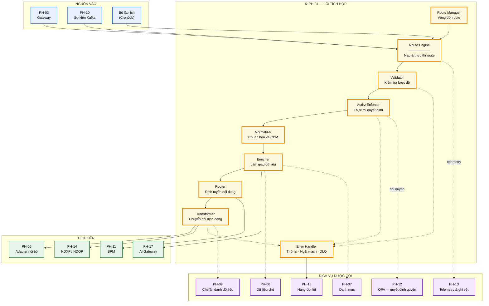
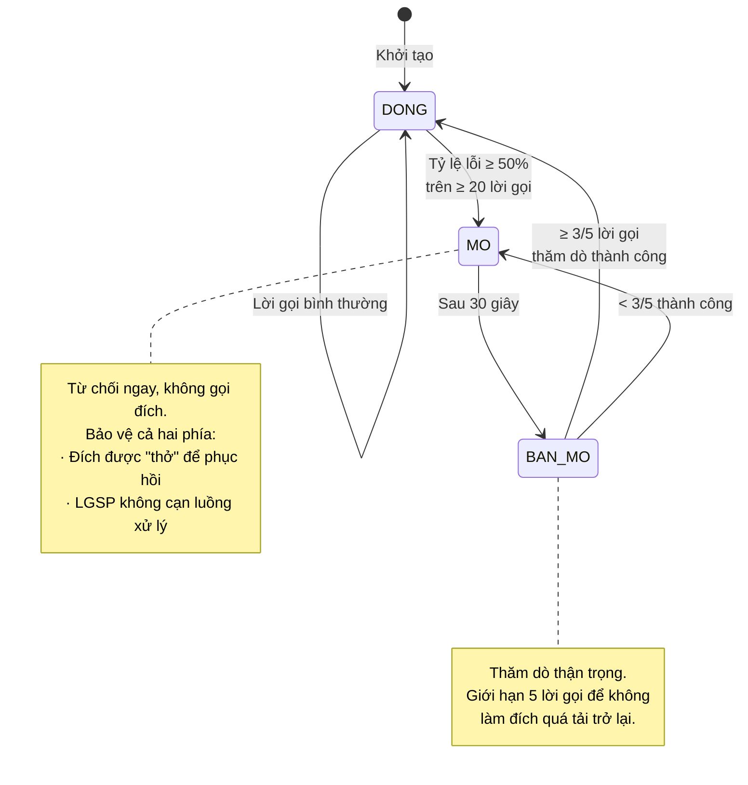
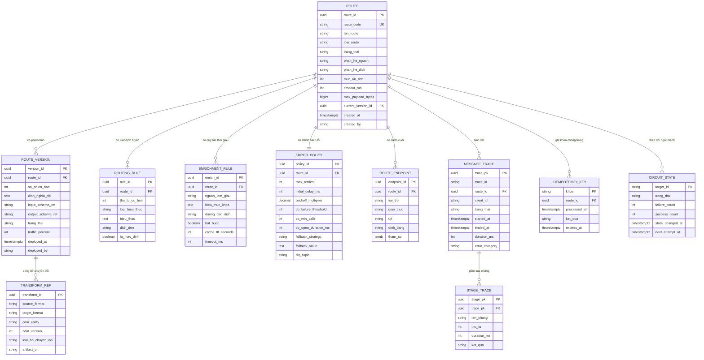

# SRS — PH-04: Lõi Tích hợp & Điều phối

| Thuộc tính | Giá trị |
|---|---|
| **Mã phân hệ** | PH-04 |
| **Tên** | Lõi Tích hợp & Điều phối (Integration Core) |
| **Nhóm** | Data Plane |
| **Mức bắt buộc** | M — Bắt buộc |
| **Phiên bản** | 1.0 |
| **Ngày** | 03/8/2026 |
| **Công nghệ chủ đạo** | Apache Camel 4.x trên Quarkus (native) |

---

## M1. Giới thiệu

### 1.1. Mục đích

PH-04 là **engine xử lý bản tin** của LGSP — nơi mọi yêu cầu trao đổi dữ liệu giữa các hệ thống thông tin được tiếp nhận, kiểm tra, chuẩn hóa, làm giàu, định tuyến và chuyển giao. Đây là phân hệ hiện thực trực tiếp yêu cầu "trục tích hợp (ESB)" tại CV 631/THH-THHT.

Tài liệu này đặc tả đầy đủ yêu cầu chức năng, dữ liệu, giao diện và chất lượng của PH-04 ở mức đủ chi tiết để thi công và nghiệm thu.

### 1.2. Phạm vi

**PH-04 chịu trách nhiệm:**

| # | Trách nhiệm |
|---|---|
| 1 | Tiếp nhận bản tin từ Gateway (PH-03) và từ hàng đợi sự kiện (PH-10) |
| 2 | Kiểm tra tính hợp lệ cấu trúc bản tin theo lược đồ |
| 3 | Gọi kiểm tra quyền tập trung và thực thi quyết định |
| 4 | Chuẩn hóa bản tin về Mô hình dữ liệu chuẩn (CDM) |
| 5 | Làm giàu bản tin bằng dữ liệu chủ và danh mục dùng chung |
| 6 | Định tuyến theo nội dung, theo cấu hình, theo trạng thái hệ thống đích |
| 7 | Chuyển đổi định dạng sang chuẩn hệ thống đích |
| 8 | Thực thi chiến lược xử lý lỗi ba tầng và đẩy bản tin lỗi vào DLQ |
| 9 | Phát sinh dữ liệu ghi vết và telemetry cho mỗi bản tin |
| 10 | Quản lý vòng đời route: nạp, kích hoạt, tạm dừng, gỡ bỏ |

**PH-04 KHÔNG chịu trách nhiệm:**

| # | Không làm | Thuộc phân hệ |
|---|---|---|
| 1 | Xác thực người dùng, cấp và xác minh token | PH-12 |
| 2 | Ra quyết định cho phép/từ chối truy cập (chỉ *gọi* và *thực thi*) | PH-12 |
| 3 | Chấm dứt TLS, chống DDoS, giới hạn tần suất | PH-03 |
| 4 | Giao tiếp kỹ thuật trực tiếp với hệ thống bên ngoài | PH-05, PH-14 |
| 5 | Lưu trữ và quản lý dữ liệu chủ, danh mục | PH-06, PH-07 |
| 6 | Lưu trữ và hiển thị nhật ký, chỉ số | PH-13 |
| 7 | Giao diện xử lý bản tin lỗi | PH-18 |
| 8 | Điều phối quy trình nghiệp vụ dài hạn có tác vụ người dùng | PH-11 |

### 1.3. Tài liệu tham chiếu

| Mã | Tài liệu |
|---|---|
| [KT] | [Kiến trúc hệ thống — mục 5 Kiến trúc tích hợp](../02-architecture/README.md#5-kiến-trúc-tích-hợp--lõi-apache-camel) |
| [LT] | [Luồng nghiệp vụ F-03, F-04, F-05, F-06, F-10](../03-flows/README.md) |
| [PL] | [Cơ sở pháp lý và ma trận CMP](../01-legal/README.md) |
| [ADR] | [ADR-001 Camel](../05-adr/README.md#adr-001), [ADR-002 Quarkus](../05-adr/README.md#adr-002), [ADR-013 CDM](../05-adr/README.md#adr-013) |
| [TT] | [Tác động TTQGS](../06-impact/README.md) |
| [CV631] | Công văn 631/THH-THHT ngày 21/5/2020 — yêu cầu chức năng LGSP |

---

## M2. Mô tả tổng quan

### 2.1. Vị trí trong kiến trúc



**Thuyết minh sơ đồ.** PH-04 nhận bản tin từ ba nguồn có đặc tính khác nhau: Gateway (đồng bộ, cần phản hồi ngay), Kafka (bất đồng bộ, chịu tải cao), bộ lập lịch (theo chu kỳ). Cả ba đi vào cùng một Route Engine và chảy qua cùng chuỗi xử lý — đây là chủ đích để mọi bản tin, bất kể nguồn, đều chịu cùng mức kiểm soát.

Đường nét đứt tới nhóm "dịch vụ được gọi" thể hiện quan hệ *tham vấn*: PH-04 hỏi PH-12 về quyền nhưng **PH-04 mới là nơi thực thi** quyết định. Phân vai này quan trọng — nếu PH-12 sập, PH-04 áp dụng chính sách mặc định từ chối thay vì cho qua.

### 2.2. Tác nhân

| Tác nhân | Loại | Tương tác với PH-04 |
|---|---|---|
| Hệ thống thông tin thành viên | Hệ thống | Gửi yêu cầu qua PH-03; nhận yêu cầu từ PH-04 |
| Cán bộ phát triển tích hợp | Người | Thiết kế, triển khai, sửa route |
| Quản trị viên nền tảng | Người | Kích hoạt/tạm dừng route, xem tình trạng |
| Cán bộ vận hành | Người | Theo dõi, xử lý sự cố route |
| PH-03 Gateway | Hệ thống | Chuyển tiếp yêu cầu đã xác thực |
| PH-10 Kafka | Hệ thống | Cung cấp sự kiện; nhận sự kiện phát ra |
| PH-12 IAM/OPA | Hệ thống | Trả quyết định cho phép/từ chối |
| PH-06/PH-07 | Hệ thống | Cung cấp dữ liệu làm giàu |
| PH-13 | Hệ thống | Nhận telemetry và bản ghi kiểm toán |
| PH-18 | Hệ thống | Nhận bản tin lỗi; yêu cầu phát lại |

### 2.3. Giả định

| Mã | Giả định |
|---|---|
| GD-01 | Mọi bản tin vào PH-04 từ Gateway đã được xác thực; PH-04 không xác thực lại danh tính |
| GD-02 | PH-05 và PH-14 che giấu hoàn toàn đặc thù kỹ thuật của hệ thống bên ngoài |
| GD-03 | Lược đồ CDM đã được đăng ký tại Schema Registry trước khi route sử dụng |
| GD-04 | Hệ thống đích chấp nhận ngữ nghĩa "ít nhất một lần" và xử lý idempotent |
| GD-05 | Đồng hồ các node được đồng bộ NTP, sai lệch dưới 100ms |

### 2.4. Ràng buộc

| Mã | Ràng buộc | Nguồn |
|---|---|---|
| RB-01 | Phải hỗ trợ HTTP, HTTPS, WebSocket, POP, IMAP, SMTP, JMS, AMQP, MQTT | CV 631 |
| RB-02 | Phải hỗ trợ JSON, XML, SOAP | CV 631 |
| RB-03 | Thời gian phản hồi tối đa 30 giây | CV 631 |
| RB-04 | Hoạt động 24/7 liên tục | CV 631 |
| RB-05 | Kiến trúc SOA, module hóa, thành phần độc lập | CV 631 |
| RB-06 | Hỗ trợ cluster xử lý song song | CV 631 |
| RB-07 | Toàn bộ công nghệ phải là mã nguồn mở | Yêu cầu dự án |
| RB-08 | Triển khai trên Kubernetes, mở rộng ngang | Cloud First — TTQGS |
| RB-09 | Không được lưu trữ dữ liệu nghiệp vụ lâu dài | Nguyên tắc kiến trúc |

### 2.5. Phụ thuộc phân hệ

| Phụ thuộc | Loại | Hành vi khi phụ thuộc không khả dụng |
|---|---|---|
| PH-12 (OPA) | **Cứng** | Từ chối bản tin (fail-closed) — an toàn hơn cho qua |
| PH-05, PH-14 | **Cứng** | Ngắt mạch, trả lỗi thân thiện, đẩy DLQ nếu bất đồng bộ |
| PH-06, PH-07 | **Mềm** | Bỏ qua bước làm giàu, gắn cờ `enriched=false`, tiếp tục |
| PH-09 | **Cứng** với dữ liệu nhạy cảm | Từ chối trả dữ liệu chưa qua xử lý che/ẩn danh |
| PH-10 (Kafka) | **Mềm** với luồng đồng bộ | Luồng đồng bộ vẫn chạy; luồng sự kiện tạm dừng |
| PH-13 | **Mềm** | Ghi telemetry vào bộ đệm cục bộ, gửi lại sau |
| PH-18 (DLQ) | **Cứng** | Nếu không ghi được DLQ thì không được xác nhận bản tin |

**Nguyên tắc phân biệt cứng/mềm.** Phụ thuộc **cứng** là thứ mà thiếu nó bản tin sẽ sai về an toàn hoặc mất dữ liệu. Phụ thuộc **mềm** chỉ làm giảm chất lượng kết quả. Cách phân loại này quyết định hành vi suy giảm — hiện thực nguyên tắc NT-08 tại [KT].

---

## M3. Yêu cầu chức năng

### 3.1. Nhóm A — Tiếp nhận và kiểm tra bản tin

#### FR-04-001 — Tiếp nhận bản tin đồng bộ · **M**

| Mục | Nội dung |
|---|---|
| **Mô tả** | Tiếp nhận yêu cầu HTTP đã được PH-03 xác thực và chuyển tiếp |
| **Tác nhân** | PH-03 Gateway |
| **Tiền điều kiện** | Route ở trạng thái `ACTIVE`; yêu cầu mang token hợp lệ và `traceId` |
| **Đầu vào** | Phương thức HTTP · đường dẫn · tiêu đề (`Authorization`, `X-Trace-Id`, `X-Client-Id`, `Content-Type`) · thân bản tin |
| **Xử lý** | 1. Trích `traceId`; nếu thiếu thì sinh mới và ghi cảnh báo<br>2. Đưa vào ngữ cảnh trao đổi (Exchange) các thuộc tính: `traceId`, `clientId`, `routeId`, `receivedAt`<br>3. Ghi chỉ số `messages_received_total` theo nhãn route và client<br>4. Chuyển sang bước kiểm tra lược đồ |
| **Đầu ra** | Exchange đã khởi tạo với đầy đủ thuộc tính ngữ cảnh |
| **Ngoại lệ** | E1: `Content-Type` không được hỗ trợ → `415`<br>E2: Thân bản tin vượt kích thước tối đa → `413`<br>E3: Route không tồn tại hoặc không `ACTIVE` → `404` |

#### FR-04-002 — Tiếp nhận bản tin bất đồng bộ từ Kafka · **M**

| Mục | Nội dung |
|---|---|
| **Mô tả** | Tiêu thụ sự kiện từ chủ đề Kafka do PH-10 quản lý |
| **Tác nhân** | PH-10 |
| **Tiền điều kiện** | Route kiểu `EVENT` ở trạng thái `ACTIVE`; nhóm tiêu thụ đã đăng ký |
| **Đầu vào** | Khóa bản ghi · giá trị · tiêu đề Kafka (chứa `traceId`, `schemaId`, `eventType`) · phân vùng · offset |
| **Xử lý** | 1. Giải mã giá trị theo `schemaId` lấy từ Schema Registry<br>2. Kiểm tra bản tin đã xử lý chưa qua **kho khóa idempotent** (khóa = `eventType + businessKey + version`)<br>3. Nếu đã xử lý → bỏ qua, xác nhận offset, ghi chỉ số `messages_duplicate_total`<br>4. Nếu chưa → đưa vào chuỗi xử lý<br>5. Chỉ xác nhận offset **sau khi** xử lý thành công hoặc đã ghi DLQ |
| **Đầu ra** | Exchange khởi tạo; offset được xác nhận đúng thời điểm |
| **Ngoại lệ** | E1: Không giải mã được theo lược đồ → DLQ, xác nhận offset<br>E2: Schema Registry không phản hồi → tạm dừng tiêu thụ, thử lại theo backoff<br>E3: Kho khóa idempotent lỗi → xử lý tiếp nhưng gắn cờ `idempotencyUnchecked=true` |

**Ghi chú thiết kế FR-04-002.** Bước 5 là điểm cốt lõi bảo đảm không mất bản tin: xác nhận offset trước khi xử lý xong sẽ mất bản tin nếu pod chết giữa chừng. Đổi lại, ngữ nghĩa trở thành "ít nhất một lần" nên bước 2 (kiểm tra trùng) là bắt buộc, không tùy chọn.

#### FR-04-003 — Kiểm tra tính hợp lệ cấu trúc · **M**

| Mục | Nội dung |
|---|---|
| **Mô tả** | Kiểm tra bản tin đúng lược đồ đã đăng ký trước khi xử lý tiếp |
| **Tiền điều kiện** | Route có khai báo `inputSchemaRef` |
| **Đầu vào** | Thân bản tin · tham chiếu lược đồ (JSON Schema Draft 2020-12 hoặc XSD 1.1) |
| **Xử lý** | 1. Nạp lược đồ từ bộ nhớ đệm cục bộ; nếu thiếu thì lấy từ Schema Registry và lưu đệm<br>2. Kiểm tra bản tin theo lược đồ<br>3. Gom **toàn bộ** lỗi vi phạm (không dừng ở lỗi đầu tiên)<br>4. Nếu hợp lệ → chuyển bước tiếp |
| **Đầu ra** | Bản tin đã kiểm chứng, hoặc danh sách lỗi có đường dẫn trường |
| **Ngoại lệ** | E1: Không hợp lệ → `400` kèm danh sách lỗi `{path, message, rejectedValue}`; **không thử lại**<br>E2: Không tải được lược đồ → dùng bản đệm gần nhất; nếu không có → `503` |

#### FR-04-004 — Kiểm tra kích thước và định dạng đính kèm · **S**

| Mục | Nội dung |
|---|---|
| **Mô tả** | Với bản tin có tệp đính kèm, kiểm tra kích thước, phần mở rộng và quét mã độc |
| **Đầu vào** | Danh sách tệp đính kèm hoặc URI tham chiếu |
| **Xử lý** | 1. Kiểm tra tổng kích thước ≤ hạn mức route<br>2. Kiểm tra phần mở rộng thuộc danh sách cho phép<br>3. Gọi dịch vụ quét mã độc<br>4. Nếu tệp > 10MB → áp dụng mẫu **Claim Check**: lưu MinIO, thay bằng URI |
| **Đầu ra** | Bản tin với đính kèm đã kiểm chứng hoặc thay bằng URI |
| **Ngoại lệ** | E1: Vượt kích thước → `413`<br>E2: Phần mở rộng không cho phép → `415`<br>E3: Phát hiện mã độc → `422`, ghi **cảnh báo an ninh** cho PH-13, chặn bản tin |

### 3.2. Nhóm B — Ủy quyền

#### FR-04-005 — Gọi kiểm tra quyền và thực thi quyết định · **M**

| Mục | Nội dung |
|---|---|
| **Mô tả** | Hỏi PH-12 (OPA) về quyền truy cập và thực thi kết quả |
| **Tiền điều kiện** | Bản tin đã qua kiểm tra lược đồ |
| **Đầu vào** | `clientId` · vai trò và phạm vi từ token · mã tài nguyên · hành động (`read`/`write`) · phân loại mật của dữ liệu · mục đích sử dụng |
| **Xử lý** | 1. Dựng yêu cầu quyết định gửi OPA<br>2. Tra bộ nhớ đệm quyết định (khóa = băm của đầu vào, thời hạn 60 giây)<br>3. Nếu trượt đệm → gọi OPA (thời hạn chờ 200ms)<br>4. Nhận `{allow, reason, fieldMask, privacyMode}`<br>5. Nếu `allow=false` → dừng, ghi vết truy cập bị từ chối<br>6. Nếu `allow=true` → lưu `fieldMask` và `privacyMode` vào ngữ cảnh để dùng ở bước xuất |
| **Đầu ra** | Quyết định cho phép kèm mặt nạ trường và chế độ bảo vệ dữ liệu |
| **Ngoại lệ** | E1: `allow=false` → `403` kèm lý do<br>E2: OPA quá hạn chờ hoặc lỗi → **từ chối** (`503`), **không** cho qua<br>E3: Dữ liệu phân loại `MAT` → từ chối tuyệt đối, không phụ thuộc kết quả OPA |

**Ghi chú thiết kế FR-04-005.** Ngoại lệ E2 áp dụng nguyên tắc *fail-closed*. Cho qua khi không kiểm tra được quyền là lỗi bảo mật nghiêm trọng — thà từ chối dịch vụ còn hơn rò rỉ dữ liệu. E3 là chốt chặn độc lập cho CMP-23: ngay cả khi chính sách OPA bị cấu hình sai, dữ liệu mật vẫn không đi ra được.

### 3.3. Nhóm C — Chuẩn hóa, làm giàu, chuyển đổi

#### FR-04-006 — Chuẩn hóa về Mô hình dữ liệu chuẩn · **M**

| Mục | Nội dung |
|---|---|
| **Mô tả** | Chuyển bản tin từ định dạng hệ thống nguồn về CDM nội bộ |
| **Đầu vào** | Bản tin định dạng nguồn · tham chiếu bộ chuyển đổi (`transformRef`) |
| **Xử lý** | 1. Chọn bộ chuyển đổi theo cặp `(sourceFormat, cdmEntity, version)`<br>2. Áp dụng chuyển đổi (XSLT 3.0 cho XML, JSLT cho JSON, ánh xạ bean cho POJO)<br>3. Bổ sung khối `_metadata`: `nguonDuLieu`, `thoiDiemCapNhat`, `mucDoTinCay`, `phanLoaiMat`<br>4. Kiểm tra kết quả đúng lược đồ CDM |
| **Đầu ra** | Bản tin CDM hợp lệ có khối `_metadata` đầy đủ |
| **Ngoại lệ** | E1: Không tìm thấy bộ chuyển đổi → `500`, cảnh báo cấu hình<br>E2: Chuyển đổi lỗi → DLQ kèm bản tin gốc<br>E3: Kết quả không đúng lược đồ CDM → DLQ, cảnh báo lỗi bộ chuyển đổi |

#### FR-04-007 — Ánh xạ sang Từ điển dữ liệu dùng chung quốc gia · **M**

| Mục | Nội dung |
|---|---|
| **Mô tả** | Ánh xạ trường CDM sang từ điển dữ liệu quốc gia trước khi gửi lên cấp quốc gia |
| **Tiền điều kiện** | Bản tin có đích đến là NDXP/NDOP |
| **Đầu vào** | Bản tin CDM · bảng ánh xạ từ PH-07 |
| **Xử lý** | 1. Lấy bảng ánh xạ theo thực thể và phiên bản từ điển<br>2. Ánh xạ tên trường và giá trị mã danh mục<br>3. Kiểm tra **độ phủ ánh xạ**: mọi trường bắt buộc phải ánh xạ được<br>4. Ghi chỉ số `mapping_coverage_ratio` |
| **Đầu ra** | Bản tin theo từ điển quốc gia |
| **Ngoại lệ** | E1: Trường bắt buộc không ánh xạ được → **chặn**, `422`, cảnh báo cho quản trị dữ liệu<br>E2: Bảng ánh xạ chưa ban hành → dùng ánh xạ tạm, gắn cờ `mappingProvisional=true`, ghi cảnh báo |

**Ghi chú.** Yêu cầu này đáp ứng CMP-30 phát sinh từ TTQGS ([TT] mục 3.3). Ngoại lệ E2 xử lý tình huống thực tế là từ điển quốc gia chưa công bố chi tiết — cho phép vận hành nhưng đánh dấu rõ để rà soát sau.

#### FR-04-008 — Làm giàu bản tin · **M**

| Mục | Nội dung |
|---|---|
| **Mô tả** | Bổ sung dữ liệu từ dữ liệu chủ (PH-06) và danh mục dùng chung (PH-07) |
| **Đầu vào** | Bản tin CDM · danh sách quy tắc làm giàu của route |
| **Xử lý** | 1. Với mỗi quy tắc: tra bộ nhớ đệm cục bộ → đệm chia sẻ (Valkey) → gọi dịch vụ nguồn<br>2. Gọi song song các quy tắc độc lập nhau<br>3. Gộp kết quả vào bản tin theo đường dẫn khai báo<br>4. Thời hạn đệm theo loại: danh mục 24 giờ, dữ liệu chủ 15 phút |
| **Đầu ra** | Bản tin đã làm giàu |
| **Ngoại lệ** | E1: Nguồn làm giàu lỗi và quy tắc `required=false` → bỏ qua, gắn `enrichmentPartial=true`, tiếp tục<br>E2: Nguồn lỗi và `required=true` → xử lý theo chiến lược lỗi của route<br>E3: Quá hạn chờ (mặc định 300ms) → như E1 |

#### FR-04-009 — Áp dụng che, giả danh hóa, ẩn danh hóa · **M**

| Mục | Nội dung |
|---|---|
| **Mô tả** | Áp dụng bảo vệ dữ liệu theo `privacyMode` và `fieldMask` nhận từ FR-04-005 |
| **Đầu vào** | Bản tin CDM · `fieldMask` · `privacyMode` (`none`/`mask`/`pseudonymize`/`anonymize`) |
| **Xử lý** | 1. Nếu `privacyMode = none` và `fieldMask` rỗng → bỏ qua<br>2. Ngược lại gọi PH-09 với bản tin và tham số<br>3. Nhận bản tin đã xử lý<br>4. Ghi vết: trường nào bị che, chế độ nào áp dụng |
| **Đầu ra** | Bản tin đã áp dụng bảo vệ dữ liệu |
| **Ngoại lệ** | E1: PH-09 lỗi và bản tin chứa trường nhạy cảm → **từ chối** (`503`)<br>E2: PH-09 lỗi và bản tin không chứa trường nhạy cảm → tiếp tục, ghi cảnh báo |

#### FR-04-010 — Chuyển đổi sang định dạng hệ thống đích · **M**

| Mục | Nội dung |
|---|---|
| **Mô tả** | Chuyển bản tin CDM sang định dạng mà hệ thống đích chấp nhận |
| **Đầu vào** | Bản tin CDM · đặc tả định dạng đích |
| **Xử lý** | 1. Chọn bộ chuyển đổi theo `(cdmEntity, targetFormat, version)`<br>2. Áp dụng chuyển đổi<br>3. Với đích SOAP: dựng phong bì SOAP đúng đặc tả WSDL<br>4. Với đích cần ký số: chuyển PH-14 xử lý ký |
| **Đầu ra** | Bản tin định dạng đích |
| **Ngoại lệ** | E1: Không có bộ chuyển đổi → `500`, cảnh báo cấu hình<br>E2: Chuyển đổi lỗi → theo chiến lược lỗi |

### 3.4. Nhóm D — Định tuyến

#### FR-04-011 — Định tuyến theo nội dung · **M**

| Mục | Nội dung |
|---|---|
| **Mô tả** | Chọn đích đến dựa trên nội dung bản tin (Content-Based Router) |
| **Đầu vào** | Bản tin CDM · tập luật định tuyến của route |
| **Xử lý** | 1. Duyệt luật theo thứ tự ưu tiên giảm dần<br>2. Với mỗi luật, đánh giá biểu thức điều kiện (JSONPath / XPath / Simple)<br>3. Luật đầu tiên khớp quyết định đích đến<br>4. Nếu không luật nào khớp → dùng đích mặc định |
| **Đầu ra** | Định danh đích đến |
| **Ngoại lệ** | E1: Không luật nào khớp và không có đích mặc định → DLQ, cảnh báo cấu hình<br>E2: Biểu thức điều kiện lỗi cú pháp → `500`, cảnh báo, không nạp route |

#### FR-04-012 — Tách và gộp bản tin · **S**

| Mục | Nội dung |
|---|---|
| **Mô tả** | Tách bản tin lô thành nhiều bản tin đơn (Splitter) và gộp phản hồi (Aggregator) |
| **Đầu vào** | Bản tin lô · biểu thức tách · chiến lược gộp · điều kiện kết thúc gộp |
| **Xử lý** | 1. Tách theo biểu thức, giữ `correlationId` chung<br>2. Xử lý song song với mức song song cấu hình được (mặc định 10)<br>3. Gộp theo `correlationId`<br>4. Kết thúc gộp khi: đủ số phần tử **hoặc** quá hạn chờ (mặc định 30 giây) |
| **Đầu ra** | Bản tin gộp chứa toàn bộ kết quả và danh sách phần tử lỗi |
| **Ngoại lệ** | E1: Quá hạn gộp → trả kết quả một phần, đánh dấu `partial=true`<br>E2: Một phần tử lỗi → không hủy cả lô; ghi vào danh sách lỗi của kết quả |

#### FR-04-013 — Gọi song song nhiều hệ thống · **S**

| Mục | Nội dung |
|---|---|
| **Mô tả** | Gửi cùng một yêu cầu tới nhiều hệ thống, gộp kết quả (Scatter-Gather) |
| **Đầu vào** | Bản tin · danh sách đích · chiến lược gộp |
| **Xử lý** | 1. Nhân bản bản tin cho từng đích<br>2. Gọi song song, mỗi đích có thời hạn chờ riêng<br>3. Gộp phản hồi theo chiến lược khai báo |
| **Đầu ra** | Bản tin gộp |
| **Ngoại lệ** | E1: Một đích lỗi → gộp phần còn lại, đánh dấu đích lỗi<br>E2: Toàn bộ đích lỗi → theo chiến lược lỗi của route |

#### FR-04-014 — Phát sự kiện ra Kafka · **M**

| Mục | Nội dung |
|---|---|
| **Mô tả** | Phát sự kiện thay đổi ra chủ đề Kafka cho các bên đăng ký |
| **Đầu vào** | Bản tin CDM · chủ đề đích · biểu thức khóa phân vùng |
| **Xử lý** | 1. Tính khóa phân vùng theo **định danh thực thể** (số định danh cá nhân, mã doanh nghiệp)<br>2. Gắn tiêu đề: `traceId`, `schemaId`, `eventType`, `producedAt`, `sourceRoute`<br>3. Gửi với `acks=all`<br>4. Chờ xác nhận trước khi coi là thành công |
| **Đầu ra** | Sự kiện đã ghi vào Kafka |
| **Ngoại lệ** | E1: Không gửi được → thử lại theo backoff; sau 3 lần → DLQ<br>E2: Không tính được khóa phân vùng → dùng khóa ngẫu nhiên, ghi **cảnh báo** (rủi ro sai thứ tự) |

**Ghi chú.** Bước 1 quyết định tính đúng đắn về thứ tự sự kiện: mọi thay đổi của cùng một công dân phải vào cùng phân vùng, nếu không sẽ xảy ra hiện tượng cập nhật cũ ghi đè cập nhật mới (xem [LT] F-05).

### 3.5. Nhóm E — Xử lý lỗi

#### FR-04-015 — Phân loại lỗi · **M**

| Mục | Nội dung |
|---|---|
| **Mô tả** | Phân loại lỗi để chọn đúng chiến lược xử lý |
| **Đầu vào** | Ngoại lệ phát sinh · mã trạng thái HTTP (nếu có) · ngữ cảnh |
| **Xử lý** | Áp dụng bảng phân loại:<br>· **Tạm thời**: quá hạn chờ, mất kết nối, `502`, `503`, `504` → thử lại<br>· **Nghiệp vụ**: `400`, `404`, `409`, `422`, lỗi lược đồ, lỗi chuyển đổi → **không** thử lại<br>· **Bảo mật**: `401`, `403` → không thử lại, ghi cảnh báo an ninh<br>· **Không xác định** → xử lý như tạm thời nhưng giới hạn 1 lần thử lại |
| **Đầu ra** | Nhãn phân loại lỗi |
| **Ngoại lệ** | Không có — mọi lỗi đều được phân loại vào một trong bốn nhóm |

#### FR-04-016 — Thử lại có độ trễ tăng dần · **M**

| Mục | Nội dung |
|---|---|
| **Mô tả** | Thử lại lỗi tạm thời với khoảng chờ tăng theo cấp số nhân |
| **Đầu vào** | Bản tin · lần thử hiện tại · cấu hình thử lại của route |
| **Xử lý** | 1. Mặc định: tối đa 3 lần, chờ ban đầu 1000ms, hệ số nhân 2, có nhiễu ngẫu nhiên ±20%<br>2. Trước mỗi lần thử, kiểm tra ngân sách thời gian còn lại của bản tin<br>3. Nếu thời gian đã dùng + khoảng chờ > 30 giây → dừng thử lại ngay |
| **Đầu ra** | Kết quả thành công, hoặc chuyển sang bước DLQ |
| **Ngoại lệ** | E1: Hết số lần thử → DLQ<br>E2: Hết ngân sách thời gian → DLQ với lý do `TIMEOUT_BUDGET_EXCEEDED` |

**Ghi chú.** Nhiễu ngẫu nhiên ở bước 1 tránh hiện tượng đồng loạt thử lại cùng lúc gây "bão yêu cầu" khi hệ thống đích vừa phục hồi. Bước 3 bảo đảm không vi phạm trần 30 giây của CV 631 (RB-03).

#### FR-04-017 — Ngắt mạch bảo vệ · **M**

| Mục | Nội dung |
|---|---|
| **Mô tả** | Ngừng gọi hệ thống đích khi phát hiện hỏng kéo dài |
| **Đầu vào** | Thống kê lời gọi tới đích trong cửa sổ trượt |
| **Xử lý** | Máy trạng thái ba trạng thái:<br>· **ĐÓNG** → **MỞ** khi tỷ lệ lỗi ≥ 50% trên tối thiểu 20 lời gọi<br>· **MỞ**: từ chối ngay, không gọi đích, giữ 30 giây<br>· **MỞ** → **BÁN MỞ** sau 30 giây, cho phép tối đa 5 lời gọi thăm dò<br>· **BÁN MỞ** → **ĐÓNG** nếu ≥ 3/5 lời gọi thành công; ngược lại quay lại **MỞ** |
| **Đầu ra** | Cho phép gọi, hoặc kích hoạt phương án dự phòng |
| **Ngoại lệ** | E1: Mạch **MỞ** và luồng đồng bộ → `503` kèm thông báo thân thiện<br>E2: Mạch **MỞ** và luồng bất đồng bộ → DLQ trực tiếp, không thử vô ích<br>E3: Chuyển sang **MỞ** → phát cảnh báo mức **NGHIÊM TRỌNG** cho PH-13 |



#### FR-04-018 — Đẩy bản tin lỗi vào DLQ · **M**

| Mục | Nội dung |
|---|---|
| **Mô tả** | Ghi bản tin không xử lý được vào hàng đợi lỗi kèm đầy đủ ngữ cảnh |
| **Đầu vào** | Bản tin gốc · ngoại lệ · ngữ cảnh xử lý |
| **Xử lý** | Dựng bản ghi DLQ gồm **bắt buộc đủ**: `dlqId`, `traceId`, `routeId`, `originalPayload`, `currentPayload`, `errorClass`, `errorMessage`, `stackTraceHash`, `attemptCount`, `firstFailedAt`, `lastFailedAt`, `sourceSystem`, `targetSystem`, `errorCategory`, `replayable`<br>Ghi vào chủ đề DLQ tương ứng và thông báo PH-18 |
| **Đầu ra** | Bản ghi DLQ đã lưu bền vững |
| **Ngoại lệ** | E1: Không ghi được DLQ → **không xác nhận** offset Kafka để bản tin được xử lý lại; với luồng đồng bộ trả `500`<br>E2: Bản tin vượt kích thước tối đa của DLQ → lưu thân bản tin vào MinIO, DLQ giữ URI |

**Ghi chú.** Danh sách trường ở cột "Xử lý" là **tối thiểu bắt buộc** — thiếu bất kỳ trường nào thì cán bộ vận hành không chẩn đoán được và bản tin lỗi trở thành rác không xử lý được (xem [LT] F-10).

#### FR-04-019 — Phương án dự phòng · **S**

| Mục | Nội dung |
|---|---|
| **Mô tả** | Trả kết quả thay thế khi đích không khả dụng |
| **Đầu vào** | Cấu hình dự phòng của route |
| **Xử lý** | Theo thứ tự ưu tiên: 1) Trả dữ liệu từ đệm dù đã hết hạn (gắn `stale=true`); 2) Trả giá trị mặc định khai báo; 3) Trả lỗi có cấu trúc kèm hướng dẫn |
| **Đầu ra** | Phản hồi dự phòng |
| **Ngoại lệ** | E1: Không cấu hình dự phòng → trả `503` chuẩn |

### 3.6. Nhóm F — Quản lý vòng đời route

#### FR-04-020 — Nạp và kích hoạt route · **M**

| Mục | Nội dung |
|---|---|
| **Mô tả** | Nạp định nghĩa route và đưa vào hoạt động không cần khởi động lại |
| **Tác nhân** | Quản trị viên nền tảng, PH-02 |
| **Đầu vào** | Định nghĩa route (Camel YAML DSL) · siêu dữ liệu route |
| **Xử lý** | 1. Kiểm tra cú pháp định nghĩa<br>2. Kiểm tra tham chiếu: lược đồ, bộ chuyển đổi, đích đến có tồn tại<br>3. Nạp vào ngữ cảnh Camel<br>4. Chuyển trạng thái sang `ACTIVE`<br>5. Ghi sự kiện thay đổi cấu hình cho PH-13 |
| **Đầu ra** | Route hoạt động, tiếp nhận bản tin |
| **Ngoại lệ** | E1: Cú pháp sai → từ chối, trả lỗi kèm vị trí dòng<br>E2: Tham chiếu không tồn tại → từ chối, liệt kê tham chiếu thiếu<br>E3: Trùng `routeId` đang hoạt động → từ chối, yêu cầu dùng chức năng cập nhật |

#### FR-04-021 — Tạm dừng, tiếp tục, gỡ bỏ route · **M**

| Mục | Nội dung |
|---|---|
| **Mô tả** | Điều khiển trạng thái route trong lúc vận hành |
| **Tác nhân** | Quản trị viên nền tảng |
| **Đầu vào** | `routeId` · hành động (`suspend`/`resume`/`remove`) |
| **Xử lý** | · **Tạm dừng**: ngừng nhận bản tin mới, **hoàn tất** bản tin đang xử lý (chờ tối đa 30 giây)<br>· **Tiếp tục**: nhận bản tin trở lại<br>· **Gỡ bỏ**: tạm dừng rồi loại khỏi ngữ cảnh<br>Ghi sự kiện kèm người thực hiện và lý do |
| **Đầu ra** | Route ở trạng thái mới |
| **Ngoại lệ** | E1: Route không tồn tại → `404`<br>E2: Còn bản tin đang xử lý sau 30 giây → buộc dừng, đẩy các bản tin đó vào DLQ |

#### FR-04-022 — Triển khai route theo phiên bản · **S**

| Mục | Nội dung |
|---|---|
| **Mô tả** | Chạy song song hai phiên bản route, chuyển lưu lượng dần |
| **Đầu vào** | `routeId` · phiên bản mới · tỷ lệ lưu lượng |
| **Xử lý** | 1. Nạp phiên bản mới song song phiên bản hiện tại<br>2. Chia lưu lượng theo tỷ lệ khai báo<br>3. Theo dõi tỷ lệ lỗi phiên bản mới<br>4. Tự động quay lui nếu tỷ lệ lỗi phiên bản mới > 2 lần phiên bản cũ |
| **Đầu ra** | Lưu lượng phân chia theo tỷ lệ |
| **Ngoại lệ** | E1: Phiên bản mới lỗi vượt ngưỡng → quay lui tự động, cảnh báo |

### 3.7. Nhóm G — Ghi vết và telemetry

#### FR-04-023 — Sinh và lan truyền traceId · **M**

| Mục | Nội dung |
|---|---|
| **Mô tả** | Bảo đảm mọi bản tin mang định danh truy vết xuyên suốt |
| **Xử lý** | 1. Nhận `traceId` từ PH-03 hoặc tiêu đề Kafka<br>2. Nếu thiếu → sinh mới theo chuẩn W3C Trace Context<br>3. Truyền vào **mọi** lời gọi đi ra: tiêu đề HTTP, tiêu đề Kafka, ngữ cảnh nhật ký<br>4. Sinh `spanId` riêng cho từng chặng xử lý |
| **Đầu ra** | Bản tin và mọi lời gọi phái sinh mang `traceId` thống nhất |
| **Ngoại lệ** | E1: Đích không hỗ trợ tiêu đề tùy chỉnh → ghi ánh xạ `traceId ↔ định danh nghiệp vụ` vào nhật ký |

#### FR-04-024 — Ghi vết truy cập bất đồng bộ · **M**

| Mục | Nội dung |
|---|---|
| **Mô tả** | Ghi bản ghi kiểm toán cho mọi truy cập dữ liệu mà không làm chậm phản hồi |
| **Đầu vào** | Ngữ cảnh xử lý bản tin |
| **Xử lý** | 1. Dùng mẫu **Wire Tap** — sao chép sang nhánh xử lý song song<br>2. Dựng bản ghi: `traceId`, `clientId`, `subjectId` (người/tổ chức bị tra cứu), `resource`, `action`, `purpose`, `decision`, `fieldsAccessed`, `privacyMode`, `timestamp`, `sourceIp`<br>3. Gửi tới PH-13 qua Kafka<br>4. **Không chờ** xác nhận trên đường phản hồi chính |
| **Đầu ra** | Bản ghi kiểm toán đã gửi |
| **Ngoại lệ** | E1: Không gửi được → ghi vào bộ đệm cục bộ bền vững, gửi lại sau; **không** chặn bản tin chính<br>E2: Bộ đệm đầy → ghi cảnh báo mức nghiêm trọng; với dữ liệu nhạy cảm thì **chặn** bản tin |

**Ghi chú.** E2 là ngoại lệ có chủ đích cho nguyên tắc "ghi vết không chặn": với dữ liệu nhạy cảm, không ghi được vết là vi phạm CMP-28, nên thà từ chối phục vụ.

#### FR-04-025 — Phát chỉ số vận hành · **M**

| Mục | Nội dung |
|---|---|
| **Mô tả** | Phát chỉ số cho PH-13 phục vụ giám sát và tính KPI |
| **Xử lý** | Phát tối thiểu các chỉ số:<br>· `lgsp_messages_total{route,client,status}` — bộ đếm<br>· `lgsp_message_duration_seconds{route,stage}` — biểu đồ phân phối<br>· `lgsp_enrichment_cache_hits_total{source,result}` — bộ đếm<br>· `lgsp_circuit_breaker_state{target}` — đo lường (0 đóng, 1 bán mở, 2 mở)<br>· `lgsp_dlq_messages_total{route,category}` — bộ đếm<br>· `lgsp_mapping_coverage_ratio{entity}` — đo lường<br>· `lgsp_route_active_count` — đo lường |
| **Đầu ra** | Chỉ số theo chuẩn OpenTelemetry |
| **Ngoại lệ** | E1: Bộ thu thập không khả dụng → đệm cục bộ tối đa 10.000 điểm, sau đó bỏ điểm cũ nhất |

### 3.8. Bảng tổng hợp yêu cầu chức năng

| Nhóm | Mã | Tên | Ưu tiên |
|---|---|---|:-:|
| A | FR-04-001 | Tiếp nhận bản tin đồng bộ | M |
| A | FR-04-002 | Tiếp nhận bản tin bất đồng bộ từ Kafka | M |
| A | FR-04-003 | Kiểm tra tính hợp lệ cấu trúc | M |
| A | FR-04-004 | Kiểm tra kích thước và định dạng đính kèm | S |
| B | FR-04-005 | Gọi kiểm tra quyền và thực thi quyết định | M |
| C | FR-04-006 | Chuẩn hóa về CDM | M |
| C | FR-04-007 | Ánh xạ Từ điển dữ liệu quốc gia | M |
| C | FR-04-008 | Làm giàu bản tin | M |
| C | FR-04-009 | Che, giả danh hóa, ẩn danh hóa | M |
| C | FR-04-010 | Chuyển đổi sang định dạng đích | M |
| D | FR-04-011 | Định tuyến theo nội dung | M |
| D | FR-04-012 | Tách và gộp bản tin | S |
| D | FR-04-013 | Gọi song song nhiều hệ thống | S |
| D | FR-04-014 | Phát sự kiện ra Kafka | M |
| E | FR-04-015 | Phân loại lỗi | M |
| E | FR-04-016 | Thử lại có độ trễ tăng dần | M |
| E | FR-04-017 | Ngắt mạch bảo vệ | M |
| E | FR-04-018 | Đẩy bản tin lỗi vào DLQ | M |
| E | FR-04-019 | Phương án dự phòng | S |
| F | FR-04-020 | Nạp và kích hoạt route | M |
| F | FR-04-021 | Tạm dừng, tiếp tục, gỡ bỏ route | M |
| F | FR-04-022 | Triển khai route theo phiên bản | S |
| G | FR-04-023 | Sinh và lan truyền traceId | M |
| G | FR-04-024 | Ghi vết truy cập bất đồng bộ | M |
| G | FR-04-025 | Phát chỉ số vận hành | M |

**Tổng: 25 yêu cầu chức năng** — 21 bắt buộc (M), 4 cần có (S).

---

## M4. Mô hình dữ liệu

### 4.1. Sơ đồ thực thể



### 4.2. Đặc tả thực thể

#### EN-04-01 — ROUTE (Định nghĩa luồng tích hợp)

| Trường | Kiểu | Bắt buộc | Ràng buộc | Mô tả |
|---|---|:-:|---|---|
| `route_id` | UUID | ✓ | PK | Định danh nội bộ |
| `route_code` | VARCHAR(80) | ✓ | UNIQUE, `^[a-z0-9-]+$` | Mã route dùng trong cấu hình và nhật ký |
| `ten_route` | VARCHAR(255) | ✓ | | Tên hiển thị tiếng Việt |
| `loai_route` | VARCHAR(20) | ✓ | ∈ {`SYNC`,`EVENT`,`SCHEDULED`,`BATCH`} | Kiểu kích hoạt |
| `trang_thai` | VARCHAR(20) | ✓ | ∈ {`DRAFT`,`TESTING`,`ACTIVE`,`SUSPENDED`,`RETIRED`} | Trạng thái vòng đời |
| `phan_he_nguon` | VARCHAR(80) | ✓ | | Hệ thống khởi phát |
| `phan_he_dich` | VARCHAR(80) | | | Hệ thống đích chính |
| `muc_uu_tien` | SMALLINT | ✓ | 1–10, mặc định 5 | Ưu tiên khi tài nguyên hạn chế |
| `timeout_ms` | INTEGER | ✓ | 1000–30000, mặc định 10000 | Ngân sách thời gian (RB-03) |
| `max_payload_bytes` | BIGINT | ✓ | mặc định 10.485.760 | Kích thước tối đa |
| `current_version_id` | UUID | | FK → ROUTE_VERSION | Phiên bản đang phục vụ |
| `created_at` | TIMESTAMPTZ | ✓ | | Thời điểm tạo |
| `created_by` | VARCHAR(100) | ✓ | | Người tạo |

**Ràng buộc bảng:** `timeout_ms ≤ 30000` (không được vượt trần CV 631); route ở `ACTIVE` bắt buộc có `current_version_id`.

#### EN-04-02 — ROUTE_VERSION (Phiên bản route)

| Trường | Kiểu | Bắt buộc | Ràng buộc | Mô tả |
|---|---|:-:|---|---|
| `version_id` | UUID | ✓ | PK | |
| `route_id` | UUID | ✓ | FK | |
| `so_phien_ban` | INTEGER | ✓ | UNIQUE cùng `route_id` | Tăng dần từ 1 |
| `dinh_nghia_dsl` | TEXT | ✓ | | Camel YAML DSL |
| `input_schema_ref` | VARCHAR(200) | | | Tham chiếu lược đồ đầu vào |
| `output_schema_ref` | VARCHAR(200) | | | Tham chiếu lược đồ đầu ra |
| `trang_thai` | VARCHAR(20) | ✓ | ∈ {`DRAFT`,`CANARY`,`ACTIVE`,`ROLLED_BACK`,`ARCHIVED`} | |
| `traffic_percent` | SMALLINT | ✓ | 0–100, mặc định 100 | Tỷ lệ lưu lượng (FR-04-022) |
| `deployed_at` | TIMESTAMPTZ | | | |
| `deployed_by` | VARCHAR(100) | | | |

**Ràng buộc:** tổng `traffic_percent` của các phiên bản `ACTIVE`/`CANARY` cùng route phải bằng 100.

#### EN-04-03 — ROUTING_RULE (Luật định tuyến)

| Trường | Kiểu | Bắt buộc | Ràng buộc | Mô tả |
|---|---|:-:|---|---|
| `rule_id` | UUID | ✓ | PK | |
| `route_id` | UUID | ✓ | FK | |
| `thu_tu_uu_tien` | SMALLINT | ✓ | UNIQUE cùng `route_id` | Nhỏ hơn = xét trước |
| `loai_bieu_thuc` | VARCHAR(20) | ✓ | ∈ {`JSONPATH`,`XPATH`,`SIMPLE`,`HEADER`} | |
| `bieu_thuc` | TEXT | ✓ | | Biểu thức điều kiện |
| `dich_den` | VARCHAR(200) | ✓ | | URI đích |
| `la_mac_dinh` | BOOLEAN | ✓ | mặc định false | Luật vét cạn |

**Ràng buộc:** tối đa **một** luật `la_mac_dinh = true` cho mỗi route.

#### EN-04-04 — ENRICHMENT_RULE (Quy tắc làm giàu)

| Trường | Kiểu | Bắt buộc | Ràng buộc | Mô tả |
|---|---|:-:|---|---|
| `enrich_id` | UUID | ✓ | PK | |
| `route_id` | UUID | ✓ | FK | |
| `nguon_lam_giau` | VARCHAR(50) | ✓ | ∈ {`MDM`,`RDM`,`CACHE`,`EXTERNAL`} | Phân hệ cung cấp |
| `bieu_thuc_khoa` | TEXT | ✓ | | Cách trích khóa tra cứu |
| `duong_dan_dich` | VARCHAR(200) | ✓ | | Vị trí gộp kết quả trong CDM |
| `bat_buoc` | BOOLEAN | ✓ | mặc định false | Quyết định hành vi khi lỗi (FR-04-008) |
| `cache_ttl_seconds` | INTEGER | ✓ | mặc định 900 | Thời hạn đệm |
| `timeout_ms` | INTEGER | ✓ | mặc định 300 | Hạn chờ |

#### EN-04-05 — ERROR_POLICY (Chính sách xử lý lỗi)

| Trường | Kiểu | Bắt buộc | Mặc định | Mô tả |
|---|---|:-:|---|---|
| `policy_id` | UUID | ✓ | | PK |
| `route_id` | UUID | ✓ | | FK, UNIQUE |
| `max_retries` | SMALLINT | ✓ | 3 | Số lần thử lại tối đa |
| `initial_delay_ms` | INTEGER | ✓ | 1000 | Khoảng chờ ban đầu |
| `backoff_multiplier` | DECIMAL(3,1) | ✓ | 2.0 | Hệ số nhân |
| `cb_failure_threshold` | SMALLINT | ✓ | 50 | Ngưỡng % lỗi mở mạch |
| `cb_min_calls` | SMALLINT | ✓ | 20 | Số lời gọi tối thiểu để xét |
| `cb_open_duration_ms` | INTEGER | ✓ | 30000 | Thời gian giữ mạch mở |
| `fallback_strategy` | VARCHAR(20) | ✓ | `ERROR` | ∈ {`NONE`,`STALE_CACHE`,`DEFAULT_VALUE`,`ERROR`} |
| `fallback_value` | TEXT | | | Giá trị dự phòng |
| `dlq_topic` | VARCHAR(120) | ✓ | | Chủ đề DLQ |

#### EN-04-06 — MESSAGE_TRACE (Vết xử lý bản tin)

| Trường | Kiểu | Bắt buộc | Mô tả |
|---|---|:-:|---|
| `trace_pk` | UUID | ✓ | PK |
| `trace_id` | VARCHAR(64) | ✓ | Định danh W3C Trace Context, có chỉ mục |
| `route_id` | UUID | ✓ | FK |
| `client_id` | VARCHAR(80) | ✓ | Hệ thống gọi |
| `trang_thai` | VARCHAR(20) | ✓ | ∈ {`SUCCESS`,`FAILED`,`RETRIED`,`DLQ`,`REJECTED`} |
| `started_at` / `ended_at` | TIMESTAMPTZ | ✓ | Thời điểm bắt đầu/kết thúc |
| `duration_ms` | INTEGER | ✓ | Tổng thời gian |
| `error_category` | VARCHAR(30) | | ∈ {`TRANSIENT`,`BUSINESS`,`SECURITY`,`UNKNOWN`} |

**Chính sách lưu giữ:** phân vùng theo ngày, giữ **90 ngày** rồi chuyển sang lưu trữ lạnh trên MinIO.

#### EN-04-07 — IDEMPOTENCY_KEY (Khóa chống trùng)

| Trường | Kiểu | Bắt buộc | Mô tả |
|---|---|:-:|---|
| `khoa` | VARCHAR(255) | ✓ | PK — `eventType:businessKey:version` |
| `route_id` | UUID | ✓ | FK |
| `processed_at` | TIMESTAMPTZ | ✓ | Thời điểm xử lý lần đầu |
| `ket_qua` | VARCHAR(20) | ✓ | Kết quả lần xử lý đầu |
| `expires_at` | TIMESTAMPTZ | ✓ | Mặc định `processed_at + 7 ngày` |

**Ghi chú.** Lưu trên Valkey với TTL tự động; sao lưu PostgreSQL để chịu được mất cache. Tác vụ dọn dẹp chạy hằng ngày xóa bản ghi quá hạn.

#### EN-04-08 — CIRCUIT_STATE (Trạng thái ngắt mạch)

| Trường | Kiểu | Bắt buộc | Mô tả |
|---|---|:-:|---|
| `target_id` | VARCHAR(120) | ✓ | PK — định danh hệ thống đích |
| `trang_thai` | VARCHAR(12) | ✓ | ∈ {`CLOSED`,`OPEN`,`HALF_OPEN`} |
| `failure_count` / `success_count` | INTEGER | ✓ | Đếm trong cửa sổ trượt |
| `state_changed_at` | TIMESTAMPTZ | ✓ | Thời điểm đổi trạng thái |
| `next_attempt_at` | TIMESTAMPTZ | | Thời điểm cho phép thăm dò |

**Ghi chú.** Lưu trên Valkey để mọi replica cùng nhìn thấy một trạng thái — nếu mỗi pod giữ trạng thái riêng thì mạch sẽ mở không đồng bộ và bảo vệ kém hiệu quả.

### 4.3. Chính sách lưu giữ dữ liệu

| Thực thể | Thời hạn | Sau khi hết hạn |
|---|---|---|
| ROUTE, ROUTE_VERSION | Vĩnh viễn | — (giữ lịch sử cấu hình) |
| MESSAGE_TRACE, STAGE_TRACE | 90 ngày | Chuyển MinIO, nén |
| IDEMPOTENCY_KEY | 7 ngày | Xóa tự động |
| CIRCUIT_STATE | Không lưu lâu dài | Chỉ tồn tại trong Valkey |
| Bản tin đang xử lý | Vòng đời một Exchange | Xóa ngay sau khi xử lý (RB-09) |

---

## M5. Giao diện API

### 5.1. Nguyên tắc chung

| Khía cạnh | Quy định |
|---|---|
| Đường dẫn gốc quản trị | `/api/admin/v1` |
| Đường dẫn gốc dữ liệu | `/api/v1` (do route định nghĩa động) |
| Xác thực | Bearer JWT do PH-12 cấp; API quản trị yêu cầu vai trò `PLATFORM_ADMIN` hoặc `INTEGRATION_DEV` |
| Định dạng | JSON (`application/json`) mặc định; hỗ trợ XML, SOAP theo route |
| Tiêu đề bắt buộc | `X-Trace-Id` (tự sinh nếu thiếu), `X-Client-Id` |
| Phiên bản | Trên đường dẫn (`/v1`) |
| Mã lỗi | Theo RFC 9457 Problem Details |

### 5.2. Cấu trúc lỗi chuẩn

```json
{
  "type": "https://lgsp.local/errors/validation-failed",
  "title": "Bản tin không đúng lược đồ",
  "status": 400,
  "detail": "Bản tin vi phạm 2 ràng buộc của lược đồ cong-dan/v1",
  "instance": "/api/v1/cong-dan/001199001234",
  "traceId": "4bf92f3577b34da6a3ce929d0e0e4736",
  "errors": [
    { "path": "$.soDinhDanh", "message": "Phải gồm đúng 12 chữ số", "rejectedValue": "0011990012" },
    { "path": "$.ngaySinh",  "message": "Phải theo định dạng ISO 8601", "rejectedValue": "15/01/1990" }
  ]
}
```

### 5.3. Danh mục điểm cuối quản trị

| Phương thức | Đường dẫn | Chức năng | FR liên quan |
|---|---|---|---|
| `GET` | `/api/admin/v1/routes` | Danh sách route, hỗ trợ lọc và phân trang | FR-04-020 |
| `POST` | `/api/admin/v1/routes` | Tạo route mới (trạng thái `DRAFT`) | FR-04-020 |
| `GET` | `/api/admin/v1/routes/{routeCode}` | Chi tiết route | — |
| `PUT` | `/api/admin/v1/routes/{routeCode}` | Cập nhật siêu dữ liệu route | — |
| `POST` | `/api/admin/v1/routes/{routeCode}/versions` | Tạo phiên bản mới | FR-04-022 |
| `POST` | `/api/admin/v1/routes/{routeCode}/deploy` | Triển khai phiên bản, đặt tỷ lệ lưu lượng | FR-04-020, 022 |
| `POST` | `/api/admin/v1/routes/{routeCode}/suspend` | Tạm dừng route | FR-04-021 |
| `POST` | `/api/admin/v1/routes/{routeCode}/resume` | Tiếp tục route | FR-04-021 |
| `DELETE` | `/api/admin/v1/routes/{routeCode}` | Gỡ bỏ route | FR-04-021 |
| `POST` | `/api/admin/v1/routes/validate` | Kiểm tra định nghĩa DSL không triển khai | FR-04-020 |
| `GET` | `/api/admin/v1/routes/{routeCode}/stats` | Thống kê vận hành route | FR-04-025 |
| `GET` | `/api/admin/v1/traces/{traceId}` | Truy vết đầy đủ một bản tin | FR-04-023 |
| `GET` | `/api/admin/v1/circuits` | Trạng thái ngắt mạch mọi đích | FR-04-017 |
| `POST` | `/api/admin/v1/circuits/{targetId}/reset` | Đặt lại mạch về `CLOSED` | FR-04-017 |
| `GET` | `/api/admin/v1/health` | Kiểm tra tình trạng phân hệ | — |

### 5.4. Đặc tả chi tiết các điểm cuối chính

#### 5.4.1. `POST /api/admin/v1/routes` — Tạo route

**Yêu cầu:**

```http
POST /api/admin/v1/routes HTTP/1.1
Authorization: Bearer <token>
Content-Type: application/json
X-Trace-Id: 4bf92f3577b34da6a3ce929d0e0e4736
```

```json
{
  "routeCode": "tra-cuu-cong-dan",
  "tenRoute": "Tra cứu thông tin công dân từ CSDLQG Dân cư",
  "loaiRoute": "SYNC",
  "phanHeNguon": "CONG-DVC",
  "phanHeDich": "NDXP-DANCU",
  "mucUuTien": 8,
  "timeoutMs": 10000,
  "maxPayloadBytes": 1048576,
  "errorPolicy": {
    "maxRetries": 3,
    "initialDelayMs": 1000,
    "backoffMultiplier": 2.0,
    "cbFailureThreshold": 50,
    "cbMinCalls": 20,
    "cbOpenDurationMs": 30000,
    "fallbackStrategy": "STALE_CACHE",
    "dlqTopic": "lgsp.dlq.tra-cuu-cong-dan"
  },
  "enrichmentRules": [
    {
      "nguonLamGiau": "RDM",
      "bieuThucKhoa": "$.noiThuongTru.maDonViHanhChinh",
      "duongDanDich": "$.noiThuongTru.tenDayDu",
      "batBuoc": false,
      "cacheTtlSeconds": 86400,
      "timeoutMs": 200
    }
  ]
}
```

**Phản hồi thành công `201 Created`:**

```json
{
  "routeId": "8f14e45f-ea2b-4c15-9a3d-71c0f6e5d2a1",
  "routeCode": "tra-cuu-cong-dan",
  "trangThai": "DRAFT",
  "createdAt": "2026-08-03T14:32:10+07:00",
  "createdBy": "nguyen.van.quan",
  "_links": {
    "self": "/api/admin/v1/routes/tra-cuu-cong-dan",
    "versions": "/api/admin/v1/routes/tra-cuu-cong-dan/versions"
  }
}
```

**Mã lỗi:**

| Mã | Điều kiện |
|---|---|
| `400` | Thân yêu cầu sai lược đồ; `timeoutMs > 30000` |
| `401` | Thiếu hoặc sai token |
| `403` | Không có vai trò `INTEGRATION_DEV` |
| `409` | `routeCode` đã tồn tại |
| `422` | Tham chiếu không tồn tại (nguồn làm giàu, chủ đề DLQ) |

#### 5.4.2. `POST /api/admin/v1/routes/{routeCode}/deploy` — Triển khai

**Yêu cầu:**

```json
{
  "versionNumber": 3,
  "trafficPercent": 10,
  "autoRollback": true,
  "rollbackErrorRatioThreshold": 2.0,
  "lyDo": "Bổ sung ánh xạ từ điển dữ liệu quốc gia"
}
```

**Phản hồi `200 OK`:**

```json
{
  "routeCode": "tra-cuu-cong-dan",
  "deployment": {
    "versions": [
      { "versionNumber": 2, "trangThai": "ACTIVE", "trafficPercent": 90 },
      { "versionNumber": 3, "trangThai": "CANARY", "trafficPercent": 10 }
    ],
    "deployedAt": "2026-08-03T14:35:00+07:00",
    "autoRollback": true
  }
}
```

**Mã lỗi:** `404` route/phiên bản không tồn tại · `409` đang có triển khai dở dang · `422` tổng `trafficPercent` khác 100.

#### 5.4.3. `GET /api/admin/v1/traces/{traceId}` — Truy vết bản tin

**Phản hồi `200 OK`:**

```json
{
  "traceId": "4bf92f3577b34da6a3ce929d0e0e4736",
  "routeCode": "tra-cuu-cong-dan",
  "clientId": "CONG-DVC",
  "trangThai": "SUCCESS",
  "startedAt": "2026-08-03T14:32:10.120+07:00",
  "endedAt": "2026-08-03T14:32:11.480+07:00",
  "durationMs": 1360,
  "stages": [
    { "tenChang": "receive",     "thuTu": 1, "durationMs": 4,   "ketQua": "OK" },
    { "tenChang": "validate",    "thuTu": 2, "durationMs": 12,  "ketQua": "OK" },
    { "tenChang": "authorize",   "thuTu": 3, "durationMs": 8,   "ketQua": "PERMIT" },
    { "tenChang": "cache-lookup","thuTu": 4, "durationMs": 3,   "ketQua": "MISS" },
    { "tenChang": "call-target", "thuTu": 5, "durationMs": 1280, "ketQua": "OK" },
    { "tenChang": "normalize",   "thuTu": 6, "durationMs": 22,  "ketQua": "OK" },
    { "tenChang": "enrich",      "thuTu": 7, "durationMs": 18,  "ketQua": "OK" },
    { "tenChang": "privacy",     "thuTu": 8, "durationMs": 9,   "ketQua": "MASKED" },
    { "tenChang": "respond",     "thuTu": 9, "durationMs": 4,   "ketQua": "OK" }
  ],
  "_links": {
    "logs": "/api/admin/v1/logs?traceId=4bf92f3577b34da6a3ce929d0e0e4736",
    "spans": "/api/admin/v1/spans?traceId=4bf92f3577b34da6a3ce929d0e0e4736"
  }
}
```

**Ghi chú.** Phân rã theo chặng cho thấy ngay điểm nghẽn — ở ví dụ trên, 1280ms trên tổng 1360ms là chờ hệ thống đích, nghĩa là LGSP chỉ tốn 80ms. Đây là dữ liệu cần thiết để phân định trách nhiệm khi có khiếu nại về hiệu năng.

### 5.5. Giao diện tiêu thụ (PH-04 gọi phân hệ khác)

| Phân hệ đích | Điểm cuối | Mục đích | Hạn chờ |
|---|---|---|---|
| PH-12 | `POST /v1/data/lgsp/authz` | Quyết định quyền | 200ms |
| PH-06 | `GET /api/v1/master/{entity}/{key}` | Tra dữ liệu chủ | 300ms |
| PH-07 | `GET /api/v1/reference/{catalog}/{code}` | Tra danh mục | 200ms |
| PH-07 | `POST /api/v1/mapping/translate` | Ánh xạ từ điển quốc gia | 300ms |
| PH-09 | `POST /api/v1/privacy/apply` | Che/giả danh/ẩn danh | 200ms |
| PH-05 | Động theo adapter | Gọi hệ thống nội bộ | Theo route |
| PH-14 | `POST /api/v1/national/{channel}` | Gọi NDXP/NDOP | 15000ms |
| PH-13 | Kafka `lgsp.audit` | Ghi vết | Bất đồng bộ |
| PH-18 | Kafka `lgsp.dlq.*` | Bản tin lỗi | Bất đồng bộ |

---

## M6. Giao diện người dùng

### 6.1. Danh mục màn hình

| Mã | Tên màn hình | Đối tượng | Mockup |
|---|---|---|---|
| **UI-04-01** | Danh sách luồng tích hợp | Quản trị viên, Cán bộ phát triển | [`routes.html`](../../mockup/pages/routes.html) |
| **UI-04-02** | Chi tiết luồng — sơ đồ xử lý | Cán bộ phát triển | [`routes.html`](../../mockup/pages/routes.html) (tab Sơ đồ) |
| **UI-04-03** | Cấu hình xử lý lỗi | Cán bộ phát triển | [`routes.html`](../../mockup/pages/routes.html) (tab Xử lý lỗi) |
| **UI-04-04** | Thống kê vận hành luồng | Vận hành | [`routes.html`](../../mockup/pages/routes.html) (tab Thống kê) |
| **UI-04-05** | Truy vết bản tin theo traceId | Vận hành | [`monitoring.html`](../../mockup/pages/monitoring.html) |
| **UI-04-06** | Trạng thái ngắt mạch | Vận hành | [`monitoring.html`](../../mockup/pages/monitoring.html) |

### 6.2. UI-04-01 — Danh sách luồng tích hợp

**Mục đích.** Cho phép tìm, lọc và điều khiển trạng thái các luồng tích hợp.

**Thành phần:**

| Thành phần | Mô tả |
|---|---|
| Ô tìm kiếm | Tìm theo mã hoặc tên route, lọc tức thời |
| Bộ lọc trạng thái | Tab: Tất cả · Đang chạy · Tạm dừng · Bản nháp · Ngừng dùng |
| Bộ lọc loại | Chọn nhiều: `SYNC`, `EVENT`, `SCHEDULED`, `BATCH` |
| Bảng danh sách | Cột: Mã route · Tên · Loại · Nguồn → Đích · Lượt gọi 24h · Tỷ lệ lỗi · P99 · Trạng thái · Thao tác |
| Chỉ báo sức khỏe | Chấm màu: xanh (lỗi < 1%) · vàng (1–5%) · đỏ (> 5%) |
| Thao tác dòng | Xem · Tạm dừng/Tiếp tục · Xem nhật ký |
| Nút chính | "Tạo luồng mới" |

**Quy tắc tương tác:**

| # | Quy tắc |
|---|---|
| 1 | Nhấn dòng → mở UI-04-02 |
| 2 | "Tạm dừng" hiển thị hộp xác nhận nêu rõ số bản tin đang xử lý |
| 3 | Route `DRAFT` không có nút Tạm dừng |
| 4 | Người dùng vai trò `VIEWER` chỉ thấy nút Xem |
| 5 | Bảng tự làm mới mỗi 30 giây; có thể tắt tự làm mới |

**Trạng thái màn hình:** Đang tải (khung xương) · Có dữ liệu · Rỗng (kèm hướng dẫn tạo route đầu tiên) · Lỗi tải (kèm nút thử lại).

### 6.3. UI-04-02 — Chi tiết luồng, sơ đồ xử lý

**Mục đích.** Hiển thị trực quan chuỗi xử lý của route để hiểu nhanh và chẩn đoán.

**Thành phần:**

| Thành phần | Mô tả |
|---|---|
| Thanh tiêu đề | Mã route · tên · nhãn trạng thái · nhãn phiên bản |
| Thẻ tab | Sơ đồ · Định nghĩa DSL · Xử lý lỗi · Thống kê · Lịch sử thay đổi |
| Sơ đồ chuỗi xử lý | Các nút theo hàng ngang: Tiếp nhận → Kiểm tra → Ủy quyền → Chuẩn hóa → Làm giàu → Định tuyến → Chuyển đổi → Gửi → Ghi vết |
| Chỉ số trên nút | Mỗi nút hiển thị thời gian trung bình và tỷ lệ lỗi của chặng đó |
| Nhánh lỗi | Hiển thị tách biệt bên dưới, màu đỏ, nối tới DLQ |
| Khung DSL | Hiển thị Camel YAML có tô màu cú pháp, chỉ đọc |

**Quy tắc tương tác:** nhấn một nút chặng → mở bảng bên phải hiển thị chi tiết cấu hình và 10 bản tin gần nhất qua chặng đó; chặng có tỷ lệ lỗi > 5% được viền đỏ.

### 6.4. UI-04-03 — Cấu hình xử lý lỗi

**Thành phần:** biểu mẫu ba nhóm — *Thử lại* (số lần, chờ ban đầu, hệ số nhân, xem trước chuỗi khoảng chờ), *Ngắt mạch* (ngưỡng %, số lời gọi tối thiểu, thời gian mở, sơ đồ trạng thái minh họa), *Dự phòng* (chiến lược, giá trị, chủ đề DLQ).

**Quy tắc tương tác:**

| # | Quy tắc |
|---|---|
| 1 | Xem trước chuỗi khoảng chờ cập nhật tức thời khi đổi tham số (ví dụ: 1s → 2s → 4s, tổng 7s) |
| 2 | Cảnh báo nếu tổng thời gian thử lại + hạn chờ vượt `timeoutMs` của route |
| 3 | Chặn lưu nếu tổng vượt 30 giây (RB-03) |
| 4 | Đổi cấu hình có hiệu lực ngay, không cần triển khai lại route |

### 6.5. UI-04-05 — Truy vết bản tin

**Thành phần:** ô nhập `traceId` · dòng thời gian các chặng dạng thác nước (chiều dài tỷ lệ thời gian) · bảng thuộc tính bản tin · khung nhật ký liên quan · liên kết sang bản ghi kiểm toán.

**Quy tắc tương tác:** dán `traceId` và nhấn Enter để tra cứu; chặng lỗi tô đỏ và tự mở rộng chi tiết; có nút sao chép `traceId` để chia sẻ cho đơn vị liên quan.

---

## M7. Yêu cầu phi chức năng

### 7.1. Hiệu năng

| Mã | Yêu cầu | Chỉ tiêu | Cách đo |
|---|---|---|---|
| **NFR-04-001** | Độ trễ nội tại của PH-04 (không tính thời gian chờ hệ thống đích) | P50 ≤ 20ms · P95 ≤ 50ms · P99 ≤ 120ms | Biểu đồ phân phối theo chặng |
| **NFR-04-002** | Độ trễ đầu-cuối luồng đồng bộ (có gọi đích) | P99 ≤ 3s (trần quy định 30s) | Đo tại Gateway |
| **NFR-04-003** | Thông lượng mỗi replica | ≥ 500 bản tin/giây với bản tin ≤ 32KB | Kiểm thử tải |
| **NFR-04-004** | Thông lượng toàn cụm | ≥ 5.000 bản tin/giây | Kiểm thử tải |
| **NFR-04-005** | Độ trễ bổ sung do kiểm tra lược đồ | ≤ 10ms với lược đồ ≤ 100 trường | Đo chặng `validate` |
| **NFR-04-006** | Tỷ lệ trúng đệm làm giàu | ≥ 70% sau 1 giờ vận hành | `cache_hits / (hits + misses)` |
| **NFR-04-007** | Thời gian khởi động pod đến khi sẵn sàng | ≤ 5 giây | Từ tạo pod đến `readyz` trả 200 |

### 7.2. Tính sẵn sàng và chịu lỗi

| Mã | Yêu cầu | Chỉ tiêu |
|---|---|---|
| **NFR-04-008** | Tỷ lệ sẵn sàng | ≥ 99,9% mỗi tháng (RB-04) |
| **NFR-04-009** | Số replica tối thiểu | 3, phân bố trên ≥ 2 vùng sẵn sàng |
| **NFR-04-010** | Mất một replica | Không lỗi người dùng; yêu cầu chuyển sang replica khác |
| **NFR-04-011** | Mất toàn bộ một vùng sẵn sàng | Dịch vụ tiếp tục, độ trễ tăng ≤ 50% |
| **NFR-04-012** | Tắt an toàn | Hoàn tất bản tin đang xử lý trong ≤ 30 giây trước khi thoát |
| **NFR-04-013** | Không mất bản tin | 0 bản tin mất khi giết pod đột ngột (luồng bất đồng bộ) |
| **NFR-04-014** | Cô lập lỗi | Một đích hỏng không làm giảm quá 5% thông lượng các route khác |

### 7.3. Khả năng mở rộng

| Mã | Yêu cầu | Chỉ tiêu |
|---|---|---|
| **NFR-04-015** | Mở rộng ngang tự động theo CPU | Ngưỡng 70%, từ 3 đến 20 replica |
| **NFR-04-016** | Mở rộng theo độ trễ hàng đợi (KEDA) | Kích hoạt khi consumer lag > 1.000 bản tin |
| **NFR-04-017** | Thời gian phản ứng mở rộng | Replica mới nhận tải trong ≤ 30 giây kể từ khi vượt ngưỡng |
| **NFR-04-018** | Số route đồng thời trên một thực thể | ≥ 200 route |
| **NFR-04-019** | Tách nhóm route theo miền | Triển khai độc lập theo miền (dân cư, đất đai, văn bản…) mà không sửa mã |

### 7.4. Bảo mật

| Mã | Yêu cầu |
|---|---|
| **NFR-04-020** | Mọi lời gọi đi ra dùng mTLS qua Istio; không chấp nhận TLS < 1.2 (CMP-13) |
| **NFR-04-021** | Không ghi dữ liệu cá nhân vào nhật ký ứng dụng; chỉ ghi định danh đã băm |
| **NFR-04-022** | Bí mật (mật khẩu, khóa) lấy từ Vault lúc chạy; không có trong ảnh container, biến môi trường tĩnh hay ConfigMap |
| **NFR-04-023** | Chạy container với người dùng không phải root, hệ thống tệp gốc chỉ đọc |
| **NFR-04-024** | Quét lỗ hổng ảnh container ở mỗi lần dựng; chặn phát hành nếu có lỗ hổng mức Cao trở lên |
| **NFR-04-025** | Kiểm quyền theo nguyên tắc fail-closed (FR-04-005 E2) |

### 7.5. Khả năng quan sát

| Mã | Yêu cầu |
|---|---|
| **NFR-04-026** | 100% bản tin có `traceId`; 100% lời gọi đi ra mang `traceId` |
| **NFR-04-027** | Lưu toàn bộ trace của bản tin lỗi hoặc chậm bất thường; lấy mẫu 5% trace thành công |
| **NFR-04-028** | Nhật ký dạng JSON có cấu trúc, kèm `traceId`, `routeId`, `stage` |
| **NFR-04-029** | Độ trễ chỉ số xuất hiện trên dashboard ≤ 15 giây (CMP-10) |
| **NFR-04-030** | Điểm cuối `/healthz` (sống) và `/readyz` (sẵn sàng) tách biệt nhau |

### 7.6. Khả năng bảo trì

| Mã | Yêu cầu |
|---|---|
| **NFR-04-031** | Route định nghĩa khai báo bằng YAML; không viết mã Java cho luồng thông thường |
| **NFR-04-032** | Thêm một route mới không yêu cầu dựng lại ảnh container |
| **NFR-04-033** | Độ phủ kiểm thử đơn vị ≥ 80% cho mã xử lý lõi |
| **NFR-04-034** | Mọi route đều dùng template chuẩn; sai lệch phải có thuyết minh |

---

## M8. Quy tắc nghiệp vụ

| Mã | Quy tắc | Lý do | Cách thực thi | Khi vi phạm |
|---|---|---|---|---|
| **BR-04-001** | Mọi bản tin **bắt buộc** qua đủ chuỗi: kiểm tra lược đồ → ủy quyền → ghi vết | Bảo đảm không route nào "quên" kiểm soát bắt buộc | Template route chuẩn; kiểm tra tự động khi nạp route | Từ chối nạp route |
| **BR-04-002** | Không route nào được gọi trực tiếp hệ thống bên ngoài — phải qua PH-05 hoặc PH-14 | Cô lập đặc thù kỹ thuật khỏi lõi | Chính sách mạng chặn; rà soát khi nạp route | Từ chối nạp route |
| **BR-04-003** | `timeout_ms` của route không vượt 30.000ms | Trần quy định CV 631 | Ràng buộc CSDL + kiểm tra khi nạp | Từ chối lưu |
| **BR-04-004** | Tổng thời gian thử lại + hạn chờ không vượt `timeout_ms` | Tránh vi phạm trần thời gian phản hồi | Kiểm tra khi lưu chính sách lỗi | Cảnh báo và chặn lưu |
| **BR-04-005** | Lỗi nghiệp vụ **không được** thử lại | Thử lại vô ích, gây nhiễu cảnh báo và lãng phí | Bảng phân loại lỗi FR-04-015 | Ghi cảnh báo cấu hình sai |
| **BR-04-006** | Dữ liệu phân loại `MAT` không bao giờ được đi qua PH-04 ra ngoài | CMP-23, NĐ 47 | Kiểm tra độc lập tại FR-04-005 E3 | Chặn, ghi cảnh báo an ninh |
| **BR-04-007** | Không xác nhận offset Kafka trước khi xử lý xong hoặc ghi DLQ | Bảo đảm không mất bản tin | Cấu hình xác nhận thủ công | Lỗi thiết kế — chặn khi rà soát mã |
| **BR-04-008** | Mọi bên tiêu thụ sự kiện phải xử lý idempotent | Ngữ nghĩa "ít nhất một lần" của Kafka | Kho khóa idempotent FR-04-002 | Ghi vào tài liệu kết nạp; kiểm thử bắt buộc |
| **BR-04-009** | Khóa phân vùng Kafka phải là định danh thực thể | Bảo đảm thứ tự sự kiện của cùng một đối tượng | Kiểm tra khi nạp route | Cảnh báo mức cao |
| **BR-04-010** | Ghi vết chạy bất đồng bộ, không chặn phản hồi — trừ dữ liệu nhạy cảm | Cân bằng hiệu năng và tuân thủ | Wire Tap FR-04-024 | — |
| **BR-04-011** | Khi PH-12 không phản hồi, từ chối bản tin (fail-closed) | Không cho qua khi chưa kiểm được quyền | FR-04-005 E2 | — |
| **BR-04-012** | Bản tin không ánh xạ được từ điển quốc gia thì không gửi lên cấp quốc gia | CMP-30 | FR-04-007 E1 | Chặn, cảnh báo quản trị dữ liệu |
| **BR-04-013** | PH-04 không lưu dữ liệu nghiệp vụ quá vòng đời một Exchange | LGSP là trục truyền dẫn, không phải kho | Rà soát thiết kế; kiểm thử | Lỗi thiết kế |
| **BR-04-014** | Mỗi route có đúng một luật định tuyến mặc định hoặc không có | Tránh nhập nhằng khi không luật nào khớp | Ràng buộc CSDL | Từ chối lưu |
| **BR-04-015** | Route ở trạng thái `ACTIVE` bắt buộc có phiên bản đang phục vụ | Tránh route "sống" nhưng không có định nghĩa | Ràng buộc CSDL | Từ chối chuyển trạng thái |

---

## M9. Tuân thủ

### 9.1. Ánh xạ yêu cầu pháp lý

| Mã CMP | Yêu cầu | FR/NFR đáp ứng | Cách kiểm chứng |
|---|---|---|---|
| **CMP-04** | ESB: định tuyến, chuyển đổi, mediation | FR-04-006, 010, 011, 012, 013 | Kiểm thử EIP: định tuyến theo nội dung, tách/gộp, chuyển đổi 3 định dạng |
| **CMP-11** | Đa giao thức HTTP/S, WS, JMS, AMQP, MQTT, SMTP/POP/IMAP | FR-04-001, 002; RB-01 | Kiểm thử từng component với hệ thống giả lập |
| **CMP-12** | Định dạng JSON, XML, SOAP | FR-04-006, 010; RB-02 | Kiểm thử marshal/unmarshal ba định dạng |
| **CMP-16** | Thời gian phản hồi ≤ 30 giây | NFR-04-002; BR-04-003, 004 | Kiểm thử tải đo P99; kiểm thử ràng buộc cấu hình |
| **CMP-15** | Hoạt động 24/7 | NFR-04-008…014 | Kiểm thử chaos; đo tỷ lệ sẵn sàng |
| **CMP-13** | TLS 1.2 trở lên | NFR-04-020 | Quét TLS; kiểm tra cấu hình Istio |
| **CMP-23** | Không chia sẻ dữ liệu mật | FR-04-005 E3; BR-04-006 | Kiểm thử gửi bản tin gắn nhãn `MAT` → phải bị chặn |
| **CMP-28** | Ghi vết truy cập dữ liệu | FR-04-024 | Đối chiếu số bản ghi kiểm toán với số giao dịch |
| **CMP-10** | Giám sát thời gian thực | FR-04-025; NFR-04-029 | Đo độ trễ chỉ số lên dashboard |
| **CMP-30** | Ánh xạ Từ điển dữ liệu quốc gia | FR-04-007; BR-04-012 | Kiểm tra độ phủ ánh xạ = 100% trường bắt buộc |
| **CMP-32** | Ẩn danh hóa, giả danh hóa | FR-04-009 | Kiểm thử ba chế độ bảo vệ dữ liệu |
| **CMP-01** | Không kết nối điểm-điểm | BR-04-002 | Chính sách mạng; rà soát nhật ký kết nối |

### 9.2. Ánh xạ nguyên tắc TTQGS

| Nguyên tắc TTQGS | Cách PH-04 đáp ứng |
|---|---|
| **API First** | Mọi route bộc lộ qua API có hợp đồng OpenAPI; API quản trị đầy đủ (M5) |
| **Security by Design** | Ủy quyền fail-closed, mTLS, không bí mật trong ảnh, chạy không phải root |
| **Privacy by Design** | FR-04-009 áp dụng che/giả danh/ẩn danh theo mục đích sử dụng |
| **Data-Centric** | Chuẩn hóa CDM bắt buộc; ánh xạ từ điển quốc gia |
| **Modular Design** | Route độc lập, đóng gói lại thành Kamelet, triển khai theo nhóm miền |
| **Cloud First** | Quarkus native trên K8s, mở rộng ngang tự động |
| **Open Standard** | Camel, OpenTelemetry, JSON Schema, W3C Trace Context — toàn bộ chuẩn mở |

---

## M10. Kiểm thử chấp nhận

### 10.1. Kiểm thử chức năng

| Mã | Kịch bản | Dữ liệu thử | Kết quả mong đợi | Tiêu chí đạt |
|---|---|---|---|---|
| **AT-04-001** | Luồng đồng bộ thành công đầu-cuối | Yêu cầu tra cứu công dân hợp lệ | `200` kèm dữ liệu CDM đã làm giàu | Phản hồi đúng lược đồ CDM; có `traceId`; đủ 9 chặng trong vết |
| **AT-04-002** | Bản tin sai lược đồ | Số định danh 10 chữ số | `400` kèm danh sách lỗi có đường dẫn trường | Liệt kê **đủ** mọi lỗi, không dừng ở lỗi đầu |
| **AT-04-003** | Từ chối quyền | Client không có phạm vi `congdan.read` | `403` kèm lý do | Có bản ghi kiểm toán ghi nhận từ chối |
| **AT-04-004** | OPA không phản hồi | Dừng dịch vụ PH-12 | `503`, **không** cho bản tin qua | Xác nhận fail-closed (BR-04-011) |
| **AT-04-005** | Dữ liệu mật bị chặn | Bản tin gắn `phanLoaiMat = MAT` | Bị chặn bất kể chính sách OPA | Có cảnh báo an ninh (CMP-23) |
| **AT-04-006** | Thử lại lỗi tạm thời | Đích trả `503` hai lần rồi `200` | Thành công ở lần thử thứ 3 | Khoảng chờ đúng 1s, 2s (±20% nhiễu) |
| **AT-04-007** | Không thử lại lỗi nghiệp vụ | Đích trả `400` | Vào DLQ ngay, **không** thử lại | `attemptCount = 1` (BR-04-005) |
| **AT-04-008** | Ngắt mạch mở | Đích lỗi 12/20 lời gọi | Mạch chuyển `OPEN`; lời gọi tiếp theo bị từ chối ngay | Có cảnh báo mức nghiêm trọng |
| **AT-04-009** | Ngắt mạch phục hồi | Sau 30s, đích trả `200` | Mạch `HALF_OPEN` → `CLOSED` sau 3/5 thành công | Lưu lượng phục hồi hoàn toàn |
| **AT-04-010** | Chống trùng sự kiện | Gửi cùng sự kiện 3 lần | Xử lý 1 lần, bỏ qua 2 lần | `messages_duplicate_total = 2` |
| **AT-04-011** | Không mất bản tin khi giết pod | Giết pod giữa lúc xử lý 1.000 sự kiện | Bản tin được xử lý lại bởi replica khác | Tổng xử lý = 1.000, mất = 0 (NFR-04-013) |
| **AT-04-012** | Ánh xạ từ điển thiếu | Bản tin có trường bắt buộc chưa ánh xạ | `422`, chặn gửi lên quốc gia | Có cảnh báo cho quản trị dữ liệu |
| **AT-04-013** | Làm giàu suy giảm | Dừng PH-06, quy tắc `batBuoc=false` | Bản tin vẫn qua, gắn `enrichmentPartial=true` | Không lỗi người dùng |
| **AT-04-014** | Tách và gộp | Bản tin lô 100 phần tử, 3 phần tử lỗi | Trả 97 thành công + danh sách 3 lỗi | Không hủy cả lô |
| **AT-04-015** | Thứ tự sự kiện | 50 thay đổi của cùng một công dân | Xử lý đúng thứ tự phát sinh | Cùng phân vùng Kafka (BR-04-009) |
| **AT-04-016** | Nạp route không gián đoạn | Nạp route mới khi đang có tải | Route mới hoạt động; các route khác không gián đoạn | 0 yêu cầu lỗi trong lúc nạp |
| **AT-04-017** | Triển khai canary tự quay lui | Phiên bản mới lỗi 30%, cũ 5% | Tự quay lui về phiên bản cũ | Quay lui trong ≤ 60 giây |
| **AT-04-018** | Tạm dừng route an toàn | Tạm dừng khi có 50 bản tin đang xử lý | Hoàn tất cả 50 rồi mới dừng | 0 bản tin bị mất |

### 10.2. Kiểm thử phi chức năng

| Mã | Kịch bản | Tiêu chí đạt |
|---|---|---|
| **AT-04-019** | Kiểm thử tải 5.000 TPS trong 30 phút | P99 ≤ 3s; tỷ lệ lỗi < 0,1%; không rò rỉ bộ nhớ |
| **AT-04-020** | Kiểm thử chịu tải 8 giờ ở 60% công suất | Không suy giảm hiệu năng; bộ nhớ ổn định |
| **AT-04-021** | Tải đột biến gấp 5 lần trong 1 phút | Tự mở rộng kịp; tỷ lệ lỗi < 1% |
| **AT-04-022** | Đo độ trễ nội tại | P99 ≤ 120ms (không tính chờ đích) — NFR-04-001 |
| **AT-04-023** | Thời gian khởi động pod | ≤ 5 giây đến khi `readyz` trả 200 |
| **AT-04-024** | Đủ giao thức bắt buộc | Kết nối thành công qua HTTP/S, WebSocket, JMS, AMQP, MQTT, SMTP (CMP-11) |
| **AT-04-025** | Đủ định dạng bắt buộc | Marshal/unmarshal JSON, XML, SOAP (CMP-12) |
| **AT-04-026** | Mất một vùng sẵn sàng | Dịch vụ tiếp tục, độ trễ tăng ≤ 50% |
| **AT-04-027** | Quét bảo mật ảnh container | Không lỗ hổng mức Cao trở lên |
| **AT-04-028** | Kiểm tra không có bí mật trong ảnh | Quét tự động không phát hiện chuỗi bí mật |

### 10.3. Điều kiện nghiệm thu phân hệ

PH-04 được nghiệm thu khi thỏa mãn **đồng thời**:

| # | Điều kiện |
|---|---|
| 1 | 21/21 yêu cầu mức **M** được cài đặt và kiểm chứng |
| 2 | 28/28 kịch bản kiểm thử chấp nhận đạt |
| 3 | Toàn bộ chỉ tiêu phi chức năng đạt ngưỡng |
| 4 | 12/12 mục CMP tại M9 có bằng chứng được chấp nhận |
| 5 | Độ phủ kiểm thử đơn vị ≥ 80% |
| 6 | Không còn lỗi mức Nghiêm trọng hoặc Cao trong hệ thống theo dõi lỗi |
| 7 | Tài liệu vận hành và runbook đã bàn giao |

---

## Liên kết

- Danh mục phân hệ → [README.md](README.md)
- Kiến trúc tích hợp → [02-architecture mục 5](../02-architecture/README.md#5-kiến-trúc-tích-hợp--lõi-apache-camel)
- Luồng nghiệp vụ liên quan → [F-03](../03-flows/README.md#f-03--khai-thác-dữ-liệu-đồng-bộ-nội-bộ), [F-04](../03-flows/README.md#f-04--khai-thác-dữ-liệu-từ-csdl-quốc-gia-qua-ndxp), [F-05](../03-flows/README.md#f-05--đồng-bộ-dữ-liệu-bất-đồng-bộ-theo-sự-kiện), [F-10](../03-flows/README.md#f-10--xử-lý-lỗi-và-phát-lại-bản-tin)
- Quyết định công nghệ → [ADR-001](../05-adr/README.md#adr-001), [ADR-002](../05-adr/README.md#adr-002), [ADR-013](../05-adr/README.md#adr-013)
