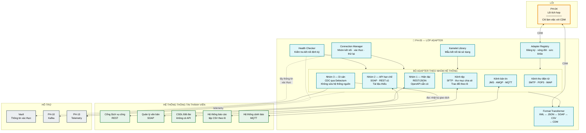
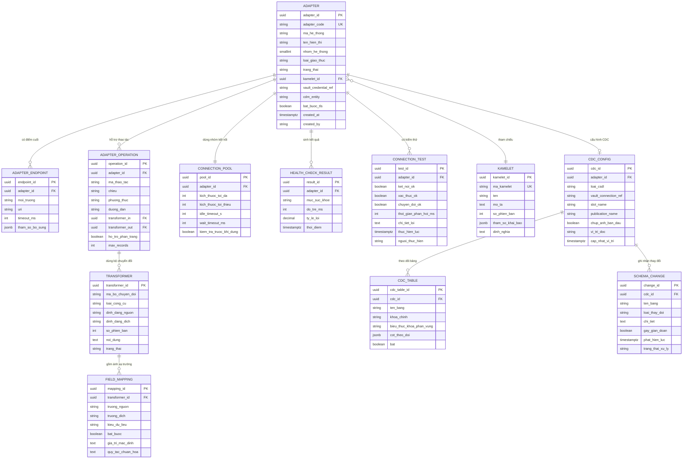

# SRS — PH-05: Quản lý Adapter & Kết nối hệ thống

| Thuộc tính | Giá trị |
|---|---|
| **Mã phân hệ** | PH-05 |
| **Tên** | Quản lý Adapter & Kết nối hệ thống (Adapter & Connectivity) |
| **Nhóm** | Data Plane |
| **Mức bắt buộc** | M — Bắt buộc |
| **Phiên bản** | 1.0 |
| **Ngày** | 03/8/2026 |
| **Công nghệ chủ đạo** | Apache Camel components + Kamelet · Debezium (CDC) |

---

## M1. Giới thiệu

### 1.1. Mục đích

PH-05 là **lớp cách ly** giữa lõi tích hợp sạch sẽ và thực tế hỗn tạp của các hệ thống thông tin thành viên. Mỗi sở, ngành có hệ thống với công nghệ, giao thức và thói quen khác nhau — có hệ thống REST hiện đại, có hệ thống SOAP từ mười năm trước, có hệ thống không API và không còn nhà thầu bảo trì.

Nhiệm vụ của PH-05 là **che giấu toàn bộ sự khác biệt đó** để PH-04 chỉ làm việc với một mô hình thống nhất.

Đây là phân hệ hiện thực yêu cầu "bộ điều hợp (adapter)" tại CV 631: *"tất cả yêu cầu ra vào đều phải thông qua adapter"*.

### 1.2. Phạm vi

**PH-05 chịu trách nhiệm:**

| # | Trách nhiệm |
|---|---|
| 1 | Giao tiếp kỹ thuật với hệ thống thông tin thành viên qua mọi giao thức bắt buộc |
| 2 | Chuyển đổi định dạng bản tin giữa hệ thống nguồn/đích và CDM |
| 3 | Bắt thay đổi dữ liệu (CDC) từ hệ thống không có API |
| 4 | Quản lý nhóm kết nối, xác thực với hệ thống bên ngoài |
| 5 | Đóng gói mẫu kết nối lặp lại thành Kamelet tái sử dụng |
| 6 | Đăng ký, kiểm thử và quản lý vòng đời adapter |
| 7 | Kiểm tra sức khỏe kết nối tới từng hệ thống |
| 8 | Xử lý đặc thù giao thức: phân trang, giới hạn tần suất phía đối tác, thử lại |

**PH-05 KHÔNG chịu trách nhiệm:**

| # | Không làm | Thuộc phân hệ |
|---|---|---|
| 1 | **Logic nghiệp vụ** — định tuyến, quyết định xử lý | PH-04 |
| 2 | Kiểm tra quyền truy cập | PH-12 (qua PH-04) |
| 3 | Làm giàu dữ liệu từ dữ liệu chủ, danh mục | PH-04, PH-06, PH-07 |
| 4 | Kết nối tới NDXP/NDOP (có adapter chuyên biệt riêng) | PH-14 |
| 5 | Quản lý chủ đề Kafka và lược đồ sự kiện | PH-10 |
| 6 | Quy trình thẩm định, phê duyệt kết nạp hệ thống | PH-01 |

**Nguyên tắc ranh giới then chốt.** Adapter chỉ làm **hai việc**: giao tiếp kỹ thuật và chuyển đổi định dạng. Không chứa logic nghiệp vụ. Giữ đúng ranh giới này khiến adapter thay thế được khi hệ thống nguồn nâng cấp mà không ảnh hưởng nghiệp vụ — xem [BR-05-001](#m8-quy-tắc-nghiệp-vụ).

### 1.3. Tài liệu tham chiếu

| Mã | Tài liệu |
|---|---|
| [KT] | [Kiến trúc phân lớp — L1 Kết nối](../02-architecture/README.md#3-kiến-trúc-phân-lớp-tổng-thể) |
| [LT] | [F-03](../03-flows/README.md#f-03--khai-thác-dữ-liệu-đồng-bộ-nội-bộ), [F-05](../03-flows/README.md#f-05--đồng-bộ-dữ-liệu-bất-đồng-bộ-theo-sự-kiện), [F-06](../03-flows/README.md#f-06--liên-thông-văn-bản-điện-tử) |
| [KH] | [Kế hoạch triển khai — Bước 1 phân loại HTTT, Bước 9 xây adapter](../04-deployment/README.md) |
| [ADR] | [ADR-001 Camel](../05-adr/README.md#adr-001), [ADR-005 Debezium](../05-adr/README.md#adr-005), [ADR-013 CDM](../05-adr/README.md#adr-013) |
| [SRS] | [PH-04 Lõi tích hợp](SRS-PH-04-integration-core.md) |
| [CV631] | Công văn 631/THH-THHT — adapter, đa giao thức, đa định dạng |

---

## M2. Mô tả tổng quan

### 2.1. Vị trí trong kiến trúc



**Thuyết minh sơ đồ.** Hai mũi tên hai chiều giữa PH-04 và PH-05 đều ghi "CDM" — đây là điểm cốt lõi: **lõi không bao giờ nhìn thấy định dạng gốc** của hệ thống bên ngoài. Mọi khác biệt về SOAP, CSV, cấu trúc bảng CSDL đều dừng lại ở PH-05.

Hệ quả thực tiễn: khi Sở Tài nguyên nâng cấp CSDL Đất đai từ không-API lên REST, chỉ cần thay adapter A3 bằng A1. Các luồng nghiệp vụ tại PH-04, chính sách tại PH-12, dashboard tại PH-13 **không phải sửa gì**.

**Đường CDC đặc biệt.** Mũi tên từ A3 tới T3 là một chiều và ghi "đọc nhật ký giao dịch" — Debezium không truy vấn bảng, không dùng trigger, không cần hệ thống nguồn sửa mã. Đây thường là con đường khả thi **duy nhất** để đưa hệ thống di sản lên trục ([ADR-005](../05-adr/README.md#adr-005)).

### 2.2. Phân loại hệ thống và chiến lược kết nối

Bốn nhóm hệ thống đã xác định tại [Bước 1 kế hoạch triển khai](../04-deployment/README.md#bước-1--khảo-sát-hiện-trạng-và-lập-danh-mục-tích-hợp) quyết định cách xây adapter:

| Nhóm | Đặc điểm | Adapter | Chi phí xây | Rủi ro |
|---|---|---|---|---|
| **Nhóm 1 — Hiện đại** | REST API, tài liệu OpenAPI đầy đủ, đang bảo trì | Sinh tự động từ OpenAPI + Kamelet chuẩn | Thấp | Thấp |
| **Nhóm 2 — API hạn chế** | SOAP/API cũ, tài liệu thiếu hoặc lệch thực tế | Adapter chuyên biệt, cần khảo sát thực tế | Trung bình | Trung bình — tài liệu sai lệch |
| **Nhóm 3 — Di sản** | Không API, không nhà thầu, không sửa được | CDC qua Debezium đọc nhật ký giao dịch | Trung bình | Cao — phụ thuộc cấu trúc CSDL nội bộ |
| **Nhóm 4 — Sắp thay thế** | Có kế hoạch thay mới | Không đầu tư sâu; kết nối tối thiểu hoặc chờ | Rất thấp | Thấp |

**Ghi chú về rủi ro Nhóm 3.** CDC đọc trực tiếp cấu trúc bảng của hệ thống nguồn — vốn là chi tiết cài đặt nội bộ, không phải hợp đồng công bố. Nếu nhà cung cấp đổi lược đồ bảng, adapter sẽ hỏng mà không có cảnh báo trước. Biện pháp giảm thiểu: giám sát lược đồ (FR-05-009) và thỏa thuận thông báo trước với đơn vị chủ quản.

### 2.3. Tác nhân

| Tác nhân | Loại | Tương tác |
|---|---|---|
| Cán bộ phát triển tích hợp | Người | Xây, cấu hình, kiểm thử adapter |
| Cán bộ kỹ thuật đơn vị thành viên | Người | Cung cấp thông tin kỹ thuật hệ thống, phối hợp kiểm thử |
| Quản trị viên nền tảng | Người | Bật/tắt adapter, xem sức khỏe kết nối |
| PH-04 Lõi tích hợp | Hệ thống | Gọi adapter để giao tiếp hệ thống bên ngoài |
| PH-10 Kafka | Hệ thống | Nhận sự kiện CDC |
| Hệ thống thông tin thành viên | Hệ thống | Đầu kia của kết nối |
| Vault | Hệ thống | Cung cấp thông tin xác thực |

### 2.4. Giả định

| Mã | Giả định |
|---|---|
| GD-01 | Hệ thống thành viên đã hoàn tất kết nạp tại PH-01 và có credential hợp lệ |
| GD-02 | Đơn vị chủ quản cung cấp tài liệu kỹ thuật hoặc cho phép khảo sát thực tế |
| GD-03 | Với Nhóm 3: được cấp tài khoản CSDL chỉ đọc có quyền đọc nhật ký giao dịch |
| GD-04 | Đường mạng tới hệ thống thành viên đã thông và có băng thông đủ |
| GD-05 | Lược đồ CDM tương ứng đã đăng ký tại Schema Registry |

### 2.5. Ràng buộc

| Mã | Ràng buộc | Nguồn |
|---|---|---|
| RB-01 | Hỗ trợ HTTP, HTTPS, WebSocket, POP, IMAP, SMTP, JMS, AMQP, MQTT | CV 631, CMP-11 |
| RB-02 | Hỗ trợ JSON, XML, SOAP | CV 631, CMP-12 |
| RB-03 | Mọi yêu cầu ra vào phải qua adapter | CV 631 |
| RB-04 | Không sửa mã hệ thống thành viên khi tích hợp Nhóm 3 | Thực tế triển khai |
| RB-05 | Kết nối ra ngoài dùng TLS 1.2 trở lên khi hệ thống đích hỗ trợ | CMP-13 |
| RB-06 | Toàn bộ công nghệ mã nguồn mở | Yêu cầu dự án |

### 2.6. Phụ thuộc phân hệ

| Phụ thuộc | Loại | Hành vi khi không khả dụng |
|---|---|---|
| Vault | **Cứng** | Không thiết lập được kết nối mới; kết nối đang mở vẫn dùng |
| PH-10 (Kafka) | **Cứng** với CDC | Debezium tạm dừng, giữ vị trí đọc; tiếp tục khi Kafka trở lại |
| Hệ thống thành viên | **Cứng** cho adapter tương ứng | Ngắt mạch tại PH-04; adapter báo không khỏe |
| PH-13 | **Mềm** | Đệm telemetry cục bộ |

---

## M3. Yêu cầu chức năng

### 3.1. Nhóm A — Đăng ký và vòng đời adapter

#### FR-05-001 — Đăng ký adapter · **M**

| Mục | Nội dung |
|---|---|
| **Mô tả** | Khai báo một adapter kết nối tới hệ thống thành viên |
| **Tác nhân** | Cán bộ phát triển tích hợp |
| **Tiền điều kiện** | Hệ thống đã kết nạp tại PH-01 |
| **Đầu vào** | Mã adapter · mã hệ thống · nhóm (1–4) · loại giao thức · điểm cuối · tham chiếu thông tin xác thực · lược đồ CDM đích |
| **Xử lý** | 1. Kiểm tra mã hệ thống tồn tại và trạng thái `ACTIVE` tại PH-01<br>2. Kiểm tra lược đồ CDM đích đã đăng ký tại Schema Registry<br>3. Kiểm tra tham chiếu Vault hợp lệ (không kiểm tra nội dung bí mật)<br>4. Tạo adapter ở trạng thái `DRAFT`<br>5. Ghi sự kiện đăng ký |
| **Đầu ra** | Adapter đã đăng ký, trạng thái `DRAFT` |
| **Ngoại lệ** | E1: Mã hệ thống không tồn tại → `422`<br>E2: Lược đồ CDM chưa đăng ký → `422` kèm hướng dẫn<br>E3: Mã adapter trùng → `409` |

#### FR-05-002 — Kiểm thử kết nối · **M**

| Mục | Nội dung |
|---|---|
| **Mô tả** | Xác minh adapter kết nối được tới hệ thống thật trước khi kích hoạt |
| **Tiền điều kiện** | Adapter ở trạng thái `DRAFT` hoặc `TESTING` |
| **Đầu vào** | Mã adapter · dữ liệu mẫu (tùy chọn) |
| **Xử lý** | 1. Lấy thông tin xác thực từ Vault<br>2. Thiết lập kết nối tới hệ thống đích<br>3. Thực hiện thao tác kiểm tra không gây tác dụng phụ (đọc, hoặc gọi điểm cuối sức khỏe)<br>4. Nếu có dữ liệu mẫu → chạy chuyển đổi và kiểm tra kết quả đúng lược đồ CDM<br>5. Đo thời gian phản hồi<br>6. Ghi kết quả kiểm thử |
| **Đầu ra** | Báo cáo kiểm thử: kết nối · xác thực · chuyển đổi · thời gian phản hồi |
| **Ngoại lệ** | E1: Không kết nối được → báo lỗi cụ thể (DNS, từ chối kết nối, quá hạn chờ)<br>E2: Xác thực thất bại → báo rõ, không ghi bí mật vào nhật ký<br>E3: Chuyển đổi cho kết quả sai lược đồ CDM → liệt kê trường sai |

**Ghi chú về bước 3.** Thao tác kiểm tra phải **không gây tác dụng phụ** — không tạo, sửa, xóa dữ liệu trên hệ thống thành viên. Đây là yêu cầu bắt buộc vì kiểm thử có thể chạy nhiều lần trên môi trường thật.

#### FR-05-003 — Kích hoạt, tạm dừng, gỡ bỏ adapter · **M**

| Mục | Nội dung |
|---|---|
| **Mô tả** | Điều khiển trạng thái adapter trong vận hành |
| **Đầu vào** | Mã adapter · hành động (`activate`/`suspend`/`remove`) · lý do |
| **Xử lý** | · **Kích hoạt**: yêu cầu kiểm thử kết nối đã đạt trong 24 giờ gần nhất; mở nhóm kết nối; chuyển `ACTIVE`<br>· **Tạm dừng**: ngừng nhận yêu cầu mới, hoàn tất yêu cầu đang xử lý (tối đa 30 giây), đóng nhóm kết nối<br>· **Gỡ bỏ**: tạm dừng rồi loại khỏi đăng ký; giữ lịch sử<br>Ghi sự kiện kèm người thực hiện và lý do |
| **Đầu ra** | Adapter ở trạng thái mới |
| **Ngoại lệ** | E1: Kích hoạt khi chưa kiểm thử đạt → từ chối<br>E2: Còn luồng PH-04 đang dùng adapter khi gỡ bỏ → cảnh báo, liệt kê luồng, yêu cầu xác nhận |

#### FR-05-004 — Kiểm tra sức khỏe kết nối · **M**

| Mục | Nội dung |
|---|---|
| **Mô tả** | Theo dõi liên tục tình trạng kết nối tới từng hệ thống |
| **Xử lý** | 1. Kiểm tra chủ động định kỳ (mặc định 30 giây) bằng thao tác nhẹ không tác dụng phụ<br>2. Kiểm tra thụ động: theo dõi tỷ lệ lỗi và độ trễ của lưu lượng thật<br>3. Đánh giá ba mức: `HEALTHY` · `DEGRADED` (độ trễ tăng hoặc lỗi rải rác) · `UNHEALTHY`<br>4. Phát chỉ số và cảnh báo khi đổi mức<br>5. Thông báo PH-04 để điều chỉnh hành vi ngắt mạch |
| **Đầu ra** | Trạng thái sức khỏe từng adapter |
| **Ngoại lệ** | E1: Chuyển `UNHEALTHY` → cảnh báo mức cao cho vận hành và đơn vị chủ quản<br>E2: Hệ thống đích không có điểm cuối sức khỏe → dùng kiểm tra thụ động, ghi rõ hạn chế |

### 3.2. Nhóm B — Adapter theo giao thức

#### FR-05-005 — Adapter REST/HTTP · **M**

| Mục | Nội dung |
|---|---|
| **Mô tả** | Kết nối hệ thống có REST API (chủ yếu Nhóm 1) |
| **Đầu vào** | Bản tin CDM · cấu hình điểm cuối |
| **Xử lý** | 1. Dựng yêu cầu HTTP: phương thức, đường dẫn, tham số, tiêu đề<br>2. Áp dụng xác thực: Bearer token, khóa API, Basic, hoặc mTLS<br>3. Gửi qua nhóm kết nối dùng lại<br>4. Xử lý phân trang tự động nếu API trả nhiều trang<br>5. Tôn trọng hạn mức phía đối tác (đọc tiêu đề `X-RateLimit-*` nếu có)<br>6. Chuyển đổi phản hồi sang CDM |
| **Đầu ra** | Bản tin CDM |
| **Ngoại lệ** | E1: `429` từ đối tác → chờ theo `Retry-After`, báo PH-04 giảm nhịp<br>E2: `4xx` khác → lỗi nghiệp vụ, không thử lại<br>E3: `5xx`, quá hạn chờ → lỗi tạm thời, PH-04 quyết định thử lại<br>E4: Phản hồi sai định dạng khai báo → lỗi chuyển đổi, đẩy DLQ kèm phản hồi gốc |

**Ghi chú về bước 4.** Phân trang tự động là chi tiết dễ bỏ sót: nhiều API trả 100 bản ghi/trang, nếu adapter chỉ lấy trang đầu thì dữ liệu thiếu mà không có lỗi nào. Adapter phải tự lặp cho tới hết, có giới hạn số trang tối đa để tránh vòng lặp vô hạn.

#### FR-05-006 — Adapter SOAP · **M**

| Mục | Nội dung |
|---|---|
| **Mô tả** | Kết nối hệ thống dùng SOAP (chủ yếu Nhóm 2) |
| **Đầu vào** | Bản tin CDM · tham chiếu WSDL |
| **Xử lý** | 1. Nạp WSDL, xác định thao tác và kiểu dữ liệu<br>2. Dựng phong bì SOAP đúng đặc tả<br>3. Áp dụng WS-Security nếu yêu cầu (UsernameToken, chữ ký)<br>4. Gửi kèm tiêu đề `SOAPAction`<br>5. Phân tích phản hồi, tách phần thân<br>6. Chuyển đổi sang CDM qua XSLT |
| **Đầu ra** | Bản tin CDM |
| **Ngoại lệ** | E1: Phản hồi chứa `SOAP Fault` → trích mã và mô tả lỗi, phân loại theo bảng ánh xạ<br>E2: WSDL không tải được → dùng bản đã đệm; nếu không có → lỗi cấu hình<br>E3: WSDL thực tế lệch tài liệu → ghi cảnh báo chi tiết cho cán bộ tích hợp |

**Ghi chú về E3.** Đây là tình huống rất phổ biến với Nhóm 2: tài liệu nói một đằng, hệ thống trả một nẻo. Adapter phải phát hiện và báo rõ thay vì lỗi mơ hồ.

#### FR-05-007 — Adapter hàng đợi bản tin · **M**

| Mục | Nội dung |
|---|---|
| **Mô tả** | Kết nối qua JMS, AMQP, MQTT |
| **Xử lý** | 1. Thiết lập kết nối tới nhà môi giới bản tin<br>2. Với vai trò tiêu thụ: đăng ký hàng đợi/chủ đề, xác nhận sau khi xử lý xong<br>3. Với vai trò phát: gửi kèm thuộc tính bản tin (`traceId`, `correlationId`)<br>4. Áp dụng mức chất lượng dịch vụ phù hợp (MQTT QoS 1 trở lên cho dữ liệu quan trọng)<br>5. Tự kết nối lại khi mất kết nối |
| **Đầu ra** | Bản tin gửi/nhận thành công |
| **Ngoại lệ** | E1: Mất kết nối nhà môi giới → thử lại có backoff, ghi cảnh báo<br>E2: Bản tin không giải mã được → chuyển hàng đợi lỗi của nhà môi giới nếu có, hoặc DLQ<br>E3: Hàng đợi đầy → tạm dừng phát, cảnh báo |

#### FR-05-008 — Adapter tệp và SFTP · **M**

| Mục | Nội dung |
|---|---|
| **Mô tả** | Trao đổi dữ liệu theo lô qua tệp |
| **Xử lý** | 1. Quét thư mục theo lịch hoặc theo dõi thay đổi<br>2. **Khóa tệp** trước khi xử lý để tránh hai thực thể cùng đọc<br>3. Chỉ xử lý tệp đã ghi xong (kiểm tra kích thước ổn định hoặc tệp đánh dấu hoàn tất)<br>4. Phân tích định dạng: CSV, cố định độ rộng, XML, JSON<br>5. Chuyển đổi từng bản ghi sang CDM<br>6. Chuyển tệp sang thư mục lưu trữ sau khi xử lý xong; tệp lỗi sang thư mục lỗi<br>7. Với tệp lớn: xử lý theo luồng, không nạp toàn bộ vào bộ nhớ |
| **Đầu ra** | Các bản tin CDM từ nội dung tệp |
| **Ngoại lệ** | E1: Tệp đang ghi dở → bỏ qua lượt này, thử lại lượt sau<br>E2: Một bản ghi lỗi → tiếp tục các bản ghi còn lại, gom danh sách lỗi<br>E3: Tệp sai định dạng hoàn toàn → chuyển thư mục lỗi, cảnh báo<br>E4: Mất kết nối SFTP giữa chừng → không xóa tệp nguồn, thử lại từ đầu |

**Ghi chú về bước 2 và 3.** Hai bước này giải quyết hai lỗi kinh điển của tích hợp qua tệp: đọc tệp đang ghi dở (được nửa dữ liệu) và hai pod cùng xử lý một tệp (dữ liệu nhân đôi).

#### FR-05-009 — Adapter CDC cho hệ thống di sản · **M**

| Mục | Nội dung |
|---|---|
| **Mô tả** | Bắt thay đổi dữ liệu từ CSDL mà không sửa hệ thống nguồn (Nhóm 3) |
| **Tiền điều kiện** | Có tài khoản CSDL quyền đọc nhật ký giao dịch; CSDL bật ghi nhật ký phù hợp |
| **Đầu vào** | Thông tin kết nối CSDL · danh sách bảng theo dõi · vị trí bắt đầu |
| **Xử lý** | 1. Debezium kết nối và đọc **nhật ký giao dịch** (WAL với PostgreSQL, binlog với MySQL, redo log với Oracle)<br>2. Chụp ảnh ban đầu nếu là lần đầu (tùy chọn, có thể bỏ qua nếu chỉ cần thay đổi từ nay)<br>3. Phát sự kiện thay đổi: `INSERT`, `UPDATE`, `DELETE` kèm giá trị trước/sau<br>4. **Giám sát lược đồ**: phát hiện thay đổi cấu trúc bảng và cảnh báo<br>5. Chuyển đổi sang CDM<br>6. Đẩy vào Kafka với khóa phân vùng theo định danh thực thể<br>7. Lưu vị trí đọc bền vững để tiếp tục sau khi khởi động lại |
| **Đầu ra** | Sự kiện thay đổi trên Kafka |
| **Ngoại lệ** | E1: Mất kết nối CSDL → giữ vị trí, thử lại; cảnh báo nếu quá 5 phút<br>E2: Lược đồ bảng thay đổi phá vỡ ánh xạ → **tạm dừng** adapter, cảnh báo nghiêm trọng, không phát dữ liệu sai<br>E3: Nhật ký giao dịch bị xoay vòng mất phần chưa đọc → cảnh báo nghiêm trọng, cần chụp ảnh lại<br>E4: Kafka không khả dụng → tạm dừng đọc, giữ vị trí |

**Ghi chú về E2 — quyết định thiết kế quan trọng.** Khi cấu trúc bảng đổi, lựa chọn giữa "tiếp tục với dữ liệu có thể sai" và "dừng lại chờ người xử lý". Thiết kế này chọn **dừng**: dữ liệu sai lan vào trục gây hậu quả khó khắc phục hơn nhiều so với gián đoạn tạm thời có kiểm soát.

**Ghi chú về tác động lên hệ thống nguồn.** Đọc nhật ký giao dịch gần như không tạo tải cho CSDL nguồn — khác hẳn với việc truy vấn định kỳ (polling) vốn gây tải đáng kể. Đây là lý do CDC phù hợp với hệ thống di sản vốn đã yếu về hiệu năng.

#### FR-05-010 — Adapter thư điện tử · **S**

| Mục | Nội dung |
|---|---|
| **Mô tả** | Gửi/nhận qua SMTP, POP3, IMAP theo yêu cầu CV 631 |
| **Xử lý** | · **Gửi**: dựng thư từ mẫu, đính kèm tệp, gửi qua SMTP có xác thực<br>· **Nhận**: quét hộp thư qua IMAP/POP3, trích nội dung và đính kèm, đánh dấu đã xử lý<br>· Quét mã độc mọi tệp đính kèm trước khi xử lý |
| **Đầu ra** | Thư đã gửi hoặc bản tin CDM từ thư nhận |
| **Ngoại lệ** | E1: Máy chủ thư từ chối → thử lại theo backoff<br>E2: Phát hiện mã độc trong đính kèm → chặn, cảnh báo an ninh, không xử lý tiếp |

#### FR-05-011 — Adapter CSDL trực tiếp · **S**

| Mục | Nội dung |
|---|---|
| **Mô tả** | Truy vấn trực tiếp CSDL khi được phép và không có lựa chọn khác |
| **Xử lý** | 1. Chỉ dùng tài khoản **chỉ đọc**<br>2. Chỉ chạy truy vấn đã khai báo trước, tham số hóa — không nhận SQL động từ bên gọi<br>3. Đặt thời hạn truy vấn bắt buộc<br>4. Giới hạn số bản ghi trả về<br>5. Dùng nhóm kết nối có giới hạn để không cạn kết nối của hệ thống nguồn |
| **Đầu ra** | Bản tin CDM |
| **Ngoại lệ** | E1: Truy vấn quá hạn → hủy truy vấn tại CSDL, trả lỗi<br>E2: Vượt giới hạn bản ghi → trả kèm cảnh báo cắt bớt, yêu cầu thu hẹp điều kiện |

**Ghi chú.** Bước 2 chống chèn mã SQL từ gốc: adapter không bao giờ ghép chuỗi truy vấn từ dữ liệu đầu vào.

### 3.3. Nhóm C — Chuyển đổi định dạng

#### FR-05-012 — Chuyển đổi sang và từ CDM · **M**

| Mục | Nội dung |
|---|---|
| **Mô tả** | Chuyển đổi hai chiều giữa định dạng hệ thống và mô hình chuẩn |
| **Đầu vào** | Bản tin định dạng nguồn · tham chiếu bộ chuyển đổi |
| **Xử lý** | 1. Chọn bộ chuyển đổi theo `(hệ thống, thao tác, chiều, phiên bản)`<br>2. Áp dụng công cụ phù hợp: XSLT 3.0 cho XML, JSLT cho JSON, bộ phân tích riêng cho CSV/cố định độ rộng<br>3. Chuẩn hóa kiểu dữ liệu: ngày tháng về ISO 8601, số về định dạng thống nhất, chuỗi cắt khoảng trắng thừa<br>4. Chuẩn hóa mã danh mục qua PH-07 nếu có ánh xạ<br>5. Kiểm tra kết quả đúng lược đồ CDM |
| **Đầu ra** | Bản tin CDM hợp lệ |
| **Ngoại lệ** | E1: Không tìm thấy bộ chuyển đổi → lỗi cấu hình, cảnh báo<br>E2: Chuyển đổi lỗi → giữ bản tin gốc, đẩy DLQ kèm thông tin lỗi<br>E3: Kết quả không đúng lược đồ → liệt kê trường sai, DLQ |

**Ghi chú về bước 3.** Chuẩn hóa kiểu dữ liệu là nguồn lỗi phổ biến trong thực tế: hệ thống A ghi ngày `15/01/1990`, hệ thống B ghi `1990-01-15`, hệ thống C ghi `19900115`. Không chuẩn hóa ở adapter thì lỗi này lan vào lõi và nhân lên.

#### FR-05-013 — Xử lý dữ liệu thiếu và giá trị đặc biệt · **M**

| Mục | Nội dung |
|---|---|
| **Mô tả** | Xử lý nhất quán các giá trị rỗng, mặc định, sai quy ước |
| **Xử lý** | Áp dụng quy tắc khai báo cho từng trường:<br>· Giá trị rỗng của hệ thống nguồn (`""`, `"null"`, `"N/A"`, `0`, `01/01/1900`) → chuẩn hóa thành thiếu giá trị<br>· Trường bắt buộc thiếu → theo cấu hình: dùng mặc định, hoặc từ chối bản tin<br>· Ghi nhận tỷ lệ thiếu để phục vụ đánh giá chất lượng tại PH-08 |
| **Đầu ra** | Bản tin đã chuẩn hóa giá trị thiếu |
| **Ngoại lệ** | E1: Trường bắt buộc thiếu và không có mặc định → DLQ, thông báo chủ quản nguồn |

#### FR-05-014 — Quản lý phiên bản bộ chuyển đổi · **S**

| Mục | Nội dung |
|---|---|
| **Mô tả** | Cho phép nâng cấp bộ chuyển đổi an toàn |
| **Xử lý** | 1. Mỗi bộ chuyển đổi có phiên bản<br>2. Chạy song song phiên bản cũ và mới, đối chiếu kết quả trên lưu lượng thật (chế độ so sánh)<br>3. Báo cáo khác biệt<br>4. Chuyển hẳn sang phiên bản mới khi khác biệt được xác nhận là đúng ý đồ |
| **Đầu ra** | Bộ chuyển đổi phiên bản mới có hiệu lực |
| **Ngoại lệ** | E1: Khác biệt vượt ngưỡng cấu hình → cảnh báo, yêu cầu xác nhận thủ công |

### 3.4. Nhóm D — Kết nối và tái sử dụng

#### FR-05-015 — Quản lý nhóm kết nối · **M**

| Mục | Nội dung |
|---|---|
| **Mô tả** | Dùng lại kết nối để giảm chi phí thiết lập và bảo vệ hệ thống nguồn |
| **Xử lý** | 1. Mỗi hệ thống đích có nhóm kết nối riêng, kích thước cấu hình được<br>2. Giới hạn số kết nối đồng thời để không làm quá tải hệ thống nguồn<br>3. Kiểm tra kết nối còn sống trước khi dùng lại<br>4. Đóng kết nối nhàn rỗi quá lâu<br>5. Chờ có giới hạn khi nhóm cạn, không chờ vô hạn |
| **Đầu ra** | Kết nối khả dụng |
| **Ngoại lệ** | E1: Nhóm cạn và hết thời gian chờ → trả lỗi cho PH-04, không xếp hàng vô hạn<br>E2: Kết nối lỗi khi lấy ra → loại bỏ, tạo kết nối mới |

**Ghi chú về bước 2.** Giới hạn kết nối là biện pháp bảo vệ hệ thống thành viên: nhiều hệ thống cũ chỉ chịu được vài chục kết nối đồng thời. Nếu LGSP mở rộng lên 20 replica mà mỗi replica mở 50 kết nối thì sẽ làm sập chính hệ thống mình đang tích hợp.

#### FR-05-016 — Quản lý thông tin xác thực · **M**

| Mục | Nội dung |
|---|---|
| **Mô tả** | Lấy và làm mới thông tin xác thực an toàn |
| **Xử lý** | 1. Lấy từ Vault lúc chạy, không lưu trong cấu hình<br>2. Đệm trong bộ nhớ với thời hạn ngắn<br>3. Tự làm mới token OAuth2 trước khi hết hạn<br>4. Hỗ trợ xoay vòng bí mật không gián đoạn: thử bí mật mới, nếu lỗi thì dùng bí mật cũ trong giai đoạn chuyển tiếp |
| **Đầu ra** | Thông tin xác thực hợp lệ |
| **Ngoại lệ** | E1: Vault không khả dụng → dùng bản đệm; hết đệm → adapter chuyển `UNHEALTHY`<br>E2: Xác thực thất bại → cảnh báo, không thử lại nhiều lần (tránh khóa tài khoản phía đối tác) |

**Ghi chú về E2.** Thử lại xác thực nhiều lần có thể khiến hệ thống đối tác khóa tài khoản của LGSP — biến sự cố nhỏ thành sự cố lớn. Giới hạn số lần thử là biện pháp phòng ngừa cần thiết.

#### FR-05-017 — Thư viện Kamelet tái sử dụng · **M**

| Mục | Nội dung |
|---|---|
| **Mô tả** | Đóng gói mẫu kết nối lặp lại thành thành phần dùng lại |
| **Xử lý** | 1. Nhận diện mẫu kết nối lặp lại (ví dụ: REST + OAuth2 + phân trang)<br>2. Đóng gói thành Kamelet với tham số khai báo<br>3. Đăng ký vào thư viện, có phiên bản và tài liệu<br>4. Adapter mới tham chiếu Kamelet thay vì viết lại |
| **Đầu ra** | Kamelet trong thư viện |
| **Ngoại lệ** | E1: Kamelet có lỗi ảnh hưởng nhiều adapter → cơ chế cảnh báo tới mọi adapter đang dùng |

**Ghi chú về giá trị.** Đây là cơ chế khiến chi phí kết nạp hệ thống **giảm dần theo số lượng**: hệ thống thứ nhất phải xây từ đầu, hệ thống thứ hai mươi chỉ cần cấu hình Kamelet có sẵn. Đây là điều kiện để [Bước 18 mở rộng diện kết nối](../04-deployment/README.md#bước-18--mở-rộng-diện-kết-nối) khả thi.

#### FR-05-018 — Sinh adapter từ đặc tả OpenAPI · **S**

| Mục | Nội dung |
|---|---|
| **Mô tả** | Tự động tạo khung adapter cho hệ thống Nhóm 1 |
| **Đầu vào** | Tài liệu OpenAPI 3.x của hệ thống đích |
| **Xử lý** | 1. Phân tích đặc tả, liệt kê thao tác khả dụng<br>2. Cán bộ chọn thao tác cần tích hợp<br>3. Sinh cấu hình adapter và khung bộ chuyển đổi<br>4. Đề xuất ánh xạ trường dựa trên tên tương đồng<br>5. Cán bộ rà soát và hoàn thiện ánh xạ |
| **Đầu ra** | Adapter khung, cần hoàn thiện ánh xạ |
| **Ngoại lệ** | E1: Đặc tả sai cú pháp → báo lỗi cụ thể<br>E2: Không suy được ánh xạ → để trống, yêu cầu điền thủ công |

**Ghi chú.** Bước 4 chỉ **đề xuất**, không tự quyết. Ánh xạ trường sai gây lỗi dữ liệu nghiêm trọng nên phải có người xác nhận.

### 3.5. Bảng tổng hợp yêu cầu chức năng

| Nhóm | Mã | Tên | Ưu tiên |
|---|---|---|:-:|
| A | FR-05-001 | Đăng ký adapter | M |
| A | FR-05-002 | Kiểm thử kết nối | M |
| A | FR-05-003 | Kích hoạt, tạm dừng, gỡ bỏ adapter | M |
| A | FR-05-004 | Kiểm tra sức khỏe kết nối | M |
| B | FR-05-005 | Adapter REST/HTTP | M |
| B | FR-05-006 | Adapter SOAP | M |
| B | FR-05-007 | Adapter hàng đợi bản tin | M |
| B | FR-05-008 | Adapter tệp và SFTP | M |
| B | FR-05-009 | Adapter CDC cho hệ thống di sản | M |
| B | FR-05-010 | Adapter thư điện tử | S |
| B | FR-05-011 | Adapter CSDL trực tiếp | S |
| C | FR-05-012 | Chuyển đổi sang và từ CDM | M |
| C | FR-05-013 | Xử lý dữ liệu thiếu và giá trị đặc biệt | M |
| C | FR-05-014 | Quản lý phiên bản bộ chuyển đổi | S |
| D | FR-05-015 | Quản lý nhóm kết nối | M |
| D | FR-05-016 | Quản lý thông tin xác thực | M |
| D | FR-05-017 | Thư viện Kamelet tái sử dụng | M |
| D | FR-05-018 | Sinh adapter từ đặc tả OpenAPI | S |

**Tổng: 18 yêu cầu chức năng** — 13 bắt buộc (M), 5 cần có (S).

---

## M4. Mô hình dữ liệu

### 4.1. Sơ đồ thực thể



### 4.2. Đặc tả thực thể

#### EN-05-01 — ADAPTER

| Trường | Kiểu | Bắt buộc | Ràng buộc | Mô tả |
|---|---|:-:|---|---|
| `adapter_id` | UUID | ✓ | PK | |
| `adapter_code` | VARCHAR(80) | ✓ | UNIQUE, `^[a-z0-9-]+$` | Mã dùng trong cấu hình route |
| `ma_he_thong` | VARCHAR(80) | ✓ | Tồn tại tại PH-01 | Hệ thống thành viên |
| `ten_hien_thi` | VARCHAR(200) | ✓ | | |
| `nhom_he_thong` | SMALLINT | ✓ | ∈ {1,2,3,4} | Quyết định chiến lược kết nối |
| `loai_giao_thuc` | VARCHAR(24) | ✓ | ∈ {`REST`,`SOAP`,`JMS`,`AMQP`,`MQTT`,`FILE`,`SFTP`,`CDC`,`JDBC`,`SMTP`,`IMAP`,`POP3`} | Phủ đủ RB-01 |
| `trang_thai` | VARCHAR(20) | ✓ | ∈ {`DRAFT`,`TESTING`,`ACTIVE`,`SUSPENDED`,`RETIRED`} | |
| `kamelet_id` | UUID | | FK | Rỗng nếu adapter tự viết |
| `vault_credential_ref` | VARCHAR(200) | | | **Tham chiếu** Vault, không phải bí mật |
| `cdm_entity` | VARCHAR(80) | ✓ | Đã đăng ký Schema Registry | Thực thể CDM đích |
| `bat_buoc_tls` | BOOLEAN | ✓ | mặc định true | Tắt chỉ khi hệ thống đích không hỗ trợ, cần thuyết minh |

**Ràng buộc bảng.** Adapter `ACTIVE` bắt buộc có kiểm thử kết nối đạt trong 24 giờ trước khi kích hoạt. Adapter `nhom_he_thong = 3` bắt buộc có bản ghi `CDC_CONFIG`.

#### EN-05-02 — ADAPTER_OPERATION

| Trường | Kiểu | Bắt buộc | Mô tả |
|---|---|:-:|---|
| `operation_id` | UUID | ✓ | PK |
| `adapter_id` | UUID | ✓ | FK |
| `ma_thao_tac` | VARCHAR(80) | ✓ | UNIQUE cùng adapter |
| `chieu` | VARCHAR(12) | ✓ | ∈ {`INBOUND`,`OUTBOUND`,`BIDIRECTIONAL`} |
| `phuong_thuc` | VARCHAR(20) | | Với REST: GET/POST/… ; với SOAP: tên thao tác |
| `duong_dan` | VARCHAR(300) | | |
| `transformer_in` / `transformer_out` | UUID | | FK — chuyển đổi hai chiều |
| `ho_tro_phan_trang` | BOOLEAN | ✓ | mặc định false (FR-05-005 bước 4) |
| `max_records` | INTEGER | ✓ | Giới hạn an toàn, mặc định 10.000 |

#### EN-05-03 — CDC_CONFIG

| Trường | Kiểu | Bắt buộc | Mô tả |
|---|---|:-:|---|
| `cdc_id` | UUID | ✓ | PK |
| `adapter_id` | UUID | ✓ | FK, UNIQUE |
| `loai_csdl` | VARCHAR(24) | ✓ | ∈ {`POSTGRESQL`,`MYSQL`,`ORACLE`,`SQLSERVER`,`DB2`} |
| `vault_connection_ref` | VARCHAR(200) | ✓ | Tham chiếu thông tin kết nối |
| `slot_name` | VARCHAR(80) | | Với PostgreSQL: tên replication slot |
| `publication_name` | VARCHAR(80) | | Với PostgreSQL |
| `chup_anh_ban_dau` | BOOLEAN | ✓ | Có chụp toàn bộ dữ liệu hiện có không |
| `vi_tri_doc` | VARCHAR(200) | | Vị trí đọc hiện tại trong nhật ký — **bền vững** |
| `cap_nhat_vi_tri` | TIMESTAMPTZ | | Thời điểm cập nhật vị trí gần nhất |

**Ghi chú quan trọng.** `vi_tri_doc` phải lưu bền vững và cập nhật thường xuyên. Mất giá trị này đồng nghĩa phải chụp ảnh lại toàn bộ — tốn kém và gây tải lớn cho hệ thống nguồn.

#### EN-05-04 — SCHEMA_CHANGE (Nhật ký thay đổi lược đồ)

| Trường | Kiểu | Bắt buộc | Mô tả |
|---|---|:-:|---|
| `change_id` | UUID | ✓ | PK |
| `cdc_id` | UUID | ✓ | FK |
| `ten_bang` | VARCHAR(120) | ✓ | |
| `loai_thay_doi` | VARCHAR(40) | ✓ | ∈ {`ADD_COLUMN`,`DROP_COLUMN`,`RENAME_COLUMN`,`CHANGE_TYPE`,`DROP_TABLE`} |
| `chi_tiet` | TEXT | ✓ | Mô tả cụ thể |
| `gay_gian_doan` | BOOLEAN | ✓ | Có phá vỡ ánh xạ hiện tại không |
| `phat_hien_luc` | TIMESTAMPTZ | ✓ | |
| `trang_thai_xu_ly` | VARCHAR(24) | ✓ | ∈ {`NEW`,`ACKNOWLEDGED`,`RESOLVED`,`IGNORED`} |

**Ghi chú.** Bảng này hiện thực FR-05-009 bước 4 và ngoại lệ E2 — là cơ sở để giảm thiểu rủi ro cao nhất của Nhóm 3.

#### EN-05-05 — FIELD_MAPPING

| Trường | Kiểu | Bắt buộc | Mô tả |
|---|---|:-:|---|
| `mapping_id` | UUID | ✓ | PK |
| `transformer_id` | UUID | ✓ | FK |
| `truong_nguon` | VARCHAR(200) | ✓ | Đường dẫn trường ở định dạng nguồn |
| `truong_dich` | VARCHAR(200) | ✓ | Đường dẫn trong CDM |
| `kieu_du_lieu` | VARCHAR(40) | ✓ | Kiểu đích sau chuẩn hóa |
| `bat_buoc` | BOOLEAN | ✓ | Thiếu thì từ chối hay dùng mặc định |
| `gia_tri_mac_dinh` | TEXT | | |
| `quy_tac_chuan_hoa` | TEXT | | Biểu thức chuẩn hóa (định dạng ngày, cắt khoảng trắng…) |

#### EN-05-06 — KAMELET

| Trường | Kiểu | Bắt buộc | Mô tả |
|---|---|:-:|---|
| `kamelet_id` | UUID | ✓ | PK |
| `ma_kamelet` | VARCHAR(80) | ✓ | UNIQUE |
| `ten` | VARCHAR(200) | ✓ | |
| `mo_ta` | TEXT | ✓ | Bắt buộc — để người khác biết khi nào dùng |
| `so_phien_ban` | INTEGER | ✓ | |
| `tham_so_khai_bao` | JSONB | ✓ | Lược đồ tham số |
| `dinh_nghia` | TEXT | ✓ | Định nghĩa Kamelet YAML |

### 4.3. Chính sách lưu giữ

| Thực thể | Thời hạn | Ghi chú |
|---|---|---|
| ADAPTER, OPERATION, TRANSFORMER, KAMELET | Vĩnh viễn | Giữ lịch sử cấu hình |
| CDC_CONFIG.vi_tri_doc | Vĩnh viễn | Sao lưu cùng CSDL, mất là phải chụp ảnh lại |
| SCHEMA_CHANGE | Vĩnh viễn | Truy vết nguyên nhân sự cố dữ liệu |
| CONNECTION_TEST | 1 năm | |
| HEALTH_CHECK_RESULT | 90 ngày | Tổng hợp theo giờ sau 7 ngày |

---

## M5. Giao diện API

### 5.1. Nguyên tắc chung

| Khía cạnh | Quy định |
|---|---|
| Đường dẫn quản trị | `/api/admin/v1/adapters` |
| Giao diện với PH-04 | Nội bộ qua Camel direct endpoint, không qua mạng |
| Xác thực | Bearer JWT, vai trò `INTEGRATION_DEV` hoặc `PLATFORM_ADMIN` |
| Mã lỗi | RFC 9457 Problem Details |

### 5.2. Điểm cuối quản trị

| Phương thức | Đường dẫn | Chức năng | FR |
|---|---|---|---|
| `GET` | `/api/admin/v1/adapters` | Danh sách adapter, lọc theo nhóm/giao thức/trạng thái | FR-05-001 |
| `POST` | `/api/admin/v1/adapters` | Đăng ký adapter mới | FR-05-001 |
| `GET` | `/api/admin/v1/adapters/{code}` | Chi tiết adapter | — |
| `PUT` | `/api/admin/v1/adapters/{code}` | Cập nhật cấu hình | — |
| `POST` | `/api/admin/v1/adapters/{code}/test` | Kiểm thử kết nối | FR-05-002 |
| `POST` | `/api/admin/v1/adapters/{code}/activate` | Kích hoạt | FR-05-003 |
| `POST` | `/api/admin/v1/adapters/{code}/suspend` | Tạm dừng | FR-05-003 |
| `DELETE` | `/api/admin/v1/adapters/{code}` | Gỡ bỏ | FR-05-003 |
| `GET` | `/api/admin/v1/adapters/{code}/health` | Tình trạng sức khỏe | FR-05-004 |
| `GET` | `/api/admin/v1/adapters/health` | Sức khỏe toàn bộ adapter | FR-05-004 |
| `POST` | `/api/admin/v1/adapters/{code}/operations` | Thêm thao tác | FR-05-001 |
| `POST` | `/api/admin/v1/adapters/from-openapi` | Sinh adapter từ OpenAPI | FR-05-018 |
| `GET` | `/api/admin/v1/transformers` | Danh sách bộ chuyển đổi | FR-05-012 |
| `POST` | `/api/admin/v1/transformers/{id}/preview` | Chạy thử chuyển đổi với dữ liệu mẫu | FR-05-012 |
| `POST` | `/api/admin/v1/transformers/{id}/compare` | So sánh hai phiên bản trên lưu lượng thật | FR-05-014 |
| `GET` | `/api/admin/v1/kamelets` | Thư viện Kamelet | FR-05-017 |
| `POST` | `/api/admin/v1/kamelets` | Đăng ký Kamelet mới | FR-05-017 |
| `GET` | `/api/admin/v1/cdc/{code}/status` | Trạng thái CDC: vị trí đọc, độ trễ | FR-05-009 |
| `GET` | `/api/admin/v1/cdc/schema-changes` | Thay đổi lược đồ chưa xử lý | FR-05-009 |
| `POST` | `/api/admin/v1/cdc/{code}/resume` | Tiếp tục CDC sau khi xử lý thay đổi lược đồ | FR-05-009 |

### 5.3. Đặc tả chi tiết điểm cuối chính

#### 5.3.1. `POST /api/admin/v1/adapters` — Đăng ký adapter

**Yêu cầu — ví dụ adapter SOAP (Nhóm 2):**

```json
{
  "adapterCode": "qlvb-soap",
  "maHeThong": "HT-QLVB",
  "tenHienThi": "Hệ thống Quản lý văn bản và điều hành",
  "nhomHeThong": 2,
  "loaiGiaoThuc": "SOAP",
  "cdmEntity": "VAN_BAN",
  "batBuocTls": true,
  "vaultCredentialRef": "secret/lgsp/adapters/qlvb-soap",
  "endpoints": [
    {
      "moiTruong": "PROD",
      "uri": "https://qlvb.tinh.gov.vn/services/VanBanService",
      "timeoutMs": 15000,
      "thamSoBoSung": { "wsdlUrl": "https://qlvb.tinh.gov.vn/services/VanBanService?wsdl" }
    }
  ],
  "operations": [
    {
      "maThaoTac": "guiVanBan",
      "chieu": "OUTBOUND",
      "phuongThuc": "SendDocument",
      "transformerOut": "cdm-to-qlvb-v1"
    },
    {
      "maThaoTac": "nhanBienNhan",
      "chieu": "INBOUND",
      "phuongThuc": "ReceiveAck",
      "transformerIn": "qlvb-to-cdm-v1"
    }
  ],
  "connectionPool": {
    "kichThuocToiDa": 20,
    "kichThuocToiThieu": 2,
    "idleTimeoutS": 300,
    "waitTimeoutMs": 3000
  }
}
```

**Phản hồi `201 Created`:**

```json
{
  "adapterId": "b2c4e6a8-1f3d-4a5b-9c7e-2d4f6a8b0c1e",
  "adapterCode": "qlvb-soap",
  "trangThai": "DRAFT",
  "_links": {
    "self": "/api/admin/v1/adapters/qlvb-soap",
    "test": "/api/admin/v1/adapters/qlvb-soap/test"
  },
  "buocTiepTheo": "Chạy kiểm thử kết nối trước khi kích hoạt"
}
```

#### 5.3.2. `POST /api/admin/v1/adapters/{code}/test` — Kiểm thử kết nối

**Phản hồi thành công `200 OK`:**

```json
{
  "adapterCode": "qlvb-soap",
  "ketQua": "PASSED",
  "thucHienLuc": "2026-08-03T15:20:00+07:00",
  "chiTiet": {
    "ketNoi": { "ok": true, "thoiGianMs": 142 },
    "xacThuc": { "ok": true, "phuongThuc": "WS-Security UsernameToken" },
    "taiWsdl": { "ok": true, "soThaoTac": 12, "canhBao": "WSDL khai báo 12 thao tác, cấu hình dùng 2" },
    "chuyenDoi": { "ok": true, "soTruongAnhXa": 18, "truongKhongAnhXa": [] }
  },
  "thoiGianPhanHoiMs": 142
}
```

**Phản hồi thất bại `200 OK`** (kiểm thử thất bại vẫn là kết quả hợp lệ):

```json
{
  "adapterCode": "csdl-datdai-cdc",
  "ketQua": "FAILED",
  "chiTiet": {
    "ketNoi": { "ok": true, "thoiGianMs": 88 },
    "xacThuc": { "ok": true },
    "quyenDocNhatKy": {
      "ok": false,
      "loi": "Tài khoản lgsp_cdc thiếu quyền REPLICATION trên CSDL",
      "huongDan": "Yêu cầu đơn vị chủ quản cấp quyền REPLICATION cho tài khoản này"
    }
  }
}
```

**Ghi chú thiết kế.** Thông báo lỗi kèm **hướng dẫn khắc phục cụ thể** thay vì chỉ báo lỗi kỹ thuật. Cán bộ tích hợp thường phải làm việc với đơn vị chủ quản, nên cần biết chính xác cần yêu cầu gì.

#### 5.3.3. `GET /api/admin/v1/cdc/{code}/status` — Trạng thái CDC

```json
{
  "adapterCode": "csdl-datdai-cdc",
  "trangThai": "RUNNING",
  "loaiCsdl": "ORACLE",
  "viTriDoc": "SCN:8847362910",
  "capNhatViTri": "2026-08-03T15:24:58+07:00",
  "doTreGiay": 2,
  "bangTheoDoi": [
    { "tenBang": "THUA_DAT", "soSuKien24h": 4820, "suKienCuoi": "2026-08-03T15:24:55+07:00" },
    { "tenBang": "CHU_SU_DUNG", "soSuKien24h": 1204, "suKienCuoi": "2026-08-03T15:20:11+07:00" }
  ],
  "thayDoiLuocDoChuaXuLy": 0,
  "canhBao": []
}
```

---

## M6. Giao diện người dùng

### 6.1. Danh mục màn hình

| Mã | Tên màn hình | Đối tượng | Mockup |
|---|---|---|---|
| **UI-05-01** | Danh sách adapter và sức khỏe kết nối | Cán bộ tích hợp, Vận hành | [`adapters.html`](../../mockup/pages/adapters.html) |
| **UI-05-02** | Đăng ký và cấu hình adapter | Cán bộ tích hợp | [`adapters.html`](../../mockup/pages/adapters.html) (tab Cấu hình) |
| **UI-05-03** | Kiểm thử kết nối | Cán bộ tích hợp | [`adapters.html`](../../mockup/pages/adapters.html) (tab Kiểm thử) |
| **UI-05-04** | Trình ánh xạ trường | Cán bộ tích hợp | [`adapters.html`](../../mockup/pages/adapters.html) (tab Ánh xạ) |
| **UI-05-05** | Giám sát CDC | Vận hành | [`adapters.html`](../../mockup/pages/adapters.html) (tab CDC) |
| **UI-05-06** | Thư viện Kamelet | Cán bộ tích hợp | [`adapters.html`](../../mockup/pages/adapters.html) (tab Kamelet) |

### 6.2. UI-05-01 — Danh sách adapter và sức khỏe

| Thành phần | Mô tả |
|---|---|
| Thẻ tổng quan | Tổng số adapter · đang hoạt động · suy giảm · mất kết nối |
| Bộ lọc | Nhóm hệ thống (1–4) · giao thức · trạng thái · mức sức khỏe |
| Bảng danh sách | Mã · Hệ thống · Nhóm · Giao thức · Sức khỏe · Độ trễ · Tỷ lệ lỗi · Lượt gọi 24h · Thao tác |
| Chỉ báo sức khỏe | Chấm màu ba mức, kèm tooltip nêu lý do |
| Thao tác dòng | Xem · Kiểm thử · Tạm dừng/Kích hoạt |

**Quy tắc tương tác:**

| # | Quy tắc |
|---|---|
| 1 | Adapter `UNHEALTHY` luôn hiển thị lên đầu bất kể sắp xếp |
| 2 | Nhấn dòng → mở chi tiết với các tab tương ứng |
| 3 | Adapter Nhóm 3 hiển thị nhãn CDC và độ trễ đọc nhật ký |
| 4 | Có thay đổi lược đồ chưa xử lý → hiện huy hiệu cảnh báo trên dòng |

### 6.3. UI-05-03 — Kiểm thử kết nối

**Mục đích.** Cho phép cán bộ kiểm chứng adapter trước khi kích hoạt, và chẩn đoán khi có sự cố.

| Thành phần | Mô tả |
|---|---|
| Nút "Chạy kiểm thử" | Kích hoạt kiểm thử, hiển thị tiến trình theo từng bước |
| Bảng kết quả từng bước | Kết nối · Xác thực · Tải đặc tả · Chuyển đổi — mỗi bước có biểu tượng đạt/không |
| Khung lỗi chi tiết | Với bước thất bại: thông báo lỗi + **hướng dẫn khắc phục** |
| Ô dữ liệu mẫu | Cho phép dán bản tin mẫu để kiểm thử chuyển đổi |
| Khung kết quả chuyển đổi | Hiển thị song song: dữ liệu nguồn → CDM |
| Lịch sử kiểm thử | Danh sách lần kiểm thử trước, ai chạy, kết quả |

**Quy tắc tương tác:**

| # | Quy tắc |
|---|---|
| 1 | Kiểm thử chỉ dùng thao tác không gây tác dụng phụ (FR-05-002) |
| 2 | Nút "Kích hoạt" bị vô hiệu nếu chưa có kiểm thử đạt trong 24 giờ |
| 3 | Không hiển thị bí mật trong kết quả kiểm thử, kể cả khi lỗi xác thực |
| 4 | Lỗi có hướng dẫn khắc phục kèm nút sao chép để gửi đơn vị chủ quản |

### 6.4. UI-05-04 — Trình ánh xạ trường

**Mục đích.** Xây và sửa ánh xạ giữa trường hệ thống nguồn và CDM một cách trực quan.

| Thành phần | Mô tả |
|---|---|
| Cột trái | Cây trường của định dạng nguồn (từ WSDL, OpenAPI, hoặc mẫu dữ liệu) |
| Cột phải | Cây trường CDM đích theo lược đồ đã đăng ký |
| Vùng giữa | Đường nối thể hiện ánh xạ; kéo thả để tạo |
| Bảng quy tắc | Với mỗi ánh xạ: kiểu dữ liệu · bắt buộc · giá trị mặc định · quy tắc chuẩn hóa |
| Chỉ báo độ phủ | Tỷ lệ trường CDM bắt buộc đã được ánh xạ |
| Khung xem trước | Dữ liệu mẫu chạy qua ánh xạ hiện tại |

**Quy tắc tương tác:**

| # | Quy tắc |
|---|---|
| 1 | Trường CDM bắt buộc chưa ánh xạ → tô đỏ, chặn lưu |
| 2 | Hệ thống **đề xuất** ánh xạ theo tên tương đồng, cán bộ phải xác nhận (FR-05-018) |
| 3 | Ánh xạ có chuyển kiểu dữ liệu → hiện cảnh báo và yêu cầu chọn quy tắc chuẩn hóa |
| 4 | Xem trước cập nhật tức thời khi sửa ánh xạ |

### 6.5. UI-05-05 — Giám sát CDC

| Thành phần | Mô tả |
|---|---|
| Thẻ trạng thái | Trạng thái · vị trí đọc · độ trễ (giây) · sự kiện/phút |
| Bảng bảng theo dõi | Tên bảng · số sự kiện 24h · sự kiện gần nhất · trạng thái |
| Cảnh báo thay đổi lược đồ | Danh sách thay đổi chưa xử lý, phân biệt loại có/không gây gián đoạn |
| Biểu đồ độ trễ | Độ trễ đọc nhật ký theo thời gian |
| Nút "Tiếp tục" | Cho phép nối lại CDC sau khi xử lý xong thay đổi lược đồ |

**Quy tắc tương tác:**

| # | Quy tắc |
|---|---|
| 1 | Thay đổi lược đồ gây gián đoạn → hiển thị nổi bật màu đỏ kèm mô tả cụ thể |
| 2 | Nút "Tiếp tục" chỉ bật sau khi cán bộ xác nhận đã cập nhật ánh xạ |
| 3 | Độ trễ vượt ngưỡng → cảnh báo trực quan kèm gợi ý nguyên nhân |
| 4 | Hiển thị rõ cảnh báo nếu vị trí đọc không cập nhật quá 5 phút |

---

## M7. Yêu cầu phi chức năng

### 7.1. Hiệu năng

| Mã | Yêu cầu | Chỉ tiêu | Cách đo |
|---|---|---|---|
| **NFR-05-001** | Chi phí xử lý của adapter (không tính chờ hệ thống đích) | P99 ≤ 30ms | Hiệu số thời gian tổng và thời gian gọi đích |
| **NFR-05-002** | Chi phí chuyển đổi định dạng | ≤ 20ms với bản tin ≤ 32KB | Đo tại bước chuyển đổi |
| **NFR-05-003** | Độ trễ CDC | ≤ 5 giây từ khi giao dịch commit tới khi sự kiện vào Kafka | So sánh dấu thời gian |
| **NFR-05-004** | Thông lượng CDC | ≥ 2.000 sự kiện/giây mỗi adapter | Kiểm thử tải |
| **NFR-05-005** | Xử lý tệp lớn | Tệp 500MB không làm bộ nhớ pod vượt 512MB | Xử lý theo luồng |
| **NFR-05-006** | Tái sử dụng kết nối | ≥ 95% yêu cầu dùng kết nối có sẵn | Chỉ số nhóm kết nối |

### 7.2. Tính sẵn sàng và chịu lỗi

| Mã | Yêu cầu | Chỉ tiêu |
|---|---|---|
| **NFR-05-007** | Cô lập lỗi giữa các adapter | Một hệ thống đích hỏng không ảnh hưởng adapter khác |
| **NFR-05-008** | CDC không mất sự kiện khi khởi động lại | 0 sự kiện mất — nhờ vị trí đọc bền vững |
| **NFR-05-009** | Tự kết nối lại | Khôi phục trong ≤ 60 giây sau khi hệ thống đích trở lại |
| **NFR-05-010** | Giới hạn kết nối bảo vệ hệ thống nguồn | Không vượt số kết nối đã thỏa thuận với đơn vị chủ quản |
| **NFR-05-011** | Xử lý tệp idempotent | Xử lý lại cùng tệp không tạo dữ liệu trùng |

### 7.3. Bảo mật

| Mã | Yêu cầu |
|---|---|
| **NFR-05-012** | Thông tin xác thực lấy từ Vault lúc chạy, không có trong cấu hình hay ảnh container |
| **NFR-05-013** | Kết nối ra ngoài dùng TLS 1.2 trở lên; tắt TLS phải có thuyết minh được phê duyệt |
| **NFR-05-014** | Không ghi bí mật, mật khẩu, token vào nhật ký kể cả khi lỗi xác thực |
| **NFR-05-015** | Tài khoản CSDL cho CDC và JDBC chỉ có quyền đọc |
| **NFR-05-016** | Truy vấn JDBC tham số hóa, không ghép chuỗi động |
| **NFR-05-017** | Quét mã độc mọi tệp đính kèm nhận từ bên ngoài |

### 7.4. Khả năng mở rộng và bảo trì

| Mã | Yêu cầu |
|---|---|
| **NFR-05-018** | Thêm adapter mới không cần dựng lại ảnh container |
| **NFR-05-019** | Số adapter đồng thời ≥ 200 trên một cụm |
| **NFR-05-020** | Adapter đóng gói được thành Kamelet để tái sử dụng |
| **NFR-05-021** | Thay adapter (ví dụ Nhóm 3 → Nhóm 1) không cần sửa luồng tại PH-04 |
| **NFR-05-022** | Bộ chuyển đổi khai báo bằng XSLT/JSLT, không viết mã Java cho ánh xạ thông thường |

### 7.5. Khả năng quan sát

| Mã | Yêu cầu |
|---|---|
| **NFR-05-023** | Phát chỉ số: `adapter_calls_total{adapter,operation,status}`, `adapter_duration_seconds`, `adapter_health_status`, `adapter_pool_active`, `cdc_lag_seconds{adapter}`, `cdc_events_total{table,op}`, `transform_errors_total` |
| **NFR-05-024** | Mọi lời gọi mang `traceId` từ PH-04 |
| **NFR-05-025** | Cảnh báo khi adapter chuyển `UNHEALTHY` trong ≤ 60 giây |
| **NFR-05-026** | Cảnh báo khi độ trễ CDC vượt 30 giây |

---

## M8. Quy tắc nghiệp vụ

| Mã | Quy tắc | Lý do | Cách thực thi | Khi vi phạm |
|---|---|---|---|---|
| **BR-05-001** | Adapter chỉ làm giao tiếp kỹ thuật và chuyển đổi định dạng — **không chứa logic nghiệp vụ** | Giữ adapter thay thế được khi hệ thống nguồn nâng cấp | Rà soát khi duyệt adapter | Từ chối phê duyệt |
| **BR-05-002** | Mọi kết nối tới hệ thống bên ngoài phải qua adapter | CV 631; kiểm soát tập trung | Chính sách mạng; rà soát mã | Chặn ở tầng mạng |
| **BR-05-003** | Không kích hoạt adapter chưa có kiểm thử kết nối đạt trong 24 giờ | Tránh kích hoạt adapter hỏng vào môi trường thật | Kiểm tra tại FR-05-003 | Từ chối kích hoạt |
| **BR-05-004** | Thao tác kiểm thử không được gây tác dụng phụ | Kiểm thử chạy nhiều lần trên môi trường thật | Chỉ dùng thao tác đọc hoặc điểm cuối sức khỏe | Rà soát khi duyệt |
| **BR-05-005** | Không sửa mã hệ thống thành viên khi tích hợp Nhóm 3 | Hệ thống di sản thường không thể sửa | Dùng CDC đọc nhật ký giao dịch | — |
| **BR-05-006** | Thay đổi lược đồ CSDL phá vỡ ánh xạ → **tạm dừng** CDC, không phát dữ liệu sai | Dữ liệu sai lan vào trục khó khắc phục hơn gián đoạn tạm thời | FR-05-009 E2 | — |
| **BR-05-007** | Thông tin xác thực chỉ lấy từ Vault, không lưu trong cấu hình | Giảm thiệt hại khi cấu hình bị lộ | Chỉ lưu tham chiếu | Từ chối lưu adapter |
| **BR-05-008** | Tài khoản CSDL cho CDC/JDBC chỉ có quyền đọc | Ngăn LGSP vô tình sửa dữ liệu hệ thống nguồn | Kiểm tra khi kiểm thử kết nối | Cảnh báo, từ chối kích hoạt |
| **BR-05-009** | Giới hạn số kết nối đồng thời theo thỏa thuận với đơn vị chủ quản | Không làm quá tải hệ thống mình đang tích hợp | Cấu hình nhóm kết nối | Rà soát khi duyệt |
| **BR-05-010** | Không thử lại nhiều lần khi xác thực thất bại | Tránh bị hệ thống đối tác khóa tài khoản | FR-05-016 E2 | — |
| **BR-05-011** | Chỉ xử lý tệp đã ghi xong; khóa tệp trước khi xử lý | Tránh đọc dữ liệu nửa vời và xử lý trùng | FR-05-008 bước 2, 3 | Dữ liệu sai |
| **BR-05-012** | Chuẩn hóa kiểu dữ liệu ngay tại adapter | Không để lỗi định dạng lan vào lõi | FR-05-012 bước 3 | Rà soát khi duyệt ánh xạ |
| **BR-05-013** | Trường CDM bắt buộc phải được ánh xạ đầy đủ | Bản tin thiếu trường bắt buộc sẽ bị chặn ở PH-04 | Kiểm tra tại UI-05-04 | Chặn lưu ánh xạ |
| **BR-05-014** | Ánh xạ trường tự động chỉ là **đề xuất**, phải có người xác nhận | Ánh xạ sai gây lỗi dữ liệu nghiêm trọng | FR-05-018 bước 5 | — |
| **BR-05-015** | Vị trí đọc CDC phải lưu bền vững và sao lưu | Mất vị trí phải chụp ảnh lại, gây tải lớn cho nguồn | Lưu trong PostgreSQL có sao lưu | Rủi ro vận hành |

---

## M9. Tuân thủ

### 9.1. Ánh xạ yêu cầu pháp lý

| Mã CMP | Yêu cầu | FR/NFR đáp ứng | Cách kiểm chứng |
|---|---|---|---|
| **CMP-11** | Đa giao thức: HTTP/S, WebSocket, JMS, AMQP, MQTT, SMTP/POP/IMAP | FR-05-005, 007, 010; RB-01 | Kiểm thử kết nối thực tế qua từng giao thức với hệ thống giả lập |
| **CMP-12** | Định dạng JSON, XML, SOAP | FR-05-005, 006, 012; RB-02 | Kiểm thử chuyển đổi hai chiều ba định dạng |
| **CMP-13** | TLS 1.2 trở lên | NFR-05-013 | Kiểm tra cấu hình kết nối ra; quét giao thức |
| **CMP-24** | Bảo vệ thông tin xác thực | NFR-05-012, 014; BR-05-007 | Quét cấu hình và ảnh container không có bí mật |
| **CMP-01** | Không kết nối điểm-điểm | BR-05-002 | Rà soát chính sách mạng và nhật ký kết nối |
| **CMP-10** | Giám sát thời gian thực | NFR-05-023, 025, 026 | Dashboard hiển thị sức khỏe adapter và độ trễ CDC |

### 9.2. Ánh xạ nguyên tắc TTQGS

| Nguyên tắc | Cách PH-05 đáp ứng |
|---|---|
| **Modular Design** | Mỗi adapter độc lập; Kamelet tái sử dụng; thay adapter không ảnh hưởng luồng |
| **Open Standard** | Camel components, OpenAPI, WSDL, JSON Schema, XSLT — chuẩn mở |
| **Security by Design** | Bí mật từ Vault, tài khoản chỉ đọc, truy vấn tham số hóa, quét mã độc |
| **API First** | Adapter Nhóm 1 sinh tự động từ đặc tả OpenAPI |
| **Cloud First** | Không trạng thái (trừ vị trí CDC), mở rộng ngang trên K8s |

---

## M10. Kiểm thử chấp nhận

### 10.1. Kiểm thử chức năng

| Mã | Kịch bản | Dữ liệu thử | Kết quả mong đợi | Tiêu chí đạt |
|---|---|---|---|---|
| **AT-05-001** | Adapter REST gọi thành công | Hệ thống Nhóm 1 có OpenAPI | Trả bản tin CDM hợp lệ | Đúng lược đồ CDM |
| **AT-05-002** | Adapter REST xử lý phân trang | API trả 5 trang × 100 bản ghi | Lấy đủ 500 bản ghi | Không thiếu dữ liệu (FR-05-005 bước 4) |
| **AT-05-003** | Adapter REST tôn trọng hạn mức đối tác | Đối tác trả `429` kèm `Retry-After: 5` | Chờ đúng 5 giây rồi thử lại | Không gây thêm `429` |
| **AT-05-004** | Adapter SOAP gọi thành công | Hệ thống Nhóm 2 có WSDL | Bản tin CDM hợp lệ | CMP-12 |
| **AT-05-005** | Adapter SOAP xử lý SOAP Fault | Hệ thống trả Fault | Trích mã và mô tả lỗi, phân loại đúng | Không hiểu nhầm thành lỗi tạm thời |
| **AT-05-006** | Phát hiện WSDL lệch thực tế | WSDL khai báo trường A, hệ thống trả trường B | Cảnh báo chi tiết cho cán bộ | FR-05-006 E3 |
| **AT-05-007** | CDC bắt được thay đổi | `INSERT`, `UPDATE`, `DELETE` trên bảng theo dõi | 3 sự kiện tương ứng trên Kafka | Có giá trị trước/sau |
| **AT-05-008** | CDC không tạo tải cho nguồn | Chạy CDC 1 giờ trên CSDL đang hoạt động | Tải CSDL nguồn tăng < 5% | BR-05-005 |
| **AT-05-009** | CDC giữ vị trí khi khởi động lại | Giết pod giữa lúc xử lý 10.000 sự kiện | Tiếp tục đúng vị trí, **0 sự kiện mất** | NFR-05-008 |
| **AT-05-010** | CDC dừng khi lược đồ đổi | Thêm cột NOT NULL vào bảng theo dõi | Adapter **tạm dừng**, cảnh báo nghiêm trọng | BR-05-006 |
| **AT-05-011** | Adapter tệp không đọc tệp đang ghi | Đang ghi tệp 100MB | Bỏ qua lượt này, xử lý ở lượt sau | FR-05-008 E1 |
| **AT-05-012** | Adapter tệp không xử lý trùng | Hai pod cùng thấy một tệp | Chỉ một pod xử lý | Khóa tệp hoạt động |
| **AT-05-013** | Adapter tệp xử lý bản ghi lỗi | Tệp 1.000 dòng, 5 dòng sai định dạng | 995 dòng thành công + danh sách 5 lỗi | Không hủy cả tệp |
| **AT-05-014** | Adapter tệp lớn không tràn bộ nhớ | Tệp 500MB | Bộ nhớ pod ≤ 512MB | NFR-05-005 |
| **AT-05-015** | Adapter JMS/AMQP/MQTT | Gửi và nhận qua từng giao thức | Thành công cả ba | CMP-11 |
| **AT-05-016** | Adapter SMTP/IMAP | Gửi thư và nhận thư có đính kèm | Thành công; đính kèm được quét mã độc | CMP-11 |
| **AT-05-017** | Chặn tệp đính kèm nhiễm mã độc | Thư có tệp EICAR | Chặn, cảnh báo an ninh | NFR-05-017 |
| **AT-05-018** | Chuẩn hóa kiểu dữ liệu | Ba hệ thống ghi ngày ba định dạng khác nhau | Cả ba cho cùng giá trị ISO 8601 | BR-05-012 |
| **AT-05-019** | Chặn ánh xạ thiếu trường bắt buộc | Ánh xạ bỏ sót trường CDM bắt buộc | Chặn lưu, tô đỏ trường thiếu | BR-05-013 |
| **AT-05-020** | Kiểm thử kết nối không gây tác dụng phụ | Chạy kiểm thử 10 lần liên tiếp | Không tạo/sửa/xóa dữ liệu trên nguồn | BR-05-004 |
| **AT-05-021** | Chặn kích hoạt khi chưa kiểm thử | Kích hoạt adapter chưa kiểm thử | Từ chối | BR-05-003 |
| **AT-05-022** | Giới hạn nhóm kết nối | Gửi 200 yêu cầu đồng thời, nhóm giới hạn 20 | Tối đa 20 kết nối tới nguồn | BR-05-009 |
| **AT-05-023** | Không thử lại xác thực nhiều lần | Bí mật sai | Thử tối đa số lần cấu hình, không lặp vô hạn | BR-05-010 |
| **AT-05-024** | Không ghi bí mật vào nhật ký | Gây lỗi xác thực | Nhật ký không chứa mật khẩu hay token | NFR-05-014 |
| **AT-05-025** | Cô lập lỗi giữa adapter | Dừng hệ thống của adapter A | Adapter B, C hoạt động bình thường | NFR-05-007 |
| **AT-05-026** | Tái sử dụng Kamelet | Tạo adapter thứ hai từ Kamelet có sẵn | Thời gian cấu hình giảm rõ rệt, không viết mã mới | FR-05-017 |
| **AT-05-027** | Sinh adapter từ OpenAPI | Nạp đặc tả OpenAPI 3.1 | Sinh khung adapter, đề xuất ánh xạ | FR-05-018 |
| **AT-05-028** | Thay adapter không sửa luồng | Đổi adapter CDC sang REST cho cùng hệ thống | Luồng PH-04 không thay đổi | NFR-05-021 |

### 10.2. Kiểm thử phi chức năng

| Mã | Kịch bản | Tiêu chí đạt |
|---|---|---|
| **AT-05-029** | Đo chi phí xử lý của adapter | P99 ≤ 30ms không tính chờ đích |
| **AT-05-030** | Độ trễ CDC dưới tải | ≤ 5 giây với 2.000 sự kiện/giây |
| **AT-05-031** | Tải 200 adapter đồng thời | Không suy giảm quá 10% hiệu năng |
| **AT-05-032** | Tự kết nối lại sau sự cố mạng | Khôi phục ≤ 60 giây |
| **AT-05-033** | Quét cấu hình và ảnh container | Không phát hiện bí mật (CMP-24) |
| **AT-05-034** | Kiểm tra quyền tài khoản CSDL | Xác nhận chỉ có quyền đọc (BR-05-008) |
| **AT-05-035** | Kiểm thử toàn bộ giao thức bắt buộc | Kết nối thành công qua đủ danh sách RB-01 (CMP-11) |

### 10.3. Điều kiện nghiệm thu phân hệ

| # | Điều kiện |
|---|---|
| 1 | 13/13 yêu cầu mức **M** được cài đặt và kiểm chứng |
| 2 | 35/35 kịch bản kiểm thử chấp nhận đạt |
| 3 | Toàn bộ chỉ tiêu phi chức năng đạt ngưỡng |
| 4 | 6/6 mục CMP tại M9 có bằng chứng được chấp nhận |
| 5 | Kiểm thử thành công với **ít nhất một hệ thống thật thuộc mỗi nhóm 1, 2, 3** |
| 6 | Thư viện Kamelet có tối thiểu 5 mẫu kết nối phổ biến |
| 7 | Tài liệu hướng dẫn xây adapter mới đã bàn giao |
| 8 | Đơn vị chủ quản của các hệ thống đã kết nối xác nhận không bị ảnh hưởng hiệu năng |

---

## Liên kết

- Danh mục phân hệ → [README.md](README.md)
- Kiến trúc phân lớp → [02-architecture mục 3](../02-architecture/README.md#3-kiến-trúc-phân-lớp-tổng-thể)
- Phân loại hệ thống → [04-deployment Bước 1](../04-deployment/README.md#bước-1--khảo-sát-hiện-trạng-và-lập-danh-mục-tích-hợp)
- Phân hệ liên quan → [PH-04 Lõi tích hợp](SRS-PH-04-integration-core.md), [PH-14 Kết nối quốc gia](README.md)
- Luồng nghiệp vụ → [F-03](../03-flows/README.md#f-03--khai-thác-dữ-liệu-đồng-bộ-nội-bộ), [F-05](../03-flows/README.md#f-05--đồng-bộ-dữ-liệu-bất-đồng-bộ-theo-sự-kiện), [F-06](../03-flows/README.md#f-06--liên-thông-văn-bản-điện-tử)
- Quyết định công nghệ → [ADR-001](../05-adr/README.md#adr-001), [ADR-005](../05-adr/README.md#adr-005), [ADR-013](../05-adr/README.md#adr-013)
