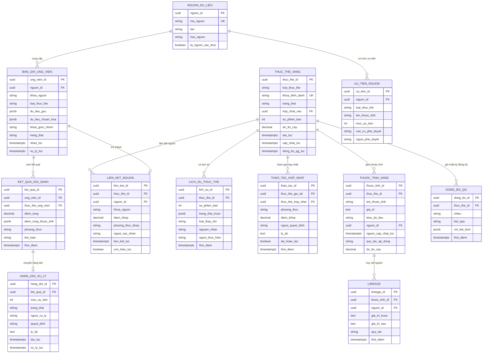

# SRS — PH-06: Quản lý Dữ liệu chủ (MDM)

| Thuộc tính | Giá trị |
|---|---|
| **Mã phân hệ** | PH-06 |
| **Tên** | Quản lý Dữ liệu chủ (Master Data Management) |
| **Nhóm** | Dữ liệu |
| **Mức bắt buộc** | M — Bắt buộc |
| **Phiên bản** | 1.0 |
| **Ngày** | 03/8/2026 |
| **Công nghệ chủ đạo** | Quarkus + PostgreSQL + thuật toán đối sánh (deterministic + probabilistic) |

---

## M1. Giới thiệu

### 1.1. Mục đích

PH-06 trả lời một câu hỏi tưởng đơn giản nhưng rất khó: **"Ông Nguyễn Văn A trong hệ thống Y tế và ông Nguyễn Văn A trong hệ thống Đất đai có phải cùng một người không?"**

Câu hỏi này chỉ trả lời được ở tầng trục — nơi duy nhất nhìn thấy đồng thời nhiều nguồn dữ liệu. PH-06 thực hiện đối sánh thực thể, tạo **bản ghi vàng** (golden record) và duy trì nó đồng bộ với Cơ sở dữ liệu tổng hợp quốc gia.

Đây là phân hệ đáp ứng NĐ 47/2020 về dữ liệu chủ (CMP-20) và yêu cầu mới từ TTQGS về dữ liệu chủ thống nhất toàn quốc (CMP-35).

### 1.2. Phạm vi

**PH-06 chịu trách nhiệm:**

| # | Trách nhiệm |
|---|---|
| 1 | Thu nhận bản ghi ứng viên từ nhiều nguồn dữ liệu |
| 2 | Đối sánh thực thể: xác định (theo định danh) và xác suất (theo tổ hợp thuộc tính) |
| 3 | Tạo và duy trì bản ghi vàng cho các thực thể cốt lõi |
| 4 | Giải quyết xung đột thuộc tính theo thứ tự ưu tiên nguồn |
| 5 | Quản lý hàng đợi xử lý thủ công cho các trường hợp không chắc chắn |
| 6 | Hợp nhất và tách bản ghi, giữ lịch sử để hoàn tác được |
| 7 | Đồng bộ hai chiều với Cơ sở dữ liệu tổng hợp quốc gia |
| 8 | Cung cấp API tra cứu bản ghi vàng cho các phân hệ khác |
| 9 | Truy vết nguồn gốc từng thuộc tính trong bản ghi vàng |
| 10 | Phát sự kiện khi bản ghi vàng thay đổi |

**PH-06 KHÔNG chịu trách nhiệm:**

| # | Không làm | Thuộc phân hệ |
|---|---|---|
| 1 | Quản lý bảng mã, danh mục phân loại | PH-07 |
| 2 | Đánh giá chất lượng dữ liệu tổng thể | PH-08 |
| 3 | Che, ẩn danh hóa dữ liệu khi trả ra | PH-09 (qua PH-04) |
| 4 | Là nguồn chân lý cuối cùng về nhân thân | CSDL tổng hợp quốc gia |
| 5 | Lưu trữ dữ liệu nghiệp vụ chi tiết | Hệ thống thành viên |

**Ranh giới quan trọng số 4 — thay đổi do TTQGS.** Trước đây MDM cấp tỉnh tự quyết bản ghi vàng. TTQGS quy định *"dữ liệu chủ quốc gia phải được quản trị, cập nhật, đồng bộ và khai thác thống nhất trên phạm vi toàn quốc"*. Vai trò PH-06 chuyển thành **đồng bộ, ánh xạ và bổ sung thuộc tính địa phương**, không tự quyết chân lý về nhân thân ([TT] mục 4.1).

### 1.3. Tài liệu tham chiếu

| Mã | Tài liệu |
|---|---|
| [KT] | [Kiến trúc dữ liệu](../02-architecture/README.md#6-kiến-trúc-dữ-liệu) |
| [LT] | [F-09 Quản lý dữ liệu chủ và đối sánh thực thể](../03-flows/README.md#f-09--quản-lý-dữ-liệu-chủ-và-đối-sánh-thực-thể), [F-05](../03-flows/README.md#f-05--đồng-bộ-dữ-liệu-bất-đồng-bộ-theo-sự-kiện) |
| [PL] | [Ma trận CMP](../01-legal/README.md) — NĐ 47/2020 dữ liệu chủ |
| [TT] | [Tác động TTQGS mục 4.1 — MDM chuyển vai trò](../06-impact/README.md) |
| [ADR] | [ADR-013 CDM](../05-adr/README.md#adr-013), [ADR-008 PostgreSQL](../05-adr/README.md#adr-008) |
| [SRS] | [PH-07 Danh mục](SRS-PH-07-rdm.md), [PH-04 Lõi tích hợp](SRS-PH-04-integration-core.md) |

---

## M2. Mô tả tổng quan

### 2.1. Vị trí trong kiến trúc

```mermaid
graph TB
    subgraph SOURCES["NGUỒN DỮ LIỆU"]
        S1["HT Y tế<br/>hồ sơ sức khỏe"]
        S2["HT Giáo dục<br/>hồ sơ học sinh"]
        S3["HT Tư pháp<br/>hộ tịch"]
        NAT["CSDLQG Dân cư<br/>qua PH-14"]
    end

    subgraph PH06["◉ PH-06 — QUẢN LÝ DỮ LIỆU CHỦ"]
        INGEST["Ingestion<br/>Thu nhận & chuẩn hóa ứng viên"]
        subgraph MATCH["Match Engine"]
            DET["Đối sánh xác định<br/>theo số định danh"]
            PROB["Đối sánh xác suất<br/>fuzzy: tên · ngày sinh · địa chỉ"]
            SCORE["Chấm điểm & phân ngưỡng"]
        end
        SURV["Survivorship Engine<br/>Giải quyết xung đột thuộc tính"]
        GOLD["Golden Record Store<br/>Bản ghi vàng + lịch sử"]
        QUEUE["Stewardship Queue<br/>Hàng đợi xử lý thủ công"]
        LINEAGE["Lineage Tracker<br/>Truy vết nguồn từng thuộc tính"]
        SYNC["National Sync<br/>Đồng bộ CSDL tổng hợp QG"]
    end

    subgraph CONSUMERS["BÊN SỬ DỤNG"]
        PH04["PH-04<br/>làm giàu bản tin"]
        PH08["PH-08<br/>chất lượng dữ liệu"]
        UI["Cán bộ quản trị dữ liệu"]
    end

    subgraph SUP["HỖ TRỢ"]
        PH07["PH-07<br/>chuẩn hóa mã danh mục"]
        PG["PostgreSQL"]
        KAFKA["PH-10<br/>sự kiện thay đổi"]
        NATDB["CSDL tổng hợp<br/>quốc gia"]
    end

    S1 --> INGEST
    S2 --> INGEST
    S3 --> INGEST
    NAT --> INGEST
    INGEST -->|"chuẩn hóa mã"| PH07
    INGEST --> DET
    DET -->|"không có<br/>số định danh"| PROB
    PROB --> SCORE
    DET --> SURV
    SCORE -->|"điểm ≥ 0,9"| SURV
    SCORE -->|"0,7 ≤ điểm < 0,9"| QUEUE
    SCORE -->|"điểm < 0,7"| SURV
    QUEUE --> UI
    UI -->|"quyết định"| SURV
    SURV --> GOLD
    GOLD --> LINEAGE
    GOLD --> SYNC
    SYNC <-->|"hai chiều"| NATDB
    GOLD --> PH04
    GOLD --> PH08
    GOLD -->|"sự kiện cập nhật"| KAFKA
    GOLD --> PG

    classDef src fill:#e8f0fe,stroke:#1967d2,stroke-width:2px,color:#000
    classDef ph06 fill:#e6f4ea,stroke:#137333,stroke-width:2px,color:#000
    classDef cons fill:#fef7e0,stroke:#ea8600,stroke-width:2px,color:#000
    classDef sup fill:#eceff1,stroke:#455a64,stroke-width:2px,color:#000
    class S1,S2,S3,NAT src
    class INGEST,DET,PROB,SCORE,SURV,GOLD,QUEUE,LINEAGE,SYNC ph06
    class PH04,PH08,UI cons
    class PH07,PG,KAFKA,NATDB sup
```



**Thuyết minh sơ đồ.** Ba nhánh từ khối `SCORE` là điểm cốt lõi của phân hệ — ba ngưỡng điểm dẫn tới ba hành vi khác nhau:

| Khoảng điểm | Kết luận | Hành động | Lý do |
|---|---|---|---|
| ≥ 0,9 | Chắc chắn cùng một người | Tự động hợp nhất | Rủi ro sai thấp, khối lượng lớn |
| 0,7 – 0,9 | Nghi ngờ | **Chuyển người xử lý** | Sai ở đây gây hậu quả nghiêm trọng |
| < 0,7 | Khác nhau | Tạo thực thể mới | Rủi ro sai thấp |

**Vì sao vùng xám cố ý không tự động hóa.** Hợp nhất nhầm hai công dân khác nhau khiến hồ sơ y tế, quyền lợi bảo hiểm, thông tin đất đai bị trộn lẫn — khắc phục rất tốn kém và có thể ảnh hưởng quyền lợi công dân. Chi phí một lượt rà soát thủ công (vài phút) rẻ hơn nhiều so với chi phí sửa một lần hợp nhất sai.

**Mũi tên hai chiều với CSDL tổng hợp quốc gia.** Đây là thay đổi từ TTQGS: PH-06 vừa **nhận** dữ liệu chủ quốc gia làm chuẩn, vừa **gửi lên** phần dữ liệu địa phương thu thập được. Không còn là kho độc lập của tỉnh.

### 2.2. Các thực thể dữ liệu chủ

| Thực thể | Khóa định danh | Nguồn chân lý | Nguồn bổ sung |
|---|---|---|---|
| **Công dân** | Số định danh cá nhân (12 chữ số) | CSDLQG Dân cư | HT Y tế, Giáo dục, Tư pháp, BHXH |
| **Tổ chức, doanh nghiệp** | Mã số thuế / mã số doanh nghiệp | CSDLQG Đăng ký doanh nghiệp | HT Kế hoạch đầu tư, Thuế địa phương |
| **Đơn vị hành chính** | Mã đơn vị hành chính | Danh mục quốc gia (PH-07) | — |
| **Cán bộ, công chức** | Số định danh cá nhân + mã cán bộ | HT Quản lý cán bộ | HT Nội vụ |
| **Thửa đất** | Số hiệu thửa + mã đơn vị hành chính | CSDL Đất đai | — |

**Ghi chú.** Đơn vị hành chính là ranh giới mờ giữa PH-06 và PH-07: nó vừa là danh mục (bảng mã hữu hạn) vừa là thực thể có thuộc tính. Quyết định: **quản lý tại PH-07** vì tính chất bảng mã trội hơn, PH-06 chỉ tham chiếu.

### 2.3. Tác nhân

| Tác nhân | Loại | Tương tác |
|---|---|---|
| Cán bộ quản trị dữ liệu | Người | Xử lý hàng đợi đối sánh, hợp nhất/tách thủ công |
| Lãnh đạo phụ trách dữ liệu | Người | Phê duyệt quy tắc ưu tiên nguồn |
| PH-04 Lõi tích hợp | Hệ thống | Tra bản ghi vàng để làm giàu bản tin |
| PH-08 Chất lượng dữ liệu | Hệ thống | Lấy bản ghi vàng để chấm điểm chất lượng |
| PH-14 Kết nối quốc gia | Hệ thống | Cầu nối tới CSDL tổng hợp quốc gia |
| Hệ thống thành viên | Hệ thống | Cung cấp bản ghi ứng viên |

### 2.4. Giả định

| Mã | Giả định |
|---|---|
| GD-01 | Số định danh cá nhân là khóa liên kết chính, phần lớn bản ghi mới đã có |
| GD-02 | CSDL tổng hợp quốc gia có API đồng bộ hai chiều hoặc cơ chế tương đương |
| GD-03 | Thứ tự ưu tiên nguồn được lãnh đạo phê duyệt bằng văn bản |
| GD-04 | Có cán bộ quản trị dữ liệu chuyên trách xử lý hàng đợi đối sánh |
| GD-05 | Dữ liệu lịch sử chưa có số định danh chiếm tỷ lệ đáng kể, cần đối sánh xác suất |

### 2.5. Ràng buộc

| Mã | Ràng buộc | Nguồn |
|---|---|---|
| RB-01 | Dữ liệu chủ là thông tin cơ bản định danh thực thể nghiệp vụ cốt lõi | NĐ 47/2020 |
| RB-02 | Dữ liệu chủ phải đồng bộ thống nhất toàn quốc qua CSDL tổng hợp quốc gia | TTQGS, CMP-35 |
| RB-03 | Thứ tự ưu tiên nguồn là quyết định quản lý, phải có phê duyệt | Yêu cầu quản trị |
| RB-04 | Mọi thay đổi bản ghi vàng phải lưu lịch sử để hoàn tác được | Toàn vẹn dữ liệu |
| RB-05 | Truy cập dữ liệu chủ phải được ghi vết đầy đủ | Luật Dữ liệu 2024, CMP-28 |
| RB-06 | Toàn bộ công nghệ mã nguồn mở | Yêu cầu dự án |

### 2.6. Phụ thuộc phân hệ

| Phụ thuộc | Loại | Hành vi khi không khả dụng |
|---|---|---|
| PostgreSQL | **Cứng** | Không tra cứu và cập nhật được bản ghi vàng |
| PH-07 (danh mục) | **Mềm** | Bỏ qua chuẩn hóa mã, đánh dấu bản ghi cần rà soát |
| PH-14 (kết nối QG) | **Mềm** | Tạm dừng đồng bộ quốc gia, giữ hàng chờ |
| PH-10 (Kafka) | **Mềm** | Sự kiện thay đổi bị chậm, dữ liệu vẫn đúng |
| PH-12 | **Cứng** cho quản trị | Không truy cập giao diện quản trị dữ liệu |

---

## M3. Yêu cầu chức năng

### 3.1. Nhóm A — Thu nhận và chuẩn hóa

#### FR-06-001 — Thu nhận bản ghi ứng viên · **M**

| Mục | Nội dung |
|---|---|
| **Mô tả** | Nhận bản ghi từ hệ thống nguồn để đưa vào quy trình đối sánh |
| **Tác nhân** | PH-04 (đồng bộ), PH-10 (sự kiện) |
| **Đầu vào** | Bản ghi CDM · mã hệ thống nguồn · thời điểm phát sinh · loại thao tác (`CREATE`/`UPDATE`/`DELETE`) |
| **Xử lý** | 1. Kiểm tra bản ghi đúng lược đồ CDM của thực thể<br>2. Ghi vào bảng ứng viên kèm siêu dữ liệu nguồn<br>3. Kiểm tra trùng lặp theo `(nguồn, khóa nguồn, phiên bản)`<br>4. Xếp hàng chờ đối sánh<br>5. Ghi chỉ số số lượng ứng viên theo nguồn |
| **Đầu ra** | Bản ghi ứng viên đã ghi nhận |
| **Ngoại lệ** | E1: Sai lược đồ CDM → từ chối, ghi lỗi kèm chi tiết trường sai<br>E2: Bản ghi đã xử lý (cùng phiên bản) → bỏ qua, ghi chỉ số trùng<br>E3: Thiếu khóa nguồn → từ chối, không có cách truy vết ngược |

#### FR-06-002 — Chuẩn hóa dữ liệu trước đối sánh · **M**

| Mục | Nội dung |
|---|---|
| **Mô tả** | Chuẩn hóa để tăng độ chính xác đối sánh |
| **Đầu vào** | Bản ghi ứng viên thô |
| **Xử lý** | 1. **Họ tên**: cắt khoảng trắng thừa, chuẩn hóa chữ hoa/thường, tách họ-đệm-tên, sinh dạng không dấu<br>2. **Ngày sinh**: chuẩn về ISO 8601; nhận diện giá trị giả (`01/01/1900`, `00/00/0000`) → đánh dấu thiếu<br>3. **Số định danh**: bỏ ký tự phân cách, kiểm tra độ dài và checksum<br>4. **Địa chỉ**: tách thành phần, chuẩn hóa mã đơn vị hành chính qua PH-07<br>5. **Giới tính, dân tộc**: chuẩn hóa mã qua PH-07<br>6. Sinh **khóa gom nhóm** (blocking key) để thu hẹp không gian đối sánh |
| **Đầu ra** | Bản ghi đã chuẩn hóa kèm khóa gom nhóm |
| **Ngoại lệ** | E1: Số định danh sai checksum → đánh dấu nghi ngờ, vẫn tiếp tục nhưng không dùng làm khóa xác định<br>E2: PH-07 không khả dụng → bỏ qua chuẩn hóa mã, đánh dấu `needsNormalization=true` |

**Ghi chú về bước 6 — khóa gom nhóm.** Nếu so sánh mọi bản ghi mới với toàn bộ 5 triệu bản ghi hiện có thì chi phí là không khả thi. Khóa gom nhóm (ví dụ: 3 ký tự đầu của tên không dấu + năm sinh) thu hẹp còn vài chục ứng viên cần so sánh chi tiết — giảm chi phí từ O(n) xuống gần O(1).

### 3.2. Nhóm B — Đối sánh thực thể

#### FR-06-003 — Đối sánh xác định · **M**

| Mục | Nội dung |
|---|---|
| **Mô tả** | Đối sánh theo khóa định danh — chính xác tuyệt đối, không suy đoán |
| **Đầu vào** | Bản ghi chuẩn hóa có khóa định danh |
| **Xử lý** | 1. Tra bản ghi vàng theo khóa định danh (số định danh cá nhân, mã số thuế)<br>2. Nếu tìm thấy → điểm khớp = 1,0, cùng thực thể<br>3. Nếu không tìm thấy → tạo thực thể mới với khóa này<br>4. Không cần đối sánh xác suất |
| **Đầu ra** | Định danh thực thể vàng · điểm khớp 1,0 |
| **Ngoại lệ** | E1: Khóa định danh sai checksum → chuyển sang đối sánh xác suất<br>E2: Hai bản ghi vàng cùng khóa định danh (dữ liệu hỏng) → cảnh báo nghiêm trọng, chuyển hàng đợi xử lý |

#### FR-06-004 — Đối sánh xác suất · **M**

| Mục | Nội dung |
|---|---|
| **Mô tả** | Đối sánh khi không có khóa định danh — dùng tổ hợp thuộc tính |
| **Tiền điều kiện** | Bản ghi không có số định danh hoặc số định danh không hợp lệ |
| **Đầu vào** | Bản ghi chuẩn hóa |
| **Xử lý** | 1. Dùng khóa gom nhóm lấy tập ứng viên tiềm năng<br>2. So sánh từng thuộc tính với trọng số:<br>&nbsp;&nbsp;· Họ tên (so khớp mờ, chịu sai chính tả và dấu) — trọng số 0,35<br>&nbsp;&nbsp;· Ngày sinh (khớp chính xác hoặc lệch ≤ 2 ngày) — trọng số 0,30<br>&nbsp;&nbsp;· Địa chỉ thường trú (mã đơn vị hành chính) — trọng số 0,20<br>&nbsp;&nbsp;· Giới tính — trọng số 0,05<br>&nbsp;&nbsp;· Họ tên cha/mẹ (nếu có) — trọng số 0,10<br>3. Tính điểm tổng hợp có trọng số<br>4. Phân ngưỡng theo bảng ba mức |
| **Đầu ra** | Danh sách ứng viên khớp kèm điểm |
| **Ngoại lệ** | E1: Nhiều ứng viên cùng điểm cao → chuyển hàng đợi thủ công dù điểm ≥ 0,9<br>E2: Không đủ thuộc tính để chấm điểm (chỉ có tên) → không tự động, chuyển hàng đợi |

**Bảng phân ngưỡng:**

| Điểm | Kết luận | Hành động |
|---|---|---|
| ≥ 0,90 | Chắc chắn khớp | Tự động hợp nhất |
| 0,70 – 0,89 | Nghi ngờ | Hàng đợi xử lý thủ công |
| < 0,70 | Không khớp | Tạo thực thể mới |

**Ghi chú về so khớp mờ tên tiếng Việt.** Thuật toán phải chịu được: khác dấu (`Nguyễn` vs `Nguyên`), sai chính tả phổ biến (`Xuân` vs `Suân`), thứ tự họ-tên đảo, thiếu tên đệm. Dùng kết hợp khoảng cách chuỗi và so khớp âm vị tiếng Việt.

#### FR-06-005 — Hàng đợi xử lý thủ công · **M**

| Mục | Nội dung |
|---|---|
| **Mô tả** | Quản lý các trường hợp cần con người quyết định |
| **Tác nhân** | Cán bộ quản trị dữ liệu |
| **Đầu vào** | Cặp bản ghi nghi ngờ · điểm khớp · chi tiết so sánh từng thuộc tính |
| **Xử lý** | 1. Xếp hàng theo mức ưu tiên (điểm cao xử lý trước)<br>2. Hiển thị so sánh song song hai bản ghi, tô sáng điểm giống và khác<br>3. Cán bộ chọn: **Hợp nhất** · **Tách riêng** · **Hoãn** (cần thêm thông tin)<br>4. Ghi quyết định kèm người và lý do<br>5. Học từ quyết định: thống kê để hiệu chỉnh trọng số về sau |
| **Đầu ra** | Quyết định hợp nhất hoặc tách |
| **Ngoại lệ** | E1: Hàng đợi quá 500 mục → cảnh báo quá tải<br>E2: Mục chờ quá 7 ngày → nâng mức ưu tiên, thông báo |

### 3.3. Nhóm C — Tạo và duy trì bản ghi vàng

#### FR-06-006 — Giải quyết xung đột thuộc tính · **M**

| Mục | Nội dung |
|---|---|
| **Mô tả** | Chọn giá trị đúng khi các nguồn mâu thuẫn |
| **Đầu vào** | Nhiều bản ghi cùng thực thể từ các nguồn khác nhau |
| **Xử lý** | Áp dụng quy tắc theo thứ tự:<br>1. **Ưu tiên nguồn**: nguồn có thẩm quyền pháp lý cao hơn thắng<br>2. **Cùng mức ưu tiên**: dữ liệu mới hơn thắng<br>3. **Cùng thời điểm**: dữ liệu đầy đủ hơn thắng<br>4. Với thuộc tính đặc thù có thể khai báo quy tắc riêng<br>5. Ghi nguồn của **từng thuộc tính** vào lineage |
| **Đầu ra** | Bản ghi vàng với từng thuộc tính có nguồn xác định |
| **Ngoại lệ** | E1: Xung đột ở thuộc tính quan trọng (ngày sinh, giới tính) giữa hai nguồn cùng mức → chuyển hàng đợi thủ công<br>E2: Chưa khai báo thứ tự ưu tiên cho nguồn mới → dùng mức thấp nhất, cảnh báo cấu hình |

**Thứ tự ưu tiên nguồn mặc định:**

| Mức | Nguồn | Cơ sở |
|---|---|---|
| 1 (cao nhất) | CSDL tổng hợp quốc gia / CSDLQG Dân cư | Nguồn xác thực về nhân thân theo Luật |
| 2 | Hệ thống hộ tịch (Tư pháp) | Cơ quan đăng ký sự kiện hộ tịch |
| 3 | Hệ thống chuyên ngành liên quan trực tiếp | Cơ quan quản lý lĩnh vực |
| 4 | Hệ thống chuyên ngành khác | — |
| 5 (thấp nhất) | Dữ liệu nhập tay | Rủi ro sai sót cao nhất |

**Ghi chú.** Thứ tự này là **quyết định quản lý**, phải có văn bản phê duyệt của lãnh đạo (RB-03) — không do đội kỹ thuật tự quyết. Bảng trên là đề xuất mặc định để trình duyệt.

#### FR-06-007 — Tạo và cập nhật bản ghi vàng · **M**

| Mục | Nội dung |
|---|---|
| **Mô tả** | Duy trì bản ghi vàng cho mỗi thực thể |
| **Xử lý** | 1. Tạo mới nếu chưa có thực thể tương ứng<br>2. Cập nhật thuộc tính theo kết quả giải quyết xung đột<br>3. **Lưu phiên bản cũ** trước khi ghi đè (RB-04)<br>4. Tăng số phiên bản, cập nhật thời điểm<br>5. Duy trì liên kết tới tất cả bản ghi nguồn đã đóng góp<br>6. Phát sự kiện `golden-record-updated` lên Kafka |
| **Đầu ra** | Bản ghi vàng cập nhật; sự kiện đã phát |
| **Ngoại lệ** | E1: Không ghi được lịch sử → **hủy** cập nhật (không cho phép mất khả năng hoàn tác)<br>E2: Không phát được sự kiện → ghi hàng chờ, thử lại |

#### FR-06-008 — Hợp nhất và tách bản ghi · **M**

| Mục | Nội dung |
|---|---|
| **Mô tả** | Gộp hai thực thể được xác định là một, hoặc tách khi phát hiện nhầm |
| **Tác nhân** | Cán bộ quản trị dữ liệu, hoặc tự động khi điểm ≥ 0,9 |
| **Xử lý** | · **Hợp nhất**: chọn thực thể tồn tại (survivor), chuyển toàn bộ liên kết nguồn sang, giải quyết xung đột thuộc tính, đánh dấu thực thể kia là `MERGED_INTO`<br>· **Tách**: khôi phục thực thể đã bị hợp nhất, phân bổ lại liên kết nguồn theo quyết định của cán bộ<br>· Cả hai đều lưu lịch sử đầy đủ để hoàn tác |
| **Đầu ra** | Cấu trúc thực thể cập nhật |
| **Ngoại lệ** | E1: Hợp nhất hai thực thể đều có số định danh **khác nhau** → chặn, đây là dấu hiệu lỗi nghiêm trọng<br>E2: Tách thực thể chưa từng hợp nhất → `422`<br>E3: Thực thể đang được tham chiếu bởi giao dịch đang chạy → chờ hoặc từ chối |

**Ghi chú về E1.** Hai bản ghi có số định danh cá nhân khác nhau về nguyên tắc là hai người khác nhau. Nếu hệ thống đề xuất hợp nhất chúng thì hoặc dữ liệu nguồn sai, hoặc thuật toán lỗi — cả hai đều cần điều tra, không được hợp nhất.

#### FR-06-009 — Truy vết nguồn gốc thuộc tính · **M**

| Mục | Nội dung |
|---|---|
| **Mô tả** | Cho biết mỗi thuộc tính trong bản ghi vàng đến từ đâu |
| **Xử lý** | 1. Với mỗi thuộc tính lưu: nguồn · thời điểm nguồn cập nhật · thời điểm đưa vào bản ghi vàng · quy tắc đã áp dụng<br>2. Cho phép tra cứu lịch sử thay đổi từng thuộc tính<br>3. Hiển thị được trên giao diện dạng dòng thời gian |
| **Đầu ra** | Thông tin nguồn gốc từng thuộc tính |
| **Ngoại lệ** | — |

**Ghi chú về giá trị thực tiễn.** Khi công dân khiếu nại "ngày sinh trong hệ thống sai", cán bộ cần biết ngay giá trị đó đến từ hệ thống nào để yêu cầu đơn vị chủ quản sửa tại nguồn — sửa ở bản ghi vàng mà không sửa nguồn thì lần đồng bộ sau sẽ sai lại.

#### FR-06-010 — Hoàn tác thao tác · **S**

| Mục | Nội dung |
|---|---|
| **Mô tả** | Khôi phục trạng thái trước một thao tác hợp nhất hoặc cập nhật sai |
| **Đầu vào** | Định danh thao tác cần hoàn tác · lý do |
| **Xử lý** | 1. Lấy trạng thái trước thao tác từ lịch sử<br>2. Kiểm tra chưa có thao tác nào phụ thuộc sau đó<br>3. Khôi phục và ghi thao tác hoàn tác như một thao tác mới (không xóa lịch sử)<br>4. Phát sự kiện cập nhật |
| **Đầu ra** | Trạng thái đã khôi phục |
| **Ngoại lệ** | E1: Có thao tác phụ thuộc sau đó → cảnh báo, liệt kê, yêu cầu xác nhận<br>E2: Quá thời hạn cho phép hoàn tác (mặc định 90 ngày) → yêu cầu phê duyệt cấp cao hơn |

### 3.4. Nhóm D — Đồng bộ quốc gia và cung cấp dữ liệu

#### FR-06-011 — Đồng bộ với CSDL tổng hợp quốc gia · **M**

| Mục | Nội dung |
|---|---|
| **Mô tả** | Duy trì nhất quán giữa dữ liệu chủ địa phương và quốc gia |
| **Tiền điều kiện** | Kết nối tới CSDL tổng hợp quốc gia qua PH-14 đã thông |
| **Xử lý** | · **Chiều xuống** (quốc gia → địa phương): nhận cập nhật dữ liệu chủ quốc gia, áp dụng với mức ưu tiên cao nhất<br>· **Chiều lên** (địa phương → quốc gia): gửi dữ liệu địa phương thu thập được theo quy định<br>1. Đối chiếu định kỳ để phát hiện lệch<br>2. Với lệch: nguồn quốc gia thắng với thuộc tính nhân thân<br>3. Ghi nhật ký đồng bộ và danh sách lệch<br>4. Cảnh báo khi tỷ lệ lệch vượt ngưỡng |
| **Đầu ra** | Dữ liệu chủ đồng bộ hai chiều |
| **Ngoại lệ** | E1: Không kết nối được → giữ hàng chờ, cảnh báo sau 24 giờ<br>E2: Tỷ lệ lệch > 5% → **tạm dừng** đồng bộ tự động, chờ điều tra<br>E3: Quốc gia trả dữ liệu mâu thuẫn nội bộ → không áp dụng, báo cáo lên đơn vị quản lý |

**Ghi chú về E2 — cơ chế an toàn.** Tỷ lệ lệch cao bất thường thường là dấu hiệu lỗi hệ thống (sai ánh xạ, lỗi đồng bộ) chứ không phải dữ liệu thật khác nhau. Áp dụng hàng loạt trong tình huống đó có thể làm hỏng dữ liệu trên diện rộng.

#### FR-06-012 — Tra cứu bản ghi vàng · **M**

| Mục | Nội dung |
|---|---|
| **Mô tả** | Cung cấp bản ghi vàng cho các phân hệ khác |
| **Tác nhân** | PH-04, PH-08 |
| **Đầu vào** | Loại thực thể · khóa tra cứu (định danh hoặc điều kiện) |
| **Xử lý** | 1. Tra theo khóa định danh (nhanh nhất)<br>2. Hoặc tra theo điều kiện thuộc tính<br>3. Trả bản ghi vàng kèm siêu dữ liệu: nguồn, độ tin cậy, thời điểm cập nhật<br>4. Ghi vết truy cập (RB-05) |
| **Đầu ra** | Bản ghi vàng |
| **Ngoại lệ** | E1: Không tìm thấy → `404`<br>E2: Thực thể đã bị hợp nhất → trả bản ghi survivor kèm thông tin chuyển hướng<br>E3: Không ghi được vết truy cập → **từ chối** trả dữ liệu (CMP-28) |

#### FR-06-013 — Phát sự kiện thay đổi · **M**

| Mục | Nội dung |
|---|---|
| **Mô tả** | Thông báo cho hệ thống quan tâm khi bản ghi vàng đổi |
| **Xử lý** | 1. Phát sự kiện lên Kafka với khóa phân vùng = định danh thực thể<br>2. Sự kiện chứa: loại thực thể, định danh, thuộc tính thay đổi, giá trị trước/sau, nguồn gây thay đổi<br>3. **Không** chứa dữ liệu nhạy cảm đầy đủ — bên nhận tra lại nếu cần |
| **Đầu ra** | Sự kiện đã phát |
| **Ngoại lệ** | E1: Kafka không khả dụng → hàng chờ bền vững, phát lại |

**Ghi chú về bước 3.** Sự kiện đi qua Kafka có thể được nhiều bên đọc, lưu lại lâu. Đưa dữ liệu cá nhân đầy đủ vào sự kiện tạo rủi ro rò rỉ — chỉ gửi thông báo có thay đổi, bên cần thì tra lại qua API có kiểm soát quyền.

### 3.5. Bảng tổng hợp yêu cầu chức năng

| Nhóm | Mã | Tên | Ưu tiên |
|---|---|---|:-:|
| A | FR-06-001 | Thu nhận bản ghi ứng viên | M |
| A | FR-06-002 | Chuẩn hóa dữ liệu trước đối sánh | M |
| B | FR-06-003 | Đối sánh xác định | M |
| B | FR-06-004 | Đối sánh xác suất | M |
| B | FR-06-005 | Hàng đợi xử lý thủ công | M |
| C | FR-06-006 | Giải quyết xung đột thuộc tính | M |
| C | FR-06-007 | Tạo và cập nhật bản ghi vàng | M |
| C | FR-06-008 | Hợp nhất và tách bản ghi | M |
| C | FR-06-009 | Truy vết nguồn gốc thuộc tính | M |
| C | FR-06-010 | Hoàn tác thao tác | S |
| D | FR-06-011 | Đồng bộ với CSDL tổng hợp quốc gia | M |
| D | FR-06-012 | Tra cứu bản ghi vàng | M |
| D | FR-06-013 | Phát sự kiện thay đổi | M |

**Tổng: 13 yêu cầu chức năng** — 12 bắt buộc (M), 1 cần có (S).

---

## M4. Mô hình dữ liệu

### 4.1. Sơ đồ thực thể



### 4.2. Đặc tả thực thể

#### EN-06-01 — THUC_THE_VANG (Bản ghi vàng)

| Trường | Kiểu | Bắt buộc | Ràng buộc | Mô tả |
|---|---|:-:|---|---|
| `thuc_the_id` | UUID | ✓ | PK | Định danh nội bộ, ổn định vĩnh viễn |
| `loai_thuc_the` | VARCHAR(40) | ✓ | ∈ {`CONG_DAN`,`TO_CHUC`,`CAN_BO`,`THUA_DAT`} | |
| `khoa_dinh_danh` | VARCHAR(60) | | UNIQUE cùng `loai_thuc_the` | Số định danh cá nhân, mã số thuế… |
| `trang_thai` | VARCHAR(20) | ✓ | ∈ {`ACTIVE`,`MERGED`,`SUSPENDED`,`ARCHIVED`} | |
| `hop_nhat_vao` | UUID | | FK, tự tham chiếu | Trỏ tới thực thể survivor khi `MERGED` |
| `so_phien_ban` | INTEGER | ✓ | Tăng dần | |
| `do_tin_cay` | DECIMAL(3,2) | ✓ | 0,00–1,00 | Độ tin cậy tổng hợp của bản ghi |
| `dong_bo_qg_luc` | TIMESTAMPTZ | | | Lần đồng bộ quốc gia gần nhất |

**Ràng buộc bảng.** Thực thể `MERGED` bắt buộc có `hop_nhat_vao`. `khoa_dinh_danh` có thể rỗng với bản ghi lịch sử chưa có số định danh.

#### EN-06-02 — THUOC_TINH_VANG

| Trường | Kiểu | Bắt buộc | Mô tả |
|---|---|:-:|---|
| `thuoc_tinh_id` | UUID | ✓ | PK |
| `thuc_the_id` | UUID | ✓ | FK |
| `ten_thuoc_tinh` | VARCHAR(100) | ✓ | UNIQUE cùng thực thể |
| `gia_tri` | TEXT | ✓ | |
| `kieu_du_lieu` | VARCHAR(30) | ✓ | |
| `nguon_id` | UUID | ✓ | FK — **nguồn của chính thuộc tính này** |
| `nguon_cap_nhat_luc` | TIMESTAMPTZ | ✓ | Thời điểm nguồn cập nhật, không phải thời điểm ghi vào MDM |
| `quy_tac_ap_dung` | VARCHAR(60) | ✓ | Quy tắc nào quyết định chọn giá trị này |
| `do_tin_cay` | DECIMAL(3,2) | ✓ | |

**Ghi chú thiết kế quan trọng.** Lưu nguồn ở **cấp thuộc tính** chứ không phải cấp bản ghi. Một bản ghi vàng công dân có thể lấy họ tên từ CSDLQG Dân cư, số điện thoại từ hệ thống Y tế, nghề nghiệp từ hệ thống Lao động. Không có thiết kế này thì FR-06-009 (truy vết nguồn gốc) không thực hiện được.

#### EN-06-03 — LIEN_KET_NGUON

| Trường | Kiểu | Bắt buộc | Mô tả |
|---|---|:-:|---|
| `lien_ket_id` | UUID | ✓ | PK |
| `thuc_the_id` | UUID | ✓ | FK |
| `nguon_id` | UUID | ✓ | FK |
| `khoa_nguon` | VARCHAR(120) | ✓ | Khóa của bản ghi ở hệ thống nguồn |
| `diem_khop` | DECIMAL(3,2) | ✓ | Điểm khi tạo liên kết |
| `phuong_thuc_khop` | VARCHAR(24) | ✓ | ∈ {`DETERMINISTIC`,`PROBABILISTIC`,`MANUAL`} |
| `nguoi_xac_nhan` | VARCHAR(100) | | Bắt buộc khi `phuong_thuc_khop = MANUAL` |
| `con_hieu_luc` | BOOLEAN | ✓ | |

**Ràng buộc.** UNIQUE trên `(nguon_id, khoa_nguon)` khi `con_hieu_luc = true` — một bản ghi nguồn chỉ thuộc một thực thể vàng tại một thời điểm.

#### EN-06-04 — UU_TIEN_NGUON

| Trường | Kiểu | Bắt buộc | Mô tả |
|---|---|:-:|---|
| `uu_tien_id` | UUID | ✓ | PK |
| `nguon_id` | UUID | ✓ | FK |
| `loai_thuc_the` | VARCHAR(40) | ✓ | |
| `ten_thuoc_tinh` | VARCHAR(100) | | Rỗng = áp dụng cho mọi thuộc tính |
| `muc_uu_tien` | SMALLINT | ✓ | 1 = cao nhất |
| `can_cu_phe_duyet` | VARCHAR(300) | ✓ | **Bắt buộc** — số văn bản phê duyệt (RB-03) |
| `nguoi_phe_duyet` | VARCHAR(100) | ✓ | **Bắt buộc** |

**Ghi chú.** Hai trường bắt buộc cuối hiện thực RB-03: thứ tự ưu tiên nguồn là quyết định quản lý, không cho phép cấu hình mà không có phê duyệt.

#### EN-06-05 — HANG_DOI_XU_LY

| Trường | Kiểu | Bắt buộc | Mô tả |
|---|---|:-:|---|
| `hang_doi_id` | UUID | ✓ | PK |
| `ket_qua_id` | UUID | ✓ | FK → KET_QUA_DOI_SANH |
| `muc_uu_tien` | SMALLINT | ✓ | Tính từ điểm khớp và độ nhạy cảm thực thể |
| `trang_thai` | VARCHAR(20) | ✓ | ∈ {`PENDING`,`IN_REVIEW`,`RESOLVED`,`DEFERRED`} |
| `nguoi_xu_ly` | VARCHAR(100) | | |
| `quyet_dinh` | VARCHAR(20) | | ∈ {`MERGE`,`SEPARATE`,`DEFER`} |
| `ly_do` | TEXT | | **Bắt buộc** khi có quyết định |

#### EN-06-06 — LICH_SU_THUC_THE

| Trường | Kiểu | Bắt buộc | Mô tả |
|---|---|:-:|---|
| `lich_su_id` | UUID | ✓ | PK |
| `thuc_the_id` | UUID | ✓ | FK |
| `so_phien_ban` | INTEGER | ✓ | |
| `trang_thai_truoc` | JSONB | ✓ | Toàn bộ trạng thái trước thay đổi |
| `loai_thay_doi` | VARCHAR(30) | ✓ | ∈ {`CREATE`,`UPDATE`,`MERGE`,`SPLIT`,`UNDO`,`NATIONAL_SYNC`} |
| `nguyen_nhan` | VARCHAR(200) | ✓ | |
| `nguoi_thuc_hien` | VARCHAR(100) | ✓ | Người hoặc mã hệ thống |

**Ghi chú.** Lưu **toàn bộ** trạng thái trước (không chỉ phần thay đổi) để hoàn tác đơn giản và chắc chắn — đánh đổi dung lượng lấy độ tin cậy, chấp nhận được vì dữ liệu chủ thay đổi không quá thường xuyên.

### 4.3. Chính sách lưu giữ

| Thực thể | Thời hạn | Ghi chú |
|---|---|---|
| THUC_THE_VANG, THUOC_TINH_VANG | **Vĩnh viễn** | Dữ liệu chủ không xóa |
| LICH_SU_THUC_THE | **Vĩnh viễn** | Bắt buộc để hoàn tác và truy vết (RB-04) |
| LINEAGE | Vĩnh viễn | |
| BAN_GHI_UNG_VIEN | 1 năm sau khi xử lý | Chuyển lưu trữ lạnh |
| KET_QUA_DOI_SANH | 2 năm | Phục vụ hiệu chỉnh thuật toán |
| HANG_DOI_XU_LY | Vĩnh viễn | Ghi nhận quyết định của con người |
| DONG_BO_QG | 3 năm | |

---

## M5. Giao diện API

### 5.1. Nguyên tắc chung

| Khía cạnh | Quy định |
|---|---|
| Đường dẫn tra cứu | `/api/v1/master` |
| Đường dẫn quản trị | `/api/admin/v1/mdm` |
| Xác thực | Bearer JWT; tra cứu cần phạm vi `master.read`; quản trị cần vai trò `DATA_STEWARD` |
| Ghi vết | **Mọi** truy cập dữ liệu chủ đều ghi vết (RB-05) |
| Mã lỗi | RFC 9457 Problem Details |

### 5.2. Điểm cuối tra cứu

| Phương thức | Đường dẫn | Chức năng | FR |
|---|---|---|---|
| `GET` | `/api/v1/master/{entity}/{key}` | Tra bản ghi vàng theo khóa định danh | FR-06-012 |
| `POST` | `/api/v1/master/{entity}/search` | Tra theo điều kiện thuộc tính | FR-06-012 |
| `POST` | `/api/v1/master/{entity}/resolve` | Đối sánh một bản ghi, trả thực thể khớp | FR-06-003, 004 |
| `GET` | `/api/v1/master/{entity}/{key}/lineage` | Truy vết nguồn gốc thuộc tính | FR-06-009 |
| `GET` | `/api/v1/master/{entity}/{key}/history` | Lịch sử thay đổi | FR-06-007 |
| `GET` | `/api/v1/master/{entity}/{key}/sources` | Danh sách bản ghi nguồn đã đóng góp | FR-06-009 |

### 5.3. Điểm cuối quản trị

| Phương thức | Đường dẫn | Chức năng | FR |
|---|---|---|---|
| `POST` | `/api/admin/v1/mdm/candidates` | Nạp bản ghi ứng viên | FR-06-001 |
| `GET` | `/api/admin/v1/mdm/queue` | Hàng đợi xử lý thủ công | FR-06-005 |
| `GET` | `/api/admin/v1/mdm/queue/{id}` | Chi tiết một mục, so sánh song song | FR-06-005 |
| `POST` | `/api/admin/v1/mdm/queue/{id}/resolve` | Quyết định hợp nhất/tách/hoãn | FR-06-005 |
| `POST` | `/api/admin/v1/mdm/entities/merge` | Hợp nhất thủ công | FR-06-008 |
| `POST` | `/api/admin/v1/mdm/entities/{id}/split` | Tách thực thể | FR-06-008 |
| `POST` | `/api/admin/v1/mdm/operations/{id}/undo` | Hoàn tác thao tác | FR-06-010 |
| `GET` | `/api/admin/v1/mdm/source-priority` | Bảng ưu tiên nguồn | FR-06-006 |
| `PUT` | `/api/admin/v1/mdm/source-priority` | Cập nhật ưu tiên (cần căn cứ phê duyệt) | FR-06-006 |
| `POST` | `/api/admin/v1/mdm/sync/national` | Kích hoạt đồng bộ quốc gia | FR-06-011 |
| `GET` | `/api/admin/v1/mdm/sync/discrepancies` | Danh sách lệch với quốc gia | FR-06-011 |
| `GET` | `/api/admin/v1/mdm/stats` | Thống kê: số thực thể, tỷ lệ tự động, hàng đợi | — |

### 5.4. Đặc tả chi tiết điểm cuối chính

#### 5.4.1. `GET /api/v1/master/CONG_DAN/{soDinhDanh}` — Tra bản ghi vàng

**Phản hồi `200 OK`:**

```json
{
  "thucTheId": "3f2a9c14-7b8e-4d21-a5c6-9e0f1b2d3c4a",
  "loaiThucThe": "CONG_DAN",
  "khoaDinhDanh": "001199001234",
  "trangThai": "ACTIVE",
  "soPhienBan": 7,
  "doTinCay": 0.96,
  "thuocTinh": {
    "hoTen": { "giaTri": "Nguyễn Văn A", "nguon": "CSDLQG_DANCU", "capNhatLuc": "2026-06-15T08:00:00+07:00", "doTinCay": 1.0 },
    "ngaySinh": { "giaTri": "1990-01-15", "nguon": "CSDLQG_DANCU", "capNhatLuc": "2026-06-15T08:00:00+07:00", "doTinCay": 1.0 },
    "gioiTinh": { "giaTri": "NAM", "nguon": "CSDLQG_DANCU", "capNhatLuc": "2026-06-15T08:00:00+07:00", "doTinCay": 1.0 },
    "soDienThoai": { "giaTri": "0912345678", "nguon": "HT_YTE", "capNhatLuc": "2026-07-20T14:30:00+07:00", "doTinCay": 0.75 },
    "noiThuongTru": { "giaTri": "01001", "nguon": "CSDLQG_DANCU", "capNhatLuc": "2026-06-15T08:00:00+07:00", "doTinCay": 1.0 }
  },
  "nguonDongGop": ["CSDLQG_DANCU", "HT_YTE", "HT_TUPHAP"],
  "dongBoQgLuc": "2026-08-03T06:00:00+07:00",
  "capNhatLuc": "2026-07-20T14:30:00+07:00"
}
```

**Ghi chú thiết kế.** Mỗi thuộc tính đi kèm nguồn và độ tin cậy — bên gọi tự quyết định có tin dùng hay không. Ví dụ số điện thoại từ hệ thống Y tế có độ tin cậy 0,75, ứng dụng cần độ chính xác cao có thể chọn xác minh lại.

**Phản hồi khi thực thể đã hợp nhất `200 OK`:**

```json
{
  "thucTheId": "8a1b2c3d-...",
  "trangThai": "MERGED",
  "hopNhatVao": "3f2a9c14-7b8e-4d21-a5c6-9e0f1b2d3c4a",
  "canhBao": "Thực thể này đã được hợp nhất. Dữ liệu hiện hành nằm ở thực thể đích.",
  "_links": { "survivor": "/api/v1/master/CONG_DAN/001199001234" }
}
```

#### 5.4.2. `POST /api/v1/master/CONG_DAN/resolve` — Đối sánh bản ghi

**Yêu cầu (bản ghi không có số định danh):**

```json
{
  "hoTen": "Nguyen Van A",
  "ngaySinh": "1990-01-15",
  "gioiTinh": "NAM",
  "noiThuongTru": { "maDonViHanhChinh": "01001" },
  "nguonYeuCau": "HT_GIAODUC"
}
```

**Phản hồi khớp chắc chắn `200 OK`:**

```json
{
  "ketLuan": "MATCHED",
  "thucTheId": "3f2a9c14-7b8e-4d21-a5c6-9e0f1b2d3c4a",
  "khoaDinhDanh": "001199001234",
  "diemKhop": 0.94,
  "phuongThuc": "PROBABILISTIC",
  "diemTungThuocTinh": {
    "hoTen": 0.98, "ngaySinh": 1.0, "noiThuongTru": 1.0, "gioiTinh": 1.0
  }
}
```

**Phản hồi vùng nghi ngờ `202 Accepted`:**

```json
{
  "ketLuan": "NEEDS_REVIEW",
  "diemKhop": 0.82,
  "hangDoiId": "d4e5f6a7-...",
  "ungVienTiemNang": [
    { "thucTheId": "3f2a9c14-...", "diemKhop": 0.82, "hoTen": "Nguyễn Văn A", "ngaySinh": "1990-01-15" },
    { "thucTheId": "9b8c7d6e-...", "diemKhop": 0.79, "hoTen": "Nguyễn Văn Á", "ngaySinh": "1990-01-15" }
  ],
  "thongBao": "Đã chuyển cán bộ quản trị dữ liệu xử lý. Chưa tạo liên kết."
}
```

**Ghi chú.** Trả `202 Accepted` thay vì `200` để bên gọi biết rõ: yêu cầu đã tiếp nhận nhưng **chưa có kết luận cuối** — không được dùng kết quả này để ghi dữ liệu.

#### 5.4.3. `GET /api/v1/master/CONG_DAN/{key}/lineage` — Truy vết nguồn gốc

```json
{
  "khoaDinhDanh": "001199001234",
  "thuocTinh": "ngaySinh",
  "giaTriHienTai": "1990-01-15",
  "lichSu": [
    {
      "thoiDiem": "2026-06-15T08:00:00+07:00",
      "giaTriTruoc": "1990-01-05",
      "giaTriSau": "1990-01-15",
      "nguon": "CSDLQG_DANCU",
      "quyTac": "SOURCE_PRIORITY",
      "ghiChu": "Nguồn ưu tiên mức 1 ghi đè giá trị từ HT_YTE (mức 3)"
    },
    {
      "thoiDiem": "2025-03-10T10:20:00+07:00",
      "giaTriTruoc": null,
      "giaTriSau": "1990-01-05",
      "nguon": "HT_YTE",
      "quyTac": "FIRST_VALUE",
      "ghiChu": "Giá trị đầu tiên ghi nhận"
    }
  ]
}
```

**Ghi chú giá trị thực tiễn.** Khi công dân khiếu nại ngày sinh sai, cán bộ tra ngay được: giá trị hiện tại đến từ CSDLQG Dân cư, trước đó có giá trị khác từ hệ thống Y tế. Kết luận: cần đề nghị sửa tại CSDLQG Dân cư, không sửa ở LGSP.

---

## M6. Giao diện người dùng

### 6.1. Danh mục màn hình

| Mã | Tên màn hình | Đối tượng | Mockup |
|---|---|---|---|
| **UI-06-01** | Tra cứu bản ghi vàng | Cán bộ quản trị dữ liệu | [`mdm.html`](../../mockup/pages/mdm.html) |
| **UI-06-02** | Hàng đợi đối sánh thủ công | Cán bộ quản trị dữ liệu | [`mdm.html`](../../mockup/pages/mdm.html) (tab Hàng đợi) |
| **UI-06-03** | So sánh và quyết định hợp nhất | Cán bộ quản trị dữ liệu | [`mdm.html`](../../mockup/pages/mdm.html) (tab Hàng đợi → chi tiết) |
| **UI-06-04** | Truy vết nguồn gốc thuộc tính | Cán bộ quản trị dữ liệu | [`mdm.html`](../../mockup/pages/mdm.html) (tab Nguồn gốc) |
| **UI-06-05** | Cấu hình ưu tiên nguồn | Cán bộ quản trị dữ liệu, Lãnh đạo | [`mdm.html`](../../mockup/pages/mdm.html) (tab Ưu tiên nguồn) |
| **UI-06-06** | Đồng bộ quốc gia và danh sách lệch | Cán bộ quản trị dữ liệu | [`mdm.html`](../../mockup/pages/mdm.html) (tab Đồng bộ) |

### 6.2. UI-06-01 — Tra cứu bản ghi vàng

| Thành phần | Mô tả |
|---|---|
| Ô tìm kiếm | Nhập số định danh, hoặc tên + ngày sinh |
| Chọn loại thực thể | Công dân · Tổ chức · Cán bộ · Thửa đất |
| Bảng kết quả | Định danh · Tên · Ngày sinh · Nguồn đóng góp · Độ tin cậy · Cập nhật cuối |
| Bảng chi tiết | Toàn bộ thuộc tính, mỗi thuộc tính hiển thị kèm **nhãn nguồn** và độ tin cậy |
| Thẻ độ tin cậy | Chấm màu theo mức: cao (≥0,9) · trung bình (0,7–0,9) · thấp (<0,7) |
| Liên kết nguồn | Danh sách bản ghi nguồn đã đóng góp, mở được sang hệ thống gốc |

**Quy tắc tương tác:**

| # | Quy tắc |
|---|---|
| 1 | Mọi lượt tra cứu đều ghi vết — hiển thị thông báo nhắc người dùng |
| 2 | Thuộc tính có độ tin cậy thấp hiển thị nhãn cảnh báo |
| 3 | Thực thể đã hợp nhất → tự chuyển hướng sang survivor kèm thông báo |
| 4 | Nhấn nhãn nguồn của một thuộc tính → mở truy vết nguồn gốc (UI-06-04) |

### 6.3. UI-06-03 — So sánh và quyết định hợp nhất

**Mục đích.** Đây là màn hình quan trọng nhất của phân hệ — nơi con người ra quyết định mà máy không dám tự quyết.

| Thành phần | Mô tả |
|---|---|
| Điểm khớp tổng | Hiển thị nổi bật kèm thanh trực quan |
| Bảng so sánh song song | Hai cột: bản ghi A và B, từng thuộc tính một dòng |
| Tô sáng khác biệt | Thuộc tính giống → nền xanh nhạt; khác → nền đỏ nhạt |
| Điểm từng thuộc tính | Hiển thị điểm khớp riêng của mỗi thuộc tính |
| Ngữ cảnh bổ sung | Bản ghi nguồn đóng góp, thời điểm, hệ thống |
| Ba nút quyết định | **Hợp nhất** · **Là hai người khác nhau** · **Hoãn — cần thêm thông tin** |
| Ô lý do | **Bắt buộc** nhập trước khi quyết định |
| Điều hướng nhanh | Nút chuyển sang mục tiếp theo trong hàng đợi |

**Quy tắc tương tác:**

| # | Quy tắc |
|---|---|
| 1 | Không cho quyết định khi chưa nhập lý do (BR-06-008) |
| 2 | Hai bản ghi có số định danh **khác nhau** → nút Hợp nhất bị vô hiệu kèm giải thích (BR-06-006) |
| 3 | Sau quyết định, tự chuyển sang mục tiếp theo để xử lý liên tục |
| 4 | Hiển thị số mục còn lại trong hàng đợi |
| 5 | Có thể quay lại sửa quyết định trong 24 giờ (sau đó cần chức năng hoàn tác) |

**Ghi chú thiết kế.** Quy tắc 3 và 4 phục vụ hiệu suất làm việc: cán bộ thường xử lý hàng đợi theo đợt, mỗi mục vài chục giây. Bắt họ quay lại danh sách sau mỗi quyết định sẽ làm chậm đáng kể.

### 6.4. UI-06-05 — Cấu hình ưu tiên nguồn

| Thành phần | Mô tả |
|---|---|
| Bảng ưu tiên | Nguồn · Loại thực thể · Thuộc tính (hoặc "tất cả") · Mức ưu tiên · Căn cứ phê duyệt |
| Kéo thả sắp xếp | Thay đổi thứ tự ưu tiên bằng kéo thả |
| Ô căn cứ phê duyệt | **Bắt buộc** — số và ngày văn bản phê duyệt |
| Xem trước tác động | Số bản ghi vàng sẽ đổi giá trị nếu áp dụng thứ tự mới |
| Nút áp dụng | Chỉ bật khi đã có căn cứ phê duyệt |

**Quy tắc tương tác:**

| # | Quy tắc |
|---|---|
| 1 | Không cho lưu nếu thiếu căn cứ phê duyệt (BR-06-004) |
| 2 | Xem trước tác động chạy trước khi áp dụng, hiển thị số bản ghi ảnh hưởng |
| 3 | Tác động > 1.000 bản ghi → yêu cầu xác nhận bổ sung |
| 4 | Lưu lịch sử mọi thay đổi thứ tự ưu tiên |

### 6.5. UI-06-06 — Đồng bộ quốc gia

| Thành phần | Mô tả |
|---|---|
| Thẻ trạng thái | Lần đồng bộ cuối · số bản ghi đồng bộ · số lệch · trạng thái kết nối |
| Bảng danh sách lệch | Định danh · Thuộc tính · Giá trị địa phương · Giá trị quốc gia · Đề xuất |
| Bộ lọc | Theo thuộc tính, theo mức độ nghiêm trọng |
| Thao tác hàng loạt | Áp dụng giá trị quốc gia cho các lệch đã chọn |
| Biểu đồ tỷ lệ lệch | Theo thời gian, giúp phát hiện bất thường |
| Cảnh báo ngưỡng | Tỷ lệ lệch > 5% → cảnh báo đỏ, đồng bộ tự động đã tạm dừng |

**Quy tắc tương tác:** khi đồng bộ tự động bị tạm dừng do vượt ngưỡng, hiển thị rõ lý do và yêu cầu cán bộ điều tra trước khi cho phép tiếp tục (FR-06-011 E2).

---

## M7. Yêu cầu phi chức năng

### 7.1. Hiệu năng

| Mã | Yêu cầu | Chỉ tiêu | Cách đo |
|---|---|---|---|
| **NFR-06-001** | Độ trễ tra bản ghi vàng theo khóa định danh | P99 ≤ 50ms | Đo tại API |
| **NFR-06-002** | Độ trễ đối sánh xác định | P99 ≤ 30ms | — |
| **NFR-06-003** | Độ trễ đối sánh xác suất | P99 ≤ 300ms | Bao gồm gom nhóm và chấm điểm |
| **NFR-06-004** | Thông lượng thu nhận ứng viên | ≥ 1.000 bản ghi/giây | Kiểm thử tải |
| **NFR-06-005** | Số bản ghi vàng hỗ trợ | ≥ 10 triệu thực thể | Kiểm thử dung lượng |
| **NFR-06-006** | Hiệu quả gom nhóm | Trung bình ≤ 50 ứng viên/lần đối sánh xác suất | Đo thống kê |
| **NFR-06-007** | Tỷ lệ tự động hóa | ≥ 85% bản ghi được xử lý tự động, ≤ 15% vào hàng đợi | Đo thống kê |

**Ghi chú về NFR-06-007.** Chỉ tiêu này quan trọng về mặt vận hành: nếu 40% bản ghi vào hàng đợi thủ công thì cán bộ không xử lý xuể và hệ thống thực tế không dùng được. Không đạt chỉ tiêu này là dấu hiệu cần hiệu chỉnh trọng số hoặc cải thiện chất lượng dữ liệu nguồn.

### 7.2. Độ chính xác đối sánh

| Mã | Yêu cầu | Chỉ tiêu |
|---|---|---|
| **NFR-06-008** | Tỷ lệ hợp nhất sai (false positive) | ≤ 0,1% trên tập kiểm chứng |
| **NFR-06-009** | Tỷ lệ bỏ sót (false negative) | ≤ 2% trên tập kiểm chứng |
| **NFR-06-010** | Độ chính xác đối sánh xác định | 100% (không suy đoán) |

**Ghi chú về sự bất đối xứng giữa NFR-06-008 và 009.** Ngưỡng hợp nhất sai (0,1%) nghiêm ngặt hơn nhiều so với bỏ sót (2%). Lý do: hợp nhất nhầm hai người gây hậu quả nghiêm trọng và khó phát hiện; bỏ sót chỉ tạo hai bản ghi riêng, phát hiện và sửa được sau.

### 7.3. Tính sẵn sàng

| Mã | Yêu cầu | Chỉ tiêu |
|---|---|---|
| **NFR-06-011** | Tỷ lệ sẵn sàng dịch vụ tra cứu | ≥ 99,9% |
| **NFR-06-012** | Số replica tối thiểu | 2 cho dịch vụ tra cứu; 2 cho xử lý đối sánh |
| **NFR-06-013** | Khôi phục dữ liệu | RPO ≤ 15 phút · RTO ≤ 30 phút |
| **NFR-06-014** | PH-14 sự cố | Tạm dừng đồng bộ quốc gia; tra cứu và đối sánh nội bộ vẫn chạy |

### 7.4. Bảo mật và tuân thủ

| Mã | Yêu cầu |
|---|---|
| **NFR-06-015** | **Mọi** truy cập dữ liệu chủ được ghi vết: ai, tra ai, mục đích, thời điểm (CMP-28) |
| **NFR-06-016** | Không ghi được vết → từ chối trả dữ liệu |
| **NFR-06-017** | Dữ liệu chủ mã hóa khi lưu trữ (at-rest) |
| **NFR-06-018** | Truy cập hàng loạt (> 100 bản ghi) cần phê duyệt riêng và ghi vết đặc biệt |
| **NFR-06-019** | Không xuất dữ liệu chủ ra tệp mà không có phê duyệt |

**Ghi chú về NFR-06-018.** Tra cứu một công dân là nghiệp vụ bình thường; tra cứu hàng loạt là dấu hiệu có thể lạm dụng (thu thập dữ liệu trái phép). Phân biệt hai trường hợp là biện pháp bảo vệ dữ liệu cá nhân thiết yếu.

### 7.5. Khả năng quan sát

| Mã | Yêu cầu |
|---|---|
| **NFR-06-020** | Phát chỉ số: `mdm_entities_total{type}`, `mdm_match_total{method,result}`, `mdm_match_duration_seconds`, `mdm_queue_depth`, `mdm_auto_rate`, `mdm_sync_discrepancy_ratio`, `mdm_merge_total{type}` |
| **NFR-06-021** | Cảnh báo khi hàng đợi > 500 mục |
| **NFR-06-022** | Cảnh báo khi tỷ lệ tự động < 80% |
| **NFR-06-023** | Cảnh báo khi tỷ lệ lệch đồng bộ quốc gia > 5% |
| **NFR-06-024** | Cảnh báo khi có mục hàng đợi chờ > 7 ngày |

---

## M8. Quy tắc nghiệp vụ

| Mã | Quy tắc | Lý do | Cách thực thi | Khi vi phạm |
|---|---|---|---|---|
| **BR-06-001** | Số định danh cá nhân là khóa đối sánh xác định, ưu tiên tuyệt đối | Chính xác 100%, không suy đoán | FR-06-003 | — |
| **BR-06-002** | Điểm 0,7–0,9 **bắt buộc** chuyển người xử lý, không tự động | Hợp nhất sai gây hậu quả nghiêm trọng | FR-06-004 bảng ngưỡng | Rà soát cấu hình |
| **BR-06-003** | CSDL tổng hợp quốc gia là nguồn chân lý về nhân thân | TTQGS, CMP-35 | Ưu tiên mức 1 | — |
| **BR-06-004** | Thứ tự ưu tiên nguồn phải có căn cứ phê duyệt bằng văn bản | Là quyết định quản lý, không phải kỹ thuật | Trường bắt buộc trong CSDL | Từ chối lưu |
| **BR-06-005** | Mọi thay đổi bản ghi vàng phải lưu trạng thái trước | Bảo đảm hoàn tác được | FR-06-007 E1 | Hủy cập nhật |
| **BR-06-006** | Không hợp nhất hai thực thể có số định danh khác nhau | Về nguyên tắc là hai người khác nhau | FR-06-008 E1 | Chặn, cảnh báo |
| **BR-06-007** | Không xóa thực thể — chỉ đánh dấu hợp nhất hoặc lưu trữ | Dữ liệu lịch sử tham chiếu vẫn cần | Ràng buộc CSDL | Từ chối xóa |
| **BR-06-008** | Quyết định hợp nhất/tách thủ công phải có lý do | Truy vết và giải trình | Trường bắt buộc | Từ chối lưu |
| **BR-06-009** | Nguồn được lưu ở **cấp thuộc tính**, không phải cấp bản ghi | Một bản ghi vàng có nhiều nguồn đóng góp | Thiết kế EN-06-02 | Không truy vết được |
| **BR-06-010** | Không ghi được vết truy cập → từ chối trả dữ liệu | CMP-28 | FR-06-012 E3 | Từ chối |
| **BR-06-011** | Tỷ lệ lệch đồng bộ quốc gia > 5% → tạm dừng đồng bộ tự động | Dấu hiệu lỗi hệ thống, áp dụng hàng loạt sẽ hỏng dữ liệu | FR-06-011 E2 | Tạm dừng |
| **BR-06-012** | Sự kiện thay đổi **không** chứa dữ liệu cá nhân đầy đủ | Kafka lưu lâu, nhiều bên đọc — rủi ro rò rỉ | FR-06-013 bước 3 | Rà soát thiết kế |
| **BR-06-013** | Truy cập hàng loạt cần phê duyệt riêng | Dấu hiệu có thể lạm dụng | NFR-06-018 | Chặn, cảnh báo |
| **BR-06-014** | Sửa dữ liệu sai phải sửa **tại nguồn**, không chỉ ở bản ghi vàng | Sửa ở MDM thì lần đồng bộ sau sẽ sai lại | Hướng dẫn vận hành + truy vết nguồn | Dữ liệu sai lặp lại |
| **BR-06-015** | Bản ghi thiếu thuộc tính để chấm điểm → không tự động, chuyển hàng đợi | Chấm điểm trên dữ liệu nghèo cho kết quả không tin cậy | FR-06-004 E2 | — |

---

## M9. Tuân thủ

### 9.1. Ánh xạ yêu cầu pháp lý

| Mã CMP | Yêu cầu | FR/NFR đáp ứng | Cách kiểm chứng |
|---|---|---|---|
| **CMP-20** | Quản lý dữ liệu chủ | FR-06-003…009 | Tạo bản ghi vàng từ 3 nguồn chồng lấn; kiểm chứng khử trùng lặp |
| **CMP-35** | Dữ liệu chủ đồng bộ CSDL tổng hợp quốc gia | FR-06-011; BR-06-003 | Kiểm thử đồng bộ hai chiều thành công, không tạo mâu thuẫn |
| **CMP-28** | Ghi vết truy cập dữ liệu | NFR-06-015, 016; BR-06-010 | Đối chiếu số bản ghi vết với số lượt tra cứu |
| **CMP-21** | Sử dụng danh mục dùng chung | FR-06-002 bước 4, 5 | Kiểm chứng mã danh mục được chuẩn hóa qua PH-07 |
| **CMP-22** | Chất lượng dữ liệu | NFR-06-008, 009 | Đo tỷ lệ hợp nhất sai và bỏ sót trên tập kiểm chứng |
| **CMP-24** | Bảo vệ dữ liệu | NFR-06-017, 018, 019 | Kiểm tra mã hóa at-rest; kiểm thử chặn truy cập hàng loạt |

### 9.2. Ánh xạ nguyên tắc TTQGS

| Nguyên tắc | Cách PH-06 đáp ứng |
|---|---|
| **Data-Centric** | Dữ liệu chủ là tài sản chiến lược, quản trị tập trung có truy vết nguồn gốc |
| **"Thu thập một lần, dùng nhiều lần"** | Bản ghi vàng là cơ sở kỹ thuật để không yêu cầu dân cung cấp lại dữ liệu đã có |
| **Dữ liệu chủ thống nhất toàn quốc** | Đồng bộ hai chiều với CSDL tổng hợp quốc gia (BR-06-003) |
| **Privacy by Design** | Ghi vết bắt buộc, chặn truy cập hàng loạt, sự kiện không chứa dữ liệu đầy đủ |
| **AI hỗ trợ, con người quyết định** | Vùng nghi ngờ chuyển người xử lý, không để thuật toán tự quyết |

---

## M10. Kiểm thử chấp nhận

### 10.1. Kiểm thử chức năng

| Mã | Kịch bản | Dữ liệu thử | Kết quả mong đợi | Tiêu chí đạt |
|---|---|---|---|---|
| **AT-06-001** | Tạo bản ghi vàng từ ba nguồn | Cùng công dân ở HT Y tế, Giáo dục, CSDLQG | Một bản ghi vàng, ba liên kết nguồn | CMP-20 |
| **AT-06-002** | Đối sánh xác định theo số định danh | Bản ghi có số định danh trùng | Điểm 1,0, hợp nhất tự động | FR-06-003 |
| **AT-06-003** | Đối sánh xác suất điểm cao | Cùng tên, ngày sinh, địa chỉ; không số định danh | Điểm ≥ 0,9, hợp nhất tự động | FR-06-004 |
| **AT-06-004** | Đối sánh vùng nghi ngờ | Tên gần giống, ngày sinh trùng, địa chỉ khác | Điểm 0,7–0,9, **vào hàng đợi** | BR-06-002 |
| **AT-06-005** | Đối sánh không khớp | Hai người khác nhau | Điểm < 0,7, tạo thực thể mới | FR-06-004 |
| **AT-06-006** | So khớp tên khác dấu | "Nguyễn Văn A" vs "Nguyen Van A" | Điểm tên ≥ 0,95 | So khớp mờ tiếng Việt |
| **AT-06-007** | Chặn hợp nhất hai số định danh khác nhau | Hai bản ghi có số định danh khác | Chặn, cảnh báo nghiêm trọng | BR-06-006 |
| **AT-06-008** | Ưu tiên nguồn giải quyết xung đột | CSDLQG và HT Y tế có ngày sinh khác nhau | Lấy giá trị từ CSDLQG | FR-06-006 |
| **AT-06-009** | Cùng mức ưu tiên, dữ liệu mới thắng | Hai nguồn cùng mức, thời điểm khác | Lấy giá trị mới hơn | FR-06-006 bước 2 |
| **AT-06-010** | Chặn cấu hình ưu tiên thiếu căn cứ | Đổi thứ tự ưu tiên không nhập văn bản | Từ chối lưu | BR-06-004 |
| **AT-06-011** | Truy vết nguồn gốc thuộc tính | Tra lineage của `ngaySinh` | Hiển thị đủ lịch sử, nguồn, quy tắc | FR-06-009 |
| **AT-06-012** | Lưu lịch sử trước khi cập nhật | Cập nhật bản ghi vàng | Trạng thái trước được lưu đầy đủ | BR-06-005 |
| **AT-06-013** | Hoàn tác hợp nhất sai | Hợp nhất rồi hoàn tác | Khôi phục đúng trạng thái trước | FR-06-010 |
| **AT-06-014** | Tách thực thể đã hợp nhất | Phát hiện hợp nhất nhầm | Tách thành công, phân bổ lại liên kết nguồn | FR-06-008 |
| **AT-06-015** | Xử lý hàng đợi thủ công | Cán bộ quyết định hợp nhất | Ghi quyết định kèm người và lý do | FR-06-005 |
| **AT-06-016** | Chặn quyết định thiếu lý do | Bấm hợp nhất không nhập lý do | Từ chối | BR-06-008 |
| **AT-06-017** | Đồng bộ quốc gia chiều xuống | Quốc gia cập nhật họ tên | Bản ghi vàng cập nhật theo | CMP-35 |
| **AT-06-018** | Đồng bộ quốc gia chiều lên | Dữ liệu địa phương mới | Gửi lên quốc gia thành công | CMP-35 |
| **AT-06-019** | Tạm dừng khi lệch quá ngưỡng | Giả lập 8% bản ghi lệch | **Tạm dừng** đồng bộ tự động, cảnh báo | BR-06-011 |
| **AT-06-020** | Chặn trả dữ liệu khi không ghi được vết | Dừng dịch vụ ghi vết | Từ chối trả dữ liệu chủ | BR-06-010 |
| **AT-06-021** | Truy cập hàng loạt cần phê duyệt | Tra 500 bản ghi một lần | Yêu cầu phê duyệt, ghi vết đặc biệt | NFR-06-018 |
| **AT-06-022** | Sự kiện không chứa dữ liệu đầy đủ | Cập nhật bản ghi vàng | Sự kiện Kafka chỉ có định danh và trường đổi | BR-06-012 |
| **AT-06-023** | Thực thể đã hợp nhất trả chuyển hướng | Tra thực thể `MERGED` | Trả survivor kèm thông báo | FR-06-012 E2 |
| **AT-06-024** | Chuẩn hóa nhận diện ngày sinh giả | Ngày sinh `01/01/1900` | Đánh dấu thiếu, không dùng đối sánh | FR-06-002 bước 2 |

### 10.2. Kiểm thử phi chức năng và độ chính xác

| Mã | Kịch bản | Tiêu chí đạt |
|---|---|---|
| **AT-06-025** | Đo tỷ lệ hợp nhất sai | ≤ 0,1% trên tập kiểm chứng ≥ 10.000 bản ghi có nhãn |
| **AT-06-026** | Đo tỷ lệ bỏ sót | ≤ 2% trên cùng tập kiểm chứng |
| **AT-06-027** | Đo tỷ lệ tự động hóa | ≥ 85% xử lý tự động (NFR-06-007) |
| **AT-06-028** | Hiệu quả gom nhóm | Trung bình ≤ 50 ứng viên mỗi lần đối sánh |
| **AT-06-029** | Tải 1.000 bản ghi/giây | Không dồn hàng chờ; P99 đối sánh ≤ 300ms |
| **AT-06-030** | Dung lượng 10 triệu thực thể | Tra cứu P99 ≤ 50ms |
| **AT-06-031** | Khôi phục dữ liệu | RPO ≤ 15 phút, RTO ≤ 30 phút, dữ liệu toàn vẹn |
| **AT-06-032** | Mã hóa dữ liệu at-rest | Xác nhận dữ liệu chủ được mã hóa trên đĩa |

### 10.3. Điều kiện nghiệm thu phân hệ

| # | Điều kiện |
|---|---|
| 1 | 12/12 yêu cầu mức **M** được cài đặt và kiểm chứng |
| 2 | 32/32 kịch bản kiểm thử chấp nhận đạt |
| 3 | Tỷ lệ hợp nhất sai ≤ 0,1% và bỏ sót ≤ 2% trên tập kiểm chứng có nhãn |
| 4 | Tỷ lệ tự động hóa ≥ 85% |
| 5 | 6/6 mục CMP tại M9 có bằng chứng được chấp nhận |
| 6 | **Bảng thứ tự ưu tiên nguồn đã được lãnh đạo phê duyệt bằng văn bản** |
| 7 | Đồng bộ thành công ít nhất một lần hai chiều với CSDL tổng hợp quốc gia |
| 8 | Cán bộ quản trị dữ liệu đã được đào tạo xử lý hàng đợi đối sánh |
| 9 | Quy trình xử lý khiếu nại về dữ liệu chủ đã ban hành |

---

## Liên kết

- Danh mục phân hệ → [README.md](README.md)
- Kiến trúc dữ liệu → [02-architecture mục 6](../02-architecture/README.md#6-kiến-trúc-dữ-liệu)
- Luồng nghiệp vụ → [F-09 Quản lý dữ liệu chủ](../03-flows/README.md#f-09--quản-lý-dữ-liệu-chủ-và-đối-sánh-thực-thể)
- Tác động TTQGS (MDM chuyển vai trò) → [06-impact mục 4.1](../06-impact/README.md)
- Phân hệ liên quan → [PH-07 Danh mục](SRS-PH-07-rdm.md), [PH-14 Kết nối quốc gia](SRS-PH-14-national.md), [PH-08 Chất lượng dữ liệu](README.md)
- Quyết định công nghệ → [ADR-013](../05-adr/README.md#adr-013), [ADR-008](../05-adr/README.md#adr-008)
