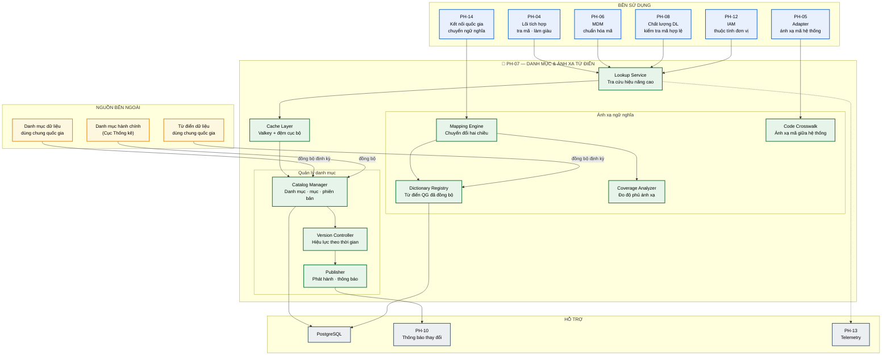
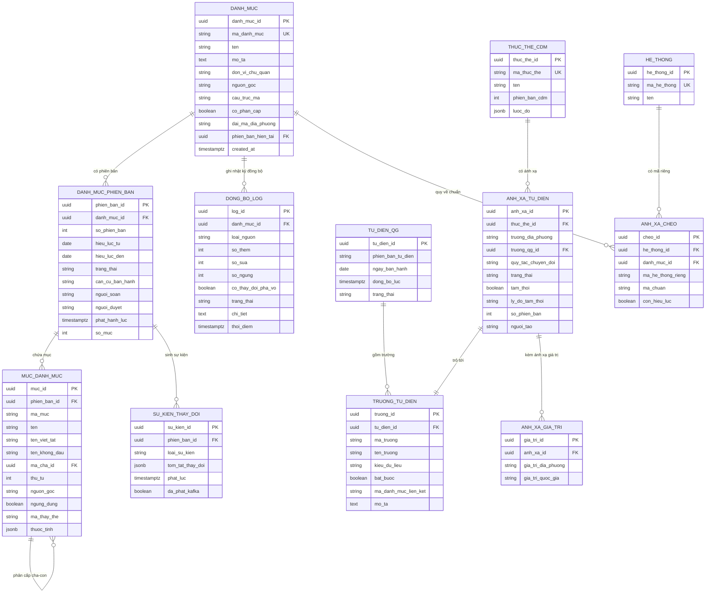

# SRS — PH-07: Danh mục dùng chung & Ánh xạ từ điển

| Thuộc tính | Giá trị |
|---|---|
| **Mã phân hệ** | PH-07 |
| **Tên** | Danh mục dùng chung & Ánh xạ từ điển (Reference Data & Dictionary Mapping) |
| **Nhóm** | Dữ liệu |
| **Mức bắt buộc** | M — Bắt buộc |
| **Phiên bản** | 1.0 |
| **Ngày** | 03/8/2026 |
| **Công nghệ chủ đạo** | Quarkus + PostgreSQL + Valkey (đệm phân tán) |

---

## M1. Giới thiệu

### 1.1. Mục đích

PH-07 giữ **bảng mã chuẩn** dùng chung cho toàn bộ/tỉnh và làm **cầu nối ngữ nghĩa** giữa dữ liệu địa phương với Từ điển dữ liệu dùng chung quốc gia.

Phân hệ này giải hai bài toán khác nhau nhưng gắn liền:

| Bài toán | Ví dụ | Chức năng |
|---|---|---|
| **Danh mục dùng chung** | Mã đơn vị hành chính, mã thủ tục hành chính, mã ngành nghề | Một nguồn duy nhất, có phiên bản, mọi hệ thống dùng chung |
| **Ánh xạ từ điển** | Trường `soDinhDanh` của tỉnh ↔ tên trường tương ứng trong từ điển quốc gia | Chuyển đổi ngữ nghĩa trước khi gửi lên cấp quốc gia |

Đây là phân hệ đáp ứng NĐ 47/2020 về danh mục dữ liệu dùng chung (CMP-21) và yêu cầu mới từ TTQGS về tuân thủ Từ điển dữ liệu dùng chung quốc gia (CMP-30, CMP-31).

### 1.2. Phạm vi

**PH-07 chịu trách nhiệm:**

| # | Trách nhiệm |
|---|---|
| 1 | Quản lý danh mục dùng chung: tạo, sửa, phát hành, ngừng dùng |
| 2 | Quản lý phiên bản danh mục với hiệu lực theo thời gian |
| 3 | Cung cấp API tra cứu mã và giải mã (mã → tên) hiệu năng cao |
| 4 | Đồng bộ Danh mục dữ liệu dùng chung quốc gia làm nguồn gốc |
| 5 | Quản lý bảng ánh xạ giữa CDM địa phương và Từ điển dữ liệu quốc gia |
| 6 | Thực hiện chuyển đổi ngữ nghĩa hai chiều theo bảng ánh xạ |
| 7 | Đo và báo cáo độ phủ ánh xạ |
| 8 | Ánh xạ mã giữa các hệ thống thành viên dùng bảng mã khác nhau |
| 9 | Thông báo thay đổi danh mục cho các bên đăng ký |

**PH-07 KHÔNG chịu trách nhiệm:**

| # | Không làm | Thuộc phân hệ |
|---|---|---|
| 1 | Quản lý dữ liệu chủ (thực thể nghiệp vụ: công dân, doanh nghiệp) | PH-06 |
| 2 | Đánh giá chất lượng dữ liệu | PH-08 |
| 3 | Thực thi chuyển đổi trong luồng bản tin (chỉ *cung cấp* bảng ánh xạ) | PH-04 |
| 4 | Chuyển đổi định dạng kỹ thuật (XML↔JSON) | PH-05 |
| 5 | Gửi bản tin lên NDXP/NDOP | PH-14 |

**Phân biệt PH-07 với PH-06 — điểm dễ nhầm.** Danh mục dùng chung (PH-07) là **bảng mã phân loại**: hữu hạn, thay đổi hiếm, không thuộc về ai. Dữ liệu chủ (PH-06) là **thực thể nghiệp vụ có danh tính**: số lượng lớn, thay đổi thường xuyên, thuộc về một cá nhân/tổ chức cụ thể.

| Tiêu chí | Danh mục (PH-07) | Dữ liệu chủ (PH-06) |
|---|---|---|
| Ví dụ | Danh mục 63 tỉnh thành | 100 triệu bản ghi công dân |
| Số lượng bản ghi | Hàng chục đến hàng nghìn | Hàng triệu đến hàng trăm triệu |
| Nhịp thay đổi | Vài lần/năm | Liên tục |
| Có chủ thể không | Không | Có |
| Cần đối sánh không | Không | Có (match engine) |

### 1.3. Tài liệu tham chiếu

| Mã | Tài liệu |
|---|---|
| [KT] | [Kiến trúc dữ liệu](../02-architecture/README.md#6-kiến-trúc-dữ-liệu) |
| [LT] | [F-03](../03-flows/README.md#f-03--khai-thác-dữ-liệu-đồng-bộ-nội-bộ), [F-04](../03-flows/README.md#f-04--khai-thác-dữ-liệu-từ-csdl-quốc-gia-qua-ndxp), [F-09](../03-flows/README.md#f-09--quản-lý-dữ-liệu-chủ-và-đối-sánh-thực-thể) |
| [PL] | [Ma trận CMP](../01-legal/README.md) — NĐ 47/2020 danh mục dữ liệu dùng chung |
| [TT] | [Tác động TTQGS mục 3.3 — M-02 Ánh xạ Từ điển quốc gia](../06-impact/README.md) |
| [ADR] | [ADR-013 CDM](../05-adr/README.md#adr-013), [ADR-008 PostgreSQL + Valkey](../05-adr/README.md#adr-008) |
| [SRS] | [PH-04 Lõi tích hợp](SRS-PH-04-integration-core.md), [PH-06 MDM](SRS-PH-06-mdm.md) |

---

## M2. Mô tả tổng quan

### 2.1. Vị trí trong kiến trúc



**Thuyết minh sơ đồ.** PH-07 phục vụ **sáu phân hệ** — nhiều hơn bất kỳ phân hệ dữ liệu nào khác. Đây là hệ quả tự nhiên: gần như mọi bản tin đi qua trục đều chứa ít nhất một mã danh mục (mã đơn vị hành chính, mã thủ tục, mã loại văn bản).

Hệ quả về thiết kế: **hiệu năng tra cứu là yêu cầu số một**. Nếu mỗi lần tra mã tốn 50ms thì với bản tin chứa 5 mã, PH-07 một mình đã ngốn 250ms — vượt xa ngân sách. Vì vậy có hai tầng đệm (cục bộ trong pod + Valkey chia sẻ) và danh mục đủ nhỏ để nạp toàn bộ vào bộ nhớ.

**Hai chiều đồng bộ từ bên ngoài.** Danh mục quốc gia và Từ điển quốc gia là **nguồn gốc** — địa phương không được sửa, chỉ mở rộng phần đặc thù. Đây là thay đổi quan trọng do TTQGS mang lại: trước đây bộ/tỉnh tự quản lý danh mục, nay phải lấy từ trung ương làm chuẩn ([TT] mục 3.3).

### 2.2. Tác nhân

| Tác nhân | Loại | Tương tác |
|---|---|---|
| Cán bộ quản trị dữ liệu | Người | Tạo, sửa, phát hành danh mục; xây bảng ánh xạ |
| Lãnh đạo phụ trách dữ liệu | Người | Phê duyệt phát hành danh mục có tác động rộng |
| Cán bộ nghiệp vụ chuyên ngành | Người | Đề xuất bổ sung mã mới cho danh mục ngành mình |
| PH-04, PH-05, PH-06, PH-08, PH-12, PH-14 | Hệ thống | Tra cứu mã, ánh xạ ngữ nghĩa |
| Hệ thống danh mục quốc gia | Hệ thống ngoài | Nguồn gốc danh mục dùng chung |
| Hệ thống từ điển quốc gia | Hệ thống ngoài | Nguồn gốc từ điển dữ liệu |

### 2.3. Giả định

| Mã | Giả định |
|---|---|
| GD-01 | Danh mục dữ liệu dùng chung quốc gia được công bố và có API hoặc kênh đồng bộ |
| GD-02 | Từ điển dữ liệu dùng chung quốc gia sẽ được ban hành; **hiện chưa công bố chi tiết** |
| GD-03 | Tổng kích thước toàn bộ danh mục đủ nhỏ để nạp vào bộ nhớ (< 500MB) |
| GD-04 | Đơn vị chủ quản từng danh mục chuyên ngành được xác định rõ |
| GD-05 | Thay đổi danh mục đơn vị hành chính được thông báo trước ít nhất 30 ngày |

**Ghi chú về GD-02 — rủi ro chính của phân hệ này.** Từ điển dữ liệu quốc gia chưa ban hành chi tiết tại thời điểm thiết kế. Giải pháp: xây Mapping Engine với **cấu hình ngoài**, dùng ánh xạ tạm có đánh dấu, nạp cấu hình thật khi văn bản ban hành — xem FR-07-011 và [TT] mục 8.3.

### 2.4. Ràng buộc

| Mã | Ràng buộc | Nguồn |
|---|---|---|
| RB-01 | Danh mục dùng chung là bảng mã do cơ quan có thẩm quyền ban hành | NĐ 47/2020 |
| RB-02 | Phải tuân thủ Danh mục dữ liệu dùng chung quốc gia | TTQGS, CMP-31 |
| RB-03 | Phải ánh xạ được về Từ điển dữ liệu dùng chung quốc gia | TTQGS, CMP-30 |
| RB-04 | Danh mục phải có phiên bản và hiệu lực theo thời gian | Yêu cầu nghiệp vụ |
| RB-05 | Không được xóa mã đã sử dụng — chỉ đánh dấu ngừng dùng | Toàn vẹn dữ liệu lịch sử |
| RB-06 | Toàn bộ công nghệ mã nguồn mở | Yêu cầu dự án |

### 2.5. Phụ thuộc phân hệ

| Phụ thuộc | Loại | Hành vi khi không khả dụng |
|---|---|---|
| PostgreSQL | **Cứng** cho ghi | Không sửa danh mục; **tra cứu vẫn hoạt động** nhờ đệm |
| Valkey | **Mềm** | Chuyển sang đệm cục bộ trong pod, độ trễ tăng nhẹ |
| Hệ thống danh mục quốc gia | **Mềm** | Giữ bản đồng bộ gần nhất, cảnh báo nếu quá hạn |
| PH-10 (Kafka) | **Mềm** | Thông báo thay đổi bị chậm; danh mục vẫn dùng được |
| PH-12 | **Cứng** cho quản trị | Không đăng nhập quản trị được; tra cứu công khai vẫn chạy |

**Ghi chú quan trọng.** PH-07 được thiết kế để **luôn trả lời được** ngay cả khi CSDL sự cố — vì hàng loạt phân hệ khác phụ thuộc nó. Toàn bộ danh mục đang hiệu lực nạp sẵn trong bộ nhớ pod khi khởi động.

---

## M3. Yêu cầu chức năng

### 3.1. Nhóm A — Quản lý danh mục

#### FR-07-001 — Tạo và quản lý danh mục · **M**

| Mục | Nội dung |
|---|---|
| **Mô tả** | Định nghĩa một danh mục dùng chung mới |
| **Tác nhân** | Cán bộ quản trị dữ liệu |
| **Tiền điều kiện** | Người thao tác có vai trò `DATA_STEWARD` |
| **Đầu vào** | Mã danh mục · tên · mô tả · đơn vị chủ quản · nguồn gốc (quốc gia/địa phương) · cấu trúc mã · có phân cấp không |
| **Xử lý** | 1. Kiểm tra mã danh mục chưa tồn tại<br>2. Kiểm tra cấu trúc mã hợp lệ (biểu thức, độ dài)<br>3. Nếu nguồn gốc là quốc gia → đánh dấu **chỉ đọc**, chỉ đồng bộ được<br>4. Tạo danh mục ở trạng thái `DRAFT`<br>5. Ghi sự kiện kiểm toán |
| **Đầu ra** | Danh mục đã tạo |
| **Ngoại lệ** | E1: Mã trùng → `409`<br>E2: Cấu trúc mã không hợp lệ → `422`<br>E3: Cố tạo danh mục trùng tên với danh mục quốc gia → cảnh báo, đề xuất dùng danh mục quốc gia |

#### FR-07-002 — Quản lý mục trong danh mục · **M**

| Mục | Nội dung |
|---|---|
| **Mô tả** | Thêm, sửa, ngừng dùng mã trong danh mục |
| **Đầu vào** | Mã danh mục · mã mục · tên · tên viết tắt · mã cha (nếu phân cấp) · thứ tự · thuộc tính mở rộng |
| **Xử lý** | 1. Kiểm tra danh mục cho phép sửa (không phải nguồn quốc gia)<br>2. Kiểm tra mã mục đúng cấu trúc khai báo<br>3. Với danh mục phân cấp: kiểm tra mã cha tồn tại, không tạo vòng lặp<br>4. Thêm/sửa mục vào phiên bản đang soạn<br>5. **Không cho xóa** mã đã được sử dụng — chỉ đánh dấu `ngungDung` |
| **Đầu ra** | Mục đã cập nhật |
| **Ngoại lệ** | E1: Danh mục nguồn quốc gia → `403`, không cho sửa thủ công<br>E2: Mã cha không tồn tại → `422`<br>E3: Phát hiện vòng lặp phân cấp → `422` kèm đường đi vòng lặp<br>E4: Cố xóa mã đang dùng → `409`, đề nghị dùng chức năng ngừng dùng |

**Ghi chú về bước 5 (RB-05).** Xóa mã đã dùng sẽ khiến dữ liệu lịch sử mất ý nghĩa — một hồ sơ từ năm 2020 tham chiếu mã đơn vị hành chính cũ vẫn cần giải mã được. Ngừng dùng giữ mã tra cứu được nhưng không cho chọn mới.

#### FR-07-003 — Quản lý phiên bản danh mục · **M**

| Mục | Nội dung |
|---|---|
| **Mô tả** | Quản lý các phiên bản danh mục với hiệu lực theo thời gian |
| **Đầu vào** | Mã danh mục · số phiên bản · ngày hiệu lực từ · ngày hết hiệu lực · căn cứ ban hành |
| **Xử lý** | 1. Tạo phiên bản mới từ phiên bản hiện tại (sao chép toàn bộ mục)<br>2. Cho phép sửa các mục trong phiên bản mới<br>3. Sinh **báo cáo khác biệt** so với phiên bản đang hiệu lực<br>4. Kiểm tra khoảng hiệu lực không chồng lấn với phiên bản khác<br>5. Ghi căn cứ ban hành (số văn bản, ngày) |
| **Đầu ra** | Phiên bản mới ở trạng thái `DRAFT` |
| **Ngoại lệ** | E1: Khoảng hiệu lực chồng lấn → `422` kèm phiên bản xung đột<br>E2: Ngày hiệu lực trong quá khứ → cảnh báo, yêu cầu xác nhận (ảnh hưởng dữ liệu đã xử lý) |

**Ghi chú về báo cáo khác biệt.** Đây là công cụ quan trọng: khi sáp nhập đơn vị hành chính, một phiên bản danh mục có thể thay đổi hàng trăm mã. Báo cáo khác biệt cho thấy chính xác mã nào thêm, mã nào ngừng, mã nào đổi tên — cơ sở để đánh giá tác động trước khi phát hành.

#### FR-07-004 — Phát hành danh mục · **M**

| Mục | Nội dung |
|---|---|
| **Mô tả** | Đưa phiên bản danh mục vào sử dụng |
| **Tác nhân** | Cán bộ quản trị dữ liệu (trình), Lãnh đạo phụ trách dữ liệu (duyệt) |
| **Tiền điều kiện** | Phiên bản ở trạng thái `DRAFT`, không còn lỗi kiểm tra |
| **Xử lý** | 1. Kiểm tra toàn vẹn: mọi mã cha tồn tại, không vòng lặp, mã đúng cấu trúc<br>2. Đánh giá tác động: liệt kê hệ thống đang dùng danh mục này<br>3. Nếu số mã thay đổi > 10% → **bắt buộc** phê duyệt của lãnh đạo<br>4. Chuyển trạng thái `PUBLISHED`<br>5. Cập nhật đệm ở mọi thực thể<br>6. Phát sự kiện thay đổi lên Kafka cho các bên đăng ký<br>7. Ghi kiểm toán kèm người duyệt |
| **Đầu ra** | Danh mục có hiệu lực |
| **Ngoại lệ** | E1: Còn lỗi toàn vẹn → từ chối, liệt kê lỗi<br>E2: Thay đổi lớn chưa có phê duyệt → chờ duyệt<br>E3: Không cập nhật được đệm ở một số thực thể → cảnh báo, thử lại |

#### FR-07-005 — Đồng bộ danh mục quốc gia · **M**

| Mục | Nội dung |
|---|---|
| **Mô tả** | Lấy Danh mục dữ liệu dùng chung quốc gia làm nguồn gốc |
| **Xử lý** | 1. Chạy theo lịch (mặc định hằng ngày) hoặc theo yêu cầu<br>2. Lấy danh mục từ nguồn quốc gia<br>3. So sánh với bản hiện có, sinh báo cáo khác biệt<br>4. Với thay đổi **không phá vỡ** (thêm mã mới) → áp dụng tự động<br>5. Với thay đổi **phá vỡ** (ngừng mã đang dùng, đổi ý nghĩa) → **chờ xác nhận** của cán bộ quản trị dữ liệu<br>6. Ghi nhật ký đồng bộ |
| **Đầu ra** | Danh mục địa phương đồng bộ với quốc gia |
| **Ngoại lệ** | E1: Nguồn quốc gia không khả dụng → giữ bản cũ, cảnh báo nếu quá 7 ngày<br>E2: Thay đổi phá vỡ → tạm dừng, thông báo cán bộ, liệt kê hệ thống bị ảnh hưởng<br>E3: Dữ liệu quốc gia sai định dạng → từ chối áp dụng, cảnh báo nghiêm trọng |

**Ghi chú về bước 4-5 — quyết định thiết kế.** Phân biệt hai loại thay đổi là điểm mấu chốt. Thêm mã mới không gây hại nên áp dụng tự động để danh mục luôn cập nhật. Ngừng một mã đang được hàng nghìn hồ sơ dùng thì cần người đánh giá tác động trước.

#### FR-07-006 — Mở rộng danh mục cho đặc thù địa phương · **S**

| Mục | Nội dung |
|---|---|
| **Mô tả** | Bổ sung mã đặc thù địa phương vào danh mục có nguồn gốc quốc gia |
| **Xử lý** | 1. Chỉ cho phép thêm mã trong **dải mã dành riêng** cho địa phương<br>2. Đánh dấu rõ mã có nguồn gốc `LOCAL`<br>3. Mã địa phương **không** đồng bộ ngược lên quốc gia<br>4. Cảnh báo nếu mã địa phương trùng ý nghĩa với mã quốc gia đã có |
| **Đầu ra** | Mã mở rộng đã thêm |
| **Ngoại lệ** | E1: Mã ngoài dải cho phép → `422` kèm dải hợp lệ<br>E2: Trùng ý nghĩa với mã quốc gia → cảnh báo, đề nghị dùng mã quốc gia |

### 3.2. Nhóm B — Tra cứu và cung cấp

#### FR-07-007 — Tra cứu mã · **M**

| Mục | Nội dung |
|---|---|
| **Mô tả** | Cung cấp thông tin của một mã — chức năng được gọi nhiều nhất |
| **Tác nhân** | PH-04, PH-05, PH-06, PH-08, PH-12 |
| **Đầu vào** | Mã danh mục · mã mục · thời điểm tham chiếu (mặc định hiện tại) |
| **Xử lý** | 1. Tra đệm cục bộ trong pod<br>2. Nếu trượt → tra Valkey<br>3. Nếu trượt → tra CSDL, ghi vào cả hai tầng đệm<br>4. Chọn phiên bản có hiệu lực tại thời điểm tham chiếu<br>5. Trả thông tin mục kèm trạng thái (`ACTIVE`/`DEPRECATED`) |
| **Đầu ra** | `{ ma, ten, tenVietTat, maCha, trangThai, thuocTinh, phienBanDanhMuc }` |
| **Ngoại lệ** | E1: Mã không tồn tại → `404` kèm gợi ý mã tương tự<br>E2: Mã đã ngừng dùng → trả kèm cờ `deprecated=true` và mã thay thế nếu có<br>E3: Không có phiên bản hiệu lực tại thời điểm → `404` kèm khoảng hiệu lực gần nhất |

**Ghi chú về bước 4 — tra cứu theo thời điểm.** Đây là năng lực quan trọng thường bị bỏ sót: khi xử lý lại một hồ sơ từ năm 2023, phải dùng danh mục có hiệu lực **năm 2023**, không phải danh mục hiện tại. Nếu không, mã đơn vị hành chính đã sáp nhập sẽ không giải mã được.

#### FR-07-008 — Tra cứu hàng loạt · **M**

| Mục | Nội dung |
|---|---|
| **Mô tả** | Tra nhiều mã trong một lời gọi để giảm số vòng mạng |
| **Đầu vào** | Danh sách cặp (mã danh mục, mã mục), tối đa 500 phần tử |
| **Xử lý** | 1. Gom nhóm theo danh mục<br>2. Tra hàng loạt từ đệm và CSDL<br>3. Trả kết quả theo đúng thứ tự yêu cầu, kèm phần tử không tìm thấy |
| **Đầu ra** | Mảng kết quả tương ứng |
| **Ngoại lệ** | E1: Vượt 500 phần tử → `413` kèm giới hạn<br>E2: Một số mã không tìm thấy → trả kết quả một phần, đánh dấu rõ |

#### FR-07-009 — Lấy toàn bộ danh mục · **M**

| Mục | Nội dung |
|---|---|
| **Mô tả** | Tải toàn bộ mục của một danh mục, phục vụ hiển thị danh sách chọn |
| **Đầu vào** | Mã danh mục · thời điểm tham chiếu · có bao gồm mã ngừng dùng không |
| **Xử lý** | 1. Lấy toàn bộ mục của phiên bản hiệu lực<br>2. Sắp xếp theo thứ tự khai báo<br>3. Với danh mục phân cấp: trả cấu trúc cây<br>4. Hỗ trợ tiêu đề `ETag` để bên gọi đệm |
| **Đầu ra** | Danh sách hoặc cây mục |
| **Ngoại lệ** | E1: Danh mục quá lớn (> 50.000 mục) → yêu cầu phân trang |

**Ghi chú về `ETag`.** Danh mục thay đổi hiếm nên bên gọi có thể đệm lâu. `ETag` cho phép trả `304 Not Modified` khi chưa đổi — tiết kiệm băng thông đáng kể vì danh mục đơn vị hành chính có thể vài MB.

#### FR-07-010 — Tìm kiếm trong danh mục · **S**

| Mục | Nội dung |
|---|---|
| **Mô tả** | Tìm mã theo tên, hỗ trợ gõ không dấu |
| **Xử lý** | 1. Chuẩn hóa từ khóa: bỏ dấu, chuyển chữ thường<br>2. Tìm theo tiền tố và chứa chuỗi<br>3. Xếp hạng: khớp chính xác → khớp tiền tố → khớp chứa<br>4. Giới hạn kết quả trả về |
| **Đầu ra** | Danh sách mục khớp, xếp theo độ liên quan |
| **Ngoại lệ** | E1: Từ khóa quá ngắn (< 2 ký tự) → yêu cầu nhập thêm |

**Ghi chú.** Hỗ trợ gõ không dấu là yêu cầu thực tế quan trọng với tiếng Việt: cán bộ gõ "ha noi" phải tìm được "Hà Nội".

### 3.3. Nhóm C — Ánh xạ từ điển quốc gia

#### FR-07-011 — Quản lý bảng ánh xạ từ điển · **M**

| Mục | Nội dung |
|---|---|
| **Mô tả** | Định nghĩa ánh xạ giữa CDM địa phương và Từ điển dữ liệu quốc gia |
| **Tác nhân** | Cán bộ quản trị dữ liệu |
| **Đầu vào** | Thực thể CDM · trường địa phương · trường từ điển quốc gia · quy tắc chuyển đổi giá trị |
| **Xử lý** | 1. Nạp định nghĩa từ điển quốc gia đã đồng bộ<br>2. Cho phép ánh xạ trường ↔ trường<br>3. Với trường có giá trị mã: khai báo thêm ánh xạ giá trị<br>4. Đánh dấu ánh xạ **tạm thời** nếu từ điển quốc gia chưa ban hành phần liên quan<br>5. Kiểm tra kiểu dữ liệu tương thích<br>6. Lưu bảng ánh xạ có phiên bản |
| **Đầu ra** | Bảng ánh xạ đã lưu |
| **Ngoại lệ** | E1: Kiểu dữ liệu không tương thích → cảnh báo, yêu cầu khai báo quy tắc chuyển đổi<br>E2: Từ điển quốc gia chưa có trường tương ứng → cho phép đánh dấu `PROVISIONAL`, ghi nhật ký để rà soát khi từ điển ban hành |

**Ghi chú về E2 — xử lý rủi ro GD-02.** Từ điển quốc gia chưa ban hành chi tiết, nhưng không thể dừng chờ. Cơ chế ánh xạ tạm thời cho phép vận hành ngay, đồng thời giữ danh sách rõ ràng những gì cần rà soát lại — tránh tình trạng "quên mất đã tạm thời chỗ nào".

#### FR-07-012 — Chuyển đổi ngữ nghĩa hai chiều · **M**

| Mục | Nội dung |
|---|---|
| **Mô tả** | Chuyển bản tin giữa CDM địa phương và định dạng từ điển quốc gia |
| **Tác nhân** | PH-14 (trước khi gửi lên quốc gia), PH-04 |
| **Đầu vào** | Bản tin · thực thể CDM · chiều chuyển đổi (`TO_NATIONAL`/`FROM_NATIONAL`) |
| **Xử lý** | 1. Lấy bảng ánh xạ theo thực thể và phiên bản từ điển<br>2. Đổi tên trường theo ánh xạ<br>3. Đổi giá trị mã theo ánh xạ giá trị<br>4. Áp dụng quy tắc chuyển đổi định dạng (ngày tháng, đơn vị đo)<br>5. **Kiểm tra độ phủ**: mọi trường bắt buộc phải ánh xạ được<br>6. Trả bản tin đã chuyển kèm báo cáo trường chưa ánh xạ |
| **Đầu ra** | Bản tin theo từ điển quốc gia (hoặc ngược lại) |
| **Ngoại lệ** | E1: Trường **bắt buộc** không ánh xạ được → `422`, **chặn** gửi lên quốc gia (CMP-30)<br>E2: Trường không bắt buộc chưa ánh xạ → bỏ qua, ghi vào báo cáo<br>E3: Giá trị mã không có trong ánh xạ → `422` kèm mã không ánh xạ được |

#### FR-07-013 — Đo và báo cáo độ phủ ánh xạ · **M**

| Mục | Nội dung |
|---|---|
| **Mô tả** | Theo dõi mức độ hoàn thiện của ánh xạ từ điển |
| **Xử lý** | 1. Với mỗi thực thể CDM: đếm tổng số trường, số trường đã ánh xạ, số bắt buộc chưa ánh xạ<br>2. Tính tỷ lệ độ phủ<br>3. Phân loại: đầy đủ (100% bắt buộc) · thiếu (còn bắt buộc chưa ánh xạ) · tạm thời (có ánh xạ `PROVISIONAL`)<br>4. Phát chỉ số `mapping_coverage_ratio` cho PH-16 tính KPI<br>5. Sinh báo cáo định kỳ cho cán bộ quản trị dữ liệu |
| **Đầu ra** | Báo cáo độ phủ theo thực thể |
| **Ngoại lệ** | — |

**Ghi chú.** Chỉ số này là đầu vào trực tiếp cho nhóm KPI "Liên thông và tích hợp" của TTQGS ([TT] mục 3.6) — mức độ tuân thủ Từ điển dữ liệu quốc gia là một trong các chỉ số bắt buộc báo cáo.

#### FR-07-014 — Đồng bộ từ điển quốc gia · **M**

| Mục | Nội dung |
|---|---|
| **Mô tả** | Cập nhật định nghĩa Từ điển dữ liệu dùng chung quốc gia |
| **Xử lý** | 1. Lấy từ điển từ nguồn quốc gia theo lịch<br>2. So sánh với bản hiện có<br>3. Với trường mới → thêm vào registry, đánh dấu chưa ánh xạ<br>4. Với trường đổi định nghĩa → **cảnh báo**, đánh dấu ánh xạ liên quan cần rà soát<br>5. Với trường bị loại bỏ → cảnh báo, liệt kê ánh xạ bị ảnh hưởng<br>6. Cập nhật trạng thái các ánh xạ `PROVISIONAL` nếu nay đã có định nghĩa chính thức |
| **Đầu ra** | Registry từ điển cập nhật |
| **Ngoại lệ** | E1: Nguồn không khả dụng → giữ bản cũ, cảnh báo<br>E2: Thay đổi ảnh hưởng ánh xạ đang dùng → **không tự áp dụng**, chờ cán bộ xử lý |

### 3.4. Nhóm D — Ánh xạ mã giữa hệ thống

#### FR-07-015 — Ánh xạ mã chéo giữa hệ thống · **M**

| Mục | Nội dung |
|---|---|
| **Mô tả** | Chuyển mã giữa các hệ thống dùng bảng mã khác nhau cho cùng khái niệm |
| **Tác nhân** | PH-05 (adapter) |
| **Đầu vào** | Hệ thống nguồn · hệ thống đích · mã danh mục chuẩn · giá trị mã nguồn |
| **Xử lý** | 1. Tra bảng ánh xạ chéo: mã hệ thống nguồn → mã chuẩn<br>2. Từ mã chuẩn → mã hệ thống đích<br>3. Nếu một trong hai chiều thiếu → báo lỗi rõ chiều nào thiếu |
| **Đầu ra** | Mã theo hệ thống đích |
| **Ngoại lệ** | E1: Mã nguồn chưa ánh xạ → `422` kèm gợi ý thêm ánh xạ<br>E2: Mã chuẩn không có tương ứng ở đích → `422`, ghi vào danh sách cần bổ sung |

**Ghi chú về giá trị thực tiễn.** Đây là tình huống rất phổ biến: hệ thống Y tế mã hóa giới tính là `M`/`F`, hệ thống Tư pháp dùng `1`/`2`, danh mục chuẩn dùng `NAM`/`NU`. Ánh xạ qua mã chuẩn thay vì từng cặp giúp chi phí không bùng nổ khi thêm hệ thống mới — cùng nguyên lý với CDM tại [ADR-013](../05-adr/README.md#adr-013).

#### FR-07-016 — Thông báo thay đổi danh mục · **M**

| Mục | Nội dung |
|---|---|
| **Mô tả** | Báo cho các bên đăng ký khi danh mục thay đổi |
| **Xử lý** | 1. Khi phát hành phiên bản mới → phát sự kiện lên Kafka<br>2. Sự kiện chứa: mã danh mục, phiên bản, tóm tắt thay đổi, ngày hiệu lực<br>3. Bên đăng ký (PH-04, PH-05, PH-06) nhận và làm mới đệm<br>4. Với thay đổi lớn → gửi thêm thông báo cho cán bộ đầu mối các đơn vị |
| **Đầu ra** | Sự kiện thay đổi đã phát |
| **Ngoại lệ** | E1: Kafka không khả dụng → lưu vào hàng chờ, phát lại; đệm bên nhận vẫn hết hạn theo thời gian nên tự làm mới |

### 3.5. Bảng tổng hợp yêu cầu chức năng

| Nhóm | Mã | Tên | Ưu tiên |
|---|---|---|:-:|
| A | FR-07-001 | Tạo và quản lý danh mục | M |
| A | FR-07-002 | Quản lý mục trong danh mục | M |
| A | FR-07-003 | Quản lý phiên bản danh mục | M |
| A | FR-07-004 | Phát hành danh mục | M |
| A | FR-07-005 | Đồng bộ danh mục quốc gia | M |
| A | FR-07-006 | Mở rộng danh mục cho đặc thù địa phương | S |
| B | FR-07-007 | Tra cứu mã | M |
| B | FR-07-008 | Tra cứu hàng loạt | M |
| B | FR-07-009 | Lấy toàn bộ danh mục | M |
| B | FR-07-010 | Tìm kiếm trong danh mục | S |
| C | FR-07-011 | Quản lý bảng ánh xạ từ điển | M |
| C | FR-07-012 | Chuyển đổi ngữ nghĩa hai chiều | M |
| C | FR-07-013 | Đo và báo cáo độ phủ ánh xạ | M |
| C | FR-07-014 | Đồng bộ từ điển quốc gia | M |
| D | FR-07-015 | Ánh xạ mã chéo giữa hệ thống | M |
| D | FR-07-016 | Thông báo thay đổi danh mục | M |

**Tổng: 16 yêu cầu chức năng** — 14 bắt buộc (M), 2 cần có (S).

---

## M4. Mô hình dữ liệu

### 4.1. Sơ đồ thực thể



### 4.2. Đặc tả thực thể

#### EN-07-01 — DANH_MUC

| Trường | Kiểu | Bắt buộc | Ràng buộc | Mô tả |
|---|---|:-:|---|---|
| `danh_muc_id` | UUID | ✓ | PK | |
| `ma_danh_muc` | VARCHAR(60) | ✓ | UNIQUE, `^[A-Z0-9_]+$` | Ví dụ `DVHC`, `TTHC`, `NGANH_NGHE` |
| `ten` | VARCHAR(200) | ✓ | | |
| `mo_ta` | TEXT | ✓ | | Bắt buộc — để người dùng biết khi nào dùng |
| `don_vi_chu_quan` | VARCHAR(80) | ✓ | | Đơn vị chịu trách nhiệm nội dung |
| `nguon_goc` | VARCHAR(16) | ✓ | ∈ {`NATIONAL`,`LOCAL`,`HYBRID`} | `NATIONAL` = chỉ đọc, chỉ đồng bộ |
| `cau_truc_ma` | VARCHAR(200) | ✓ | Biểu thức chính quy | Kiểm tra mã mục hợp lệ |
| `co_phan_cap` | BOOLEAN | ✓ | mặc định false | |
| `dai_ma_dia_phuong` | VARCHAR(100) | | | Dải mã cho phép mở rộng (FR-07-006) |
| `phien_ban_hien_tai` | UUID | | FK | Phiên bản đang hiệu lực |

**Ràng buộc bảng.** Danh mục `nguon_goc = NATIONAL` không cho phép thêm/sửa mục thủ công (FR-07-002 E1). Danh mục `HYBRID` cho phép mở rộng trong `dai_ma_dia_phuong`.

#### EN-07-02 — DANH_MUC_PHIEN_BAN

| Trường | Kiểu | Bắt buộc | Ràng buộc | Mô tả |
|---|---|:-:|---|---|
| `phien_ban_id` | UUID | ✓ | PK | |
| `danh_muc_id` | UUID | ✓ | FK | |
| `so_phien_ban` | INTEGER | ✓ | UNIQUE cùng danh mục | Tăng dần |
| `hieu_luc_tu` | DATE | ✓ | | |
| `hieu_luc_den` | DATE | | | Rỗng = còn hiệu lực |
| `trang_thai` | VARCHAR(20) | ✓ | ∈ {`DRAFT`,`PENDING_APPROVAL`,`PUBLISHED`,`SUPERSEDED`,`RETIRED`} | |
| `can_cu_ban_hanh` | VARCHAR(300) | | | Số và ngày văn bản |
| `nguoi_soan` / `nguoi_duyet` | VARCHAR(100) | | | |
| `so_muc` | INTEGER | ✓ | | Số mục trong phiên bản, phục vụ đánh giá tác động |

**Ràng buộc quan trọng.** Khoảng `[hieu_luc_tu, hieu_luc_den]` của các phiên bản `PUBLISHED` cùng danh mục **không được chồng lấn** (FR-07-003 E1) — đây là điều kiện để tra cứu theo thời điểm cho kết quả xác định.

#### EN-07-03 — MUC_DANH_MUC

| Trường | Kiểu | Bắt buộc | Ràng buộc | Mô tả |
|---|---|:-:|---|---|
| `muc_id` | UUID | ✓ | PK | |
| `phien_ban_id` | UUID | ✓ | FK | |
| `ma_muc` | VARCHAR(60) | ✓ | UNIQUE cùng phiên bản; khớp `cau_truc_ma` | |
| `ten` | VARCHAR(300) | ✓ | | |
| `ten_viet_tat` | VARCHAR(80) | | | |
| `ten_khong_dau` | VARCHAR(300) | ✓ | Sinh tự động | Phục vụ tìm kiếm không dấu (FR-07-010) |
| `ma_cha_id` | UUID | | FK, tự tham chiếu | Với danh mục phân cấp |
| `thu_tu` | INTEGER | ✓ | | Thứ tự hiển thị |
| `nguon_goc` | VARCHAR(16) | ✓ | ∈ {`NATIONAL`,`LOCAL`} | Phân biệt mã mở rộng địa phương |
| `ngung_dung` | BOOLEAN | ✓ | mặc định false | Thay cho xóa (RB-05) |
| `ma_thay_the` | VARCHAR(60) | | | Mã thay thế khi ngừng dùng |
| `thuoc_tinh` | JSONB | | | Thuộc tính mở rộng theo từng danh mục |

**Ghi chú về `ten_khong_dau`.** Sinh tự động khi lưu bằng cách bỏ dấu tiếng Việt và chuyển chữ thường. Có chỉ mục để tìm kiếm nhanh.

#### EN-07-04 — ANH_XA_TU_DIEN

| Trường | Kiểu | Bắt buộc | Ràng buộc | Mô tả |
|---|---|:-:|---|---|
| `anh_xa_id` | UUID | ✓ | PK | |
| `thuc_the_id` | UUID | ✓ | FK | Thực thể CDM |
| `truong_dia_phuong` | VARCHAR(200) | ✓ | | Đường dẫn trường trong CDM |
| `truong_qg_id` | UUID | | FK | Trường tương ứng trong từ điển quốc gia |
| `quy_tac_chuyen_doi` | VARCHAR(300) | | | Biểu thức chuyển đổi giá trị |
| `trang_thai` | VARCHAR(20) | ✓ | ∈ {`DRAFT`,`ACTIVE`,`NEEDS_REVIEW`,`RETIRED`} | |
| `tam_thoi` | BOOLEAN | ✓ | mặc định false | Ánh xạ tạm khi từ điển QG chưa ban hành (FR-07-011 E2) |
| `ly_do_tam_thoi` | TEXT | | **Bắt buộc** khi `tam_thoi = true` | |
| `so_phien_ban` | INTEGER | ✓ | | |

**Ràng buộc.** Ánh xạ `tam_thoi = true` bắt buộc có `ly_do_tam_thoi` — để khi từ điển ban hành, cán bộ biết chỗ nào cần rà lại và vì sao đã tạm.

#### EN-07-05 — ANH_XA_CHEO (Ánh xạ mã giữa hệ thống)

| Trường | Kiểu | Bắt buộc | Mô tả |
|---|---|:-:|---|
| `cheo_id` | UUID | ✓ | PK |
| `he_thong_id` | UUID | ✓ | FK — hệ thống dùng mã riêng |
| `danh_muc_id` | UUID | ✓ | FK — danh mục chuẩn quy về |
| `ma_he_thong_rieng` | VARCHAR(60) | ✓ | Mã theo quy ước hệ thống đó |
| `ma_chuan` | VARCHAR(60) | ✓ | Mã trong danh mục chuẩn |
| `con_hieu_luc` | BOOLEAN | ✓ | |

**Ràng buộc.** UNIQUE trên `(he_thong_id, danh_muc_id, ma_he_thong_rieng)` — một mã riêng chỉ ứng một mã chuẩn.

#### EN-07-06 — DONG_BO_LOG

| Trường | Kiểu | Bắt buộc | Mô tả |
|---|---|:-:|---|
| `log_id` | UUID | ✓ | PK |
| `danh_muc_id` | UUID | ✓ | FK |
| `loai_nguon` | VARCHAR(24) | ✓ | ∈ {`NATIONAL_CATALOG`,`NATIONAL_DICTIONARY`,`GSO`} |
| `so_them` / `so_sua` / `so_ngung` | INTEGER | ✓ | Thống kê thay đổi |
| `co_thay_doi_pha_vo` | BOOLEAN | ✓ | Quyết định tự áp dụng hay chờ xác nhận (FR-07-005) |
| `trang_thai` | VARCHAR(24) | ✓ | ∈ {`APPLIED`,`PENDING_CONFIRM`,`REJECTED`,`FAILED`} |
| `chi_tiet` | TEXT | ✓ | Báo cáo khác biệt |

### 4.3. Chính sách lưu giữ

| Thực thể | Thời hạn | Ghi chú |
|---|---|---|
| DANH_MUC, DANH_MUC_PHIEN_BAN, MUC_DANH_MUC | **Vĩnh viễn** | Bắt buộc — dữ liệu lịch sử cần giải mã được (RB-05) |
| ANH_XA_TU_DIEN, ANH_XA_GIA_TRI | Vĩnh viễn | Giữ lịch sử phiên bản ánh xạ |
| ANH_XA_CHEO | Vĩnh viễn | |
| DONG_BO_LOG | 3 năm | Truy vết nguồn gốc thay đổi |
| SU_KIEN_THAY_DOI | 1 năm | |

---

## M5. Giao diện API

### 5.1. Nguyên tắc chung

| Khía cạnh | Quy định |
|---|---|
| Đường dẫn tra cứu | `/api/v1/reference` |
| Đường dẫn ánh xạ | `/api/v1/mapping` |
| Đường dẫn quản trị | `/api/admin/v1/reference` |
| Xác thực tra cứu | Bearer JWT, phạm vi `reference.read` |
| Xác thực quản trị | Vai trò `DATA_STEWARD` |
| Đệm | Trả `ETag` và `Cache-Control` để bên gọi đệm |
| Mã lỗi | RFC 9457 Problem Details |

### 5.2. Điểm cuối tra cứu

| Phương thức | Đường dẫn | Chức năng | FR |
|---|---|---|---|
| `GET` | `/api/v1/reference/{catalog}/{code}` | Tra một mã | FR-07-007 |
| `POST` | `/api/v1/reference/lookup/batch` | Tra hàng loạt (≤ 500) | FR-07-008 |
| `GET` | `/api/v1/reference/{catalog}` | Toàn bộ danh mục | FR-07-009 |
| `GET` | `/api/v1/reference/{catalog}/tree` | Cây phân cấp | FR-07-009 |
| `GET` | `/api/v1/reference/{catalog}/search?q=` | Tìm kiếm | FR-07-010 |
| `GET` | `/api/v1/reference/catalogs` | Danh sách các danh mục có sẵn | — |

### 5.3. Điểm cuối ánh xạ

| Phương thức | Đường dẫn | Chức năng | FR |
|---|---|---|---|
| `POST` | `/api/v1/mapping/translate` | Chuyển đổi ngữ nghĩa bản tin | FR-07-012 |
| `POST` | `/api/v1/mapping/crosswalk` | Ánh xạ mã giữa hệ thống | FR-07-015 |
| `GET` | `/api/v1/mapping/coverage` | Báo cáo độ phủ ánh xạ | FR-07-013 |
| `GET` | `/api/v1/mapping/entities/{entity}` | Bảng ánh xạ của một thực thể | FR-07-011 |

### 5.4. Điểm cuối quản trị

| Phương thức | Đường dẫn | Chức năng | FR |
|---|---|---|---|
| `POST` | `/api/admin/v1/reference/catalogs` | Tạo danh mục | FR-07-001 |
| `POST` | `/api/admin/v1/reference/catalogs/{c}/versions` | Tạo phiên bản mới | FR-07-003 |
| `GET` | `/api/admin/v1/reference/catalogs/{c}/versions/{v}/diff` | Báo cáo khác biệt | FR-07-003 |
| `POST` | `/api/admin/v1/reference/catalogs/{c}/versions/{v}/items` | Thêm/sửa mục | FR-07-002 |
| `POST` | `/api/admin/v1/reference/catalogs/{c}/versions/{v}/impact` | Đánh giá tác động | FR-07-004 |
| `POST` | `/api/admin/v1/reference/catalogs/{c}/versions/{v}/submit` | Trình duyệt | FR-07-004 |
| `POST` | `/api/admin/v1/reference/catalogs/{c}/versions/{v}/publish` | Phát hành | FR-07-004 |
| `POST` | `/api/admin/v1/reference/sync/national` | Kích hoạt đồng bộ quốc gia | FR-07-005 |
| `GET` | `/api/admin/v1/reference/sync/pending` | Thay đổi chờ xác nhận | FR-07-005 |
| `POST` | `/api/admin/v1/reference/sync/{logId}/confirm` | Xác nhận áp dụng thay đổi | FR-07-005 |
| `POST` | `/api/admin/v1/mapping/entities/{e}/fields` | Tạo/sửa ánh xạ trường | FR-07-011 |
| `POST` | `/api/admin/v1/mapping/dictionary/sync` | Đồng bộ từ điển quốc gia | FR-07-014 |
| `GET` | `/api/admin/v1/mapping/provisional` | Danh sách ánh xạ tạm thời cần rà soát | FR-07-011 |

### 5.5. Đặc tả chi tiết điểm cuối chính

#### 5.5.1. `GET /api/v1/reference/{catalog}/{code}` — Tra một mã

**Yêu cầu:**

```http
GET /api/v1/reference/DVHC/01001?asOf=2026-08-03 HTTP/1.1
Authorization: Bearer <token>
X-Trace-Id: 4bf92f3577b34da6a3ce929d0e0e4736
```

**Phản hồi `200 OK`:**

```http
HTTP/1.1 200 OK
ETag: "dvhc-v12-01001"
Cache-Control: public, max-age=86400
```

```json
{
  "maDanhMuc": "DVHC",
  "maMuc": "01001",
  "ten": "Phường Phúc Xá",
  "tenVietTat": "P. Phúc Xá",
  "maCha": "001",
  "duongDanPhanCap": ["01", "001", "01001"],
  "tenDayDu": "Phường Phúc Xá, Quận Ba Đình, Thành phố Hà Nội",
  "trangThai": "ACTIVE",
  "nguonGoc": "NATIONAL",
  "thuocTinh": { "capHanhChinh": "XA", "loaiHinh": "PHUONG" },
  "phienBanDanhMuc": 12,
  "hieuLucTu": "2025-01-01"
}
```

**Phản hồi khi mã đã ngừng dùng `200 OK`:**

```json
{
  "maDanhMuc": "DVHC",
  "maMuc": "01003",
  "ten": "Phường Trúc Bạch",
  "trangThai": "DEPRECATED",
  "ngungDungTu": "2025-07-01",
  "maThayThe": "01001",
  "canhBao": "Mã này đã ngừng sử dụng do sáp nhập đơn vị hành chính. Dùng mã 01001 cho dữ liệu mới."
}
```

**Ghi chú thiết kế.** Mã ngừng dùng vẫn trả `200` kèm cảnh báo và mã thay thế, **không** trả `404`. Lý do: dữ liệu lịch sử vẫn tham chiếu mã cũ và cần giải mã được (RB-05).

#### 5.5.2. `POST /api/v1/mapping/translate` — Chuyển đổi ngữ nghĩa

**Yêu cầu:**

```json
{
  "thucTheCdm": "CONG_DAN",
  "chieu": "TO_NATIONAL",
  "banTin": {
    "soDinhDanh": "001199001234",
    "hoTen": "Nguyễn Văn A",
    "gioiTinh": { "ma": "1", "danhMuc": "GIOI_TINH" },
    "noiThuongTru": { "maDonViHanhChinh": "01001" }
  }
}
```

**Phản hồi thành công `200 OK`:**

```json
{
  "banTinDaChuyen": {
    "personalIdentificationNumber": "001199001234",
    "fullName": "Nguyễn Văn A",
    "gender": "MALE",
    "permanentResidence": { "administrativeUnitCode": "01001" }
  },
  "doPhu": {
    "tongSoTruong": 4,
    "daAnhXa": 4,
    "tyLe": 1.0,
    "truongTamThoi": []
  },
  "phienBanTuDien": "2026-Q2"
}
```

**Phản hồi khi thiếu ánh xạ bắt buộc `422`:**

```json
{
  "type": "https://lgsp.local/errors/mapping-incomplete",
  "title": "Chưa ánh xạ đủ trường bắt buộc",
  "status": 422,
  "detail": "Không thể gửi bản tin lên cấp quốc gia khi còn trường bắt buộc chưa ánh xạ",
  "truongChuaAnhXa": [
    { "truong": "$.ngheNghiep", "batBuoc": true, "lyDo": "Chưa khai báo ánh xạ tới từ điển quốc gia" }
  ],
  "huongDan": "Liên hệ cán bộ quản trị dữ liệu bổ sung ánh xạ tại màn hình Ánh xạ từ điển"
}
```

**Ghi chú.** Đây chính là cơ chế hiện thực CMP-30 — chặn bản tin chưa đủ ánh xạ trước khi gửi lên quốc gia (FR-07-012 E1).

#### 5.5.3. `GET /api/v1/mapping/coverage` — Báo cáo độ phủ

```json
{
  "thoiDiem": "2026-08-03T15:40:00+07:00",
  "phienBanTuDien": "2026-Q2",
  "tongQuan": { "tyLeChung": 0.61, "soThucTheDayDu": 4, "soThucTheThieu": 3 },
  "chiTiet": [
    {
      "thucThe": "CONG_DAN",
      "tongSoTruong": 24, "daAnhXa": 24, "batBuocChuaAnhXa": 0,
      "tamThoi": 2, "tyLe": 1.0, "trangThai": "DAY_DU"
    },
    {
      "thucThe": "THUA_DAT",
      "tongSoTruong": 31, "daAnhXa": 18, "batBuocChuaAnhXa": 5,
      "tamThoi": 0, "tyLe": 0.58, "trangThai": "THIEU"
    }
  ],
  "canhBao": "Thực thể THUA_DAT còn 5 trường bắt buộc chưa ánh xạ — chưa gửi được lên NDXP/NDOP"
}
```

---

## M6. Giao diện người dùng

### 6.1. Danh mục màn hình

| Mã | Tên màn hình | Đối tượng | Mockup |
|---|---|---|---|
| **UI-07-01** | Danh sách danh mục dùng chung | Cán bộ quản trị dữ liệu | [`reference.html`](../../mockup/pages/reference.html) |
| **UI-07-02** | Quản lý mục và phiên bản | Cán bộ quản trị dữ liệu | [`reference.html`](../../mockup/pages/reference.html) (tab Mục) |
| **UI-07-03** | So sánh phiên bản và đánh giá tác động | Cán bộ quản trị dữ liệu, Lãnh đạo | [`reference.html`](../../mockup/pages/reference.html) (tab So sánh) |
| **UI-07-04** | Đồng bộ danh mục quốc gia | Cán bộ quản trị dữ liệu | [`reference.html`](../../mockup/pages/reference.html) (tab Đồng bộ) |
| **UI-07-05** | Trình ánh xạ từ điển quốc gia | Cán bộ quản trị dữ liệu | [`reference.html`](../../mockup/pages/reference.html) (tab Ánh xạ) |
| **UI-07-06** | Báo cáo độ phủ ánh xạ | Cán bộ quản trị dữ liệu, Lãnh đạo | [`reference.html`](../../mockup/pages/reference.html) (tab Độ phủ) |

### 6.2. UI-07-01 — Danh sách danh mục dùng chung

| Thành phần | Mô tả |
|---|---|
| Thẻ tổng quan | Tổng danh mục · nguồn quốc gia · nguồn địa phương · có thay đổi chờ xác nhận |
| Ô tìm kiếm | Theo mã hoặc tên danh mục |
| Bộ lọc | Nguồn gốc · đơn vị chủ quản · trạng thái |
| Bảng danh sách | Mã · Tên · Đơn vị chủ quản · Nguồn gốc · Số mục · Phiên bản · Hiệu lực từ · Trạng thái |
| Nhãn nguồn gốc | Phân biệt trực quan: quốc gia (khóa, chỉ đọc) · địa phương · hỗn hợp |
| Thao tác | Xem · Tạo phiên bản mới · Đồng bộ (với danh mục quốc gia) |

**Quy tắc tương tác:**

| # | Quy tắc |
|---|---|
| 1 | Danh mục nguồn quốc gia hiển thị biểu tượng khóa, ẩn nút Sửa mục |
| 2 | Danh mục có thay đổi đồng bộ chờ xác nhận → hiện huy hiệu cảnh báo |
| 3 | Nhấn dòng → mở chi tiết với các tab |

### 6.3. UI-07-03 — So sánh phiên bản và đánh giá tác động

**Mục đích.** Cho thấy chính xác điều gì thay đổi và ai bị ảnh hưởng **trước khi** phát hành — đây là màn quan trọng nhất của phân hệ.

| Thành phần | Mô tả |
|---|---|
| Chọn hai phiên bản | Danh sách thả xuống chọn phiên bản so sánh |
| Bảng khác biệt | Ba nhóm: **Thêm mới** (xanh) · **Sửa đổi** (vàng) · **Ngừng dùng** (đỏ) |
| Chi tiết từng thay đổi | Với mã ngừng dùng: hiển thị mã thay thế và số bản ghi đang dùng |
| Bảng đánh giá tác động | Hệ thống nào đang dùng danh mục này · số lượt tra cứu 30 ngày |
| Cảnh báo mức thay đổi | Thay đổi > 10% số mã → cảnh báo yêu cầu phê duyệt lãnh đạo |
| Nút hành động | Trình duyệt · Phát hành (nếu đủ quyền) |

**Quy tắc tương tác:**

| # | Quy tắc |
|---|---|
| 1 | Không cho phát hành nếu còn lỗi toàn vẹn (mã cha thiếu, vòng lặp) |
| 2 | Thay đổi > 10% → nút Phát hành bị vô hiệu, chỉ còn nút Trình duyệt (FR-07-004 bước 3) |
| 3 | Mã ngừng dùng mà chưa khai báo mã thay thế → cảnh báo vàng, cho phép nhưng nhắc rõ |
| 4 | Có thể xuất báo cáo khác biệt ra tệp để gửi các đơn vị |

### 6.4. UI-07-04 — Đồng bộ danh mục quốc gia

| Thành phần | Mô tả |
|---|---|
| Trạng thái đồng bộ | Lần đồng bộ cuối · kết quả · số thay đổi |
| Danh sách chờ xác nhận | Các thay đổi phá vỡ đang chờ cán bộ quyết định |
| Chi tiết một thay đổi | Loại thay đổi · mã bị ảnh hưởng · hệ thống đang dùng · số bản ghi |
| Nút hành động | Xác nhận áp dụng · Từ chối · Đồng bộ ngay |
| Nhật ký đồng bộ | Lịch sử các lần đồng bộ, có thể xem lại báo cáo khác biệt |

**Quy tắc tương tác:**

| # | Quy tắc |
|---|---|
| 1 | Thay đổi không phá vỡ đã tự áp dụng — chỉ hiển thị để biết |
| 2 | Thay đổi phá vỡ hiển thị nổi bật kèm danh sách hệ thống bị ảnh hưởng |
| 3 | Xác nhận áp dụng yêu cầu nhập lý do và tích xác nhận đã đánh giá tác động |
| 4 | Quá 7 ngày không đồng bộ được → cảnh báo đỏ trên đầu trang |

### 6.5. UI-07-05 — Trình ánh xạ từ điển quốc gia

| Thành phần | Mô tả |
|---|---|
| Cột trái | Cây trường của thực thể CDM địa phương |
| Cột phải | Cây trường của Từ điển dữ liệu quốc gia |
| Vùng giữa | Đường nối ánh xạ; kéo thả để tạo |
| Bảng quy tắc chuyển đổi | Với mỗi ánh xạ: quy tắc chuyển giá trị, ánh xạ mã |
| Chỉ báo bắt buộc | Trường bắt buộc chưa ánh xạ tô đỏ nổi bật |
| Đánh dấu tạm thời | Nút đánh dấu ánh xạ là tạm, bắt buộc nhập lý do |
| Khung xem trước | Bản tin mẫu chạy qua ánh xạ hiện tại, hiển thị song song |

**Quy tắc tương tác:**

| # | Quy tắc |
|---|---|
| 1 | Trường bắt buộc chưa ánh xạ → chặn chuyển trạng thái `ACTIVE` |
| 2 | Ánh xạ tạm thời bắt buộc nhập lý do (BR-07-009) |
| 3 | Từ điển quốc gia chưa có trường tương ứng → cho phép tạm, hiện nhãn cảnh báo |
| 4 | Xem trước cập nhật tức thời khi sửa ánh xạ |
| 5 | Trường có kiểu dữ liệu khác nhau → yêu cầu chọn quy tắc chuyển đổi |

### 6.6. UI-07-06 — Báo cáo độ phủ ánh xạ

| Thành phần | Mô tả |
|---|---|
| Thẻ tổng quan | Tỷ lệ độ phủ chung · số thực thể đầy đủ · thiếu · có ánh xạ tạm |
| Biểu đồ thanh | Độ phủ theo từng thực thể CDM |
| Bảng chi tiết | Thực thể · tổng trường · đã ánh xạ · bắt buộc chưa ánh xạ · tạm thời · trạng thái |
| Danh sách cần xử lý | Trường bắt buộc chưa ánh xạ, xếp theo mức độ ảnh hưởng |
| Danh sách ánh xạ tạm | Kèm lý do và ngày tạo, để rà soát khi từ điển ban hành |
| Xuất báo cáo | Phục vụ báo cáo KPI tuân thủ cho PH-16 |

**Quy tắc tương tác:** thực thể có trường bắt buộc chưa ánh xạ hiển thị màu đỏ kèm ghi chú "chưa gửi được lên NDXP/NDOP"; nhấn vào mở thẳng trình ánh xạ tại đúng trường thiếu.

---

## M7. Yêu cầu phi chức năng

### 7.1. Hiệu năng

| Mã | Yêu cầu | Chỉ tiêu | Cách đo |
|---|---|---|---|
| **NFR-07-001** | Độ trễ tra một mã (trúng đệm cục bộ) | P99 ≤ 1ms | Đo trong pod |
| **NFR-07-002** | Độ trễ tra một mã (trúng Valkey) | P99 ≤ 5ms | — |
| **NFR-07-003** | Độ trễ tra một mã (trượt đệm, vào CSDL) | P99 ≤ 30ms | — |
| **NFR-07-004** | Tỷ lệ trúng đệm | ≥ 95% sau 10 phút vận hành | `hits/(hits+misses)` |
| **NFR-07-005** | Tra hàng loạt 500 mã | P99 ≤ 100ms | Kiểm thử |
| **NFR-07-006** | Thông lượng tra cứu | ≥ 20.000 lượt/giây toàn cụm | Kiểm thử tải |
| **NFR-07-007** | Độ trễ chuyển đổi ngữ nghĩa một bản tin | P99 ≤ 20ms | — |
| **NFR-07-008** | Thời gian nạp toàn bộ danh mục khi khởi động | ≤ 10 giây | Đo lúc khởi động pod |

**Ghi chú về NFR-07-004.** Tỷ lệ trúng đệm cao bất thường (95%) là hợp lý vì danh mục thay đổi rất hiếm và tập mã được tra thường tập trung vào số ít giá trị phổ biến.

### 7.2. Tính sẵn sàng

| Mã | Yêu cầu | Chỉ tiêu |
|---|---|---|
| **NFR-07-009** | Tỷ lệ sẵn sàng dịch vụ tra cứu | ≥ 99,95% — nhiều phân hệ phụ thuộc |
| **NFR-07-010** | CSDL sự cố | **Tra cứu vẫn hoạt động** bằng dữ liệu trong bộ nhớ; chỉ mất chức năng quản trị |
| **NFR-07-011** | Valkey sự cố | Chuyển đệm cục bộ, độ trễ tăng nhưng không lỗi |
| **NFR-07-012** | Số replica tối thiểu | 3, phân bố trên ≥ 2 vùng sẵn sàng |
| **NFR-07-013** | Nguồn quốc gia không khả dụng | Giữ bản đồng bộ gần nhất, cảnh báo sau 7 ngày |

**Ghi chú về NFR-07-010 — quyết định thiết kế then chốt.** Toàn bộ danh mục đang hiệu lực được nạp vào bộ nhớ pod lúc khởi động. Nhờ vậy dịch vụ tra cứu **không phụ thuộc CSDL lúc chạy** — đây là điều kiện để PH-07 đạt độ sẵn sàng cao hơn cả PostgreSQL đứng sau nó.

### 7.3. Bảo mật

| Mã | Yêu cầu |
|---|---|
| **NFR-07-014** | Danh mục là dữ liệu công khai trong phạm vi CQNN — không chứa dữ liệu cá nhân |
| **NFR-07-015** | Sửa danh mục yêu cầu vai trò `DATA_STEWARD`; phát hành thay đổi lớn cần phê duyệt lãnh đạo |
| **NFR-07-016** | Mọi thay đổi danh mục được ghi kiểm toán kèm người thực hiện và căn cứ |
| **NFR-07-017** | Không cho sửa trực tiếp danh mục nguồn quốc gia |

### 7.4. Khả năng mở rộng

| Mã | Yêu cầu |
|---|---|
| **NFR-07-018** | Số danh mục ≥ 500; tổng số mục ≥ 500.000 |
| **NFR-07-019** | Một danh mục đơn lẻ ≥ 50.000 mục |
| **NFR-07-020** | Mở rộng ngang theo CPU, từ 3 đến 10 replica |
| **NFR-07-021** | Bộ nhớ mỗi pod ≤ 1GB kể cả khi nạp toàn bộ danh mục |

### 7.5. Khả năng quan sát

| Mã | Yêu cầu |
|---|---|
| **NFR-07-022** | Phát chỉ số: `ref_lookup_total{catalog,result}`, `ref_lookup_duration_seconds`, `ref_cache_hit_ratio`, `ref_sync_status{source}`, `mapping_coverage_ratio{entity}`, `mapping_provisional_count` |
| **NFR-07-023** | Cảnh báo khi tỷ lệ trúng đệm < 80% |
| **NFR-07-024** | Cảnh báo khi đồng bộ quốc gia thất bại quá 7 ngày |
| **NFR-07-025** | Cảnh báo khi có thay đổi phá vỡ chờ xác nhận quá 3 ngày |

---

## M8. Quy tắc nghiệp vụ

| Mã | Quy tắc | Lý do | Cách thực thi | Khi vi phạm |
|---|---|---|---|---|
| **BR-07-001** | Không xóa mã đã sử dụng — chỉ đánh dấu ngừng dùng | Dữ liệu lịch sử phải giải mã được | FR-07-002 bước 5; ràng buộc CSDL | Từ chối xóa |
| **BR-07-002** | Mã ngừng dùng vẫn tra cứu được, trả kèm cảnh báo và mã thay thế | Hồ sơ cũ vẫn tham chiếu mã cũ | FR-07-007 E2 | — |
| **BR-07-003** | Danh mục nguồn quốc gia chỉ đọc, chỉ cập nhật qua đồng bộ | Bảo đảm thống nhất toàn quốc (CMP-31) | FR-07-002 E1 | Từ chối sửa |
| **BR-07-004** | Mở rộng địa phương chỉ trong dải mã dành riêng | Tránh xung đột khi quốc gia cấp mã mới | FR-07-006 bước 1 | Từ chối thêm |
| **BR-07-005** | Khoảng hiệu lực các phiên bản không chồng lấn | Bảo đảm tra cứu theo thời điểm cho kết quả xác định | Ràng buộc CSDL | Từ chối lưu |
| **BR-07-006** | Tra cứu phải theo phiên bản có hiệu lực tại thời điểm tham chiếu | Xử lý lại hồ sơ cũ phải dùng danh mục cũ | FR-07-007 bước 4 | Kết quả sai |
| **BR-07-007** | Thay đổi > 10% số mã phải có phê duyệt lãnh đạo | Thay đổi lớn ảnh hưởng nhiều hệ thống | FR-07-004 bước 3 | Chặn phát hành |
| **BR-07-008** | Thay đổi phá vỡ từ nguồn quốc gia không tự áp dụng | Cần đánh giá tác động trước | FR-07-005 bước 5 | Chờ xác nhận |
| **BR-07-009** | Ánh xạ tạm thời bắt buộc có lý do | Để rà soát được khi từ điển quốc gia ban hành | Ràng buộc CSDL | Từ chối lưu |
| **BR-07-010** | Trường bắt buộc chưa ánh xạ → chặn gửi lên quốc gia | CMP-30 | FR-07-012 E1 | Chặn bản tin |
| **BR-07-011** | Ánh xạ mã chéo quy về mã chuẩn, không ánh xạ trực tiếp từng cặp hệ thống | Tránh bùng nổ số bảng ánh xạ | FR-07-015 | Rà soát khi duyệt |
| **BR-07-012** | Một mã riêng của hệ thống chỉ ứng một mã chuẩn | Tránh nhập nhằng khi chuyển đổi | Ràng buộc UNIQUE | Từ chối lưu |
| **BR-07-013** | Danh mục nạp sẵn vào bộ nhớ; tra cứu không phụ thuộc CSDL lúc chạy | Nhiều phân hệ phụ thuộc, phải luôn trả lời được | NFR-07-010 | Rà soát thiết kế |
| **BR-07-014** | Phát hành danh mục phải phát sự kiện thông báo | Bên dùng cần làm mới đệm kịp thời | FR-07-016 | Dữ liệu không nhất quán |
| **BR-07-015** | Mọi thay đổi danh mục ghi căn cứ ban hành | Truy vết cơ sở pháp lý của thay đổi | Trường bắt buộc khi phát hành | Cảnh báo khi thiếu |

---

## M9. Tuân thủ

### 9.1. Ánh xạ yêu cầu pháp lý

| Mã CMP | Yêu cầu | FR/NFR đáp ứng | Cách kiểm chứng |
|---|---|---|---|
| **CMP-21** | Danh mục dữ liệu dùng chung | FR-07-001…004, 007…009 | Tra cứu thành công các danh mục bắt buộc; kiểm chứng versioning |
| **CMP-30** | Ánh xạ Từ điển dữ liệu dùng chung quốc gia | FR-07-011, 012, 014; BR-07-010 | Kiểm thử chặn bản tin thiếu ánh xạ bắt buộc; báo cáo độ phủ |
| **CMP-31** | Tuân thủ Danh mục dữ liệu dùng chung quốc gia | FR-07-005; BR-07-003 | Đối chiếu danh mục địa phương với nguồn quốc gia |
| **CMP-10** | Giám sát thời gian thực | NFR-07-022…025 | Dashboard hiển thị độ phủ và trạng thái đồng bộ |
| **CMP-34** | Cung cấp dữ liệu KPI tự động | FR-07-013 | Chỉ số `mapping_coverage_ratio` được PH-16 thu thập |

### 9.2. Ánh xạ nguyên tắc TTQGS

| Nguyên tắc | Cách PH-07 đáp ứng |
|---|---|
| **Data-Centric** | Danh mục là tài sản dữ liệu được quản trị tập trung, có phiên bản, có chủ quản |
| **"Đúng, đủ, sạch, sống, thống nhất, dùng chung"** | Một nguồn duy nhất cho toàn bộ/tỉnh; đồng bộ từ quốc gia bảo đảm thống nhất toàn quốc |
| **API First** | Toàn bộ năng lực qua API có hợp đồng; hỗ trợ đệm phía bên gọi |
| **Open Standard** | JSON Schema, HTTP caching (`ETag`), OpenAPI |
| **Modular Design** | Tách quản lý danh mục khỏi ánh xạ ngữ nghĩa |

---

## M10. Kiểm thử chấp nhận

### 10.1. Kiểm thử chức năng

| Mã | Kịch bản | Dữ liệu thử | Kết quả mong đợi | Tiêu chí đạt |
|---|---|---|---|---|
| **AT-07-001** | Tra mã thành công | `DVHC/01001` | Trả đầy đủ thông tin kèm đường dẫn phân cấp | CMP-21 |
| **AT-07-002** | Tra mã theo thời điểm quá khứ | Mã đã ngừng dùng từ 2025, tra `asOf=2024-06-01` | Trả thông tin theo phiên bản 2024 | BR-07-006 |
| **AT-07-003** | Tra mã đã ngừng dùng | Mã bị sáp nhập | `200` kèm cảnh báo và mã thay thế | BR-07-002 |
| **AT-07-004** | Không cho xóa mã đang dùng | Xóa mã có 1.000 bản ghi tham chiếu | Từ chối, đề nghị ngừng dùng | BR-07-001 |
| **AT-07-005** | Chặn sửa danh mục quốc gia | Thêm mục vào danh mục `nguonGoc=NATIONAL` | `403` | BR-07-003 |
| **AT-07-006** | Mở rộng địa phương đúng dải | Thêm mã trong dải cho phép | Thành công, đánh dấu `LOCAL` | FR-07-006 |
| **AT-07-007** | Chặn mở rộng ngoài dải | Thêm mã ngoài dải cho phép | `422` kèm dải hợp lệ | BR-07-004 |
| **AT-07-008** | Chặn phiên bản chồng lấn hiệu lực | Tạo phiên bản có hiệu lực trùng phiên bản khác | `422` kèm phiên bản xung đột | BR-07-005 |
| **AT-07-009** | Báo cáo khác biệt phiên bản | So sánh v11 và v12 sau sáp nhập | Liệt kê đúng: thêm/sửa/ngừng | FR-07-003 |
| **AT-07-010** | Thay đổi lớn cần phê duyệt | Phiên bản thay đổi 15% số mã | Nút Phát hành vô hiệu, chỉ còn Trình duyệt | BR-07-007 |
| **AT-07-011** | Đồng bộ thay đổi không phá vỡ | Quốc gia thêm 5 mã mới | Tự áp dụng, không cần xác nhận | FR-07-005 bước 4 |
| **AT-07-012** | Đồng bộ thay đổi phá vỡ | Quốc gia ngừng mã đang dùng | **Chờ xác nhận**, liệt kê hệ thống ảnh hưởng | BR-07-008 |
| **AT-07-013** | Chuyển đổi ngữ nghĩa đầy đủ | Bản tin `CONG_DAN` có đủ ánh xạ | Bản tin theo từ điển quốc gia | CMP-30 |
| **AT-07-014** | Chặn bản tin thiếu ánh xạ bắt buộc | Bản tin `THUA_DAT` thiếu 5 trường | `422`, **chặn** gửi lên quốc gia | BR-07-010 |
| **AT-07-015** | Ánh xạ tạm thời cần lý do | Tạo ánh xạ tạm không nhập lý do | Từ chối lưu | BR-07-009 |
| **AT-07-016** | Báo cáo độ phủ chính xác | 7 thực thể, 4 đầy đủ, 3 thiếu | Số liệu khớp thực tế | FR-07-013 |
| **AT-07-017** | Ánh xạ mã chéo | HT Y tế `M` → chuẩn `NAM` → HT Tư pháp `1` | Trả `1` | FR-07-015 |
| **AT-07-018** | Chặn mã riêng ứng nhiều mã chuẩn | Thêm ánh xạ trùng mã riêng | Từ chối | BR-07-012 |
| **AT-07-019** | Tìm kiếm không dấu | Tìm "ha noi" | Trả "Hà Nội" | FR-07-010 |
| **AT-07-020** | Tra hàng loạt | 500 mã trong một lời gọi | Trả đúng thứ tự, đánh dấu mã không tìm thấy | FR-07-008 |
| **AT-07-021** | Thông báo thay đổi danh mục | Phát hành phiên bản mới | Sự kiện lên Kafka; PH-04 làm mới đệm | FR-07-016 |
| **AT-07-022** | Đệm `ETag` hoạt động | Gọi lại với `If-None-Match` | `304 Not Modified` | FR-07-009 |

### 10.2. Kiểm thử phi chức năng

| Mã | Kịch bản | Tiêu chí đạt |
|---|---|---|
| **AT-07-023** | Tra cứu khi CSDL sự cố | **Vẫn trả kết quả** từ bộ nhớ (NFR-07-010) |
| **AT-07-024** | Tra cứu khi Valkey sự cố | Vẫn hoạt động, độ trễ tăng nhưng không lỗi |
| **AT-07-025** | Tải 20.000 lượt tra/giây | P99 ≤ 5ms; tỷ lệ trúng đệm ≥ 95% |
| **AT-07-026** | Thời gian khởi động pod | Nạp toàn bộ danh mục ≤ 10 giây |
| **AT-07-027** | Bộ nhớ với 500.000 mục | Pod ≤ 1GB |
| **AT-07-028** | Độ trễ chuyển đổi ngữ nghĩa | P99 ≤ 20ms |
| **AT-07-029** | Cảnh báo đồng bộ quá hạn | Chặn nguồn quốc gia 8 ngày → có cảnh báo |
| **AT-07-030** | Kiểm toán thay đổi danh mục | Mọi thay đổi có bản ghi kèm người và căn cứ |

### 10.3. Điều kiện nghiệm thu phân hệ

| # | Điều kiện |
|---|---|
| 1 | 14/14 yêu cầu mức **M** được cài đặt và kiểm chứng |
| 2 | 30/30 kịch bản kiểm thử chấp nhận đạt |
| 3 | Toàn bộ chỉ tiêu phi chức năng đạt ngưỡng |
| 4 | 5/5 mục CMP tại M9 có bằng chứng được chấp nhận |
| 5 | Đã nạp đầy đủ các danh mục bắt buộc: đơn vị hành chính, thủ tục hành chính, loại văn bản, ngành nghề |
| 6 | Đồng bộ thành công ít nhất một lần với nguồn danh mục quốc gia |
| 7 | Báo cáo độ phủ ánh xạ đã sinh và được cán bộ quản trị dữ liệu xác nhận |
| 8 | Danh sách ánh xạ tạm thời được lập, có lý do rõ ràng cho từng mục |

---

## Liên kết

- Danh mục phân hệ → [README.md](README.md)
- Kiến trúc dữ liệu → [02-architecture mục 6](../02-architecture/README.md#6-kiến-trúc-dữ-liệu)
- Tác động TTQGS (M-02 ánh xạ từ điển) → [06-impact mục 3.3](../06-impact/README.md)
- Phân hệ liên quan → [PH-06 MDM](SRS-PH-06-mdm.md), [PH-04 Lõi tích hợp](SRS-PH-04-integration-core.md), [PH-14 Kết nối quốc gia](SRS-PH-14-national.md)
- Quyết định công nghệ → [ADR-013](../05-adr/README.md#adr-013), [ADR-008](../05-adr/README.md#adr-008)
