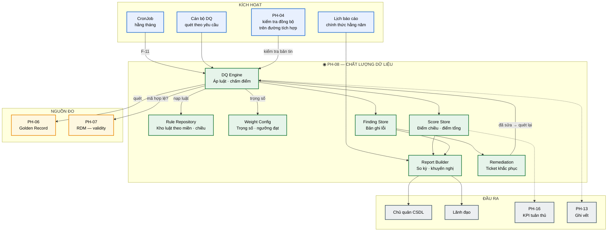
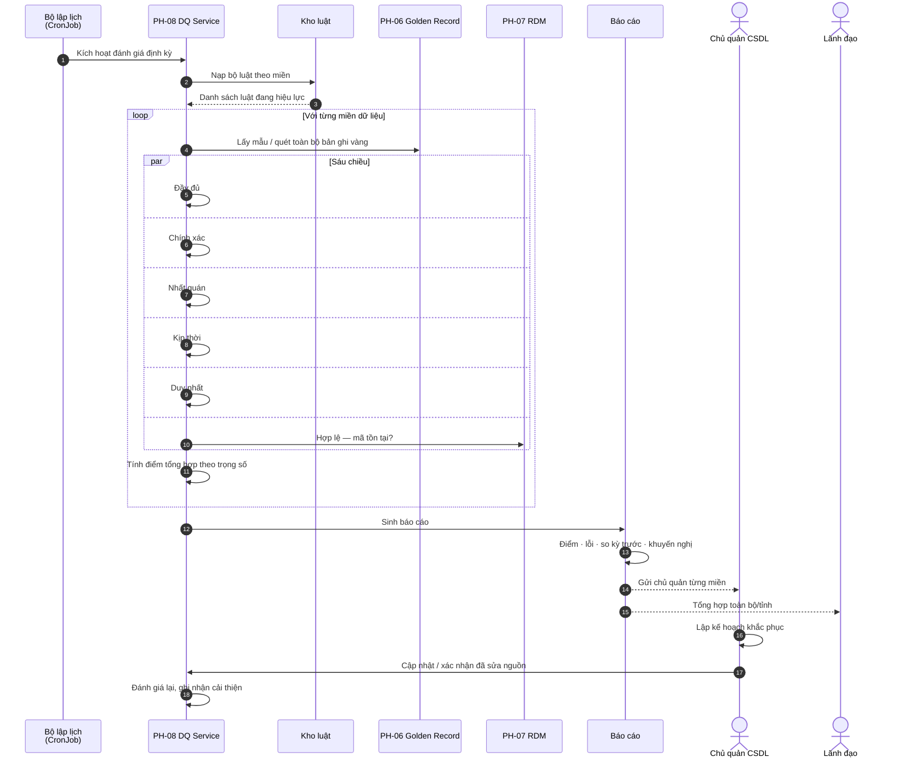
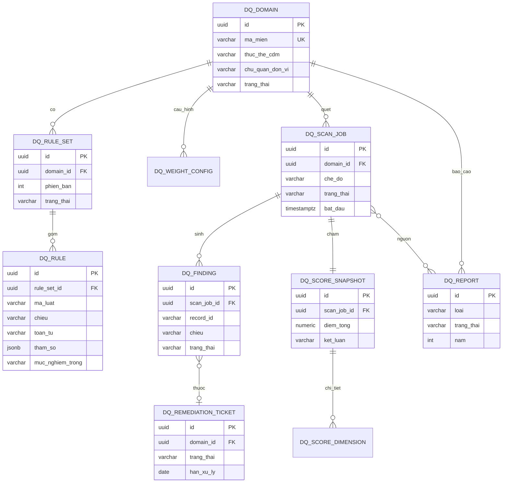

# SRS — PH-08: Chất lượng dữ liệu

| Thuộc tính | Giá trị |
|---|---|
| **Mã phân hệ** | PH-08 |
| **Tên** | Chất lượng dữ liệu (Data Quality) |
| **Nhóm** | Dữ liệu |
| **Mức bắt buộc** | M — Bắt buộc |
| **Phiên bản** | 1.0 |
| **Ngày** | 03/8/2026 |
| **Công nghệ chủ đạo** | Quarkus + PostgreSQL |

---

## M1. Giới thiệu

### 1.1. Mục đích

PH-08 trả lời câu hỏi vận hành và tuân thủ: **"Dữ liệu trên trục tốt đến mức nào — và chỗ nào cần sửa?"**

NĐ 47/2020 buộc cơ quan nhà nước **kiểm tra, đánh giá chất lượng dữ liệu định kỳ hằng năm** (CMP-22). Phân hệ này biến nghĩa vụ đó thành quy trình đo lường có số liệu: luật kiểm tra theo miền, quét bản ghi vàng, chấm điểm sáu chiều có trọng số, báo cáo hướng hành động, và vòng khắc phục → đánh giá lại.

Thiết kế chọn **đánh giá hằng tháng, báo cáo chính thức hằng năm**: phát hiện suy giảm sớm rẻ hơn nhiều so với sửa chữa sau một năm tích lũy lỗi ([F-11](../03-flows/README.md#f-11--đánh-giá-chất-lượng-dữ-liệu-định-kỳ)).

### 1.2. Sáu chiều chất lượng — khung đo thống nhất

Đây là xương sống của phân hệ. Mọi luật, điểm số và báo cáo đều quy về sáu chiều:

| Chiều | Mã | Câu hỏi kiểm tra | Ví dụ luật |
|---|---|---|---|
| **Đầy đủ** (completeness) | `COMPLETENESS` | Trường bắt buộc có bị trống? | `soDinhDanh` không null / không rỗng |
| **Chính xác** (accuracy) | `ACCURACY` | Giá trị đúng định dạng, đúng miền giá trị? | Số định danh đủ 12 chữ số, checksum hợp lệ |
| **Nhất quán** (consistency) | `CONSISTENCY` | Các nguồn có mâu thuẫn nhau? | Ngày sinh ở nguồn A và B phải trùng |
| **Kịp thời** (timeliness) | `TIMELINESS` | Dữ liệu còn tươi? | `ngayCapNhat` trong vòng 30 ngày |
| **Duy nhất** (uniqueness) | `UNIQUENESS` | Có bản ghi trùng? | Một số định danh chỉ ứng một bản ghi vàng |
| **Hợp lệ** (validity) | `VALIDITY` | Mã danh mục có tồn tại? | `maDonViHanhChinh` phải có trong RDM (PH-07) |

**Ghi chú về chiều Hợp lệ.** Validity **không** tự chứa bảng mã — PH-08 gọi PH-07 để xác nhận mã còn hiệu lực. Tách vai trò này tránh nhân bản danh mục và bảo đảm mọi kiểm tra dùng cùng nguồn chân lý danh mục.

**Ghi chú về trọng số.** Không phải mọi trường ngang nhau: thiếu số định danh cá nhân nghiêm trọng hơn thiếu số điện thoại. Điểm tổng hợp = tổng (điểm chiều × trọng số chiều), trọng số do chủ quản miền xác lập theo tác động nghiệp vụ.

### 1.3. Phạm vi

**PH-08 chịu trách nhiệm:**

| # | Trách nhiệm |
|---|---|
| 1 | Quản lý kho luật kiểm tra theo miền dữ liệu và theo sáu chiều |
| 2 | Cấu hình trọng số chiều và ngưỡng đạt/không đạt theo miền |
| 3 | Quét bản ghi vàng (PH-06) theo lịch (cron hằng tháng) hoặc theo yêu cầu |
| 4 | Chấm điểm từng chiều và điểm tổng hợp có trọng số |
| 5 | Ghi nhận bản ghi lỗi (finding) kèm chiều, luật, mức nghiêm trọng |
| 6 | Sinh báo cáo chất lượng: điểm tổng, lỗi, so kỳ trước, khuyến nghị |
| 7 | Báo cáo chính thức hằng năm phục vụ CMP-22 / NĐ 47 |
| 8 | Quản lý vòng khắc phục: giao chủ quản → cập nhật → đánh giá lại |
| 9 | Kiểm tra chất lượng đồng bộ trên đường tích hợp (gọi từ PH-04) khi được cấu hình |
| 10 | Đẩy chỉ số chất lượng sang PH-16 phục vụ KPI tuân thủ |

**PH-08 KHÔNG chịu trách nhiệm:**

| # | Không làm | Thuộc phân hệ |
|---|---|---|
| 1 | Lưu trữ và hợp nhất bản ghi vàng | PH-06 |
| 2 | Quản lý bảng mã, danh mục phân loại | PH-07 |
| 3 | Sửa dữ liệu nguồn tại HTTT thành viên | Chủ quản / hệ thống nguồn |
| 4 | Che, ẩn danh hóa khi trả dữ liệu | PH-09 |
| 5 | Tổng hợp KPI kiến trúc / xuất NAS | PH-16 |
| 6 | Điều phối luồng tích hợp | PH-04 |

**Ranh giới với PH-06.** PH-06 bảo đảm *"một thực thể — một bản ghi vàng"*; PH-08 đo *"bản ghi vàng đó tốt đến đâu"*. Hai phân hệ bổ sung nhau: MDM giảm trùng lặp (chiều uniqueness một phần), DQ đo toàn bộ sáu chiều trên tập bản ghi vàng.

### 1.4. Tài liệu tham chiếu

| Mã | Tài liệu |
|---|---|
| [KT] | [Kiến trúc dữ liệu — mục 6.3 Chất lượng dữ liệu](../02-architecture/README.md#63-quản-lý-chất-lượng-dữ-liệu) |
| [LT] | [F-11 Đánh giá chất lượng dữ liệu định kỳ](../03-flows/README.md#f-11--đánh-giá-chất-lượng-dữ-liệu-định-kỳ) |
| [PL] | [Ma trận CMP](../01-legal/README.md) — NĐ 47/2020 CMP-22 |
| [TT] | [Tác động TTQGS — nhóm dữ liệu](../06-impact/README.md) |
| [ADR] | [ADR-008 PostgreSQL](../05-adr/README.md#adr-008), [ADR-013 CDM](../05-adr/README.md#adr-013) |
| [SRS] | [PH-06 MDM](SRS-PH-06-mdm.md), [PH-07 RDM](SRS-PH-07-rdm.md), [PH-04 Lõi tích hợp](SRS-PH-04-integration-core.md), [PH-16 KPI](README.md) |

---

## M2. Mô tả tổng quan

### 2.1. Vị trí trong kiến trúc



**Thuyết minh sơ đồ.** PH-08 đứng **bên cạnh** đường dữ liệu chính, không chặn mọi bản tin theo mặc định. Hai chế độ vận hành:

1. **Đánh giá hàng loạt (batch)** — CronJob / quét thủ công đọc Golden Record, chạy sáu chiều, sinh điểm và báo cáo. Đây là xương sống CMP-22 và luồng F-11.
2. **Kiểm tra đồng bộ (inline)** — PH-04 có thể gọi PH-08 trên bản tin đang đi qua khi miền dữ liệu bật chế độ kiểm soát chặt. Kết quả đạt/không đạt quyết định bản tin đi tiếp hay vào DLQ — không thay thế đánh giá định kỳ.

### 2.2. Luồng F-11 — đánh giá định kỳ



**Thuyết minh F-11.** Báo cáo hướng hành động: không chỉ *"chất lượng 82%"* mà phải chỉ rõ bản ghi nào lỗi, lỗi gì, nguồn nào gây ra, và khuyến nghị khắc phục. Báo cáo không kèm khuyến nghị cụ thể sẽ nằm im trong ngăn kéo.

### 2.3. Tác nhân

| Tác nhân | Loại | Tương tác |
|---|---|---|
| Cán bộ chất lượng dữ liệu | Người | Quản lý luật, trọng số, lịch quét, duyệt báo cáo |
| Chủ quản CSDL / miền dữ liệu | Người | Nhận báo cáo, lập kế hoạch khắc phục, xác nhận đã sửa |
| Lãnh đạo đơn vị | Người | Xem báo cáo tổng hợp, báo cáo chính thức hằng năm |
| PH-06 MDM | Hệ thống | Cung cấp bản ghi vàng để quét |
| PH-07 RDM | Hệ thống | Xác nhận mã danh mục (chiều validity) |
| PH-04 Lõi tích hợp | Hệ thống | Gọi kiểm tra đồng bộ khi cấu hình |
| PH-16 KPI | Hệ thống | Nhận chỉ số điểm chất lượng cho báo cáo tuân thủ |
| CronJob Kubernetes | Hệ thống | Kích hoạt đánh giá hằng tháng |

### 2.4. Giả định

| Mã | Giả định |
|---|---|
| GD-01 | Bản ghi vàng của các miền ưu tiên đã tồn tại trên PH-06 và có thể truy vấn theo miền |
| GD-02 | Danh mục dùng chung trên PH-07 đã được nạp và có API tra cứu mã theo phiên bản hiệu lực |
| GD-03 | Mỗi miền dữ liệu có chủ quản được chỉ định (liên hệ, đơn vị) để nhận báo cáo và ticket khắc phục |
| GD-04 | Mô hình dữ liệu chung (CDM) đã xác định trường bắt buộc / kiểu / ràng buộc định dạng cho từng thực thể |
| GD-05 | Trọng số mặc định sáu chiều đã được phê duyệt lần đầu; chủ quản có thể điều chỉnh trong biên độ cho phép |
| GD-06 | Đồng hồ hệ thống đồng bộ NTP — chiều timeliness phụ thuộc dấu thời gian cập nhật đáng tin |

### 2.5. Ràng buộc

| Mã | Ràng buộc | Nguồn |
|---|---|---|
| RB-01 | Phải kiểm tra, đánh giá chất lượng dữ liệu **định kỳ hằng năm** và có báo cáo | NĐ 47/2020, CMP-22 |
| RB-02 | Đánh giá vận hành tối thiểu **hằng tháng**; báo cáo chính thức **hằng năm** | Thiết kế F-11 |
| RB-03 | Sáu chiều chất lượng là khung bắt buộc; không được bỏ chiều khi chấm điểm tổng hợp | Kiến trúc dữ liệu 6.3 |
| RB-04 | Chiều **hợp lệ** phải đối chiếu PH-07, không nhân bản bảng mã trong PH-08 | Phân vai PH-07 |
| RB-05 | Quét hàng loạt ưu tiên đọc bản ghi vàng PH-06, không quét trực tiếp CSDL nguồn | Phân vai PH-06 |
| RB-06 | Toàn bộ công nghệ mã nguồn mở; lưu trữ trạng thái trên PostgreSQL | Yêu cầu dự án, ADR-008 |
| RB-07 | Không ghi giá trị gốc của trường nhạy cảm vào finding khi có thể thay bằng mã lỗi + vị trí trường | CMP-28, PH-09 |

### 2.6. Phụ thuộc phân hệ

| Phụ thuộc | Loại | Hành vi khi không khả dụng |
|---|---|---|
| PH-06 | **Cứng** cho quét hàng loạt | Không quét được → job `FAILED`, cảnh báo vận hành; không bịa điểm |
| PH-07 | **Cứng** cho chiều validity | Luật validity chuyển `SKIPPED` kèm cảnh báo; điểm tổng hợp đánh dấu *"thiếu chiều hợp lệ"* |
| PH-04 | **Mềm** | Inline check không chạy; batch DQ vẫn độc lập |
| PH-16 | **Mềm** | Không đẩy KPI được → đệm cục bộ, đồng bộ lại khi PH-16 sống |
| PH-13 | **Cứng** với thao tác quản trị luật / phát hành báo cáo chính thức | Không ghi vết → từ chối thao tác (CMP-28) |
| PH-12 | **Cứng** cho API quản trị | Không xác thực/ủy quyền → từ chối |

---

## M3. Yêu cầu chức năng

### 3.1. Nhóm A — Quản lý luật kiểm tra

#### FR-08-001 — Quản lý miền dữ liệu và bộ luật · **M**

| Mục | Nội dung |
|---|---|
| **Mô tả** | Khai báo miền dữ liệu (domain) và gắn bộ luật kiểm tra đang hiệu lực |
| **Tác nhân** | Cán bộ chất lượng dữ liệu |
| **Đầu vào** | Mã miền · tên miền · thực thể CDM · chủ quản · trạng thái |
| **Xử lý** | 1. Tạo/cập nhật miền gắn với thực thể CDM (ví dụ `CONG_DAN`, `DOANH_NGHIEP`)<br>2. Gán chủ quản (đơn vị, liên hệ) — bắt buộc trước khi bật quét<br>3. Mỗi miền có **một bộ luật đang hiệu lực** (versioned)<br>4. Phiên bản luật mới ở trạng thái `DRAFT` → phê duyệt → `ACTIVE`; phiên bản cũ chuyển `SUPERSEDED`<br>5. Ghi vết mọi thay đổi cấu hình |
| **Đầu ra** | Miền và bộ luật phiên bản được lưu |
| **Ngoại lệ** | E1: Bật quét khi chưa có chủ quản → từ chối<br>E2: Phê duyệt bộ luật trống (0 luật) → từ chối<br>E3: Hai phiên bản `ACTIVE` cùng lúc → chặn, buộc chuyển phiên bản cũ |

#### FR-08-002 — Định nghĩa luật kiểm tra theo chiều · **M**

| Mục | Nội dung |
|---|---|
| **Mô tả** | Tạo luật gắn một trong sáu chiều, áp dụng trên trường/biểu thức của thực thể |
| **Tác nhân** | Cán bộ chất lượng dữ liệu |
| **Đầu vào** | Mã luật · chiều · trường/biểu thức · toán tử · tham số · mức nghiêm trọng · thông điệp lỗi |
| **Xử lý** | 1. Chọn chiều: `COMPLETENESS` \| `ACCURACY` \| `CONSISTENCY` \| `TIMELINESS` \| `UNIQUENESS` \| `VALIDITY`<br>2. Khai báo đích kiểm tra: trường đơn, tổ hợp trường, hoặc biểu thức<br>3. Chọn toán tử phù hợp chiều (xem bảng dưới)<br>4. Gán mức nghiêm trọng: `CRITICAL` · `MAJOR` · `MINOR`<br>5. Luật `VALIDITY` bắt buộc khai báo **danh mục PH-07** cần đối chiếu<br>6. Luật `CONSISTENCY` bắt buộc khai báo nguồn đối chiếu (thuộc tính lineage / nguồn phụ)<br>7. Kiểm tra cú pháp tham số trước khi lưu nháp |
| **Đầu ra** | Luật trong bộ luật `DRAFT` |
| **Ngoại lệ** | E1: Chiều không thuộc sáu chiều → từ chối<br>E2: Luật VALIDITY thiếu mã danh mục RDM → từ chối<br>E3: Trường không thuộc thực thể CDM của miền → từ chối |

**Toán tử theo chiều (tóm tắt):**

| Chiều | Toán tử điển hình |
|---|---|
| Đầy đủ | `NOT_NULL`, `NOT_EMPTY`, `REQUIRED_IF` |
| Chính xác | `REGEX`, `LENGTH`, `RANGE`, `CHECKSUM`, `TYPE` |
| Nhất quán | `EQ_SOURCE`, `EQ_FIELDS`, `CROSS_ENTITY` |
| Kịp thời | `MAX_AGE_DAYS`, `UPDATED_AFTER` |
| Duy nhất | `UNIQUE_IN_DOMAIN`, `UNIQUE_COMPOSITE` |
| Hợp lệ | `IN_RDM`, `IN_RDM_VERSION` |

#### FR-08-003 — Cấu hình trọng số và ngưỡng đạt · **M**

| Mục | Nội dung |
|---|---|
| **Mô tả** | Thiết lập trọng số sáu chiều và ngưỡng điểm đạt theo miền |
| **Tác nhân** | Cán bộ chất lượng dữ liệu, Chủ quản miền (phê duyệt trọng số) |
| **Đầu vào** | Trọng số từng chiều (0–1) · ngưỡng đạt miền · ngưỡng cảnh báo |
| **Xử lý** | 1. Nhập trọng số cho đủ sáu chiều<br>2. Kiểm tra **tổng trọng số = 1,0** (dung sai 0,001)<br>3. Chủ quản miền phê duyệt thay đổi trọng số (ghi lý do)<br>4. Thiết lập ngưỡng: `PASS` nếu điểm tổng ≥ ngưỡng đạt; `WARN` nếu ≥ ngưỡng cảnh báo; ngược lại `FAIL`<br>5. Áp dụng cấu hình cho các lần quét **sau** thời điểm phê duyệt (không sửa điểm quá khứ) |
| **Đầu ra** | Cấu hình trọng số/ngưỡng phiên bản hóa |
| **Ngoại lệ** | E1: Tổng trọng số ≠ 1 → từ chối<br>E2: Trọng số chiều = 0 mà vẫn có luật thuộc chiều đó → cảnh báo cấu hình<br>E3: Hạ ngưỡng đạt cần ghi lý do và phê duyệt chủ quản |

**Trọng số mặc định khởi tạo (GD-05):**

| Chiều | Trọng số mặc định |
|---|---|
| Đầy đủ | 0,20 |
| Chính xác | 0,20 |
| Nhất quán | 0,15 |
| Kịp thời | 0,10 |
| Duy nhất | 0,15 |
| Hợp lệ | 0,20 |

#### FR-08-004 — Nhập/xuất và sao chép bộ luật · **S**

| Mục | Nội dung |
|---|---|
| **Mô tả** | Sao chép bộ luật giữa miền cùng thực thể CDM; xuất/nhập định dạng YAML/JSON |
| **Tác nhân** | Cán bộ chất lượng dữ liệu |
| **Đầu vào** | Bộ luật nguồn · miền đích · tùy chọn điều chỉnh tham số |
| **Xử lý** | 1. Sao chép toàn bộ luật sang phiên bản `DRAFT` của miền đích<br>2. Đánh dấu luật cần rà lại tham số đặc thù miền<br>3. Xuất bộ luật ACTIVE ra file; nhập vào miền khác ở trạng thái DRAFT<br>4. Không tự ACTIVE sau nhập — bắt buộc phê duyệt |
| **Đầu ra** | Bộ luật DRAFT trên miền đích |
| **Ngoại lệ** | E1: Thực thể CDM khác nhau → từ chối sao chép<br>E2: File nhập sai schema → từ chối kèm vị trí lỗi |

---

### 3.2. Nhóm B — Quét và chấm điểm

#### FR-08-005 — Lập lịch và kích hoạt quét · **M**

| Mục | Nội dung |
|---|---|
| **Mô tả** | Chạy đánh giá hàng loạt theo cron hằng tháng, theo yêu cầu, hoặc theo sự kiện báo cáo năm |
| **Tác nhân** | CronJob, Cán bộ chất lượng dữ liệu |
| **Đầu vào** | Mã miền (hoặc tất cả) · chế độ `FULL`/`SAMPLE` · kích thước mẫu · lý do kích hoạt |
| **Xử lý** | 1. Cron mặc định: ngày 1 hằng tháng, 02:00 giờ địa phương<br>2. Tạo `ScanJob` trạng thái `QUEUED` → `RUNNING`<br>3. Nạp bộ luật ACTIVE và trọng số hiệu lực của miền<br>4. Chế độ `FULL`: quét toàn bộ bản ghi vàng thuộc miền<br>5. Chế độ `SAMPLE`: lấy mẫu ngẫu nhiên có seed ghi lại (tái lập được)<br>6. Báo cáo chính thức hằng năm bắt buộc chế độ `FULL`<br>7. Ghi tiến độ (% bản ghi đã xử lý) phục vụ UI |
| **Đầu ra** | `ScanJob` đang chạy hoặc hoàn tất |
| **Ngoại lệ** | E1: PH-06 không khả dụng → `FAILED`, cảnh báo<br>E2: Đã có job `RUNNING` cùng miền → xếp hàng hoặc từ chối trùng (cấu hình)<br>E3: Bộ luật ACTIVE thiếu → từ chối kích hoạt |

#### FR-08-006 — Thực thi kiểm tra sáu chiều · **M**

| Mục | Nội dung |
|---|---|
| **Mô tả** | Áp từng luật lên từng bản ghi vàng (hoặc mẫu) và sinh finding |
| **Tác nhân** | DQ Engine |
| **Đầu vào** | Bản ghi vàng · danh sách luật · ngữ cảnh job |
| **Xử lý** | 1. Với mỗi bản ghi, với mỗi luật ACTIVE:<br>&nbsp;&nbsp;· Đánh giá biểu thức theo chiều<br>&nbsp;&nbsp;· `VALIDITY`: gọi PH-07 `IN_RDM` / `IN_RDM_VERSION`<br>&nbsp;&nbsp;· `CONSISTENCY`: đối chiếu thuộc tính/nguồn theo lineage PH-06 khi có<br>&nbsp;&nbsp;· `UNIQUENESS`: kiểm tra trùng khóa trong phạm vi miền (chỉ số/tập hợp tạm)<br>2. Luật vi phạm → tạo finding: bản ghi · luật · chiều · mức · thông điệp · (tùy chọn) giá trị đã che<br>3. Luật đạt → cộng vào thống kê đạt<br>4. Luật `SKIPPED` (phụ thuộc chết) → ghi riêng, không tính là đạt<br>5. Xử lý theo lô để đạt NFR thông lượng |
| **Đầu ra** | Tập finding + thống kê thô theo luật/chiều |
| **Ngoại lệ** | E1: PH-07 timeout → luật VALIDITY = `SKIPPED`, cảnh báo job<br>E2: Bản ghi thiếu khóa → finding CRITICAL cấu trúc, bỏ qua luật còn lại trên bản ghi đó<br>E3: Lỗi transient → thử lại tối đa 3 lần rồi đánh dấu lỗi kỹ thuật |

#### FR-08-007 — Chấm điểm có trọng số · **M**

| Mục | Nội dung |
|---|---|
| **Mô tả** | Tính điểm từng chiều và điểm tổng hợp theo trọng số đã phê duyệt |
| **Tác nhân** | DQ Engine |
| **Đầu vào** | Thống kê đạt/vi phạm theo chiều · cấu hình trọng số · ngưỡng |
| **Xử lý** | 1. Điểm chiều = (số lần luật đạt / số lần luật áp dụng thuộc chiều) × 100<br>2. Loại trừ lần `SKIPPED` khỏi mẫu số<br>3. Điểm tổng = Σ (điểm chiều × trọng số chiều)<br>4. Gán kết luận miền: `PASS` / `WARN` / `FAIL` theo ngưỡng<br>5. Lưu `ScoreSnapshot` gắn `ScanJob`, không ghi đè snapshot kỳ trước<br>6. Nếu thiếu ≥ 1 chiều do SKIPPED hàng loạt → gắn cờ `INCOMPLETE_DIMENSIONS` |
| **Đầu ra** | Snapshot điểm theo miền và theo chiều |
| **Ngoại lệ** | E1: Mẫu số chiều = 0 (không có luật) → điểm chiều = null, không đưa vào tổng; cảnh báo cấu hình<br>E2: Cờ `INCOMPLETE_DIMENSIONS` → không được dùng làm báo cáo chính thức năm cho đến khi quét lại đủ |

**Công thức:**

\[
\text{Điểm tổng} = \sum_{d \in 6\ \text{chiều}} \text{điểm}_d \times w_d
\quad\text{với}\quad \sum w_d = 1
\]

#### FR-08-008 — So sánh với kỳ trước · **M**

| Mục | Nội dung |
|---|---|
| **Mô tả** | Tính biến động điểm và finding so với snapshot liền trước cùng miền |
| **Tác nhân** | DQ Engine, Report Builder |
| **Đầu vào** | Snapshot hiện tại · snapshot kỳ trước (cùng miền, job thành công) |
| **Xử lý** | 1. Tìm snapshot thành công gần nhất trước job hiện tại<br>2. Δ điểm tổng, Δ từng chiều<br>3. Finding mới / đã hết / còn tồn tại (theo khóa bản ghi + mã luật)<br>4. Gắn nhãn xu hướng: `IMPROVED` · `STABLE` · `DEGRADED`<br>5. Nếu không có kỳ trước → đánh dấu `BASELINE` |
| **Đầu ra** | Khối so sánh kỳ gắn vào báo cáo |
| **Ngoại lệ** | E1: Kỳ trước dùng bộ trọng số khác → vẫn so điểm nhưng gắn cảnh báo *"trọng số đã đổi"* |

#### FR-08-009 — Kiểm tra chất lượng đồng bộ (inline) · **S**

| Mục | Nội dung |
|---|---|
| **Mô tả** | API đồng bộ cho PH-04 kiểm tra một bản tin/bản ghi theo bộ luật miền |
| **Tác nhân** | PH-04 |
| **Đầu vào** | Mã miền · payload bản ghi · chế độ `STRICT`/`ADVISORY` · danh sách chiều cần chạy (mặc định đủ sáu, có thể rút gọn) |
| **Xử lý** | 1. Nạp luật ACTIVE (đệm bộ nhớ)<br>2. Chạy tập luật cho phép inline (loại trừ luật uniqueness toàn miền nặng nếu cấu hình)<br>3. `STRICT`: có finding `CRITICAL`/`MAJOR` → trả `khongDat`<br>4. `ADVISORY`: luôn trả `dat` kèm danh sách cảnh báo<br>5. Không ghi ScoreSnapshot; có thể ghi finding tạm tùy cấu hình |
| **Đầu ra** | Kết quả đạt/không đạt + danh sách lỗi rút gọn |
| **Ngoại lệ** | E1: PH-07 chậm → validity SKIPPED; `STRICT` có thể cấu hình fail-open hoặc fail-closed theo miền<br>E2: Timeout tổng ≥ ngưỡng NFR → trả lỗi kỹ thuật, PH-04 quyết định theo chính sách route |

---

### 3.3. Nhóm C — Báo cáo

#### FR-08-010 — Sinh báo cáo chất lượng kỳ · **M**

| Mục | Nội dung |
|---|---|
| **Mô tả** | Tổng hợp kết quả một (hoặc nhiều) ScanJob thành báo cáo hướng hành động |
| **Tác nhân** | Report Builder, Cán bộ chất lượng dữ liệu |
| **Đầu vào** | `ScanJob` hoàn tất · tùy chọn gộp nhiều miền |
| **Xử lý** | 1. Gom: điểm tổng · điểm sáu chiều · kết luận PASS/WARN/FAIL<br>2. Danh sách bản ghi lỗi (finding) nhóm theo chiều, mức, luật — phân trang/xuất file<br>3. Khối so kỳ trước (FR-08-008)<br>4. Sinh **khuyến nghị** tự động từ mẫu (xem bảng)<br>5. Gắn thông tin chủ quản nhận báo cáo<br>6. Trạng thái báo cáo: `DRAFT` → `PUBLISHED` |
| **Đầu ra** | Báo cáo kỳ (tháng/quý/đợt) |
| **Ngoại lệ** | E1: Job chưa `SUCCEEDED` → không sinh báo cáo<br>E2: Xuất file quá lớn → tách tệp theo chiều/miền |

**Mẫu khuyến nghị (ví dụ):**

| Điều kiện | Khuyến nghị |
|---|---|
| Completeness thấp trên trường X | Rà soát quy trình nhập liệu nguồn; bổ sung kiểm tra bắt buộc tại adapter PH-05 |
| Validity lỗi mã RDM cao | Đồng bộ danh mục PH-07 với hệ thống nguồn; kiểm tra phiên bản mã |
| Uniqueness suy giảm | Rà hàng đợi stewardship PH-06; kiểm tra trùng số định danh |
| Timeliness thấp | Rút ngắn chu kỳ đồng bộ CDC/F-05 của nguồn |
| Điểm tổng DEGRADED > 5 điểm | Ưu tiên ticket CRITICAL trong 15 ngày làm việc |

#### FR-08-011 — Báo cáo chính thức hằng năm (CMP-22) · **M**

| Mục | Nội dung |
|---|---|
| **Mô tả** | Phát hành báo cáo chất lượng dữ liệu chính thức phục vụ nghĩa vụ NĐ 47 / CMP-22 |
| **Tác nhân** | Cán bộ chất lượng dữ liệu, Lãnh đạo (phê duyệt) |
| **Đầu vào** | Năm báo cáo · danh sách miền bắt buộc · kết quả quét FULL trong năm |
| **Xử lý** | 1. Yêu cầu mỗi miền trong phạm vi tuân thủ có ≥ 1 quét `FULL` thành công trong năm<br>2. Lấy snapshot đại diện (mặc định: quét FULL tháng 12, hoặc trung bình có trọng số các tháng — cấu hình)<br>3. Tổng hợp toàn bộ/tỉnh: điểm theo miền, xu hướng 12 tháng, finding CRITICAL còn mở<br>4. Đính kèm khuyến nghị và tình trạng khắc phục trong năm<br>5. Phê duyệt lãnh đạo → trạng thái `OFFICIAL`<br>6. Đóng dấu thời gian, người ký số/phê duyệt, mã báo cáo<br>7. Lưu trữ tối thiểu theo chính sách lưu giữ; đẩy tóm tắt sang PH-16 |
| **Đầu ra** | Báo cáo chính thức năm (`OFFICIAL`) |
| **Ngoại lệ** | E1: Thiếu quét FULL miền bắt buộc → không cho `OFFICIAL`, liệt kê miền thiếu<br>E2: Có cờ `INCOMPLETE_DIMENSIONS` trên snapshot đại diện → chặn phát hành<br>E3: Chưa phê duyệt lãnh đạo → giữ `PENDING_APPROVAL` |

#### FR-08-012 — Phân phối báo cáo và thông báo · **M**

| Mục | Nội dung |
|---|---|
| **Mô tả** | Gửi báo cáo tới chủ quản miền và lãnh đạo; thông báo khi điểm suy giảm |
| **Tác nhân** | Hệ thống thông báo, Cán bộ chất lượng dữ liệu |
| **Đầu vào** | Báo cáo `PUBLISHED`/`OFFICIAL` · danh sách người nhận |
| **Xử lý** | 1. Gửi chủ quản từng miền phần báo cáo thuộc miền mình<br>2. Gửi lãnh đạo bản tổng hợp<br>3. Nếu xu hướng `DEGRADED` hoặc kết luận `FAIL` → thông báo mức cao<br>4. Ghi nhật ký phân phối (ai nhận, lúc nào, kênh)<br>5. Cho phép tải lại từ console |
| **Đầu ra** | Biên bản phân phối |
| **Ngoại lệ** | E1: Chủ quản chưa cấu hình liên hệ → cảnh báo cấu hình, vẫn lưu báo cáo<br>E2: Kênh thông báo sự cố → xếp hàng thử lại |

---

### 3.4. Nhóm D — Khắc phục và đánh giá lại

#### FR-08-013 — Mở ticket khắc phục từ finding · **M**

| Mục | Nội dung |
|---|---|
| **Mô tả** | Chuyển finding (đơn lẻ hoặc nhóm) thành ticket giao chủ quản |
| **Tác nhân** | Cán bộ chất lượng dữ liệu, Hệ thống (tự mở theo ngưỡng) |
| **Đầu vào** | Finding hoặc bộ lọc nhóm · hạn xử lý · mức ưu tiên |
| **Xử lý** | 1. Tạo ticket gắn miền, chủ quản, danh sách finding<br>2. Ưu tiên mặc định theo mức finding cao nhất trong nhóm<br>3. Hạn xử lý mặc định: CRITICAL 15 ngày làm việc, MAJOR 30, MINOR 60<br>4. Trạng thái: `OPEN` → `IN_PROGRESS` → `RESOLVED` → `VERIFIED` / `REOPENED`<br>5. Có thể tự mở ticket khi báo cáo `FAIL` và số CRITICAL vượt ngưỡng |
| **Đầu ra** | Ticket khắc phục |
| **Ngoại lệ** | E1: Finding đã thuộc ticket OPEN khác → gắn thêm, không tạo trùng nếu cấu hình gộp<br>E2: Không có chủ quản → ticket gán hàng đợi DQ chung |

#### FR-08-014 — Cập nhật tiến độ khắc phục · **M**

| Mục | Nội dung |
|---|---|
| **Mô tả** | Chủ quản cập nhật trạng thái, ghi chú đã sửa tại nguồn, đính kèm bằng chứng |
| **Tác nhân** | Chủ quản CSDL |
| **Đầu vào** | Mã ticket · trạng thái mới · ghi chú · liên kết bằng chứng (tùy chọn) |
| **Xử lý** | 1. Chủ quản chuyển `IN_PROGRESS` / `RESOLVED` kèm giải thích<br>2. Khi `RESOLVED`: yêu cầu xác nhận dữ liệu nguồn đã cập nhật (và/hoặc đồng bộ lại PH-06)<br>3. Không cho chủ quản tự `VERIFIED` — chỉ cán bộ DQ hoặc hệ thống sau quét lại<br>4. Ghi vết mọi thay đổi |
| **Đầu ra** | Ticket cập nhật |
| **Ngoại lệ** | E1: Quá hạn → gắn cờ `OVERDUE`, thông báo lãnh đạo miền<br>E2: Đóng ticket khi còn finding CRITICAL chưa giải thích → từ chối |

#### FR-08-015 — Đánh giá lại sau khắc phục · **M**

| Mục | Nội dung |
|---|---|
| **Mô tả** | Quét lại phạm vi liên quan và xác nhận cải thiện |
| **Tác nhân** | Cán bộ chất lượng dữ liệu, DQ Engine |
| **Đầu vào** | Ticket `RESOLVED` · phạm vi quét (toàn miền hoặc tập khóa bản ghi) |
| **Xử lý** | 1. Kích hoạt ScanJob phạm vi hẹp (danh sách `recordId` trong ticket) hoặc FULL miền<br>2. Đối chiếu finding cũ: hết lỗi → đánh dấu finding `CLEARED`<br>3. Còn lỗi → `REOPENED` ticket, giữ lịch sử<br>4. Nếu toàn bộ finding trong ticket cleared → `VERIFIED`, ghi Δ điểm nếu có snapshot<br>5. Cập nhật thống kê cải thiện phục vụ báo cáo năm |
| **Đầu ra** | Ticket `VERIFIED` hoặc `REOPENED` + kết quả quét lại |
| **Ngoại lệ** | E1: Quét lại thất bại kỹ thuật → giữ `RESOLVED`, không `VERIFIED`<br>E2: Bản ghi không còn trên PH-06 → finding `OBSOLETE`, ghi chú |

#### FR-08-016 — Đẩy chỉ số sang PH-16 · **S**

| Mục | Nội dung |
|---|---|
| **Mô tả** | Xuất chỉ số điểm chất lượng và trạng thái tuân thủ CMP-22 cho PH-16 |
| **Tác nhân** | Hệ thống |
| **Đầu vào** | ScoreSnapshot · báo cáo OFFICIAL · thống kê ticket |
| **Xử lý** | 1. Sau mỗi job thành công: đẩy điểm tổng, điểm chiều, kết luận miền<br>2. Sau báo cáo OFFICIAL: đẩy mã báo cáo, năm, trạng thái phê duyệt<br>3. Định kỳ đẩy tỷ lệ ticket quá hạn, tỷ lệ finding CRITICAL còn mở<br>4. Idempotent theo `snapshotId` / `reportId` |
| **Đầu ra** | Sự kiện/API nhận tại PH-16 |
| **Ngoại lệ** | E1: PH-16 down → xếp hàng outbox, thử lại<br>E2: Schema KPI đổi → phiên bản payload, cảnh báo tương thích |

---

## M4. Mô hình dữ liệu

### 4.1. Sơ đồ thực thể



### 4.2. Thực thể

#### EN-08-01 — `dq_domain` (Miền dữ liệu)

| Thuộc tính | Kiểu | Ràng buộc | Mô tả |
|---|---|---|---|
| `id` | UUID | PK | — |
| `ma_mien` | VARCHAR(64) | UNIQUE, NOT NULL | Ví dụ `CONG_DAN` |
| `ten_mien` | VARCHAR(255) | NOT NULL | — |
| `thuc_the_cdm` | VARCHAR(128) | NOT NULL | Ánh xạ thực thể CDM |
| `chu_quan_don_vi` | VARCHAR(255) | NULL | Đơn vị chủ quản |
| `chu_quan_lien_he` | VARCHAR(255) | NULL | Email/đầu mối |
| `inline_che_do` | VARCHAR(16) | DEFAULT `OFF` | `OFF`/`ADVISORY`/`STRICT` |
| `trang_thai` | VARCHAR(16) | NOT NULL | `ACTIVE`/`INACTIVE` |
| `tao_luc` / `cap_nhat_luc` | TIMESTAMPTZ | NOT NULL | — |

#### EN-08-02 — `dq_rule_set` / `dq_rule` (Bộ luật & luật)

| Thuộc tính | Kiểu | Ràng buộc | Mô tả |
|---|---|---|---|
| `rule_set.id` | UUID | PK | — |
| `domain_id` | UUID | FK → domain | — |
| `phien_ban` | INT | NOT NULL | Tăng dần theo miền |
| `trang_thai` | VARCHAR(16) | NOT NULL | `DRAFT`/`ACTIVE`/`SUPERSEDED` |
| `rule.ma_luat` | VARCHAR(64) | UNIQUE trong rule_set | — |
| `rule.chieu` | VARCHAR(32) | CHECK sáu chiều | — |
| `rule.truong_dich` | VARCHAR(255) | NOT NULL | Đường dẫn trường/biểu thức |
| `rule.toan_tu` | VARCHAR(64) | NOT NULL | — |
| `rule.tham_so` | JSONB | NOT NULL DEFAULT `{}` | Regex, maxAge, mã danh mục RDM… |
| `rule.muc_nghiem_trong` | VARCHAR(16) | NOT NULL | `CRITICAL`/`MAJOR`/`MINOR` |
| `rule.thong_diep` | TEXT | NOT NULL | Thông điệp finding |
| `rule.cho_phep_inline` | BOOLEAN | DEFAULT true | — |

**Ràng buộc:** tối đa một `rule_set` trạng thái `ACTIVE` mỗi `domain_id`.

#### EN-08-03 — `dq_weight_config` (Trọng số & ngưỡng)

| Thuộc tính | Kiểu | Ràng buộc | Mô tả |
|---|---|---|---|
| `id` | UUID | PK | — |
| `domain_id` | UUID | FK | — |
| `w_completeness` … `w_validity` | NUMERIC(5,4) | NOT NULL | Sáu cột trọng số |
| `nguong_dat` | NUMERIC(5,2) | NOT NULL | Ví dụ 80,00 |
| `nguong_canh_bao` | NUMERIC(5,2) | NOT NULL | Ví dụ 70,00 |
| `phien_ban` | INT | NOT NULL | — |
| `hieu_luc_tu` | TIMESTAMPTZ | NOT NULL | — |
| `nguoi_phe_duyet` | VARCHAR(128) | NULL | — |

**Ràng buộc:** `CHECK (abs(sum(w_*)-1) < 0.001)`; `nguong_canh_bao` ≤ `nguong_dat`.

#### EN-08-04 — `dq_scan_job` (Job quét)

| Thuộc tính | Kiểu | Ràng buộc | Mô tả |
|---|---|---|---|
| `id` | UUID | PK | — |
| `domain_id` | UUID | FK | — |
| `rule_set_id` | UUID | FK | Bộ luật đã dùng |
| `weight_config_id` | UUID | FK | Trọng số đã dùng |
| `che_do` | VARCHAR(16) | NOT NULL | `FULL`/`SAMPLE`/`RECHECK` |
| `kich_hoat_boi` | VARCHAR(32) | NOT NULL | `CRON`/`MANUAL`/`REMEDIATION`/`ANNUAL` |
| `sample_size` | INT | NULL | — |
| `sample_seed` | BIGINT | NULL | Tái lập mẫu |
| `trang_thai` | VARCHAR(16) | NOT NULL | `QUEUED`/`RUNNING`/`SUCCEEDED`/`FAILED`/`CANCELLED` |
| `tong_ban_ghi` | BIGINT | NULL | — |
| `da_xu_ly` | BIGINT | DEFAULT 0 | — |
| `bat_dau` / `ket_thuc` | TIMESTAMPTZ | NULL | — |
| `loi_ky_thuat` | TEXT | NULL | — |
| `co_incomplete_dimensions` | BOOLEAN | DEFAULT false | — |

#### EN-08-05 — `dq_score_snapshot` / `dq_score_dimension` / `dq_finding`

| Thuộc tính | Kiểu | Ràng buộc | Mô tả |
|---|---|---|---|
| `snapshot.diem_tong` | NUMERIC(5,2) | NULL | Null nếu incomplete nặng |
| `snapshot.ket_luan` | VARCHAR(8) | NOT NULL | `PASS`/`WARN`/`FAIL`/`N_A` |
| `snapshot.xu_huong` | VARCHAR(16) | NULL | `IMPROVED`/`STABLE`/`DEGRADED`/`BASELINE` |
| `dimension.chieu` | VARCHAR(32) | NOT NULL | — |
| `dimension.diem` | NUMERIC(5,2) | NULL | — |
| `dimension.so_dat` / `so_vi_pham` / `so_bo_qua` | BIGINT | NOT NULL | — |
| `finding.record_id` | VARCHAR(128) | NOT NULL | Khóa bản ghi vàng |
| `finding.rule_id` | UUID | FK | — |
| `finding.chieu` | VARCHAR(32) | NOT NULL | — |
| `finding.muc` | VARCHAR(16) | NOT NULL | — |
| `finding.thong_diep` | TEXT | NOT NULL | — |
| `finding.gia_tri_tom_tat` | VARCHAR(255) | NULL | Đã che nếu nhạy cảm |
| `finding.trang_thai` | VARCHAR(16) | NOT NULL | `OPEN`/`CLEARED`/`OBSOLETE` |

**Chỉ mục:** `(scan_job_id, chieu)`, `(record_id, rule_id)`, `(trang_thai)` trên finding.

#### EN-08-06 — `dq_remediation_ticket` / `dq_report`

| Thuộc tính | Kiểu | Ràng buộc | Mô tả |
|---|---|---|---|
| `ticket.ma_ticket` | VARCHAR(32) | UNIQUE | Ví dụ `DQ-2026-000142` |
| `ticket.domain_id` | UUID | FK | — |
| `ticket.uu_tien` | VARCHAR(16) | NOT NULL | — |
| `ticket.han_xu_ly` | DATE | NOT NULL | — |
| `ticket.trang_thai` | VARCHAR(16) | NOT NULL | Xem FR-08-013 |
| `ticket.ghi_chu` | TEXT | NULL | — |
| `report.loai` | VARCHAR(16) | NOT NULL | `PERIODIC`/`ANNUAL` |
| `report.nam` | INT | NULL | Bắt buộc nếu ANNUAL |
| `report.trang_thai` | VARCHAR(32) | NOT NULL | `DRAFT`/`PUBLISHED`/`PENDING_APPROVAL`/`OFFICIAL` |
| `report.noi_dung` | JSONB | NOT NULL | Điểm, so kỳ, khuyến nghị, tóm tắt |
| `report.ma_bao_cao` | VARCHAR(64) | UNIQUE NULL | Cấp khi OFFICIAL |
| `report.nguoi_phe_duyet` | VARCHAR(128) | NULL | — |

### 4.3. Chính sách lưu giữ

| Dữ liệu | Thời gian lưu | Ghi chú |
|---|---|---|
| Score snapshot + dimension | ≥ 5 năm | Phục vụ so kỳ và thanh tra CMP-22 |
| Finding chi tiết | ≥ 24 tháng sau `CLEARED`; CRITICAL ≥ 5 năm | Có thể archive |
| Báo cáo `OFFICIAL` | Theo chế độ lưu trữ hồ sơ điện tử đơn vị (≥ 10 năm khuyến nghị) | Không xóa mềm tùy tiện |
| Scan job kỹ thuật | ≥ 24 tháng | Log chi tiết có thể rút gọn |
| Ticket | ≥ 5 năm sau `VERIFIED` | — |

---

## M5. Giao diện API

### 5.1. Quy ước

| Mục | Giá trị |
|---|---|
| Base path | `/api/v1/dq` |
| Xác thực | Bearer JWT qua PH-12 |
| Định dạng | `application/json` |
| Phân trang | `page`, `size`, `sort` |
| Mã lỗi | Problem Details (RFC 7807) |

### 5.2. Danh mục endpoint

| Phương thức | Đường dẫn | Mô tả | FR |
|---|---|---|---|
| `GET/POST` | `/domains` | Liệt kê / tạo miền | FR-08-001 |
| `GET/PATCH` | `/domains/{maMien}` | Chi tiết / cập nhật miền | FR-08-001 |
| `GET/POST` | `/domains/{maMien}/rule-sets` | Bộ luật | FR-08-001, 002 |
| `POST` | `/domains/{maMien}/rule-sets/{id}/activate` | Kích hoạt bộ luật | FR-08-001 |
| `PUT` | `/domains/{maMien}/weights` | Cập nhật trọng số (nháp→duyệt) | FR-08-003 |
| `POST` | `/domains/{maMien}/scans` | Kích hoạt quét | FR-08-005 |
| `GET` | `/scans/{jobId}` | Trạng thái job | FR-08-005 |
| `GET` | `/scans/{jobId}/scores` | Snapshot điểm | FR-08-007 |
| `GET` | `/scans/{jobId}/findings` | Danh sách lỗi | FR-08-006 |
| `POST` | `/check` | Kiểm tra inline | FR-08-009 |
| `POST` | `/reports` | Sinh báo cáo kỳ | FR-08-010 |
| `POST` | `/reports/annual` | Báo cáo năm | FR-08-011 |
| `POST` | `/reports/{id}/publish` | Phát hành | FR-08-012 |
| `POST` | `/reports/{id}/approve-official` | Phê duyệt chính thức | FR-08-011 |
| `POST` | `/tickets` | Mở ticket | FR-08-013 |
| `PATCH` | `/tickets/{maTicket}` | Cập nhật tiến độ | FR-08-014 |
| `POST` | `/tickets/{maTicket}/recheck` | Đánh giá lại | FR-08-015 |

### 5.3. Ví dụ quan trọng

#### 5.3.1. `POST /api/v1/dq/domains/{maMien}/scans` — Kích hoạt quét

**Yêu cầu:**

```json
{
  "cheDo": "FULL",
  "kichHoatBoi": "MANUAL",
  "lyDo": "Rà soát trước báo cáo quý 3"
}
```

**Phản hồi `202 Accepted`:**

```json
{
  "jobId": "7c9e6679-7425-40de-944b-e07fc1f90ae7",
  "maMien": "CONG_DAN",
  "trangThai": "QUEUED",
  "uocTinhBanGhi": 1250000
}
```

#### 5.3.2. `GET /api/v1/dq/scans/{jobId}/scores` — Điểm

**Phản hồi `200 OK`:**

```json
{
  "jobId": "7c9e6679-7425-40de-944b-e07fc1f90ae7",
  "maMien": "CONG_DAN",
  "diemTong": 84.35,
  "ketLuan": "PASS",
  "xuHuong": "IMPROVED",
  "deltaDiemTong": 2.10,
  "coIncompleteDimensions": false,
  "chieu": [
    { "chieu": "COMPLETENESS", "diem": 91.2, "trongSo": 0.20, "soDat": 1120000, "soViPham": 108000 },
    { "chieu": "ACCURACY", "diem": 88.0, "trongSo": 0.20, "soDat": 980000, "soViPham": 133000 },
    { "chieu": "CONSISTENCY", "diem": 79.5, "trongSo": 0.15, "soDat": 640000, "soViPham": 165000 },
    { "chieu": "TIMELINESS", "diem": 72.0, "trongSo": 0.10, "soDat": 410000, "soViPham": 160000 },
    { "chieu": "UNIQUENESS", "diem": 96.0, "trongSo": 0.15, "soDat": 1248000, "soViPham": 52000 },
    { "chieu": "VALIDITY", "diem": 85.0, "trongSo": 0.20, "soDat": 1050000, "soViPham": 185000 }
  ],
  "soSanhKyTruoc": {
    "jobIdKyTruoc": "a1b2c3d4-...",
    "diemTongKyTruoc": 82.25,
    "findingMoi": 4200,
    "findingDaHet": 6100,
    "findingConTonTai": 15200
  }
}
```

#### 5.3.3. `POST /api/v1/dq/check` — Inline từ PH-04

**Yêu cầu:**

```json
{
  "maMien": "CONG_DAN",
  "cheDo": "STRICT",
  "banGhi": {
    "soDinhDanh": "001199001234",
    "hoTen": "Nguyễn Văn A",
    "ngaySinh": "1990-01-15",
    "maDonViHanhChinh": "01001"
  }
}
```

**Phản hồi `200 OK` (không đạt):**

```json
{
  "ketQua": "KHONG_DAT",
  "loi": [
    {
      "maLuat": "CD-ACC-001",
      "chieu": "ACCURACY",
      "muc": "CRITICAL",
      "thongDiep": "Số định danh không đúng checksum"
    }
  ],
  "thoiGianXuLyMs": 12
}
```

#### 5.3.4. `POST /api/v1/dq/reports/annual` — Báo cáo năm

**Yêu cầu:**

```json
{
  "nam": 2026,
  "danhSachMien": ["CONG_DAN", "DOANH_NGHIEP", "HO_SO_DAT_DAI"],
  "phuongPhapChonSnapshot": "FULL_THANG_12"
}
```

**Phản hồi lỗi `422` khi thiếu quét FULL:**

```json
{
  "type": "https://lgsp.local/errors/dq-annual-incomplete",
  "title": "Chưa đủ điều kiện báo cáo chính thức",
  "status": 422,
  "detail": "Các miền sau chưa có quét FULL thành công trong năm 2026",
  "mienThieu": ["HO_SO_DAT_DAI"]
}
```

---

## M6. Giao diện người dùng

### 6.1. Danh mục màn hình

| Mã | Tên màn hình | Đối tượng | Mockup |
|---|---|---|---|
| **UI-08-01** | Tổng quan chất lượng theo miền | Cán bộ DQ, Lãnh đạo | [`dq.html`](../../mockup/pages/dq.html) |
| **UI-08-02** | Quản lý luật kiểm tra | Cán bộ DQ | [`dq.html`](../../mockup/pages/dq.html) (tab Luật) |
| **UI-08-03** | Trọng số và ngưỡng | Cán bộ DQ, Chủ quản | [`dq.html`](../../mockup/pages/dq.html) (tab Trọng số) |
| **UI-08-04** | Job quét & tiến độ | Cán bộ DQ | [`dq.html`](../../mockup/pages/dq.html) (tab Quét) |
| **UI-08-05** | Bản ghi lỗi (findings) | Cán bộ DQ, Chủ quản | [`dq.html`](../../mockup/pages/dq.html) (tab Lỗi) |
| **UI-08-06** | Báo cáo & so kỳ | Cán bộ DQ, Lãnh đạo | [`dq.html`](../../mockup/pages/dq.html) (tab Báo cáo) |
| **UI-08-07** | Ticket khắc phục | Chủ quản, Cán bộ DQ | [`dq.html`](../../mockup/pages/dq.html) (tab Khắc phục) |

### 6.2. UI-08-01 — Tổng quan chất lượng theo miền

| Thành phần | Mô tả |
|---|---|
| Thẻ miền | Điểm tổng · kết luận màu · Δ so kỳ trước · ngày quét gần nhất |
| Biểu đồ radar 6 chiều | Một đa giác mỗi miền đang chọn |
| Đèn xu hướng | Xanh IMPROVED · xám STABLE · đỏ DEGRADED |
| Cảnh báo | Job thất bại, incomplete dimensions, ticket OVERDUE |
| Nút thao tác nhanh | Quét ngay · Mở báo cáo · Xem lỗi CRITICAL |

**Quy tắc tương tác:**

| # | Quy tắc |
|---|---|
| 1 | Kết luận `FAIL` → thẻ miền viền đỏ, ưu tiên đầu danh sách |
| 2 | Cờ `INCOMPLETE_DIMENSIONS` → badge cảnh báo, không cho xuất báo cáo chính thức từ UI |
| 3 | Click thẻ miền → điều hướng UI-08-05 lọc theo miền |

### 6.3. UI-08-02 — Quản lý luật kiểm tra

| Thành phần | Mô tả |
|---|---|
| Chọn miền / phiên bản bộ luật | DRAFT vs ACTIVE |
| Bảng luật | Mã · Chiều · Trường · Toán tử · Mức · Inline |
| Bộ lọc theo chiều | Sáu chip chiều |
| Biểu mẫu luật | Form theo chiều (VALIDITY bắt buộc chọn danh mục RDM) |
| Nút kích hoạt phiên bản | Chỉ hiện với DRAFT đã có ≥ 1 luật |

**Quy tắc tương tác:**

| # | Quy tắc |
|---|---|
| 1 | Sửa luật trên ACTIVE → tạo bản nháp mới (không sửa tại chỗ bản ACTIVE) |
| 2 | Luật VALIDITY thiếu danh mục → chặn lưu |
| 3 | Xem trước: chạy luật trên 1 `recordId` mẫu |

### 6.4. UI-08-05 — Bản ghi lỗi

**Mục đích.** Đây là màn hình "hướng hành động": từ điểm số xuống đúng bản ghi cần sửa.

| Thành phần | Mô tả |
|---|---|
| Bộ lọc | Miền · chiều · mức · luật · trạng thái finding · khoảng thời gian job |
| Bảng finding | Record ID · Chiều · Luật · Mức · Thông điệp · Ticket gắn |
| Xuất CSV/JSON | Phục vụ chủ quản xử lý hàng loạt |
| Gộp thành ticket | Chọn nhiều dòng → FR-08-013 |
| Liên kết PH-06 | Mở bản ghi vàng tương ứng (nếu có quyền) |

**Quy tắc tương tác:**

| # | Quy tắc |
|---|---|
| 1 | Không hiển thị giá trị gốc trường nhạy cảm dạng rõ — chỉ tóm tắt đã che |
| 2 | Finding `CLEARED` mặc định ẩn; bật bộ lọc mới thấy |
| 3 | CRITICAL chưa có ticket → gợi ý "Tạo ticket" |

### 6.5. UI-08-06 — Báo cáo & so kỳ

| Thành phần | Mô tả |
|---|---|
| Chọn kỳ / năm | Báo cáo tháng hoặc chính thức năm |
| Khối điểm | Tổng + 6 chiều + so kỳ |
| Danh sách khuyến nghị | Sinh từ FR-08-010 |
| Quy trình phê duyệt năm | DRAFT → PENDING_APPROVAL → OFFICIAL |
| Tải PDF/JSON | Bản phân phối |

**Quy tắc tương tác:**

| # | Quy tắc |
|---|---|
| 1 | Nút "Phê duyệt chính thức" chỉ bật khi đủ quét FULL mọi miền bắt buộc |
| 2 | Hiển thị rõ phương pháp chọn snapshot năm |
| 3 | Sau OFFICIAL → khóa chỉnh sửa nội dung, chỉ còn tải/phân phối |

### 6.6. UI-08-07 — Ticket khắc phục

| Thành phần | Mô tả |
|---|---|
| Kanban/danh sách | OPEN · IN_PROGRESS · RESOLVED · VERIFIED · REOPENED |
| Chi tiết ticket | Finding liên quan · hạn · ghi chú · bằng chứng |
| Nút đánh giá lại | Gọi FR-08-015 |
| Cờ OVERDUE | Tô đỏ, lọc nhanh |

**Quy tắc tương tác:**

| # | Quy tắc |
|---|---|
| 1 | Chủ quản không tự VERIFIED |
| 2 | RESOLVED bắt buộc có ghi chú |
| 3 | Recheck thất bại → thông báo rõ, ticket không tự REOPENED vì lỗi kỹ thuật |

---

## M7. Yêu cầu phi chức năng

### 7.1. Hiệu năng

| Mã | Yêu cầu | Chỉ tiêu | Cách đo |
|---|---|---|---|
| **NFR-08-001** | Độ trễ kiểm tra inline một bản ghi (không gồm uniqueness toàn miền) | P99 ≤ 50ms | Đo tại `/check` |
| **NFR-08-002** | Thông lượng inline | ≥ 2.000 bản ghi/giây | Kiểm thử tải |
| **NFR-08-003** | Quét FULL 1 triệu bản ghi, ~30 luật | ≤ 60 phút | Job trên môi trường chuẩn |
| **NFR-08-004** | Quét SAMPLE 10.000 bản ghi | ≤ 3 phút | — |
| **NFR-08-005** | Đệm bộ luật + trọng số ACTIVE | Tỷ lệ trúng đệm ≥ 95% | Chỉ số cache |
| **NFR-08-006** | Gọi PH-07 validity | Timeout ≤ 100ms/lần; batch khi có thể | Circuit breaker |

**Ghi chú về NFR-08-001.** Inline nằm trên đường tích hợp tùy chọn — nếu chậm sẽ kéo latency PH-04. Luật uniqueness toàn miền không chạy inline mặc định.

### 7.2. Độ đúng và tái lập

| Mã | Yêu cầu | Chỉ tiêu |
|---|---|---|
| **NFR-08-007** | Cùng dữ liệu + cùng luật + cùng trọng số → cùng điểm | 100% tái lập (sai số làm tròn ≤ 0,01) |
| **NFR-08-008** | SAMPLE tái lập được bằng `sample_seed` | Cùng seed → cùng tập mẫu |
| **NFR-08-009** | Snapshot không bị ghi đè | Mỗi job thành công tạo snapshot mới |
| **NFR-08-010** | Báo cáo OFFICIAL bất biến sau phê duyệt | Nội dung JSON không đổi |

### 7.3. Tính sẵn sàng

| Mã | Yêu cầu | Chỉ tiêu |
|---|---|---|
| **NFR-08-011** | Tỷ lệ sẵn sàng API quản trị + inline | ≥ 99,5% |
| **NFR-08-012** | Số replica tối thiểu | 2 |
| **NFR-08-013** | PH-06 sự cố | Job batch FAIL rõ ràng; API quản trị vẫn đọc cấu hình |
| **NFR-08-014** | PH-07 sự cố | Validity SKIPPED + cờ incomplete; không treo job vô hạn |

### 7.4. Bảo mật

| Mã | Yêu cầu |
|---|---|
| **NFR-08-015** | Mọi API quản trị qua PH-12; phân quyền `dq.admin`, `dq.steward`, `dq.viewer`, `dq.domain_owner` |
| **NFR-08-016** | Finding không lưu giá trị gốc trường nhạy cảm dạng rõ (RB-07) |
| **NFR-08-017** | Thao tác kích hoạt luật, phê duyệt trọng số, OFFICIAL báo cáo bắt buộc ghi vết |
| **NFR-08-018** | Xuất finding có kiểm soát quyền theo miền |
| **NFR-08-019** | Kết nối PH-06/PH-07/PH-16 dùng mTLS trong cụm |

### 7.5. Khả năng quan sát

| Mã | Yêu cầu |
|---|---|
| **NFR-08-020** | Chỉ số: `dq_scan_jobs_total{domain,status}`, `dq_scan_duration_seconds`, `dq_score_gauge{domain,dimension}`, `dq_findings_total{dimension,severity}`, `dq_check_total{result}`, `dq_tickets_overdue` |
| **NFR-08-021** | Cảnh báo: job FAILED, điểm DEGRADED > 5, ticket OVERDUE, incomplete dimensions trên miền bắt buộc |
| **NFR-08-022** | TraceId xuyên suốt job và lời gọi PH-06/PH-07 |
| **NFR-08-023** | Dashboard Grafana tối thiểu: điểm theo miền theo thời gian, top luật vi phạm |

### 7.6. Lưu trữ & mở rộng

| Mã | Yêu cầu | Chỉ tiêu |
|---|---|---|
| **NFR-08-024** | PostgreSQL là CSDL trạng thái | ADR-008 |
| **NFR-08-025** | Partition finding theo tháng | Giữ truy vấn kỳ gần nhanh |
| **NFR-08-026** | Scale-out worker quét | Thêm replica xử lý lô độc lập theo phân đoạn khóa |

---

## M8. Quy tắc nghiệp vụ

| Mã | Quy tắc | Lý do | Cách thực thi | Khi vi phạm |
|---|---|---|---|---|
| **BR-08-001** | Đánh giá vận hành tối thiểu hằng tháng; báo cáo chính thức hằng năm | CMP-22, F-11 | Cron + FR-08-011 | Cảnh báo tuân thủ |
| **BR-08-002** | Chấm điểm tổng hợp phải đủ khung sáu chiều (trừ SKIPPED có cờ) | Kiến trúc 6.3 | FR-08-007 | Không OFFICIAL nếu incomplete |
| **BR-08-003** | Tổng trọng số sáu chiều = 1 | Công bằng công thức | FR-08-003 | Từ chối lưu |
| **BR-08-004** | Validity chỉ đối chiếu qua PH-07 | Một nguồn chân lý danh mục | FR-08-002, 006 | Từ chối luật tự chứa bảng mã |
| **BR-08-005** | Quét hàng loạt đọc Golden Record PH-06 | Phân vai MDM | FR-08-005 | Từ chối cấu hình nguồn ngoài |
| **BR-08-006** | Báo cáo năm chỉ OFFICIAL khi mọi miền bắt buộc có FULL thành công | CMP-22 có bằng chứng | FR-08-011 E1 | Chặn phê duyệt |
| **BR-08-007** | Snapshot và báo cáo OFFICIAL không sửa nội dung sau phát hành | Thanh tra, so kỳ | NFR-08-009, 010 | Từ chối PATCH |
| **BR-08-008** | Chủ quản không tự VERIFIED ticket | Tách vai trò đo / sửa | FR-08-014 | Từ chối |
| **BR-08-009** | Thay trọng số không hồi tố điểm quá khứ | So kỳ trung thực | FR-08-003 bước 5 | — |
| **BR-08-010** | Job đang RUNNING không bị trùng kích hoạt tùy tiện | Toàn vẹn tài nguyên | FR-08-005 E2 | Xếp hàng/từ chối |
| **BR-08-011** | Finding CRITICAL quá hạn ticket → thông báo lãnh đạo miền | Kiểm soát rủi ro dữ liệu | FR-08-014 E1 | Cảnh báo |
| **BR-08-012** | Inline STRICT: CRITICAL/MAJOR → không đạt | Bảo vệ đường tích hợp khi bật | FR-08-009 | PH-04 xử lý theo route |
| **BR-08-013** | Khuyến nghị bắt buộc trong báo cáo PUBLISHED | Báo cáo hướng hành động (F-11) | FR-08-010 | Chặn publish nếu khối khuyến nghị rỗng |
| **BR-08-014** | SAMPLE không dùng làm snapshot đại diện báo cáo năm | Độ tin cậy thống kê | FR-08-011 | Chặn |
| **BR-08-015** | Mọi thay đổi luật ACTIVE phải qua phiên bản mới | Kiểm soát thay đổi | UI-08-02, FR-08-001 | — |

---

## M9. Tuân thủ CMP

### 9.1. Ánh xạ yêu cầu pháp lý

| Mã CMP | Yêu cầu | FR/NFR/BR đáp ứng | Cách kiểm chứng |
|---|---|---|---|
| **CMP-22** | Đánh giá chất lượng dữ liệu định kỳ hằng năm | FR-08-005, 007, 010, 011; BR-08-001, 006 | Có báo cáo `OFFICIAL` năm; đủ FULL miền bắt buộc; lưu trữ được truy xuất |
| **CMP-20** | Quản lý dữ liệu chủ (phối hợp) | FR-08-005, 006; phụ thuộc PH-06 | Quét trên golden record; AT đối chiếu record_id tồn tại PH-06 |
| **CMP-21** | Danh mục dùng chung (phối hợp) | FR-08-002, 006 validity; BR-08-004 | Luật validity gọi PH-07; không nhân bảng mã |
| **CMP-28** | Ghi vết thao tác dữ liệu/cấu hình | FR-08-001, 011, 014; NFR-08-017 | Nhật ký kích hoạt luật, OFFICIAL, cập nhật ticket |
| **CMP-10** | Giám sát, thống kê, báo cáo | NFR-08-020…023; FR-08-016 | Dashboard điểm DQ; chỉ số đẩy PH-16 |

### 9.2. Ánh xạ nghĩa vụ NĐ 47 & vận hành

| Nghĩa vụ / nguyên tắc | Cách PH-08 đáp ứng |
|---|---|
| Kiểm tra, đánh giá chất lượng định kỳ | Cron tháng + báo cáo năm OFFICIAL |
| Có số liệu để cải thiện nguồn | Finding + khuyến nghị + ticket + recheck |
| Không thay thế trách nhiệm chủ quản nguồn | PH-08 đo và giao việc; sửa liệu tại nguồn / MDM |
| Data-Centric | Luật gắn trường/thực thể CDM, không gắn ad-hoc từng hệ thống gọi |

### 9.3. Phủ nội dung bắt buộc F-11

| Hạng mục F-11 / checklist | Cơ chế trong SRS |
|---|---|
| Sáu chiều DQ | M1.2, FR-08-002, FR-08-006, FR-08-007 |
| Luật theo miền | FR-08-001, FR-08-002 |
| Chấm điểm có trọng số | FR-08-003, FR-08-007 |
| Quét Golden Record | FR-08-005, BR-08-005 |
| Cron hằng tháng | FR-08-005, BR-08-001 |
| Báo cáo chính thức hằng năm | FR-08-011, CMP-22 |
| Báo cáo: điểm, lỗi, so kỳ, khuyến nghị | FR-08-008, FR-08-010, BR-08-013 |
| Chủ quản khắc phục → đánh giá lại | FR-08-013…015 |
| Luồng F-11 | M2.2 |

---

## M10. Kiểm thử chấp nhận

### 10.1. Kiểm thử chức năng

| Mã | Kịch bản | Dữ liệu thử | Kết quả mong đợi | Tiêu chí đạt |
|---|---|---|---|---|
| **AT-08-001** | Tạo miền và bộ luật DRAFT | Miền `CONG_DAN` + 6 luật đủ 6 chiều | Lưu thành công | FR-08-001, 002 |
| **AT-08-002** | Kích hoạt bộ luật | DRAFT có luật | ACTIVE; bản cũ SUPERSEDED | FR-08-001 |
| **AT-08-003** | Từ chối tổng trọng số ≠ 1 | Trọng số tổng 0,95 | `400`/`422` | BR-08-003 |
| **AT-08-004** | Luật VALIDITY thiếu mã RDM | Toán tử `IN_RDM` không có catalog | Từ chối lưu | BR-08-004 |
| **AT-08-005** | Quét FULL thành công | 10.000 bản ghi vàng giả lập | Job SUCCEEDED + snapshot | FR-08-005, 007 |
| **AT-08-006** | Điểm có trọng số đúng công thức | Điểm chiều cố định + trọng số mặc định | `diemTong` khớp ±0,01 | NFR-08-007 |
| **AT-08-007** | Completeness phát hiện null | Bản ghi thiếu `soDinhDanh` | Finding COMPLETENESS | FR-08-006 |
| **AT-08-008** | Accuracy regex/checksum | Số định danh sai checksum | Finding ACCURACY CRITICAL | FR-08-006 |
| **AT-08-009** | Validity gọi PH-07 | Mã hành chính không tồn tại | Finding VALIDITY | FR-08-006 |
| **AT-08-010** | PH-07 down → SKIPPED + cờ | Cắt PH-07 khi quét | Validity SKIPPED, `coIncompleteDimensions=true` | NFR-08-014 |
| **AT-08-011** | Uniqueness trùng khóa | Hai golden cùng số định danh | Finding UNIQUENESS | FR-08-006 |
| **AT-08-012** | So kỳ IMPROVED | Kỳ trước 80, kỳ này 84 | `xuHuong=IMPROVED`, delta dương | FR-08-008 |
| **AT-08-013** | Báo cáo kỳ có đủ 4 khối | Job SUCCEEDED | Điểm + lỗi + so kỳ + khuyến nghị | FR-08-010, BR-08-013 |
| **AT-08-014** | Chặn OFFICIAL thiếu FULL | Thiếu 1 miền bắt buộc | `422` annual-incomplete | BR-08-006 |
| **AT-08-015** | SAMPLE không làm snapshot năm | Chỉ có SAMPLE trong năm | Chặn OFFICIAL | BR-08-014 |
| **AT-08-016** | Phân phối báo cáo | PUBLISHED | Có biên bản nhận chủ quản | FR-08-012 |
| **AT-08-017** | Mở ticket từ finding CRITICAL | Chọn nhóm finding | Ticket OPEN, hạn 15 ngày LV | FR-08-013 |
| **AT-08-018** | Chủ quản không VERIFIED | PATCH status=VERIFIED bởi owner | Từ chối | BR-08-008 |
| **AT-08-019** | Recheck cleared → VERIFIED | Sửa dữ liệu, quét lại hết lỗi | Finding CLEARED, ticket VERIFIED | FR-08-015 |
| **AT-08-020** | Recheck còn lỗi → REOPENED | Chưa sửa hết | Ticket REOPENED | FR-08-015 |
| **AT-08-021** | Inline STRICT không đạt | Payload sai checksum | `KHONG_DAT` | BR-08-012 |
| **AT-08-022** | Inline ADVISORY vẫn dat | Cùng payload lỗi | `DAT` kèm cảnh báo | FR-08-009 |
| **AT-08-023** | Không ghi đè snapshot | Hai job liên tiếp | Hai snapshot riêng | BR-08-007 |
| **AT-08-024** | Đổi trọng số không đổi điểm cũ | Đổi w sau job1, chạy job2 | Snapshot job1 giữ nguyên điểm | BR-08-009 |
| **AT-08-025** | Cron tháng tạo job | Tới lịch giả lập | Job `kichHoatBoi=CRON` | BR-08-001 |

### 10.2. Kiểm thử phi chức năng

| Mã | Kịch bản | Tiêu chí đạt |
|---|---|---|
| **AT-08-026** | Latency `/check` | P99 ≤ 50ms (NFR-08-001) |
| **AT-08-027** | Tải inline 2.000 rps | Lỗi < 0,1%, không sập |
| **AT-08-028** | Quét 1 triệu bản ghi | ≤ 60 phút (NFR-08-003) |
| **AT-08-029** | SAMPLE cùng seed | Hai lần chạy cùng tập `record_id` |
| **AT-08-030** | Finding không chứa PII rõ | Quét cột `gia_tri_tom_tat` trên tập nhạy cảm | Không có số định danh đầy đủ |
| **AT-08-031** | PH-06 down | Job FAILED + cảnh báo | Không điểm giả |
| **AT-08-032** | Outbox đẩy PH-16 | Dừng PH-16 rồi bật lại | Snapshot được đồng bộ đủ, không trùng |

### 10.3. Điều kiện nghiệm thu phân hệ

| # | Điều kiện |
|---|---|
| 1 | Toàn bộ yêu cầu mức **M** được cài đặt và kiểm chứng |
| 2 | 32/32 kịch bản AT đạt (hoặc tương đương đã truy vết) |
| 3 | Chỉ tiêu NFR hiệu năng batch + inline đạt trên môi trường chuẩn |
| 4 | Có ít nhất một báo cáo `OFFICIAL` mẫu năm được phê duyệt trên môi trường UAT |
| 5 | Sáu chiều đều có ≥ 1 luật ACTIVE trên miền thí điểm |
| 6 | Luồng F-11 end-to-end: cron → quét → báo cáo → ticket → recheck được diễn tập |
| 7 | Validity chứng minh gọi PH-07 (không bảng mã cục bộ) |
| 8 | Chỉ số DQ xuất hiện trên dashboard vận hành / PH-16 (môi trường tích hợp) |

---

## Liên kết

- Danh mục phân hệ → [README.md](README.md)
- Kiến trúc chất lượng dữ liệu → [02-architecture mục 6.3](../02-architecture/README.md#63-quản-lý-chất-lượng-dữ-liệu)
- Luồng F-11 → [03-flows F-11](../03-flows/README.md#f-11--đánh-giá-chất-lượng-dữ-liệu-định-kỳ)
- Ma trận CMP-22 → [01-legal](../01-legal/README.md)
- Phân hệ liên quan → [PH-06 MDM](SRS-PH-06-mdm.md), [PH-07 RDM](SRS-PH-07-rdm.md), [PH-04 Lõi tích hợp](SRS-PH-04-integration-core.md), [PH-16 KPI](README.md), [PH-09 Privacy](SRS-PH-09-privacy.md)
- Quyết định công nghệ → [ADR-008 PostgreSQL](../05-adr/README.md#adr-008), [ADR-013 CDM](../05-adr/README.md#adr-013)
