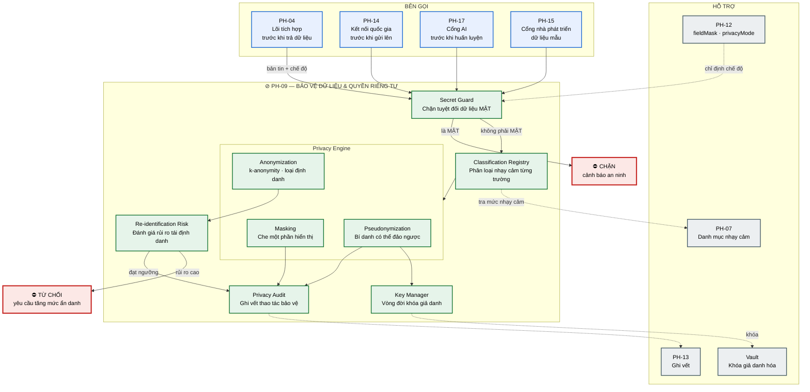
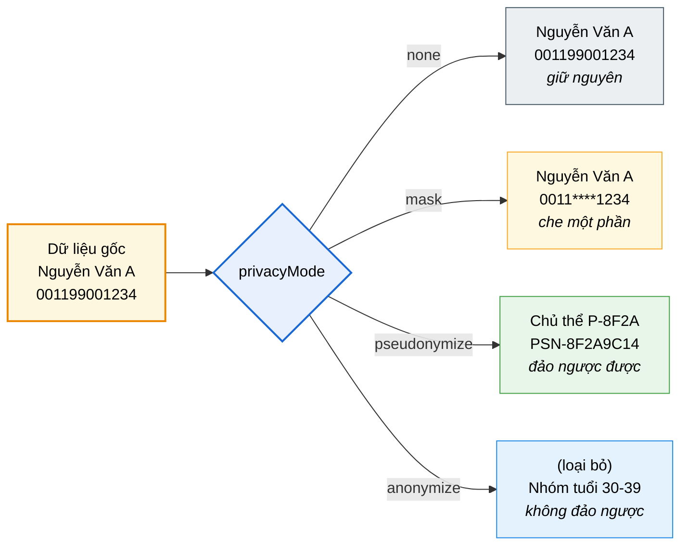
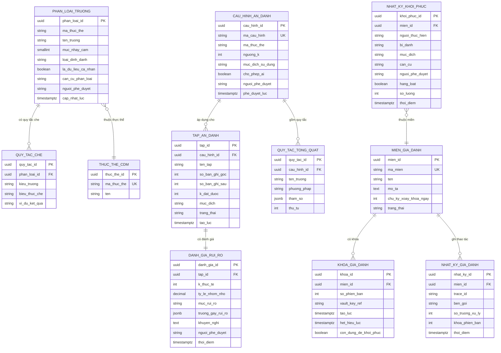

# SRS — PH-09: Bảo vệ dữ liệu & Quyền riêng tư

| Thuộc tính | Giá trị |
|---|---|
| **Mã phân hệ** | PH-09 |
| **Tên** | Bảo vệ dữ liệu & Quyền riêng tư (Data Privacy & Protection) |
| **Nhóm** | Dữ liệu |
| **Mức bắt buộc** | M — Bắt buộc |
| **Phiên bản** | 1.0 |
| **Ngày** | 03/8/2026 |
| **Công nghệ chủ đạo** | Quarkus + Vault (khóa giả danh hóa) + thư viện ẩn danh hóa |

---

## M1. Giới thiệu

### 1.1. Mục đích

PH-09 là **chốt kiểm soát cuối cùng** trước khi dữ liệu rời khỏi trục. Phân hệ này biến dữ liệu đầy đủ thành dạng phù hợp với người nhận và mục đích sử dụng — che một phần, thay bằng bí danh, hoặc loại bỏ hoàn toàn khả năng định danh.

Đây là phân hệ đáp ứng yêu cầu mới từ TTQGS về **ẩn danh hóa và giả danh hóa dữ liệu** (CMP-32), cùng các yêu cầu sẵn có về không chia sẻ dữ liệu mật (CMP-23) và mã hóa dữ liệu (CMP-24).

### 1.2. Ba kỹ thuật bảo vệ — phân biệt bản chất

Đây là điểm dễ nhầm lẫn nhất và cũng là lý do phân hệ này tồn tại độc lập:

| Kỹ thuật | Định nghĩa | Khôi phục được? | Trường hợp dùng |
|---|---|---|---|
| **Che (masking)** | Ẩn một phần giá trị khi hiển thị | Không cần — bản gốc vẫn ở nguồn | Hiển thị cho người dùng ít quyền |
| **Giả danh hóa (pseudonymization)** | Thay định danh bằng bí danh, **giữ ánh xạ ngược** | **Có**, nếu có khóa | Phân tích dữ liệu, chuyển cho bên thứ ba có kiểm soát |
| **Ẩn danh hóa (anonymization)** | Loại bỏ hoàn toàn khả năng định danh | **Không bao giờ** | Dữ liệu mở, thống kê, huấn luyện AI |

**Hệ quả pháp lý quan trọng.** Dữ liệu **giả danh hóa vẫn là dữ liệu cá nhân** — vì có thể khôi phục nên vẫn chịu ràng buộc bảo vệ dữ liệu cá nhân. Dữ liệu **ẩn danh hóa đúng cách không còn là dữ liệu cá nhân** — được chia sẻ tự do hơn. Nhầm lẫn hai khái niệm này dẫn tới vi phạm pháp luật hoặc hạn chế sử dụng không cần thiết.

### 1.3. Phạm vi

**PH-09 chịu trách nhiệm:**

| # | Trách nhiệm |
|---|---|
| 1 | Áp dụng che dữ liệu theo mặt nạ trường nhận từ PH-12 |
| 2 | Giả danh hóa có thể đảo ngược, quản lý khóa qua Vault |
| 3 | Ẩn danh hóa đạt ngưỡng k-anonymity cho dữ liệu thống kê |
| 4 | Quản lý phân loại mức độ nhạy cảm của trường dữ liệu |
| 5 | Chặn tuyệt đối dữ liệu thuộc bí mật nhà nước |
| 6 | Đánh giá rủi ro tái định danh trước khi phát hành dữ liệu ẩn danh |
| 7 | Quản lý vòng đời khóa giả danh hóa |
| 8 | Ghi vết mọi thao tác bảo vệ dữ liệu |
| 9 | Cung cấp báo cáo tuân thủ bảo vệ dữ liệu cá nhân |

**PH-09 KHÔNG chịu trách nhiệm:**

| # | Không làm | Thuộc phân hệ |
|---|---|---|
| 1 | **Quyết định** ai được xem gì — chỉ *thực thi* chế độ được chỉ định | PH-12 |
| 2 | Mã hóa đường truyền (TLS) và mã hóa lưu trữ ở tầng hạ tầng | Istio, hạ tầng |
| 3 | Quản lý danh tính người dùng | PH-12 |
| 4 | Lưu trữ dữ liệu chủ | PH-06 |
| 5 | Ghi vết truy cập tổng thể | PH-13 |

**Ranh giới số 1 — phân vai với PH-12.** PH-12 trả về `fieldMask` và `privacyMode` trong quyết định ủy quyền ([FR-12-013](SRS-PH-12-iam.md#m3-yêu-cầu-chức-năng)). PH-09 **thực thi** các chỉ định đó. Tách hai vai trò cho phép thay đổi chính sách (PH-12) mà không đụng tới thuật toán xử lý (PH-09), và ngược lại.

### 1.4. Tài liệu tham chiếu

| Mã | Tài liệu |
|---|---|
| [KT] | [Kiến trúc an toàn thông tin](../02-architecture/README.md#8-kiến-trúc-an-toàn-thông-tin), [Kiến trúc dữ liệu](../02-architecture/README.md#6-kiến-trúc-dữ-liệu) |
| [LT] | [F-03](../03-flows/README.md#f-03--khai-thác-dữ-liệu-đồng-bộ-nội-bộ), [F-04](../03-flows/README.md#f-04--khai-thác-dữ-liệu-từ-csdl-quốc-gia-qua-ndxp) |
| [PL] | [Ma trận CMP](../01-legal/README.md) — NĐ 47/2020, NĐ 165/2025, Luật Dữ liệu 2024 |
| [TT] | [Tác động TTQGS mục 3.4 — M-03 Ẩn danh hóa](../06-impact/README.md) |
| [ADR] | [ADR-012 Vault](../05-adr/README.md#adr-012), [ADR-004 OPA](../05-adr/README.md#adr-004) |
| [SRS] | [PH-12 IAM](SRS-PH-12-iam.md), [PH-04 Lõi tích hợp](SRS-PH-04-integration-core.md) |

---

## M2. Mô tả tổng quan

### 2.1. Vị trí trong kiến trúc



**Thuyết minh sơ đồ.** Hai điểm chặn màu đỏ là đặc trưng của phân hệ này:

**Chặn thứ nhất — Secret Guard.** Kiểm tra dữ liệu thuộc bí mật nhà nước **trước** mọi xử lý khác. Đây là chốt độc lập với quyết định của PH-12: kể cả khi chính sách OPA cho phép, dữ liệu gắn nhãn `MAT` vẫn bị chặn. Hai lớp kiểm tra độc lập giảm rủi ro một lớp bị cấu hình sai (CMP-23).

**Chặn thứ hai — Đánh giá rủi ro tái định danh.** Ẩn danh hóa không đơn giản là xóa tên. Một tập dữ liệu "ẩn danh" chứa `xã + năm sinh + nghề nghiệp` có thể chỉ ứng một người duy nhất trong xã đó. Khối `RISK` đo rủi ro này và từ chối phát hành nếu chưa đạt ngưỡng an toàn.

### 2.2. Bốn chế độ xử lý



**Thuyết minh.** Bốn chế độ tạo thành thang giảm dần về mức độ chi tiết, tăng dần về mức bảo vệ. Chế độ áp dụng do PH-12 quyết định dựa trên vai trò bên gọi và **mục đích sử dụng khai báo** — cùng một API, cùng một dữ liệu, bốn kết quả khác nhau tùy ngữ cảnh.

### 2.3. Tác nhân

| Tác nhân | Loại | Tương tác |
|---|---|---|
| Cán bộ an toàn thông tin | Người | Cấu hình phân loại nhạy cảm, duyệt quy tắc bảo vệ |
| Cán bộ quản trị dữ liệu | Người | Khai báo trường nhạy cảm cho dữ liệu ngành mình |
| Cán bộ bảo vệ bí mật nhà nước | Người | Xác định và cập nhật danh mục dữ liệu mật |
| PH-04 Lõi tích hợp | Hệ thống | Gọi trước khi trả dữ liệu ra ngoài |
| PH-14 Kết nối quốc gia | Hệ thống | Gọi trước khi gửi lên cấp quốc gia |
| PH-17 Cổng AI | Hệ thống | Gọi trước khi đưa dữ liệu vào huấn luyện |
| PH-12 IAM | Hệ thống | Cung cấp `fieldMask` và `privacyMode` |

### 2.4. Giả định

| Mã | Giả định |
|---|---|
| GD-01 | Danh mục dữ liệu thuộc bí mật nhà nước đã được xác định và cập nhật |
| GD-02 | Mỗi trường trong CDM đã được phân loại mức độ nhạy cảm |
| GD-03 | Vault sẵn sàng để lưu và xoay vòng khóa giả danh hóa |
| GD-04 | Mục đích sử dụng được bên gọi khai báo trung thực (có ghi vết để hậu kiểm) |
| GD-05 | Ngưỡng k-anonymity được cán bộ ATTT phê duyệt theo từng loại dữ liệu |

### 2.5. Ràng buộc

| Mã | Ràng buộc | Nguồn |
|---|---|---|
| RB-01 | Hỗ trợ ẩn danh hóa **hoặc** giả danh hóa dữ liệu | TTQGS, CMP-32 |
| RB-02 | Không chia sẻ dữ liệu thuộc bí mật nhà nước qua trục | NĐ 47/2020, CMP-23 |
| RB-03 | Mã hóa dữ liệu theo quy định | NĐ 165/2025, CMP-24 |
| RB-04 | Bảo vệ dữ liệu cá nhân trong toàn bộ vòng đời | Luật Dữ liệu 2024 |
| RB-05 | Khóa giả danh hóa không được rời khỏi ranh giới bảo mật | Nguyên tắc bảo mật |
| RB-06 | Dữ liệu đưa vào huấn luyện AI bắt buộc qua xử lý bảo vệ | TTQGS, CMP-38 |
| RB-07 | Toàn bộ công nghệ mã nguồn mở | Yêu cầu dự án |

### 2.6. Phụ thuộc phân hệ

| Phụ thuộc | Loại | Hành vi khi không khả dụng |
|---|---|---|
| Vault | **Cứng** cho giả danh hóa | Không giả danh hóa được → **từ chối** yêu cầu, không trả dữ liệu thô |
| PH-12 | **Cứng** | Không có `privacyMode` → áp dụng mức bảo vệ **cao nhất** (fail-safe) |
| PH-07 | **Mềm** | Dùng bảng phân loại đã đệm |
| PH-13 | **Cứng** với dữ liệu nhạy cảm | Không ghi được vết → từ chối xử lý (CMP-28) |

**Ghi chú về hành vi fail-safe.** Khác với PH-12 (fail-closed = từ chối), PH-09 khi thiếu thông tin chế độ sẽ áp dụng **mức bảo vệ cao nhất** thay vì từ chối hoàn toàn — vẫn trả được dữ liệu nhưng ở dạng an toàn nhất. Đây là lựa chọn cân bằng giữa an toàn và khả dụng.

---

## M3. Yêu cầu chức năng

### 3.1. Nhóm A — Phân loại và chặn dữ liệu mật

#### FR-09-001 — Quản lý phân loại mức độ nhạy cảm · **M**

| Mục | Nội dung |
|---|---|
| **Mô tả** | Khai báo mức độ nhạy cảm cho từng trường dữ liệu |
| **Tác nhân** | Cán bộ an toàn thông tin, Cán bộ quản trị dữ liệu |
| **Đầu vào** | Thực thể CDM · tên trường · mức nhạy cảm · loại dữ liệu cá nhân · căn cứ phân loại |
| **Xử lý** | 1. Gán mức nhạy cảm theo thang bốn cấp<br>2. Đánh dấu trường thuộc loại **định danh trực tiếp** hoặc **bán định danh**<br>3. Ghi căn cứ phân loại (văn bản, quy định)<br>4. Yêu cầu phê duyệt của cán bộ ATTT khi nâng/hạ mức<br>5. Cập nhật vào registry, làm mới đệm |
| **Đầu ra** | Bảng phân loại cập nhật |
| **Ngoại lệ** | E1: Hạ mức nhạy cảm → **bắt buộc** phê duyệt và ghi lý do<br>E2: Trường chưa phân loại → mặc định mức cao nhất, cảnh báo cấu hình thiếu |

**Thang phân loại:**

| Mức | Ký hiệu | Ý nghĩa | Xử lý mặc định |
|---|---|---|---|
| 0 | `CONG_KHAI` | Dữ liệu công khai | Không xử lý |
| 1 | `NOI_BO` | Chỉ trong CQNN | Che nếu bên gọi ít quyền |
| 2 | `NHAY_CAM` | Dữ liệu cá nhân nhạy cảm (sức khỏe, sinh trắc, tôn giáo…) | Bắt buộc xử lý bảo vệ |
| 3 | `MAT` | Thuộc bí mật nhà nước | **Chặn tuyệt đối** |

**Phân loại theo khả năng định danh:**

| Loại | Ví dụ | Rủi ro |
|---|---|---|
| **Định danh trực tiếp** | Số định danh cá nhân, họ tên đầy đủ, số điện thoại | Nhận ra ngay lập tức |
| **Bán định danh** (quasi-identifier) | Ngày sinh, mã xã, nghề nghiệp, giới tính | Tổ hợp nhiều trường có thể định danh |
| **Nhạy cảm** | Tình trạng sức khỏe, tiền án, thu nhập | Gây hại nếu lộ |
| **Không định danh** | Mã hồ sơ ngẫu nhiên, trạng thái xử lý | Không rủi ro |

**Ghi chú về "bán định danh".** Đây là khái niệm then chốt cho ẩn danh hóa: từng trường riêng lẻ vô hại, nhưng tổ hợp `ngày sinh + mã xã + giới tính` có thể xác định duy nhất một người. Ẩn danh hóa phải xử lý các trường này, không chỉ xóa tên.

#### FR-09-002 — Chặn dữ liệu bí mật nhà nước · **M**

| Mục | Nội dung |
|---|---|
| **Mô tả** | Ngăn tuyệt đối dữ liệu mật đi qua trục |
| **Tác nhân** | PH-04, PH-14, PH-17 |
| **Tiền điều kiện** | — (kiểm tra đầu tiên, trước mọi xử lý khác) |
| **Đầu vào** | Bản tin · thực thể · thông tin phân loại |
| **Xử lý** | 1. Quét mọi trường trong bản tin, đối chiếu registry phân loại<br>2. Nếu **bất kỳ** trường nào mức `MAT` → chặn toàn bộ bản tin<br>3. Ghi cảnh báo an ninh mức nghiêm trọng<br>4. Không trả bất kỳ phần nào của bản tin, kể cả phần không mật<br>5. Trả mã lỗi không tiết lộ nội dung dữ liệu |
| **Đầu ra** | Cho qua hoặc chặn |
| **Ngoại lệ** | E1: Có trường `MAT` → `403`, cảnh báo an ninh, ghi vết đầy đủ<br>E2: Không xác định được phân loại → coi như `MAT`, chặn, cảnh báo cấu hình<br>E3: Registry không khả dụng → dùng bản đệm; nếu không có → chặn (fail-safe) |

**Ghi chú về bước 4 — quyết định thiết kế.** Chặn toàn bộ bản tin thay vì lọc bỏ trường mật. Lý do: chính sự tồn tại của trường mật trong bản tin đã là dấu hiệu cấu hình sai — cần điều tra, không nên xử lý tự động rồi cho qua.

### 3.2. Nhóm B — Che dữ liệu

#### FR-09-003 — Che dữ liệu theo mặt nạ trường · **M**

| Mục | Nội dung |
|---|---|
| **Mô tả** | Áp dụng `fieldMask` nhận từ PH-12 |
| **Đầu vào** | Bản tin · `fieldMask` (bản đồ trường → chế độ) |
| **Xử lý** | 1. Với mỗi trường trong `fieldMask`:<br>&nbsp;&nbsp;· `full` → giữ nguyên<br>&nbsp;&nbsp;· `masked` → áp dụng quy tắc che theo kiểu trường<br>&nbsp;&nbsp;· `hidden` → **loại bỏ hoàn toàn** khỏi bản tin<br>2. Trường không có trong `fieldMask` → áp dụng mặc định theo mức nhạy cảm<br>3. Ghi vết trường nào bị che, chế độ nào |
| **Đầu ra** | Bản tin đã che |
| **Ngoại lệ** | E1: `fieldMask` rỗng và có trường nhạy cảm → áp dụng che mặc định, ghi cảnh báo<br>E2: Trường `hidden` là trường bắt buộc của lược đồ → loại bỏ và đánh dấu bản tin không đầy đủ |

**Quy tắc che theo kiểu trường:**

| Kiểu trường | Quy tắc che | Ví dụ |
|---|---|---|
| Số định danh cá nhân | Giữ 4 số đầu và 4 số cuối | `0011****1234` |
| Họ tên | Giữ họ, che tên | `Nguyễn V** A` |
| Số điện thoại | Giữ 3 số đầu và 2 số cuối | `091*****78` |
| Thư điện tử | Giữ 2 ký tự đầu và tên miền | `ng***@moha.gov.vn` |
| Ngày sinh | Chỉ giữ năm | `1990` |
| Địa chỉ | Chỉ giữ cấp tỉnh/huyện | `Quận Ba Đình, Hà Nội` |
| Số tài khoản | Giữ 4 số cuối | `****5678` |

**Ghi chú về `hidden` vs `masked`.** `masked` vẫn cho biết trường tồn tại và một phần giá trị — hữu ích khi cần đối chiếu. `hidden` loại bỏ hoàn toàn, bên nhận không biết trường tồn tại. Chọn sai giữa hai chế độ có thể vô tình tiết lộ thông tin (ví dụ: biết một người *có* trường "tiền án" đã là thông tin nhạy cảm).

### 3.3. Nhóm C — Giả danh hóa

#### FR-09-004 — Giả danh hóa có thể đảo ngược · **M**

| Mục | Nội dung |
|---|---|
| **Mô tả** | Thay định danh bằng bí danh, giữ khả năng khôi phục có kiểm soát |
| **Tiền điều kiện** | Vault khả dụng; khóa giả danh hóa đã tạo cho miền dữ liệu |
| **Đầu vào** | Bản tin · danh sách trường cần giả danh · miền dữ liệu (`domain`) |
| **Xử lý** | 1. Với mỗi trường: lấy khóa giả danh của miền từ Vault<br>2. Tính bí danh = hàm mã hóa xác định (deterministic) với khóa và giá trị gốc<br>3. **Bảo toàn tính nhất quán**: cùng giá trị gốc trong cùng miền luôn cho cùng bí danh<br>4. Bí danh giữ định dạng nhận biết được (`PSN-` + chuỗi)<br>5. Không lưu bảng ánh xạ — khôi phục bằng khóa, không bằng tra bảng<br>6. Ghi vết thao tác giả danh hóa |
| **Đầu ra** | Bản tin đã giả danh hóa |
| **Ngoại lệ** | E1: Vault không khả dụng → **từ chối**, không trả dữ liệu thô (RB-05)<br>E2: Miền dữ liệu chưa có khóa → tạo khóa mới, ghi cảnh báo cấu hình<br>E3: Giá trị rỗng → giữ rỗng, không sinh bí danh giả |

**Ghi chú về bước 3 — tính nhất quán.** Đây là đặc tính quan trọng nhất: nếu cùng một công dân xuất hiện trong hai tập dữ liệu giả danh hóa cùng miền, họ phải có cùng bí danh. Nhờ vậy bên phân tích liên kết được dữ liệu mà không biết danh tính thật.

**Ghi chú về bước 5 — không lưu bảng ánh xạ.** Lưu bảng ánh xạ bí danh ↔ giá trị gốc tạo ra một điểm rò rỉ tập trung. Dùng mã hóa xác định với khóa trong Vault: ai có khóa mới khôi phục được, và việc dùng khóa đều bị ghi vết.

#### FR-09-005 — Khôi phục giá trị gốc · **M**

| Mục | Nội dung |
|---|---|
| **Mô tả** | Khôi phục giá trị thật từ bí danh — thao tác đặc quyền |
| **Tác nhân** | Cán bộ có quyền `privacy.deanonymize` |
| **Tiền điều kiện** | Có phê duyệt cho mục đích khôi phục |
| **Đầu vào** | Bí danh · miền dữ liệu · mục đích khôi phục · căn cứ |
| **Xử lý** | 1. Kiểm tra quyền qua PH-12<br>2. Yêu cầu xác thực lại (MFA) — thao tác nhạy cảm<br>3. Lấy khóa từ Vault<br>4. Giải mã bí danh về giá trị gốc<br>5. Ghi vết **đặc biệt**: ai khôi phục, bí danh nào, mục đích, căn cứ<br>6. Thông báo cho cán bộ ATTT |
| **Đầu ra** | Giá trị gốc |
| **Ngoại lệ** | E1: Không có quyền → `403`, ghi cảnh báo an ninh<br>E2: Không xác thực lại được → `401`<br>E3: Khôi phục hàng loạt (> 10 bí danh) → yêu cầu phê duyệt riêng<br>E4: Không ghi được vết → **từ chối** khôi phục |

**Ghi chú.** Khôi phục là thao tác vô hiệu hóa toàn bộ mục đích bảo vệ, nên phải: có quyền riêng, xác thực lại, ghi vết đặc biệt, và thông báo cho ATTT. Bốn lớp kiểm soát này khiến việc lạm dụng khó che giấu.

#### FR-09-006 — Quản lý vòng đời khóa giả danh hóa · **M**

| Mục | Nội dung |
|---|---|
| **Mô tả** | Tạo, xoay vòng và thu hồi khóa giả danh hóa |
| **Xử lý** | 1. Mỗi miền dữ liệu có khóa riêng, lưu trong Vault<br>2. Xoay vòng khóa định kỳ (mặc định 365 ngày)<br>3. **Giữ khóa cũ** để khôi phục dữ liệu đã giả danh trước đó<br>4. Bí danh mới sinh bằng khóa mới, mang nhãn phiên bản khóa<br>5. Thu hồi khóa khi miền dữ liệu ngừng sử dụng |
| **Đầu ra** | Khóa được quản lý theo vòng đời |
| **Ngoại lệ** | E1: Xoay khóa làm mất tính nhất quán bí danh → cảnh báo rõ trước khi thực hiện, yêu cầu xác nhận<br>E2: Xóa khóa cũ → **chặn** nếu còn dữ liệu giả danh bằng khóa đó |

**Ghi chú về E1 — đánh đổi thực tế.** Xoay khóa tăng an toàn nhưng phá vỡ tính nhất quán: cùng một công dân sẽ có bí danh khác trước và sau khi xoay. Vì vậy chu kỳ xoay dài (1 năm) và phải cảnh báo rõ tác động.

### 3.4. Nhóm D — Ẩn danh hóa

#### FR-09-007 — Ẩn danh hóa dữ liệu · **M**

| Mục | Nội dung |
|---|---|
| **Mô tả** | Loại bỏ hoàn toàn khả năng định danh, không thể khôi phục |
| **Đầu vào** | Tập dữ liệu · cấu hình ẩn danh · ngưỡng k |
| **Xử lý** | 1. **Loại bỏ** toàn bộ trường định danh trực tiếp<br>2. **Tổng quát hóa** các trường bán định danh:<br>&nbsp;&nbsp;· Ngày sinh → nhóm tuổi (30–39)<br>&nbsp;&nbsp;· Địa chỉ xã → cấp huyện hoặc tỉnh<br>&nbsp;&nbsp;· Nghề nghiệp chi tiết → nhóm ngành<br>3. **Chặn** giá trị hiếm gặp (suppression): nhóm có ít hơn k bản ghi bị loại<br>4. Kiểm tra đạt ngưỡng **k-anonymity**: mỗi tổ hợp bán định danh xuất hiện ≥ k lần<br>5. Đánh giá rủi ro tái định danh (FR-09-008)<br>6. Ghi cấu hình ẩn danh đã áp dụng |
| **Đầu ra** | Tập dữ liệu ẩn danh kèm báo cáo mức bảo vệ |
| **Ngoại lệ** | E1: Không đạt ngưỡng k → tăng mức tổng quát hóa và thử lại; sau 3 lần vẫn không đạt → **từ chối** phát hành<br>E2: Sau khi chặn, số bản ghi còn lại quá ít (< 30% ban đầu) → cảnh báo dữ liệu không còn giá trị thống kê<br>E3: Tập dữ liệu quá nhỏ để đạt k → từ chối, đề nghị gộp thêm dữ liệu |

**Ghi chú về k-anonymity.** Ngưỡng `k` nghĩa là: với mọi tổ hợp giá trị bán định danh, phải có ít nhất `k` bản ghi giống hệt nhau. Nếu `k=5`, không thể thu hẹp một bản ghi xuống dưới nhóm 5 người. Ngưỡng thông dụng: `k=5` cho dữ liệu nội bộ, `k=10` trở lên cho dữ liệu mở.

#### FR-09-008 — Đánh giá rủi ro tái định danh · **M**

| Mục | Nội dung |
|---|---|
| **Mô tả** | Đo khả năng khôi phục danh tính từ dữ liệu đã ẩn danh |
| **Đầu vào** | Tập dữ liệu ẩn danh · cấu hình đã áp dụng |
| **Xử lý** | 1. Tính giá trị k thực tế đạt được (kích thước nhóm nhỏ nhất)<br>2. Tính tỷ lệ bản ghi thuộc nhóm nhỏ (rủi ro cao)<br>3. Đánh giá rủi ro liên kết với dữ liệu công khai bên ngoài<br>4. Phân loại rủi ro: **thấp** · **trung bình** · **cao**<br>5. Sinh báo cáo kèm khuyến nghị |
| **Đầu ra** | Báo cáo đánh giá rủi ro |
| **Ngoại lệ** | E1: Rủi ro **cao** → **chặn** phát hành, nêu rõ trường nào gây rủi ro<br>E2: Rủi ro **trung bình** → cho phép nhưng yêu cầu phê duyệt của cán bộ ATTT |

**Ghi chú về bước 3.** Đây là rủi ro dễ bị bỏ sót: dữ liệu ẩn danh của LGSP có thể ghép với dữ liệu công khai khác (danh bạ, mạng xã hội, công bố của cơ quan khác) để tái định danh. Đánh giá phải tính đến khả năng này, không chỉ xét tập dữ liệu độc lập.

#### FR-09-009 — Ẩn danh hóa dữ liệu huấn luyện AI · **M**

| Mục | Nội dung |
|---|---|
| **Mô tả** | Xử lý bắt buộc trước khi dữ liệu vào huấn luyện mô hình AI |
| **Tác nhân** | PH-17 |
| **Tiền điều kiện** | Yêu cầu đến từ luồng huấn luyện AI |
| **Xử lý** | 1. Áp dụng ẩn danh hóa với ngưỡng k cao hơn mức thông thường<br>2. Loại bỏ toàn bộ trường mức `NHAY_CAM` trừ khi có phê duyệt riêng<br>3. Ghi nhận cấu hình ẩn danh vào siêu dữ liệu tập huấn luyện<br>4. Truy vết được: mô hình nào huấn luyện từ tập dữ liệu nào, ẩn danh mức nào<br>5. Ghi vết đặc biệt cho mục đích AI |
| **Đầu ra** | Tập dữ liệu sẵn sàng huấn luyện + siêu dữ liệu truy vết |
| **Ngoại lệ** | E1: Không đạt ngưỡng k cho AI → từ chối, không cho huấn luyện<br>E2: Yêu cầu giữ trường nhạy cảm không có phê duyệt → từ chối |

**Ghi chú.** Yêu cầu này hiện thực CMP-38 (kiểm soát dữ liệu huấn luyện AI) từ TTQGS. Bước 4 quan trọng vì khi mô hình AI có vấn đề, cần truy được dữ liệu huấn luyện để điều tra.

### 3.5. Nhóm E — Ghi vết và báo cáo

#### FR-09-010 — Ghi vết thao tác bảo vệ dữ liệu · **M**

| Mục | Nội dung |
|---|---|
| **Mô tả** | Ghi lại mọi thao tác xử lý bảo vệ dữ liệu |
| **Xử lý** | Ghi: `traceId`, bên gọi, thực thể, chế độ áp dụng, danh sách trường bị xử lý, mục đích sử dụng, kết quả, thời điểm<br>Với thao tác khôi phục giá trị gốc: ghi vết **mở rộng** kèm căn cứ và người phê duyệt<br>Gửi tới PH-13 |
| **Đầu ra** | Bản ghi kiểm toán |
| **Ngoại lệ** | E1: Không ghi được vết với dữ liệu nhạy cảm → **từ chối** xử lý (CMP-28) |

#### FR-09-011 — Báo cáo tuân thủ bảo vệ dữ liệu · **S**

| Mục | Nội dung |
|---|---|
| **Mô tả** | Cung cấp bằng chứng tuân thủ cho kiểm định và thanh tra |
| **Xử lý** | Tổng hợp định kỳ: số lượt xử lý theo từng chế độ · tỷ lệ dữ liệu nhạy cảm được bảo vệ · số lần khôi phục giá trị gốc và lý do · trường chưa phân loại · rủi ro tái định danh của các tập đã phát hành |
| **Đầu ra** | Báo cáo tuân thủ |
| **Ngoại lệ** | — |

### 3.6. Bảng tổng hợp yêu cầu chức năng

| Nhóm | Mã | Tên | Ưu tiên |
|---|---|---|:-:|
| A | FR-09-001 | Quản lý phân loại mức độ nhạy cảm | M |
| A | FR-09-002 | Chặn dữ liệu bí mật nhà nước | M |
| B | FR-09-003 | Che dữ liệu theo mặt nạ trường | M |
| C | FR-09-004 | Giả danh hóa có thể đảo ngược | M |
| C | FR-09-005 | Khôi phục giá trị gốc | M |
| C | FR-09-006 | Quản lý vòng đời khóa giả danh hóa | M |
| D | FR-09-007 | Ẩn danh hóa dữ liệu | M |
| D | FR-09-008 | Đánh giá rủi ro tái định danh | M |
| D | FR-09-009 | Ẩn danh hóa dữ liệu huấn luyện AI | M |
| E | FR-09-010 | Ghi vết thao tác bảo vệ dữ liệu | M |
| E | FR-09-011 | Báo cáo tuân thủ bảo vệ dữ liệu | S |

**Tổng: 11 yêu cầu chức năng** — 10 bắt buộc (M), 1 cần có (S).

---

## M4. Mô hình dữ liệu

### 4.1. Sơ đồ thực thể



### 4.2. Đặc tả thực thể

#### EN-09-01 — PHAN_LOAI_TRUONG

| Trường | Kiểu | Bắt buộc | Ràng buộc | Mô tả |
|---|---|:-:|---|---|
| `phan_loai_id` | UUID | ✓ | PK | |
| `ma_thuc_the` | VARCHAR(80) | ✓ | | Thực thể CDM |
| `ten_truong` | VARCHAR(200) | ✓ | UNIQUE cùng thực thể | Đường dẫn trường |
| `muc_nhay_cam` | SMALLINT | ✓ | ∈ {0,1,2,3} | 0=công khai … 3=mật |
| `loai_dinh_danh` | VARCHAR(24) | ✓ | ∈ {`DIRECT`,`QUASI`,`SENSITIVE`,`NONE`} | Quyết định cách ẩn danh hóa |
| `la_du_lieu_ca_nhan` | BOOLEAN | ✓ | | Chịu ràng buộc bảo vệ dữ liệu cá nhân |
| `can_cu_phan_loai` | VARCHAR(300) | ✓ | | **Bắt buộc** — văn bản căn cứ |
| `nguoi_phe_duyet` | VARCHAR(100) | ✓ | | Cán bộ ATTT phê duyệt |

**Ràng buộc.** Trường chưa có bản ghi phân loại → mặc định `muc_nhay_cam = 3` (mật) khi xử lý — nguyên tắc an toàn (FR-09-002 E2).

#### EN-09-02 — MIEN_GIA_DANH và KHOA_GIA_DANH

| Trường (MIEN) | Kiểu | Bắt buộc | Mô tả |
|---|---|:-:|---|
| `ma_mien` | VARCHAR(60) | ✓ | UNIQUE — ví dụ `CONG_DAN_ANALYTICS` |
| `chu_ky_xoay_khoa_ngay` | INTEGER | ✓ | Mặc định 365 |
| `trang_thai` | VARCHAR(20) | ✓ | ∈ {`ACTIVE`,`RETIRED`} |

| Trường (KHOA) | Kiểu | Bắt buộc | Mô tả |
|---|---|:-:|---|
| `so_phien_ban` | INTEGER | ✓ | Tăng dần mỗi lần xoay |
| `vault_key_ref` | VARCHAR(200) | ✓ | **Tham chiếu** Vault — khóa không nằm trong CSDL này |
| `het_hieu_luc` | TIMESTAMPTZ | | Ngừng dùng để sinh bí danh mới |
| `con_dung_de_khoi_phuc` | BOOLEAN | ✓ | Khóa cũ vẫn cần để khôi phục dữ liệu cũ |

**Ràng buộc quan trọng (RB-05).** `vault_key_ref` chỉ là đường dẫn. Khóa thật không bao giờ rời Vault; thao tác mã hóa/giải mã thực hiện **bên trong** Vault.

#### EN-09-03 — CAU_HINH_AN_DANH

| Trường | Kiểu | Bắt buộc | Mô tả |
|---|---|:-:|---|
| `cau_hinh_id` | UUID | ✓ | PK |
| `ma_cau_hinh` | VARCHAR(60) | ✓ | UNIQUE |
| `ma_thuc_the` | VARCHAR(80) | ✓ | |
| `nguong_k` | INTEGER | ✓ | Ngưỡng k-anonymity; ≥ 5 |
| `muc_dich_su_dung` | VARCHAR(60) | ✓ | Thống kê, dữ liệu mở, huấn luyện AI… |
| `cho_phep_ai` | BOOLEAN | ✓ | Có được dùng cho huấn luyện AI không |
| `nguoi_phe_duyet` | VARCHAR(100) | ✓ | **Bắt buộc** — cán bộ ATTT |

#### EN-09-04 — QUY_TAC_TONG_QUAT

| Trường | Kiểu | Bắt buộc | Mô tả |
|---|---|:-:|---|
| `quy_tac_id` | UUID | ✓ | PK |
| `cau_hinh_id` | UUID | ✓ | FK |
| `ten_truong` | VARCHAR(200) | ✓ | |
| `phuong_phap` | VARCHAR(30) | ✓ | ∈ {`REMOVE`,`GENERALIZE`,`BUCKET`,`ROUND`,`SUPPRESS`,`SHIFT`} |
| `tham_so` | JSONB | ✓ | Ví dụ: `{"buckets": 10}` cho nhóm tuổi |
| `thu_tu` | SMALLINT | ✓ | Thứ tự áp dụng |

#### EN-09-05 — DANH_GIA_RUI_RO

| Trường | Kiểu | Bắt buộc | Mô tả |
|---|---|:-:|---|
| `danh_gia_id` | UUID | ✓ | PK |
| `tap_id` | UUID | ✓ | FK |
| `k_thuc_te` | INTEGER | ✓ | Kích thước nhóm nhỏ nhất đạt được |
| `ty_le_nhom_nho` | DECIMAL(5,4) | ✓ | Tỷ lệ bản ghi thuộc nhóm rủi ro cao |
| `muc_rui_ro` | VARCHAR(16) | ✓ | ∈ {`THAP`,`TRUNG_BINH`,`CAO`} |
| `truong_gay_rui_ro` | JSONB | | Trường nào đóng góp rủi ro nhiều nhất |
| `khuyen_nghi` | TEXT | ✓ | Hướng dẫn giảm rủi ro |
| `nguoi_phe_duyet` | VARCHAR(100) | | Bắt buộc khi `muc_rui_ro = TRUNG_BINH` |

#### EN-09-06 — NHAT_KY_KHOI_PHUC

| Trường | Kiểu | Bắt buộc | Mô tả |
|---|---|:-:|---|
| `khoi_phuc_id` | UUID | ✓ | PK |
| `mien_id` | UUID | ✓ | FK |
| `nguoi_thuc_hien` | VARCHAR(100) | ✓ | |
| `bi_danh` | VARCHAR(120) | ✓ | Bí danh được khôi phục |
| `muc_dich` | VARCHAR(300) | ✓ | **Bắt buộc** |
| `can_cu` | VARCHAR(300) | ✓ | **Bắt buộc** — văn bản hoặc yêu cầu |
| `nguoi_phe_duyet` | VARCHAR(100) | | Bắt buộc khi `hang_loat = true` |
| `hang_loat` | BOOLEAN | ✓ | > 10 bí danh |
| `so_luong` | INTEGER | ✓ | |

**Ghi chú.** Bảng này là bằng chứng quan trọng nhất khi thanh tra: cho thấy ai đã khôi phục danh tính, khi nào và vì sao. Lưu **vĩnh viễn**.

### 4.3. Chính sách lưu giữ

| Thực thể | Thời hạn | Ghi chú |
|---|---|---|
| PHAN_LOAI_TRUONG, QUY_TAC_CHE | Vĩnh viễn | Giữ lịch sử phân loại |
| MIEN_GIA_DANH, KHOA_GIA_DANH | Vĩnh viễn | Khóa cũ cần để khôi phục dữ liệu cũ |
| CAU_HINH_AN_DANH, QUY_TAC_TONG_QUAT | Vĩnh viễn | Truy vết cách một tập được ẩn danh |
| TAP_AN_DANH, DANH_GIA_RUI_RO | Vĩnh viễn | Bằng chứng tuân thủ |
| NHAT_KY_GIA_DANH | 5 năm | |
| **NHAT_KY_KHOI_PHUC** | **Vĩnh viễn** | Bằng chứng thanh tra, không được xóa |

---

## M5. Giao diện API

### 5.1. Nguyên tắc chung

| Khía cạnh | Quy định |
|---|---|
| Đường dẫn xử lý | `/api/v1/privacy` |
| Đường dẫn quản trị | `/api/admin/v1/privacy` |
| Xác thực | Bearer JWT; khôi phục cần phạm vi `privacy.deanonymize` + MFA |
| Giao thức nội bộ | Gọi từ PH-04 qua mạng nội cụm có mTLS |
| Mã lỗi | RFC 9457 Problem Details |

### 5.2. Điểm cuối xử lý

| Phương thức | Đường dẫn | Chức năng | FR |
|---|---|---|---|
| `POST` | `/api/v1/privacy/apply` | Áp dụng bảo vệ cho một bản tin | FR-09-003, 004 |
| `POST` | `/api/v1/privacy/check-classification` | Kiểm tra phân loại bản tin (có dữ liệu mật không) | FR-09-002 |
| `POST` | `/api/v1/privacy/pseudonymize` | Giả danh hóa danh sách giá trị | FR-09-004 |
| `POST` | `/api/v1/privacy/deanonymize` | Khôi phục giá trị gốc (đặc quyền) | FR-09-005 |
| `POST` | `/api/v1/privacy/anonymize` | Ẩn danh hóa tập dữ liệu | FR-09-007 |
| `POST` | `/api/v1/privacy/risk-assess` | Đánh giá rủi ro tái định danh | FR-09-008 |
| `POST` | `/api/v1/privacy/prepare-training` | Chuẩn bị dữ liệu huấn luyện AI | FR-09-009 |

### 5.3. Điểm cuối quản trị

| Phương thức | Đường dẫn | Chức năng | FR |
|---|---|---|---|
| `GET` | `/api/admin/v1/privacy/classifications` | Bảng phân loại trường | FR-09-001 |
| `PUT` | `/api/admin/v1/privacy/classifications/{entity}/{field}` | Cập nhật phân loại | FR-09-001 |
| `GET` | `/api/admin/v1/privacy/unclassified` | Trường chưa phân loại | FR-09-001 |
| `GET` | `/api/admin/v1/privacy/domains` | Danh sách miền giả danh | FR-09-006 |
| `POST` | `/api/admin/v1/privacy/domains/{id}/rotate-key` | Xoay khóa | FR-09-006 |
| `GET` | `/api/admin/v1/privacy/anon-configs` | Cấu hình ẩn danh | FR-09-007 |
| `POST` | `/api/admin/v1/privacy/anon-configs` | Tạo cấu hình ẩn danh | FR-09-007 |
| `GET` | `/api/admin/v1/privacy/datasets` | Tập dữ liệu đã ẩn danh | FR-09-008 |
| `GET` | `/api/admin/v1/privacy/deanonymize-log` | Nhật ký khôi phục | FR-09-005 |
| `GET` | `/api/admin/v1/privacy/compliance-report` | Báo cáo tuân thủ | FR-09-011 |

### 5.4. Đặc tả chi tiết điểm cuối chính

#### 5.4.1. `POST /api/v1/privacy/apply` — Áp dụng bảo vệ

Điểm cuối được gọi nhiều nhất, do PH-04 gọi trước khi trả dữ liệu.

**Yêu cầu:**

```json
{
  "traceId": "4bf92f3577b34da6a3ce929d0e0e4736",
  "thucThe": "CONG_DAN",
  "privacyMode": "mask",
  "fieldMask": {
    "soDinhDanh": "masked",
    "hoTen": "full",
    "ngaySinh": "masked",
    "noiThuongTru": "full",
    "thongTinSucKhoe": "hidden"
  },
  "mucDichSuDung": "XAC_MINH_DANH_TINH",
  "benGoi": "HT-XACMINH",
  "banTin": {
    "soDinhDanh": "001199001234",
    "hoTen": "Nguyễn Văn A",
    "ngaySinh": "1990-01-15",
    "noiThuongTru": { "maDonViHanhChinh": "01001", "tenDayDu": "Phường Phúc Xá, Ba Đình, Hà Nội" },
    "thongTinSucKhoe": { "nhomMau": "O", "benhNen": ["Tăng huyết áp"] }
  }
}
```

**Phản hồi `200 OK`:**

```json
{
  "banTinDaXuLy": {
    "soDinhDanh": "0011****1234",
    "hoTen": "Nguyễn Văn A",
    "ngaySinh": "1990",
    "noiThuongTru": { "maDonViHanhChinh": "01001", "tenDayDu": "Phường Phúc Xá, Ba Đình, Hà Nội" }
  },
  "daXuLy": {
    "che": ["soDinhDanh", "ngaySinh"],
    "loaiBo": ["thongTinSucKhoe"],
    "giuNguyen": ["hoTen", "noiThuongTru"]
  },
  "canhBao": [],
  "thoiGianXuLyMs": 4
}
```

**Ghi chú.** Trường `thongTinSucKhoe` bị **loại bỏ hoàn toàn** khỏi phản hồi (không phải để rỗng) — bên nhận không biết trường này tồn tại.

**Phản hồi khi phát hiện dữ liệu mật `403`:**

```json
{
  "type": "https://lgsp.local/errors/classified-data-blocked",
  "title": "Bản tin chứa dữ liệu thuộc bí mật nhà nước",
  "status": 403,
  "detail": "Bản tin bị chặn hoàn toàn theo quy định về bảo vệ bí mật nhà nước",
  "traceId": "4bf92f3577b34da6a3ce929d0e0e4736",
  "canhBaoAnNinh": true
}
```

**Ghi chú.** Phản hồi **không** nêu trường nào là mật — chính thông tin đó cũng nhạy cảm. Chi tiết chỉ có trong nhật ký an ninh.

#### 5.4.2. `POST /api/v1/privacy/anonymize` — Ẩn danh hóa

**Yêu cầu:**

```json
{
  "maCauHinh": "CONG_DAN_THONG_KE_K5",
  "mucDich": "BAO_CAO_THONG_KE",
  "duLieu": [
    { "soDinhDanh": "001199001234", "hoTen": "Nguyễn Văn A", "ngaySinh": "1990-01-15",
      "maXa": "01001", "ngheNghiep": "Kỹ sư phần mềm", "thuNhap": 25000000 }
  ]
}
```

**Phản hồi `200 OK`:**

```json
{
  "tapId": "a1b2c3d4-...",
  "duLieuAnDanh": [
    { "nhomTuoi": "30-39", "maHuyen": "001", "nhomNganhNghe": "CNTT", "nhomThuNhap": "20-30tr" }
  ],
  "thongKe": { "soBanGhiGoc": 15420, "soBanGhiSau": 14890, "soBanGhiBiChan": 530 },
  "danhGiaRuiRo": {
    "kThucTe": 7,
    "kYeuCau": 5,
    "tyLeNhomNho": 0.0,
    "mucRuiRo": "THAP",
    "ketLuan": "Đạt ngưỡng k-anonymity, cho phép phát hành"
  },
  "quyTacDaApDung": [
    { "truong": "soDinhDanh", "phuongPhap": "REMOVE" },
    { "truong": "hoTen", "phuongPhap": "REMOVE" },
    { "truong": "ngaySinh", "phuongPhap": "BUCKET", "thamSo": { "khoang": 10, "donVi": "nam" } },
    { "truong": "maXa", "phuongPhap": "GENERALIZE", "thamSo": { "capDo": "HUYEN" } },
    { "truong": "thuNhap", "phuongPhap": "BUCKET", "thamSo": { "khoang": 10000000 } }
  ]
}
```

**Phản hồi khi rủi ro cao `422`:**

```json
{
  "type": "https://lgsp.local/errors/reidentification-risk-high",
  "title": "Rủi ro tái định danh cao",
  "status": 422,
  "detail": "Tập dữ liệu không đạt ngưỡng k-anonymity sau 3 lần tăng mức tổng quát hóa",
  "danhGiaRuiRo": {
    "kThucTe": 2, "kYeuCau": 5, "mucRuiRo": "CAO",
    "truongGayRuiRo": [
      { "truong": "ngheNghiep", "soGiaTriDuyNhat": 847, "dongGopRuiRo": 0.62 },
      { "truong": "maXa", "soGiaTriDuyNhat": 189, "dongGopRuiRo": 0.28 }
    ]
  },
  "khuyenNghi": "Tổng quát hóa nghề nghiệp lên nhóm ngành cấp 1, hoặc gộp thêm dữ liệu để tăng kích thước tập"
}
```

**Ghi chú.** Phản hồi lỗi nêu rõ **trường nào gây rủi ro** và **khuyến nghị cụ thể** — không chỉ báo "không đạt". Cán bộ biết ngay phải làm gì.

---

## M6. Giao diện người dùng

### 6.1. Danh mục màn hình

| Mã | Tên màn hình | Đối tượng | Mockup |
|---|---|---|---|
| **UI-09-01** | Phân loại mức độ nhạy cảm | Cán bộ ATTT, Quản trị dữ liệu | [`privacy.html`](../../mockup/pages/privacy.html) |
| **UI-09-02** | Cấu hình ẩn danh hóa | Cán bộ ATTT | [`privacy.html`](../../mockup/pages/privacy.html) (tab Ẩn danh) |
| **UI-09-03** | Đánh giá rủi ro tái định danh | Cán bộ ATTT | [`privacy.html`](../../mockup/pages/privacy.html) (tab Rủi ro) |
| **UI-09-04** | Quản lý miền và khóa giả danh | Cán bộ ATTT | [`privacy.html`](../../mockup/pages/privacy.html) (tab Khóa) |
| **UI-09-05** | Nhật ký khôi phục danh tính | Cán bộ ATTT, Thanh tra | [`privacy.html`](../../mockup/pages/privacy.html) (tab Nhật ký) |
| **UI-09-06** | Báo cáo tuân thủ bảo vệ dữ liệu | Cán bộ ATTT, Lãnh đạo | [`privacy.html`](../../mockup/pages/privacy.html) (tab Báo cáo) |

### 6.2. UI-09-01 — Phân loại mức độ nhạy cảm

| Thành phần | Mô tả |
|---|---|
| Cây thực thể CDM | Chọn thực thể để xem danh sách trường |
| Bảng phân loại | Trường · Mức nhạy cảm · Loại định danh · Là dữ liệu cá nhân · Căn cứ · Người duyệt |
| Nhãn màu theo mức | Công khai (xám) · Nội bộ (xanh) · Nhạy cảm (vàng) · Mật (đỏ) |
| Cảnh báo chưa phân loại | Danh sách trường chưa có phân loại, hiển thị nổi bật |
| Biểu mẫu sửa | Chọn mức, loại định danh, nhập căn cứ |
| Xem trước quy tắc che | Hiển thị ví dụ giá trị sau khi che |

**Quy tắc tương tác:**

| # | Quy tắc |
|---|---|
| 1 | Trường chưa phân loại → nhãn đỏ, cảnh báo "đang áp dụng mức bảo vệ cao nhất" |
| 2 | **Hạ** mức nhạy cảm yêu cầu nhập lý do và xác thực lại MFA |
| 3 | Đặt mức `MAT` → cảnh báo rõ: trường này sẽ khiến toàn bộ bản tin bị chặn |
| 4 | Căn cứ phân loại là trường bắt buộc |

### 6.3. UI-09-03 — Đánh giá rủi ro tái định danh

**Mục đích.** Cho cán bộ ATTT thấy rõ mức an toàn của tập dữ liệu trước khi phát hành.

| Thành phần | Mô tả |
|---|---|
| Thẻ chỉ số | k đạt được · k yêu cầu · tỷ lệ nhóm nhỏ · mức rủi ro tổng thể |
| Đèn báo mức rủi ro | Xanh (thấp) · vàng (trung bình) · đỏ (cao) |
| Biểu đồ phân bố nhóm | Kích thước các nhóm bán định danh, làm nổi nhóm nhỏ hơn k |
| Bảng trường gây rủi ro | Trường · số giá trị duy nhất · mức đóng góp rủi ro |
| Khuyến nghị | Gợi ý cụ thể cách giảm rủi ro |
| Nút phát hành | Chỉ bật khi rủi ro thấp, hoặc trung bình đã có phê duyệt |

**Quy tắc tương tác:**

| # | Quy tắc |
|---|---|
| 1 | Rủi ro **cao** → nút Phát hành vô hiệu, hiển thị lý do rõ ràng |
| 2 | Rủi ro **trung bình** → yêu cầu phê duyệt của cán bộ ATTT kèm lý do |
| 3 | Có thể điều chỉnh quy tắc tổng quát hóa và chạy lại đánh giá ngay trên màn hình |
| 4 | Cảnh báo nếu số bản ghi còn lại < 30% ban đầu (dữ liệu mất giá trị thống kê) |

### 6.4. UI-09-05 — Nhật ký khôi phục danh tính

**Mục đích.** Đây là màn hình phục vụ thanh tra và giám sát nội bộ — bằng chứng ai đã khôi phục danh tính và vì sao.

| Thành phần | Mô tả |
|---|---|
| Bộ lọc | Khoảng thời gian · người thực hiện · miền dữ liệu · hàng loạt hay đơn lẻ |
| Bảng nhật ký | Thời điểm · Người thực hiện · Miền · Số lượng · Mục đích · Căn cứ · Người phê duyệt |
| Đánh dấu bất thường | Khôi phục hàng loạt hoặc ngoài giờ hành chính được tô sáng |
| Biểu đồ tần suất | Số lượt khôi phục theo thời gian, giúp phát hiện đột biến |
| Xuất báo cáo | Phục vụ thanh tra |

**Quy tắc tương tác:**

| # | Quy tắc |
|---|---|
| 1 | Nhật ký **chỉ đọc** — không ai sửa hoặc xóa được |
| 2 | Khôi phục hàng loạt không có phê duyệt → hiển thị cảnh báo đỏ |
| 3 | Nhấn một dòng → xem chi tiết đầy đủ kèm ngữ cảnh yêu cầu |

---

## M7. Yêu cầu phi chức năng

### 7.1. Hiệu năng

| Mã | Yêu cầu | Chỉ tiêu | Cách đo |
|---|---|---|---|
| **NFR-09-001** | Độ trễ che dữ liệu một bản tin | P99 ≤ 10ms | Đo tại API |
| **NFR-09-002** | Độ trễ giả danh hóa (gồm gọi Vault) | P99 ≤ 50ms | — |
| **NFR-09-003** | Độ trễ kiểm tra phân loại | P99 ≤ 5ms | Dùng đệm registry |
| **NFR-09-004** | Thông lượng xử lý bảo vệ | ≥ 5.000 bản tin/giây | Kiểm thử tải |
| **NFR-09-005** | Ẩn danh hóa tập 1 triệu bản ghi | ≤ 5 phút | Xử lý theo lô |
| **NFR-09-006** | Đệm khóa giả danh | Giảm ≥ 90% lời gọi Vault | Chỉ số tỷ lệ trúng đệm |

**Ghi chú về NFR-09-001.** Đây là chốt trên đường phản hồi đồng bộ, nên độ trễ phải rất thấp — nếu che dữ liệu tốn 100ms thì mọi lời gọi API đều chậm thêm 100ms.

### 7.2. Tính đúng đắn

| Mã | Yêu cầu | Chỉ tiêu |
|---|---|---|
| **NFR-09-007** | Tính nhất quán bí danh | Cùng giá trị + cùng miền + cùng khóa → luôn cùng bí danh, 100% |
| **NFR-09-008** | Không rò rỉ qua che dữ liệu | Không thể suy ra giá trị gốc từ giá trị đã che |
| **NFR-09-009** | Đạt ngưỡng k-anonymity | 100% tập phát hành đạt k đã cấu hình |
| **NFR-09-010** | Ẩn danh hóa không đảo ngược | Không tồn tại cơ chế khôi phục dữ liệu đã ẩn danh |

**Ghi chú về NFR-09-010.** Đây là khác biệt cốt lõi với giả danh hóa và phải kiểm chứng được: nếu có bất kỳ cách nào khôi phục thì đó không phải ẩn danh hóa, và dữ liệu vẫn là dữ liệu cá nhân về mặt pháp lý.

### 7.3. Tính sẵn sàng

| Mã | Yêu cầu | Chỉ tiêu |
|---|---|---|
| **NFR-09-011** | Tỷ lệ sẵn sàng | ≥ 99,95% — nằm trên đường dữ liệu chính |
| **NFR-09-012** | Vault sự cố | **Từ chối** giả danh hóa; che dữ liệu vẫn hoạt động |
| **NFR-09-013** | Số replica tối thiểu | 3 |
| **NFR-09-014** | Registry phân loại nạp sẵn bộ nhớ | Hoạt động khi CSDL tạm sự cố |

### 7.4. Bảo mật

| Mã | Yêu cầu |
|---|---|
| **NFR-09-015** | Khóa giả danh hóa không rời Vault; thao tác mã hóa thực hiện trong Vault (RB-05) |
| **NFR-09-016** | Không ghi giá trị gốc của dữ liệu nhạy cảm vào bất kỳ nhật ký nào |
| **NFR-09-017** | Khôi phục danh tính yêu cầu quyền riêng + MFA + ghi vết mở rộng |
| **NFR-09-018** | Nhật ký khôi phục lưu WORM, không sửa/xóa được |
| **NFR-09-019** | Thuật toán mã hóa dùng cho giả danh hóa theo tiêu chuẩn được phê duyệt |
| **NFR-09-020** | Không lưu bảng ánh xạ bí danh ↔ giá trị gốc |

### 7.5. Khả năng quan sát

| Mã | Yêu cầu |
|---|---|
| **NFR-09-021** | Phát chỉ số: `privacy_apply_total{mode,entity}`, `privacy_duration_seconds{mode}`, `privacy_blocked_total{reason}`, `privacy_deanonymize_total`, `privacy_unclassified_fields`, `anonymize_k_achieved` |
| **NFR-09-022** | Cảnh báo tức thì khi chặn dữ liệu mật |
| **NFR-09-023** | Cảnh báo khi có khôi phục hàng loạt |
| **NFR-09-024** | Cảnh báo khi số trường chưa phân loại > 0 |

---

## M8. Quy tắc nghiệp vụ

| Mã | Quy tắc | Lý do | Cách thực thi | Khi vi phạm |
|---|---|---|---|---|
| **BR-09-001** | Dữ liệu mức `MAT` bị chặn tuyệt đối, không điều kiện | CMP-23, NĐ 47 | FR-09-002 — kiểm tra đầu tiên, độc lập với PH-12 | Chặn, cảnh báo an ninh |
| **BR-09-002** | Chặn **toàn bộ** bản tin có trường mật, không lọc bỏ trường | Sự tồn tại trường mật là dấu hiệu cấu hình sai | FR-09-002 bước 4 | — |
| **BR-09-003** | Trường chưa phân loại → coi như mức cao nhất | Nguyên tắc an toàn khi thiếu thông tin | FR-09-002 E2 | — |
| **BR-09-004** | Hạ mức nhạy cảm phải có phê duyệt và lý do | Ngăn hạ mức tùy tiện làm lộ dữ liệu | FR-09-001 E1 | Từ chối |
| **BR-09-005** | Khóa giả danh không rời Vault | Giảm thiệt hại khi hệ thống bị xâm nhập | NFR-09-015 | Lỗi thiết kế |
| **BR-09-006** | Vault sự cố → từ chối, **không** trả dữ liệu thô | Thà không phục vụ còn hơn lộ dữ liệu | FR-09-004 E1 | — |
| **BR-09-007** | Không lưu bảng ánh xạ bí danh ↔ gốc | Bảng ánh xạ là điểm rò rỉ tập trung | FR-09-004 bước 5 | Lỗi thiết kế |
| **BR-09-008** | Cùng giá trị trong cùng miền luôn cho cùng bí danh | Cho phép liên kết dữ liệu mà không lộ danh tính | FR-09-004 bước 3 | Mất giá trị phân tích |
| **BR-09-009** | Khôi phục danh tính cần quyền riêng + MFA + ghi vết mở rộng | Thao tác vô hiệu hóa toàn bộ bảo vệ | FR-09-005 | Từ chối |
| **BR-09-010** | Khôi phục hàng loạt (> 10) cần phê duyệt riêng | Dấu hiệu có thể lạm dụng | FR-09-005 E3 | Từ chối |
| **BR-09-011** | Không xóa khóa cũ khi còn dữ liệu giả danh bằng khóa đó | Sẽ mất khả năng khôi phục hợp pháp | FR-09-006 E2 | Chặn xóa |
| **BR-09-012** | Không đạt ngưỡng k → không phát hành | Dữ liệu chưa an toàn về tái định danh | FR-09-007 E1 | Chặn phát hành |
| **BR-09-013** | Rủi ro tái định danh **cao** → chặn; **trung bình** → cần phê duyệt | Cân bằng an toàn và khả dụng | FR-09-008 E1, E2 | Chặn hoặc chờ duyệt |
| **BR-09-014** | Dữ liệu huấn luyện AI bắt buộc ẩn danh hóa mức cao hơn | CMP-38, TTQGS | FR-09-009 | Từ chối huấn luyện |
| **BR-09-015** | Ẩn danh hóa **không** được có cơ chế khôi phục | Nếu khôi phục được thì vẫn là dữ liệu cá nhân | NFR-09-010 | Lỗi thiết kế nghiêm trọng |
| **BR-09-016** | Nhật ký khôi phục lưu vĩnh viễn, WORM | Bằng chứng thanh tra | NFR-09-018 | — |
| **BR-09-017** | Phản hồi chặn dữ liệu mật không nêu trường nào là mật | Chính thông tin đó cũng nhạy cảm | Đặc tả API mục 5.4.1 | Rò rỉ thông tin |

---

## M9. Tuân thủ

### 9.1. Ánh xạ yêu cầu pháp lý

| Mã CMP | Yêu cầu | FR/NFR đáp ứng | Cách kiểm chứng |
|---|---|---|---|
| **CMP-32** | Ẩn danh hóa, giả danh hóa | FR-09-004, 007; NFR-09-007, 009, 010 | Kiểm thử ba chế độ; kiểm chứng ẩn danh không đảo ngược |
| **CMP-23** | Không chia sẻ dữ liệu mật | FR-09-002; BR-09-001, 002 | Gửi bản tin có trường `MAT` → phải bị chặn hoàn toàn |
| **CMP-24** | Mã hóa và bảo vệ khóa | NFR-09-015, 019, 020 | Xác nhận khóa không rời Vault; kiểm tra thuật toán |
| **CMP-28** | Ghi vết truy cập dữ liệu | FR-09-010; NFR-09-018 | Đối chiếu nhật ký với số lượt xử lý |
| **CMP-38** | Kiểm soát dữ liệu huấn luyện AI | FR-09-009; BR-09-014 | Truy vết được mô hình ↔ tập dữ liệu ↔ mức ẩn danh |

### 9.2. Ánh xạ nguyên tắc TTQGS

| Nguyên tắc | Cách PH-09 đáp ứng |
|---|---|
| **Privacy by Design** | Bảo vệ dữ liệu là chốt bắt buộc trên đường ra, không phải tùy chọn |
| **Tối thiểu hóa dữ liệu** | `fieldMask` chỉ trả trường thực sự cần cho mục đích khai báo |
| **Security by Design** | Fail-safe, chặn độc lập hai lớp, khóa trong Vault |
| **AI Governance by Design** | Dữ liệu huấn luyện bắt buộc ẩn danh, truy vết được |
| **Data-Centric** | Phân loại nhạy cảm gắn với từng trường dữ liệu, không phải từng hệ thống |

---

## M10. Kiểm thử chấp nhận

### 10.1. Kiểm thử chức năng

| Mã | Kịch bản | Dữ liệu thử | Kết quả mong đợi | Tiêu chí đạt |
|---|---|---|---|---|
| **AT-09-001** | Che dữ liệu theo mặt nạ | `fieldMask` có đủ ba chế độ | Che, giữ nguyên, loại bỏ đúng chỉ định | FR-09-003 |
| **AT-09-002** | Trường `hidden` bị loại bỏ hoàn toàn | Trường `thongTinSucKhoe` = hidden | **Không xuất hiện** trong phản hồi (không phải rỗng) | FR-09-003 |
| **AT-09-003** | Chặn dữ liệu mật | Bản tin có một trường `MAT` | Chặn **toàn bộ**, `403`, cảnh báo an ninh | BR-09-001, 002 |
| **AT-09-004** | Trường chưa phân loại coi như mật | Bản tin có trường không có trong registry | Chặn, cảnh báo cấu hình | BR-09-003 |
| **AT-09-005** | Phản hồi chặn không tiết lộ trường mật | Bản tin bị chặn | Phản hồi không nêu tên trường | BR-09-017 |
| **AT-09-006** | Giả danh hóa nhất quán | Cùng số định danh, 2 lần gọi, cùng miền | **Cùng một bí danh** | NFR-09-007 |
| **AT-09-007** | Giả danh hóa khác miền cho bí danh khác | Cùng giá trị, hai miền khác nhau | Hai bí danh **khác nhau** | Cách ly miền |
| **AT-09-008** | Khôi phục giá trị gốc | Bí danh hợp lệ, có quyền + MFA | Trả giá trị gốc, ghi vết mở rộng | FR-09-005 |
| **AT-09-009** | Chặn khôi phục không đủ quyền | Không có `privacy.deanonymize` | `403`, cảnh báo an ninh | BR-09-009 |
| **AT-09-010** | Khôi phục hàng loạt cần phê duyệt | Yêu cầu khôi phục 50 bí danh | Yêu cầu phê duyệt riêng | BR-09-010 |
| **AT-09-011** | Vault sự cố → từ chối giả danh | Dừng Vault | **Từ chối**, không trả dữ liệu thô | BR-09-006 |
| **AT-09-012** | Ẩn danh hóa đạt ngưỡng k | Tập 15.000 bản ghi, k=5 | k thực tế ≥ 5, phát hành được | FR-09-007 |
| **AT-09-013** | Chặn khi không đạt ngưỡng k | Tập nhỏ, nhiều giá trị hiếm | **Từ chối** phát hành sau 3 lần thử | BR-09-012 |
| **AT-09-014** | Đánh giá rủi ro cao chặn phát hành | Tập có trường bán định danh phân tán cao | Rủi ro `CAO`, chặn, nêu trường gây rủi ro | BR-09-013 |
| **AT-09-015** | Ẩn danh hóa không đảo ngược | Dữ liệu đã ẩn danh | Không tồn tại cách khôi phục | BR-09-015, NFR-09-010 |
| **AT-09-016** | Dữ liệu huấn luyện AI ẩn danh mức cao | Yêu cầu từ PH-17 | Áp ngưỡng k cao hơn, loại trường nhạy cảm | BR-09-014 |
| **AT-09-017** | Truy vết dữ liệu huấn luyện | Mô hình đã huấn luyện | Truy được tập dữ liệu và mức ẩn danh | CMP-38 |
| **AT-09-018** | Xoay khóa giữ khả năng khôi phục cũ | Xoay khóa miền | Bí danh cũ vẫn khôi phục được bằng khóa cũ | FR-09-006 |
| **AT-09-019** | Chặn xóa khóa còn dữ liệu | Xóa khóa đang có dữ liệu tham chiếu | Chặn | BR-09-011 |
| **AT-09-020** | Hạ mức nhạy cảm cần phê duyệt | Hạ trường từ `NHAY_CAM` xuống `NOI_BO` | Yêu cầu lý do + MFA | BR-09-004 |
| **AT-09-021** | Không ghi được vết → từ chối | Dừng dịch vụ ghi vết, xử lý dữ liệu nhạy cảm | Từ chối xử lý | CMP-28 |
| **AT-09-022** | Nhật ký khôi phục không sửa được | Thử sửa bản ghi nhật ký | Không thực hiện được (WORM) | BR-09-016 |

### 10.2. Kiểm thử phi chức năng

| Mã | Kịch bản | Tiêu chí đạt |
|---|---|---|
| **AT-09-023** | Độ trễ che dữ liệu | P99 ≤ 10ms (NFR-09-001) |
| **AT-09-024** | Độ trễ giả danh hóa | P99 ≤ 50ms kể cả gọi Vault |
| **AT-09-025** | Tải 5.000 bản tin/giây | Không suy giảm, tỷ lệ lỗi < 0,01% |
| **AT-09-026** | Ẩn danh hóa 1 triệu bản ghi | Hoàn tất ≤ 5 phút |
| **AT-09-027** | Không suy ra giá trị gốc từ giá trị che | Phân tích 10.000 mẫu che | Không tìm được quy luật khôi phục |
| **AT-09-028** | Nhật ký không chứa giá trị gốc nhạy cảm | Quét toàn bộ nhật ký | Không tìm thấy dữ liệu nhạy cảm dạng rõ |
| **AT-09-029** | Registry hoạt động khi CSDL sự cố | Dừng PostgreSQL | Kiểm tra phân loại vẫn chạy từ bộ nhớ |
| **AT-09-030** | Xác nhận khóa không rời Vault | Giám sát lưu lượng và bộ nhớ | Khóa không xuất hiện ngoài Vault |

### 10.3. Điều kiện nghiệm thu phân hệ

| # | Điều kiện |
|---|---|
| 1 | 10/10 yêu cầu mức **M** được cài đặt và kiểm chứng |
| 2 | 30/30 kịch bản kiểm thử chấp nhận đạt |
| 3 | Toàn bộ chỉ tiêu phi chức năng đạt ngưỡng |
| 4 | 5/5 mục CMP tại M9 có bằng chứng được chấp nhận |
| 5 | **100% trường trong CDM đã được phân loại mức độ nhạy cảm** |
| 6 | Danh mục dữ liệu thuộc bí mật nhà nước đã được xác định và nạp vào registry |
| 7 | Ngưỡng k-anonymity cho từng loại dữ liệu đã được cán bộ ATTT phê duyệt |
| 8 | Kiểm thử độc lập xác nhận ẩn danh hóa không đảo ngược được |
| 9 | Quy trình phê duyệt khôi phục danh tính đã ban hành |

---

## Liên kết

- Danh mục phân hệ → [README.md](README.md)
- Kiến trúc an toàn thông tin → [02-architecture mục 8](../02-architecture/README.md#8-kiến-trúc-an-toàn-thông-tin)
- Tác động TTQGS (M-03 ẩn danh hóa) → [06-impact mục 3.4](../06-impact/README.md)
- Phân hệ liên quan → [PH-12 IAM](SRS-PH-12-iam.md) (quyết định chế độ), [PH-04 Lõi tích hợp](SRS-PH-04-integration-core.md) (bên gọi), [PH-17 Cổng AI](README.md)
- Quyết định công nghệ → [ADR-012 Vault](../05-adr/README.md#adr-012), [ADR-004 OPA](../05-adr/README.md#adr-004)
