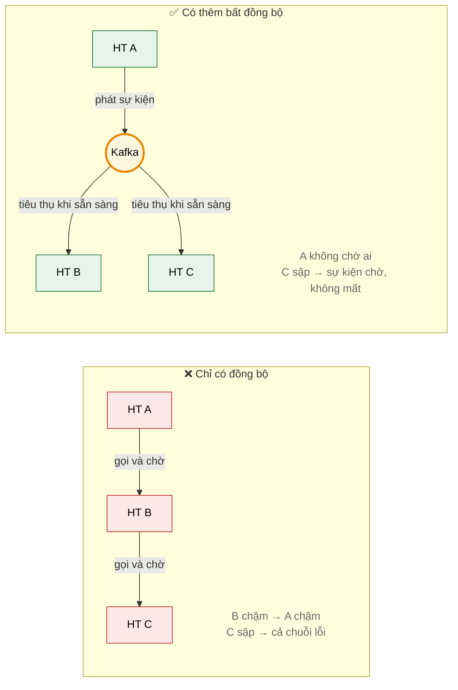
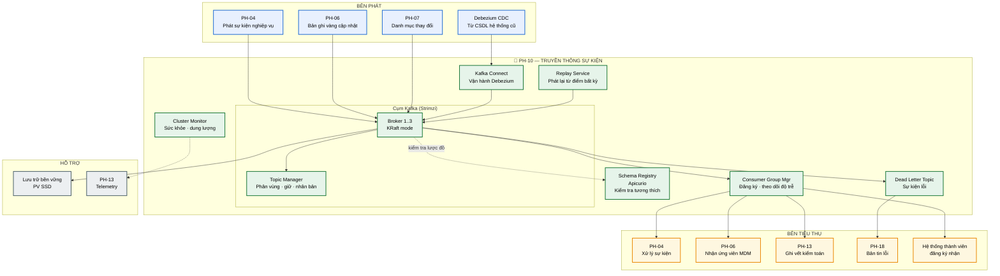
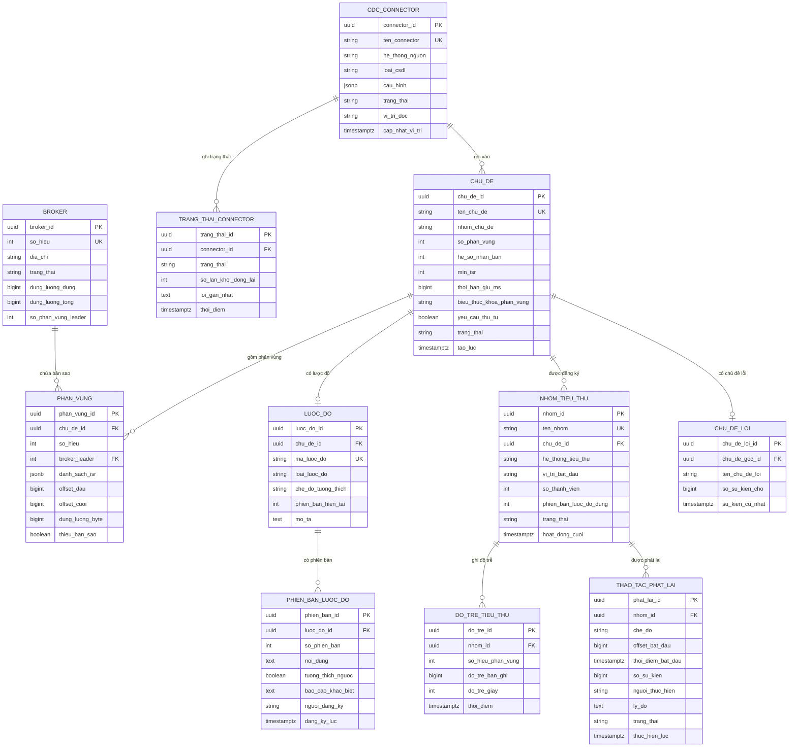

# SRS — PH-10: Truyền thông sự kiện & Đồng bộ

| Thuộc tính | Giá trị |
|---|---|
| **Mã phân hệ** | PH-10 |
| **Tên** | Truyền thông sự kiện & Đồng bộ (Event Backbone) |
| **Nhóm** | Data Plane |
| **Mức bắt buộc** | M — Bắt buộc |
| **Phiên bản** | 1.0 |
| **Ngày** | 03/8/2026 |
| **Công nghệ chủ đạo** | Apache Kafka (Strimzi) + Apicurio Registry + Debezium |

---

## M1. Giới thiệu

### 1.1. Mục đích

PH-10 là **xương sống sự kiện** của trục — nơi các hệ thống trao đổi dữ liệu mà không cần biết đến nhau và không phải chờ nhau.

Phân hệ này giải bài toán mà luồng đồng bộ không giải được: đồng bộ khối lượng lớn, thông báo thay đổi tới nhiều bên, và duy trì hoạt động khi bên nhận tạm thời không sẵn sàng. Đây là điều kiện để trục đáp ứng trần thời gian phản hồi 30 giây của CV 631 — không thể làm mọi việc đồng bộ.

### 1.2. Vì sao cần tách khớp nối theo thời gian



**Thuyết minh.** Với luồng đồng bộ, độ trễ và sự cố lan truyền dây chuyền. Với luồng sự kiện, bên phát hoàn tất ngay sau khi ghi vào Kafka; bên nhận xử lý theo nhịp của mình. Hệ thống di sản chậm không còn kéo cả trục xuống.

### 1.3. Phạm vi

**PH-10 chịu trách nhiệm:**

| # | Trách nhiệm |
|---|---|
| 1 | Vận hành cụm Kafka bảo đảm không mất sự kiện |
| 2 | Quản lý chủ đề (topic): tạo, cấu hình, phân vùng, chính sách giữ |
| 3 | Quản lý lược đồ sự kiện và kiểm tra tương thích khi thay đổi |
| 4 | Quản lý đăng ký tiêu thụ (consumer group) và theo dõi độ trễ |
| 5 | Vận hành CDC qua Debezium cho hệ thống không có API |
| 6 | Bảo đảm thứ tự sự kiện của cùng một thực thể |
| 7 | Cung cấp cơ chế phát lại sự kiện từ điểm bất kỳ |
| 8 | Quản lý hàng đợi lỗi ở tầng sự kiện |
| 9 | Giám sát sức khỏe cụm và cảnh báo |

**PH-10 KHÔNG chịu trách nhiệm:**

| # | Không làm | Thuộc phân hệ |
|---|---|---|
| 1 | Logic xử lý sự kiện — chỉ vận chuyển | PH-04 |
| 2 | Chuyển đổi định dạng, chuẩn hóa CDM | PH-04, PH-05 |
| 3 | Cấu hình chi tiết CDC cho từng hệ thống | PH-05 |
| 4 | Giao diện xử lý bản tin lỗi | PH-18 |
| 5 | Kiểm tra quyền truy cập dữ liệu trong sự kiện | PH-12 (qua PH-04) |

**Ranh giới số 3 — phân vai với PH-05 về CDC.** PH-05 **cấu hình** CDC cho từng hệ thống (bảng nào theo dõi, ánh xạ ra sao); PH-10 **vận hành** hạ tầng Debezium Connect và bảo đảm sự kiện tới Kafka an toàn. Tách vì hai việc có nhịp thay đổi khác nhau: cấu hình thay đổi mỗi khi thêm hệ thống, hạ tầng gần như bất biến.

### 1.4. Tài liệu tham chiếu

| Mã | Tài liệu |
|---|---|
| [KT] | [Kiến trúc phân lớp — L3 Bất đồng bộ](../02-architecture/README.md#3-kiến-trúc-phân-lớp-tổng-thể) |
| [LT] | [F-05 Đồng bộ dữ liệu bất đồng bộ theo sự kiện](../03-flows/README.md#f-05--đồng-bộ-dữ-liệu-bất-đồng-bộ-theo-sự-kiện), [F-06](../03-flows/README.md#f-06--liên-thông-văn-bản-điện-tử), [F-10](../03-flows/README.md#f-10--xử-lý-lỗi-và-phát-lại-bản-tin) |
| [ADR] | [ADR-005 Kafka + Apicurio + Debezium](../05-adr/README.md#adr-005) |
| [SRS] | [PH-04 Lõi tích hợp](SRS-PH-04-integration-core.md), [PH-05 Adapter](SRS-PH-05-adapter.md), [PH-18 Vận hành](SRS-PH-18-ops.md) |

---

## M2. Mô tả tổng quan

### 2.1. Vị trí trong kiến trúc



**Thuyết minh sơ đồ.** PH-04 xuất hiện ở **cả hai phía** — vừa phát vừa tiêu thụ. Đây là mô hình bình thường: lõi tích hợp phát sự kiện khi xử lý xong một luồng, đồng thời tiêu thụ sự kiện để kích hoạt luồng khác.

**Khối `SCHEMA` là chốt chặn quan trọng.** Không có nó, một bên phát đổi cấu trúc sự kiện sẽ làm hỏng hàng loạt bên tiêu thụ mà không ai biết trước. Apicurio kiểm tra tương thích **trước khi** cho phép đăng ký lược đồ mới.

### 2.2. Phân loại chủ đề

| Nhóm | Quy ước tên | Ví dụ | Chính sách giữ | Phân vùng |
|---|---|---|---|---|
| **Sự kiện nghiệp vụ** | `lgsp.event.{miền}.{thực thể}` | `lgsp.event.dancu.congdan` | 7 ngày | Theo định danh thực thể |
| **CDC** | `lgsp.cdc.{hệ thống}.{bảng}` | `lgsp.cdc.datdai.thua_dat` | 7 ngày | Theo khóa chính |
| **Dữ liệu chủ** | `lgsp.master.{thực thể}` | `lgsp.master.congdan` | 30 ngày | Theo định danh |
| **Kiểm toán** | `lgsp.audit` | — | 90 ngày (rồi chuyển MinIO) | Theo traceId |
| **Hàng đợi lỗi** | `lgsp.dlq.{route}` | `lgsp.dlq.tra-cuu-cong-dan` | **Vô thời hạn** | Theo route |
| **Điều khiển** | `lgsp.control.{loại}` | `lgsp.control.catalog-change` | 30 ngày | 1 phân vùng |

**Ghi chú về DLQ giữ vô thời hạn.** Bản tin lỗi phải được xử lý, không được tự xóa theo thời gian. Nếu để hết hạn thì mất luôn dữ liệu chưa xử lý — chỉ xóa khi cán bộ vận hành đã xử lý hoặc quyết định bỏ qua ([PH-18](SRS-PH-18-ops.md)).

### 2.3. Tác nhân

| Tác nhân | Loại | Tương tác |
|---|---|---|
| Quản trị viên nền tảng | Người | Tạo chủ đề, cấu hình phân vùng, theo dõi cụm |
| Cán bộ phát triển tích hợp | Người | Đăng ký lược đồ sự kiện, cấu hình tiêu thụ |
| Cán bộ vận hành | Người | Theo dõi độ trễ, xử lý sự cố, phát lại sự kiện |
| PH-04, PH-06, PH-07 | Hệ thống | Phát và tiêu thụ sự kiện |
| PH-05 | Hệ thống | Cấu hình CDC chạy trên Kafka Connect |
| Hệ thống thành viên | Hệ thống | Đăng ký nhận sự kiện |

### 2.4. Giả định

| Mã | Giả định |
|---|---|
| GD-01 | Hạ tầng lưu trữ SSD đủ dung lượng và IOPS cho Kafka |
| GD-02 | Mọi bên tiêu thụ cài đặt xử lý idempotent (yêu cầu tại tài liệu kết nạp) |
| GD-03 | Đồng hồ các node đồng bộ NTP — ảnh hưởng thứ tự và chính sách giữ |
| GD-04 | Mạng nội cụm có băng thông đủ cho nhân bản giữa broker |
| GD-05 | Lược đồ sự kiện được thiết kế trước, không sinh tự do |

### 2.5. Ràng buộc

| Mã | Ràng buộc | Nguồn |
|---|---|---|
| RB-01 | Hỗ trợ giao thức AMQP, MQTT, JMS cho hệ thống thành viên | CV 631, CMP-11 |
| RB-02 | Không mất sự kiện trong mọi tình huống sự cố hạ tầng | Nguyên tắc thiết kế |
| RB-03 | Bảo đảm thứ tự sự kiện của cùng một thực thể | Tính đúng đắn dữ liệu |
| RB-04 | Hoạt động 24/7 | CV 631, CMP-15 |
| RB-05 | Sự kiện không chứa dữ liệu cá nhân đầy đủ | Bảo vệ dữ liệu |
| RB-06 | Toàn bộ công nghệ mã nguồn mở | Yêu cầu dự án |

### 2.6. Phụ thuộc phân hệ

| Phụ thuộc | Loại | Hành vi khi không khả dụng |
|---|---|---|
| Lưu trữ bền vững | **Cứng** | Broker không ghi được; cụm suy giảm |
| Schema Registry | **Cứng** khi đăng ký lược đồ mới | Sự kiện dùng lược đồ đã đệm vẫn chạy |
| PH-13 | **Mềm** | Mất khả năng quan sát, dữ liệu vẫn chảy |
| PH-05 (cấu hình CDC) | **Mềm** | CDC hiện tại vẫn chạy; không thêm mới được |

---

## M3. Yêu cầu chức năng

### 3.1. Nhóm A — Quản lý chủ đề và cụm

#### FR-10-001 — Tạo và cấu hình chủ đề · **M**

| Mục | Nội dung |
|---|---|
| **Mô tả** | Tạo chủ đề Kafka theo quy ước và nhu cầu nghiệp vụ |
| **Tác nhân** | Quản trị viên nền tảng, PH-02 (tự động khi phát hành dịch vụ sự kiện) |
| **Đầu vào** | Tên chủ đề · nhóm · số phân vùng · hệ số nhân bản · chính sách giữ · biểu thức khóa phân vùng |
| **Xử lý** | 1. Kiểm tra tên theo quy ước đặt tên (mục 2.2)<br>2. Hệ số nhân bản mặc định **3**, tối thiểu 2<br>3. Đặt `min.insync.replicas = 2` để bảo đảm không mất dữ liệu<br>4. Số phân vùng tính theo thông lượng dự kiến<br>5. Chính sách giữ theo nhóm chủ đề<br>6. Tạo chủ đề qua Strimzi Operator (khai báo, GitOps) |
| **Đầu ra** | Chủ đề đã tạo và sẵn sàng |
| **Ngoại lệ** | E1: Tên sai quy ước → `422` kèm mẫu tên đúng<br>E2: Hệ số nhân bản < 2 → từ chối (RB-02)<br>E3: Số broker < hệ số nhân bản → từ chối, nêu rõ |

**Ghi chú về `min.insync.replicas = 2`.** Kết hợp với `acks=all` ở bên phát, cấu hình này bảo đảm sự kiện được ghi vào ít nhất hai broker trước khi xác nhận. Mất một broker không mất dữ liệu — đây là điều kiện cần cho RB-02.

#### FR-10-002 — Điều chỉnh số phân vùng · **S**

| Mục | Nội dung |
|---|---|
| **Mô tả** | Tăng số phân vùng khi thông lượng tăng |
| **Xử lý** | 1. Chỉ cho phép **tăng**, không giảm (giới hạn của Kafka)<br>2. **Cảnh báo rõ**: tăng phân vùng làm thay đổi ánh xạ khóa → phân vùng, có thể phá vỡ thứ tự<br>3. Yêu cầu xác nhận có hiểu tác động<br>4. Đề xuất thời điểm thực hiện: khi lưu lượng thấp |
| **Đầu ra** | Số phân vùng mới |
| **Ngoại lệ** | E1: Cố giảm phân vùng → từ chối, giải thích giới hạn kỹ thuật<br>E2: Chủ đề yêu cầu thứ tự nghiêm ngặt → cảnh báo mạnh, đề nghị cân nhắc tạo chủ đề mới |

**Ghi chú về E2 — điểm dễ gây sự cố.** Tăng phân vùng của chủ đề đang có sự kiện là thao tác nguy hiểm: khóa `001199001234` trước đây vào phân vùng 2, sau khi tăng có thể vào phân vùng 5. Sự kiện của cùng công dân nằm ở hai phân vùng khác nhau → mất thứ tự.

#### FR-10-003 — Giám sát sức khỏe cụm · **M**

| Mục | Nội dung |
|---|---|
| **Mô tả** | Theo dõi tình trạng broker, phân vùng, dung lượng |
| **Xử lý** | Theo dõi liên tục:<br>· Số broker sống / tổng<br>· Phân vùng **thiếu bản sao** (under-replicated)<br>· Phân vùng **không có leader**<br>· Dung lượng đĩa từng broker<br>· Thông lượng vào/ra<br>· Độ trễ ghi và đọc |
| **Đầu ra** | Trạng thái cụm |
| **Ngoại lệ** | E1: Có phân vùng thiếu bản sao → cảnh báo mức **cao** (nguy cơ mất dữ liệu)<br>E2: Dung lượng đĩa > 80% → cảnh báo; > 90% → cảnh báo nghiêm trọng<br>E3: Broker mất kết nối → cảnh báo tức thì |

**Ghi chú về E1.** Phân vùng thiếu bản sao nghĩa là dữ liệu chỉ còn trên ít broker hơn cấu hình — mất thêm một broker nữa là mất dữ liệu. Đây là cảnh báo phải xử lý ngay, không để qua đêm.

#### FR-10-004 — Cân bằng lại phân vùng · **S**

| Mục | Nội dung |
|---|---|
| **Mô tả** | Phân bố lại phân vùng khi thêm broker hoặc mất cân bằng |
| **Xử lý** | 1. Phát hiện mất cân bằng: chênh lệch dung lượng hoặc tải giữa broker > 20%<br>2. Sinh kế hoạch cân bằng lại<br>3. Thực hiện với giới hạn băng thông để không ảnh hưởng lưu lượng chính<br>4. Theo dõi tiến độ, cho phép hủy |
| **Đầu ra** | Phân vùng đã cân bằng |
| **Ngoại lệ** | E1: Cân bằng lại làm tăng độ trễ vượt ngưỡng → tự giảm băng thông<br>E2: Broker đích không đủ dung lượng → dừng, cảnh báo |

### 3.2. Nhóm B — Quản lý lược đồ sự kiện

#### FR-10-005 — Đăng ký lược đồ sự kiện · **M**

| Mục | Nội dung |
|---|---|
| **Mô tả** | Khai báo cấu trúc sự kiện trước khi phát |
| **Tác nhân** | Cán bộ phát triển tích hợp |
| **Đầu vào** | Chủ đề · lược đồ (Avro hoặc JSON Schema) · mô tả · chế độ tương thích |
| **Xử lý** | 1. Kiểm tra lược đồ hợp lệ<br>2. Kiểm tra có đủ **trường bắt buộc chung**: `eventId`, `eventType`, `traceId`, `producedAt`, `sourceSystem`, `businessKey`, `schemaVersion`<br>3. Kiểm tra **không chứa** trường dữ liệu cá nhân đầy đủ (RB-05)<br>4. Đăng ký vào Apicurio<br>5. Gán phiên bản lược đồ |
| **Đầu ra** | Lược đồ đã đăng ký |
| **Ngoại lệ** | E1: Thiếu trường bắt buộc chung → `422` kèm danh sách thiếu<br>E2: Phát hiện trường có vẻ chứa dữ liệu cá nhân (`soDinhDanh`, `hoTen` đầy đủ) → cảnh báo, yêu cầu xác nhận hoặc thay bằng tham chiếu<br>E3: Lược đồ sai cú pháp → `422` kèm vị trí lỗi |

**Ghi chú về bước 3 (RB-05).** Sự kiện Kafka lưu lâu và nhiều bên đọc được. Đưa dữ liệu cá nhân đầy đủ vào tạo rủi ro rò rỉ. Nguyên tắc: sự kiện chỉ mang **định danh và loại thay đổi**; bên cần dữ liệu tra lại qua API có kiểm soát quyền — cùng nguyên tắc với [BR-06-012](SRS-PH-06-mdm.md#m8-quy-tắc-nghiệp-vụ).

#### FR-10-006 — Kiểm tra tương thích khi thay đổi lược đồ · **M**

| Mục | Nội dung |
|---|---|
| **Mô tả** | Ngăn thay đổi lược đồ phá hỏng bên tiêu thụ |
| **Đầu vào** | Lược đồ mới · chế độ tương thích đã cấu hình |
| **Xử lý** | 1. So sánh với lược đồ hiện tại<br>2. Áp dụng chế độ tương thích:<br>&nbsp;&nbsp;· `BACKWARD` — bên tiêu thụ mới đọc được dữ liệu cũ (mặc định)<br>&nbsp;&nbsp;· `FORWARD` — bên tiêu thụ cũ đọc được dữ liệu mới<br>&nbsp;&nbsp;· `FULL` — cả hai chiều<br>3. Thay đổi vi phạm → **chặn đăng ký**<br>4. Sinh báo cáo khác biệt |
| **Đầu ra** | Lược đồ mới hoặc lỗi tương thích |
| **Ngoại lệ** | E1: Vi phạm tương thích → **chặn**, nêu rõ trường nào gây vi phạm<br>E2: Cần thay đổi phá vỡ → yêu cầu tạo chủ đề phiên bản mới, không ghi đè |

**Ghi chú về E2.** Khi thực sự cần thay đổi phá vỡ tương thích, cách đúng là tạo chủ đề mới (`lgsp.event.dancu.congdan.v2`) và chuyển dần bên tiêu thụ — không ghi đè lược đồ đang dùng.

#### FR-10-007 — Quản lý phiên bản lược đồ · **M**

| Mục | Nội dung |
|---|---|
| **Mô tả** | Theo dõi các phiên bản lược đồ và bên đang dùng |
| **Xử lý** | 1. Mỗi lược đồ có lịch sử phiên bản<br>2. Sự kiện mang `schemaVersion` để bên tiêu thụ biết cách giải mã<br>3. Theo dõi bên tiêu thụ đang dùng phiên bản nào<br>4. Cảnh báo khi có bên còn dùng phiên bản quá cũ |
| **Đầu ra** | Thông tin phiên bản lược đồ |
| **Ngoại lệ** | E1: Bên tiêu thụ dùng phiên bản không còn hỗ trợ → cảnh báo, thông báo đơn vị |

### 3.3. Nhóm C — Phát và tiêu thụ sự kiện

#### FR-10-008 — Phát sự kiện · **M**

| Mục | Nội dung |
|---|---|
| **Mô tả** | Ghi sự kiện vào chủ đề bảo đảm không mất |
| **Tác nhân** | PH-04, PH-06, PH-07 |
| **Đầu vào** | Chủ đề · khóa phân vùng · nội dung sự kiện · tiêu đề |
| **Xử lý** | 1. Kiểm tra sự kiện đúng lược đồ đã đăng ký<br>2. Tính khóa phân vùng theo **định danh thực thể** (RB-03)<br>3. Gắn tiêu đề bắt buộc: `traceId`, `schemaVersion`, `producedAt`, `sourceSystem`<br>4. Gửi với `acks=all` — chờ xác nhận từ ≥ 2 bản sao<br>5. Bật `enable.idempotence=true` chống trùng do thử lại<br>6. Trả xác nhận cho bên phát sau khi ghi thành công |
| **Đầu ra** | Sự kiện đã ghi bền vững |
| **Ngoại lệ** | E1: Sự kiện sai lược đồ → từ chối, không ghi<br>E2: Không đủ bản sao đồng bộ → **từ chối ghi**, báo lỗi (thà không ghi còn hơn mất)<br>E3: Không tính được khóa phân vùng → dùng khóa ngẫu nhiên nhưng **cảnh báo** rủi ro sai thứ tự |

#### FR-10-009 — Đăng ký và quản lý nhóm tiêu thụ · **M**

| Mục | Nội dung |
|---|---|
| **Mô tả** | Quản lý các bên tiêu thụ sự kiện |
| **Đầu vào** | Tên nhóm · chủ đề đăng ký · hệ thống tiêu thụ · vị trí bắt đầu |
| **Xử lý** | 1. Đăng ký nhóm tiêu thụ với tên theo quy ước<br>2. Cấu hình vị trí bắt đầu: đầu chủ đề, cuối chủ đề, hoặc thời điểm cụ thể<br>3. Bắt buộc **xác nhận offset thủ công** — chỉ commit sau khi xử lý xong<br>4. Theo dõi độ trễ tiêu thụ<br>5. Ghi nhận bên tiêu thụ để thông báo khi lược đồ thay đổi |
| **Đầu ra** | Nhóm tiêu thụ đã đăng ký |
| **Ngoại lệ** | E1: Tên nhóm trùng → `409`<br>E2: Chủ đề không tồn tại → `404`<br>E3: Nhóm không hoạt động > 7 ngày → cảnh báo, offset có thể hết hạn |

**Ghi chú về bước 3 — quyết định thiết kế cốt lõi.** Xác nhận offset tự động sẽ mất sự kiện nếu pod chết giữa lúc xử lý. Xác nhận thủ công sau khi xử lý xong bảo đảm không mất, đổi lại ngữ nghĩa thành "ít nhất một lần" — nên bên tiêu thụ bắt buộc idempotent (GD-02, [BR-04-008](SRS-PH-04-integration-core.md#m8-quy-tắc-nghiệp-vụ)).

#### FR-10-010 — Theo dõi độ trễ tiêu thụ · **M**

| Mục | Nội dung |
|---|---|
| **Mô tả** | Đo khoảng cách giữa sự kiện mới nhất và sự kiện đã xử lý |
| **Xử lý** | 1. Tính độ trễ theo số bản ghi và theo thời gian<br>2. Theo dõi theo từng nhóm tiêu thụ và từng phân vùng<br>3. Phát chỉ số cho PH-13 và KEDA (mở rộng tự động PH-04)<br>4. Phân tích xu hướng: độ trễ tăng đều là dấu hiệu bên tiêu thụ không theo kịp |
| **Đầu ra** | Chỉ số độ trễ |
| **Ngoại lệ** | E1: Độ trễ > 10.000 bản ghi → cảnh báo<br>E2: Độ trễ tăng liên tục 15 phút → cảnh báo mức cao<br>E3: Nhóm tiêu thụ ngừng tiến (offset không đổi) → cảnh báo nghiêm trọng |

**Ghi chú.** Độ trễ tiêu thụ là chỉ số quan trọng nhất của phân hệ này — CPU thấp mà độ trễ tăng vẫn là quá tải. Chỉ số này là đầu vào cho KEDA mở rộng PH-04 ([NFR-04-016](SRS-PH-04-integration-core.md#m7-yêu-cầu-phi-chức-năng)).

#### FR-10-011 — Bảo đảm thứ tự sự kiện · **M**

| Mục | Nội dung |
|---|---|
| **Mô tả** | Sự kiện của cùng một thực thể được xử lý đúng trình tự |
| **Xử lý** | 1. Khóa phân vùng = **định danh thực thể** (số định danh, mã doanh nghiệp, khóa chính bảng)<br>2. Kafka bảo đảm thứ tự trong cùng phân vùng<br>3. Bên tiêu thụ xử lý tuần tự trong một phân vùng<br>4. Kiểm tra cấu hình khóa phân vùng khi tạo chủ đề |
| **Đầu ra** | Thứ tự được bảo đảm |
| **Ngoại lệ** | E1: Chủ đề không khai báo khóa phân vùng → cảnh báo, không cho phát sự kiện cần thứ tự<br>E2: Bên tiêu thụ xử lý song song trong một phân vùng → cảnh báo cấu hình sai |

### 3.4. Nhóm D — CDC và phát lại

#### FR-10-012 — Vận hành hạ tầng CDC · **M**

| Mục | Nội dung |
|---|---|
| **Mô tả** | Chạy Kafka Connect với Debezium cho các kết nối CDC |
| **Đầu vào** | Cấu hình connector từ PH-05 |
| **Xử lý** | 1. Triển khai connector lên cụm Kafka Connect<br>2. Theo dõi trạng thái từng connector<br>3. Tự khởi động lại connector lỗi tạm thời<br>4. Lưu vị trí đọc bền vững vào chủ đề nội bộ<br>5. Phân bố connector đều giữa các worker |
| **Đầu ra** | Connector CDC hoạt động |
| **Ngoại lệ** | E1: Connector lỗi liên tục > 3 lần → dừng, cảnh báo, không tự khởi động lại vô hạn<br>E2: Worker Connect mất → tự phân bố lại connector sang worker khác<br>E3: Vị trí đọc mất → **không tự chụp ảnh lại**, cảnh báo nghiêm trọng, chờ quyết định |

**Ghi chú về E3.** Chụp ảnh lại toàn bộ CSDL nguồn gây tải rất lớn và có thể làm sập hệ thống di sản. Phải có người quyết định thời điểm, không tự động.

#### FR-10-013 — Phát lại sự kiện · **M**

| Mục | Nội dung |
|---|---|
| **Mô tả** | Đọc lại sự kiện từ một điểm trong quá khứ |
| **Tác nhân** | Cán bộ vận hành |
| **Đầu vào** | Chủ đề · nhóm tiêu thụ · điểm bắt đầu (offset hoặc thời điểm) · phạm vi |
| **Xử lý** | 1. Xác định offset tương ứng với điểm bắt đầu<br>2. Ba chế độ phát lại:<br>&nbsp;&nbsp;· **Đặt lại offset** nhóm hiện tại (ảnh hưởng bên tiêu thụ đang chạy)<br>&nbsp;&nbsp;· **Nhóm tiêu thụ mới** đọc song song (không ảnh hưởng)<br>&nbsp;&nbsp;· **Sao chép sang chủ đề tạm** để xử lý riêng<br>3. Cảnh báo rõ tác động của chế độ được chọn<br>4. Ghi vết thao tác phát lại |
| **Đầu ra** | Sự kiện được phát lại |
| **Ngoại lệ** | E1: Đặt lại offset khi nhóm đang chạy → yêu cầu dừng nhóm trước<br>E2: Điểm bắt đầu ngoài phạm vi giữ → báo lỗi, nêu khoảng thời gian còn dữ liệu<br>E3: Phát lại gây trùng dữ liệu → cảnh báo yêu cầu xác nhận bên tiêu thụ idempotent |

**Ghi chú về giá trị.** Phát lại là năng lực mà hàng đợi truyền thống không có ([ADR-005](../05-adr/README.md#adr-005)). Khi phát hiện lỗi xử lý từ ba ngày trước, có thể sửa mã rồi phát lại toàn bộ sự kiện trong khoảng đó.

#### FR-10-014 — Quản lý hàng đợi lỗi tầng sự kiện · **M**

| Mục | Nội dung |
|---|---|
| **Mô tả** | Chứa sự kiện không giải mã hoặc không xử lý được |
| **Xử lý** | 1. Mỗi chủ đề nghiệp vụ có chủ đề lỗi tương ứng<br>2. Sự kiện lỗi kèm ngữ cảnh: sự kiện gốc, lỗi, chủ đề gốc, offset gốc, số lần thử<br>3. Giữ **vô thời hạn** cho tới khi được xử lý<br>4. Cung cấp API cho PH-18 đọc và phát lại |
| **Đầu ra** | Sự kiện lỗi được lưu an toàn |
| **Ngoại lệ** | E1: Không ghi được vào chủ đề lỗi → **không commit offset** để sự kiện được thử lại<br>E2: Chủ đề lỗi đầy dung lượng → cảnh báo nghiêm trọng, không tự xóa |

### 3.5. Nhóm E — Tích hợp giao thức khác

#### FR-10-015 — Cầu nối giao thức bản tin · **S**

| Mục | Nội dung |
|---|---|
| **Mô tả** | Cho phép hệ thống dùng AMQP, MQTT, JMS tham gia trục sự kiện |
| **Tiền điều kiện** | Hệ thống thành viên đã kết nạp |
| **Xử lý** | 1. Cấu hình cầu nối chuyển đổi giữa Kafka và giao thức đích<br>2. Ánh xạ chủ đề Kafka ↔ hàng đợi/chủ đề của giao thức kia<br>3. Chuyển đổi tiêu đề bản tin tương ứng<br>4. Giữ nguyên `traceId` xuyên suốt |
| **Đầu ra** | Bản tin đi qua cầu nối |
| **Ngoại lệ** | E1: Giao thức đích không hỗ trợ tiêu đề tùy chỉnh → nhúng `traceId` vào thân bản tin<br>E2: Nhà môi giới đích mất kết nối → thử lại có backoff, cảnh báo |

**Ghi chú.** Yêu cầu này phục vụ CMP-11 (đa giao thức) — cho phép hệ thống chỉ nói được MQTT (thiết bị IoT, hệ thống quan trắc) tham gia trục mà không phải sửa.

### 3.6. Bảng tổng hợp yêu cầu chức năng

| Nhóm | Mã | Tên | Ưu tiên |
|---|---|---|:-:|
| A | FR-10-001 | Tạo và cấu hình chủ đề | M |
| A | FR-10-002 | Điều chỉnh số phân vùng | S |
| A | FR-10-003 | Giám sát sức khỏe cụm | M |
| A | FR-10-004 | Cân bằng lại phân vùng | S |
| B | FR-10-005 | Đăng ký lược đồ sự kiện | M |
| B | FR-10-006 | Kiểm tra tương thích khi thay đổi lược đồ | M |
| B | FR-10-007 | Quản lý phiên bản lược đồ | M |
| C | FR-10-008 | Phát sự kiện | M |
| C | FR-10-009 | Đăng ký và quản lý nhóm tiêu thụ | M |
| C | FR-10-010 | Theo dõi độ trễ tiêu thụ | M |
| C | FR-10-011 | Bảo đảm thứ tự sự kiện | M |
| D | FR-10-012 | Vận hành hạ tầng CDC | M |
| D | FR-10-013 | Phát lại sự kiện | M |
| D | FR-10-014 | Quản lý hàng đợi lỗi tầng sự kiện | M |
| E | FR-10-015 | Cầu nối giao thức bản tin | S |

**Tổng: 15 yêu cầu chức năng** — 12 bắt buộc (M), 3 cần có (S).

---

## M4. Mô hình dữ liệu

### 4.1. Sơ đồ thực thể



### 4.2. Đặc tả thực thể

#### EN-10-01 — CHU_DE

| Trường | Kiểu | Bắt buộc | Ràng buộc | Mô tả |
|---|---|:-:|---|---|
| `chu_de_id` | UUID | ✓ | PK | |
| `ten_chu_de` | VARCHAR(200) | ✓ | UNIQUE, theo quy ước mục 2.2 | |
| `nhom_chu_de` | VARCHAR(24) | ✓ | ∈ {`EVENT`,`CDC`,`MASTER`,`AUDIT`,`DLQ`,`CONTROL`} | Quyết định chính sách mặc định |
| `so_phan_vung` | INTEGER | ✓ | ≥ 1 | Chỉ tăng được, không giảm |
| `he_so_nhan_ban` | SMALLINT | ✓ | ≥ 2, mặc định 3 | RB-02 |
| `min_isr` | SMALLINT | ✓ | ≥ 2, mặc định 2 | Bản sao đồng bộ tối thiểu |
| `thoi_han_giu_ms` | BIGINT | ✓ | `-1` = vô thời hạn | DLQ dùng `-1` |
| `bieu_thuc_khoa_phan_vung` | VARCHAR(200) | | | Cách trích định danh thực thể |
| `yeu_cau_thu_tu` | BOOLEAN | ✓ | mặc định true | Cảnh báo khi tăng phân vùng |

**Ràng buộc bảng.** `he_so_nhan_ban ≥ min_isr`; chủ đề `yeu_cau_thu_tu = true` bắt buộc có `bieu_thuc_khoa_phan_vung` (FR-10-011 E1).

#### EN-10-02 — LUOC_DO và PHIEN_BAN_LUOC_DO

| Trường (LUOC_DO) | Kiểu | Bắt buộc | Mô tả |
|---|---|:-:|---|
| `ma_luoc_do` | VARCHAR(200) | ✓ | UNIQUE — thường là `{tên chủ đề}-value` |
| `loai_luoc_do` | VARCHAR(20) | ✓ | ∈ {`AVRO`,`JSON_SCHEMA`,`PROTOBUF`} |
| `che_do_tuong_thich` | VARCHAR(20) | ✓ | ∈ {`BACKWARD`,`FORWARD`,`FULL`,`NONE`} — mặc định `BACKWARD` |
| `phien_ban_hien_tai` | INTEGER | ✓ | |

| Trường (PHIEN_BAN) | Kiểu | Bắt buộc | Mô tả |
|---|---|:-:|---|
| `so_phien_ban` | INTEGER | ✓ | UNIQUE cùng lược đồ |
| `noi_dung` | TEXT | ✓ | Lược đồ đầy đủ |
| `tuong_thich_nguoc` | BOOLEAN | ✓ | Kết quả kiểm tra tại FR-10-006 |
| `bao_cao_khac_biet` | TEXT | | So sánh với phiên bản trước |

#### EN-10-03 — NHOM_TIEU_THU

| Trường | Kiểu | Bắt buộc | Mô tả |
|---|---|:-:|---|
| `ten_nhom` | VARCHAR(200) | ✓ | UNIQUE — theo quy ước `{hệ thống}-{mục đích}` |
| `he_thong_tieu_thu` | VARCHAR(80) | ✓ | Tồn tại tại PH-01 |
| `vi_tri_bat_dau` | VARCHAR(20) | ✓ | ∈ {`EARLIEST`,`LATEST`,`TIMESTAMP`} |
| `so_thanh_vien` | INTEGER | ✓ | Số instance đang tiêu thụ |
| `phien_ban_luoc_do_dung` | INTEGER | ✓ | Để cảnh báo khi dùng phiên bản cũ |
| `hoat_dong_cuoi` | TIMESTAMPTZ | ✓ | Phát hiện nhóm ngừng hoạt động |

#### EN-10-04 — DO_TRE_TIEU_THU

| Trường | Kiểu | Bắt buộc | Mô tả |
|---|---|:-:|---|
| `nhom_id` | UUID | ✓ | FK |
| `so_hieu_phan_vung` | INTEGER | ✓ | Độ trễ theo từng phân vùng |
| `do_tre_ban_ghi` | BIGINT | ✓ | Số bản ghi chưa xử lý |
| `do_tre_giay` | INTEGER | ✓ | Khoảng thời gian tụt hậu |

**Ghi chú.** Đo cả hai đơn vị vì chúng cho thông tin khác nhau: 10.000 bản ghi có thể là 1 giây với chủ đề lưu lượng cao, hoặc 1 giờ với chủ đề lưu lượng thấp.

#### EN-10-05 — THAO_TAC_PHAT_LAI

| Trường | Kiểu | Bắt buộc | Mô tả |
|---|---|:-:|---|
| `che_do` | VARCHAR(24) | ✓ | ∈ {`RESET_OFFSET`,`NEW_GROUP`,`COPY_TOPIC`} |
| `offset_bat_dau` | BIGINT | | Hoặc dùng `thoi_diem_bat_dau` |
| `so_su_kien` | BIGINT | ✓ | Số sự kiện được phát lại |
| `nguoi_thuc_hien` | VARCHAR(100) | ✓ | |
| `ly_do` | TEXT | ✓ | **Bắt buộc** — truy vết |

### 4.3. Chính sách lưu giữ

| Loại dữ liệu | Thời hạn | Ghi chú |
|---|---|---|
| Sự kiện nghiệp vụ trong Kafka | 7 ngày | Đủ để phát lại khi có sự cố |
| Sự kiện dữ liệu chủ | 30 ngày | |
| Sự kiện kiểm toán | 90 ngày trong Kafka, sau đó MinIO (≥ 5 năm) | CMP-28 |
| **Sự kiện lỗi (DLQ)** | **Vô thời hạn** | Chỉ xóa khi đã xử lý |
| Siêu dữ liệu chủ đề, lược đồ | Vĩnh viễn | |
| Lịch sử phiên bản lược đồ | Vĩnh viễn | Giải mã được sự kiện cũ |
| Chỉ số độ trễ | 90 ngày | Phân tích xu hướng |
| Nhật ký phát lại | 3 năm | Truy vết thao tác vận hành |

---

## M5. Giao diện API

### 5.1. Nguyên tắc chung

| Khía cạnh | Quy định |
|---|---|
| Giao thức chính | Kafka protocol (bên phát và tiêu thụ dùng trực tiếp) |
| Đường dẫn quản trị | `/api/admin/v1/events` |
| Schema Registry | `/apis/registry/v2` (chuẩn Apicurio) |
| Xác thực Kafka | SASL/SCRAM hoặc mTLS |
| Xác thực API quản trị | Bearer JWT, vai trò `PLATFORM_ADMIN` hoặc `OPERATOR` |

### 5.2. Điểm cuối quản trị

| Phương thức | Đường dẫn | Chức năng | FR |
|---|---|---|---|
| `GET` | `/api/admin/v1/events/topics` | Danh sách chủ đề | FR-10-001 |
| `POST` | `/api/admin/v1/events/topics` | Tạo chủ đề | FR-10-001 |
| `PATCH` | `/api/admin/v1/events/topics/{name}` | Sửa cấu hình chủ đề | FR-10-002 |
| `GET` | `/api/admin/v1/events/topics/{name}/partitions` | Chi tiết phân vùng | FR-10-003 |
| `POST` | `/api/admin/v1/events/topics/{name}/partitions` | Tăng số phân vùng | FR-10-002 |
| `GET` | `/api/admin/v1/events/cluster/health` | Sức khỏe cụm | FR-10-003 |
| `POST` | `/api/admin/v1/events/cluster/rebalance` | Cân bằng lại phân vùng | FR-10-004 |
| `GET` | `/api/admin/v1/events/consumer-groups` | Danh sách nhóm tiêu thụ | FR-10-009 |
| `GET` | `/api/admin/v1/events/consumer-groups/{name}/lag` | Độ trễ tiêu thụ | FR-10-010 |
| `POST` | `/api/admin/v1/events/replay` | Phát lại sự kiện | FR-10-013 |
| `GET` | `/api/admin/v1/events/replay/{id}` | Trạng thái phát lại | FR-10-013 |
| `GET` | `/api/admin/v1/events/connectors` | Danh sách CDC connector | FR-10-012 |
| `POST` | `/api/admin/v1/events/connectors/{name}/restart` | Khởi động lại connector | FR-10-012 |
| `GET` | `/api/admin/v1/events/dlt` | Tổng hợp hàng đợi lỗi | FR-10-014 |

### 5.3. Điểm cuối Schema Registry

| Phương thức | Đường dẫn | Chức năng | FR |
|---|---|---|---|
| `POST` | `/apis/registry/v2/groups/lgsp/artifacts` | Đăng ký lược đồ | FR-10-005 |
| `GET` | `/apis/registry/v2/groups/lgsp/artifacts/{id}` | Lấy lược đồ | FR-10-007 |
| `POST` | `/apis/registry/v2/groups/lgsp/artifacts/{id}/test` | Kiểm tra tương thích trước khi đăng ký | FR-10-006 |
| `GET` | `/apis/registry/v2/groups/lgsp/artifacts/{id}/versions` | Lịch sử phiên bản | FR-10-007 |

### 5.4. Cấu trúc sự kiện chuẩn

Mọi sự kiện trên trục tuân theo cấu trúc chung:

```json
{
  "eventId": "01J5X8K2M9P3Q7R4T6V8W0Y2Z4",
  "eventType": "CONG_DAN_CAP_NHAT",
  "schemaVersion": 3,
  "traceId": "4bf92f3577b34da6a3ce929d0e0e4736",
  "producedAt": "2026-08-03T15:42:10.482+07:00",
  "sourceSystem": "CSDLQG_DANCU",
  "businessKey": "001199001234",
  "payload": {
    "thucThe": "CONG_DAN",
    "dinhDanh": "001199001234",
    "truongThayDoi": ["noiThuongTru"],
    "phienBan": 7
  },
  "metadata": {
    "correlationId": "HS-2026-08-001234",
    "causationId": "01J5X8K1A2B3C4D5E6F7G8H9J0"
  }
}
```

**Thuyết minh cấu trúc.**

| Trường | Vai trò |
|---|---|
| `eventId` | Định danh duy nhất, dùng chống trùng ở bên tiêu thụ |
| `traceId` | Nối với PH-04, PH-13 — truy vết xuyên suốt |
| `businessKey` | Khóa phân vùng, bảo đảm thứ tự (RB-03) |
| `payload.truongThayDoi` | Chỉ nêu **trường nào** đổi, **không** chứa giá trị đầy đủ (RB-05) |
| `causationId` | Sự kiện nào gây ra sự kiện này — dựng được chuỗi nhân quả |

**Ghi chú quan trọng về `payload`.** Sự kiện chỉ mang định danh và danh sách trường thay đổi. Bên tiêu thụ cần giá trị thật thì gọi API của PH-06 với kiểm soát quyền đầy đủ. Đây là hiện thực RB-05 và tránh rò rỉ dữ liệu cá nhân qua Kafka.

### 5.5. Ví dụ tạo chủ đề

**Yêu cầu:**

```json
{
  "tenChuDe": "lgsp.event.dancu.congdan",
  "nhomChuDe": "EVENT",
  "soPhanVung": 12,
  "heSoNhanBan": 3,
  "minIsr": 2,
  "thoiHanGiuMs": 604800000,
  "bieuThucKhoaPhanVung": "$.businessKey",
  "yeuCauThuTu": true,
  "moTa": "Sự kiện thay đổi thông tin công dân từ CSDLQG Dân cư"
}
```

**Phản hồi `201 Created`:**

```json
{
  "chuDeId": "c1d2e3f4-...",
  "tenChuDe": "lgsp.event.dancu.congdan",
  "trangThai": "ACTIVE",
  "chuDeLoi": "lgsp.dlq.event.dancu.congdan",
  "canhBao": [
    "Chủ đề yêu cầu thứ tự — việc tăng số phân vùng về sau sẽ phá vỡ thứ tự sự kiện của các thực thể hiện có"
  ],
  "buocTiepTheo": "Đăng ký lược đồ sự kiện trước khi phát"
}
```

**Ghi chú.** Chủ đề lỗi được tạo **tự động** cùng chủ đề chính — không phụ thuộc việc ai đó nhớ tạo.

---

## M6. Giao diện người dùng

### 6.1. Danh mục màn hình

| Mã | Tên màn hình | Đối tượng | Mockup |
|---|---|---|---|
| **UI-10-01** | Tổng quan cụm sự kiện | Vận hành, Quản trị viên | [`events.html`](../../mockup/pages/events.html) |
| **UI-10-02** | Quản lý chủ đề | Quản trị viên nền tảng | [`events.html`](../../mockup/pages/events.html) (tab Chủ đề) |
| **UI-10-03** | Theo dõi độ trễ tiêu thụ | Vận hành | [`events.html`](../../mockup/pages/events.html) (tab Độ trễ) |
| **UI-10-04** | Quản lý lược đồ sự kiện | Cán bộ phát triển tích hợp | [`events.html`](../../mockup/pages/events.html) (tab Lược đồ) |
| **UI-10-05** | Giám sát CDC | Vận hành | [`events.html`](../../mockup/pages/events.html) (tab CDC) |
| **UI-10-06** | Phát lại sự kiện | Vận hành | [`events.html`](../../mockup/pages/events.html) (tab Phát lại) |

### 6.2. UI-10-01 — Tổng quan cụm sự kiện

| Thành phần | Mô tả |
|---|---|
| Thẻ sức khỏe cụm | Số broker sống · phân vùng thiếu bản sao · phân vùng không leader |
| Thẻ dung lượng | Dung lượng dùng / tổng, theo từng broker |
| Thẻ thông lượng | Sự kiện vào/ra mỗi giây |
| Cảnh báo nổi bật | Phân vùng thiếu bản sao · đĩa gần đầy · nhóm tiêu thụ tụt hậu |
| Biểu đồ thông lượng | Theo thời gian, phân tách theo chủ đề |
| Bảng chủ đề nóng | Top chủ đề theo thông lượng và dung lượng |

**Quy tắc tương tác:**

| # | Quy tắc |
|---|---|
| 1 | Phân vùng thiếu bản sao > 0 → banner đỏ, không thể ẩn (nguy cơ mất dữ liệu) |
| 2 | Dung lượng > 80% → cảnh báo vàng; > 90% → đỏ |
| 3 | Nhấn chủ đề → mở chi tiết phân vùng và nhóm tiêu thụ |

### 6.3. UI-10-03 — Theo dõi độ trễ tiêu thụ

**Mục đích.** Độ trễ tiêu thụ là chỉ số cảnh báo sớm quan trọng nhất — phát hiện bên tiêu thụ không theo kịp trước khi thành sự cố.

| Thành phần | Mô tả |
|---|---|
| Bảng nhóm tiêu thụ | Nhóm · Chủ đề · Hệ thống · Độ trễ (bản ghi) · Độ trễ (giây) · Xu hướng · Trạng thái |
| Biểu đồ độ trễ | Theo thời gian, có đường ngưỡng cảnh báo |
| Chi tiết theo phân vùng | Độ trễ từng phân vùng — phát hiện phân vùng nghẽn riêng |
| Chỉ báo xu hướng | Mũi tên: đang giảm · ổn định · đang tăng |
| Cảnh báo | Nhóm ngừng tiến (offset không đổi) · độ trễ tăng liên tục |

**Quy tắc tương tác:**

| # | Quy tắc |
|---|---|
| 1 | Nhóm ngừng tiến > 5 phút → tô đỏ, hiển thị đầu bảng |
| 2 | Độ trễ tăng liên tục 15 phút → cảnh báo, gợi ý kiểm tra bên tiêu thụ |
| 3 | Nhấn nhóm → xem chi tiết từng phân vùng, phát hiện mất cân bằng |
| 4 | Hiển thị số instance đang tiêu thụ — ít hơn số phân vùng là dấu hiệu chưa tận dụng hết |

### 6.4. UI-10-04 — Quản lý lược đồ sự kiện

| Thành phần | Mô tả |
|---|---|
| Danh sách lược đồ | Mã · chủ đề · loại · chế độ tương thích · phiên bản hiện tại |
| Trình soạn thảo lược đồ | Tô màu cú pháp, kiểm tra trực tiếp |
| Nút kiểm tra tương thích | Chạy trước khi đăng ký, hiển thị kết quả |
| Báo cáo khác biệt | So sánh với phiên bản hiện tại, phân loại thay đổi |
| Bảng bên tiêu thụ | Nhóm nào đang dùng phiên bản nào |
| Lịch sử phiên bản | Xem lại và so sánh bất kỳ hai phiên bản |

**Quy tắc tương tác:**

| # | Quy tắc |
|---|---|
| 1 | Vi phạm tương thích → chặn đăng ký, nêu rõ trường gây vi phạm |
| 2 | Thiếu trường bắt buộc chung → chặn, liệt kê đủ |
| 3 | Phát hiện trường có vẻ chứa dữ liệu cá nhân → cảnh báo, yêu cầu xác nhận |
| 4 | Hiển thị nhóm tiêu thụ còn dùng phiên bản cũ để chủ động thông báo |

### 6.5. UI-10-06 — Phát lại sự kiện

**Mục đích.** Thao tác mạnh và có rủi ro — giao diện phải làm rõ tác động trước khi thực hiện.

| Thành phần | Mô tả |
|---|---|
| Chọn chủ đề và nhóm | Danh sách thả xuống |
| Chọn điểm bắt đầu | Theo offset, hoặc theo thời điểm (dễ dùng hơn) |
| Ước tính số sự kiện | Hiển thị sẽ phát lại bao nhiêu sự kiện |
| Chọn chế độ | Ba lựa chọn kèm giải thích tác động của từng chế độ |
| Cảnh báo tác động | Nêu rõ chế độ được chọn ảnh hưởng gì |
| Ô lý do | **Bắt buộc** nhập trước khi thực hiện |
| Theo dõi tiến độ | Số sự kiện đã phát lại, tốc độ, ước tính thời gian còn lại |
| Nút hủy | Dừng phát lại giữa chừng |

**Quy tắc tương tác:**

| # | Quy tắc |
|---|---|
| 1 | Chế độ `RESET_OFFSET` → cảnh báo đỏ: ảnh hưởng bên tiêu thụ đang chạy, yêu cầu dừng nhóm trước |
| 2 | Chế độ `NEW_GROUP` → giải thích: an toàn, không ảnh hưởng nhóm hiện tại |
| 3 | Số sự kiện phát lại > 100.000 → yêu cầu xác nhận bổ sung |
| 4 | Lý do là trường bắt buộc |
| 5 | Nhắc kiểm tra bên tiêu thụ có idempotent không trước khi phát lại |

---

## M7. Yêu cầu phi chức năng

### 7.1. Hiệu năng

| Mã | Yêu cầu | Chỉ tiêu | Cách đo |
|---|---|---|---|
| **NFR-10-001** | Độ trễ ghi sự kiện (P99) | ≤ 20ms với `acks=all` | Đo tại bên phát |
| **NFR-10-002** | Thông lượng ghi | ≥ 50.000 sự kiện/giây toàn cụm | Kiểm thử tải |
| **NFR-10-003** | Thông lượng đọc | ≥ 100.000 sự kiện/giây | — |
| **NFR-10-004** | Độ trễ đầu-cuối (phát → tiêu thụ) | P99 ≤ 500ms khi không tồn đọng | — |
| **NFR-10-005** | Độ trễ CDC | ≤ 5 giây từ commit tới Kafka | Đối chiếu dấu thời gian |
| **NFR-10-006** | Tốc độ phát lại | ≥ 20.000 sự kiện/giây | — |

### 7.2. Độ bền dữ liệu

| Mã | Yêu cầu | Chỉ tiêu |
|---|---|---|
| **NFR-10-007** | Không mất sự kiện | **0 sự kiện mất** khi mất 1 broker (RB-02) |
| **NFR-10-008** | Hệ số nhân bản | ≥ 3 với chủ đề nghiệp vụ, `min.insync.replicas = 2` |
| **NFR-10-009** | Ghi bền vững trước khi xác nhận | `acks=all` bắt buộc |
| **NFR-10-010** | Khôi phục sau mất broker | Tự động trong ≤ 5 phút |
| **NFR-10-011** | Vị trí đọc CDC bền vững | Không mất khi khởi động lại connector |

### 7.3. Tính sẵn sàng

| Mã | Yêu cầu | Chỉ tiêu |
|---|---|---|
| **NFR-10-012** | Tỷ lệ sẵn sàng cụm | ≥ 99,95% |
| **NFR-10-013** | Số broker tối thiểu | 3, phân bố trên ≥ 2 vùng sẵn sàng |
| **NFR-10-014** | Mất 1 broker | Dịch vụ tiếp tục, không mất dữ liệu |
| **NFR-10-015** | Mất 1 vùng sẵn sàng | Dịch vụ tiếp tục ở chế độ suy giảm |
| **NFR-10-016** | Nâng cấp cụm | Luân phiên, không gián đoạn (CMP-15) |

### 7.4. Khả năng mở rộng

| Mã | Yêu cầu |
|---|---|
| **NFR-10-017** | Thêm broker không cần dừng cụm |
| **NFR-10-018** | Số chủ đề hỗ trợ ≥ 1.000 |
| **NFR-10-019** | Số phân vùng toàn cụm ≥ 10.000 |
| **NFR-10-020** | Dung lượng lưu trữ mở rộng được không gián đoạn |
| **NFR-10-021** | Số nhóm tiêu thụ ≥ 500 |

### 7.5. Bảo mật

| Mã | Yêu cầu |
|---|---|
| **NFR-10-022** | Xác thực bên phát và tiêu thụ qua SASL/SCRAM hoặc mTLS |
| **NFR-10-023** | Phân quyền theo chủ đề: bên nào được phát, được tiêu thụ chủ đề nào |
| **NFR-10-024** | Mã hóa đường truyền giữa client và broker |
| **NFR-10-025** | Mã hóa dữ liệu lưu trữ trên đĩa |
| **NFR-10-026** | Sự kiện không chứa dữ liệu cá nhân đầy đủ (RB-05) — kiểm tra khi đăng ký lược đồ |

### 7.6. Khả năng quan sát

| Mã | Yêu cầu |
|---|---|
| **NFR-10-027** | Phát chỉ số: `kafka_broker_up`, `kafka_under_replicated_partitions`, `kafka_offline_partitions`, `kafka_disk_usage_ratio`, `kafka_messages_in_per_sec`, `consumer_lag_records{group,topic}`, `consumer_lag_seconds`, `cdc_connector_status`, `dlt_messages_total{topic}` |
| **NFR-10-028** | Cảnh báo tức thì khi có phân vùng thiếu bản sao |
| **NFR-10-029** | Cảnh báo khi độ trễ tiêu thụ > 10.000 bản ghi |
| **NFR-10-030** | Cảnh báo khi nhóm tiêu thụ ngừng tiến > 5 phút |
| **NFR-10-031** | Cảnh báo khi dung lượng đĩa > 80% |

---

## M8. Quy tắc nghiệp vụ

| Mã | Quy tắc | Lý do | Cách thực thi | Khi vi phạm |
|---|---|---|---|---|
| **BR-10-001** | Hệ số nhân bản ≥ 2, `min.insync.replicas` ≥ 2 | Bảo đảm không mất sự kiện (RB-02) | FR-10-001 E2 | Từ chối tạo chủ đề |
| **BR-10-002** | Phát sự kiện dùng `acks=all` | Chỉ xác nhận sau khi ghi đủ bản sao | FR-10-008 bước 4 | Rủi ro mất dữ liệu |
| **BR-10-003** | Không đủ bản sao đồng bộ → **từ chối ghi** | Thà không ghi còn hơn ghi rồi mất | FR-10-008 E2 | — |
| **BR-10-004** | Xác nhận offset thủ công sau khi xử lý xong | Không mất sự kiện khi pod chết giữa chừng | FR-10-009 bước 3 | Mất sự kiện |
| **BR-10-005** | Bên tiêu thụ bắt buộc xử lý idempotent | Ngữ nghĩa "ít nhất một lần" | Ghi trong tài liệu kết nạp; kiểm thử | Dữ liệu trùng |
| **BR-10-006** | Khóa phân vùng là định danh thực thể | Bảo đảm thứ tự sự kiện (RB-03) | FR-10-011 | Sai thứ tự dữ liệu |
| **BR-10-007** | Chủ đề yêu cầu thứ tự phải khai báo khóa phân vùng | Không có khóa thì không bảo đảm được thứ tự | Ràng buộc CSDL | Từ chối tạo |
| **BR-10-008** | Tăng phân vùng phải cảnh báo phá vỡ thứ tự | Ánh xạ khóa → phân vùng thay đổi | FR-10-002 bước 2 | Sai thứ tự âm thầm |
| **BR-10-009** | Mọi sự kiện phải qua kiểm tra lược đồ | Ngăn dữ liệu rác vào trục | FR-10-008 bước 1 | Từ chối ghi |
| **BR-10-010** | Thay đổi lược đồ phá vỡ tương thích bị chặn | Bảo vệ bên tiêu thụ hiện có | FR-10-006 E1 | Chặn đăng ký |
| **BR-10-011** | Sự kiện **không** chứa dữ liệu cá nhân đầy đủ | Kafka lưu lâu, nhiều bên đọc (RB-05) | FR-10-005 bước 3 | Cảnh báo, yêu cầu sửa |
| **BR-10-012** | Chủ đề lỗi giữ vô thời hạn | Bản tin lỗi phải được xử lý, không tự xóa | Cấu hình `retention = -1` | Mất dữ liệu chưa xử lý |
| **BR-10-013** | Không ghi được chủ đề lỗi → không commit offset | Bảo đảm sự kiện được thử lại | FR-10-014 E1 | Mất sự kiện |
| **BR-10-014** | Mất vị trí đọc CDC → **không tự chụp ảnh lại** | Chụp lại gây tải lớn cho hệ thống di sản | FR-10-012 E3 | Có thể sập hệ thống nguồn |
| **BR-10-015** | Phát lại sự kiện bắt buộc nhập lý do | Truy vết thao tác vận hành có rủi ro | FR-10-013 | Từ chối thao tác |
| **BR-10-016** | Chủ đề lỗi được tạo tự động cùng chủ đề chính | Không phụ thuộc việc ai nhớ tạo | FR-10-001 | — |

---

## M9. Tuân thủ

### 9.1. Ánh xạ yêu cầu pháp lý

| Mã CMP | Yêu cầu | FR/NFR đáp ứng | Cách kiểm chứng |
|---|---|---|---|
| **CMP-11** | Đa giao thức: AMQP, MQTT, JMS | FR-10-015; RB-01 | Kiểm thử cầu nối từng giao thức |
| **CMP-15** | Hoạt động 24/7 | NFR-10-012…016 | Nâng cấp luân phiên không gián đoạn |
| **CMP-28** | Ghi vết truy cập dữ liệu | Chủ đề `lgsp.audit`, giữ ≥ 5 năm | Đối chiếu số bản ghi kiểm toán |
| **CMP-10** | Giám sát thời gian thực | FR-10-003, 010; NFR-10-027…031 | Dashboard sức khỏe cụm và độ trễ |
| **CMP-24** | Bảo vệ dữ liệu | NFR-10-024, 025, 026 | Kiểm tra mã hóa; rà soát lược đồ |

### 9.2. Ánh xạ nguyên tắc TTQGS

| Nguyên tắc | Cách PH-10 đáp ứng |
|---|---|
| **Modular Design** | Bên phát và tiêu thụ hoàn toàn tách rời, thêm bên mới không ảnh hưởng bên cũ |
| **Cloud First** | Strimzi Operator quản lý vòng đời trên K8s, mở rộng không gián đoạn |
| **Open Standard** | Kafka protocol, Avro, JSON Schema, W3C Trace Context |
| **Privacy by Design** | Sự kiện không mang dữ liệu cá nhân đầy đủ (BR-10-011) |
| **Data-Centric** | Lược đồ sự kiện được quản trị có phiên bản, kiểm tra tương thích |

---

## M10. Kiểm thử chấp nhận

### 10.1. Kiểm thử chức năng

| Mã | Kịch bản | Dữ liệu thử | Kết quả mong đợi | Tiêu chí đạt |
|---|---|---|---|---|
| **AT-10-001** | Tạo chủ đề theo quy ước | Tên hợp lệ, 12 phân vùng | Tạo thành công, sinh kèm chủ đề lỗi | BR-10-016 |
| **AT-10-002** | Chặn tên chủ đề sai quy ước | Tên không theo mẫu | `422` kèm mẫu đúng | FR-10-001 E1 |
| **AT-10-003** | Chặn hệ số nhân bản < 2 | Đặt `replicationFactor = 1` | Từ chối | BR-10-001 |
| **AT-10-004** | Chặn chủ đề thứ tự thiếu khóa phân vùng | `yeuCauThuTu=true`, không khóa | Từ chối tạo | BR-10-007 |
| **AT-10-005** | Cảnh báo khi tăng phân vùng | Tăng từ 12 lên 24 | Cảnh báo phá vỡ thứ tự, yêu cầu xác nhận | BR-10-008 |
| **AT-10-006** | Đăng ký lược đồ hợp lệ | Lược đồ đủ trường bắt buộc chung | Đăng ký thành công | FR-10-005 |
| **AT-10-007** | Chặn lược đồ thiếu trường bắt buộc | Thiếu `traceId` | `422` kèm danh sách thiếu | FR-10-005 E1 |
| **AT-10-008** | Cảnh báo lược đồ chứa dữ liệu cá nhân | Có trường `hoTen` đầy đủ | Cảnh báo, yêu cầu xác nhận | BR-10-011 |
| **AT-10-009** | Chặn thay đổi lược đồ phá vỡ tương thích | Xóa một trường bắt buộc | Chặn, nêu trường gây vi phạm | BR-10-010 |
| **AT-10-010** | Cho phép thay đổi tương thích ngược | Thêm trường tùy chọn | Đăng ký thành công, tăng phiên bản | FR-10-006 |
| **AT-10-011** | Phát sự kiện thành công | Sự kiện đúng lược đồ | Ghi bền vững, xác nhận sau khi đủ bản sao | FR-10-008 |
| **AT-10-012** | Từ chối ghi khi thiếu bản sao | Dừng 2/3 broker | **Từ chối ghi**, báo lỗi rõ | BR-10-003 |
| **AT-10-013** | Không mất sự kiện khi mất broker | Giết 1 broker giữa lúc ghi 100.000 sự kiện | **0 sự kiện mất** | NFR-10-007 |
| **AT-10-014** | Không mất sự kiện khi pod tiêu thụ chết | Giết pod giữa lúc xử lý | Sự kiện được xử lý lại bởi instance khác | BR-10-004 |
| **AT-10-015** | Bảo đảm thứ tự cùng thực thể | 100 sự kiện của cùng công dân | Xử lý đúng thứ tự phát sinh | BR-10-006 |
| **AT-10-016** | Theo dõi độ trễ tiêu thụ | Dừng bên tiêu thụ 5 phút | Độ trễ tăng đúng, cảnh báo phát ra | FR-10-010 |
| **AT-10-017** | Cảnh báo nhóm ngừng tiến | Bên tiêu thụ treo | Cảnh báo sau 5 phút | NFR-10-030 |
| **AT-10-018** | CDC đưa thay đổi vào Kafka | Thay đổi bảng CSDL nguồn | Sự kiện xuất hiện ≤ 5 giây | NFR-10-005 |
| **AT-10-019** | CDC giữ vị trí khi khởi động lại | Khởi động lại connector | Tiếp tục đúng vị trí, không mất, không lặp | NFR-10-011 |
| **AT-10-020** | Không tự chụp ảnh lại khi mất vị trí | Xóa vị trí đọc | Cảnh báo nghiêm trọng, **không** tự chụp lại | BR-10-014 |
| **AT-10-021** | Phát lại chế độ nhóm mới | Phát lại 3 ngày trước | Nhóm mới xử lý, nhóm cũ không ảnh hưởng | FR-10-013 |
| **AT-10-022** | Chặn phát lại thiếu lý do | Không nhập lý do | Từ chối | BR-10-015 |
| **AT-10-023** | Chủ đề lỗi giữ vô thời hạn | Sự kiện lỗi để 30 ngày | Vẫn còn, không bị xóa | BR-10-012 |
| **AT-10-024** | Cầu nối MQTT | Hệ thống MQTT phát bản tin | Xuất hiện trên Kafka kèm `traceId` | CMP-11 |

### 10.2. Kiểm thử phi chức năng

| Mã | Kịch bản | Tiêu chí đạt |
|---|---|---|
| **AT-10-025** | Tải 50.000 sự kiện/giây | P99 ghi ≤ 20ms, không mất sự kiện |
| **AT-10-026** | Độ trễ đầu-cuối | P99 ≤ 500ms khi không tồn đọng |
| **AT-10-027** | Mất 1 vùng sẵn sàng | Dịch vụ tiếp tục, không mất dữ liệu |
| **AT-10-028** | Nâng cấp cụm luân phiên | 0 gián đoạn, 0 sự kiện mất (CMP-15) |
| **AT-10-029** | Thêm broker khi đang chạy | Không gián đoạn, cân bằng lại thành công |
| **AT-10-030** | Tốc độ phát lại | ≥ 20.000 sự kiện/giây |
| **AT-10-031** | Mã hóa đường truyền và lưu trữ | Xác nhận TLS và mã hóa đĩa |
| **AT-10-032** | Phân quyền theo chủ đề | Client không có quyền → bị từ chối |

### 10.3. Điều kiện nghiệm thu phân hệ

| # | Điều kiện |
|---|---|
| 1 | 12/12 yêu cầu mức **M** được cài đặt và kiểm chứng |
| 2 | 32/32 kịch bản kiểm thử chấp nhận đạt |
| 3 | **Kiểm chứng 0 sự kiện mất** trong kịch bản mất broker và mất pod tiêu thụ |
| 4 | Toàn bộ chỉ tiêu phi chức năng đạt ngưỡng |
| 5 | 5/5 mục CMP tại M9 có bằng chứng được chấp nhận |
| 6 | Quy ước đặt tên chủ đề và nhóm tiêu thụ đã ban hành |
| 7 | Cấu trúc sự kiện chuẩn đã thống nhất và tài liệu hóa |
| 8 | Diễn tập phát lại sự kiện thành công |
| 9 | Runbook xử lý sự cố cụm Kafka đã bàn giao |

---

## Liên kết

- Danh mục phân hệ → [README.md](README.md)
- Kiến trúc phân lớp → [02-architecture mục 3](../02-architecture/README.md#3-kiến-trúc-phân-lớp-tổng-thể)
- Luồng nghiệp vụ → [F-05 Đồng bộ bất đồng bộ](../03-flows/README.md#f-05--đồng-bộ-dữ-liệu-bất-đồng-bộ-theo-sự-kiện), [F-10 Xử lý lỗi](../03-flows/README.md#f-10--xử-lý-lỗi-và-phát-lại-bản-tin)
- Phân hệ liên quan → [PH-04 Lõi tích hợp](SRS-PH-04-integration-core.md), [PH-05 Adapter](SRS-PH-05-adapter.md), [PH-18 Vận hành](SRS-PH-18-ops.md)
- Quyết định công nghệ → [ADR-005 Kafka + Apicurio + Debezium](../05-adr/README.md#adr-005)
