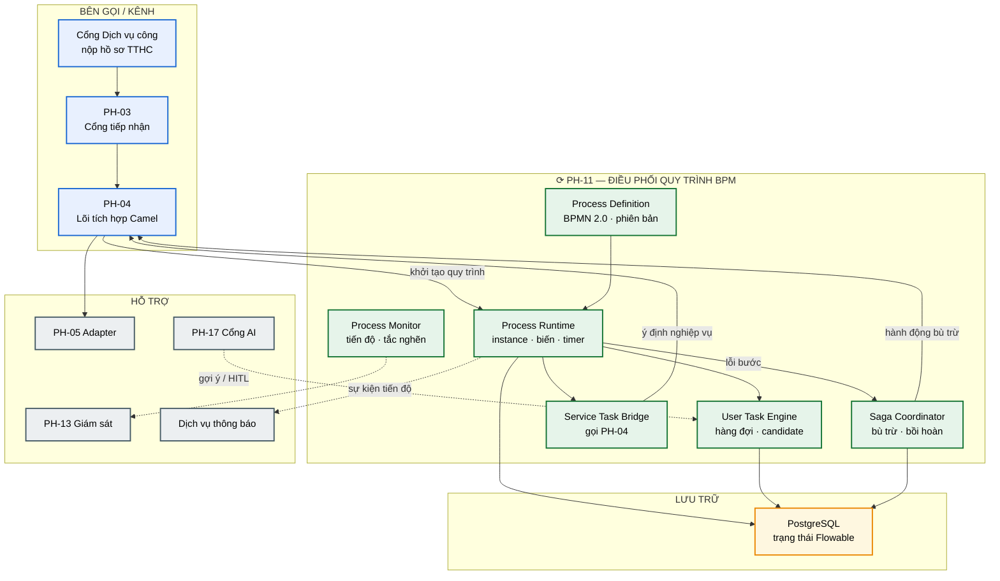
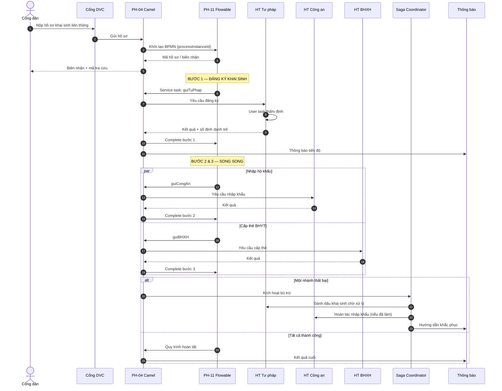
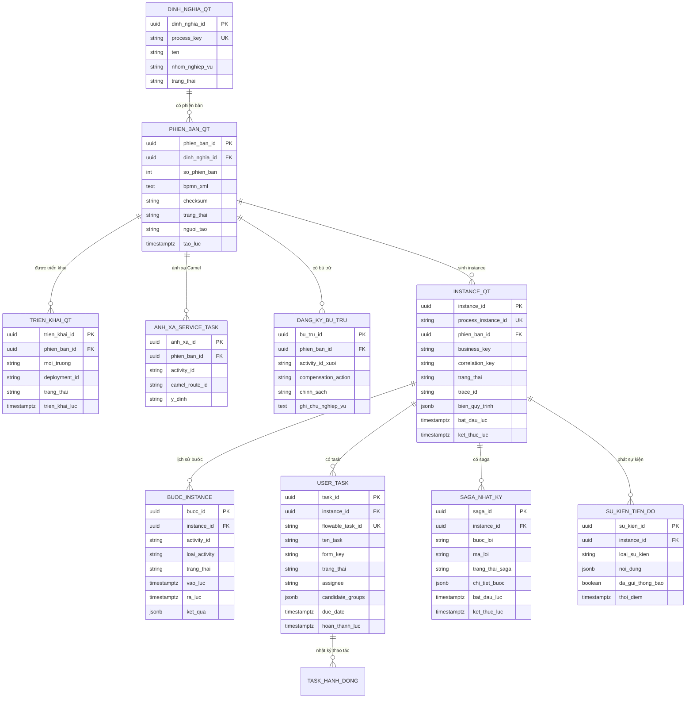

# SRS — PH-11: Điều phối quy trình nghiệp vụ (BPM)

| Thuộc tính | Giá trị |
|---|---|
| **Mã phân hệ** | PH-11 |
| **Tên** | Điều phối quy trình nghiệp vụ (Business Process Management) |
| **Nhóm** | Data Plane |
| **Mức bắt buộc** | M — Bắt buộc |
| **Phiên bản** | 1.0 |
| **Ngày** | 03/8/2026 |
| **Công nghệ chủ đạo** | Flowable (BPMN 2.0) + PostgreSQL |

---

## M1. Giới thiệu

### 1.1. Mục đích

PH-11 là **bộ não nghiệp vụ** cho các thủ tục hành chính liên thông kéo dài nhiều ngày đến nhiều tháng. Phân hệ này mô tả, triển khai và chạy quy trình theo chuẩn **BPMN 2.0**, giữ trạng thái bền vững qua mọi sự cố hạ tầng, và bảo đảm nhất quán cuối cùng giữa các bước liên hệ thống bằng mẫu **Saga / bù trừ**.

Đây là phân hệ đáp ứng yêu cầu **CMP-09** (hỗ trợ BPM chuẩn BPMN 2.0 / WS-BPEL theo CV 631), hiện thực luồng [F-07](../03-flows/README.md#f-07--giải-quyết-thủ-tục-hành-chính-liên-thông), và thực thi quyết định công nghệ tại [ADR-009](../05-adr/README.md#adr-009).

### 1.2. Ranh giới cốt lõi — Flowable và Camel

Đây là điểm dễ nhầm lẫn nhất và cũng là lý do PH-11 tồn tại độc lập với PH-04:

| Tiêu chí | Flowable (PH-11) | Camel (PH-04) |
|---|---|---|
| **Câu hỏi trả lời** | **Làm gì tiếp theo?** | **Làm bằng cách nào?** |
| Thời gian sống | Giờ → tháng | Mili giây → giây |
| Trạng thái | Có — lưu PostgreSQL | Không — sống trong bộ nhớ |
| Tác vụ người dùng | Có (user task) | Không |
| Song song / rẽ nhánh nghiệp vụ | Gateway BPMN | EIP kỹ thuật |
| Ví dụ | Đăng ký khai sinh liên thông | Gọi API Tư pháp, chuyển đổi bản tin |

**Hệ quả thiết kế.** Dùng Camel cho quy trình dài sẽ mất trạng thái khi pod khởi động lại. Dùng BPMN cho mỗi lời gọi tra cứu tạo gánh nặng ghi CSDL không cần thiết. Ranh giới này giữ sơ đồ nghiệp vụ đọc được bởi cán bộ nghiệp vụ, còn chi tiết kỹ thuật nằm gọn ở tầng tích hợp.

### 1.3. Phạm vi

**PH-11 chịu trách nhiệm:**

| # | Trách nhiệm |
|---|---|
| 1 | Định nghĩa, phiên bản hóa và triển khai định nghĩa BPMN 2.0 |
| 2 | Khởi tạo và điều khiển vòng đời instance quy trình |
| 3 | Thực thi user task (nhiệm vụ con người) và quản lý hàng đợi công việc |
| 4 | Gọi service task tới PH-04 (Camel) để thực hiện bước kỹ thuật |
| 5 | Điều phối bước tuần tự, song song, rẽ nhánh, chờ đợi, hẹn giờ |
| 6 | Điều phối Saga / bù trừ khi lỗi giữa các bước liên thông |
| 7 | Lưu trạng thái quy trình bền vững trên PostgreSQL |
| 8 | Thông báo tiến độ và trạng thái cuối tới bên liên quan |
| 9 | Giám sát instance, tắc nghẽn task, tỷ lệ bù trừ |
| 10 | Cung cấp bằng chứng tuân thủ CMP-09 (chạy được quy trình BPMN 2.0) |

**PH-11 KHÔNG chịu trách nhiệm:**

| # | Không làm | Thuộc phân hệ |
|---|---|---|
| 1 | Gọi hệ thống thành viên, chuyển đổi bản tin, retry kỹ thuật | PH-04 |
| 2 | Kết nối giao thức tới HTTT nguồn/đích | PH-05 |
| 3 | Xác thực / ủy quyền người dùng hoàn thành task | PH-12 |
| 4 | Cổng tiếp nhận HTTP từ bên ngoài | PH-03 |
| 5 | Ghi vết tập trung, dashboard vận hành tổng thể | PH-13 |
| 6 | Quyết định AI trong quy trình (nếu có) | PH-17 |

**Ranh giới số 1 — phân vai với PH-04.** Service task trong BPMN chỉ mang **ý định nghiệp vụ** (`guiTuPhap`, `capTheBHYT`). PH-04 nhận ý định đó, chọn adapter, giao thức, ánh xạ CDM và xử lý lỗi kỹ thuật. Đổi cách gọi hệ thống không đòi hỏi sửa sơ đồ BPMN; đổi logic nghiệp vụ không đòi hỏi sửa route Camel.

### 1.4. Tài liệu tham chiếu

| Mã | Tài liệu |
|---|---|
| [KT] | [Kiến trúc tổng thể — Process Orchestrator & Saga](../02-architecture/README.md) |
| [LT] | [F-07 — Giải quyết TTHC liên thông](../03-flows/README.md#f-07--giải-quyết-thủ-tục-hành-chính-liên-thông) |
| [PL] | [Ma trận CMP](../01-legal/README.md) — CMP-09 (CV 631) |
| [ADR] | [ADR-009 Flowable cho BPM](../05-adr/README.md#adr-009) |
| [SRS] | [PH-04 Lõi tích hợp](SRS-PH-04-integration-core.md), [PH-03 Gateway](SRS-PH-03-gateway.md), [PH-05 Adapter](SRS-PH-05-adapter.md), [PH-13 Giám sát](README.md), [PH-17 AI](README.md) |
| [DP] | [Triển khai — Flowable 2→6 replicas](../04-deployment/README.md) |

---

## M2. Mô tả tổng quan

### 2.1. Vị trí trong kiến trúc



**Thuyết minh sơ đồ.** PH-11 nằm trên đường dữ liệu nhưng **không** thay thế Camel. Mọi lời gọi ra hệ thống thành viên vẫn đi qua PH-04 → PH-05. Flowable chỉ giữ **trạng thái nghiệp vụ** và quyết định bước kế tiếp. PostgreSQL là nguồn sự thật của trạng thái quy trình — pod Flowable có thể khởi động lại mà instance vẫn tiếp tục đúng chỗ đang dở.

### 2.2. Luồng F-07 — TTHC liên thông



**Thuyết minh F-07 trong PH-11.**

1. **Nộp hồ sơ → khởi tạo BPMN.** Camel nhận hồ sơ, gọi PH-11 tạo instance; trả mã biên nhận ngay — công dân không chờ hết quy trình.
2. **Bước tuần tự / song song.** Gateway BPMN mô tả rõ: bước 1 xong mới mở song song bước 2 và 3.
3. **Thông báo tiến độ.** Sau mỗi bước hoàn thành, sự kiện tiến độ được phát — không chỉ thông báo kết quả cuối.
4. **Saga nếu lỗi.** Không dùng 2PC giữa các cơ quan độc lập. Mỗi bước có hành động bù trừ do nghiệp vụ định nghĩa.
5. **Hoàn tất.** Instance chuyển `COMPLETED`; biến kết quả và nhật ký bước sẵn sàng truy vết.

### 2.3. Tác nhân

| Tác nhân | Loại | Tương tác |
|---|---|---|
| Cán bộ nghiệp vụ quy trình | Người | Thiết kế / góp ý sơ đồ BPMN, định nghĩa bù trừ |
| Cán bộ thẩm định hồ sơ | Người | Nhận và hoàn thành user task |
| Quản trị quy trình | Người | Triển khai phiên bản, giám sát instance, xử lý treo |
| Công dân / tổ chức | Người | Nộp hồ sơ, tra cứu tiến độ (qua kênh DVC) |
| PH-04 Lõi tích hợp | Hệ thống | Khởi tạo instance, thực thi service task, báo hoàn thành / lỗi |
| PH-03 Gateway | Hệ thống | Đưa yêu cầu từ kênh ngoài vào trục |
| PH-05 Adapter | Hệ thống | Kết nối HTTT thành viên khi Camel thực thi |
| PH-13 Giám sát | Hệ thống | Nhận metric, trace, cảnh báo |
| PH-17 Cổng AI | Hệ thống | Gợi ý / human-in-the-loop trên user task (tùy chọn) |

### 2.4. Giả định

| Mã | Giả định |
|---|---|
| GD-01 | Mỗi thủ tục liên thông có sơ đồ BPMN đã được nghiệp vụ phê duyệt trước khi triển khai |
| GD-02 | Mỗi service task có route Camel tương ứng đã đăng ký và kiểm thử |
| GD-03 | Mỗi bước có thể thất bại đã được gắn hành động bù trừ tường minh (hoặc ghi nhận "không bù trừ được — chuyển xử lý thủ công") |
| GD-04 | PostgreSQL được sao lưu và có khả năng phục hồi điểm-trong-thời-gian |
| GD-05 | Ứng dụng thành viên hỗ trợ idempotent hoặc có mã đối chiếu để tránh nhân bản khi phát lại |
| GD-06 | Thông báo tới công dân đi qua dịch vụ thông báo độc lập; PH-11 chỉ phát sự kiện tiến độ |

### 2.5. Ràng buộc

| Mã | Ràng buộc | Nguồn |
|---|---|---|
| RB-01 | Hỗ trợ chuẩn **BPMN 2.0** | CV 631, CMP-09 |
| RB-02 | Thuyết minh BPMN thay / kế thừa WS-BPEL trong hồ sơ tuân thủ | ADR-009, CMP-09 |
| RB-03 | Trạng thái quy trình lưu bền vững — không chỉ trong bộ nhớ pod | ADR-009 |
| RB-04 | Phân vai: Flowable = làm gì tiếp; Camel = làm bằng cách nào | ADR-009 |
| RB-05 | Không dùng giao dịch phân tán 2PC giữa các HTTT thành viên | Kiến trúc |
| RB-06 | Toàn bộ công nghệ mã nguồn mở (Flowable Apache-2.0) | Yêu cầu dự án |
| RB-07 | Scale ngang Flowable theo tải instance | Triển khai: 2 → 6 replicas |

### 2.6. Phụ thuộc phân hệ

| Phụ thuộc | Loại | Hành vi khi không khả dụng |
|---|---|---|
| **PH-04** | **Cứng** | Không thực thi được service task → instance treo ở bước đang chờ; cảnh báo tắc nghẽn |
| **PH-03** | **Cứng** với kênh ngoài | Không nhận hồ sơ mới từ DVC; instance đang chạy không bị ảnh hưởng |
| **PH-05** | **Cứng** gián tiếp qua PH-04 | Lỗi kết nối hệ thống thành viên → PH-04 báo lỗi → PH-11 quyết định retry / bù trừ / chờ thủ công |
| **PH-13** | **Cứng** với ghi vết chuyển trạng thái | Không ghi được vết sự kiện quan trọng → cảnh báo vận hành; không chặn hoàn thành task thường |
| **PH-17** | **Mềm** | Không có gợi ý AI; user task vẫn hoạt động thủ công |
| PostgreSQL | **Cứng** | PH-11 **không** khởi động / không nhận instance mới nếu CSDL không khả dụng |

---

## M3. Yêu cầu chức năng

### 3.1. Nhóm A — Định nghĩa và triển khai BPMN

#### FR-11-001 — Quản lý định nghĩa quy trình BPMN 2.0 · **M**

| Mục | Nội dung |
|---|---|
| **Mô tả** | Tạo, cập nhật, phiên bản hóa định nghĩa quy trình theo chuẩn BPMN 2.0 |
| **Tác nhân** | Cán bộ nghiệp vụ quy trình, Quản trị quy trình |
| **Tiền điều kiện** | Người dùng có quyền `bpm.definition.manage` |
| **Đầu vào** | File `.bpmn20.xml` · mã quy trình (`processKey`) · tên · mô tả · nhãn nghiệp vụ · danh sách service task ↔ route Camel |
| **Xử lý** | 1. Kiểm tra cú pháp BPMN 2.0 và ràng buộc dự án (có start/end, không orphan)<br>2. Kiểm tra mọi `serviceTask` có ánh xạ route Camel đã đăng ký<br>3. Kiểm tra mọi bước có rủi ro thất bại đã khai báo bù trừ hoặc đánh dấu "thủ công"<br>4. Lưu phiên bản mới (`version` tăng dần), giữ phiên bản cũ<br>5. Chưa tự động kích hoạt — chờ triển khai (FR-11-002)<br>6. Ghi vết ai tải lên, khác biệt phiên bản |
| **Đầu ra** | Định nghĩa ở trạng thái `DRAFT` / `READY` kèm số phiên bản |
| **Ngoại lệ** | E1: XML không hợp lệ → `400`, liệt kê lỗi<br>E2: Service task thiếu ánh xạ Camel → `422`, không lưu<br>E3: Thiếu bù trừ bắt buộc → cảnh báo chặn triển khai PROD |

**Phần tử BPMN bắt buộc hỗ trợ:**

| Phần tử | Mục đích |
|---|---|
| Start / End Event | Bắt đầu / kết thúc instance |
| User Task | Nhiệm vụ con người |
| Service Task | Gọi PH-04 |
| Exclusive / Parallel / Inclusive Gateway | Rẽ nhánh, song song |
| Intermediate Timer / Message Event | Chờ thời hạn, chờ tín hiệu |
| Boundary Error Event | Bắt lỗi bước → kích hoạt Saga hoặc nhánh xử lý lỗi |
| Sub-Process | Nhóm bước con, tái sử dụng |

#### FR-11-002 — Triển khai (deploy) định nghĩa quy trình · **M**

| Mục | Nội dung |
|---|---|
| **Mô tả** | Đưa một phiên bản định nghĩa vào trạng thái chạy được trên Flowable |
| **Tác nhân** | Quản trị quy trình |
| **Tiền điều kiện** | Định nghĩa đã `READY`; môi trường đích xác định (DEV/TEST/STAGING/PROD) |
| **Đầu vào** | `processKey` · `version` · môi trường · ghi chú triển khai |
| **Xử lý** | 1. Kiểm tra lại ánh xạ Camel còn hiệu lực trên môi trường đích<br>2. Deploy vào Flowable engine → nhận `deploymentId`<br>3. Đặt phiên bản thành `ACTIVE` cho instance **mới**<br>4. Instance đang chạy giữ nguyên phiên bản cũ (không ép nâng cấp giữa chừng)<br>5. Ghi nhật ký triển khai, thông báo PH-13 |
| **Đầu ra** | Deployment thành công · phiên bản ACTIVE |
| **Ngoại lệ** | E1: Deploy PROD thiếu phê duyệt → từ chối<br>E2: Flowable từ chối XML → rollback, giữ phiên bản ACTIVE cũ<br>E3: Môi trường không có route Camel tương ứng → chặn |

#### FR-11-003 — Vô hiệu hóa / thu hồi phiên bản · **M**

| Mục | Nội dung |
|---|---|
| **Mô tả** | Ngừng nhận instance mới trên một phiên bản mà không hủy instance đang chạy |
| **Đầu vào** | `processKey` · `version` · lý do |
| **Xử lý** | 1. Chuyển phiên bản sang `SUSPENDED`<br>2. Từ chối `start` mới trên phiên bản này<br>3. Instance đang chạy tiếp tục đến khi hoàn tất hoặc bị hủy có kiểm soát<br>4. Cho phép chỉ định phiên bản thay thế làm ACTIVE |
| **Đầu ra** | Phiên bản SUSPENDED |
| **Ngoại lệ** | E1: Không còn phiên bản ACTIVE nào khác → cảnh báo, yêu cầu xác nhận |

### 3.2. Nhóm B — Runtime instance

#### FR-11-004 — Khởi tạo instance quy trình · **M**

| Mục | Nội dung |
|---|---|
| **Mô tả** | Tạo instance BPMN từ hồ sơ đầu vào (điểm vào chính của F-07) |
| **Tác nhân** | PH-04 |
| **Tiền điều kiện** | Có phiên bản `ACTIVE`; bên gọi đã xác thực qua PH-12 |
| **Đầu vào** | `processKey` · biến nghiệp vụ (mã hồ sơ, loại TTHC, dữ liệu đầu) · `traceId` · `correlationKey` |
| **Xử lý** | 1. Chọn phiên bản ACTIVE mới nhất (hoặc phiên bản chỉ định)<br>2. Tạo `processInstanceId`, ghi biến quy trình<br>3. Persist trạng thái xuống PostgreSQL<br>4. Phát sự kiện `PROCESS_STARTED`<br>5. Trả mã biên nhận / mã tra cứu gắn với instance |
| **Đầu ra** | `processInstanceId` · `businessKey` · trạng thái `RUNNING` |
| **Ngoại lệ** | E1: Không có phiên bản ACTIVE → `404`<br>E2: `correlationKey` trùng instance đang chạy → trả instance hiện có (idempotent)<br>E3: PostgreSQL lỗi → `503`, không tạo nửa vời |

**Ghi chú về idempotent.** Cùng một hồ sơ nộp lại (timeout phía DVC) không được tạo hai quy trình song song. `correlationKey` (ví dụ mã hồ sơ DVC) bảo đảm nhất quán.

#### FR-11-005 — Điều khiển vòng đời instance · **M**

| Mục | Nội dung |
|---|---|
| **Mô tả** | Tạm dừng, tiếp tục, hủy, hoặc đánh dấu lỗi có kiểm soát |
| **Tác nhân** | Quản trị quy trình, hệ thống (qua API) |
| **Đầu vào** | `processInstanceId` · hành động (`SUSPEND` / `RESUME` / `CANCEL` / `MARK_FAILED`) · lý do |
| **Xử lý** | 1. Kiểm tra chuyển trạng thái hợp lệ theo máy trạng thái<br>2. `CANCEL` → kích hoạt nhánh bù trừ nếu đã có bước hoàn tất (FR-11-011)<br>3. Ghi lý do và người thực hiện<br>4. Phát sự kiện trạng thái tới PH-13 và kênh thông báo |
| **Đầu ra** | Instance ở trạng thái mới |
| **Ngoại lệ** | E1: Hủy instance đã `COMPLETED` → từ chối<br>E2: Tiếp tục instance không ở `SUSPENDED` → từ chối |

**Máy trạng thái instance:**

| Trạng thái | Ý nghĩa |
|---|---|
| `RUNNING` | Đang thực thi |
| `WAITING_USER` | Chờ user task |
| `WAITING_SERVICE` | Chờ PH-04 hoàn thành service task |
| `COMPENSATING` | Đang chạy Saga bù trừ |
| `SUSPENDED` | Tạm dừng có chủ đích |
| `COMPLETED` | Hoàn tất thành công |
| `COMPENSATED` | Đã bù trừ xong sau lỗi |
| `FAILED` | Lỗi không bù trừ được — cần xử lý thủ công |
| `CANCELLED` | Hủy có kiểm soát |

#### FR-11-006 — Thực thi service task qua PH-04 · **M**

| Mục | Nội dung |
|---|---|
| **Mô tả** | Khi token đến service task, ủy thác thực thi kỹ thuật cho Camel |
| **Tác nhân** | Flowable Runtime → PH-04 |
| **Tiền điều kiện** | Ánh xạ `serviceTaskId` → `camelRouteId` đã cấu hình |
| **Đầu vào** | Tên tác vụ · biến quy trình cần truyền · `processInstanceId` · `traceId` |
| **Xử lý** | 1. Đánh dấu instance `WAITING_SERVICE`<br>2. Gọi PH-04 với ý định nghiệp vụ (không nhúng chi tiết giao thức)<br>3. Chờ callback hoàn thành / lỗi (async)<br>4. Thành công → ghi kết quả vào biến, tiến token<br>5. Lỗi kỹ thuật có thể retry theo cấu hình boundary; lỗi nghiệp vụ → nhánh lỗi / Saga<br>6. Persist sau mỗi chuyển bước |
| **Đầu ra** | Bước hoàn thành hoặc chuyển xử lý lỗi |
| **Ngoại lệ** | E1: PH-04 không phản hồi quá hạn → timer boundary, cảnh báo tắc nghẽn<br>E2: Ánh xạ route bị thu hồi giữa chừng → `FAILED` có lý do cấu hình |

**Ghi chú ranh giới.** Payload gửi PH-04 mang **ý định** (`action=guiTuPhap`) và dữ liệu nghiệp vụ đã chuẩn hóa. PH-04 tự chọn adapter SOAP/REST, retry, circuit breaker. PH-11 không biết và không cần biết endpoint thật.

#### FR-11-007 — Truy vấn tiến độ và lịch sử bước · **M**

| Mục | Nội dung |
|---|---|
| **Mô tả** | Cho phép tra cứu trạng thái instance, bước đã qua, bước đang chờ |
| **Tác nhân** | Cổng DVC (qua API), Quản trị quy trình, Công dân (gián tiếp) |
| **Đầu vào** | `processInstanceId` hoặc `businessKey` / mã tra cứu |
| **Xử lý** | 1. Đọc trạng thái hiện tại từ PostgreSQL<br>2. Ghép lịch sử activity (thời điểm vào/ra từng bước)<br>3. Ẩn chi tiết kỹ thuật nội bộ khỏi phản hồi công dân<br>4. Trả bước kế tiếp dự kiến nếu có |
| **Đầu ra** | Bản tiến độ + lịch sử |
| **Ngoại lệ** | E1: Không tìm thấy → `404`<br>E2: Người gọi không đủ quyền xem hồ sơ → `403` |

### 3.3. Nhóm C — User task

#### FR-11-008 — Tạo và phân công user task · **M**

| Mục | Nội dung |
|---|---|
| **Mô tả** | Sinh nhiệm vụ con người khi token đến user task trong BPMN |
| **Tác nhân** | Flowable Runtime |
| **Đầu vào** | Định nghĩa task (tên, form key, candidate groups/users, hạn xử lý) · biến quy trình |
| **Xử lý** | 1. Tạo bản ghi task với trạng thái `CREATED` → `READY`<br>2. Gán candidate theo nhóm/vai trò từ PH-12<br>3. Đặt due date nếu có<br>4. Đưa vào hàng đợi công việc<br>5. Thông báo người/nhóm được phân công<br>6. Instance chuyển `WAITING_USER` |
| **Đầu ra** | `taskId` trong hàng đợi |
| **Ngoại lệ** | E1: Không có candidate hợp lệ → cảnh báo cấu hình, task vào hàng "unassigned"<br>E2: Form key không tồn tại → vẫn tạo task, cảnh báo UI |

#### FR-11-009 — Nhận, hoàn thành, ủy quyền lại user task · **M**

| Mục | Nội dung |
|---|---|
| **Mô tả** | Cán bộ thao tác trên nhiệm vụ được giao |
| **Tác nhân** | Cán bộ thẩm định hồ sơ |
| **Tiền điều kiện** | Đã xác thực; thuộc candidate hoặc được claim |
| **Đầu vào** | `taskId` · hành động (`CLAIM` / `UNCLAIM` / `COMPLETE` / `DELEGATE`) · dữ liệu form · quyết định |
| **Xử lý** | 1. `CLAIM` — gán task cho người đang đăng nhập<br>2. `COMPLETE` — kiểm tra dữ liệu form bắt buộc, ghi biến kết quả, tiến token BPMN<br>3. `DELEGATE` — chuyển cho người khác kèm lý do<br>4. Ghi vết người xử lý, thời điểm, quyết định<br>5. Phát sự kiện tiến độ nếu cấu hình |
| **Đầu ra** | Task `COMPLETED` hoặc vẫn mở sau ủy quyền |
| **Ngoại lệ** | E1: Complete thiếu trường bắt buộc → `422`<br>E2: Claim task đã thuộc người khác → `409`<br>E3: Không có quyền → `403` |

#### FR-11-010 — Quá hạn và nhắc user task · **M**

| Mục | Nội dung |
|---|---|
| **Mô tả** | Theo dõi hạn xử lý, nhắc và leo thang |
| **Đầu vào** | Cấu hình SLA theo loại task · `taskId` |
| **Xử lý** | 1. Timer kiểm tra due date<br>2. Trước hạn: nhắc người đang claim / candidate<br>3. Quá hạn: đánh dấu `OVERDUE`, leo thang lên nhóm cấp trên nếu cấu hình<br>4. Metric tắc nghẽn gửi PH-13 |
| **Đầu ra** | Task được nhắc / leo thang |
| **Ngoại lệ** | E1: Không cấu hình SLA → chỉ cảnh báo thống kê, không leo thang tự động |

### 3.4. Nhóm D — Saga / bù trừ

#### FR-11-011 — Đăng ký hành động bù trừ theo bước · **M**

| Mục | Nội dung |
|---|---|
| **Mô tả** | Mỗi bước xuôi có thể gắn một hành động bù trừ tường minh |
| **Tác nhân** | Cán bộ nghiệp vụ quy trình |
| **Đầu vào** | `processKey` · `activityId` bước xuôi · `compensationAction` (service task bù trừ hoặc quy trình con) · chính sách (`AUTO` / `MANUAL`) |
| **Xử lý** | 1. Lưu ánh xạ bước xuôi ↔ bù trừ trong định nghĩa / cấu hình kèm<br>2. Xác nhận action bù trừ có route Camel tương ứng<br>3. Ghi chú nghiệp vụ (ví dụ: khai sinh **không xóa** mà đánh dấu chờ xử lý)<br>4. Chặn deploy PROD nếu bước rủi ro cao thiếu bù trừ và chưa được miễn trừ có phê duyệt |
| **Đầu ra** | Bảng bù trừ của quy trình |
| **Ngoại lệ** | E1: Bù trừ trỏ tới chính bước xuôi → từ chối<br>E2: Action bù trừ chưa deploy → cảnh báo |

**Ví dụ bù trừ F-07 (khai sinh liên thông):**

| Bước xuôi | Hành động bù trừ | Ghi chú nghiệp vụ |
|---|---|---|
| Đăng ký khai sinh | Đánh dấu hồ sơ chờ xử lý | **Không xóa** — văn bản pháp lý đã phát hành |
| Nhập hộ khẩu | Hoàn tác bản ghi nhập khẩu | Chỉ khi bước đã thành công |
| Cấp thẻ BHYT | Hủy thẻ đã cấp | Gọi BHXH qua PH-04 |

#### FR-11-012 — Điều phối Saga khi lỗi bước · **M**

| Mục | Nội dung |
|---|---|
| **Mô tả** | Khi một bước thất bại sau khi đã có bước khác hoàn tất, kích hoạt bù trừ theo thứ tự ngược |
| **Tác nhân** | Saga Coordinator (nội bộ PH-11), kích hoạt từ lỗi service task / hủy instance |
| **Tiền điều kiện** | Có ít nhất một bước đã hoàn tất có đăng ký bù trừ |
| **Đầu vào** | `processInstanceId` · bước lỗi · mã lỗi · ngữ cảnh |
| **Xử lý** | 1. Chuyển instance sang `COMPENSATING`<br>2. Lấy danh sách bước đã hoàn tất theo thứ tự ngược thời gian<br>3. Với mỗi bước: gọi hành động bù trừ qua PH-04 (service task bù trừ)<br>4. Ghi kết quả từng lần bù trừ<br>5. Tất cả bù trừ thành công → `COMPENSATED`<br>6. Một bù trừ thất bại → `FAILED`, mở user task xử lý thủ công, cảnh báo nghiêm trọng<br>7. Thông báo công dân / cán bộ theo cấu hình |
| **Đầu ra** | Instance `COMPENSATED` hoặc `FAILED` kèm nhật ký Saga |
| **Ngoại lệ** | E1: Bước không có bù trừ → bỏ qua có ghi nhận, hoặc chuyển thủ công tùy chính sách<br>E2: Bù trừ idempotent thất bại do hệ thống đích → retry có giới hạn rồi thủ công<br>E3: Lỗi ngay bước đầu (chưa có gì hoàn tất) → không chạy Saga, chuyển nhánh lỗi nghiệp vụ |

**Ghi chú thiết kế.** Saga bảo đảm **nhất quán cuối cùng**, không phải nhất quán tức thì. Trong lúc bù trừ, trạng thái phân tán có thể tạm không nhất quán — điều này chấp nhận được và phải được giám sát.

#### FR-11-013 — Nhật ký Saga và đối soát bù trừ · **M**

| Mục | Nội dung |
|---|---|
| **Mô tả** | Lưu vết đầy đủ các lần bù trừ để thanh tra và đối soát với hệ thống thành viên |
| **Đầu vào** | Sự kiện bù trừ từng bước |
| **Xử lý** | 1. Ghi: bước xuôi, action bù trừ, thời điểm, kết quả, `traceId`, phản hồi hệ thống đích<br>2. Cho phép đối soát theo `businessKey`<br>3. Xuất báo cáo bù trừ theo khoảng thời gian |
| **Đầu ra** | Nhật ký Saga truy vấn được |
| **Ngoại lệ** | E1: Không ghi được nhật ký → **không** đánh dấu bù trừ thành công (fail-safe ghi vết) |

### 3.5. Nhóm E — Giám sát, thông báo và tuân thủ

#### FR-11-014 — Phát sự kiện tiến độ và thông báo · **M**

| Mục | Nội dung |
|---|---|
| **Mô tả** | Phát sự kiện sau khởi tạo, mỗi bước hoàn thành, bù trừ, hoàn tất — phục vụ thông báo công dân |
| **Tác nhân** | Process Runtime |
| **Đầu vào** | Loại sự kiện · `processInstanceId` · dữ liệu tiến độ rút gọn |
| **Xử lý** | 1. Sinh sự kiện chuẩn hóa<br>2. Gửi tới kênh thông báo / PH-10 nếu cấu hình<br>3. Không đưa dữ liệu nhạy cảm vào nội dung thông báo công dân<br>4. Ghi nhận đã phát để tránh trùng |
| **Đầu ra** | Sự kiện tiến độ |
| **Ngoại lệ** | E1: Kênh thông báo lỗi → ghi hàng đợi nội bộ, không rollback bước nghiệp vụ đã xong |

#### FR-11-015 — Giám sát instance và tắc nghẽn · **M**

| Mục | Nội dung |
|---|---|
| **Mô tả** | Cung cấp chỉ số và cảnh báo vận hành quy trình |
| **Tác nhân** | Quản trị quy trình, PH-13 |
| **Xử lý** | Theo dõi: số instance theo trạng thái · tuổi thọ trung bình · task quá hạn · tỷ lệ bù trừ · thời gian chờ service task · instance treo<br>Cảnh báo khi vượt ngưỡng cấu hình |
| **Đầu ra** | Metric + cảnh báo |
| **Ngoại lệ** | — |

#### FR-11-016 — Bằng chứng tuân thủ CMP-09 và thuyết minh WS-BPEL · **M**

| Mục | Nội dung |
|---|---|
| **Mô tả** | Bảo đảm có thể triển khai và chạy ít nhất một quy trình BPMN 2.0 mẫu; thuyết minh vị trí WS-BPEL |
| **Tác nhân** | Quản trị quy trình, nhóm tuân thủ |
| **Xử lý** | 1. Duy trì quy trình mẫu chuẩn (TTHC liên thông rút gọn) luôn deploy được<br>2. Sinh biên bản chạy mẫu kèm `processInstanceId` và lịch sử bước<br>3. Hồ sơ tuân thủ ghi rõ: **BPMN 2.0 là chuẩn kế thừa và thay thế WS-BPEL trong thực tiễn công nghiệp**; Flowable đáp ứng BPMN 2.0 đầy đủ<br>4. Nếu cơ quan thẩm định **bắt buộc** WS-BPEL nghiêm ngặt: phương án dự phòng là bổ sung Apache ODE cho các quy trình BPEL cụ thể — không thay Flowable cho luồng chính<br>5. Lưu biên bản nghiệm thu CMP-09 |
| **Đầu ra** | Biên bản chạy mẫu + thuyết minh tuân thủ |
| **Ngoại lệ** | E1: Không chạy được mẫu → CMP-09 chưa đạt, chặn nghiệm thu phân hệ |

### 3.6. Bảng tổng hợp yêu cầu chức năng

| Nhóm | Mã | Tên | Ưu tiên |
|---|---|---|:-:|
| A | FR-11-001 | Quản lý định nghĩa quy trình BPMN 2.0 | M |
| A | FR-11-002 | Triển khai định nghĩa quy trình | M |
| A | FR-11-003 | Vô hiệu hóa / thu hồi phiên bản | M |
| B | FR-11-004 | Khởi tạo instance quy trình | M |
| B | FR-11-005 | Điều khiển vòng đời instance | M |
| B | FR-11-006 | Thực thi service task qua PH-04 | M |
| B | FR-11-007 | Truy vấn tiến độ và lịch sử bước | M |
| C | FR-11-008 | Tạo và phân công user task | M |
| C | FR-11-009 | Nhận, hoàn thành, ủy quyền lại user task | M |
| C | FR-11-010 | Quá hạn và nhắc user task | M |
| D | FR-11-011 | Đăng ký hành động bù trừ theo bước | M |
| D | FR-11-012 | Điều phối Saga khi lỗi bước | M |
| D | FR-11-013 | Nhật ký Saga và đối soát bù trừ | M |
| E | FR-11-014 | Phát sự kiện tiến độ và thông báo | M |
| E | FR-11-015 | Giám sát instance và tắc nghẽn | M |
| E | FR-11-016 | Bằng chứng tuân thủ CMP-09 và thuyết minh WS-BPEL | M |

**Tổng: 16 yêu cầu chức năng** — 16 bắt buộc (M).

---

## M4. Mô hình dữ liệu

### 4.1. Sơ đồ thực thể



**Ghi chú.** Flowable tự quản lý bảng engine (`ACT_*`). Các thực thể trên là **lớp nghiệp vụ LGSP** đồng bộ / bổ sung để phục vụ API quản trị, tra cứu tiến độ, Saga và tuân thủ — không thay thế schema nội bộ của Flowable.

### 4.2. Đặc tả thực thể

#### EN-11-01 — DINH_NGHIA_QT và PHIEN_BAN_QT

| Trường (Định nghĩa) | Kiểu | Bắt buộc | Mô tả |
|---|---|:-:|---|
| `dinh_nghia_id` | UUID | ✓ | PK |
| `process_key` | VARCHAR(64) | ✓ | UNIQUE — khóa nghiệp vụ ổn định qua các phiên bản |
| `ten` | VARCHAR(200) | ✓ | |
| `nhom_nghiep_vu` | VARCHAR(80) | ✓ | Ví dụ `TTHC_LIEN_THONG` |
| `trang_thai` | VARCHAR(20) | ✓ | ∈ {`DRAFT`,`ACTIVE`,`RETIRED`} |

| Trường (Phiên bản) | Kiểu | Bắt buộc | Mô tả |
|---|---|:-:|---|
| `so_phien_ban` | INTEGER | ✓ | Tăng dần, UNIQUE cùng định nghĩa |
| `bpmn_xml` | TEXT | ✓ | Nội dung BPMN 2.0 |
| `checksum` | VARCHAR(64) | ✓ | SHA-256 nội dung |
| `trang_thai` | VARCHAR(20) | ✓ | ∈ {`DRAFT`,`READY`,`ACTIVE`,`SUSPENDED`} |
| `nguoi_tao` | VARCHAR(100) | ✓ | |

#### EN-11-02 — ANH_XA_SERVICE_TASK

| Trường | Kiểu | Bắt buộc | Mô tả |
|---|---|:-:|---|
| `anh_xa_id` | UUID | ✓ | PK |
| `phien_ban_id` | UUID | ✓ | FK |
| `activity_id` | VARCHAR(100) | ✓ | ID phần tử trong BPMN |
| `camel_route_id` | VARCHAR(120) | ✓ | Route PH-04 |
| `y_dinh` | VARCHAR(120) | ✓ | Ý định nghiệp vụ, ví dụ `guiTuPhap` |

**Ràng buộc.** UNIQUE (`phien_ban_id`, `activity_id`). Deploy PROD yêu cầu mọi service task có bản ghi ánh xạ hợp lệ.

#### EN-11-03 — DANG_KY_BU_TRU

| Trường | Kiểu | Bắt buộc | Mô tả |
|---|---|:-:|---|
| `bu_tru_id` | UUID | ✓ | PK |
| `phien_ban_id` | UUID | ✓ | FK |
| `activity_id_xuoi` | VARCHAR(100) | ✓ | Bước cần bù trừ khi rollback |
| `compensation_action` | VARCHAR(120) | ✓ | Action / route bù trừ |
| `chinh_sach` | VARCHAR(16) | ✓ | ∈ {`AUTO`,`MANUAL`,`NONE_APPROVED`} |
| `ghi_chu_nghiep_vu` | TEXT | ✓ | **Bắt buộc** — giải thích nghiệp vụ (ví dụ không xóa khai sinh) |

#### EN-11-04 — INSTANCE_QT

| Trường | Kiểu | Bắt buộc | Mô tả |
|---|---|:-:|---|
| `instance_id` | UUID | ✓ | PK nghiệp vụ LGSP |
| `process_instance_id` | VARCHAR(64) | ✓ | ID Flowable — UNIQUE |
| `phien_ban_id` | UUID | ✓ | FK — khóa phiên bản đã chạy |
| `business_key` | VARCHAR(100) | ✓ | Mã hồ sơ / biên nhận |
| `correlation_key` | VARCHAR(120) | ✓ | Khóa idempotent khi start |
| `trang_thai` | VARCHAR(24) | ✓ | Theo máy trạng thái FR-11-005 |
| `trace_id` | VARCHAR(64) | ✓ | Liên kết PH-13 |
| `bien_quy_trinh` | JSONB | ✓ | Biến nghiệp vụ (đã lọc trường mật nếu cần) |
| `bat_dau_luc` | TIMESTAMPTZ | ✓ | |
| `ket_thuc_luc` | TIMESTAMPTZ | | |

**Ràng buộc.** UNIQUE (`correlation_key`) đối với instance chưa kết thúc — bảo đảm idempotent start.

#### EN-11-05 — USER_TASK

| Trường | Kiểu | Bắt buộc | Mô tả |
|---|---|:-:|---|
| `task_id` | UUID | ✓ | PK |
| `instance_id` | UUID | ✓ | FK |
| `flowable_task_id` | VARCHAR(64) | ✓ | UNIQUE |
| `ten_task` | VARCHAR(200) | ✓ | |
| `form_key` | VARCHAR(100) | | Khóa form UI |
| `trang_thai` | VARCHAR(20) | ✓ | ∈ {`READY`,`CLAIMED`,`COMPLETED`,`OVERDUE`,`CANCELLED`} |
| `assignee` | VARCHAR(100) | | Người đang nhận |
| `candidate_groups` | JSONB | ✓ | Nhóm ứng viên |
| `due_date` | TIMESTAMPTZ | | Hạn SLA |
| `hoan_thanh_luc` | TIMESTAMPTZ | | |

#### EN-11-06 — SAGA_NHAT_KY

| Trường | Kiểu | Bắt buộc | Mô tả |
|---|---|:-:|---|
| `saga_id` | UUID | ✓ | PK |
| `instance_id` | UUID | ✓ | FK |
| `buoc_loi` | VARCHAR(100) | ✓ | Activity gây kích hoạt |
| `ma_loi` | VARCHAR(64) | ✓ | |
| `trang_thai_saga` | VARCHAR(24) | ✓ | ∈ {`RUNNING`,`SUCCEEDED`,`PARTIAL`,`FAILED`} |
| `chi_tiet_buoc` | JSONB | ✓ | Mảng: bước xuôi, action, kết quả, thời điểm |
| `bat_dau_luc` | TIMESTAMPTZ | ✓ | |
| `ket_thuc_luc` | TIMESTAMPTZ | | |

**Ghi chú.** Nhật ký Saga là bằng chứng đối soát khi một cơ quan đã ghi nhận giao dịch và cần hoàn tác — lưu **tối thiểu 5 năm**.

### 4.3. Chính sách lưu giữ

| Thực thể | Thời hạn | Ghi chú |
|---|---|---|
| DINH_NGHIA_QT, PHIEN_BAN_QT, BPMN XML | Vĩnh viễn | Truy vết phiên bản quy trình |
| ANH_XA_SERVICE_TASK, DANG_KY_BU_TRU | Vĩnh viễn theo phiên bản | |
| INSTANCE_QT, BUOC_INSTANCE | 5 năm sau khi kết thúc | Hồ sơ TTHC |
| USER_TASK, TASK_HANH_DONG | 5 năm | Ai xử lý, khi nào |
| **SAGA_NHAT_KY** | **≥ 5 năm** | Đối soát bù trừ liên cơ quan |
| SU_KIEN_TIEN_DO | 2 năm | Đủ cho khiếu nại tiến độ |
| Bảng `ACT_*` Flowable | Theo chính sách dọn lịch sử engine (archive sau 1–2 năm, giữ bản nghiệp vụ LGSP) | |

---

## M5. Giao diện API

### 5.1. Nguyên tắc chung

| Khía cạnh | Quy định |
|---|---|
| Đường dẫn runtime | `/api/v1/bpm` |
| Đường dẫn quản trị | `/api/admin/v1/bpm` |
| Xác thực | Bearer JWT qua PH-12; service-to-service mTLS trong cụm |
| Giao thức nội bộ | PH-04 gọi start / complete service task callback |
| Mã lỗi | RFC 9457 Problem Details |
| Idempotency | Header `Idempotency-Key` hoặc `correlationKey` khi start |

### 5.2. Điểm cuối runtime

| Phương thức | Đường dẫn | Chức năng | FR |
|---|---|---|---|
| `POST` | `/api/v1/bpm/instances` | Khởi tạo instance | FR-11-004 |
| `GET` | `/api/v1/bpm/instances/{id}` | Chi tiết instance | FR-11-007 |
| `GET` | `/api/v1/bpm/instances/by-key/{businessKey}` | Tra cứu theo mã hồ sơ | FR-11-007 |
| `POST` | `/api/v1/bpm/instances/{id}/suspend` | Tạm dừng | FR-11-005 |
| `POST` | `/api/v1/bpm/instances/{id}/resume` | Tiếp tục | FR-11-005 |
| `POST` | `/api/v1/bpm/instances/{id}/cancel` | Hủy (+ Saga nếu cần) | FR-11-005, 012 |
| `POST` | `/api/v1/bpm/service-tasks/{executionId}/complete` | Callback hoàn thành từ PH-04 | FR-11-006 |
| `POST` | `/api/v1/bpm/service-tasks/{executionId}/fail` | Callback lỗi từ PH-04 | FR-11-006, 012 |
| `GET` | `/api/v1/bpm/tasks` | Danh sách user task của tôi / nhóm | FR-11-008 |
| `POST` | `/api/v1/bpm/tasks/{taskId}/claim` | Nhận task | FR-11-009 |
| `POST` | `/api/v1/bpm/tasks/{taskId}/complete` | Hoàn thành task | FR-11-009 |
| `POST` | `/api/v1/bpm/tasks/{taskId}/delegate` | Ủy quyền lại | FR-11-009 |
| `GET` | `/api/v1/bpm/instances/{id}/progress` | Tiến độ rút gọn (cho DVC) | FR-11-007, 014 |

### 5.3. Điểm cuối quản trị

| Phương thức | Đường dẫn | Chức năng | FR |
|---|---|---|---|
| `GET` | `/api/admin/v1/bpm/definitions` | Danh sách định nghĩa | FR-11-001 |
| `POST` | `/api/admin/v1/bpm/definitions` | Tải lên BPMN | FR-11-001 |
| `GET` | `/api/admin/v1/bpm/definitions/{key}/versions` | Các phiên bản | FR-11-001 |
| `POST` | `/api/admin/v1/bpm/definitions/{key}/versions/{ver}/deploy` | Triển khai | FR-11-002 |
| `POST` | `/api/admin/v1/bpm/definitions/{key}/versions/{ver}/suspend` | Vô hiệu hóa | FR-11-003 |
| `PUT` | `/api/admin/v1/bpm/definitions/{key}/versions/{ver}/compensations` | Đăng ký bù trừ | FR-11-011 |
| `GET` | `/api/admin/v1/bpm/instances` | Lọc instance vận hành | FR-11-015 |
| `GET` | `/api/admin/v1/bpm/sagas` | Nhật ký Saga | FR-11-013 |
| `GET` | `/api/admin/v1/bpm/metrics` | Chỉ số tắc nghẽn | FR-11-015 |
| `POST` | `/api/admin/v1/bpm/compliance/sample-run` | Chạy mẫu CMP-09 | FR-11-016 |

### 5.4. Đặc tả chi tiết điểm cuối chính

#### 5.4.1. `POST /api/v1/bpm/instances` — Khởi tạo

**Yêu cầu:**

```json
{
  "processKey": "TTHC_KHAI_SINH_LIEN_THONG",
  "businessKey": "HS-2026-0803-000142",
  "correlationKey": "DVC-KS-9f3c2a11",
  "traceId": "4bf92f3577b34da6a3ce929d0e0e4736",
  "variables": {
    "loaiTTHC": "KHAI_SINH_LIEN_THONG",
    "hoTenTre": "Nguyễn Văn B",
    "ngaySinh": "2026-08-01",
    "maXa": "01001",
    "nguoiNop": { "soDinhDanh": "001199001234", "hoTen": "Nguyễn Văn A" }
  }
}
```

**Phản hồi `201 Created`:**

```json
{
  "processInstanceId": "a8e1c2d4-1111-2222-3333-444455556666",
  "businessKey": "HS-2026-0803-000142",
  "processKey": "TTHC_KHAI_SINH_LIEN_THONG",
  "version": 3,
  "trangThai": "RUNNING",
  "maBienNhan": "BN-2026-0803-000142",
  "maTraCuu": "TC-9f3c2a11"
}
```

**Phản hồi idempotent `200 OK`** (cùng `correlationKey` đang chạy): trả đúng instance hiện có, không tạo mới.

#### 5.4.2. `POST /api/v1/bpm/service-tasks/{executionId}/fail` — Kích hoạt xử lý lỗi / Saga

**Yêu cầu:**

```json
{
  "maLoi": "BHXH_TIMEOUT",
  "moTa": "Hệ thống BHXH không phản hồi sau 3 lần thử",
  "coTheBuTru": true,
  "traceId": "4bf92f3577b34da6a3ce929d0e0e4736",
  "chiTiet": { "camelRouteId": "route-gui-bhxh", "soLanThu": 3 }
}
```

**Phản hồi `202 Accepted`:**

```json
{
  "processInstanceId": "a8e1c2d4-1111-2222-3333-444455556666",
  "trangThai": "COMPENSATING",
  "sagaId": "s1a2g3a4-...",
  "cacBuocBuTru": [
    { "activityId": "capTheBHYT", "action": "huyTheBHYT", "trangThai": "SKIPPED_NOT_DONE" },
    { "activityId": "nhapHoKhau", "action": "hoanTacNhapKhau", "trangThai": "PENDING" },
    { "activityId": "dangKyKhaiSinh", "action": "danhDauChoXuLy", "trangThai": "PENDING" }
  ]
}
```

#### 5.4.3. `GET /api/v1/bpm/instances/{id}/progress` — Tiến độ cho công dân

**Phản hồi `200 OK`:**

```json
{
  "maTraCuu": "TC-9f3c2a11",
  "trangThaiHienThi": "DANG_XU_LY",
  "phanTramUocLuong": 66,
  "cacBuoc": [
    { "ten": "Đăng ký khai sinh", "trangThai": "HOAN_THANH", "thoiDiem": "2026-08-03T10:15:00+07:00" },
    { "ten": "Nhập hộ khẩu", "trangThai": "HOAN_THANH", "thoiDiem": "2026-08-03T14:02:00+07:00" },
    { "ten": "Cấp thẻ BHYT", "trangThai": "DANG_XU_LY", "thoiDiem": null }
  ],
  "thongDiep": "Hồ sơ đang được BHXH xử lý cấp thẻ BHYT"
}
```

**Ghi chú.** Phản hồi công dân **không** lộ `camelRouteId`, endpoint nội bộ hay chi tiết lỗi kỹ thuật.

---

## M6. Giao diện người dùng

### 6.1. Danh mục màn hình

| Mã | Tên màn hình | Đối tượng | Mockup |
|---|---|---|---|
| **UI-11-01** | Danh sách định nghĩa & phiên bản BPMN | Quản trị quy trình | [`bpm.html`](../../mockup/pages/bpm.html) (dự kiến) |
| **UI-11-02** | Đăng ký ánh xạ service task & bù trừ | Quản trị / nghiệp vụ | [`bpm.html`](../../mockup/pages/bpm.html) (tab Ánh xạ) |
| **UI-11-03** | Danh sách user task (hàng đợi việc) | Cán bộ thẩm định | [`bpm.html`](../../mockup/pages/bpm.html) (tab Việc của tôi) |
| **UI-11-04** | Chi tiết task & form hoàn thành | Cán bộ thẩm định | [`bpm.html`](../../mockup/pages/bpm.html) |
| **UI-11-05** | Sơ đồ tiến độ instance | Quản trị, hỗ trợ DVC | [`bpm.html`](../../mockup/pages/bpm.html) (tab Tiến độ) |
| **UI-11-06** | Giám sát tắc nghẽn & nhật ký Saga | Quản trị quy trình | [`bpm.html`](../../mockup/pages/bpm.html) (tab Giám sát) |

### 6.2. UI-11-03 — Danh sách user task

**Mục đích.** Hàng đợi việc hàng ngày của cán bộ — điểm tương tác người-máy chính của PH-11.

| Thành phần | Mô tả |
|---|---|
| Bộ lọc | Trạng thái · loại TTHC · hạn xử lý · chỉ việc của tôi / nhóm |
| Bảng task | Mã hồ sơ · tên task · hạn · tuổi thọ · độ ưu tiên · trạng thái |
| Nhãn quá hạn | Đỏ khi `OVERDUE` |
| Nút nhận việc | Claim nhanh từ danh sách |
| Đếm theo nhóm | Số việc sẵn sàng / đang làm / quá hạn |

**Quy tắc tương tác:**

| # | Quy tắc |
|---|---|
| 1 | Task chưa claim → nhiều người trong nhóm thấy; sau claim chỉ assignee thao tác complete |
| 2 | Sắp xếp mặc định: quá hạn trước, rồi gần hạn |
| 3 | Không hiển thị dữ liệu mật trên danh sách — chỉ mã hồ sơ và tên bước |
| 4 | Click dòng → UI-11-04 |

### 6.3. UI-11-05 — Sơ đồ tiến độ instance

**Mục đích.** Nhìn một instance trên nền sơ đồ BPMN: bước nào xong, đang chờ, lỗi, đang bù trừ.

| Thành phần | Mô tả |
|---|---|
| Canvas BPMN | Tô màu theo trạng thái activity |
| Chú thích màu | Xanh = hoàn thành · vàng = đang chờ · đỏ = lỗi · tím = bù trừ |
| Timeline | Danh sách sự kiện theo thời gian |
| Biến quy trình | Xem biến (đã che nếu nhạy cảm) |
| Hành động quản trị | Suspend / Resume / Cancel (có xác nhận + lý do) |

**Quy tắc tương tác:**

| # | Quy tắc |
|---|---|
| 1 | Cancel instance đã có bước hoàn tất → cảnh báo sẽ chạy Saga |
| 2 | Click activity lỗi → xem mã lỗi và liên kết `traceId` sang PH-13 |
| 3 | Chế độ "công dân" ẩn canvas kỹ thuật, chỉ hiện timeline thân thiện |

### 6.4. UI-11-06 — Giám sát tắc nghẽn & Saga

| Thành phần | Mô tả |
|---|---|
| Thẻ chỉ số | Instance đang chạy · task quá hạn · tỷ lệ bù trừ 24h · thời gian chờ service P95 |
| Danh sách treo | Instance `WAITING_SERVICE` vượt ngưỡng |
| Bảng Saga | `sagaId` · hồ sơ · trạng thái · số bước bù trừ · kết quả |
| Liên kết runbook | Mở hướng dẫn xử lý khi Saga `FAILED` |

**Quy tắc tương tác:**

| # | Quy tắc |
|---|---|
| 1 | Saga `PARTIAL` / `FAILED` → hàng tô đỏ, yêu cầu acknowledge của quản trị |
| 2 | Có thể lọc theo `processKey` và khoảng thời gian |
| 3 | Xuất CSV nhật ký Saga phục vụ đối soát liên cơ quan |

---

## M7. Yêu cầu phi chức năng

### 7.1. Hiệu năng

| Mã | Yêu cầu | Chỉ tiêu | Cách đo |
|---|---|---|---|
| **NFR-11-001** | Độ trễ khởi tạo instance | P99 ≤ 200ms | Đo API start |
| **NFR-11-002** | Độ trễ complete user task | P99 ≤ 300ms | Đo API complete |
| **NFR-11-003** | Độ trễ callback service task | P99 ≤ 150ms | Đo API complete/fail |
| **NFR-11-004** | Thông lượng start mới | ≥ 200 instance/giây (burst) | Kiểm thử tải |
| **NFR-11-005** | Instance đồng thời đang chạy | ≥ 50.000 | Theo dõi PostgreSQL + engine |
| **NFR-11-006** | Truy vấn tiến độ | P99 ≤ 100ms | Đọc từ bản nghiệp vụ / đệm |

### 7.2. Tính sẵn sàng và mở rộng

| Mã | Yêu cầu | Chỉ tiêu |
|---|---|---|
| **NFR-11-007** | Tỷ lệ sẵn sàng | ≥ 99,9% |
| **NFR-11-008** | Số replica Flowable | Tối thiểu **2**; scale ngang **2 → 6** theo số instance đang chạy / độ sâu hàng đợi job |
| **NFR-11-009** | Mất một replica | Instance không mất; job được replica khác lấy (async executor an toàn) |
| **NFR-11-010** | PostgreSQL sự cố | Không nhận start mới; cảnh báo P1; phục hồi theo RPO đã công bố |
| **NFR-11-011** | RPO trạng thái quy trình | ≤ 5 phút (theo chính sách sao lưu CSDL) |
| **NFR-11-012** | RTO phân hệ BPM | ≤ 30 phút |

**Ghi chú về NFR-11-008.** Theo kiến trúc triển khai, Flowable scale ngang thủ công theo tải quy trình: nền tảng 2 replica, đỉnh tải TTHC liên thông có thể nâng tới 6. Async executor phải dùng khóa job trên PostgreSQL để không xử lý trùng.

### 7.3. Độ bền trạng thái

| Mã | Yêu cầu | Chỉ tiêu |
|---|---|---|
| **NFR-11-013** | Persist sau mỗi bước | 100% chuyển activity được ghi trước khi coi là xong |
| **NFR-11-014** | Sống sót qua restart pod | Instance tiếp tục đúng activity đang dở, 100% |
| **NFR-11-015** | Không mất user task đã tạo | Sau sự cố, task vẫn trong hàng đợi |

### 7.4. Bảo mật

| Mã | Yêu cầu |
|---|---|
| **NFR-11-016** | Mọi API yêu cầu JWT hợp lệ; phân quyền theo `bpm.*` |
| **NFR-11-017** | Complete task chỉ assignee hoặc người được ủy quyền |
| **NFR-11-018** | Biến quy trình không lưu bí mật nhà nước dạng rõ; trường nhạy cảm tuân thủ PH-09 khi trả ra ngoài |
| **NFR-11-019** | mTLS giữa PH-11 ↔ PH-04 |
| **NFR-11-020** | Nhật ký Saga và hành động hủy instance không sửa/xóa bởi API thường |

### 7.5. Khả năng quan sát

| Mã | Yêu cầu |
|---|---|
| **NFR-11-021** | Metric: `bpm_instance_started_total{processKey}`, `bpm_instance_active`, `bpm_task_overdue`, `bpm_saga_total{result}`, `bpm_service_wait_seconds`, `bpm_replicas` |
| **NFR-11-022** | Mọi sự kiện gắn `traceId` chuyển tiếp sang PH-13 |
| **NFR-11-023** | Cảnh báo: instance treo > ngưỡng; tỷ lệ Saga tăng đột biến; hàng đợi job Flowable đầy |
| **NFR-11-024** | Dashboard riêng quy trình TTHC liên thông (F-07) |

---

## M8. Quy tắc nghiệp vụ

| Mã | Quy tắc | Lý do | Cách thực thi | Khi vi phạm |
|---|---|---|---|---|
| **BR-11-001** | Quy trình dài hạn có user task **phải** dùng PH-11, không dùng Camel route thuần | ADR-009 — Camel mất trạng thái khi restart | Rà soát thiết kế F-07 | Từ chối thiết kế |
| **BR-11-002** | Service task chỉ mang ý định nghiệp vụ; chi tiết kỹ thuật thuộc PH-04 | Ranh giới làm gì / làm bằng cách nào | FR-11-006 | Lỗi thiết kế |
| **BR-11-003** | Mọi service task phải có ánh xạ Camel trước khi deploy PROD | Tránh instance treo vì thiếu route | FR-11-001, 002 | Chặn deploy |
| **BR-11-004** | Start instance idempotent theo `correlationKey` | Tránh nhân đôi hồ sơ khi nộp lại | FR-11-004 E2 | — |
| **BR-11-005** | Instance mới dùng phiên bản ACTIVE; instance cũ không bị ép nâng cấp | Ổn định quy trình đang chạy | FR-11-002 bước 4 | — |
| **BR-11-006** | Hủy / lỗi sau bước đã hoàn tất phải xem xét Saga | Nhất quán liên hệ thống | FR-11-005, 012 | Cảnh báo bắt buộc |
| **BR-11-007** | Hành động bù trừ do **nghiệp vụ** định nghĩa, không suy máy móc từ bước xuôi | Ví dụ khai sinh không được xóa | FR-11-011 | Từ chối cấu hình nguy hiểm |
| **BR-11-008** | Không dùng 2PC giữa các HTTT thành viên | Hệ thống độc lập đa cơ quan | Kiến trúc Saga | Cấm thiết kế |
| **BR-11-009** | Bù trừ thất bại → `FAILED` + user task thủ công, không im lặng | Tránh lệch dữ liệu không ai biết | FR-11-012 E2 | Cảnh báo P1 |
| **BR-11-010** | Không đánh dấu Saga thành công nếu chưa ghi được nhật ký | Fail-safe ghi vết | FR-11-013 E1 | Giữ `RUNNING`/`PARTIAL` |
| **BR-11-011** | User task quá hạn phải được nhìn thấy trên giám sát | SLA TTHC | FR-11-010, 015 | — |
| **BR-11-012** | Thông báo tiến độ không chứa dữ liệu nhạy cảm / mật | Bảo vệ dữ liệu cá nhân | FR-11-014 | Chặn gửi |
| **BR-11-013** | Hồ sơ tuân thủ phải thuyết minh BPMN thay thế WS-BPEL | CMP-09 + ADR-009 | FR-11-016 | Chưa đạt nghiệm thu tuân thủ |
| **BR-11-014** | Flowable scale tối thiểu 2 replica trên PROD | Sẵn sàng | NFR-11-008 | Không đạt vận hành |
| **BR-11-015** | PostgreSQL là nguồn sự thật trạng thái quy trình | Độ bền | NFR-11-013, 014 | — |

---

## M9. Tuân thủ

### 9.1. Ánh xạ yêu cầu pháp lý

| Mã CMP | Yêu cầu | FR/NFR đáp ứng | Cách kiểm chứng |
|---|---|---|---|
| **CMP-09** | BPM chuẩn BPMN 2.0 (và WS-BPEL theo CV 631) | FR-11-001, 002, 004, 016; BR-11-013 | Deploy & chạy quy trình BPMN 2.0 mẫu; lưu biên bản `processInstanceId` + lịch sử bước |

### 9.2. Thuyết minh WS-BPEL (bắt buộc theo ADR-009)

| Nội dung | Giải trình |
|---|---|
| Yêu cầu gốc | CV 631 nêu hỗ trợ BPMN 2.0 và WS-BPEL |
| Lựa chọn LGSP | **Flowable — BPMN 2.0 đầy đủ** ([ADR-009](../05-adr/README.md#adr-009)) |
| Vì sao BPMN đủ trong thực tiễn | BPMN 2.0 là chuẩn hiện hành cho điều phối quy trình có người tham gia; WS-BPEL chủ yếu gắn kỷ nguyên SOAP/orchestration dịch vụ web cũ, ít phù hợp user task và quy trình TTHC dài ngày |
| Quan hệ kế thừa | BPMN 2.0 được công nghiệp xem là chuẩn **kế thừa và thay thế** vai trò điều phối quy trình mà WS-BPEL từng đảm nhận |
| Phương án nếu thẩm định bắt buộc BPEL | Bổ sung **Apache ODE** chỉ cho quy trình BPEL cụ thể; **không** thay Flowable cho luồng F-07 |
| Bằng chứng nộp thẩm định | Biên bản chạy mẫu BPMN + văn bản thuyết minh này + (nếu cần) POC ODE |

### 9.3. Ánh xạ nguyên tắc kiến trúc

| Nguyên tắc | Cách PH-11 đáp ứng |
|---|---|
| Tách điều phối nghiệp vụ / kỹ thuật | Flowable vs Camel rõ ràng |
| Có trạng thái bền vững | PostgreSQL sau mỗi bước |
| Nhất quán cuối cùng liên hệ thống | Saga / bù trừ |
| Lấy người dân làm trung tâm | Thông báo tiến độ từng bước (F-07) |
| Mã nguồn mở | Flowable Apache-2.0 |

---

## M10. Kiểm thử chấp nhận

### 10.1. Kiểm thử chức năng

| Mã | Kịch bản | Dữ liệu thử | Kết quả mong đợi | Tiêu chí đạt |
|---|---|---|---|---|
| **AT-11-001** | Tải BPMN hợp lệ | File BPMN 2.0 mẫu F-07 | Lưu phiên bản `READY` | FR-11-001 |
| **AT-11-002** | Từ chối BPMN thiếu ánh xạ Camel | Service task không map | `422`, không lưu | BR-11-003 |
| **AT-11-003** | Deploy kích hoạt phiên bản | Version READY | `ACTIVE`, nhận được `deploymentId` | FR-11-002 |
| **AT-11-004** | Instance đang chạy không đổi version khi deploy mới | Instance cũ + deploy v+1 | Instance cũ vẫn theo version cũ | BR-11-005 |
| **AT-11-005** | Khởi tạo instance F-07 | Hồ sơ khai sinh liên thông | Có `processInstanceId`, biên nhận, trạng thái `RUNNING` | FR-11-004 |
| **AT-11-006** | Start idempotent | Cùng `correlationKey` 2 lần | Chỉ **một** instance | BR-11-004 |
| **AT-11-007** | Service task gọi PH-04 | Bước `guiTuPhap` | PH-04 nhận ý định; callback complete tiến bước | FR-11-006 |
| **AT-11-008** | Song song hai nhánh | Sau bước 1 | Công an và BHXH được gọi song song | F-07 |
| **AT-11-009** | User task claim & complete | Cán bộ thuộc candidate | Claim thành công; complete tiến token | FR-11-009 |
| **AT-11-010** | Chặn complete thiếu form | Form thiếu trường bắt buộc | `422` | FR-11-009 E1 |
| **AT-11-011** | Task quá hạn | Due date trong quá khứ | `OVERDUE` + cảnh báo | FR-11-010 |
| **AT-11-012** | Đăng ký bù trừ khai sinh | Action đánh dấu chờ xử lý | Lưu được; ghi chú "không xóa" bắt buộc | BR-11-007 |
| **AT-11-013** | Saga khi BHXH lỗi sau 2 bước xong | Fail bước cấp thẻ | Instance `COMPENSATING` → bù trừ ngược | FR-11-012 |
| **AT-11-014** | Bù trừ khai sinh không xóa | Saga chạy | Gọi đánh dấu chờ xử lý, **không** gọi xóa | BR-11-007 |
| **AT-11-015** | Bù trừ thất bại → FAILED | Action bù trừ trả lỗi | `FAILED` + task thủ công + cảnh báo P1 | BR-11-009 |
| **AT-11-016** | Lỗi bước đầu không chạy Saga | Fail ngay bước 1 | Không `COMPENSATING`; nhánh lỗi nghiệp vụ | FR-11-012 E3 |
| **AT-11-017** | Nhật ký Saga đầy đủ | Sau AT-11-013 | Có chi tiết từng bước bù trừ, `traceId` | FR-11-013 |
| **AT-11-018** | Thông báo tiến độ sau mỗi bước | Hoàn thành bước 1 | Sự kiện tiến độ được phát | FR-11-014 |
| **AT-11-019** | Tra cứu tiến độ công dân | `maTraCuu` | Timeline thân thiện, không lộ nội bộ | FR-11-007 |
| **AT-11-020** | Cancel có bước đã xong | Cancel giữa quy trình | Kích hoạt Saga / cảnh báo | BR-11-006 |
| **AT-11-021** | Suspend / resume | Instance RUNNING | Tạm dừng rồi chạy tiếp đúng chỗ | FR-11-005 |
| **AT-11-022** | Chạy mẫu CMP-09 | `sample-run` | Biên bản thành công lưu được | FR-11-016 |
| **AT-11-023** | Hồ sơ có thuyết minh WS-BPEL | Tài liệu tuân thủ | Có mục BPMN thay BPEL + phương án ODE | BR-11-013 |
| **AT-11-024** | Restart pod giữa user task | Kill replica Flowable | Task và instance vẫn còn, tiếp tục được | NFR-11-014 |

### 10.2. Kiểm thử phi chức năng

| Mã | Kịch bản | Tiêu chí đạt |
|---|---|---|
| **AT-11-025** | Độ trễ start instance | P99 ≤ 200ms |
| **AT-11-026** | Burst 200 start/giây | Tỷ lệ lỗi < 0,1%, không mất dữ liệu |
| **AT-11-027** | Scale 2 → 6 replicas | Tăng replica khi tải cao; job không xử lý trùng |
| **AT-11-028** | Mất 1 replica | Không mất instance; API vẫn phục vụ |
| **AT-11-029** | 50.000 instance đồng thời | Hệ thống ổn định, truy vấn tiến độ trong ngưỡng |
| **AT-11-030** | Metric và cảnh báo treo | PH-13 nhận đủ metric NFR-11-021; cảnh báo khi treo |
| **AT-11-031** | Persist sau mỗi bước | Tắt cứng pod ngay sau complete bước → bước đã ghi nhận |
| **AT-11-032** | Bảo mật complete task | User ngoài candidate không complete được (`403`) |

### 10.3. Điều kiện nghiệm thu phân hệ

| # | Điều kiện |
|---|---|
| 1 | 16/16 yêu cầu mức **M** được cài đặt và kiểm chứng |
| 2 | 32/32 kịch bản kiểm thử chấp nhận đạt |
| 3 | Toàn bộ chỉ tiêu phi chức năng đạt ngưỡng |
| 4 | CMP-09 có biên bản chạy BPMN 2.0 mẫu được chấp nhận |
| 5 | Văn bản thuyết minh BPMN / WS-BPEL đã đưa vào hồ sơ tuân thủ |
| 6 | Quy trình F-07 mẫu (khai sinh liên thông) chạy end-to-end trên môi trường TEST |
| 7 | Saga được kiểm chứng bằng thử nghiệm **chủ động gây lỗi** một bước |
| 8 | PROD khai báo tối thiểu 2 replica Flowable; có runbook scale tới 6 |
| 9 | Ranh giới PH-11 / PH-04 được đội tích hợp và đội nghiệp vụ xác nhận bằng văn bản |

---

## Liên kết

- Danh mục phân hệ → [README.md](README.md)
- Luồng nghiệp vụ → [F-07 Giải quyết TTHC liên thông](../03-flows/README.md#f-07--giải-quyết-thủ-tục-hành-chính-liên-thông)
- Quyết định công nghệ → [ADR-009 Flowable cho BPM](../05-adr/README.md#adr-009)
- Kiến trúc Process Orchestrator & Saga → [02-architecture](../02-architecture/README.md)
- Triển khai & scale 2→6 → [04-deployment](../04-deployment/README.md)
- Phân hệ phụ thuộc → [PH-04 Lõi tích hợp](SRS-PH-04-integration-core.md), [PH-03 Gateway](SRS-PH-03-gateway.md), [PH-05 Adapter](SRS-PH-05-adapter.md), [PH-13 Giám sát](README.md), [PH-17 Cổng AI](README.md)
- Tuân thủ pháp lý → [CMP-09 trong 01-legal](../01-legal/README.md)
