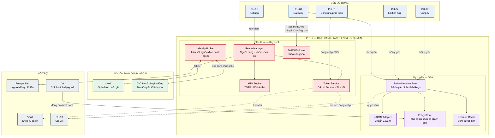
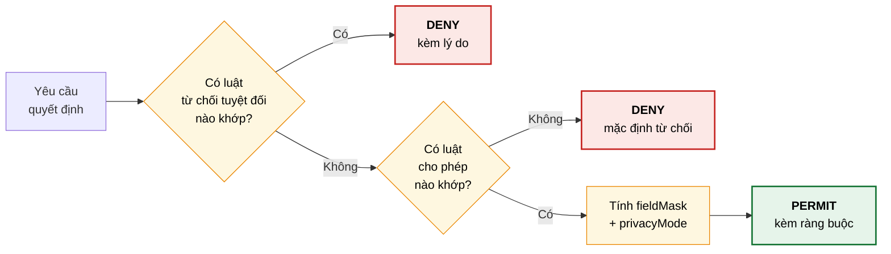

# SRS — PH-12: Định danh, Xác thực & Ủy quyền

| Thuộc tính | Giá trị |
|---|---|
| **Mã phân hệ** | PH-12 |
| **Tên** | Định danh, Xác thực & Ủy quyền (Identity & Access Management) |
| **Nhóm** | Xuyên suốt |
| **Mức bắt buộc** | M — Bắt buộc |
| **Phiên bản** | 1.0 |
| **Ngày** | 03/8/2026 |
| **Công nghệ chủ đạo** | Keycloak (xác thực) + Open Policy Agent (ủy quyền) |

---

## M1. Giới thiệu

### 1.1. Mục đích

PH-12 trả lời hai câu hỏi khác nhau về bản chất cho toàn bộ nền tảng:

| Câu hỏi | Chức năng | Thành phần |
|---|---|---|
| **"Anh là ai?"** | Xác thực — xác minh danh tính người dùng và hệ thống | Keycloak |
| **"Anh được làm gì?"** | Ủy quyền — quyết định cho phép hay từ chối một hành động | OPA + lớp XACML |

Đây là phân hệ hiện thực yêu cầu "quản lý bảo mật và định danh tập trung" tại CV 631: SSO qua SAML2 và OpenID Connect, xác thực đa yếu tố, phân quyền theo chuẩn XACML 2.0/3.0.

### 1.2. Phạm vi

**PH-12 chịu trách nhiệm:**

| # | Trách nhiệm |
|---|---|
| 1 | Quản lý danh tính người dùng (cán bộ, quản trị viên) và danh tính hệ thống (client) |
| 2 | Xác thực qua OIDC, SAML2, OAuth2 với đăng nhập một lần (SSO) |
| 3 | Xác thực đa yếu tố (MFA) theo mức nhạy cảm của thao tác |
| 4 | Liên kết định danh với nền tảng quốc gia VNeID |
| 5 | Cấp, làm mới, thu hồi token; công bố khóa công khai qua JWKS |
| 6 | Quản lý vai trò, nhóm, phạm vi quyền (scope) |
| 7 | Đánh giá chính sách truy cập và trả quyết định `allow`/`deny` |
| 8 | Trả kèm mặt nạ trường (`fieldMask`) và chế độ bảo vệ dữ liệu (`privacyMode`) |
| 9 | Quản lý vòng đời chính sách: soạn thảo, kiểm thử, phát hành, thu hồi |
| 10 | Ghi vết mọi sự kiện xác thực và quyết định ủy quyền |

**PH-12 KHÔNG chịu trách nhiệm:**

| # | Không làm | Thuộc phân hệ |
|---|---|---|
| 1 | **Thực thi** quyết định ủy quyền — chỉ *trả về* quyết định | PH-04, PH-03 |
| 2 | Xác minh token ở đường dữ liệu (Gateway tự xác minh bằng JWKS) | PH-03 |
| 3 | Che, giả danh hóa, ẩn danh hóa dữ liệu — chỉ *chỉ định* chế độ | PH-09 |
| 4 | Quy trình đăng ký, thẩm định hệ thống thành viên | PH-01 |
| 5 | Lưu trữ và hiển thị nhật ký kiểm toán | PH-13 |
| 6 | Quản lý bí mật, chứng thư số | Vault ([ADR-012](../05-adr/README.md#adr-012)) |

**Ghi chú quan trọng về ranh giới 1.** PH-12 là **Điểm quyết định chính sách** (Policy Decision Point), không phải **Điểm thực thi** (Policy Enforcement Point). PH-04 và PH-03 mới là nơi thực thi. Phân vai này quyết định hành vi khi PH-12 sự cố: bên thực thi áp dụng mặc định từ chối (fail-closed) thay vì cho qua — xem [BR-12-011](#m8-quy-tắc-nghiệp-vụ).

### 1.3. Tài liệu tham chiếu

| Mã | Tài liệu |
|---|---|
| [KT] | [Kiến trúc an toàn thông tin](../02-architecture/README.md#8-kiến-trúc-an-toàn-thông-tin) |
| [LT] | [Luồng F-08 Xác thực qua VNeID/SSO](../03-flows/README.md#f-08--xác-thực-người-dùng-qua-vneid-sso), [F-01](../03-flows/README.md#f-01--đăng-ký-và-kết-nạp-httt-thành-viên), [F-03](../03-flows/README.md#f-03--khai-thác-dữ-liệu-đồng-bộ-nội-bộ) |
| [PL] | [Cơ sở pháp lý và ma trận CMP](../01-legal/README.md) |
| [ADR] | [ADR-004 Keycloak + OPA](../05-adr/README.md#adr-004), [ADR-012 Vault](../05-adr/README.md#adr-012) |
| [CV631] | Công văn 631/THH-THHT — SSO, MFA, XACML 2.0/3.0 |
| [QD1729] | QĐ 1729/QĐ-BTTTT — nền tảng định danh và xác thực điện tử |

---

## M2. Mô tả tổng quan

### 2.1. Vị trí trong kiến trúc



**Thuyết minh sơ đồ.** Hai khối bên trong PH-12 có nhịp thay đổi rất khác nhau — đây là lý do tách chúng ([ADR-004](../05-adr/README.md#adr-004)):

| Khối | Nhịp thay đổi | Hình thức thay đổi | Rủi ro khi đổi |
|---|---|---|---|
| Xác thực (Keycloak) | Hiếm — vài lần/năm | Cấu hình realm, client | Cao — sai là không ai đăng nhập được |
| Ủy quyền (OPA) | Thường xuyên — hằng tuần | Mã Rego trong Git | Thấp — nạp nóng, quay lui bằng revert |

Nếu gộp toàn bộ logic phân quyền vào Keycloak thì mỗi lần đổi quy tắc nghiệp vụ đều phải động vào hệ thống định danh — chậm và rủi ro.

**Điểm đáng chú ý ở mũi tên Gateway → JWKS.** Gateway **không** gọi PH-12 cho mỗi yêu cầu. Nó lấy khóa công khai một lần, lưu đệm, rồi tự xác minh chữ ký JWT cục bộ. Nhờ vậy PH-12 không trở thành nút thắt cổ chai, và sự cố tạm thời của Keycloak không làm sập toàn trục — token đang hiệu lực vẫn dùng được.

### 2.2. Tác nhân

| Tác nhân | Loại | Tương tác |
|---|---|---|
| Cán bộ, công chức | Người | Đăng nhập SSO, xác thực MFA |
| Quản trị viên nền tảng | Người | Quản lý người dùng, vai trò, phiên |
| Cán bộ an toàn thông tin | Người | Soạn và duyệt chính sách truy cập, điều tra sự cố |
| Cán bộ kỹ thuật đơn vị thành viên | Người | Nhận credential, đổi bí mật client |
| Hệ thống thông tin thành viên | Hệ thống | Xác thực bằng client credentials + mTLS |
| PH-03 Gateway | Hệ thống | Lấy JWKS; hỏi quyết định quyền |
| PH-04 Lõi tích hợp | Hệ thống | Hỏi quyết định quyền cho từng bản tin |
| PH-01 Kết nạp | Hệ thống | Yêu cầu tạo/thu hồi client |
| VNeID | Hệ thống ngoài | Nguồn định danh quốc gia qua OIDC |

### 2.3. Giả định

| Mã | Giả định |
|---|---|
| GD-01 | Cơ quan đã đăng ký và được cấp quyền tích hợp VNeID |
| GD-02 | Vault sẵn sàng để lưu khóa ký token; khóa được xoay vòng theo lịch |
| GD-03 | Danh mục đơn vị hành chính do PH-07 cung cấp làm thuộc tính người dùng |
| GD-04 | Đồng hồ các node đồng bộ NTP, sai lệch < 100ms (ảnh hưởng hiệu lực token) |
| GD-05 | Bên thực thi (PH-03, PH-04) cài đặt đúng nguyên tắc fail-closed |

### 2.4. Ràng buộc

| Mã | Ràng buộc | Nguồn |
|---|---|---|
| RB-01 | Bắt buộc hỗ trợ **SAML2** và **OpenID Connect** cho SSO | CV 631 |
| RB-02 | Bắt buộc hỗ trợ **xác thực đa yếu tố** | CV 631 |
| RB-03 | Phân quyền theo chuẩn **XACML 2.0/3.0** | CV 631 |
| RB-04 | Hỗ trợ **OAuth2** cho xác thực hệ thống | CV 631 |
| RB-05 | Truyền tải qua TLS 1.2 trở lên | CV 631 |
| RB-06 | Tích hợp nền tảng định danh và xác thực điện tử quốc gia | QĐ 1729 |
| RB-07 | Ghi vết truy cập dữ liệu đầy đủ | Luật Dữ liệu 2024 |
| RB-08 | Toàn bộ công nghệ mã nguồn mở | Yêu cầu dự án |
| RB-09 | Không lưu mật khẩu dạng rõ hay mã hóa đảo ngược được | Nguyên tắc bảo mật |

### 2.5. Phụ thuộc phân hệ

| Phụ thuộc | Loại | Hành vi khi không khả dụng |
|---|---|---|
| PostgreSQL | **Cứng** | Không đăng nhập mới được; token đang hiệu lực vẫn dùng |
| Vault | **Cứng** khi xoay khóa | Dùng khóa hiện tại trong bộ nhớ; cảnh báo nghiêm trọng |
| VNeID | **Mềm** | Tắt lối đăng nhập VNeID, giữ lối tài khoản nội bộ |
| PH-07 (danh mục) | **Mềm** | Thuộc tính đơn vị dùng bản đệm gần nhất |
| PH-13 (ghi vết) | **Mềm** | Đệm cục bộ bền vững, gửi lại sau |
| Git (chính sách) | **Mềm** | Giữ chính sách đang nạp; không cập nhật được bản mới |

---

## M3. Yêu cầu chức năng

### 3.1. Nhóm A — Quản lý danh tính

#### FR-12-001 — Quản lý người dùng · **M**

| Mục | Nội dung |
|---|---|
| **Mô tả** | Tạo, sửa, khóa, mở khóa, xóa tài khoản người dùng |
| **Tác nhân** | Quản trị viên nền tảng |
| **Tiền điều kiện** | Người thao tác có vai trò `IAM_ADMIN` |
| **Đầu vào** | Tên đăng nhập · họ tên · thư điện tử công vụ · đơn vị · chức danh · vai trò · trạng thái |
| **Xử lý** | 1. Kiểm tra tên đăng nhập chưa tồn tại<br>2. Kiểm tra `maDonVi` tồn tại trong danh mục PH-07<br>3. Tạo tài khoản với trạng thái `PENDING_ACTIVATION`<br>4. Sinh liên kết kích hoạt dùng một lần, hiệu lực 24 giờ<br>5. Gửi liên kết tới thư điện tử công vụ<br>6. Ghi sự kiện kiểm toán kèm người thao tác |
| **Đầu ra** | Tài khoản đã tạo; liên kết kích hoạt đã gửi |
| **Ngoại lệ** | E1: Tên đăng nhập trùng → `409`<br>E2: `maDonVi` không tồn tại → `422`<br>E3: Thư điện tử không đúng miền công vụ → `422` kèm cảnh báo |

#### FR-12-002 — Quản lý danh tính hệ thống (client) · **M**

| Mục | Nội dung |
|---|---|
| **Mô tả** | Tạo và quản lý danh tính OAuth2 cho hệ thống thông tin thành viên |
| **Tác nhân** | PH-01 (tự động sau khi hồ sơ kết nạp được duyệt) |
| **Tiền điều kiện** | Hồ sơ kết nạp ở trạng thái `APPROVED` |
| **Đầu vào** | Mã hệ thống · tên · đơn vị chủ quản · danh sách phạm vi quyền được duyệt · loại xác thực |
| **Xử lý** | 1. Tạo client với `clientId` = mã hệ thống<br>2. Sinh `clientSecret` ngẫu nhiên đủ mạnh (≥ 256 bit)<br>3. Lưu bí mật vào Vault, **không** lưu trong CSDL Keycloak dạng đọc lại được<br>4. Gán đúng phạm vi quyền đã duyệt — không cấp rộng hơn<br>5. Bật bắt buộc mTLS nếu hệ thống thuộc nhóm truy cập dữ liệu nhạy cảm<br>6. Trả tham chiếu bí mật dùng một lần cho PH-01 |
| **Đầu ra** | Client đã tạo; tham chiếu bí mật một lần |
| **Ngoại lệ** | E1: `clientId` trùng → `409`<br>E2: Phạm vi quyền yêu cầu chưa được duyệt → `403`, ghi cảnh báo<br>E3: Vault không khả dụng → hủy tạo client, `503` |

**Ghi chú thiết kế.** Bước 4 hiện thực nguyên tắc đặc quyền tối thiểu. Việc cấp phạm vi rộng "cho tiện" là nguyên nhân phổ biến nhất của rò rỉ dữ liệu trong hệ thống liên thông.

#### FR-12-003 — Quản lý vai trò và nhóm · **M**

| Mục | Nội dung |
|---|---|
| **Mô tả** | Định nghĩa vai trò, nhóm và ánh xạ quyền |
| **Đầu vào** | Mã vai trò · tên · mô tả · danh sách phạm vi quyền · phạm vi áp dụng |
| **Xử lý** | 1. Tạo vai trò trong realm<br>2. Gán tập phạm vi quyền<br>3. Cho phép lồng nhóm (nhóm cha kế thừa xuống nhóm con)<br>4. Kiểm tra không tạo vòng lặp kế thừa |
| **Đầu ra** | Vai trò/nhóm đã tạo |
| **Ngoại lệ** | E1: Phát hiện vòng lặp kế thừa → `422` kèm đường đi vòng lặp<br>E2: Vai trò đang được gán cho người dùng → không cho xóa, `409` |

**Bộ vai trò chuẩn của nền tảng:**

| Mã vai trò | Mô tả | Phạm vi quyền tiêu biểu |
|---|---|---|
| `PLATFORM_ADMIN` | Quản trị viên nền tảng | Toàn quyền quản trị, trừ duyệt chính sách |
| `IAM_ADMIN` | Quản trị định danh | Quản lý người dùng, vai trò, client |
| `SECURITY_OFFICER` | Cán bộ an toàn thông tin | Duyệt chính sách, xem nhật ký an ninh |
| `INTEGRATION_DEV` | Cán bộ phát triển tích hợp | Tạo/sửa luồng, xem nhật ký kỹ thuật |
| `INTEGRATION_APPROVER` | Người duyệt luồng tích hợp | Duyệt phát hành luồng |
| `DATA_STEWARD` | Cán bộ quản trị dữ liệu | Xử lý đối sánh MDM, danh mục |
| `OPERATOR` | Cán bộ vận hành | Xem giám sát, xử lý DLQ |
| `VIEWER` | Chỉ xem | Xem dashboard, danh mục dịch vụ |

#### FR-12-004 — Đồng bộ thuộc tính người dùng từ danh mục · **S**

| Mục | Nội dung |
|---|---|
| **Mô tả** | Đồng bộ thuộc tính đơn vị, chức danh từ danh mục dùng chung PH-07 |
| **Xử lý** | 1. Chạy theo lịch hằng ngày<br>2. Đối chiếu `maDonVi` của người dùng với danh mục hiện hành<br>3. Cập nhật tên đơn vị, cấp hành chính<br>4. Đánh dấu tài khoản có `maDonVi` không còn tồn tại để rà soát |
| **Đầu ra** | Thuộc tính người dùng cập nhật; danh sách tài khoản cần rà soát |
| **Ngoại lệ** | E1: PH-07 không khả dụng → bỏ qua lượt đồng bộ, ghi cảnh báo |

### 3.2. Nhóm B — Xác thực

#### FR-12-005 — Đăng nhập một lần qua OpenID Connect · **M**

| Mục | Nội dung |
|---|---|
| **Mô tả** | Xác thực người dùng theo luồng Authorization Code + PKCE |
| **Tác nhân** | Cán bộ, công chức |
| **Tiền điều kiện** | Tài khoản trạng thái `ACTIVE`; ứng dụng đã đăng ký làm client |
| **Đầu vào** | Tên đăng nhập · mật khẩu · yếu tố thứ hai (nếu yêu cầu) |
| **Xử lý** | 1. Nhận yêu cầu ủy quyền kèm `code_challenge`<br>2. Hiển thị trang đăng nhập<br>3. Xác minh thông tin đăng nhập<br>4. Kiểm tra chính sách MFA (FR-12-008); nếu cần thì yêu cầu yếu tố thứ hai<br>5. Tạo phiên SSO<br>6. Trả mã ủy quyền dùng một lần, hiệu lực 60 giây<br>7. Đổi mã lấy token khi client xuất trình `code_verifier` hợp lệ |
| **Đầu ra** | Access token (JWT) · Refresh token · ID token |
| **Ngoại lệ** | E1: Sai thông tin đăng nhập → `401`, thông báo chung không tiết lộ tài khoản có tồn tại hay không<br>E2: Sai quá 5 lần trong 15 phút → khóa tạm 30 phút, cảnh báo an ninh<br>E3: Tài khoản bị khóa → `403` kèm hướng dẫn liên hệ<br>E4: `code_verifier` không khớp → `400`, hủy mã |

**Ghi chú về E1.** Thông báo phải giống hệt nhau cho trường hợp sai mật khẩu và tài khoản không tồn tại — nếu khác nhau, kẻ tấn công có thể dò ra danh sách tài khoản hợp lệ.

#### FR-12-006 — Đăng nhập qua SAML2 · **M**

| Mục | Nội dung |
|---|---|
| **Mô tả** | Hỗ trợ ứng dụng cũ chỉ nói được SAML2 |
| **Đầu vào** | SAML AuthnRequest từ nhà cung cấp dịch vụ |
| **Xử lý** | 1. Kiểm tra chữ ký AuthnRequest<br>2. Xác thực người dùng (dùng chung phiên SSO với OIDC)<br>3. Dựng SAML Assertion kèm thuộc tính người dùng<br>4. Ký Assertion bằng khóa lấy từ Vault<br>5. Gửi về nhà cung cấp dịch vụ |
| **Đầu ra** | SAML Response đã ký |
| **Ngoại lệ** | E1: Chữ ký AuthnRequest không hợp lệ → từ chối, ghi cảnh báo an ninh<br>E2: Nhà cung cấp dịch vụ chưa đăng ký → `403` |

**Ghi chú.** Bước 2 dùng chung phiên với OIDC — người dùng đã đăng nhập ứng dụng OIDC thì mở ứng dụng SAML2 không phải nhập lại. Đây chính là ý nghĩa "một lần" của SSO (CMP-06).

#### FR-12-007 — Xác thực hệ thống qua OAuth2 Client Credentials · **M**

| Mục | Nội dung |
|---|---|
| **Mô tả** | Cấp token cho hệ thống thông tin gọi API không có người dùng cuối |
| **Đầu vào** | `clientId` · `clientSecret` hoặc chứng thư mTLS · phạm vi quyền yêu cầu |
| **Xử lý** | 1. Xác minh danh tính client (bí mật hoặc chứng thư)<br>2. Kiểm tra client trạng thái `ENABLED`<br>3. Kiểm tra phạm vi yêu cầu là tập con của phạm vi được cấp<br>4. Cấp access token thời hạn ngắn (mặc định 5 phút)<br>5. Ghi sự kiện cấp token |
| **Đầu ra** | Access token (JWT) |
| **Ngoại lệ** | E1: Sai bí mật → `401`, tăng bộ đếm thất bại<br>E2: Client bị vô hiệu → `403`<br>E3: Yêu cầu phạm vi vượt quyền → cấp phần giao, ghi cảnh báo; nếu giao rỗng → `403` |

#### FR-12-008 — Xác thực đa yếu tố · **M**

| Mục | Nội dung |
|---|---|
| **Mô tả** | Yêu cầu yếu tố thứ hai theo mức nhạy cảm của thao tác |
| **Đầu vào** | Ngữ cảnh: vai trò · loại thao tác · phân loại dữ liệu · địa chỉ mạng |
| **Xử lý** | Áp dụng bảng chính sách MFA:<br>· Xem dữ liệu công khai → **1 yếu tố**<br>· Truy cập dữ liệu công dân → **2 yếu tố**<br>· Mọi thao tác ghi dữ liệu → **2 yếu tố**<br>· Thao tác quản trị nền tảng → **2 yếu tố**<br>· Duyệt chính sách truy cập → **2 yếu tố + xác nhận lại trong phiên**<br>Phương thức hỗ trợ: TOTP, WebAuthn (khóa cứng, sinh trắc thiết bị) |
| **Đầu ra** | Phiên đã nâng cấp mức xác thực |
| **Ngoại lệ** | E1: Sai mã TOTP 3 lần → khóa tạm 15 phút<br>E2: Người dùng chưa đăng ký yếu tố thứ hai nhưng thao tác yêu cầu → buộc đăng ký trước khi tiếp tục<br>E3: Mất thiết bị → quy trình khôi phục có xác minh của quản trị viên, ghi vết đầy đủ |

**Ghi chú thiết kế.** Áp MFA cho mọi thao tác gây phiền toái và khiến người dùng tìm cách né tránh. Phân tầng theo mức nhạy cảm cân bằng giữa an toàn và khả dụng — đây là lý do bảng chính sách phân biệt đọc dữ liệu công khai với ghi dữ liệu.

#### FR-12-009 — Liên kết định danh VNeID · **M**

| Mục | Nội dung |
|---|---|
| **Mô tả** | Cho phép đăng nhập bằng tài khoản định danh điện tử quốc gia |
| **Tiền điều kiện** | Cơ quan đã được cấp quyền tích hợp VNeID |
| **Đầu vào** | Lựa chọn "Đăng nhập bằng VNeID" |
| **Xử lý** | 1. Chuyển hướng tới VNeID theo luồng OIDC<br>2. Nhận mã ủy quyền, đổi lấy token<br>3. Lấy thông tin định danh (số định danh cá nhân, họ tên)<br>4. Đối sánh với tài khoản nội bộ theo số định danh<br>5. Nếu chưa liên kết → yêu cầu đăng nhập tài khoản nội bộ một lần để xác nhận liên kết<br>6. Ghi liên kết vào hồ sơ người dùng<br>7. Tạo phiên SSO |
| **Đầu ra** | Phiên đăng nhập; liên kết danh tính đã lưu |
| **Ngoại lệ** | E1: VNeID không khả dụng → ẩn lối đăng nhập này, giữ lối nội bộ<br>E2: Số định danh chưa có tài khoản nội bộ → từ chối, hướng dẫn liên hệ quản trị (**không** tự tạo tài khoản)<br>E3: Số định danh đã liên kết tài khoản khác → từ chối, cảnh báo an ninh |

**Ghi chú về E2.** Không tự tạo tài khoản từ VNeID là quyết định có chủ đích: quyền truy cập hệ thống nội bộ phải do cơ quan cấp, không suy ra tự động từ việc công dân có định danh điện tử.

#### FR-12-010 — Quản lý vòng đời token · **M**

| Mục | Nội dung |
|---|---|
| **Mô tả** | Cấp, làm mới, thu hồi và công bố khóa xác minh token |
| **Xử lý** | Tham số vòng đời:<br>· Access token: **5 phút**<br>· Refresh token: **8 giờ**, xoay vòng mỗi lần dùng<br>· Phiên SSO: **8 giờ**, hết hạn sau 30 phút không hoạt động<br>· Mã ủy quyền: **60 giây**, dùng một lần<br>Công bố khóa công khai qua điểm cuối JWKS, đệm được 24 giờ<br>Xoay khóa ký định kỳ 90 ngày, giữ khóa cũ thêm 24 giờ để token đang lưu hành vẫn xác minh được |
| **Đầu ra** | Token; tập khóa công khai |
| **Ngoại lệ** | E1: Refresh token đã dùng lại (dấu hiệu bị đánh cắp) → **thu hồi toàn bộ** token của phiên, cảnh báo an ninh<br>E2: Yêu cầu làm mới sau khi phiên hết hạn → `401`, buộc đăng nhập lại |

**Ghi chú về E1.** Xoay vòng refresh token kèm phát hiện dùng lại là biện pháp chống đánh cắp token hiệu quả: nếu kẻ tấn công dùng token đã bị nạn nhân dùng, hệ thống nhận ra ngay và cắt cả hai.

#### FR-12-011 — Thu hồi truy cập tức thời · **M**

| Mục | Nội dung |
|---|---|
| **Mô tả** | Chấm dứt ngay quyền truy cập của người dùng hoặc hệ thống |
| **Tác nhân** | Quản trị viên, Cán bộ an toàn thông tin |
| **Đầu vào** | Định danh người dùng/client · lý do thu hồi |
| **Xử lý** | 1. Vô hiệu tài khoản/client<br>2. Hủy toàn bộ phiên đang mở<br>3. Thu hồi mọi refresh token<br>4. Đẩy danh sách token bị thu hồi tới PH-03 để chặn ngay cả khi access token chưa hết hạn<br>5. Ghi vết kèm lý do và người thực hiện |
| **Đầu ra** | Truy cập đã chấm dứt |
| **Ngoại lệ** | E1: Không đẩy được danh sách thu hồi tới Gateway → cảnh báo nghiêm trọng; access token còn hiệu lực tối đa 5 phút |

**Ghi chú.** Bước 4 giải quyết điểm yếu cố hữu của JWT: token đã cấp thì không tự hủy được. Danh sách thu hồi thu hẹp cửa sổ rủi ro từ 5 phút xuống gần như tức thì.

### 3.3. Nhóm C — Ủy quyền

#### FR-12-012 — Đánh giá chính sách truy cập · **M**

| Mục | Nội dung |
|---|---|
| **Mô tả** | Trả quyết định cho phép/từ chối cho một yêu cầu truy cập cụ thể |
| **Tác nhân** | PH-03, PH-04, PH-17 |
| **Tiền điều kiện** | Chính sách tương ứng đã ở trạng thái `PUBLISHED` |
| **Đầu vào** | `subject` (client, vai trò, đơn vị) · `resource` (mã tài nguyên, phân loại mật, chủ quản) · `action` · `context` (mục đích sử dụng, thời điểm, địa chỉ mạng) |
| **Xử lý** | 1. Tra đệm quyết định (khóa = băm đầu vào, thời hạn 60 giây)<br>2. Nếu trượt → đánh giá tập chính sách Rego<br>3. Áp dụng thứ tự: **từ chối tuyệt đối** → **cho phép tường minh** → **mặc định từ chối**<br>4. Tính `fieldMask` — danh sách trường bên gọi được xem<br>5. Xác định `privacyMode` theo mục đích sử dụng<br>6. Trả quyết định kèm lý do |
| **Đầu ra** | `{ allow, reason, fieldMask[], privacyMode, obligations[] }` |
| **Ngoại lệ** | E1: Không có chính sách nào khớp → `allow=false`, lý do `NO_MATCHING_POLICY`<br>E2: Lỗi đánh giá chính sách → `allow=false`, cảnh báo nghiêm trọng<br>E3: Dữ liệu phân loại `MAT` → `allow=false` **không điều kiện** |

**Thứ tự quyết định (deny-overrides):**



**Thuyết minh.** Từ chối luôn thắng cho phép, và không khớp luật nào cũng là từ chối. Cách này bảo đảm quên viết chính sách không dẫn tới lộ dữ liệu — sai sót nghiêng về phía an toàn.

#### FR-12-013 — Tính mặt nạ trường theo ngữ cảnh · **M**

| Mục | Nội dung |
|---|---|
| **Mô tả** | Xác định bên gọi được xem những trường dữ liệu nào |
| **Đầu vào** | Vai trò và đơn vị bên gọi · loại thực thể · mục đích sử dụng |
| **Xử lý** | 1. Lấy tập trường mặc định của thực thể<br>2. Trừ đi các trường bị hạn chế theo vai trò<br>3. Trừ tiếp theo mục đích sử dụng khai báo<br>4. Trả danh sách trường được xem và chế độ xử lý từng trường |
| **Đầu ra** | `fieldMask` — bản đồ trường → chế độ (`full`/`masked`/`hidden`) |
| **Ngoại lệ** | E1: Thực thể chưa khai báo tập trường → trả tập rỗng (không lộ gì), cảnh báo cấu hình thiếu |

**Ví dụ minh họa — tra cứu công dân:**

| Bên gọi | `soDinhDanh` | `hoTen` | `ngaySinh` | `noiThuongTru` | `thongTinSucKhoe` |
|---|---|---|---|---|---|
| Hệ thống Y tế | full | full | full | full | full |
| Cổng Dịch vụ công | full | full | full | full | hidden |
| Hệ thống chỉ xác minh danh tính | masked | full | năm sinh | hidden | hidden |

Cùng một API, ba bên gọi nhận ba mức chi tiết khác nhau. Bên cung cấp dữ liệu không cần biết logic này.

#### FR-12-014 — Quản lý vòng đời chính sách · **M**

| Mục | Nội dung |
|---|---|
| **Mô tả** | Soạn thảo, kiểm thử, duyệt và phát hành chính sách truy cập |
| **Tác nhân** | Cán bộ an toàn thông tin |
| **Đầu vào** | Mã chính sách · nội dung Rego · mô tả · bộ ca kiểm thử |
| **Xử lý** | 1. Kiểm tra cú pháp Rego<br>2. Chạy bộ ca kiểm thử bắt buộc kèm chính sách<br>3. Chạy đối chiếu trên tập yêu cầu thật gần đây (chế độ chạy khô) và báo cáo khác biệt<br>4. Chuyển trạng thái `PENDING_APPROVAL`<br>5. Người duyệt **khác người soạn** phê duyệt<br>6. Phát hành, nạp nóng vào PDP<br>7. Lưu phiên bản vào Git |
| **Đầu ra** | Chính sách đang có hiệu lực |
| **Ngoại lệ** | E1: Cú pháp sai → từ chối, chỉ rõ dòng<br>E2: Ca kiểm thử thất bại → từ chối phát hành<br>E3: Người duyệt trùng người soạn → từ chối (BR-12-008)<br>E4: Chạy khô cho thấy thay đổi > 20% quyết định → cảnh báo, yêu cầu xác nhận bổ sung |

**Ghi chú về bước 3.** Chạy khô là biện pháp phòng ngừa quan trọng: một sửa đổi tưởng nhỏ trong Rego có thể vô tình chặn hàng loạt truy cập hợp lệ. Đối chiếu trên lưu lượng thật cho thấy tác động trước khi phát hành.

#### FR-12-015 — Bộ chuyển đổi XACML · **M**

| Mục | Nội dung |
|---|---|
| **Mô tả** | Cung cấp giao diện theo chuẩn XACML 2.0/3.0 để đáp ứng CV 631 |
| **Đầu vào** | Yêu cầu XACML (XML hoặc JSON profile) |
| **Xử lý** | 1. Phân tích yêu cầu XACML, trích `Subject`, `Resource`, `Action`, `Environment`<br>2. Ánh xạ sang cấu trúc đầu vào của OPA<br>3. Gọi PDP đánh giá<br>4. Dựng phản hồi XACML: `Decision` (`Permit`/`Deny`/`NotApplicable`/`Indeterminate`), `Status`, `Obligations` |
| **Đầu ra** | Phản hồi XACML hợp lệ |
| **Ngoại lệ** | E1: Yêu cầu không đúng lược đồ XACML → `Indeterminate` kèm mã lỗi cú pháp<br>E2: Thuộc tính bắt buộc thiếu → `Indeterminate` |

**Ghi chú tuân thủ.** CV 631 yêu cầu XACML 2.0/3.0. Thiết kế dùng OPA làm engine thực tế và bọc lớp XACML ở ngoài — vừa đáp ứng chuẩn bắt buộc, vừa giữ được ưu điểm chính sách dạng mã của Rego. Điểm này cần thuyết minh rõ trong hồ sơ nghiệm thu (xem [M9](#m9-tuân-thủ)).

#### FR-12-016 — Đệm quyết định · **S**

| Mục | Nội dung |
|---|---|
| **Mô tả** | Giảm độ trễ và tải cho PDP |
| **Xử lý** | 1. Khóa đệm = băm của `(subject, resource, action, context rút gọn)`<br>2. Thời hạn 60 giây<br>3. Xóa đệm ngay khi chính sách liên quan được phát hành lại<br>4. **Không** đệm quyết định liên quan dữ liệu phân loại `MAT` |
| **Đầu ra** | Quyết định từ đệm |
| **Ngoại lệ** | E1: Đệm không khả dụng → đánh giá trực tiếp, ghi nhận độ trễ tăng |

### 3.4. Nhóm D — Ghi vết và giám sát

#### FR-12-017 — Ghi vết sự kiện xác thực · **M**

| Mục | Nội dung |
|---|---|
| **Mô tả** | Ghi lại mọi sự kiện liên quan danh tính |
| **Xử lý** | Ghi các sự kiện: đăng nhập thành công/thất bại · đăng xuất · cấp token · làm mới token · thu hồi · đổi mật khẩu · đăng ký/gỡ MFA · tạo/sửa/xóa tài khoản · thay đổi vai trò<br>Mỗi bản ghi gồm: `eventType`, `subject`, `clientId`, `sourceIp`, `userAgent`, `result`, `failureReason`, `timestamp`, `traceId`<br>Gửi tới PH-13 qua Kafka |
| **Đầu ra** | Bản ghi kiểm toán |
| **Ngoại lệ** | E1: Không gửi được → đệm cục bộ bền vững, gửi lại; đệm đầy → cảnh báo nghiêm trọng |

#### FR-12-018 — Ghi vết quyết định ủy quyền · **M**

| Mục | Nội dung |
|---|---|
| **Mô tả** | Ghi lại quyết định cho phép/từ chối phục vụ truy vết và giải trình |
| **Xử lý** | Ghi: `traceId`, `subject`, `resource`, `action`, `decision`, `matchedPolicy`, `reason`, `fieldMask`, `privacyMode`, `evaluationTimeMs`<br>Với quyết định **từ chối**: ghi 100%<br>Với quyết định **cho phép**: ghi 100% nếu tài nguyên nhạy cảm, lấy mẫu 10% với tài nguyên thường |
| **Đầu ra** | Bản ghi quyết định |
| **Ngoại lệ** | E1: Tài nguyên nhạy cảm mà không ghi được vết → trả `allow=false` (không phục vụ khi không ghi được vết) |

#### FR-12-019 — Phát hiện hành vi bất thường · **S**

| Mục | Nội dung |
|---|---|
| **Mô tả** | Nhận diện dấu hiệu tấn công hoặc lạm dụng |
| **Xử lý** | Phát cảnh báo khi:<br>· Đăng nhập thất bại > 20 lần/phút từ một địa chỉ<br>· Một tài khoản đăng nhập từ nhiều địa chỉ khác vùng trong thời gian ngắn<br>· Tỷ lệ từ chối ủy quyền của một client tăng đột biến (> 5 lần mức thường)<br>· Truy cập dữ liệu nhạy cảm ngoài giờ hành chính<br>· Refresh token bị dùng lại |
| **Đầu ra** | Cảnh báo an ninh gửi PH-13 |
| **Ngoại lệ** | E1: Cảnh báo giả nhiều → cho phép cán bộ ATTT tinh chỉnh ngưỡng |

### 3.5. Bảng tổng hợp yêu cầu chức năng

| Nhóm | Mã | Tên | Ưu tiên |
|---|---|---|:-:|
| A | FR-12-001 | Quản lý người dùng | M |
| A | FR-12-002 | Quản lý danh tính hệ thống (client) | M |
| A | FR-12-003 | Quản lý vai trò và nhóm | M |
| A | FR-12-004 | Đồng bộ thuộc tính từ danh mục | S |
| B | FR-12-005 | Đăng nhập một lần qua OIDC | M |
| B | FR-12-006 | Đăng nhập qua SAML2 | M |
| B | FR-12-007 | Xác thực hệ thống qua OAuth2 | M |
| B | FR-12-008 | Xác thực đa yếu tố | M |
| B | FR-12-009 | Liên kết định danh VNeID | M |
| B | FR-12-010 | Quản lý vòng đời token | M |
| B | FR-12-011 | Thu hồi truy cập tức thời | M |
| C | FR-12-012 | Đánh giá chính sách truy cập | M |
| C | FR-12-013 | Tính mặt nạ trường theo ngữ cảnh | M |
| C | FR-12-014 | Quản lý vòng đời chính sách | M |
| C | FR-12-015 | Bộ chuyển đổi XACML | M |
| C | FR-12-016 | Đệm quyết định | S |
| D | FR-12-017 | Ghi vết sự kiện xác thực | M |
| D | FR-12-018 | Ghi vết quyết định ủy quyền | M |
| D | FR-12-019 | Phát hiện hành vi bất thường | S |

**Tổng: 19 yêu cầu chức năng** — 16 bắt buộc (M), 3 cần có (S).

---

## M4. Mô hình dữ liệu

### 4.1. Sơ đồ thực thể

```mermaid
erDiagram
    NGUOI_DUNG ||--o{ NGUOI_DUNG_VAI_TRO : "được gán"
    NGUOI_DUNG ||--o{ YEU_TO_XAC_THUC : "đăng ký"
    NGUOI_DUNG ||--o{ PHIEN : "tạo"
    NGUOI_DUNG ||--o| LIEN_KET_VNEID : "liên kết"
    VAI_TRO ||--o{ NGUOI_DUNG_VAI_TRO : "gán cho"
    VAI_TRO ||--o{ VAI_TRO_PHAM_VI : "chứa"
    PHAM_VI ||--o{ VAI_TRO_PHAM_VI : "thuộc"
    CLIENT ||--o{ CLIENT_PHAM_VI : "được cấp"
    PHAM_VI ||--o{ CLIENT_PHAM_VI : "thuộc"
    CLIENT ||--o{ PHIEN : "tạo"
    CHINH_SACH ||--o{ CHINH_SACH_PHIEN_BAN : "có phiên bản"
    CHINH_SACH ||--o{ CA_KIEM_THU : "kèm ca kiểm thử"
    CHINH_SACH ||--o{ QUYET_DINH : "sinh ra"
    THUC_THE_TRUONG ||--o{ MAT_NA_TRUONG : "định nghĩa"
    VAI_TRO ||--o{ MAT_NA_TRUONG : "áp dụng cho"

    NGUOI_DUNG {
        uuid nguoi_dung_id PK
        string ten_dang_nhap UK
        string ho_ten
        string thu_dien_tu UK
        string ma_don_vi
        string chuc_danh
        string trang_thai
        boolean mfa_bat_buoc
        int so_lan_that_bai
        timestamptz khoa_den
        timestamptz dang_nhap_cuoi
        timestamptz created_at
    }
    VAI_TRO {
        uuid vai_tro_id PK
        string ma_vai_tro UK
        string ten_vai_tro
        text mo_ta
        uuid vai_tro_cha_id FK
        boolean la_he_thong
    }
    PHAM_VI {
        uuid pham_vi_id PK
        string ma_pham_vi UK
        string mo_ta
        string nhom_tai_nguyen
        boolean nhay_cam
    }
    NGUOI_DUNG_VAI_TRO {
        uuid id PK
        uuid nguoi_dung_id FK
        uuid vai_tro_id FK
        timestamptz hieu_luc_tu
        timestamptz hieu_luc_den
        string nguoi_gan
    }
    VAI_TRO_PHAM_VI {
        uuid id PK
        uuid vai_tro_id FK
        uuid pham_vi_id FK
    }
    CLIENT {
        uuid client_pk PK
        string client_id UK
        string ten_he_thong
        string ma_don_vi
        string loai_xac_thuc
        string vault_secret_ref
        boolean bat_buoc_mtls
        string trang_thai
        timestamptz created_at
    }
    CLIENT_PHAM_VI {
        uuid id PK
        uuid client_pk FK
        uuid pham_vi_id FK
        string nguoi_duyet
        timestamptz ngay_duyet
    }
    YEU_TO_XAC_THUC {
        uuid yeu_to_id PK
        uuid nguoi_dung_id FK
        string loai
        string ten_thiet_bi
        text du_lieu_ma_hoa
        timestamptz dang_ky_luc
        timestamptz su_dung_cuoi
    }
    PHIEN {
        uuid phien_id PK
        uuid nguoi_dung_id FK
        uuid client_pk FK
        string dia_chi_ip
        string user_agent
        string muc_xac_thuc
        timestamptz bat_dau
        timestamptz hoat_dong_cuoi
        timestamptz het_han
        string trang_thai
    }
    LIEN_KET_VNEID {
        uuid lien_ket_id PK
        uuid nguoi_dung_id FK
        string so_dinh_danh UK
        timestamptz lien_ket_luc
        string nguoi_xac_nhan
    }
    CHINH_SACH {
        uuid chinh_sach_id PK
        string ma_chinh_sach UK
        string ten
        text mo_ta
        string nhom_tai_nguyen
        string trang_thai
        uuid phien_ban_hien_tai FK
    }
    CHINH_SACH_PHIEN_BAN {
        uuid phien_ban_id PK
        uuid chinh_sach_id FK
        int so_phien_ban
        text noi_dung_rego
        string trang_thai
        string nguoi_soan
        string nguoi_duyet
        timestamptz phat_hanh_luc
        string git_commit
    }
    CA_KIEM_THU {
        uuid ca_id PK
        uuid chinh_sach_id FK
        string ten_ca
        jsonb dau_vao
        boolean ket_qua_mong_doi
        text mo_ta
    }
    THUC_THE_TRUONG {
        uuid id PK
        string ma_thuc_the
        string ten_truong
        boolean nhay_cam
        string phan_loai_mat
    }
    MAT_NA_TRUONG {
        uuid mat_na_id PK
        uuid vai_tro_id FK
        uuid truong_id FK
        string che_do
        string muc_dich_su_dung
    }
    QUYET_DINH {
        uuid quyet_dinh_id PK
        string trace_id
        string subject_id
        string resource_id
        string action
        boolean cho_phep
        uuid chinh_sach_khop FK
        text ly_do
        int thoi_gian_danh_gia_ms
        timestamptz thoi_diem
    }
```



### 4.2. Đặc tả thực thể

#### EN-12-01 — NGUOI_DUNG

| Trường | Kiểu | Bắt buộc | Ràng buộc | Mô tả |
|---|---|:-:|---|---|
| `nguoi_dung_id` | UUID | ✓ | PK | |
| `ten_dang_nhap` | VARCHAR(80) | ✓ | UNIQUE, `^[a-z0-9._-]+$` | |
| `ho_ten` | VARCHAR(160) | ✓ | | |
| `thu_dien_tu` | VARCHAR(160) | ✓ | UNIQUE, miền công vụ | |
| `ma_don_vi` | VARCHAR(20) | ✓ | Tồn tại trong danh mục PH-07 | |
| `chuc_danh` | VARCHAR(120) | | | |
| `trang_thai` | VARCHAR(24) | ✓ | ∈ {`PENDING_ACTIVATION`,`ACTIVE`,`LOCKED`,`SUSPENDED`,`DISABLED`} | |
| `mfa_bat_buoc` | BOOLEAN | ✓ | mặc định true | |
| `so_lan_that_bai` | SMALLINT | ✓ | mặc định 0 | Đếm liên tiếp, đặt lại khi đăng nhập thành công |
| `khoa_den` | TIMESTAMPTZ | | | Thời điểm hết khóa tạm |
| `dang_nhap_cuoi` | TIMESTAMPTZ | | | |

**Ràng buộc bảng.** Không lưu mật khẩu ở bảng này — Keycloak lưu dạng băm với thuật toán Argon2id (RB-09). Tài khoản không đăng nhập 90 ngày tự chuyển `SUSPENDED`.

#### EN-12-02 — CLIENT

| Trường | Kiểu | Bắt buộc | Ràng buộc | Mô tả |
|---|---|:-:|---|---|
| `client_pk` | UUID | ✓ | PK | |
| `client_id` | VARCHAR(80) | ✓ | UNIQUE | Trùng mã hệ thống tại PH-01 |
| `ten_he_thong` | VARCHAR(200) | ✓ | | |
| `ma_don_vi` | VARCHAR(20) | ✓ | | Đơn vị chủ quản |
| `loai_xac_thuc` | VARCHAR(24) | ✓ | ∈ {`CLIENT_SECRET`,`MTLS`,`PRIVATE_KEY_JWT`} | |
| `vault_secret_ref` | VARCHAR(200) | | | **Tham chiếu** tới Vault, không phải bí mật |
| `bat_buoc_mtls` | BOOLEAN | ✓ | mặc định false | Bật với hệ thống truy cập dữ liệu nhạy cảm |
| `trang_thai` | VARCHAR(20) | ✓ | ∈ {`ENABLED`,`DISABLED`,`REVOKED`} | |

**Ràng buộc quan trọng.** `vault_secret_ref` chỉ là đường dẫn tới Vault. Bí mật thật **không bao giờ** nằm trong CSDL này (RB-09, [ADR-012](../05-adr/README.md#adr-012)).

#### EN-12-03 — PHAM_VI (Scope)

| Trường | Kiểu | Bắt buộc | Mô tả |
|---|---|:-:|---|
| `pham_vi_id` | UUID | ✓ | PK |
| `ma_pham_vi` | VARCHAR(80) | ✓ | UNIQUE, dạng `{tainguyen}.{hanhdong}` |
| `mo_ta` | VARCHAR(300) | ✓ | Mô tả bằng tiếng Việt để người duyệt hiểu |
| `nhom_tai_nguyen` | VARCHAR(60) | ✓ | Nhóm để tổ chức danh sách |
| `nhay_cam` | BOOLEAN | ✓ | Quyết định có bắt buộc MFA và ghi vết 100% |

**Ví dụ phạm vi:** `congdan.read`, `congdan.write`, `datdai.read`, `vanban.send`, `route.deploy`, `policy.approve`.

#### EN-12-04 — CHINH_SACH_PHIEN_BAN

| Trường | Kiểu | Bắt buộc | Mô tả |
|---|---|:-:|---|
| `phien_ban_id` | UUID | ✓ | PK |
| `chinh_sach_id` | UUID | ✓ | FK |
| `so_phien_ban` | INTEGER | ✓ | UNIQUE cùng chính sách |
| `noi_dung_rego` | TEXT | ✓ | Mã chính sách |
| `trang_thai` | VARCHAR(24) | ✓ | ∈ {`DRAFT`,`TESTING`,`PENDING_APPROVAL`,`PUBLISHED`,`SUPERSEDED`,`REVOKED`} |
| `nguoi_soan` | VARCHAR(100) | ✓ | |
| `nguoi_duyet` | VARCHAR(100) | | **Phải khác** `nguoi_soan` (BR-12-008) |
| `phat_hanh_luc` | TIMESTAMPTZ | | |
| `git_commit` | VARCHAR(40) | | Mã commit để truy vết |

#### EN-12-05 — MAT_NA_TRUONG

| Trường | Kiểu | Bắt buộc | Mô tả |
|---|---|:-:|---|
| `mat_na_id` | UUID | ✓ | PK |
| `vai_tro_id` | UUID | ✓ | FK |
| `truong_id` | UUID | ✓ | FK → THUC_THE_TRUONG |
| `che_do` | VARCHAR(12) | ✓ | ∈ {`full`,`masked`,`hidden`} |
| `muc_dich_su_dung` | VARCHAR(60) | | Rỗng = áp dụng mọi mục đích |

#### EN-12-06 — QUYET_DINH (Nhật ký quyết định)

| Trường | Kiểu | Bắt buộc | Mô tả |
|---|---|:-:|---|
| `quyet_dinh_id` | UUID | ✓ | PK |
| `trace_id` | VARCHAR(64) | ✓ | Có chỉ mục, nối với PH-04 và PH-13 |
| `subject_id` | VARCHAR(120) | ✓ | Người dùng hoặc client |
| `resource_id` | VARCHAR(200) | ✓ | |
| `action` | VARCHAR(40) | ✓ | |
| `cho_phep` | BOOLEAN | ✓ | |
| `chinh_sach_khop` | UUID | | Chính sách quyết định kết quả |
| `ly_do` | TEXT | | Bắt buộc khi từ chối |
| `thoi_gian_danh_gia_ms` | INTEGER | ✓ | |

### 4.3. Chính sách lưu giữ

| Thực thể | Thời hạn | Sau khi hết hạn |
|---|---|---|
| NGUOI_DUNG, CLIENT, VAI_TRO, PHAM_VI | Vĩnh viễn | Vô hiệu, không xóa (giữ truy vết) |
| CHINH_SACH_PHIEN_BAN | Vĩnh viễn | Giữ toàn bộ lịch sử |
| PHIEN | 30 ngày sau khi kết thúc | Xóa |
| QUYET_DINH | **5 năm** | Chuyển MinIO WORM |
| Sự kiện xác thực (tại PH-13) | **5 năm** | Theo chính sách PH-13 |

**Ghi chú.** Nhật ký quyết định giữ 5 năm để đáp ứng nghĩa vụ truy vết "ai truy cập dữ liệu gì, khi nào" của Luật Dữ liệu 2024 (CMP-28).

---

## M5. Giao diện API

### 5.1. Nguyên tắc chung

| Khía cạnh | Quy định |
|---|---|
| Đường dẫn xác thực | `/realms/lgsp/protocol/openid-connect/*` (chuẩn Keycloak) |
| Đường dẫn ủy quyền | `/api/authz/v1` |
| Đường dẫn quản trị | `/api/admin/v1/iam` |
| Định dạng | JSON; riêng XACML hỗ trợ cả XML |
| Xác thực API quản trị | Bearer JWT, vai trò `IAM_ADMIN` hoặc `SECURITY_OFFICER` |
| Mã lỗi | RFC 9457 Problem Details; riêng điểm cuối OIDC theo RFC 6749 |

### 5.2. Điểm cuối chuẩn OpenID Connect

| Phương thức | Đường dẫn | Chức năng |
|---|---|---|
| `GET` | `/.well-known/openid-configuration` | Tài liệu khám phá |
| `GET` | `/protocol/openid-connect/auth` | Bắt đầu luồng ủy quyền |
| `POST` | `/protocol/openid-connect/token` | Đổi mã lấy token; làm mới token |
| `GET` | `/protocol/openid-connect/certs` | **JWKS** — khóa công khai xác minh JWT |
| `POST` | `/protocol/openid-connect/logout` | Đăng xuất |
| `POST` | `/protocol/openid-connect/revoke` | Thu hồi token |
| `GET` | `/protocol/openid-connect/userinfo` | Thông tin người dùng |

### 5.3. Điểm cuối ủy quyền

#### 5.3.1. `POST /api/authz/v1/decide` — Quyết định truy cập

Điểm cuối được gọi nhiều nhất trên toàn nền tảng (mỗi bản tin một lần).

**Yêu cầu:**

```json
{
  "traceId": "4bf92f3577b34da6a3ce929d0e0e4736",
  "subject": {
    "type": "CLIENT",
    "id": "CONG-DVC",
    "roles": ["SERVICE"],
    "scopes": ["congdan.read", "tthc.read"],
    "maDonVi": "01",
    "authLevel": "MTLS"
  },
  "resource": {
    "id": "cong-dan/001199001234",
    "entity": "CONG_DAN",
    "phanLoaiMat": "NOI_BO",
    "chuQuan": "CSDLQG_DANCU"
  },
  "action": "read",
  "context": {
    "mucDichSuDung": "GIAI_QUYET_TTHC",
    "maHoSo": "HS-2026-08-001234",
    "sourceIp": "10.20.30.40",
    "thoiDiem": "2026-08-03T14:32:10+07:00"
  }
}
```

**Phản hồi cho phép `200 OK`:**

```json
{
  "allow": true,
  "reason": "MATCHED_POLICY:congdan-read-tthc",
  "matchedPolicy": "congdan-read-tthc",
  "policyVersion": 7,
  "fieldMask": {
    "soDinhDanh": "full",
    "hoTen": "full",
    "ngaySinh": "full",
    "noiThuongTru": "full",
    "thongTinSucKhoe": "hidden"
  },
  "privacyMode": "none",
  "obligations": [
    { "type": "AUDIT", "level": "FULL" },
    { "type": "TTL", "maxCacheSeconds": 900 }
  ],
  "evaluationTimeMs": 6
}
```

**Phản hồi từ chối `200 OK`** (từ chối vẫn là kết quả hợp lệ, không phải lỗi HTTP):

```json
{
  "allow": false,
  "reason": "DATA_CLASSIFIED_SECRET",
  "detail": "Dữ liệu thuộc phạm vi bí mật nhà nước, không được chia sẻ qua trục",
  "matchedPolicy": "deny-classified-data",
  "evaluationTimeMs": 3
}
```

**Mã lỗi:**

| Mã | Điều kiện |
|---|---|
| `400` | Thân yêu cầu thiếu trường bắt buộc |
| `401` | Bên gọi chưa xác thực |
| `500` | Lỗi đánh giá chính sách — bên gọi **phải** xử lý như từ chối |
| `503` | PDP quá tải — bên gọi **phải** xử lý như từ chối |

**Ghi chú thiết kế quan trọng.** `500` và `503` phải được bên gọi hiểu là từ chối, không phải "thử lại rồi cho qua". Đây là hợp đồng bắt buộc giữa PH-12 và bên thực thi (BR-12-011).

#### 5.3.2. `POST /api/authz/v1/decide/batch` — Quyết định theo lô · **S**

Cho phép hỏi nhiều quyết định trong một lời gọi, giảm số vòng mạng khi xử lý bản tin lô.

**Yêu cầu:** mảng tối đa 100 phần tử, mỗi phần tử như `5.3.1` kèm `itemId`.
**Phản hồi:** mảng kết quả tương ứng theo `itemId`.

#### 5.3.3. `POST /api/authz/v1/xacml` — Giao diện XACML

Chấp nhận `Content-Type: application/xacml+xml` hoặc `application/xacml+json`.

```xml
<Request xmlns="urn:oasis:names:tc:xacml:3.0:core:schema:wd-17"
         CombiningAlgId="urn:oasis:names:tc:xacml:3.0:attribute-category:...">
  <Attributes Category="urn:oasis:names:tc:xacml:1.0:subject-category:access-subject">
    <Attribute AttributeId="urn:oasis:names:tc:xacml:1.0:subject:subject-id">
      <AttributeValue DataType="http://www.w3.org/2001/XMLSchema#string">CONG-DVC</AttributeValue>
    </Attribute>
  </Attributes>
  <Attributes Category="urn:oasis:names:tc:xacml:3.0:attribute-category:resource">
    <Attribute AttributeId="urn:oasis:names:tc:xacml:1.0:resource:resource-id">
      <AttributeValue DataType="http://www.w3.org/2001/XMLSchema#string">cong-dan/001199001234</AttributeValue>
    </Attribute>
  </Attributes>
  <Attributes Category="urn:oasis:names:tc:xacml:3.0:attribute-category:action">
    <Attribute AttributeId="urn:oasis:names:tc:xacml:1.0:action:action-id">
      <AttributeValue DataType="http://www.w3.org/2001/XMLSchema#string">read</AttributeValue>
    </Attribute>
  </Attributes>
</Request>
```

**Phản hồi:** `Decision` ∈ {`Permit`, `Deny`, `NotApplicable`, `Indeterminate`} kèm `Status` và `Obligations`.

### 5.4. Điểm cuối quản trị

| Phương thức | Đường dẫn | Chức năng | FR |
|---|---|---|---|
| `GET` | `/api/admin/v1/iam/users` | Danh sách người dùng, lọc và phân trang | FR-12-001 |
| `POST` | `/api/admin/v1/iam/users` | Tạo người dùng | FR-12-001 |
| `PATCH` | `/api/admin/v1/iam/users/{id}` | Sửa thông tin, đổi trạng thái | FR-12-001 |
| `POST` | `/api/admin/v1/iam/users/{id}/revoke` | Thu hồi truy cập tức thời | FR-12-011 |
| `POST` | `/api/admin/v1/iam/users/{id}/reset-mfa` | Đặt lại yếu tố thứ hai | FR-12-008 |
| `GET` | `/api/admin/v1/iam/users/{id}/sessions` | Phiên đang mở của người dùng | FR-12-010 |
| `POST` | `/api/admin/v1/iam/clients` | Tạo client cho hệ thống | FR-12-002 |
| `POST` | `/api/admin/v1/iam/clients/{id}/rotate-secret` | Xoay bí mật client | FR-12-002 |
| `POST` | `/api/admin/v1/iam/clients/{id}/revoke` | Thu hồi client | FR-12-011 |
| `GET` | `/api/admin/v1/iam/roles` | Danh sách vai trò | FR-12-003 |
| `POST` | `/api/admin/v1/iam/roles` | Tạo vai trò | FR-12-003 |
| `GET` | `/api/admin/v1/iam/scopes` | Danh mục phạm vi quyền | FR-12-003 |
| `GET` | `/api/admin/v1/iam/policies` | Danh sách chính sách | FR-12-014 |
| `POST` | `/api/admin/v1/iam/policies` | Tạo chính sách (DRAFT) | FR-12-014 |
| `POST` | `/api/admin/v1/iam/policies/{id}/test` | Chạy bộ ca kiểm thử | FR-12-014 |
| `POST` | `/api/admin/v1/iam/policies/{id}/dry-run` | Chạy khô trên lưu lượng thật | FR-12-014 |
| `POST` | `/api/admin/v1/iam/policies/{id}/submit` | Trình duyệt | FR-12-014 |
| `POST` | `/api/admin/v1/iam/policies/{id}/approve` | Phê duyệt và phát hành | FR-12-014 |
| `POST` | `/api/admin/v1/iam/policies/{id}/revoke` | Thu hồi chính sách | FR-12-014 |
| `GET` | `/api/admin/v1/iam/decisions` | Tra cứu nhật ký quyết định | FR-12-018 |
| `GET` | `/api/admin/v1/iam/alerts` | Cảnh báo an ninh đang mở | FR-12-019 |

### 5.5. Ví dụ chính sách Rego

```rego
package lgsp.authz

import future.keywords.if
import future.keywords.in

default allow := false

# ---- Từ chối tuyệt đối: dữ liệu bí mật nhà nước (CMP-23) ----
deny contains reason if {
    input.resource.phanLoaiMat == "MAT"
    reason := "DATA_CLASSIFIED_SECRET"
}

# ---- Từ chối: mục đích sử dụng không khai báo ----
deny contains reason if {
    input.action == "read"
    data.entities[input.resource.entity].nhay_cam == true
    not input.context.mucDichSuDung
    reason := "PURPOSE_NOT_DECLARED"
}

# ---- Cho phép: tra cứu công dân phục vụ giải quyết TTHC ----
allow if {
    count(deny) == 0
    input.action == "read"
    input.resource.entity == "CONG_DAN"
    "congdan.read" in input.subject.scopes
    input.context.mucDichSuDung == "GIAI_QUYET_TTHC"
    input.context.maHoSo != ""
}

# ---- Cho phép: đơn vị chủ quản luôn đọc được dữ liệu của mình ----
allow if {
    count(deny) == 0
    input.action == "read"
    input.subject.maDonVi == data.resources[input.resource.entity].maDonViChuQuan
}

# ---- Mặt nạ trường theo vai trò và mục đích (FR-12-013) ----
field_mask[field] := mode if {
    some field, _ in data.entities[input.resource.entity].fields
    mode := mask_for(field)
}

mask_for(field) := "hidden" if {
    data.entities[input.resource.entity].fields[field].nhay_cam == true
    not input.context.mucDichSuDung in data.purposes_allowing_sensitive
} else := "full"

# ---- Nghĩa vụ kèm theo quyết định ----
obligations contains {"type": "AUDIT", "level": "FULL"} if {
    data.entities[input.resource.entity].nhay_cam == true
}
```

**Thuyết minh.** Cấu trúc Rego này hiện thực trực tiếp thứ tự quyết định tại FR-12-012: khối `deny` được kiểm tra trước và mọi khối `allow` đều có điều kiện `count(deny) == 0`. Nhờ vậy không thể vô tình viết một luật cho phép ghi đè luật từ chối.

---

## M6. Giao diện người dùng

### 6.1. Danh mục màn hình

| Mã | Tên màn hình | Đối tượng | Mockup |
|---|---|---|---|
| **UI-12-01** | Đăng nhập (SSO + VNeID + MFA) | Mọi người dùng | [`login.html`](../../mockup/pages/login.html) |
| **UI-12-02** | Quản lý người dùng | Quản trị định danh | [`iam.html`](../../mockup/pages/iam.html) (tab Người dùng) |
| **UI-12-03** | Quản lý danh tính hệ thống | Quản trị định danh | [`iam.html`](../../mockup/pages/iam.html) (tab Hệ thống) |
| **UI-12-04** | Vai trò và phạm vi quyền | Quản trị định danh | [`iam.html`](../../mockup/pages/iam.html) (tab Vai trò) |
| **UI-12-05** | Soạn thảo và duyệt chính sách | Cán bộ ATTT | [`iam.html`](../../mockup/pages/iam.html) (tab Chính sách) |
| **UI-12-06** | Tra cứu nhật ký quyết định | Cán bộ ATTT, Vận hành | [`iam.html`](../../mockup/pages/iam.html) (tab Nhật ký) |
| **UI-12-07** | Cảnh báo an ninh | Cán bộ ATTT | [`iam.html`](../../mockup/pages/iam.html) (tab Cảnh báo) |

### 6.2. UI-12-01 — Đăng nhập

**Mục đích.** Điểm vào duy nhất cho mọi người dùng, hỗ trợ nhiều lối xác thực.

| Thành phần | Mô tả |
|---|---|
| Biểu mẫu tài khoản nội bộ | Tên đăng nhập · mật khẩu · ghi nhớ thiết bị |
| Nút "Đăng nhập bằng VNeID" | Chuyển hướng luồng OIDC tới VNeID |
| Bước xác thực yếu tố thứ hai | Ô nhập mã TOTP hoặc nút kích hoạt WebAuthn |
| Thông báo lỗi | Chung chung, không tiết lộ tài khoản có tồn tại hay không |
| Liên kết hỗ trợ | Quên mật khẩu · mất thiết bị MFA |
| Chọn chế độ sáng/tối | Có ở góc trên |

**Quy tắc tương tác:**

| # | Quy tắc |
|---|---|
| 1 | Sai 5 lần trong 15 phút → khóa 30 phút, hiển thị thời gian còn lại |
| 2 | Nếu VNeID không khả dụng → ẩn nút VNeID, không hiển thị lỗi gây hoang mang |
| 3 | Bước MFA chỉ hiện sau khi yếu tố thứ nhất đúng |
| 4 | Người dùng chưa đăng ký MFA nhưng vai trò yêu cầu → chuyển sang màn đăng ký bắt buộc |
| 5 | Đăng nhập thành công → chuyển về địa chỉ ban đầu người dùng định truy cập |

**Trạng thái màn hình:** mặc định · đang xác thực · yêu cầu MFA · bị khóa tạm · lỗi hệ thống.

### 6.3. UI-12-02 — Quản lý người dùng

| Thành phần | Mô tả |
|---|---|
| Ô tìm kiếm | Theo tên, tên đăng nhập, thư điện tử, đơn vị |
| Bộ lọc | Trạng thái · đơn vị · vai trò · đã bật MFA |
| Bảng danh sách | Họ tên · Tên đăng nhập · Đơn vị · Vai trò · MFA · Đăng nhập cuối · Trạng thái · Thao tác |
| Bảng chi tiết | Mở bên phải: thông tin, vai trò, yếu tố xác thực, phiên đang mở |
| Thao tác nhanh | Khóa · Mở khóa · Đặt lại MFA · Thu hồi truy cập · Buộc đăng xuất |

**Quy tắc tương tác:**

| # | Quy tắc |
|---|---|
| 1 | "Thu hồi truy cập" yêu cầu nhập lý do bắt buộc trước khi thực hiện |
| 2 | Hiển thị cảnh báo trực quan với tài khoản không đăng nhập > 90 ngày |
| 3 | Không cho tự khóa tài khoản của chính mình |
| 4 | Thay đổi vai trò cần xác nhận lại bằng MFA (thao tác nhạy cảm) |

### 6.4. UI-12-05 — Soạn thảo và duyệt chính sách

**Mục đích.** Cho phép cán bộ ATTT quản lý chính sách truy cập an toàn, có kiểm chứng trước khi phát hành.

| Thành phần | Mô tả |
|---|---|
| Danh sách chính sách | Mã · tên · nhóm tài nguyên · phiên bản · trạng thái · người duyệt |
| Trình soạn thảo Rego | Tô màu cú pháp, kiểm tra lỗi trực tiếp khi gõ |
| Khung ca kiểm thử | Danh sách ca, đầu vào JSON, kết quả mong đợi, kết quả thực tế |
| Nút "Chạy kiểm thử" | Hiển thị số ca đạt/không đạt |
| Nút "Chạy khô" | Đối chiếu trên lưu lượng thật 24 giờ gần nhất, hiển thị khác biệt |
| Bảng khác biệt | Danh sách yêu cầu đổi kết quả: trước → sau, kèm số lượng |
| Luồng duyệt | Trình duyệt → chờ phê duyệt → phát hành |

**Quy tắc tương tác:**

| # | Quy tắc |
|---|---|
| 1 | Không cho trình duyệt nếu còn ca kiểm thử thất bại |
| 2 | Nút "Phê duyệt" bị vô hiệu với chính người soạn thảo (BR-12-008) |
| 3 | Chạy khô thay đổi > 20% quyết định → hiện cảnh báo màu đỏ, yêu cầu tích xác nhận |
| 4 | Phát hành yêu cầu xác nhận lại MFA |
| 5 | Mỗi phiên bản có nút "So sánh với phiên bản đang chạy" |

**Ghi chú thiết kế.** Khung chạy khô là điểm khác biệt quan trọng so với các hệ thống quản trị chính sách thông thường. Nó biến câu hỏi mơ hồ "sửa thế này có an toàn không?" thành con số cụ thể: "sẽ chặn thêm 1.240 yêu cầu vốn đang được phép, chủ yếu từ hệ thống X".

### 6.5. UI-12-06 — Tra cứu nhật ký quyết định

| Thành phần | Mô tả |
|---|---|
| Bộ lọc | Khoảng thời gian · bên gọi · tài nguyên · kết quả (cho phép/từ chối) · chính sách khớp |
| Ô tra theo traceId | Nối trực tiếp với truy vết bản tin tại PH-04 và PH-13 |
| Bảng kết quả | Thời điểm · Bên gọi · Tài nguyên · Hành động · Kết quả · Chính sách · Thời gian đánh giá |
| Biểu đồ tỷ lệ từ chối | Theo thời gian, giúp phát hiện bất thường |
| Xuất dữ liệu | CSV phục vụ báo cáo và thanh tra |

**Quy tắc tương tác:** nhấn một dòng → hiển thị đầy đủ đầu vào quyết định và chính sách đã khớp; có liên kết mở truy vết bản tin tương ứng theo `traceId`.

---

## M7. Yêu cầu phi chức năng

### 7.1. Hiệu năng

| Mã | Yêu cầu | Chỉ tiêu | Cách đo |
|---|---|---|---|
| **NFR-12-001** | Độ trễ quyết định ủy quyền (trượt đệm) | P50 ≤ 5ms · P95 ≤ 15ms · P99 ≤ 30ms | Biểu đồ phân phối tại PDP |
| **NFR-12-002** | Độ trễ quyết định (trúng đệm) | P99 ≤ 2ms | — |
| **NFR-12-003** | Thông lượng quyết định | ≥ 10.000 quyết định/giây toàn cụm | Kiểm thử tải |
| **NFR-12-004** | Độ trễ cấp token | P99 ≤ 300ms | Đo tại điểm cuối token |
| **NFR-12-005** | Độ trễ xác minh JWT tại Gateway | ≤ 2ms (cục bộ, không gọi PH-12) | Đo tại PH-03 |
| **NFR-12-006** | Tỷ lệ trúng đệm quyết định | ≥ 60% sau 1 giờ vận hành | `hits/(hits+misses)` |
| **NFR-12-007** | Thời gian nạp nóng chính sách mới | ≤ 5 giây tới mọi thực thể PDP | Đo từ lúc phát hành |

### 7.2. Tính sẵn sàng

| Mã | Yêu cầu | Chỉ tiêu |
|---|---|---|
| **NFR-12-008** | Tỷ lệ sẵn sàng PDP | ≥ 99,95% (cao hơn mức chung vì nằm trên đường dữ liệu) |
| **NFR-12-009** | Tỷ lệ sẵn sàng Keycloak | ≥ 99,9% |
| **NFR-12-010** | Số replica tối thiểu | Keycloak 2 · OPA 3 (hoặc sidecar mỗi pod) |
| **NFR-12-011** | Keycloak sự cố | Token đang hiệu lực vẫn dùng được; chỉ đăng nhập mới bị ảnh hưởng |
| **NFR-12-012** | OPA sự cố | Bên gọi áp dụng fail-closed; hệ thống từ chối thay vì cho qua |
| **NFR-12-013** | Khôi phục CSDL định danh | RPO ≤ 5 phút · RTO ≤ 15 phút |

### 7.3. Bảo mật

| Mã | Yêu cầu |
|---|---|
| **NFR-12-014** | Mật khẩu băm bằng Argon2id với tham số theo khuyến nghị OWASP hiện hành |
| **NFR-12-015** | Khóa ký token lưu trong Vault; thao tác ký thực hiện trong ranh giới Vault |
| **NFR-12-016** | Xoay khóa ký định kỳ 90 ngày, không gián đoạn dịch vụ |
| **NFR-12-017** | Toàn bộ giao tiếp qua TLS 1.2 trở lên; nội cụm dùng mTLS (CMP-13) |
| **NFR-12-018** | Không ghi mật khẩu, bí mật, token đầy đủ vào bất kỳ nhật ký nào |
| **NFR-12-019** | Chính sách mật khẩu: tối thiểu 12 ký tự, kiểm tra danh sách mật khẩu phổ biến |
| **NFR-12-020** | Chống dò mật khẩu: giới hạn tần suất theo địa chỉ và theo tài khoản |
| **NFR-12-021** | Bảo vệ chống CSRF trên mọi biểu mẫu quản trị |
| **NFR-12-022** | Không cho phép luồng OAuth2 Implicit và Resource Owner Password (đã lỗi thời, kém an toàn) |

### 7.4. Khả năng mở rộng

| Mã | Yêu cầu |
|---|---|
| **NFR-12-023** | OPA triển khai dạng sidecar cạnh PH-03 và PH-04 để loại bỏ độ trễ mạng |
| **NFR-12-024** | Số người dùng hỗ trợ ≥ 50.000; số client ≥ 500 |
| **NFR-12-025** | Số chính sách đồng thời ≥ 500 mà không suy giảm quá 20% độ trễ đánh giá |
| **NFR-12-026** | Mở rộng ngang PDP theo CPU, từ 3 đến 15 replica |

### 7.5. Khả năng quan sát

| Mã | Yêu cầu |
|---|---|
| **NFR-12-027** | 100% quyết định từ chối được ghi vết; cho phép lấy mẫu với tài nguyên thường |
| **NFR-12-028** | Phát chỉ số: `iam_decisions_total{result,policy}`, `iam_decision_duration_seconds`, `iam_login_total{result,method}`, `iam_token_issued_total`, `iam_policy_reload_seconds`, `iam_active_sessions` |
| **NFR-12-029** | Mọi quyết định mang `traceId` khớp với PH-04 và PH-13 |
| **NFR-12-030** | Cảnh báo an ninh tới cán bộ ATTT trong ≤ 60 giây kể từ khi phát hiện |

---

## M8. Quy tắc nghiệp vụ

| Mã | Quy tắc | Lý do | Cách thực thi | Khi vi phạm |
|---|---|---|---|---|
| **BR-12-001** | Mặc định từ chối — không khớp chính sách nào thì không cho phép | Quên viết chính sách không được dẫn tới lộ dữ liệu | `default allow := false` trong Rego | — |
| **BR-12-002** | Từ chối luôn thắng cho phép (deny-overrides) | Bảo đảm luật cấm không bị luật cho phép vô hiệu hóa | Mọi khối `allow` có điều kiện `count(deny) == 0` | Rà soát khi duyệt chính sách |
| **BR-12-003** | Dữ liệu phân loại `MAT` bị từ chối không điều kiện | CMP-23, NĐ 47 | Luật `deny` cấp cao nhất | Chặn, cảnh báo an ninh |
| **BR-12-004** | Bí mật client không bao giờ lưu trong CSDL dạng đọc lại được | Giảm thiệt hại khi CSDL bị lộ | Chỉ lưu tham chiếu Vault | Từ chối tạo client |
| **BR-12-005** | Phạm vi quyền cấp cho client không vượt phạm vi đã được duyệt | Đặc quyền tối thiểu | Kiểm tra tại FR-12-002 bước 4 | Từ chối, ghi cảnh báo |
| **BR-12-006** | Thao tác ghi dữ liệu và quản trị bắt buộc MFA | Giảm thiệt hại khi mật khẩu bị lộ | Chính sách MFA phân tầng | Buộc xác thực bổ sung |
| **BR-12-007** | Không tự tạo tài khoản nội bộ từ danh tính VNeID | Quyền truy cập hệ thống do cơ quan cấp, không suy ra từ định danh công dân | FR-12-009 E2 | Từ chối đăng nhập |
| **BR-12-008** | Người duyệt chính sách phải khác người soạn thảo | Nguyên tắc bốn mắt | Ràng buộc CSDL + kiểm tra khi duyệt | Từ chối phê duyệt |
| **BR-12-009** | Chính sách phải kèm bộ ca kiểm thử và toàn bộ ca phải đạt | Ngăn phát hành chính sách sai | Cổng kiểm tra tại FR-12-014 | Từ chối phát hành |
| **BR-12-010** | Refresh token xoay vòng; dùng lại token cũ → thu hồi cả phiên | Chống đánh cắp token | FR-12-010 E1 | Thu hồi, cảnh báo |
| **BR-12-011** | PH-12 lỗi hoặc quá hạn chờ → bên gọi **phải** xử lý như từ chối | Không cho qua khi chưa kiểm được quyền | Hợp đồng API; kiểm thử AT-12-012 | Lỗi thiết kế bên gọi |
| **BR-12-012** | Không đệm quyết định với dữ liệu phân loại `MAT` | Tránh rủi ro dùng lại quyết định cũ với dữ liệu nhạy cảm nhất | FR-12-016 bước 4 | — |
| **BR-12-013** | Tài nguyên nhạy cảm không ghi được vết → từ chối phục vụ | CMP-28 — không có vết thì không được truy cập | FR-12-018 E1 | Từ chối |
| **BR-12-014** | Không dùng luồng OAuth2 Implicit và Password Grant | Hai luồng này đã bị khuyến cáo loại bỏ vì kém an toàn | Cấu hình Keycloak | Từ chối cấu hình |
| **BR-12-015** | Thông báo đăng nhập thất bại không tiết lộ tài khoản có tồn tại hay không | Chống dò danh sách tài khoản | FR-12-005 E1 | Rà soát khi kiểm thử |
| **BR-12-016** | Tài khoản không hoạt động 90 ngày tự chuyển `SUSPENDED` | Giảm bề mặt tấn công từ tài khoản bỏ quên | Tác vụ định kỳ | — |
| **BR-12-017** | Thu hồi truy cập phải nêu lý do bắt buộc | Phục vụ giải trình và điều tra | Kiểm tra tại API và giao diện | Từ chối thao tác |

---

## M9. Tuân thủ

### 9.1. Ánh xạ yêu cầu pháp lý

| Mã CMP | Yêu cầu | FR/NFR đáp ứng | Cách kiểm chứng |
|---|---|---|---|
| **CMP-06** | SSO qua SAML2 và OpenID Connect | FR-12-005, FR-12-006 | Đăng nhập thành công qua **cả hai** giao thức; kiểm chứng phiên dùng chung |
| **CMP-07** | Xác thực đa yếu tố | FR-12-008 | Kiểm thử TOTP và WebAuthn; kiểm thử chính sách phân tầng |
| **CMP-08** | Phân quyền theo chuẩn XACML 2.0/3.0 | FR-12-012, FR-12-015 | Gửi yêu cầu XACML hợp lệ, nhận `Permit`/`Deny` đúng |
| **CMP-23** | Không chia sẻ dữ liệu mật | FR-12-012 E3; BR-12-003 | Gửi yêu cầu với `phanLoaiMat=MAT` → phải bị từ chối mọi trường hợp |
| **CMP-27** | Tích hợp định danh điện tử quốc gia | FR-12-009 | Đăng nhập thực tế qua VNeID |
| **CMP-13** | TLS 1.2 trở lên | NFR-12-017 | Quét TLS trên mọi điểm cuối |
| **CMP-28** | Ghi vết truy cập dữ liệu | FR-12-017, FR-12-018; BR-12-013 | Đối chiếu số bản ghi quyết định với số giao dịch |
| **CMP-24** | Mã hóa, bảo vệ khóa | NFR-12-014, 015, 016 | Kiểm tra thuật toán băm; xác nhận khóa không rời Vault |
| **CMP-32** | Chỉ định chế độ bảo vệ dữ liệu | FR-12-013 | Kiểm thử `fieldMask` và `privacyMode` theo ba vai trò khác nhau |

### 9.2. Thuyết minh về cách đáp ứng XACML

CV 631 yêu cầu phân quyền theo chuẩn XACML 2.0/3.0. Thiết kế này dùng **OPA làm engine đánh giá thực tế** và cung cấp **lớp giao diện tương thích XACML** ở phía ngoài (FR-12-015).

**Lý do lựa chọn:**

| Tiêu chí | XACML PDP thuần | OPA + lớp XACML |
|---|---|---|
| Đáp ứng chuẩn CV 631 | Có | Có (qua giao diện tương thích) |
| Chính sách dạng mã, kiểm thử được | Hạn chế | Có |
| Quản lý phiên bản trong Git | Khó | Tự nhiên |
| Nạp nóng không gián đoạn | Hạn chế | Có |
| Cộng đồng và hỗ trợ hiện tại | Đang thu hẹp | Rộng, thuộc CNCF |
| Hiệu năng | Trung bình | Cao |

**Nội dung cần thuyết minh trong hồ sơ nghiệm thu.** Giao diện XACML tại `/api/authz/v1/xacml` chấp nhận yêu cầu đúng lược đồ XACML 3.0 và trả phản hồi đúng chuẩn, gồm đủ bốn giá trị `Decision` và cơ chế `Obligations`. Bên tích hợp theo chuẩn XACML không cần biết engine bên trong là OPA.

### 9.3. Ánh xạ nguyên tắc TTQGS

| Nguyên tắc | Cách PH-12 đáp ứng |
|---|---|
| **Security by Design** | Fail-closed, mặc định từ chối, bốn mắt khi duyệt chính sách, MFA phân tầng |
| **Privacy by Design** | `fieldMask` theo mục đích sử dụng, tối thiểu hóa dữ liệu trả về |
| **API First** | Toàn bộ năng lực bộc lộ qua API chuẩn OIDC/OAuth2 và API quản trị có hợp đồng |
| **Open Standard** | OIDC, OAuth2, SAML2, XACML, JWT, JWKS — chuẩn mở hoàn toàn |
| **Modular Design** | Tách xác thực khỏi ủy quyền; chính sách tách khỏi mã ứng dụng |

---

## M10. Kiểm thử chấp nhận

### 10.1. Kiểm thử chức năng

| Mã | Kịch bản | Dữ liệu thử | Kết quả mong đợi | Tiêu chí đạt |
|---|---|---|---|---|
| **AT-12-001** | Đăng nhập OIDC thành công | Tài khoản hợp lệ + TOTP đúng | Nhận access token, refresh token, ID token | Token hợp lệ, xác minh được bằng JWKS |
| **AT-12-002** | Đăng nhập SAML2 dùng chung phiên SSO | Đã đăng nhập ứng dụng OIDC, mở ứng dụng SAML2 | **Không** phải đăng nhập lại | Xác nhận SSO thực sự (CMP-06) |
| **AT-12-003** | Sai mật khẩu không tiết lộ tài khoản | Tài khoản tồn tại sai mật khẩu; tài khoản không tồn tại | Hai thông báo **giống hệt nhau** | So sánh từng ký tự phản hồi và thời gian phản hồi |
| **AT-12-004** | Khóa tạm sau nhiều lần sai | Sai 5 lần trong 15 phút | Khóa 30 phút, có cảnh báo an ninh | Lần thử thứ 6 bị chặn dù mật khẩu đúng |
| **AT-12-005** | MFA bắt buộc với thao tác ghi | Tài khoản chỉ xác thực 1 yếu tố, thực hiện ghi dữ liệu | Bị yêu cầu yếu tố thứ hai | Không thể bỏ qua bằng gọi API trực tiếp |
| **AT-12-006** | Đăng nhập VNeID | Tài khoản đã liên kết | Đăng nhập thành công | CMP-27 |
| **AT-12-007** | VNeID với số định danh chưa có tài khoản | Số định danh lạ | **Từ chối**, không tự tạo tài khoản | BR-12-007 |
| **AT-12-008** | Xoay vòng refresh token | Dùng lại refresh token cũ | Thu hồi **toàn bộ** phiên + cảnh báo | BR-12-010 |
| **AT-12-009** | Thu hồi truy cập tức thời | Thu hồi client đang có token hiệu lực | Gateway chặn ngay lời gọi tiếp theo | Thời gian chặn ≤ 10 giây |
| **AT-12-010** | Quyết định cho phép có mặt nạ trường | Ba vai trò khác nhau tra cùng một công dân | Ba `fieldMask` khác nhau đúng thiết kế | Đối chiếu với bảng tại FR-12-013 |
| **AT-12-011** | Dữ liệu mật bị từ chối tuyệt đối | `phanLoaiMat = MAT`, client có đủ mọi phạm vi | `allow=false` | Không có cách nào cho phép (CMP-23) |
| **AT-12-012** | Fail-closed khi PDP lỗi | Dừng OPA, PH-04 gửi yêu cầu | PH-04 **từ chối** bản tin | Xác nhận không cho qua (BR-12-011) |
| **AT-12-013** | Không khớp chính sách nào | Yêu cầu với tài nguyên chưa có chính sách | `allow=false`, lý do `NO_MATCHING_POLICY` | BR-12-001 |
| **AT-12-014** | Từ chối thắng cho phép | Yêu cầu khớp đồng thời một luật cho phép và một luật từ chối | Kết quả **từ chối** | BR-12-002 |
| **AT-12-015** | Giao diện XACML | Gửi yêu cầu XACML 3.0 hợp lệ | Phản hồi `Permit`/`Deny` đúng lược đồ | CMP-08 |
| **AT-12-016** | Bốn mắt khi duyệt chính sách | Người soạn tự bấm phê duyệt | Bị từ chối | BR-12-008 |
| **AT-12-017** | Ca kiểm thử thất bại chặn phát hành | Chính sách có 1 ca không đạt | Không cho trình duyệt | BR-12-009 |
| **AT-12-018** | Chạy khô phát hiện tác động | Sửa chính sách gây chặn thêm nhiều yêu cầu | Báo cáo số lượng và danh sách khác biệt | Cảnh báo hiện đúng khi vượt 20% |
| **AT-12-019** | Nạp nóng chính sách | Phát hành chính sách mới khi đang có tải | Có hiệu lực ≤ 5 giây, không gián đoạn | NFR-12-007 |
| **AT-12-020** | Client không được cấp phạm vi vượt quyền | Yêu cầu phạm vi ngoài danh sách duyệt | Chỉ cấp phần giao; giao rỗng → từ chối | BR-12-005 |
| **AT-12-021** | Bí mật client không nằm trong CSDL | Truy vấn trực tiếp CSDL | Chỉ thấy tham chiếu Vault | BR-12-004 |
| **AT-12-022** | Ghi vết quyết định từ chối | Thực hiện 100 yêu cầu bị từ chối | 100 bản ghi trong nhật ký quyết định | NFR-12-027 |

### 10.2. Kiểm thử phi chức năng

| Mã | Kịch bản | Tiêu chí đạt |
|---|---|---|
| **AT-12-023** | Tải 10.000 quyết định/giây trong 30 phút | P99 ≤ 30ms; tỷ lệ lỗi < 0,01% |
| **AT-12-024** | Keycloak ngừng hoạt động | Token đang hiệu lực vẫn dùng được; luồng dữ liệu không gián đoạn |
| **AT-12-025** | Xoay khóa ký token | Không gián đoạn; token cũ vẫn xác minh được trong 24 giờ |
| **AT-12-026** | Quét bảo mật ứng dụng | Không lỗ hổng mức Cao trở lên; không lộ thông tin phiên bản |
| **AT-12-027** | Kiểm tra không lộ bí mật trong nhật ký | Quét toàn bộ nhật ký không tìm thấy mật khẩu, bí mật, token đầy đủ |
| **AT-12-028** | Chống dò mật khẩu tự động | 1.000 lần thử từ một địa chỉ bị chặn sau ngưỡng, có cảnh báo |
| **AT-12-029** | Quét TLS | Đạt mức A trở lên; không chấp nhận TLS < 1.2 (CMP-13) |
| **AT-12-030** | Khôi phục CSDL định danh | RPO ≤ 5 phút, RTO ≤ 15 phút; dữ liệu toàn vẹn |

### 10.3. Điều kiện nghiệm thu phân hệ

| # | Điều kiện |
|---|---|
| 1 | 16/16 yêu cầu mức **M** được cài đặt và kiểm chứng |
| 2 | 30/30 kịch bản kiểm thử chấp nhận đạt |
| 3 | Toàn bộ chỉ tiêu phi chức năng đạt ngưỡng |
| 4 | 9/9 mục CMP tại M9 có bằng chứng được chấp nhận |
| 5 | Thuyết minh XACML được hội đồng nghiệm thu chấp thuận |
| 6 | Kiểm thử xâm nhập không phát hiện lỗ hổng mức Cao trở lên |
| 7 | Bộ chính sách nền tảng đã được cán bộ ATTT duyệt và phát hành |
| 8 | Tài liệu vận hành và quy trình ứng cứu sự cố danh tính đã bàn giao |

---

## Liên kết

- Danh mục phân hệ → [README.md](README.md)
- Kiến trúc an toàn thông tin → [02-architecture mục 8](../02-architecture/README.md#8-kiến-trúc-an-toàn-thông-tin)
- Luồng nghiệp vụ → [F-08 Xác thực](../03-flows/README.md#f-08--xác-thực-người-dùng-qua-vneid-sso), [F-01 Kết nạp](../03-flows/README.md#f-01--đăng-ký-và-kết-nạp-httt-thành-viên), [F-03 Khai thác dữ liệu](../03-flows/README.md#f-03--khai-thác-dữ-liệu-đồng-bộ-nội-bộ)
- Bên thực thi quyết định → [SRS PH-04 FR-04-005](SRS-PH-04-integration-core.md#m3-yêu-cầu-chức-năng)
- Quyết định công nghệ → [ADR-004](../05-adr/README.md#adr-004), [ADR-012](../05-adr/README.md#adr-012)
