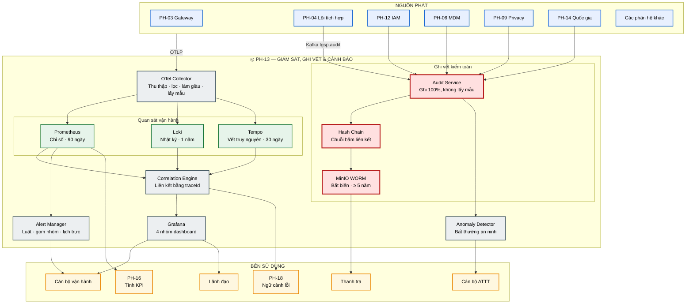
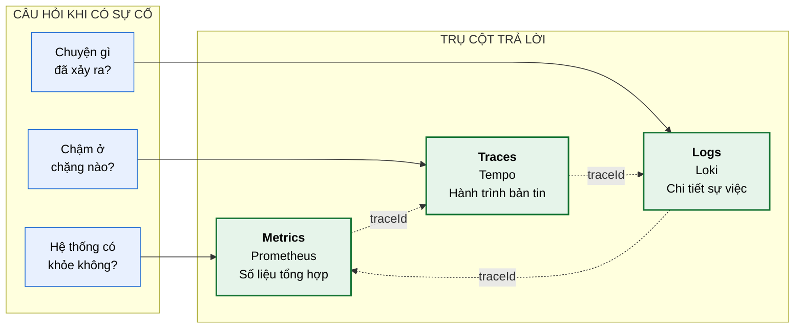
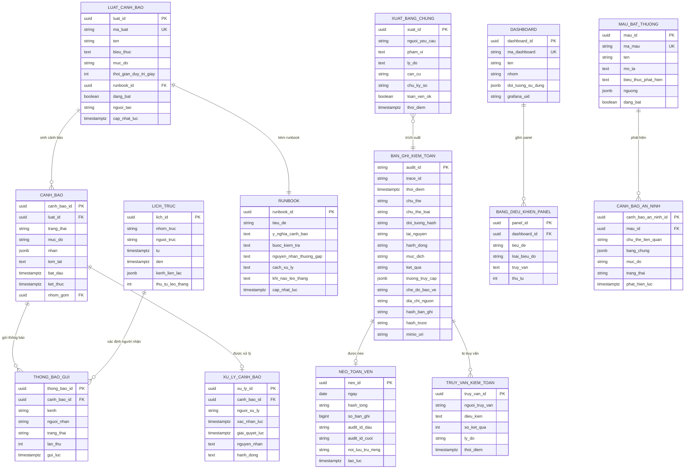

# SRS — PH-13: Giám sát, Ghi vết & Cảnh báo

| Thuộc tính | Giá trị |
|---|---|
| **Mã phân hệ** | PH-13 |
| **Tên** | Giám sát, Ghi vết & Cảnh báo (Observability & Audit) |
| **Nhóm** | Xuyên suốt |
| **Mức bắt buộc** | M — Bắt buộc |
| **Phiên bản** | 1.0 |
| **Ngày** | 03/8/2026 |
| **Công nghệ chủ đạo** | OpenTelemetry + Prometheus + Loki + Tempo + Grafana + MinIO (WORM) |

---

## M1. Giới thiệu

### 1.1. Mục đích

PH-13 trả lời hai loại câu hỏi khác nhau về bản chất, và việc phân biệt chúng quyết định toàn bộ thiết kế phân hệ:

| Loại | Câu hỏi | Đối tượng | Yêu cầu |
|---|---|---|---|
| **Quan sát vận hành** | Hệ thống có khỏe không? Chậm ở đâu? Vì sao lỗi? | Cán bộ vận hành, kỹ thuật | Nhanh, đủ dùng, lấy mẫu được |
| **Ghi vết kiểm toán** | Ai truy cập dữ liệu gì, khi nào, vì mục đích gì? | Thanh tra, cơ quan giám sát | **Đầy đủ 100%**, bất biến, giữ lâu |

Nhầm lẫn hai loại này là lỗi thiết kế phổ biến: lấy mẫu bản ghi kiểm toán làm mất bằng chứng pháp lý; lưu 100% nhật ký vận hành làm phình dung lượng vô ích.

Đây là phân hệ đáp ứng CV 631 về giám sát thời gian thực (CMP-10) và Luật Dữ liệu 2024 về ghi vết truy cập (CMP-28).

### 1.2. Phạm vi

**PH-13 chịu trách nhiệm:**

| # | Trách nhiệm |
|---|---|
| 1 | Thu thập chỉ số, nhật ký, vết truy nguyên từ mọi phân hệ |
| 2 | Lưu trữ và truy vấn dữ liệu quan sát theo chính sách giữ |
| 3 | Ghi vết kiểm toán bất biến cho mọi truy cập dữ liệu |
| 4 | Liên kết ba nguồn quan sát bằng `traceId` |
| 5 | Cung cấp bốn nhóm dashboard theo đối tượng sử dụng |
| 6 | Đánh giá luật cảnh báo và gửi thông báo theo lịch trực |
| 7 | Phát hiện bất thường về an ninh |
| 8 | Cung cấp dữ liệu cho PH-16 tính KPI |
| 9 | Xuất bằng chứng phục vụ thanh tra |

**PH-13 KHÔNG chịu trách nhiệm:**

| # | Không làm | Thuộc phân hệ |
|---|---|---|
| 1 | Sinh dữ liệu quan sát — chỉ *thu thập* | Mọi phân hệ tự phát |
| 2 | Xử lý bản tin lỗi (DLQ) | PH-18 |
| 3 | Quyết định ủy quyền | PH-12 |
| 4 | Tính toán và báo cáo KPI tuân thủ | PH-16 |
| 5 | Che, ẩn danh hóa dữ liệu trong bản ghi | PH-09 (bên gọi đã xử lý) |

### 1.3. Tài liệu tham chiếu

| Mã | Tài liệu |
|---|---|
| [KT] | [Kiến trúc giám sát & vận hành](../02-architecture/README.md#9-kiến-trúc-giám-sát--vận-hành) |
| [LT] | [F-12 Giám sát và cảnh báo vận hành](../03-flows/README.md#f-12--giám-sát-và-cảnh-báo-vận-hành), [F-03](../03-flows/README.md#f-03--khai-thác-dữ-liệu-đồng-bộ-nội-bộ), [F-10](../03-flows/README.md#f-10--xử-lý-lỗi-và-phát-lại-bản-tin) |
| [PL] | [Ma trận CMP](../01-legal/README.md) — CV 631 (CMP-10), Luật Dữ liệu 2024 (CMP-28) |
| [ADR] | [ADR-007 OpenTelemetry + LGTM](../05-adr/README.md#adr-007), [ADR-008 MinIO WORM](../05-adr/README.md#adr-008) |
| [SRS] | [PH-04](SRS-PH-04-integration-core.md), [PH-12](SRS-PH-12-iam.md), [PH-16](SRS-PH-16-nas-kpi.md), [PH-18](SRS-PH-18-ops.md) |

---

## M2. Mô tả tổng quan

### 2.1. Vị trí trong kiến trúc



**Thuyết minh sơ đồ.** Hai đường dữ liệu song song và **không trộn lẫn** là điểm thiết kế cốt lõi:

| Đặc điểm | Đường quan sát vận hành | Đường ghi vết kiểm toán |
|---|---|---|
| Đi qua | OTel Collector | Kafka `lgsp.audit` → Audit Service |
| Lấy mẫu | Có (5% trace thành công) | **Không bao giờ** |
| Lưu trữ | Prometheus/Loki/Tempo | MinIO WORM |
| Sửa/xóa được | Có (hết hạn tự xóa) | **Không** (chuỗi băm + WORM) |
| Thời hạn | 30 ngày – 1 năm | ≥ 5 năm |
| Mất dữ liệu | Chấp nhận được | **Không chấp nhận** |

Nếu gộp hai đường vào một, hoặc mất bằng chứng pháp lý do lấy mẫu, hoặc phình dung lượng vì lưu tất cả 5 năm.

**Khối `CHAIN` — chuỗi băm liên kết.** Mỗi bản ghi kiểm toán chứa mã băm của bản ghi trước. Sửa một bản ghi ở giữa làm gãy toàn bộ chuỗi phía sau — phát hiện được ngay. Kết hợp với MinIO WORM, kể cả quản trị viên hệ thống cũng không sửa được lịch sử.

### 2.2. Ba trụ cột quan sát



**Thuyết minh.** Ba trụ cột không thay thế nhau mà bổ trợ. Giá trị thực sự nằm ở **đường nét đứt** — `traceId` liên kết cả ba. Quy trình chẩn đoán điển hình: cảnh báo từ metrics → lấy `traceId` của yêu cầu lỗi → xem trace thấy chặng nào chậm → xem log của chặng đó thấy lỗi cụ thể. Không có `traceId` xuyên suốt thì phải đoán mò.

### 2.3. Tác nhân

| Tác nhân | Loại | Tương tác |
|---|---|---|
| Cán bộ vận hành | Người | Theo dõi dashboard, nhận cảnh báo, chẩn đoán sự cố |
| Cán bộ an toàn thông tin | Người | Điều tra sự cố an ninh, xem nhật ký kiểm toán |
| Lãnh đạo | Người | Xem dashboard nghiệp vụ |
| Cán bộ thanh tra | Người | Trích xuất bằng chứng kiểm toán |
| Chủ quản dịch vụ | Người | Xem chỉ số dịch vụ của mình |
| Mọi phân hệ | Hệ thống | Phát telemetry và bản ghi kiểm toán |
| PH-16 | Hệ thống | Lấy chỉ số tính KPI |
| PH-18 | Hệ thống | Lấy ngữ cảnh cho bản tin lỗi |

### 2.4. Giả định

| Mã | Giả định |
|---|---|
| GD-01 | Mọi phân hệ đã nhúng OpenTelemetry và phát telemetry theo chuẩn OTLP |
| GD-02 | `traceId` được sinh tại PH-03 và truyền xuyên suốt |
| GD-03 | Dung lượng lưu trữ đủ cho chính sách giữ đã định |
| GD-04 | Đồng hồ các node đồng bộ NTP — sai lệch ảnh hưởng thứ tự sự kiện |
| GD-05 | Bên gọi đã che dữ liệu nhạy cảm trước khi ghi vào nhật ký |

### 2.5. Ràng buộc

| Mã | Ràng buộc | Nguồn |
|---|---|---|
| RB-01 | Giám sát, thống kê, báo cáo, phân tích **nghiệp vụ** thời gian thực | CV 631, CMP-10 |
| RB-02 | Ghi vết đầy đủ truy cập dữ liệu: ai, gì, khi nào | Luật Dữ liệu 2024, CMP-28 |
| RB-03 | Nhật ký kiểm toán không sửa, không xóa được | Giá trị chứng cứ |
| RB-04 | Không ghi dữ liệu cá nhân dạng rõ vào nhật ký vận hành | Bảo vệ dữ liệu cá nhân |
| RB-05 | Hoạt động 24/7 | CV 631, CMP-15 |
| RB-06 | Toàn bộ công nghệ mã nguồn mở, chuẩn mở | Yêu cầu dự án |

### 2.6. Phụ thuộc phân hệ

| Phụ thuộc | Loại | Hành vi khi không khả dụng |
|---|---|---|
| MinIO (WORM) | **Cứng** cho ghi vết | Không ghi được vết → bên gọi **từ chối** xử lý dữ liệu nhạy cảm |
| Lưu trữ bền vững | **Cứng** | Mất khả năng lưu dữ liệu quan sát mới |
| PH-10 (Kafka) | **Mềm** | Bản ghi kiểm toán đệm tại nguồn, gửi lại sau |
| Kênh thông báo | **Mềm** | Cảnh báo hiển thị trên dashboard, không gửi được ra ngoài |

**Ghi chú quan trọng.** PH-13 là phân hệ **xuyên suốt nhưng không chặn** — sự cố PH-13 không làm dừng luồng dữ liệu ([PR-06](README.md#1-nguyên-tắc-phân-rã-phân-hệ)). Ngoại lệ duy nhất: dữ liệu nhạy cảm không ghi được vết thì bên gọi phải từ chối phục vụ (CMP-28).

---

## M3. Yêu cầu chức năng

### 3.1. Nhóm A — Thu thập dữ liệu quan sát

#### FR-13-001 — Thu thập chỉ số · **M**

| Mục | Nội dung |
|---|---|
| **Mô tả** | Nhận và lưu chỉ số từ mọi phân hệ |
| **Tác nhân** | Mọi phân hệ |
| **Đầu vào** | Chỉ số theo giao thức OTLP hoặc điểm cuối Prometheus |
| **Xử lý** | 1. OTel Collector nhận qua OTLP hoặc thu thập chủ động<br>2. Làm giàu nhãn: namespace, pod, phiên bản, môi trường<br>3. Lọc bỏ chỉ số không dùng để giảm dung lượng<br>4. Ghi vào Prometheus<br>5. Tổng hợp chỉ số cũ (downsampling) sau 7 ngày để tiết kiệm |
| **Đầu ra** | Chỉ số truy vấn được |
| **Ngoại lệ** | E1: Collector quá tải → áp dụng backpressure, ưu tiên chỉ số quan trọng<br>E2: Prometheus đầy dung lượng → xóa dữ liệu cũ nhất, cảnh báo nghiêm trọng |

#### FR-13-002 — Thu thập nhật ký · **M**

| Mục | Nội dung |
|---|---|
| **Mô tả** | Nhận nhật ký có cấu trúc từ mọi phân hệ |
| **Đầu vào** | Nhật ký dạng JSON có `traceId`, `level`, `message`, ngữ cảnh |
| **Xử lý** | 1. Thu thập từ stdout container hoặc qua OTLP<br>2. Bắt buộc định dạng JSON có cấu trúc<br>3. Trích và đánh chỉ mục `traceId`, `routeId`, `stage`, `level`<br>4. **Quét phát hiện dữ liệu cá nhân dạng rõ** — cảnh báo nếu có (RB-04)<br>5. Ghi vào Loki |
| **Đầu ra** | Nhật ký truy vấn được theo `traceId` |
| **Ngoại lệ** | E1: Nhật ký không đúng JSON → vẫn nhận nhưng ghi cảnh báo, không đánh chỉ mục được<br>E2: Phát hiện dữ liệu cá nhân → cảnh báo cho phân hệ nguồn, ghi lại vị trí để sửa<br>E3: Loki quá tải → đệm cục bộ, bỏ nhật ký mức `DEBUG` trước |

**Ghi chú về bước 4 — kiểm tra thực tế cần thiết.** Lập trình viên thường vô tình ghi cả bản tin vào nhật ký khi gỡ lỗi, để lại dữ liệu cá nhân trong Loki. Quét tự động phát hiện mẫu như số định danh 12 chữ số hoặc trường `hoTen` và cảnh báo.

#### FR-13-003 — Thu thập vết truy nguyên · **M**

| Mục | Nội dung |
|---|---|
| **Mô tả** | Nhận trace theo chuẩn W3C Trace Context |
| **Đầu vào** | Span theo giao thức OTLP |
| **Xử lý** | 1. Nhận span từ mọi phân hệ<br>2. Ghép span thành trace hoàn chỉnh theo `traceId`<br>3. Áp dụng chiến lược lấy mẫu (FR-13-004)<br>4. Ghi vào Tempo<br>5. Trích chỉ số từ trace: độ trễ theo chặng |
| **Đầu ra** | Trace truy vấn được |
| **Ngoại lệ** | E1: Trace không đầy đủ (thiếu span giữa) → vẫn lưu, đánh dấu không đầy đủ<br>E2: Trace quá dài (> 1.000 span) → cắt bớt, giữ span đầu, cuối và span lỗi |

#### FR-13-004 — Lấy mẫu trace thông minh · **M**

| Mục | Nội dung |
|---|---|
| **Mô tả** | Giảm dung lượng mà không mất trace quan trọng |
| **Xử lý** | Áp dụng lấy mẫu **theo kết quả** (tail-based sampling):<br>1. Giữ **100%** trace có lỗi<br>2. Giữ **100%** trace chậm bất thường (vượt P99)<br>3. Giữ **100%** trace liên quan dữ liệu nhạy cảm<br>4. Lấy mẫu **5%** trace thành công bình thường<br>5. Quyết định lấy mẫu sau khi trace hoàn tất, không phải lúc bắt đầu |
| **Đầu ra** | Tập trace được lưu |
| **Ngoại lệ** | E1: Bộ đệm quyết định lấy mẫu đầy → chuyển tạm sang lấy mẫu đầu (head-based), cảnh báo |

**Ghi chú về bước 5 — điểm khác biệt quan trọng.** Lấy mẫu **đầu** (quyết định khi trace bắt đầu) sẽ bỏ sót đúng những trace cần nhất, vì lúc bắt đầu chưa biết có lỗi hay không. Lấy mẫu **cuối** giữ được toàn bộ trace lỗi — nghịch lý thường gặp là lấy mẫu ngẫu nhiên đều lại bỏ mất trace quan trọng.

### 3.2. Nhóm B — Ghi vết kiểm toán

#### FR-13-005 — Ghi bản ghi kiểm toán · **M**

| Mục | Nội dung |
|---|---|
| **Mô tả** | Ghi lại mọi truy cập dữ liệu, không lấy mẫu |
| **Tác nhân** | PH-04, PH-06, PH-09, PH-12, PH-14 |
| **Tiền điều kiện** | — |
| **Đầu vào** | Bản ghi kiểm toán qua chủ đề Kafka `lgsp.audit` |
| **Xử lý** | 1. Nhận từ Kafka, bảo đảm không mất<br>2. Kiểm tra đủ trường bắt buộc<br>3. Tính mã băm bản ghi, liên kết với băm bản ghi trước (chuỗi băm)<br>4. Ghi vào MinIO bật chế độ WORM<br>5. Đánh chỉ mục để truy vấn: `traceId`, `subjectId`, `clientId`, thời điểm<br>6. Xác nhận offset Kafka **sau khi** ghi thành công |
| **Đầu ra** | Bản ghi kiểm toán bất biến |
| **Ngoại lệ** | E1: Thiếu trường bắt buộc → vẫn ghi nhưng đánh dấu không đầy đủ, cảnh báo phân hệ nguồn<br>E2: Không ghi được MinIO → **không xác nhận offset**, sự kiện được thử lại; cảnh báo nghiêm trọng<br>E3: Chuỗi băm gãy → cảnh báo an ninh mức cao nhất, có thể là dấu hiệu can thiệp |

**Trường bắt buộc của bản ghi kiểm toán:**

| Trường | Ý nghĩa | Bắt buộc |
|---|---|---|
| `auditId` | Định danh bản ghi | ✓ |
| `traceId` | Nối với vết vận hành | ✓ |
| `thoiDiem` | Thời điểm chính xác tới mili giây | ✓ |
| `chuThe` | Ai truy cập (người dùng hoặc hệ thống) | ✓ |
| `doiTuong` | Truy cập dữ liệu của ai (số định danh đã băm) | ✓ |
| `taiNguyen` | Dữ liệu gì | ✓ |
| `hanhDong` | Đọc, ghi, xóa | ✓ |
| `mucDich` | Mục đích sử dụng khai báo | ✓ |
| `ketQua` | Cho phép hay từ chối | ✓ |
| `truongTruyCap` | Danh sách trường thực sự được trả | ✓ |
| `cheDoBaoVe` | Chế độ che/ẩn danh đã áp dụng | ✓ |
| `diaChiNguon` | Địa chỉ mạng bên gọi | ✓ |
| `hashTruoc` | Băm bản ghi trước (chuỗi băm) | ✓ |

**Ghi chú về `doiTuong` được băm.** Nhật ký kiểm toán lưu 5 năm và nhiều người xem — lưu số định danh dạng rõ tạo rủi ro. Băm cho phép vẫn truy vấn được "ai đã tra cứu công dân X" (băm X rồi tìm) mà không lộ danh sách công dân bị tra cứu.

#### FR-13-006 — Bảo đảm tính bất biến · **M**

| Mục | Nội dung |
|---|---|
| **Mô tả** | Ngăn mọi khả năng sửa hoặc xóa nhật ký kiểm toán |
| **Xử lý** | Ba lớp bảo vệ:<br>1. **MinIO Object Lock** chế độ tuân thủ — không xóa được trong thời hạn giữ, kể cả bởi tài khoản quản trị<br>2. **Chuỗi băm** — mỗi bản ghi chứa băm bản ghi trước<br>3. **Neo định kỳ** — mỗi ngày ghi mã băm tổng của toàn bộ chuỗi vào nơi lưu trữ riêng biệt<br>Kiểm tra toàn vẹn chuỗi định kỳ hằng ngày |
| **Đầu ra** | Nhật ký có giá trị chứng cứ |
| **Ngoại lệ** | E1: Phát hiện chuỗi băm gãy → **cảnh báo an ninh cao nhất**, khoanh vùng khoảng bị ảnh hưởng<br>E2: Neo hằng ngày không khớp → nghi vấn can thiệp, báo cáo lãnh đạo |

**Ghi chú về ba lớp.** Object Lock ngăn xóa; chuỗi băm phát hiện sửa; neo định kỳ chống việc dựng lại toàn bộ chuỗi giả. Ba lớp bổ trợ nhau — vượt qua cả ba là rất khó.

#### FR-13-007 — Truy vấn nhật ký kiểm toán · **M**

| Mục | Nội dung |
|---|---|
| **Mô tả** | Tra cứu bản ghi kiểm toán phục vụ điều tra và thanh tra |
| **Tác nhân** | Cán bộ ATTT, Thanh tra |
| **Tiền điều kiện** | Người truy vấn có vai trò `SECURITY_OFFICER` hoặc `AUDITOR` |
| **Đầu vào** | Điều kiện: khoảng thời gian, chủ thể, đối tượng, tài nguyên, kết quả |
| **Xử lý** | 1. Kiểm tra quyền truy vấn qua PH-12<br>2. Thực hiện truy vấn theo chỉ mục<br>3. Trả kết quả kèm thông tin xác minh toàn vẹn<br>4. **Ghi vết chính việc truy vấn nhật ký** — ai xem nhật ký cũng bị ghi lại |
| **Đầu ra** | Kết quả truy vấn |
| **Ngoại lệ** | E1: Không đủ quyền → `403`, ghi cảnh báo an ninh<br>E2: Truy vấn phạm vi quá rộng (> 1 triệu bản ghi) → yêu cầu thu hẹp hoặc xuất bất đồng bộ |

**Ghi chú về bước 4.** Việc xem nhật ký kiểm toán cũng là hành vi nhạy cảm cần ghi vết — nếu không, người có quyền xem có thể lạm dụng tra cứu thông tin cá nhân mà không để lại dấu vết.

#### FR-13-008 — Xuất bằng chứng thanh tra · **S**

| Mục | Nội dung |
|---|---|
| **Mô tả** | Xuất hồ sơ kiểm toán có giá trị pháp lý |
| **Đầu vào** | Phạm vi cần xuất · lý do · căn cứ yêu cầu |
| **Xử lý** | 1. Trích xuất bản ghi trong phạm vi<br>2. Kèm chứng minh toàn vẹn: mã băm chuỗi, mã neo hằng ngày<br>3. **Ký số** tệp xuất bằng chứng thư của LGSP<br>4. Ghi vết việc xuất kèm lý do và người yêu cầu |
| **Đầu ra** | Tệp bằng chứng đã ký |
| **Ngoại lệ** | E1: Không ký số được → không xuất, vì tệp không ký thiếu giá trị pháp lý<br>E2: Phát hiện chuỗi băm không toàn vẹn trong phạm vi → cảnh báo rõ trong tệp xuất |

### 3.3. Nhóm C — Liên kết và chẩn đoán

#### FR-13-009 — Liên kết ba nguồn bằng traceId · **M**

| Mục | Nội dung |
|---|---|
| **Mô tả** | Cho phép chuyển qua lại giữa metrics, traces, logs |
| **Đầu vào** | `traceId` hoặc điểm dữ liệu bất kỳ |
| **Xử lý** | 1. Từ chỉ số → lấy trace mẫu tương ứng khoảng thời gian<br>2. Từ trace → lấy toàn bộ nhật ký có cùng `traceId`<br>3. Từ nhật ký → mở trace tương ứng<br>4. Từ trace → mở bản ghi kiểm toán liên quan (nếu có quyền)<br>5. Hiển thị liên kết ngay trên giao diện Grafana |
| **Đầu ra** | Ngữ cảnh đầy đủ của một yêu cầu |
| **Ngoại lệ** | E1: Trace đã hết hạn giữ → hiển thị nhật ký còn lại kèm thông báo<br>E2: `traceId` không tồn tại → gợi ý kiểm tra khoảng thời gian |

#### FR-13-010 — Truy vết một yêu cầu đầu-cuối · **M**

| Mục | Nội dung |
|---|---|
| **Mô tả** | Hiển thị toàn bộ hành trình một bản tin qua các phân hệ |
| **Đầu vào** | `traceId` |
| **Xử lý** | 1. Lấy toàn bộ span của trace<br>2. Dựng cây theo quan hệ cha-con<br>3. Hiển thị dạng thác nước: chiều dài tỷ lệ thời gian<br>4. Đánh dấu chặng lỗi và chặng chậm bất thường<br>5. Kèm nhật ký từng chặng<br>6. Tính phân bổ thời gian: chặng nào chiếm bao nhiêu phần trăm |
| **Đầu ra** | Hành trình đầy đủ có phân tích |
| **Ngoại lệ** | E1: Trace không đầy đủ → hiển thị phần có, đánh dấu khoảng thiếu |

**Ghi chú về bước 6.** Phân bổ thời gian là thông tin quyết định khi phân định trách nhiệm: nếu 94% thời gian là chờ NDXP thì vấn đề không nằm ở LGSP ([UI-04-04](SRS-PH-04-integration-core.md#m6-giao-diện-người-dùng)).

### 3.4. Nhóm D — Dashboard và cảnh báo

#### FR-13-011 — Bốn nhóm dashboard · **M**

| Mục | Nội dung |
|---|---|
| **Mô tả** | Cung cấp góc nhìn phù hợp cho từng đối tượng |
| **Xử lý** | Xây dựng và duy trì bốn nhóm: |

| Nhóm | Đối tượng | Nội dung chính |
|---|---|---|
| **Sức khỏe nền tảng** | Vận hành | CPU, bộ nhớ, tình trạng pod, hàng đợi, dung lượng |
| **Chất lượng dịch vụ** | Quản trị nền tảng | Tỷ lệ thành công, độ trễ theo API, vi phạm SLA |
| **Hoạt động nghiệp vụ** | Lãnh đạo | Giao dịch theo đơn vị, theo dịch vụ, xu hướng |
| **An ninh** | Cán bộ ATTT | Đăng nhập thất bại, truy cập bị từ chối, truy cập dữ liệu nhạy cảm |

| Mục | Nội dung |
|---|---|
| **Đầu ra** | Bốn nhóm dashboard hoạt động |
| **Ngoại lệ** | E1: Thiếu dữ liệu cho một chỉ số → hiển thị rõ "chưa có dữ liệu", không hiển thị 0 gây hiểu nhầm |

**Ghi chú về nhóm "Hoạt động nghiệp vụ".** CV 631 yêu cầu "phân tích hoạt động **nghiệp vụ**" — không chỉ chỉ số kỹ thuật (CMP-10). Dashboard cho lãnh đạo trả lời câu hỏi quản lý: đơn vị nào dùng trục nhiều nhất, dịch vụ nào có nhu cầu cao, đơn vị nào chưa kết nối.

#### FR-13-012 — Quản lý luật cảnh báo · **M**

| Mục | Nội dung |
|---|---|
| **Mô tả** | Định nghĩa điều kiện phát cảnh báo |
| **Tác nhân** | Cán bộ vận hành, Quản trị viên |
| **Đầu vào** | Tên luật · biểu thức điều kiện · ngưỡng · thời gian duy trì · mức độ · runbook |
| **Xử lý** | 1. Kiểm tra biểu thức hợp lệ<br>2. **Bắt buộc** có runbook kèm theo<br>3. Đánh giá luật định kỳ (mặc định 30 giây)<br>4. Chỉ phát khi điều kiện duy trì đủ thời gian (tránh cảnh báo nhấp nháy)<br>5. Cho phép chạy thử luật trên dữ liệu lịch sử |
| **Đầu ra** | Luật cảnh báo hoạt động |
| **Ngoại lệ** | E1: Không có runbook → **từ chối** tạo luật<br>E2: Biểu thức sai → báo lỗi cụ thể<br>E3: Chạy thử cho thấy phát quá nhiều → cảnh báo, đề nghị điều chỉnh ngưỡng |

**Ghi chú về E1 — quy tắc quan trọng.** Cảnh báo không có runbook khiến cán bộ trực lúng túng lúc nửa đêm: không biết cảnh báo nghĩa gì, kiểm tra gì trước, xử lý ra sao. Bắt buộc runbook là biện pháp đơn giản nhưng hiệu quả.

#### FR-13-013 — Phân loại và gửi cảnh báo · **M**

| Mục | Nội dung |
|---|---|
| **Mô tả** | Đưa cảnh báo tới đúng người theo mức độ khẩn |
| **Xử lý** | 1. Phân ba mức theo **triệu chứng người dùng**, không theo nguyên nhân kỹ thuật:<br>&nbsp;&nbsp;· **Nghiêm trọng** — người dùng bị ảnh hưởng → gọi trực ngay<br>&nbsp;&nbsp;· **Cảnh báo** — có nguy cơ → thông báo, xử lý trong giờ làm việc<br>&nbsp;&nbsp;· **Thông tin** — ghi nhận, lập kế hoạch<br>2. **Gom nhóm** cảnh báo cùng nguyên nhân để tránh bão thông báo<br>3. **Chống lặp** — không gửi lại cảnh báo đang mở<br>4. Áp dụng lịch trực để xác định người nhận<br>5. Leo thang nếu không có phản hồi trong thời hạn |
| **Đầu ra** | Cảnh báo đã gửi đúng người |
| **Ngoại lệ** | E1: Kênh thông báo lỗi → thử kênh dự phòng, hiển thị trên dashboard<br>E2: Quá nhiều cảnh báo cùng lúc (> 50 trong 5 phút) → gom thành một thông báo tổng hợp |

**Ghi chú về phân loại theo triệu chứng.** Cảnh báo "CPU 90%" ít giá trị — CPU cao mà người dùng không bị ảnh hưởng thì không phải sự cố. Cảnh báo "tỷ lệ lỗi API vượt 5%" mới đáng gọi trực. Nguyên tắc này giảm mạnh mệt mỏi cảnh báo.

#### FR-13-014 — Phát hiện bất thường an ninh · **M**

| Mục | Nội dung |
|---|---|
| **Mô tả** | Nhận diện dấu hiệu tấn công hoặc lạm dụng từ dữ liệu kiểm toán |
| **Xử lý** | Phát hiện các mẫu:<br>· Truy cập dữ liệu nhạy cảm ngoài giờ hành chính<br>· Một chủ thể tra cứu số lượng đối tượng bất thường<br>· Tỷ lệ từ chối tăng đột biến của một client<br>· Truy cập từ địa chỉ mạng lạ<br>· Khôi phục danh tính hàng loạt (từ PH-09)<br>· Đăng nhập thất bại nhiều lần (từ PH-12)<br>· Chuỗi băm kiểm toán gãy |
| **Đầu ra** | Cảnh báo an ninh |
| **Ngoại lệ** | E1: Cảnh báo giả nhiều → cho phép cán bộ ATTT tinh chỉnh ngưỡng theo từng mẫu<br>E2: Phát hiện mẫu nghiêm trọng → cảnh báo tức thì, đề xuất tạm ngừng client liên quan |

### 3.5. Nhóm E — Cung cấp dữ liệu cho phân hệ khác

#### FR-13-015 — Cung cấp chỉ số cho PH-16 · **M**

| Mục | Nội dung |
|---|---|
| **Mô tả** | Cung cấp dữ liệu thô để PH-16 tính KPI tuân thủ |
| **Đầu vào** | Yêu cầu truy vấn từ PH-16 |
| **Xử lý** | 1. Cung cấp API truy vấn chỉ số theo khoảng thời gian<br>2. Cung cấp số liệu tổng hợp: số giao dịch, tỷ lệ thành công, độ trễ, số hệ thống kết nối<br>3. Bảo đảm số liệu nhất quán cho cùng một truy vấn |
| **Đầu ra** | Dữ liệu cho KPI |
| **Ngoại lệ** | E1: Khoảng thời gian vượt thời hạn giữ → trả dữ liệu có, nêu rõ giới hạn |

#### FR-13-016 — Cung cấp ngữ cảnh cho PH-18 · **M**

| Mục | Nội dung |
|---|---|
| **Mô tả** | Cung cấp trace và nhật ký cho việc chẩn đoán bản tin lỗi |
| **Đầu vào** | `traceId` từ bản ghi DLQ |
| **Xử lý** | 1. Trả trace đầy đủ của bản tin lỗi<br>2. Trả nhật ký liên quan<br>3. Trả chỉ số tại thời điểm lỗi (tải, độ trễ hạ nguồn) |
| **Đầu ra** | Ngữ cảnh chẩn đoán |
| **Ngoại lệ** | E1: Trace đã hết hạn → trả nhật ký còn lại |

**Ghi chú.** Vì DLQ giữ vô thời hạn còn trace chỉ 30 ngày, bản tin lỗi cũ có thể không còn trace. Đây là lý do bản ghi DLQ phải tự chứa đủ ngữ cảnh ([FR-04-018](SRS-PH-04-integration-core.md#m3-yêu-cầu-chức-năng)).

### 3.6. Bảng tổng hợp yêu cầu chức năng

| Nhóm | Mã | Tên | Ưu tiên |
|---|---|---|:-:|
| A | FR-13-001 | Thu thập chỉ số | M |
| A | FR-13-002 | Thu thập nhật ký | M |
| A | FR-13-003 | Thu thập vết truy nguyên | M |
| A | FR-13-004 | Lấy mẫu trace thông minh | M |
| B | FR-13-005 | Ghi bản ghi kiểm toán | M |
| B | FR-13-006 | Bảo đảm tính bất biến | M |
| B | FR-13-007 | Truy vấn nhật ký kiểm toán | M |
| B | FR-13-008 | Xuất bằng chứng thanh tra | S |
| C | FR-13-009 | Liên kết ba nguồn bằng traceId | M |
| C | FR-13-010 | Truy vết một yêu cầu đầu-cuối | M |
| D | FR-13-011 | Bốn nhóm dashboard | M |
| D | FR-13-012 | Quản lý luật cảnh báo | M |
| D | FR-13-013 | Phân loại và gửi cảnh báo | M |
| D | FR-13-014 | Phát hiện bất thường an ninh | M |
| E | FR-13-015 | Cung cấp chỉ số cho PH-16 | M |
| E | FR-13-016 | Cung cấp ngữ cảnh cho PH-18 | M |

**Tổng: 16 yêu cầu chức năng** — 15 bắt buộc (M), 1 cần có (S).

---

## M4. Mô hình dữ liệu

### 4.1. Sơ đồ thực thể



### 4.2. Đặc tả thực thể

#### EN-13-01 — BAN_GHI_KIEM_TOAN

| Trường | Kiểu | Bắt buộc | Ràng buộc | Mô tả |
|---|---|:-:|---|---|
| `audit_id` | VARCHAR(32) | ✓ | PK, ULID | Có thứ tự theo thời gian |
| `trace_id` | VARCHAR(64) | ✓ | Chỉ mục | Nối với vết vận hành |
| `thoi_diem` | TIMESTAMPTZ | ✓ | Chỉ mục | Chính xác tới mili giây |
| `chu_the` | VARCHAR(120) | ✓ | Chỉ mục | Ai truy cập |
| `chu_the_loai` | VARCHAR(16) | ✓ | ∈ {`USER`,`CLIENT`,`SYSTEM`} | |
| `doi_tuong_hash` | VARCHAR(64) | ✓ | Chỉ mục | **Băm** của định danh đối tượng |
| `tai_nguyen` | VARCHAR(200) | ✓ | | Dữ liệu gì |
| `hanh_dong` | VARCHAR(20) | ✓ | ∈ {`READ`,`WRITE`,`DELETE`,`EXPORT`} | |
| `muc_dich` | VARCHAR(80) | ✓ | | Mục đích sử dụng khai báo |
| `ket_qua` | VARCHAR(16) | ✓ | ∈ {`PERMIT`,`DENY`,`ERROR`} | |
| `truong_truy_cap` | JSONB | ✓ | | Trường nào thực sự được trả |
| `che_do_bao_ve` | VARCHAR(20) | ✓ | | Chế độ che/ẩn danh đã áp dụng |
| `hash_ban_ghi` | VARCHAR(64) | ✓ | | Băm của chính bản ghi này |
| `hash_truoc` | VARCHAR(64) | ✓ | | Băm bản ghi trước — chuỗi liên kết |
| `minio_uri` | VARCHAR(300) | ✓ | | Vị trí bản ghi gốc trên MinIO WORM |

**Ràng buộc quan trọng.** Bảng này trong PostgreSQL chỉ là **chỉ mục để truy vấn nhanh**; bản ghi gốc bất biến nằm trên MinIO WORM. Nếu ai đó sửa được PostgreSQL, đối chiếu với MinIO sẽ phát hiện.

#### EN-13-02 — NEO_TOAN_VEN

| Trường | Kiểu | Bắt buộc | Mô tả |
|---|---|:-:|---|
| `neo_id` | UUID | ✓ | PK |
| `ngay` | DATE | ✓ | UNIQUE — mỗi ngày một neo |
| `hash_tong` | VARCHAR(64) | ✓ | Băm tổng toàn bộ chuỗi tới thời điểm này |
| `so_ban_ghi` | BIGINT | ✓ | Số bản ghi tính tới ngày đó |
| `audit_id_dau` / `audit_id_cuoi` | VARCHAR(32) | ✓ | Khoảng bản ghi trong ngày |
| `noi_luu_tru_rieng` | VARCHAR(300) | ✓ | Vị trí lưu neo, **tách khỏi** nơi lưu nhật ký |

**Ghi chú.** Neo lưu ở nơi tách biệt (ví dụ bucket khác, hoặc hệ thống khác) để kẻ tấn công dựng lại chuỗi giả vẫn không khớp neo.

#### EN-13-03 — LUAT_CANH_BAO và RUNBOOK

| Trường (LUAT) | Kiểu | Bắt buộc | Mô tả |
|---|---|:-:|---|
| `ma_luat` | VARCHAR(80) | ✓ | UNIQUE |
| `bieu_thuc` | TEXT | ✓ | Biểu thức PromQL |
| `muc_do` | VARCHAR(16) | ✓ | ∈ {`CRITICAL`,`WARNING`,`INFO`} |
| `thoi_gian_duy_tri_giay` | INTEGER | ✓ | Chống cảnh báo nhấp nháy |
| `runbook_id` | UUID | ✓ | **FK bắt buộc** (FR-13-012 E1) |

| Trường (RUNBOOK) | Kiểu | Bắt buộc | Mô tả |
|---|---|:-:|---|
| `y_nghia_canh_bao` | TEXT | ✓ | Cảnh báo này nghĩa là gì |
| `buoc_kiem_tra` | TEXT | ✓ | Kiểm tra gì đầu tiên |
| `nguyen_nhan_thuong_gap` | TEXT | ✓ | Các nguyên nhân phổ biến |
| `cach_xu_ly` | TEXT | ✓ | Xử lý ra sao |
| `khi_nao_leo_thang` | TEXT | ✓ | Khi nào báo cấp trên |

**Ghi chú.** Năm trường bắt buộc của runbook trả lời đúng năm câu hỏi cán bộ trực cần biết lúc 2 giờ sáng.

#### EN-13-04 — CANH_BAO

| Trường | Kiểu | Bắt buộc | Mô tả |
|---|---|:-:|---|
| `canh_bao_id` | UUID | ✓ | PK |
| `luat_id` | UUID | ✓ | FK |
| `trang_thai` | VARCHAR(20) | ✓ | ∈ {`FIRING`,`ACKNOWLEDGED`,`RESOLVED`,`SILENCED`} |
| `nhan` | JSONB | ✓ | Nhãn xác định thực thể cụ thể (route, client…) |
| `nhom_gom` | UUID | | Cảnh báo cùng nguyên nhân được gom |

#### EN-13-05 — MAU_BAT_THUONG

| Trường | Kiểu | Bắt buộc | Mô tả |
|---|---|:-:|---|
| `ma_mau` | VARCHAR(60) | ✓ | UNIQUE |
| `bieu_thuc_phat_hien` | TEXT | ✓ | Truy vấn phát hiện mẫu |
| `nguong` | JSONB | ✓ | Ngưỡng tinh chỉnh được |
| `dang_bat` | BOOLEAN | ✓ | Tắt được nếu quá nhiều cảnh báo giả |

### 4.3. Chính sách lưu giữ

| Loại dữ liệu | Thời hạn | Nơi lưu | Sau khi hết hạn |
|---|---|---|---|
| Chỉ số (độ phân giải cao) | 7 ngày | Prometheus | Tổng hợp xuống độ phân giải thấp |
| Chỉ số (tổng hợp) | 90 ngày | Prometheus | Xóa |
| Nhật ký vận hành | 1 năm | Loki | Xóa |
| Vết truy nguyên | 30 ngày | Tempo | Xóa |
| **Bản ghi kiểm toán** | **≥ 5 năm** | **MinIO WORM** | **Không xóa** (theo quy định lưu trữ) |
| Chỉ mục kiểm toán | ≥ 5 năm | PostgreSQL | Đồng bộ với WORM |
| Neo toàn vẹn | Vĩnh viễn | Lưu trữ riêng | — |
| Luật cảnh báo, runbook | Vĩnh viễn | PostgreSQL | — |
| Lịch sử cảnh báo | 2 năm | PostgreSQL | Xóa |
| Nhật ký truy vấn kiểm toán | 5 năm | WORM | Không xóa |

---

## M5. Giao diện API

### 5.1. Nguyên tắc chung

| Khía cạnh | Quy định |
|---|---|
| Đường dẫn tiếp nhận telemetry | OTLP qua gRPC `:4317` và HTTP `:4318` |
| Đường dẫn ghi vết | Kafka `lgsp.audit` (không qua HTTP) |
| Đường dẫn truy vấn | `/api/v1/observability` |
| Đường dẫn kiểm toán | `/api/v1/audit` |
| Xác thực | Bearer JWT; kiểm toán cần vai trò `SECURITY_OFFICER` hoặc `AUDITOR` |
| Mã lỗi | RFC 9457 Problem Details |

### 5.2. Điểm cuối quan sát

| Phương thức | Đường dẫn | Chức năng | FR |
|---|---|---|---|
| `GET` | `/api/v1/observability/metrics/query` | Truy vấn chỉ số (PromQL) | FR-13-001 |
| `GET` | `/api/v1/observability/logs/query` | Truy vấn nhật ký (LogQL) | FR-13-002 |
| `GET` | `/api/v1/observability/traces/{traceId}` | Lấy trace đầy đủ | FR-13-010 |
| `GET` | `/api/v1/observability/traces/search` | Tìm trace theo điều kiện | FR-13-003 |
| `GET` | `/api/v1/observability/correlate/{traceId}` | Lấy cả ba nguồn theo traceId | FR-13-009 |
| `GET` | `/api/v1/observability/service-health` | Sức khỏe tổng hợp theo phân hệ | FR-13-011 |

### 5.3. Điểm cuối kiểm toán

| Phương thức | Đường dẫn | Chức năng | FR |
|---|---|---|---|
| `POST` | `/api/v1/audit/query` | Truy vấn nhật ký kiểm toán | FR-13-007 |
| `GET` | `/api/v1/audit/records/{auditId}` | Chi tiết một bản ghi | FR-13-007 |
| `POST` | `/api/v1/audit/verify` | Kiểm tra toàn vẹn chuỗi băm | FR-13-006 |
| `POST` | `/api/v1/audit/export` | Xuất bằng chứng (bất đồng bộ) | FR-13-008 |
| `GET` | `/api/v1/audit/export/{id}` | Tải tệp bằng chứng đã ký | FR-13-008 |
| `GET` | `/api/v1/audit/anchors` | Danh sách neo toàn vẹn | FR-13-006 |

### 5.4. Điểm cuối cảnh báo

| Phương thức | Đường dẫn | Chức năng | FR |
|---|---|---|---|
| `GET` | `/api/v1/observability/alerts` | Cảnh báo đang mở | FR-13-013 |
| `POST` | `/api/v1/observability/alerts/{id}/ack` | Xác nhận đã tiếp nhận | FR-13-013 |
| `POST` | `/api/v1/observability/alerts/{id}/resolve` | Đánh dấu đã xử lý | FR-13-013 |
| `POST` | `/api/v1/observability/alerts/{id}/silence` | Tạm ẩn có thời hạn | FR-13-013 |
| `GET` | `/api/admin/v1/observability/rules` | Danh sách luật cảnh báo | FR-13-012 |
| `POST` | `/api/admin/v1/observability/rules` | Tạo luật (kèm runbook) | FR-13-012 |
| `POST` | `/api/admin/v1/observability/rules/{id}/test` | Chạy thử trên dữ liệu lịch sử | FR-13-012 |
| `GET` | `/api/v1/observability/security-alerts` | Cảnh báo an ninh | FR-13-014 |

### 5.5. Đặc tả chi tiết điểm cuối chính

#### 5.5.1. `GET /api/v1/observability/correlate/{traceId}` — Liên kết ba nguồn

**Phản hồi `200 OK`:**

```json
{
  "traceId": "4bf92f3577b34da6a3ce929d0e0e4736",
  "tomTat": {
    "batDau": "2026-08-03T14:32:10.120+07:00",
    "ketThuc": "2026-08-03T14:32:11.480+07:00",
    "tongThoiGianMs": 1360,
    "trangThai": "SUCCESS",
    "soChang": 9,
    "benGoi": "CONG-DVC"
  },
  "trace": {
    "chang": [
      { "ten": "gateway.receive", "phanHe": "PH-03", "batDauMs": 0, "thoiGianMs": 4, "ketQua": "OK" },
      { "ten": "core.validate", "phanHe": "PH-04", "batDauMs": 4, "thoiGianMs": 12, "ketQua": "OK" },
      { "ten": "iam.authorize", "phanHe": "PH-12", "batDauMs": 16, "thoiGianMs": 8, "ketQua": "PERMIT" },
      { "ten": "national.invoke", "phanHe": "PH-14", "batDauMs": 27, "thoiGianMs": 1280, "ketQua": "OK", "canhBao": "Chiếm 94% tổng thời gian" },
      { "ten": "privacy.apply", "phanHe": "PH-09", "batDauMs": 1330, "thoiGianMs": 9, "ketQua": "MASKED" }
    ],
    "phanBoThoiGian": [
      { "phanHe": "PH-14", "thoiGianMs": 1280, "tyLe": 0.941 },
      { "phanHe": "PH-04", "thoiGianMs": 52, "tyLe": 0.038 },
      { "phanHe": "PH-03", "thoiGianMs": 12, "tyLe": 0.009 }
    ]
  },
  "logs": { "soDong": 14, "_link": "/api/v1/observability/logs/query?traceId=4bf92f..." },
  "audit": { "coBanGhi": true, "canQuyen": "SECURITY_OFFICER", "_link": "/api/v1/audit/query?traceId=4bf92f..." },
  "nhanXet": "94% thời gian là chờ nền tảng quốc gia. Độ trễ nội tại của LGSP là 80ms."
}
```

**Ghi chú thiết kế.** Trường `nhanXet` và `phanBoThoiGian` biến dữ liệu thô thành kết luận sử dụng được ngay — cán bộ vận hành không phải tự tính toán để biết vấn đề nằm ở đâu.

#### 5.5.2. `POST /api/v1/audit/query` — Truy vấn nhật ký kiểm toán

**Yêu cầu:**

```json
{
  "tuThoiDiem": "2026-08-01T00:00:00+07:00",
  "denThoiDiem": "2026-08-03T23:59:59+07:00",
  "chuThe": "CONG-DVC",
  "taiNguyen": "cong-dan/*",
  "ketQua": "PERMIT",
  "lyDoTruyVan": "Điều tra khiếu nại số 42/2026 về truy cập dữ liệu công dân",
  "gioiHan": 500
}
```

**Phản hồi `200 OK`:**

```json
{
  "tongSoKetQua": 184,
  "toanVenChuoi": { "daKiemTra": true, "hopLe": true, "neoGanNhat": "2026-08-03" },
  "banGhi": [
    {
      "auditId": "01J5X8K2M9P3Q7R4T6V8W0Y2Z4",
      "traceId": "4bf92f3577b34da6a3ce929d0e0e4736",
      "thoiDiem": "2026-08-03T14:32:11.462+07:00",
      "chuThe": "CONG-DVC",
      "chuTheLoai": "CLIENT",
      "doiTuongHash": "a3f5b8c1d2e4...",
      "taiNguyen": "cong-dan/001199001234",
      "hanhDong": "READ",
      "mucDich": "GIAI_QUYET_TTHC",
      "ketQua": "PERMIT",
      "truongTruyCap": ["soDinhDanh", "hoTen", "ngaySinh", "noiThuongTru"],
      "cheDoBaoVe": "mask",
      "diaChiNguon": "10.20.30.40"
    }
  ],
  "ghiChu": "Việc truy vấn này đã được ghi vết theo quy định"
}
```

**Ghi chú.** Trường `toanVenChuoi` cho biết chuỗi băm đã được kiểm tra và hợp lệ — thông tin cần thiết để kết quả có giá trị làm bằng chứng.

#### 5.5.3. `POST /api/v1/audit/verify` — Kiểm tra toàn vẹn

**Phản hồi khi phát hiện bất thường `200 OK`:**

```json
{
  "phamVi": { "tu": "2026-07-01", "den": "2026-08-03" },
  "ketQua": "VI_PHAM",
  "soBanGhiKiemTra": 4820100,
  "chiTiet": {
    "chuoiBamHopLe": false,
    "viTriGay": {
      "auditId": "01J4T2K8M1P5Q9R3T7V1W5Y9Z3",
      "thoiDiem": "2026-07-18T03:14:22+07:00",
      "moTa": "Băm bản ghi không khớp với hash_truoc của bản ghi kế tiếp"
    },
    "neoNgayKhongKhop": ["2026-07-18", "2026-07-19"],
    "doiChieuMinioWorm": "Bản ghi trên MinIO khác với chỉ mục PostgreSQL"
  },
  "mucDoNghiemTrong": "CAO_NHAT",
  "hanhDongDaThucHien": [
    "Đã phát cảnh báo an ninh mức cao nhất",
    "Đã thông báo cán bộ ATTT và lãnh đạo",
    "Đã khoanh vùng khoảng bị ảnh hưởng: 18/7 - 19/7/2026"
  ]
}
```

**Ghi chú.** Đây là kịch bản nghiêm trọng nhất mà phân hệ này phải xử lý: có dấu hiệu ai đó can thiệp nhật ký kiểm toán. Phản hồi nêu rõ vị trí, mức độ và các hành động đã tự động thực hiện.

---

## M6. Giao diện người dùng

### 6.1. Danh mục màn hình

| Mã | Tên màn hình | Đối tượng | Mockup |
|---|---|---|---|
| **UI-13-01** | Dashboard sức khỏe nền tảng | Vận hành | [`monitoring.html`](../../mockup/pages/monitoring.html) |
| **UI-13-02** | Truy vết bản tin theo traceId | Vận hành, Kỹ thuật | [`monitoring.html`](../../mockup/pages/monitoring.html) (tab Truy vết) |
| **UI-13-03** | Danh sách cảnh báo và xử lý | Vận hành | [`monitoring.html`](../../mockup/pages/monitoring.html) (tab Cảnh báo) |
| **UI-13-04** | Dashboard hoạt động nghiệp vụ | Lãnh đạo | [`monitoring.html`](../../mockup/pages/monitoring.html) (tab Nghiệp vụ) |
| **UI-13-05** | Tra cứu nhật ký kiểm toán | Cán bộ ATTT, Thanh tra | [`monitoring.html`](../../mockup/pages/monitoring.html) (tab Kiểm toán) |
| **UI-13-06** | Cảnh báo an ninh | Cán bộ ATTT | [`monitoring.html`](../../mockup/pages/monitoring.html) (tab An ninh) |
| **UI-13-07** | Quản lý luật cảnh báo và runbook | Vận hành, Quản trị viên | [`monitoring.html`](../../mockup/pages/monitoring.html) (tab Luật) |

### 6.2. UI-13-01 — Dashboard sức khỏe nền tảng

| Thành phần | Mô tả |
|---|---|
| Thẻ chỉ số chính | Giao dịch/giây · tỷ lệ thành công · độ trễ P99 · số cảnh báo mở |
| Bản đồ phân hệ | 18 phân hệ hiển thị dạng lưới, màu theo sức khỏe |
| Biểu đồ lưu lượng | Theo thời gian, phân tách theo mã trạng thái |
| Biểu đồ độ trễ | P50, P95, P99 theo thời gian |
| Bảng tài nguyên | CPU, bộ nhớ, đĩa theo namespace |
| Danh sách cảnh báo mới nhất | 5 cảnh báo gần nhất, nhấn để mở chi tiết |

**Quy tắc tương tác:**

| # | Quy tắc |
|---|---|
| 1 | Phân hệ có cảnh báo mức nghiêm trọng → ô tô đỏ, nhấp nháy nhẹ |
| 2 | Nhấn một phân hệ → lọc toàn bộ dashboard theo phân hệ đó |
| 3 | Chọn khoảng thời gian trên biểu đồ → mọi panel đồng bộ theo |
| 4 | Nhấn điểm bất thường trên biểu đồ → mở danh sách trace lỗi trong khoảng đó |
| 5 | Thiếu dữ liệu hiển thị "chưa có dữ liệu", **không** hiển thị số 0 |

### 6.3. UI-13-02 — Truy vết bản tin

**Mục đích.** Màn hình được dùng nhiều nhất khi chẩn đoán sự cố.

| Thành phần | Mô tả |
|---|---|
| Ô nhập traceId | Dán và nhấn Enter |
| Tóm tắt | Thời gian tổng, trạng thái, bên gọi, số chặng |
| Biểu đồ thác nước | Mỗi chặng một thanh ngang, chiều dài tỷ lệ thời gian |
| Bảng phân bổ thời gian | Phân hệ nào chiếm bao nhiêu phần trăm |
| Nhận xét tự động | Kết luận về điểm nghẽn |
| Khung nhật ký | Nhật ký của chặng được chọn |
| Liên kết kiểm toán | Nút mở bản ghi kiểm toán (nếu có quyền) |
| Nút sao chép traceId | Chia sẻ cho đơn vị liên quan |

**Quy tắc tương tác:**

| # | Quy tắc |
|---|---|
| 1 | Chặng lỗi tô đỏ và **tự mở rộng** chi tiết |
| 2 | Chặng chiếm > 50% thời gian → gắn nhãn cảnh báo |
| 3 | Nhấn một chặng → hiển thị nhật ký của chặng đó bên dưới |
| 4 | Trace đã hết hạn → hiển thị nhật ký còn lại kèm thông báo rõ |
| 5 | Nút mở kiểm toán chỉ hiện với người có vai trò phù hợp |

### 6.4. UI-13-03 — Danh sách cảnh báo và xử lý

| Thành phần | Mô tả |
|---|---|
| Bộ lọc | Mức độ · trạng thái · phân hệ · khoảng thời gian |
| Bảng cảnh báo | Mức · Tên · Phân hệ · Bắt đầu · Thời gian kéo dài · Trạng thái · Người xử lý |
| Nhóm gom | Cảnh báo cùng nguyên nhân hiển thị gộp, mở rộng được |
| Chi tiết cảnh báo | Mô tả · biểu thức · giá trị hiện tại · biểu đồ liên quan |
| **Runbook** | Hiển thị ngay trong màn hình, không phải mở tab khác |
| Nút hành động | Xác nhận tiếp nhận · Đánh dấu đã xử lý · Tạm ẩn |
| Ô ghi nhận | Nguyên nhân và hành động đã thực hiện |

**Quy tắc tương tác:**

| # | Quy tắc |
|---|---|
| 1 | Runbook hiển thị **ngay khi mở cảnh báo**, năm mục rõ ràng |
| 2 | Cảnh báo nghiêm trọng chưa xác nhận > 15 phút → leo thang tự động |
| 3 | Đánh dấu đã xử lý yêu cầu ghi nguyên nhân và hành động |
| 4 | Tạm ẩn bắt buộc có thời hạn và lý do |
| 5 | Có liên kết nhanh sang truy vết trace liên quan |

**Ghi chú về quy tắc 1.** Đây là chi tiết nhỏ nhưng tác động lớn: cán bộ trực lúc nửa đêm không phải tìm tài liệu ở nơi khác, mọi thứ cần biết đã ở ngay màn hình.

### 6.5. UI-13-05 — Tra cứu nhật ký kiểm toán

**Mục đích.** Phục vụ điều tra và thanh tra — màn hình có yêu cầu pháp lý cao nhất.

| Thành phần | Mô tả |
|---|---|
| Cảnh báo đầu trang | "Việc tra cứu này sẽ được ghi vết" — hiển thị thường trực |
| Ô lý do truy vấn | **Bắt buộc** nhập trước khi tra |
| Bộ lọc | Thời gian · chủ thể · đối tượng · tài nguyên · hành động · kết quả |
| Bảng kết quả | Thời điểm · Chủ thể · Tài nguyên · Hành động · Mục đích · Kết quả · Chế độ bảo vệ |
| Chỉ báo toàn vẹn | Trạng thái kiểm tra chuỗi băm cho phạm vi truy vấn |
| Chi tiết bản ghi | Toàn bộ trường, kèm mã băm và liên kết trace |
| Nút xuất bằng chứng | Xuất tệp đã ký số |

**Quy tắc tương tác:**

| # | Quy tắc |
|---|---|
| 1 | Không nhập lý do → không cho truy vấn |
| 2 | Chỉ báo toàn vẹn hiển thị nổi bật; nếu vi phạm → banner đỏ |
| 3 | Truy vấn > 1 triệu bản ghi → chuyển sang xuất bất đồng bộ |
| 4 | Định danh đối tượng hiển thị dạng băm; muốn tra người cụ thể thì nhập định danh, hệ thống tự băm |
| 5 | Xuất bằng chứng yêu cầu nhập căn cứ và xác thực lại |

### 6.6. UI-13-07 — Quản lý luật cảnh báo và runbook

| Thành phần | Mô tả |
|---|---|
| Danh sách luật | Mã · tên · mức độ · trạng thái · số lần phát 30 ngày |
| Trình soạn biểu thức | PromQL có gợi ý và kiểm tra cú pháp |
| Nút chạy thử | Chạy trên dữ liệu 7 ngày qua, hiển thị sẽ phát bao nhiêu lần |
| Biểu mẫu runbook | Năm mục bắt buộc, có mẫu gợi ý |
| Thống kê hiệu quả | Tỷ lệ cảnh báo giả (được tạm ẩn hoặc đóng không hành động) |

**Quy tắc tương tác:**

| # | Quy tắc |
|---|---|
| 1 | Không có runbook → **không lưu được** luật |
| 2 | Chạy thử cho thấy > 20 lần phát trong 7 ngày → cảnh báo ngưỡng quá nhạy |
| 3 | Luật có tỷ lệ cảnh báo giả > 50% → gợi ý xem lại ngưỡng |
| 4 | Xóa luật yêu cầu xác nhận và ghi lý do |

---

## M7. Yêu cầu phi chức năng

### 7.1. Hiệu năng

| Mã | Yêu cầu | Chỉ tiêu | Cách đo |
|---|---|---|---|
| **NFR-13-001** | Độ trễ chỉ số lên dashboard | ≤ 15 giây (CMP-10) | Từ lúc phát tới lúc hiển thị |
| **NFR-13-002** | Độ trễ ghi bản ghi kiểm toán | P99 ≤ 200ms | Từ Kafka tới MinIO |
| **NFR-13-003** | Thông lượng thu thập chỉ số | ≥ 1 triệu điểm/giây | Kiểm thử tải |
| **NFR-13-004** | Thông lượng ghi vết kiểm toán | ≥ 20.000 bản ghi/giây | Kiểm thử tải |
| **NFR-13-005** | Độ trễ truy vấn trace theo traceId | P99 ≤ 2 giây | — |
| **NFR-13-006** | Độ trễ truy vấn kiểm toán | P99 ≤ 5 giây với 10.000 kết quả | — |
| **NFR-13-007** | Độ trễ tải dashboard | P99 ≤ 3 giây | — |

### 7.2. Độ bền dữ liệu kiểm toán

| Mã | Yêu cầu | Chỉ tiêu |
|---|---|---|
| **NFR-13-008** | Không mất bản ghi kiểm toán | **0 bản ghi mất** trong mọi tình huống |
| **NFR-13-009** | Tính bất biến | Không sửa/xóa được, kể cả bởi quản trị viên hệ thống |
| **NFR-13-010** | Kiểm tra toàn vẹn | Chạy tự động hằng ngày trên toàn bộ chuỗi |
| **NFR-13-011** | Thời hạn giữ | ≥ 5 năm |
| **NFR-13-012** | Khôi phục | RPO = 0 với dữ liệu kiểm toán |

**Ghi chú về NFR-13-012 (RPO = 0).** Không được mất bất kỳ bản ghi kiểm toán nào, kể cả bản ghi vừa tạo. Đạt được nhờ: Kafka lưu bền vững trước, chỉ xác nhận offset sau khi ghi MinIO thành công.

### 7.3. Tính sẵn sàng

| Mã | Yêu cầu | Chỉ tiêu |
|---|---|---|
| **NFR-13-013** | Tỷ lệ sẵn sàng thu thập | ≥ 99,9% |
| **NFR-13-014** | Tỷ lệ sẵn sàng ghi vết kiểm toán | ≥ 99,95% |
| **NFR-13-015** | Sự cố PH-13 | **Không chặn** luồng dữ liệu (trừ dữ liệu nhạy cảm) |
| **NFR-13-016** | Collector quá tải | Đệm cục bộ, bỏ dữ liệu ít quan trọng trước |
| **NFR-13-017** | Số replica tối thiểu | Collector: DaemonSet · Prometheus: 2 · Audit Service: 3 |

### 7.4. Khả năng mở rộng

| Mã | Yêu cầu |
|---|---|
| **NFR-13-018** | Số chỉ số riêng biệt ≥ 100.000 |
| **NFR-13-019** | Dung lượng nhật ký ≥ 500GB/ngày |
| **NFR-13-020** | Số trace ≥ 10 triệu/ngày (sau lấy mẫu) |
| **NFR-13-021** | Số bản ghi kiểm toán ≥ 100 triệu/năm |
| **NFR-13-022** | Mở rộng lưu trữ không gián đoạn |

### 7.5. Bảo mật

| Mã | Yêu cầu |
|---|---|
| **NFR-13-023** | Truy cập nhật ký kiểm toán yêu cầu vai trò riêng, ghi vết mọi lượt truy vấn |
| **NFR-13-024** | Không lưu dữ liệu cá nhân dạng rõ trong nhật ký vận hành (RB-04) |
| **NFR-13-025** | Định danh đối tượng trong bản ghi kiểm toán lưu dạng băm |
| **NFR-13-026** | Tệp xuất bằng chứng phải được ký số |
| **NFR-13-027** | Neo toàn vẹn lưu tách biệt khỏi nhật ký |
| **NFR-13-028** | Dữ liệu quan sát mã hóa khi lưu và khi truyền |

---

## M8. Quy tắc nghiệp vụ

| Mã | Quy tắc | Lý do | Cách thực thi | Khi vi phạm |
|---|---|---|---|---|
| **BR-13-001** | Bản ghi kiểm toán **không bao giờ** lấy mẫu | Bằng chứng pháp lý phải đầy đủ (CMP-28) | Đường ghi vết tách khỏi đường quan sát | Mất giá trị chứng cứ |
| **BR-13-002** | Nhật ký kiểm toán không sửa, không xóa được | RB-03 — giá trị chứng cứ | MinIO WORM + chuỗi băm + neo | — |
| **BR-13-003** | Không ghi được vết → bên gọi từ chối xử lý dữ liệu nhạy cảm | CMP-28 | Hợp đồng với PH-04, PH-06, PH-09 | Vi phạm ghi vết |
| **BR-13-004** | Chỉ xác nhận offset Kafka sau khi ghi MinIO thành công | Bảo đảm không mất bản ghi | FR-13-005 bước 6 | Mất bản ghi kiểm toán |
| **BR-13-005** | Định danh đối tượng lưu dạng băm | Nhật ký lưu 5 năm, nhiều người xem | FR-13-005 | Rủi ro lộ dữ liệu |
| **BR-13-006** | Việc truy vấn nhật ký kiểm toán cũng bị ghi vết | Ngăn lạm dụng quyền xem | FR-13-007 bước 4 | Không phát hiện lạm dụng |
| **BR-13-007** | Truy vấn kiểm toán bắt buộc nhập lý do | Truy vết mục đích | Trường bắt buộc | Từ chối truy vấn |
| **BR-13-008** | Mọi luật cảnh báo bắt buộc có runbook | Cán bộ trực cần biết xử lý ra sao | FR-13-012 E1 | Từ chối tạo luật |
| **BR-13-009** | Cảnh báo phân loại theo **triệu chứng người dùng** | Giảm mệt mỏi cảnh báo | FR-13-013 bước 1 | Cảnh báo nhiễu |
| **BR-13-010** | Lấy mẫu trace theo kết quả, giữ 100% trace lỗi | Lấy mẫu đầu bỏ sót trace quan trọng | FR-13-004 bước 5 | Mất khả năng chẩn đoán |
| **BR-13-011** | Không ghi dữ liệu cá nhân dạng rõ vào nhật ký vận hành | RB-04 | FR-13-002 bước 4 quét phát hiện | Cảnh báo, yêu cầu sửa |
| **BR-13-012** | Chuỗi băm gãy → cảnh báo an ninh mức cao nhất | Dấu hiệu can thiệp nhật ký | FR-13-006 E1 | — |
| **BR-13-013** | Neo toàn vẹn lưu tách biệt khỏi nhật ký | Chống dựng lại chuỗi giả | NFR-13-027 | Giảm giá trị chứng cứ |
| **BR-13-014** | Tệp xuất bằng chứng phải ký số | Không ký thì thiếu giá trị pháp lý | FR-13-008 E1 | Không xuất |
| **BR-13-015** | Sự cố PH-13 không chặn luồng dữ liệu | Nguyên tắc ranh giới lỗi PR-06 | Thiết kế bất đồng bộ | — |
| **BR-13-016** | Thiếu dữ liệu hiển thị "chưa có dữ liệu", không hiển thị 0 | Số 0 gây hiểu nhầm là không có sự cố | FR-13-011 E1 | Quyết định sai |

---

## M9. Tuân thủ

### 9.1. Ánh xạ yêu cầu pháp lý

| Mã CMP | Yêu cầu | FR/NFR đáp ứng | Cách kiểm chứng |
|---|---|---|---|
| **CMP-10** | Giám sát, thống kê, báo cáo, phân tích **nghiệp vụ** thời gian thực | FR-13-001…003, 011; NFR-13-001 | Đo độ trễ chỉ số ≤ 15 giây; kiểm chứng đủ 4 nhóm dashboard |
| **CMP-28** | Ghi vết truy cập dữ liệu | FR-13-005…008; BR-13-001…007 | Đối chiếu số bản ghi kiểm toán với số giao dịch — phải khớp 100% |
| **CMP-15** | Hoạt động 24/7 | NFR-13-013…017 | Kiểm thử chaos, đo tỷ lệ sẵn sàng |
| **CMP-24** | Bảo vệ dữ liệu | NFR-13-024, 025, 028 | Quét nhật ký không có dữ liệu cá nhân dạng rõ |
| **CMP-34** | Cung cấp dữ liệu KPI tự động | FR-13-015 | PH-16 lấy được dữ liệu tính KPI |

**Ghi chú về CMP-28 — điểm nghiệm thu quan trọng.** Cách kiểm chứng là **đối chiếu số lượng**: đếm số giao dịch truy cập dữ liệu trong một khoảng, đếm số bản ghi kiểm toán tương ứng. Hai con số phải khớp tuyệt đối. Chênh lệch dù nhỏ cũng là dấu hiệu có truy cập không được ghi vết.

### 9.2. Ánh xạ nguyên tắc TTQGS

| Nguyên tắc | Cách PH-13 đáp ứng |
|---|---|
| **Quản trị dựa trên kết quả** | Dashboard nghiệp vụ cung cấp số liệu thực tế cho quyết định quản lý |
| **Lãnh đạo dựa trên dữ liệu thời gian thực** | Độ trễ chỉ số ≤ 15 giây, dashboard cho lãnh đạo |
| **Open Standard** | OpenTelemetry, PromQL, W3C Trace Context — chuẩn mở, không khóa nhà cung cấp |
| **Security by Design** | Ghi vết bất biến, phát hiện bất thường, truy vấn kiểm toán có kiểm soát |
| **Privacy by Design** | Định danh băm, quét phát hiện dữ liệu cá nhân trong nhật ký |

---

## M10. Kiểm thử chấp nhận

### 10.1. Kiểm thử chức năng

| Mã | Kịch bản | Dữ liệu thử | Kết quả mong đợi | Tiêu chí đạt |
|---|---|---|---|---|
| **AT-13-001** | Thu thập đủ ba nguồn | Một giao dịch qua trục | Có chỉ số, nhật ký, trace cùng `traceId` | FR-13-001…003 |
| **AT-13-002** | Độ trễ chỉ số lên dashboard | Phát chỉ số mới | Hiển thị ≤ 15 giây | CMP-10 |
| **AT-13-003** | Liên kết ba nguồn | Nhập một `traceId` | Trả đủ trace, nhật ký, liên kết kiểm toán | FR-13-009 |
| **AT-13-004** | Truy vết đầu-cuối có phân bổ thời gian | Giao dịch qua 9 chặng | Hiển thị thác nước + phân bổ % theo phân hệ | FR-13-010 |
| **AT-13-005** | Giữ 100% trace lỗi | 1.000 giao dịch, 50 lỗi | **Đủ 50 trace lỗi** được lưu | BR-13-010 |
| **AT-13-006** | Lấy mẫu trace thành công | 1.000 giao dịch thành công | Khoảng 50 trace được lưu (5%) | FR-13-004 |
| **AT-13-007** | Ghi 100% bản ghi kiểm toán | 10.000 lượt truy cập dữ liệu | **Đúng 10.000** bản ghi kiểm toán | BR-13-001, CMP-28 |
| **AT-13-008** | Không mất bản ghi khi MinIO tạm lỗi | Ngắt MinIO 2 phút giữa lúc ghi | Bản ghi được ghi lại sau khi khôi phục, 0 mất | BR-13-004 |
| **AT-13-009** | Không sửa được nhật ký kiểm toán | Thử sửa bản ghi trên MinIO | Bị từ chối bởi Object Lock | BR-13-002 |
| **AT-13-010** | Phát hiện chuỗi băm gãy | Sửa một bản ghi trong chỉ mục PostgreSQL | Kiểm tra toàn vẹn phát hiện, cảnh báo cao nhất | BR-13-012 |
| **AT-13-011** | Neo hằng ngày hoạt động | Chạy 7 ngày | 7 neo được tạo, đối chiếu khớp | FR-13-006 |
| **AT-13-012** | Truy vấn kiểm toán cần lý do | Truy vấn không nhập lý do | Từ chối | BR-13-007 |
| **AT-13-013** | Truy vấn kiểm toán bị ghi vết | Thực hiện một truy vấn | Có bản ghi ghi nhận việc truy vấn đó | BR-13-006 |
| **AT-13-014** | Truy vấn không đủ quyền | Người dùng vai trò `VIEWER` | `403`, cảnh báo an ninh | FR-13-007 E1 |
| **AT-13-015** | Xuất bằng chứng có ký số | Xuất 1.000 bản ghi | Tệp có chữ ký số hợp lệ, kèm chứng minh toàn vẹn | BR-13-014 |
| **AT-13-016** | Chặn tạo luật không có runbook | Tạo luật thiếu runbook | Từ chối | BR-13-008 |
| **AT-13-017** | Cảnh báo gom nhóm | 20 pod cùng lỗi một nguyên nhân | Gộp thành 1 thông báo | FR-13-013 bước 2 |
| **AT-13-018** | Chống lặp cảnh báo | Điều kiện duy trì 30 phút | Chỉ gửi 1 lần, không lặp | FR-13-013 bước 3 |
| **AT-13-019** | Leo thang khi không phản hồi | Cảnh báo nghiêm trọng, không xác nhận 15 phút | Leo thang lên người tiếp theo | UI-13-03 quy tắc 2 |
| **AT-13-020** | Runbook hiển thị trong màn hình cảnh báo | Mở một cảnh báo | Runbook 5 mục hiển thị ngay | UI-13-03 quy tắc 1 |
| **AT-13-021** | Phát hiện bất thường an ninh | Một client tra cứu 1.000 công dân trong 5 phút | Cảnh báo an ninh phát ra | FR-13-014 |
| **AT-13-022** | Phát hiện truy cập ngoài giờ | Truy cập dữ liệu nhạy cảm lúc 2 giờ sáng | Cảnh báo | FR-13-014 |
| **AT-13-023** | Quét phát hiện dữ liệu cá nhân trong nhật ký | Ghi nhật ký chứa số định danh | Cảnh báo cho phân hệ nguồn | BR-13-011 |
| **AT-13-024** | Bốn nhóm dashboard hoạt động | Truy cập từng nhóm | Đủ dữ liệu, đúng đối tượng | CMP-10 |
| **AT-13-025** | Hiển thị "chưa có dữ liệu" thay vì 0 | Chỉ số chưa có dữ liệu | Hiển thị rõ "chưa có dữ liệu" | BR-13-016 |
| **AT-13-026** | Cung cấp dữ liệu cho PH-16 | PH-16 truy vấn tính KPI | Trả đủ số liệu, nhất quán | FR-13-015 |

### 10.2. Kiểm thử phi chức năng

| Mã | Kịch bản | Tiêu chí đạt |
|---|---|---|
| **AT-13-027** | Tải 1 triệu điểm chỉ số/giây | Không mất dữ liệu, độ trễ ≤ 15 giây |
| **AT-13-028** | Tải 20.000 bản ghi kiểm toán/giây | 0 bản ghi mất, P99 ≤ 200ms |
| **AT-13-029** | PH-13 sự cố hoàn toàn | Luồng dữ liệu **không bị chặn** (trừ dữ liệu nhạy cảm) |
| **AT-13-030** | Collector quá tải | Đệm và bỏ dữ liệu ít quan trọng trước, không sập |
| **AT-13-031** | Kiểm tra toàn vẹn 100 triệu bản ghi | Hoàn tất trong khung thời gian chấp nhận được |
| **AT-13-032** | Quét nhật ký tìm dữ liệu cá nhân | Không phát hiện dữ liệu cá nhân dạng rõ |
| **AT-13-033** | Truy vấn kiểm toán 10.000 kết quả | P99 ≤ 5 giây |
| **AT-13-034** | Khôi phục dữ liệu kiểm toán | RPO = 0, dữ liệu toàn vẹn |

### 10.3. Điều kiện nghiệm thu phân hệ

| # | Điều kiện |
|---|---|
| 1 | 15/15 yêu cầu mức **M** được cài đặt và kiểm chứng |
| 2 | 34/34 kịch bản kiểm thử chấp nhận đạt |
| 3 | **Đối chiếu số bản ghi kiểm toán với số giao dịch khớp 100%** (CMP-28) |
| 4 | Kiểm chứng không sửa/xóa được nhật ký kiểm toán bằng thử nghiệm thực tế |
| 5 | Toàn bộ chỉ tiêu phi chức năng đạt ngưỡng |
| 6 | 5/5 mục CMP tại M9 có bằng chứng được chấp nhận |
| 7 | Đủ bốn nhóm dashboard, được đối tượng sử dụng xác nhận phù hợp |
| 8 | **100% luật cảnh báo có runbook đầy đủ 5 mục** |
| 9 | Diễn tập xuất bằng chứng thanh tra thành công |
| 10 | Lịch trực và quy trình leo thang đã ban hành |

---

## Liên kết

- Danh mục phân hệ → [README.md](README.md)
- Kiến trúc giám sát → [02-architecture mục 9](../02-architecture/README.md#9-kiến-trúc-giám-sát--vận-hành)
- Luồng nghiệp vụ → [F-12 Giám sát và cảnh báo](../03-flows/README.md#f-12--giám-sát-và-cảnh-báo-vận-hành)
- Phân hệ liên quan → [PH-04](SRS-PH-04-integration-core.md), [PH-12](SRS-PH-12-iam.md), [PH-16](SRS-PH-16-nas-kpi.md), [PH-18](SRS-PH-18-ops.md)
- Quyết định công nghệ → [ADR-007 OpenTelemetry + LGTM](../05-adr/README.md#adr-007), [ADR-008 MinIO WORM](../05-adr/README.md#adr-008)
