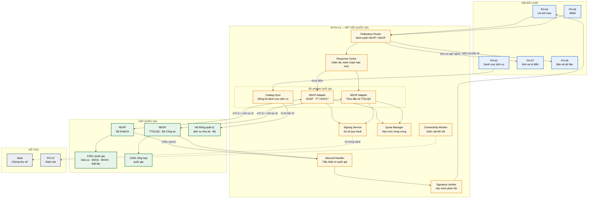
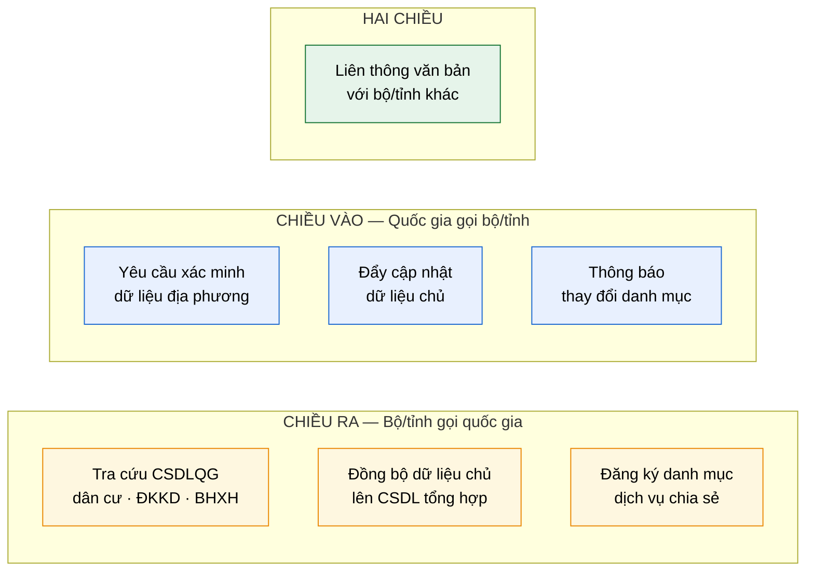
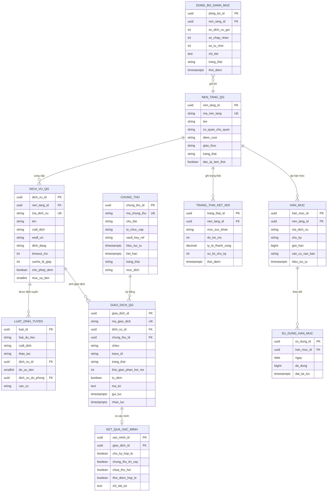

# SRS — PH-14: Kết nối Quốc gia (NDXP/NDOP)

| Thuộc tính | Giá trị |
|---|---|
| **Mã phân hệ** | PH-14 |
| **Tên** | Kết nối Quốc gia (National Exchange Connectivity) |
| **Nhóm** | Data Plane |
| **Mức bắt buộc** | M — Bắt buộc |
| **Phiên bản** | 1.0 |
| **Ngày** | 03/8/2026 |
| **Công nghệ chủ đạo** | Apache Camel + Vault (ký số) + WS-Security |

---

## M1. Giới thiệu

### 1.1. Mục đích

PH-14 là **cổng ra duy nhất** của bộ/tỉnh tới các nền tảng cấp quốc gia. Phân hệ này cô lập toàn bộ đặc thù kỹ thuật của trung ương — định dạng bản tin riêng, chữ ký số bắt buộc, xác thực hai chiều — để các luồng nghiệp vụ nội bộ không phải biết đến chúng.

Đây là phân hệ đáp ứng TT 13/2017 về kết nối với CSDL quốc gia (CMP-25) và yêu cầu mới từ TTQGS về kết nối NDOP — nền tảng chia sẻ, điều phối dữ liệu của Trung tâm Dữ liệu quốc gia (CMP-29).

### 1.2. Hai nền tảng quốc gia — điểm mới từ TTQGS

| Nền tảng | Chủ quản | Vai trò | Trạng thái |
|---|---|---|---|
| **NDXP** | Bộ Khoa học và Công nghệ | Nền tảng tích hợp, chia sẻ dữ liệu quốc gia | Đang vận hành |
| **NDOP** | Trung tâm Dữ liệu quốc gia (Bộ Công an) | Nền tảng chia sẻ, **điều phối** dữ liệu | Mới, theo TTQGS |

**Hệ quả thiết kế.** Có hai đường ra quốc gia đồng nghĩa cần logic quyết định "dữ liệu nào đi đường nào". Thiết kế đặt logic này tập trung ở **Federation Router** thay vì rải rác trong từng route nghiệp vụ — khi phân công giữa NDXP và NDOP thay đổi, chỉ sửa một chỗ ([TT] mục 3.2).

### 1.3. Phạm vi

**PH-14 chịu trách nhiệm:**

| # | Trách nhiệm |
|---|---|
| 1 | Định tuyến yêu cầu tới NDXP hoặc NDOP theo bảng cấu hình |
| 2 | Chuyển đổi bản tin sang định dạng quy định của từng nền tảng |
| 3 | Ký số bản tin gửi đi, khóa riêng không rời Vault |
| 4 | Xác minh chữ ký phản hồi từ nền tảng quốc gia |
| 5 | Xác thực hai chiều (mTLS) với nền tảng quốc gia |
| 6 | Quản lý hạn mức truy vấn do trung ương áp đặt |
| 7 | Đệm dữ liệu để giảm tải và tránh chạm hạn mức |
| 8 | Tiếp nhận yêu cầu **đến từ** cấp quốc gia (chiều ngược) |
| 9 | Đồng bộ danh mục dịch vụ lên hệ thống quản lý của Bộ |
| 10 | Đồng bộ dữ liệu chủ hai chiều với CSDL tổng hợp quốc gia |
| 11 | Giám sát tình trạng kết nối và chất lượng dịch vụ trung ương |

**PH-14 KHÔNG chịu trách nhiệm:**

| # | Không làm | Thuộc phân hệ |
|---|---|---|
| 1 | Logic nghiệp vụ, quyết định khi nào cần gọi quốc gia | PH-04 |
| 2 | Kiểm tra quyền truy cập | PH-12 (qua PH-04) |
| 3 | Ánh xạ ngữ nghĩa sang Từ điển dữ liệu quốc gia | PH-07 |
| 4 | Che, ẩn danh hóa dữ liệu | PH-09 |
| 5 | Kết nối hệ thống nội bộ bộ/tỉnh | PH-05 |
| 6 | Quản lý bản ghi vàng | PH-06 |

**Ranh giới số 3 — phân vai với PH-07.** PH-07 cung cấp bảng ánh xạ và thực hiện **chuyển đổi ngữ nghĩa** (tên trường, mã danh mục). PH-14 thực hiện **chuyển đổi kỹ thuật** (đóng gói SOAP, ký số, giao thức). Hai lớp chuyển đổi khác nhau về bản chất và nhịp thay đổi.

### 1.4. Tài liệu tham chiếu

| Mã | Tài liệu |
|---|---|
| [KT] | [Kiến trúc ngữ cảnh](../02-architecture/README.md#2-kiến-trúc-ngữ-cảnh-c4-level-1) |
| [LT] | [F-04 Khai thác dữ liệu từ CSDLQG qua NDXP](../03-flows/README.md#f-04--khai-thác-dữ-liệu-từ-csdl-quốc-gia-qua-ndxp), [F-02](../03-flows/README.md#f-02--công-bố-và-đăng-ký-dịch-vụ-chia-sẻ-dữ-liệu), [F-06](../03-flows/README.md#f-06--liên-thông-văn-bản-điện-tử) |
| [PL] | [Ma trận CMP](../01-legal/README.md) — TT 13/2017, NĐ 47/2020 Điều 26 |
| [TT] | [Tác động TTQGS mục 3.2 — M-01 Kết nối NDOP](../06-impact/README.md) |
| [KH] | [Kế hoạch triển khai Bước 11 — Kết nối NDXP và CSDLQG](../04-deployment/README.md) |
| [ADR] | [ADR-012 Vault](../05-adr/README.md#adr-012), [ADR-001 Camel](../05-adr/README.md#adr-001) |
| [SRS] | [PH-04](SRS-PH-04-integration-core.md), [PH-07](SRS-PH-07-rdm.md), [PH-06](SRS-PH-06-mdm.md), [PH-09](SRS-PH-09-privacy.md) |

---

## M2. Mô tả tổng quan

### 2.1. Vị trí trong kiến trúc



**Thuyết minh sơ đồ.** Ba đặc điểm phân biệt PH-14 với PH-05 (adapter nội bộ):

**Thứ nhất — chữ ký số hai chiều.** Bản tin gửi đi phải ký, phản hồi nhận về phải xác minh. Đây là yêu cầu cứng của TT 13/2017, không thương lượng được. Với hệ thống nội bộ, mTLS thường đã đủ.

**Thứ hai — hạn mức do bên ngoài áp đặt.** Trung ương giới hạn số lượt truy vấn cho mỗi bộ/tỉnh. Vượt hạn mức thì bị từ chối phục vụ, có thể ảnh hưởng cả tỉnh. Vì vậy khối `CACHE` và `QUOTA` là thành phần **thiết yếu**, không phải tối ưu tùy chọn.

**Thứ ba — chiều ngược.** Trung ương có thể gọi vào bộ/tỉnh (ví dụ: yêu cầu xác minh, đẩy thông báo). Khối `INBOUND` xử lý chiều này — điều mà PH-05 không có.

### 2.2. Ba nhóm luồng đi qua PH-14



**Thuyết minh.** Nhiều thiết kế chỉ tính đến chiều ra, dẫn tới không đáp ứng được khi trung ương yêu cầu kết nối chiều vào. Bảng dưới cho thấy mỗi luồng có yêu cầu kỹ thuật khác nhau:

| Nhóm luồng | Đặc điểm | Yêu cầu đặc thù |
|---|---|---|
| Chiều ra | Tần suất cao, nhạy cảm độ trễ | Đệm mạnh, quản lý hạn mức |
| Chiều vào | Tần suất thấp, yêu cầu sẵn sàng cao | Điểm cuối công khai có bảo vệ, xác minh chữ ký nghiêm ngặt |
| Hai chiều | Bất đồng bộ, cần biên nhận | Bảo đảm giao nhận, theo dõi trạng thái |

### 2.3. Tác nhân

| Tác nhân | Loại | Tương tác |
|---|---|---|
| PH-04 Lõi tích hợp | Hệ thống | Gọi khai thác dữ liệu quốc gia |
| PH-06 MDM | Hệ thống | Đồng bộ dữ liệu chủ |
| PH-02 Danh mục dịch vụ | Hệ thống | Đăng ký danh mục lên Bộ |
| NDXP | Hệ thống ngoài | Trục tích hợp quốc gia |
| NDOP | Hệ thống ngoài | Nền tảng điều phối dữ liệu TTDLQG |
| Quản trị viên nền tảng | Người | Cấu hình kết nối, theo dõi hạn mức |
| Cán bộ ATTT | Người | Quản lý chứng thư số, xử lý sự cố chữ ký |

### 2.4. Giả định

| Mã | Giả định |
|---|---|
| GD-01 | Bộ/tỉnh đã hoàn tất thủ tục đăng ký kết nối NDXP và được cấp tài khoản |
| GD-02 | **Đặc tả kỹ thuật NDOP chưa công bố chi tiết** tại thời điểm thiết kế |
| GD-03 | Chứng thư số chuyên dùng công vụ đã được Ban Cơ yếu Chính phủ cấp |
| GD-04 | Hạn mức truy vấn từng CSDLQG được thông báo bằng văn bản |
| GD-05 | Đường truyền tới trung ương qua Mạng truyền số liệu chuyên dùng |

**Ghi chú về GD-02 — rủi ro chính.** Thiết kế NDOP Adapter theo khung của NDXP Adapter, để sẵn điểm mở rộng, hoàn thiện khi có đặc tả. Thủ tục đăng ký kết nối phải khởi động sớm vì không phụ thuộc tiến độ kỹ thuật ([KH] Bước 11.1).

### 2.5. Ràng buộc

| Mã | Ràng buộc | Nguồn |
|---|---|---|
| RB-01 | Tuân thủ yêu cầu kỹ thuật kết nối CSDLQG | TT 13/2017, CMP-25 |
| RB-02 | Chữ ký số bắt buộc cho bản tin trao đổi với quốc gia | TT 13/2017 |
| RB-03 | Kết nối NDOP theo đặc tả TTDLQG | TTQGS, CMP-29 |
| RB-04 | Đăng ký danh mục dịch vụ lên hệ thống của Bộ | NĐ 47/2020 Điều 26, CMP-03 |
| RB-05 | Dữ liệu chủ đồng bộ với CSDL tổng hợp quốc gia | TTQGS, CMP-35 |
| RB-06 | Khóa riêng chứng thư số không rời khỏi ranh giới bảo mật | Nguyên tắc bảo mật |
| RB-07 | TLS 1.2 trở lên, xác thực hai chiều | CMP-13 |
| RB-08 | Toàn bộ công nghệ mã nguồn mở | Yêu cầu dự án |

### 2.6. Phụ thuộc phân hệ

| Phụ thuộc | Loại | Hành vi khi không khả dụng |
|---|---|---|
| Vault | **Cứng** | Không ký số được → **không gửi** bản tin, đẩy hàng chờ |
| PH-07 (ánh xạ) | **Cứng** cho chiều ra | Không chuyển ngữ nghĩa được → chặn gửi (CMP-30) |
| PH-09 (bảo vệ) | **Cứng** | Không kiểm tra được → chặn, không gửi dữ liệu chưa xử lý |
| NDXP/NDOP | **Cứng** cho luồng tương ứng | Ngắt mạch, trả dữ liệu đệm nếu có, hoặc lỗi thân thiện |
| PH-13 | **Mềm** | Đệm telemetry cục bộ |

---

## M3. Yêu cầu chức năng

### 3.1. Nhóm A — Định tuyến liên bang

#### FR-14-001 — Định tuyến tới NDXP hoặc NDOP · **M**

| Mục | Nội dung |
|---|---|
| **Mô tả** | Quyết định bản tin đi qua nền tảng quốc gia nào |
| **Tác nhân** | PH-04, PH-06 |
| **Đầu vào** | Loại dữ liệu · CSDL đích · loại thao tác · cấu hình định tuyến |
| **Xử lý** | 1. Tra bảng định tuyến theo `(loại dữ liệu, CSDL đích, thao tác)`<br>2. Nếu có nhiều đích khả dụng → chọn theo thứ tự ưu tiên cấu hình<br>3. Kiểm tra nền tảng đích đang khả dụng (không ngắt mạch)<br>4. Nếu đích chính không khả dụng và có đích dự phòng → chuyển hướng, ghi cảnh báo<br>5. Chuyển bản tin cho adapter tương ứng |
| **Đầu ra** | Bản tin đã định tuyến |
| **Ngoại lệ** | E1: Không có luật định tuyến khớp → `422`, cảnh báo cấu hình thiếu<br>E2: Cả hai nền tảng không khả dụng → `503` kèm thông báo thân thiện<br>E3: Chuyển hướng sang dự phòng → ghi cảnh báo để rà soát |

**Ghi chú về bước 4.** Chuyển hướng dự phòng chỉ áp dụng khi cùng một dữ liệu khai thác được qua cả hai nền tảng. Nếu chỉ NDXP có CSDL Dân cư thì không có dự phòng — phải trả lỗi rõ ràng thay vì thử vô ích.

#### FR-14-002 — Quản lý bảng định tuyến · **M**

| Mục | Nội dung |
|---|---|
| **Mô tả** | Cấu hình phân công dữ liệu giữa NDXP và NDOP |
| **Tác nhân** | Quản trị viên nền tảng |
| **Đầu vào** | Loại dữ liệu · CSDL đích · nền tảng · thứ tự ưu tiên · căn cứ |
| **Xử lý** | 1. Kiểm tra không trùng lặp luật cùng độ ưu tiên<br>2. Kiểm tra nền tảng đích đã cấu hình kết nối<br>3. Cho phép nạp nóng, không cần khởi động lại<br>4. Ghi kiểm toán kèm căn cứ (văn bản hướng dẫn của trung ương) |
| **Đầu ra** | Bảng định tuyến cập nhật |
| **Ngoại lệ** | E1: Trùng luật → `409`<br>E2: Nền tảng chưa cấu hình → `422` |

### 3.2. Nhóm B — Adapter NDXP

#### FR-14-003 — Chuyển đổi bản tin sang định dạng NDXP · **M**

| Mục | Nội dung |
|---|---|
| **Mô tả** | Đóng gói bản tin theo đặc tả TT 13/2017 |
| **Tiền điều kiện** | Bản tin đã qua ánh xạ ngữ nghĩa tại PH-07 |
| **Đầu vào** | Bản tin theo từ điển quốc gia · mã dịch vụ NDXP |
| **Xử lý** | 1. Nạp đặc tả WSDL của dịch vụ NDXP<br>2. Dựng phong bì SOAP đúng cấu trúc quy định<br>3. Bổ sung tiêu đề bắt buộc: mã đơn vị gửi, mã giao dịch, thời điểm, phiên bản<br>4. Sinh mã giao dịch duy nhất để đối soát<br>5. Kiểm tra bản tin đúng lược đồ XSD của NDXP |
| **Đầu ra** | Bản tin định dạng NDXP chưa ký |
| **Ngoại lệ** | E1: Không tải được WSDL → dùng bản đệm; không có → lỗi cấu hình<br>E2: Bản tin không đúng XSD → `422` kèm chi tiết trường sai, **không gửi**<br>E3: Đặc tả NDXP thay đổi → cảnh báo, cần cập nhật adapter |

#### FR-14-004 — Gọi dịch vụ NDXP · **M**

| Mục | Nội dung |
|---|---|
| **Mô tả** | Gửi bản tin đã ký tới NDXP và nhận phản hồi |
| **Đầu vào** | Bản tin đã ký · điểm cuối NDXP |
| **Xử lý** | 1. Kiểm tra hạn mức còn lại (FR-14-009)<br>2. Thiết lập kết nối mTLS với NDXP<br>3. Gửi bản tin kèm tiêu đề `SOAPAction`<br>4. Chờ phản hồi với thời hạn cấu hình (mặc định 15 giây)<br>5. Xác minh chữ ký phản hồi (FR-14-006)<br>6. Trích phần thân, chuyển đổi ngược về từ điển quốc gia<br>7. Ghi mã giao dịch và kết quả để đối soát |
| **Đầu ra** | Phản hồi đã xác minh |
| **Ngoại lệ** | E1: Vượt hạn mức → `429`, không gửi, báo PH-04<br>E2: Quá hạn chờ → lỗi tạm thời, PH-04 quyết định thử lại<br>E3: NDXP trả lỗi nghiệp vụ (SOAP Fault) → phân loại, không thử lại<br>E4: Chữ ký phản hồi không hợp lệ → **cảnh báo an ninh**, từ chối dùng dữ liệu |

**Ghi chú về E4 — mức độ nghiêm trọng.** Chữ ký phản hồi sai là dấu hiệu tấn công xen giữa hoặc lỗi cấu hình nghiêm trọng, không phải lỗi kỹ thuật thông thường. Phải xử lý như sự cố an ninh: ghi cảnh báo, thông báo cán bộ ATTT, không dùng dữ liệu nhận được.

### 3.3. Nhóm C — Adapter NDOP

#### FR-14-005 — Kết nối NDOP · **M**

| Mục | Nội dung |
|---|---|
| **Mô tả** | Giao tiếp với Nền tảng chia sẻ, điều phối dữ liệu của TTDLQG |
| **Tiền điều kiện** | Đã đăng ký và được cấp quyền kết nối NDOP |
| **Đầu vào** | Bản tin · mã dịch vụ NDOP |
| **Xử lý** | 1. Chuyển đổi theo đặc tả NDOP<br>2. Ký số theo yêu cầu của TTDLQG<br>3. Gửi qua kênh bảo mật quy định<br>4. Xác minh phản hồi<br>5. Chuyển đổi ngược |
| **Đầu ra** | Phản hồi từ NDOP |
| **Ngoại lệ** | E1: Đặc tả chưa có → dùng khung tạm, ghi rõ trạng thái `PROVISIONAL`<br>E2: Các ngoại lệ khác tương tự FR-14-004 |

**Ghi chú về E1 — xử lý rủi ro GD-02.** Adapter được thiết kế với **cấu hình ngoài** cho: định dạng bản tin, thuật toán ký, cấu trúc tiêu đề. Khi TTDLQG công bố đặc tả, chỉ cần nạp cấu hình thay vì viết lại adapter.

### 3.4. Nhóm D — Chữ ký số

#### FR-14-006 — Ký số bản tin gửi đi · **M**

| Mục | Nội dung |
|---|---|
| **Mô tả** | Ký bản tin bằng chứng thư số của bộ/tỉnh |
| **Tiền điều kiện** | Chứng thư số còn hiệu lực, đã nạp vào Vault |
| **Đầu vào** | Bản tin cần ký · định danh chứng thư |
| **Xử lý** | 1. Chuẩn hóa bản tin (canonicalization) theo chuẩn quy định<br>2. Tính giá trị băm<br>3. **Gửi giá trị băm vào Vault để ký** — khóa riêng không rời Vault<br>4. Nhận chữ ký, gắn vào bản tin theo chuẩn (XML Signature hoặc WS-Security)<br>5. Bổ sung thông tin chứng thư vào bản tin<br>6. Ghi vết thao tác ký |
| **Đầu ra** | Bản tin đã ký |
| **Ngoại lệ** | E1: Vault không khả dụng → **không gửi**, đẩy hàng chờ, cảnh báo (RB-06)<br>E2: Chứng thư hết hạn → chặn, cảnh báo nghiêm trọng<br>E3: Chứng thư sắp hết hạn (< 30 ngày) → cảnh báo vận hành, vẫn ký |

**Ghi chú về bước 3 — quyết định bảo mật cốt lõi.** Gửi **giá trị băm** vào Vault để ký, không lấy khóa ra. Hệ quả: kể cả khi pod bị chiếm quyền hoàn toàn, kẻ tấn công không lấy được khóa riêng — chỉ có thể yêu cầu ký trong thời gian còn giữ quyền, và mọi yêu cầu ký đều có vết trong nhật ký Vault.

#### FR-14-007 — Xác minh chữ ký phản hồi · **M**

| Mục | Nội dung |
|---|---|
| **Mô tả** | Kiểm tra tính xác thực và toàn vẹn của phản hồi từ quốc gia |
| **Đầu vào** | Bản tin phản hồi có chữ ký |
| **Xử lý** | 1. Trích chữ ký và thông tin chứng thư từ bản tin<br>2. Kiểm tra chứng thư thuộc chuỗi tin cậy đã cấu hình<br>3. Kiểm tra chứng thư chưa bị thu hồi (tra danh sách thu hồi)<br>4. Chuẩn hóa phần được ký, tính lại giá trị băm<br>5. Xác minh chữ ký khớp<br>6. Kiểm tra thời điểm ký trong khoảng chấp nhận (chống phát lại) |
| **Đầu ra** | Xác nhận hợp lệ hoặc từ chối |
| **Ngoại lệ** | E1: Chữ ký không khớp → **cảnh báo an ninh**, từ chối dùng dữ liệu<br>E2: Chứng thư không thuộc chuỗi tin cậy → cảnh báo an ninh, từ chối<br>E3: Chứng thư bị thu hồi → cảnh báo nghiêm trọng, từ chối<br>E4: Thời điểm ký quá cũ (> 5 phút) → nghi ngờ phát lại, từ chối |

#### FR-14-008 — Quản lý chứng thư số · **M**

| Mục | Nội dung |
|---|---|
| **Mô tả** | Theo dõi vòng đời chứng thư số dùng cho kết nối quốc gia |
| **Xử lý** | 1. Lưu chứng thư trong Vault, theo dõi hạn hiệu lực<br>2. Cảnh báo trước 60, 30, 7 ngày hết hạn<br>3. Hỗ trợ chuyển tiếp: nạp chứng thư mới trước khi cũ hết hạn<br>4. Cập nhật danh sách chứng thư tin cậy của trung ương định kỳ<br>5. Cập nhật danh sách chứng thư bị thu hồi |
| **Đầu ra** | Chứng thư được quản lý theo vòng đời |
| **Ngoại lệ** | E1: Chứng thư hết hạn mà chưa có thay thế → **chặn toàn bộ** kết nối quốc gia, cảnh báo cấp cao nhất<br>E2: Không cập nhật được danh sách thu hồi > 7 ngày → cảnh báo |

**Ghi chú về E1.** Chứng thư hết hạn làm ngưng toàn bộ khai thác dữ liệu quốc gia — ảnh hưởng trực tiếp tới dịch vụ công. Vì vậy cảnh báo phải sớm và nhiều lần, và quy trình gia hạn cần khởi động trước ít nhất 60 ngày.

### 3.5. Nhóm E — Hạn mức và đệm

#### FR-14-009 — Quản lý hạn mức truy vấn · **M**

| Mục | Nội dung |
|---|---|
| **Mô tả** | Theo dõi và tuân thủ hạn mức do trung ương áp đặt |
| **Đầu vào** | Nền tảng · dịch vụ · hạn mức theo chu kỳ |
| **Xử lý** | 1. Đếm số lượt gọi theo từng chu kỳ (giờ, ngày, tháng)<br>2. Trước mỗi lời gọi: kiểm tra còn hạn mức<br>3. Cảnh báo khi đạt 70%, 85%, 95% hạn mức<br>4. Khi đạt 95% → ưu tiên dịch vụ thiết yếu, hoãn dịch vụ ưu tiên thấp<br>5. Khi hết hạn mức → từ chối, trả thông tin thời điểm đặt lại |
| **Đầu ra** | Cho phép gọi hoặc từ chối |
| **Ngoại lệ** | E1: Hết hạn mức → `429` kèm thời điểm đặt lại; ưu tiên dùng dữ liệu đệm<br>E2: Trung ương thay đổi hạn mức → cập nhật cấu hình, thông báo quản trị viên |

**Ghi chú về bước 4 — phân bổ khi khan hiếm.** Khi sắp hết hạn mức, ưu tiên các dịch vụ công thiết yếu (đang có người dân chờ) hơn các tác vụ nền (đồng bộ định kỳ). Không có cơ chế này thì một tác vụ đồng bộ có thể ngốn hết hạn mức và làm ngưng dịch vụ công.

#### FR-14-010 — Đệm phản hồi từ quốc gia · **M**

| Mục | Nội dung |
|---|---|
| **Mô tả** | Giảm số lượt gọi ra quốc gia, tránh chạm hạn mức |
| **Xử lý** | 1. Đệm phản hồi theo khóa `(dịch vụ, tham số truy vấn)`<br>2. Thời hạn đệm theo loại dữ liệu:<br>&nbsp;&nbsp;· Dữ liệu nhân thân (họ tên, ngày sinh): 15 phút<br>&nbsp;&nbsp;· Dữ liệu ít thay đổi (nơi sinh, dân tộc): 24 giờ<br>&nbsp;&nbsp;· Dữ liệu trạng thái (tình trạng hôn nhân): 5 phút<br>3. Không đệm dữ liệu phân loại nhạy cảm cao<br>4. Vô hiệu đệm khi nhận thông báo thay đổi từ quốc gia<br>5. Khi hết hạn mức hoặc quốc gia sự cố → dùng dữ liệu đệm quá hạn, gắn cờ `stale=true` |
| **Đầu ra** | Phản hồi từ đệm hoặc từ quốc gia |
| **Ngoại lệ** | E1: Dữ liệu đệm quá hạn được dùng → gắn cờ rõ, ghi cảnh báo<br>E2: Bên gọi yêu cầu dữ liệu tươi (`no-cache`) → bỏ qua đệm nếu còn hạn mức |

**Ghi chú về hiệu quả thực tế.** Trong giờ cao điểm dịch vụ công, hàng nghìn hồ sơ có thể cùng tra cứu một số ít công dân. Đệm 15 phút cho dữ liệu nhân thân thường giảm 60–80% lượt gọi ra NDXP — đây là biện pháp thiết yếu để không chạm hạn mức.

### 3.6. Nhóm F — Chiều vào và đồng bộ

#### FR-14-011 — Tiếp nhận yêu cầu từ cấp quốc gia · **M**

| Mục | Nội dung |
|---|---|
| **Mô tả** | Xử lý yêu cầu do NDXP/NDOP gọi vào bộ/tỉnh |
| **Tác nhân** | NDXP, NDOP |
| **Đầu vào** | Yêu cầu từ nền tảng quốc gia |
| **Xử lý** | 1. Xác thực nguồn gọi qua mTLS<br>2. Xác minh chữ ký bản tin (FR-14-007)<br>3. Kiểm tra mã đơn vị gửi thuộc danh sách được phép<br>4. Chuyển đổi về CDM<br>5. Chuyển PH-04 xử lý theo luồng nghiệp vụ<br>6. Dựng phản hồi, ký số, trả về |
| **Đầu ra** | Phản hồi đã ký |
| **Ngoại lệ** | E1: Chữ ký không hợp lệ → từ chối, cảnh báo an ninh<br>E2: Nguồn gọi không được phép → `403`, cảnh báo<br>E3: PH-04 xử lý lỗi → trả lỗi theo định dạng quy định của trung ương |

#### FR-14-012 — Đồng bộ danh mục dịch vụ lên Bộ · **M**

| Mục | Nội dung |
|---|---|
| **Mô tả** | Thực hiện nghĩa vụ đăng ký dịch vụ chia sẻ theo NĐ 47 Điều 26 |
| **Tác nhân** | PH-02 |
| **Đầu vào** | Danh mục dịch vụ đã phát hành |
| **Xử lý** | 1. Lấy danh sách dịch vụ trạng thái `PUBLISHED` từ PH-02<br>2. Chuyển đổi sang định dạng quy định của Bộ<br>3. Gửi lên hệ thống quản lý dịch vụ chia sẻ dữ liệu<br>4. Nhận xác nhận, cập nhật trạng thái đồng bộ<br>5. Chạy định kỳ (mặc định hằng ngày) và khi có dịch vụ mới phát hành |
| **Đầu ra** | Danh mục đã đăng ký trung ương |
| **Ngoại lệ** | E1: Hệ thống Bộ không khả dụng → hàng chờ, thử lại<br>E2: Quá 7 ngày không đồng bộ được → cảnh báo tuân thủ (CMP-03)<br>E3: Bộ từ chối một dịch vụ → ghi lý do, thông báo chủ quản dịch vụ |

**Ghi chú.** Đây là nghĩa vụ pháp lý thường bị bỏ sót trong triển khai thực tế. Thiết kế đưa vào luồng tự động để không phụ thuộc việc ai đó nhớ làm thủ công.

#### FR-14-013 — Đồng bộ dữ liệu chủ với CSDL tổng hợp quốc gia · **M**

| Mục | Nội dung |
|---|---|
| **Mô tả** | Cầu nối cho PH-06 đồng bộ hai chiều dữ liệu chủ |
| **Tác nhân** | PH-06 |
| **Xử lý** | · **Chiều xuống**: nhận cập nhật dữ liệu chủ quốc gia, chuyển PH-06<br>· **Chiều lên**: gửi dữ liệu địa phương lên theo quy định<br>1. Chuyển đổi định dạng qua PH-07<br>2. Kiểm tra bảo vệ dữ liệu qua PH-09<br>3. Ký số và gửi<br>4. Đối soát kết quả, báo cáo lệch cho PH-06 |
| **Đầu ra** | Dữ liệu chủ đồng bộ |
| **Ngoại lệ** | E1: PH-09 chặn (có dữ liệu nhạy cảm) → không gửi, báo PH-06<br>E2: PH-07 chưa ánh xạ đủ → không gửi, báo cần bổ sung ánh xạ (CMP-30) |

#### FR-14-014 — Giám sát kết nối quốc gia · **M**

| Mục | Nội dung |
|---|---|
| **Mô tả** | Theo dõi tình trạng và chất lượng kết nối với trung ương |
| **Xử lý** | 1. Kiểm tra kết nối định kỳ (mặc định 60 giây) bằng thao tác nhẹ<br>2. Theo dõi: tỷ lệ thành công, độ trễ, mức dùng hạn mức, số lỗi chữ ký<br>3. Đánh giá ba mức sức khỏe cho từng nền tảng<br>4. Phát chỉ số và cảnh báo<br>5. Ghi nhận thời gian gián đoạn phục vụ báo cáo |
| **Đầu ra** | Trạng thái kết nối |
| **Ngoại lệ** | E1: Mất kết nối > 5 phút → cảnh báo mức cao, thông báo đơn vị quản lý trung ương<br>E2: Tỷ lệ lỗi chữ ký > 0 → cảnh báo an ninh ngay |

### 3.7. Bảng tổng hợp yêu cầu chức năng

| Nhóm | Mã | Tên | Ưu tiên |
|---|---|---|:-:|
| A | FR-14-001 | Định tuyến tới NDXP hoặc NDOP | M |
| A | FR-14-002 | Quản lý bảng định tuyến | M |
| B | FR-14-003 | Chuyển đổi bản tin sang định dạng NDXP | M |
| B | FR-14-004 | Gọi dịch vụ NDXP | M |
| C | FR-14-005 | Kết nối NDOP | M |
| D | FR-14-006 | Ký số bản tin gửi đi | M |
| D | FR-14-007 | Xác minh chữ ký phản hồi | M |
| D | FR-14-008 | Quản lý chứng thư số | M |
| E | FR-14-009 | Quản lý hạn mức truy vấn | M |
| E | FR-14-010 | Đệm phản hồi từ quốc gia | M |
| F | FR-14-011 | Tiếp nhận yêu cầu từ cấp quốc gia | M |
| F | FR-14-012 | Đồng bộ danh mục dịch vụ lên Bộ | M |
| F | FR-14-013 | Đồng bộ dữ liệu chủ với CSDL tổng hợp | M |
| F | FR-14-014 | Giám sát kết nối quốc gia | M |

**Tổng: 14 yêu cầu chức năng** — toàn bộ đều bắt buộc (M).

---

## M4. Mô hình dữ liệu

### 4.1. Sơ đồ thực thể



### 4.2. Đặc tả thực thể

#### EN-14-01 — NEN_TANG_QG

| Trường | Kiểu | Bắt buộc | Ràng buộc | Mô tả |
|---|---|:-:|---|---|
| `nen_tang_id` | UUID | ✓ | PK | |
| `ma_nen_tang` | VARCHAR(20) | ✓ | UNIQUE, ∈ {`NDXP`,`NDOP`,`HTBO`} | |
| `ten` | VARCHAR(200) | ✓ | | |
| `co_quan_chu_quan` | VARCHAR(120) | ✓ | | Bộ KH&CN, TTDLQG… |
| `diem_cuoi` | VARCHAR(300) | ✓ | | Địa chỉ kết nối |
| `giao_thuc` | VARCHAR(20) | ✓ | ∈ {`SOAP`,`REST`,`MQ`} | |
| `trang_thai` | VARCHAR(20) | ✓ | ∈ {`ACTIVE`,`REGISTERING`,`SUSPENDED`,`INACTIVE`} | |
| `dac_ta_tam_thoi` | BOOLEAN | ✓ | mặc định false | **Đánh dấu NDOP khi chưa có đặc tả chính thức** (GD-02) |

**Ghi chú về `dac_ta_tam_thoi`.** Trường này giải quyết rủi ro GD-02 một cách minh bạch: hệ thống biết rõ nền tảng nào đang dùng đặc tả tạm, hiển thị cảnh báo trên giao diện, và có danh sách rõ ràng cần rà soát khi đặc tả chính thức ban hành.

#### EN-14-02 — DICH_VU_QG

| Trường | Kiểu | Bắt buộc | Mô tả |
|---|---|:-:|---|
| `dich_vu_id` | UUID | ✓ | PK |
| `nen_tang_id` | UUID | ✓ | FK |
| `ma_dich_vu` | VARCHAR(80) | ✓ | UNIQUE — mã dịch vụ theo quy định trung ương |
| `csdl_dich` | VARCHAR(60) | ✓ | CSDLQG đích: `DANCU`, `DKKD`, `BHXH`… |
| `wsdl_uri` | VARCHAR(300) | | Với dịch vụ SOAP |
| `timeout_ms` | INTEGER | ✓ | Mặc định 15000 — cao hơn nội bộ do đi qua WAN |
| `cache_ttl_giay` | INTEGER | ✓ | Thời hạn đệm |
| `cho_phep_dem` | BOOLEAN | ✓ | Tắt với dữ liệu nhạy cảm cao |
| `muc_uu_tien` | SMALLINT | ✓ | Quyết định thứ tự khi khan hiếm hạn mức |

#### EN-14-03 — CHUNG_THU

| Trường | Kiểu | Bắt buộc | Mô tả |
|---|---|:-:|---|
| `chung_thu_id` | UUID | ✓ | PK |
| `ma_chung_thu` | VARCHAR(80) | ✓ | UNIQUE — số sê-ri |
| `chu_the` | VARCHAR(300) | ✓ | Chủ thể chứng thư |
| `to_chuc_cap` | VARCHAR(200) | ✓ | Ban Cơ yếu Chính phủ… |
| `vault_key_ref` | VARCHAR(200) | ✓ | **Tham chiếu** Vault — khóa riêng không ở đây (RB-06) |
| `het_han` | TIMESTAMPTZ | ✓ | Cơ sở để cảnh báo gia hạn |
| `trang_thai` | VARCHAR(20) | ✓ | ∈ {`ACTIVE`,`EXPIRING`,`EXPIRED`,`REVOKED`} |
| `muc_dich` | VARCHAR(40) | ✓ | ∈ {`SIGNING`,`TLS_CLIENT`,`BOTH`} |

#### EN-14-04 — GIAO_DICH_QG

| Trường | Kiểu | Bắt buộc | Mô tả |
|---|---|:-:|---|
| `giao_dich_id` | UUID | ✓ | PK |
| `ma_giao_dich` | VARCHAR(80) | ✓ | UNIQUE — mã đối soát với trung ương |
| `dich_vu_id` | UUID | ✓ | FK |
| `chung_thu_id` | UUID | | FK — chứng thư đã dùng ký |
| `chieu` | VARCHAR(12) | ✓ | ∈ {`OUTBOUND`,`INBOUND`} |
| `trace_id` | VARCHAR(64) | ✓ | Nối với PH-04, PH-13 |
| `trang_thai` | VARCHAR(24) | ✓ | ∈ {`SENT`,`SUCCESS`,`FAILED`,`TIMEOUT`,`REJECTED`,`QUOTA_EXCEEDED`} |
| `tu_dem` | BOOLEAN | ✓ | Phản hồi lấy từ đệm hay gọi thật |
| `ma_loi` | TEXT | | Mã lỗi từ trung ương |

**Ghi chú về `ma_giao_dich`.** Trung ương yêu cầu mã giao dịch duy nhất để đối soát khi có tranh chấp về việc "đã gửi hay chưa". Lưu lại toàn bộ mã giao dịch là bằng chứng khi cần chứng minh.

#### EN-14-05 — HAN_MUC và SU_DUNG_HAN_MUC

| Trường (HAN_MUC) | Kiểu | Bắt buộc | Mô tả |
|---|---|:-:|---|
| `ma_dich_vu` | VARCHAR(80) | | Rỗng = áp cho toàn nền tảng |
| `chu_ky` | VARCHAR(16) | ✓ | ∈ {`HOUR`,`DAY`,`MONTH`} |
| `gioi_han` | BIGINT | ✓ | Số lượt tối đa |
| `can_cu_van_ban` | VARCHAR(300) | ✓ | **Bắt buộc** — văn bản thông báo hạn mức |

| Trường (SU_DUNG) | Kiểu | Bắt buộc | Mô tả |
|---|---|:-:|---|
| `ngay` | DATE | ✓ | |
| `da_dung` | BIGINT | ✓ | Số lượt đã dùng trong chu kỳ |
| `dat_lai_luc` | TIMESTAMPTZ | ✓ | Thời điểm bộ đếm về 0 |

### 4.3. Chính sách lưu giữ

| Thực thể | Thời hạn | Ghi chú |
|---|---|---|
| NEN_TANG_QG, DICH_VU_QG, LUAT_DINH_TUYEN | Vĩnh viễn | |
| CHUNG_THU | Vĩnh viễn | Giữ cả chứng thư hết hạn để xác minh giao dịch cũ |
| **GIAO_DICH_QG** | **5 năm** | Bằng chứng đối soát với trung ương |
| KET_QUA_XAC_MINH | 5 năm | Bằng chứng an ninh |
| SU_DUNG_HAN_MUC | 2 năm | Phục vụ đàm phán hạn mức |
| TRANG_THAI_KET_NOI | 1 năm | Báo cáo chất lượng dịch vụ |
| DONG_BO_DANH_MUC | 3 năm | Bằng chứng tuân thủ Điều 26 |

---

## M5. Giao diện API

### 5.1. Nguyên tắc chung

| Khía cạnh | Quy định |
|---|---|
| Đường dẫn nội bộ (PH-04 gọi) | `/api/v1/national` |
| Đường dẫn chiều vào (quốc gia gọi) | `/gateway/national/inbound` — có bảo vệ riêng |
| Đường dẫn quản trị | `/api/admin/v1/national` |
| Xác thực nội bộ | Bearer JWT + mTLS nội cụm |
| Xác thực chiều vào | mTLS + chữ ký số bản tin |
| Mã lỗi | RFC 9457 cho nội bộ; theo quy định trung ương cho chiều vào |

### 5.2. Điểm cuối nội bộ

| Phương thức | Đường dẫn | Chức năng | FR |
|---|---|---|---|
| `POST` | `/api/v1/national/invoke` | Gọi dịch vụ quốc gia (tự định tuyến) | FR-14-001, 004, 005 |
| `POST` | `/api/v1/national/ndxp/{service}` | Gọi thẳng NDXP | FR-14-004 |
| `POST` | `/api/v1/national/ndop/{service}` | Gọi thẳng NDOP | FR-14-005 |
| `POST` | `/api/v1/national/sync/master-data` | Đồng bộ dữ liệu chủ | FR-14-013 |
| `POST` | `/api/v1/national/sync/catalog` | Đồng bộ danh mục dịch vụ | FR-14-012 |
| `GET` | `/api/v1/national/quota` | Tình trạng hạn mức | FR-14-009 |

### 5.3. Điểm cuối quản trị

| Phương thức | Đường dẫn | Chức năng | FR |
|---|---|---|---|
| `GET` | `/api/admin/v1/national/platforms` | Danh sách nền tảng và trạng thái | FR-14-014 |
| `GET` | `/api/admin/v1/national/services` | Danh mục dịch vụ quốc gia | — |
| `GET` | `/api/admin/v1/national/routing` | Bảng định tuyến | FR-14-002 |
| `PUT` | `/api/admin/v1/national/routing` | Cập nhật định tuyến (nạp nóng) | FR-14-002 |
| `GET` | `/api/admin/v1/national/certificates` | Chứng thư và hạn hiệu lực | FR-14-008 |
| `POST` | `/api/admin/v1/national/certificates` | Nạp chứng thư mới | FR-14-008 |
| `GET` | `/api/admin/v1/national/quota/usage` | Chi tiết mức dùng hạn mức | FR-14-009 |
| `PUT` | `/api/admin/v1/national/quota` | Cập nhật hạn mức (cần căn cứ) | FR-14-009 |
| `GET` | `/api/admin/v1/national/transactions` | Tra cứu giao dịch, đối soát | — |
| `GET` | `/api/admin/v1/national/health` | Sức khỏe kết nối chi tiết | FR-14-014 |
| `POST` | `/api/admin/v1/national/cache/invalidate` | Vô hiệu đệm | FR-14-010 |

### 5.4. Đặc tả chi tiết điểm cuối chính

#### 5.4.1. `POST /api/v1/national/invoke` — Gọi dịch vụ quốc gia

**Yêu cầu:**

```json
{
  "traceId": "4bf92f3577b34da6a3ce929d0e0e4736",
  "loaiDuLieu": "CONG_DAN",
  "csdlDich": "DANCU",
  "thaoTac": "TRA_CUU",
  "thamSo": { "soDinhDanh": "001199001234" },
  "mucDichSuDung": "GIAI_QUYET_TTHC",
  "maHoSo": "HS-2026-08-001234",
  "yeuCauDuLieuTuoi": false
}
```

**Phản hồi thành công `200 OK`:**

```json
{
  "maGiaoDich": "LGSP-01-20260803-0000184320",
  "nenTangDaDung": "NDXP",
  "tuDem": true,
  "duLieu": {
    "soDinhDanh": "001199001234",
    "hoTen": "Nguyễn Văn A",
    "ngaySinh": "1990-01-15",
    "noiThuongTru": { "maDonViHanhChinh": "01001" }
  },
  "sieuDuLieu": {
    "thoiDiemDuLieu": "2026-08-03T14:20:00+07:00",
    "tuoiDemGiay": 420,
    "chuKyDaXacMinh": true
  },
  "thoiGianPhanHoiMs": 8
}
```

**Ghi chú.** Trường `tuDem: true` và `tuoiDemGiay` cho bên gọi biết dữ liệu lấy từ đệm và cũ bao nhiêu — bên gọi tự quyết có chấp nhận hay yêu cầu dữ liệu tươi.

**Phản hồi khi hết hạn mức `429`:**

```json
{
  "type": "https://lgsp.local/errors/national-quota-exceeded",
  "title": "Đã hết hạn mức truy vấn CSDL Dân cư",
  "status": 429,
  "detail": "Hạn mức 50.000 lượt/ngày đã dùng hết. Bộ đếm đặt lại lúc 00:00 ngày 04/8/2026.",
  "traceId": "4bf92f3577b34da6a3ce929d0e0e4736",
  "hanMuc": { "gioiHan": 50000, "daDung": 50000, "chuKy": "DAY", "datLaiLuc": "2026-08-04T00:00:00+07:00" },
  "duLieuDem": {
    "coSan": true,
    "tuoiGiay": 3600,
    "goiY": "Gọi lại với yeuCauDuLieuTuoi=false để dùng dữ liệu đệm"
  }
}
```

**Ghi chú thiết kế.** Phản hồi lỗi vẫn cho biết **có dữ liệu đệm khả dụng** và cách lấy — biến một lỗi cứng thành lựa chọn cho bên gọi.

**Phản hồi khi chữ ký phản hồi không hợp lệ `502`:**

```json
{
  "type": "https://lgsp.local/errors/signature-verification-failed",
  "title": "Chữ ký phản hồi từ nền tảng quốc gia không hợp lệ",
  "status": 502,
  "detail": "Không thể tin cậy dữ liệu nhận được. Sự cố đã được ghi nhận và thông báo cán bộ an toàn thông tin.",
  "maGiaoDich": "LGSP-01-20260803-0000184321",
  "canhBaoAnNinh": true
}
```

#### 5.4.2. `GET /api/v1/national/quota` — Tình trạng hạn mức

```json
{
  "thoiDiem": "2026-08-03T15:50:00+07:00",
  "nenTang": [
    {
      "maNenTang": "NDXP",
      "trangThai": "HEALTHY",
      "dichVu": [
        { "maDichVu": "DANCU_TRA_CUU", "chuKy": "DAY", "gioiHan": 50000,
          "daDung": 38420, "tyLe": 0.77, "mucCanhBao": "WARNING", "datLaiLuc": "2026-08-04T00:00:00+07:00" },
        { "maDichVu": "DKKD_TRA_CUU", "chuKy": "DAY", "gioiHan": 20000,
          "daDung": 4120, "tyLe": 0.21, "mucCanhBao": "OK", "datLaiLuc": "2026-08-04T00:00:00+07:00" }
      ]
    },
    {
      "maNenTang": "NDOP",
      "trangThai": "REGISTERING",
      "ghiChu": "Đang chờ hoàn tất thủ tục đăng ký kết nối",
      "dacTaTamThoi": true
    }
  ],
  "tyLeTrungDem": 0.72,
  "khuyenNghi": "Dịch vụ DANCU_TRA_CUU đã dùng 77% hạn mức ngày. Cân nhắc tăng thời hạn đệm hoặc đề nghị nâng hạn mức."
}
```

---

## M6. Giao diện người dùng

### 6.1. Danh mục màn hình

| Mã | Tên màn hình | Đối tượng | Mockup |
|---|---|---|---|
| **UI-14-01** | Tổng quan kết nối quốc gia | Vận hành, Quản trị viên | [`national.html`](../../mockup/pages/national.html) |
| **UI-14-02** | Cấu hình định tuyến NDXP/NDOP | Quản trị viên nền tảng | [`national.html`](../../mockup/pages/national.html) (tab Định tuyến) |
| **UI-14-03** | Theo dõi hạn mức truy vấn | Vận hành, Lãnh đạo | [`national.html`](../../mockup/pages/national.html) (tab Hạn mức) |
| **UI-14-04** | Quản lý chứng thư số | Cán bộ ATTT | [`national.html`](../../mockup/pages/national.html) (tab Chứng thư) |
| **UI-14-05** | Tra cứu và đối soát giao dịch | Vận hành | [`national.html`](../../mockup/pages/national.html) (tab Giao dịch) |
| **UI-14-06** | Trạng thái đồng bộ danh mục | Quản trị viên | [`national.html`](../../mockup/pages/national.html) (tab Đồng bộ) |

### 6.2. UI-14-01 — Tổng quan kết nối quốc gia

| Thành phần | Mô tả |
|---|---|
| Thẻ trạng thái nền tảng | NDXP, NDOP, Hệ thống Bộ — mỗi thẻ có đèn báo sức khỏe |
| Chỉ số chính | Lượt gọi 24h · tỷ lệ thành công · độ trễ P99 · tỷ lệ trúng đệm |
| Cảnh báo nổi bật | Hạn mức sắp hết · chứng thư sắp hết hạn · lỗi chữ ký |
| Biểu đồ lưu lượng | Theo thời gian, phân tách theo nền tảng và dịch vụ |
| Bảng dịch vụ | Dịch vụ · nền tảng · lượt gọi · tỷ lệ lỗi · độ trễ · mức dùng hạn mức |

**Quy tắc tương tác:**

| # | Quy tắc |
|---|---|
| 1 | Nền tảng có `dacTaTamThoi` hiển thị nhãn cảnh báo "đặc tả tạm thời" |
| 2 | Hạn mức > 85% → thẻ chuyển màu vàng; > 95% → đỏ |
| 3 | Có lỗi chữ ký → hiển thị banner đỏ trên đầu trang, không thể ẩn |
| 4 | Nhấn dịch vụ → mở chi tiết giao dịch của dịch vụ đó |

### 6.3. UI-14-03 — Theo dõi hạn mức truy vấn

**Mục đích.** Hạn mức là tài nguyên khan hiếm do bên ngoài áp đặt — cần theo dõi sát để không gián đoạn dịch vụ công.

| Thành phần | Mô tả |
|---|---|
| Thanh tiến trình từng dịch vụ | Mức dùng so với hạn mức, đổi màu theo ngưỡng |
| Dự báo cạn hạn mức | Ước tính thời điểm hết hạn mức theo nhịp hiện tại |
| Biểu đồ mức dùng theo giờ | Nhận diện giờ cao điểm |
| Bảng đóng góp | Hệ thống nội bộ nào gọi nhiều nhất |
| Hiệu quả đệm | Số lượt tiết kiệm được nhờ đệm |
| Nút điều chỉnh | Tăng thời hạn đệm cho dịch vụ đang căng |

**Quy tắc tương tác:**

| # | Quy tắc |
|---|---|
| 1 | Dự báo cạn hạn mức trước 22:00 → cảnh báo nổi bật kèm khuyến nghị |
| 2 | Hiển thị rõ hệ thống nào tiêu tốn hạn mức nhiều nhất để làm việc với đơn vị đó |
| 3 | Tăng thời hạn đệm có hiệu lực ngay, hiển thị ước tính mức tiết kiệm |
| 4 | Cập nhật hạn mức yêu cầu nhập căn cứ văn bản |

### 6.4. UI-14-04 — Quản lý chứng thư số

| Thành phần | Mô tả |
|---|---|
| Bảng chứng thư | Mã · Chủ thể · Tổ chức cấp · Mục đích · Hiệu lực · Trạng thái |
| Đếm ngược hết hạn | Số ngày còn lại, đổi màu theo mức khẩn |
| Cảnh báo gia hạn | Danh sách chứng thư cần gia hạn, có hướng dẫn thủ tục |
| Nạp chứng thư mới | Biểu mẫu tải lên, xác nhận nạp vào Vault |
| Danh sách chứng thư tin cậy | Chứng thư của trung ương dùng để xác minh phản hồi |
| Nhật ký lỗi chữ ký | Các lần xác minh thất bại, phục vụ điều tra |

**Quy tắc tương tác:**

| # | Quy tắc |
|---|---|
| 1 | Chứng thư còn < 60 ngày → cảnh báo vàng; < 30 ngày → đỏ; < 7 ngày → banner toàn hệ thống |
| 2 | Nạp chứng thư yêu cầu vai trò `SECURITY_OFFICER` + MFA |
| 3 | **Không hiển thị** khóa riêng ở bất kỳ đâu — chỉ hiện tham chiếu Vault |
| 4 | Chứng thư hết hạn không cho xóa nếu còn giao dịch cũ cần xác minh |

### 6.5. UI-14-05 — Tra cứu và đối soát giao dịch

**Mục đích.** Khi có tranh chấp với trung ương ("chúng tôi không nhận được yêu cầu"), đây là màn hình cung cấp bằng chứng.

| Thành phần | Mô tả |
|---|---|
| Ô tra theo mã giao dịch | Mã đối soát với trung ương |
| Ô tra theo traceId | Nối với truy vết nội bộ tại PH-04, PH-13 |
| Bộ lọc | Nền tảng · dịch vụ · trạng thái · khoảng thời gian · chiều |
| Bảng giao dịch | Mã · Thời điểm · Dịch vụ · Chiều · Trạng thái · Thời gian phản hồi · Từ đệm |
| Chi tiết giao dịch | Bản tin gửi (đã che dữ liệu nhạy cảm) · phản hồi · kết quả xác minh chữ ký |
| Xuất bằng chứng | Xuất hồ sơ giao dịch phục vụ đối soát |

**Quy tắc tương tác:**

| # | Quy tắc |
|---|---|
| 1 | Nội dung bản tin hiển thị đã che dữ liệu cá nhân |
| 2 | Xem nội dung đầy đủ cần quyền riêng và ghi vết |
| 3 | Giao dịch lỗi chữ ký tô đỏ và hiển thị chi tiết nguyên nhân |
| 4 | Xuất bằng chứng kèm chữ ký của LGSP để có giá trị đối soát |

---

## M7. Yêu cầu phi chức năng

### 7.1. Hiệu năng

| Mã | Yêu cầu | Chỉ tiêu | Cách đo |
|---|---|---|---|
| **NFR-14-001** | Chi phí xử lý của PH-14 (không tính chờ quốc gia) | P99 ≤ 80ms | Hiệu số tổng thời gian và thời gian gọi quốc gia |
| **NFR-14-002** | Độ trễ ký số | P99 ≤ 50ms (gồm gọi Vault) | Đo tại bước ký |
| **NFR-14-003** | Độ trễ xác minh chữ ký | P99 ≤ 30ms | — |
| **NFR-14-004** | Độ trễ khi trúng đệm | P99 ≤ 15ms | Không gọi ra ngoài |
| **NFR-14-005** | Tỷ lệ trúng đệm | ≥ 60% với dịch vụ tra cứu dân cư | `hits/(hits+misses)` |
| **NFR-14-006** | Thông lượng | ≥ 500 giao dịch/giây | Kiểm thử tải |

**Ghi chú về NFR-14-005.** Đây là chỉ tiêu có tác động trực tiếp tới khả năng không chạm hạn mức. Tỷ lệ 60% nghĩa là chỉ 40% lượt tra cứu thực sự gọi ra NDXP.

### 7.2. Tính sẵn sàng

| Mã | Yêu cầu | Chỉ tiêu |
|---|---|---|
| **NFR-14-007** | Tỷ lệ sẵn sàng của PH-14 | ≥ 99,9% |
| **NFR-14-008** | Điểm cuối chiều vào | ≥ 99,95% — trung ương gọi vào bất kỳ lúc nào |
| **NFR-14-009** | Quốc gia sự cố | Trả dữ liệu đệm quá hạn kèm cờ, hoặc lỗi thân thiện |
| **NFR-14-010** | Vault sự cố | Không gửi bản tin mới, giữ hàng chờ; không mất dữ liệu |
| **NFR-14-011** | Số replica tối thiểu | 3 |
| **NFR-14-012** | Hàng chờ khi quốc gia gián đoạn | Giữ ≥ 100.000 bản tin, không mất |

### 7.3. Bảo mật

| Mã | Yêu cầu |
|---|---|
| **NFR-14-013** | Khóa riêng chứng thư không rời Vault; ký thực hiện trong Vault (RB-06) |
| **NFR-14-014** | mTLS bắt buộc với mọi kết nối quốc gia |
| **NFR-14-015** | TLS 1.2 trở lên (CMP-13) |
| **NFR-14-016** | 100% bản tin gửi đi được ký; 100% phản hồi được xác minh |
| **NFR-14-017** | Chữ ký sai xử lý như sự cố an ninh, không phải lỗi kỹ thuật |
| **NFR-14-018** | Điểm cuối chiều vào có bảo vệ chống DDoS và giới hạn tần suất |
| **NFR-14-019** | Không ghi nội dung bản tin chứa dữ liệu cá nhân vào nhật ký thường |

### 7.4. Khả năng quan sát

| Mã | Yêu cầu |
|---|---|
| **NFR-14-020** | Phát chỉ số: `national_calls_total{platform,service,status}`, `national_duration_seconds`, `national_quota_used_ratio{service}`, `national_cache_hit_ratio`, `national_signature_errors_total`, `national_cert_days_remaining`, `national_connectivity_status` |
| **NFR-14-021** | Cảnh báo khi hạn mức đạt 70%, 85%, 95% |
| **NFR-14-022** | Cảnh báo tức thì khi có lỗi chữ ký |
| **NFR-14-023** | Cảnh báo chứng thư còn 60, 30, 7 ngày |
| **NFR-14-024** | Cảnh báo khi mất kết nối quốc gia > 5 phút |
| **NFR-14-025** | Mọi giao dịch mang `traceId` nối được với PH-04 |

---

## M8. Quy tắc nghiệp vụ

| Mã | Quy tắc | Lý do | Cách thực thi | Khi vi phạm |
|---|---|---|---|---|
| **BR-14-001** | Mọi bản tin gửi quốc gia phải được ký số | TT 13/2017, CMP-25 | FR-14-006 | Không gửi |
| **BR-14-002** | Mọi phản hồi phải được xác minh chữ ký trước khi dùng | Chống tấn công xen giữa | FR-14-007 | Từ chối dữ liệu |
| **BR-14-003** | Chữ ký không hợp lệ xử lý như **sự cố an ninh** | Không phải lỗi kỹ thuật thông thường | FR-14-004 E4, FR-14-007 E1 | Cảnh báo ATTT |
| **BR-14-004** | Khóa riêng không rời Vault | Giảm thiệt hại khi bị xâm nhập | FR-14-006 bước 3 | Lỗi thiết kế |
| **BR-14-005** | Vault sự cố → **không gửi**, giữ hàng chờ | Thà chậm còn hơn gửi bản tin không ký | FR-14-006 E1 | — |
| **BR-14-006** | Chứng thư hết hạn → chặn toàn bộ kết nối quốc gia | Bản tin ký bằng chứng thư hết hạn bị từ chối | FR-14-008 E1 | Chặn |
| **BR-14-007** | Chỉ PH-14 được kết nối trực tiếp với NDXP/NDOP | Cô lập đặc thù trung ương khỏi lõi | Chính sách mạng | Chặn ở tầng mạng |
| **BR-14-008** | Không gửi bản tin chưa qua ánh xạ từ điển đầy đủ | CMP-30 | Kiểm tra với PH-07 trước khi gửi | Chặn |
| **BR-14-009** | Không gửi bản tin chưa qua kiểm tra bảo vệ dữ liệu | CMP-23, CMP-32 | Kiểm tra với PH-09 trước khi gửi | Chặn |
| **BR-14-010** | Hết hạn mức → ưu tiên dịch vụ thiết yếu | Không để tác vụ nền làm ngưng dịch vụ công | FR-14-009 bước 4 | — |
| **BR-14-011** | Không đệm dữ liệu phân loại nhạy cảm cao | Giảm rủi ro lộ dữ liệu từ bộ đệm | FR-14-010 bước 3 | Rà soát cấu hình |
| **BR-14-012** | Dữ liệu đệm quá hạn được dùng phải gắn cờ rõ | Bên gọi cần biết để tự quyết định | FR-14-010 E1 | Dữ liệu sai lệch |
| **BR-14-013** | Mọi giao dịch lưu mã đối soát 5 năm | Bằng chứng khi tranh chấp với trung ương | Chính sách lưu giữ | Không có bằng chứng |
| **BR-14-014** | Đăng ký danh mục dịch vụ lên Bộ là nghĩa vụ bắt buộc | NĐ 47 Điều 26, CMP-03 | FR-14-012 tự động | Cảnh báo tuân thủ |
| **BR-14-015** | Hạn mức cấu hình phải có căn cứ văn bản | Tránh đặt sai gây gián đoạn hoặc vi phạm | Trường bắt buộc | Từ chối lưu |
| **BR-14-016** | Nền tảng dùng đặc tả tạm phải đánh dấu rõ | Minh bạch rủi ro, rà soát được khi có đặc tả chính thức | Trường `dac_ta_tam_thoi` | — |

---

## M9. Tuân thủ

### 9.1. Ánh xạ yêu cầu pháp lý

| Mã CMP | Yêu cầu | FR/NFR đáp ứng | Cách kiểm chứng |
|---|---|---|---|
| **CMP-25** | Kết nối CSDLQG theo chuẩn TT 13/2017 | FR-14-003, 004, 006, 007 | Kiểm thử kết nối thực tế với NDXP; xác minh chữ ký hai chiều |
| **CMP-29** | Kết nối NDOP | FR-14-001, 005 | Kiểm thử kết nối NDOP (khi có đặc tả) |
| **CMP-03** | Đăng ký danh mục dịch vụ lên Bộ | FR-14-012; BR-14-014 | Nhật ký đồng bộ thành công |
| **CMP-35** | Đồng bộ dữ liệu chủ với CSDL tổng hợp | FR-14-013 | Kiểm thử đồng bộ hai chiều |
| **CMP-13** | TLS 1.2 trở lên | NFR-14-014, 015 | Quét giao thức kết nối |
| **CMP-24** | Bảo vệ khóa mã hóa | NFR-14-013; BR-14-004 | Xác nhận khóa không rời Vault |
| **CMP-30** | Ánh xạ từ điển trước khi gửi | BR-14-008 | Kiểm thử chặn bản tin thiếu ánh xạ |
| **CMP-10** | Giám sát thời gian thực | FR-14-014; NFR-14-020…024 | Dashboard trạng thái kết nối |

### 9.2. Ánh xạ nguyên tắc TTQGS

| Nguyên tắc | Cách PH-14 đáp ứng |
|---|---|
| **Ưu tiên hạ tầng dùng chung quốc gia** | Khai thác NDXP/NDOP thay vì tự xây kết nối riêng tới từng CSDLQG |
| **Security by Design** | Ký số hai chiều, mTLS, khóa trong Vault, chữ ký sai là sự cố an ninh |
| **Modular Design** | Adapter riêng cho từng nền tảng; Federation Router tách logic định tuyến |
| **Open Standard** | SOAP, WS-Security, XML Signature, TLS — chuẩn mở |
| **Data-Centric** | Đồng bộ dữ liệu chủ với CSDL tổng hợp quốc gia |

---

## M10. Kiểm thử chấp nhận

### 10.1. Kiểm thử chức năng

| Mã | Kịch bản | Dữ liệu thử | Kết quả mong đợi | Tiêu chí đạt |
|---|---|---|---|---|
| **AT-14-001** | Gọi NDXP thành công | Tra cứu công dân qua CSDLQG Dân cư | Trả dữ liệu đã xác minh chữ ký | CMP-25 |
| **AT-14-002** | Ký số bản tin | Bản tin gửi NDXP | Chữ ký hợp lệ, NDXP chấp nhận | BR-14-001 |
| **AT-14-003** | Khóa riêng không rời Vault | Giám sát trong lúc ký | Khóa không xuất hiện ngoài Vault | BR-14-004 |
| **AT-14-004** | Xác minh chữ ký phản hồi | Phản hồi hợp lệ từ NDXP | Xác minh thành công, dùng dữ liệu | BR-14-002 |
| **AT-14-005** | Từ chối phản hồi chữ ký sai | Giả lập phản hồi bị sửa nội dung | **Từ chối**, cảnh báo an ninh | BR-14-003 |
| **AT-14-006** | Từ chối chứng thư bị thu hồi | Phản hồi ký bằng chứng thư đã thu hồi | Từ chối, cảnh báo nghiêm trọng | FR-14-007 E3 |
| **AT-14-007** | Chống phát lại | Phản hồi có thời điểm ký cũ 10 phút | Từ chối | FR-14-007 E4 |
| **AT-14-008** | Vault sự cố → không gửi | Dừng Vault | Không gửi bản tin, đẩy hàng chờ | BR-14-005 |
| **AT-14-009** | Định tuyến NDXP/NDOP đúng | Hai loại dữ liệu khác nhau | Đi đúng nền tảng theo bảng định tuyến | FR-14-001 |
| **AT-14-010** | Chuyển hướng dự phòng | NDXP ngắt mạch, có dự phòng NDOP | Chuyển hướng, ghi cảnh báo | FR-14-001 bước 4 |
| **AT-14-011** | Đệm giảm lượt gọi | 100 lượt tra cùng công dân trong 10 phút | Chỉ 1 lượt gọi thật ra NDXP | NFR-14-005 |
| **AT-14-012** | Không đệm dữ liệu nhạy cảm | Dịch vụ `cho_phep_dem = false` | Mỗi lượt đều gọi thật | BR-14-011 |
| **AT-14-013** | Hết hạn mức trả lỗi có hướng dẫn | Dùng hết hạn mức ngày | `429` kèm thông tin đệm khả dụng | FR-14-009 E1 |
| **AT-14-014** | Ưu tiên dịch vụ thiết yếu khi cạn hạn mức | Đạt 95% hạn mức | Dịch vụ công vẫn chạy, tác vụ nền bị hoãn | BR-14-010 |
| **AT-14-015** | Dữ liệu đệm quá hạn gắn cờ | Quốc gia sự cố, dùng đệm cũ | Trả kèm `stale=true` | BR-14-012 |
| **AT-14-016** | Tiếp nhận yêu cầu chiều vào | NDXP gọi vào LGSP | Xác thực, xử lý, trả phản hồi đã ký | FR-14-011 |
| **AT-14-017** | Từ chối chiều vào không hợp lệ | Yêu cầu từ nguồn không được phép | `403`, cảnh báo | FR-14-011 E2 |
| **AT-14-018** | Đồng bộ danh mục dịch vụ | Phát hành dịch vụ mới tại PH-02 | Tự đồng bộ lên hệ thống Bộ | CMP-03 |
| **AT-14-019** | Đồng bộ dữ liệu chủ hai chiều | Cập nhật từ PH-06 | Gửi lên và nhận về thành công | CMP-35 |
| **AT-14-020** | Chặn bản tin thiếu ánh xạ từ điển | Bản tin chưa ánh xạ đủ | **Không gửi**, báo lỗi rõ | BR-14-008 |
| **AT-14-021** | Chặn bản tin chứa dữ liệu mật | Bản tin có trường `MAT` | Không gửi, PH-09 chặn | BR-14-009 |
| **AT-14-022** | Cảnh báo chứng thư sắp hết hạn | Chứng thư còn 25 ngày | Cảnh báo đỏ hiển thị | FR-14-008 |
| **AT-14-023** | Chặn khi chứng thư hết hạn | Chứng thư đã hết hạn | Chặn toàn bộ kết nối quốc gia | BR-14-006 |
| **AT-14-024** | Đối soát giao dịch | Tra theo mã giao dịch | Trả đủ thông tin gửi, nhận, xác minh | BR-14-013 |

### 10.2. Kiểm thử phi chức năng

| Mã | Kịch bản | Tiêu chí đạt |
|---|---|---|
| **AT-14-025** | Chi phí xử lý của PH-14 | P99 ≤ 80ms không tính chờ quốc gia |
| **AT-14-026** | Độ trễ ký số | P99 ≤ 50ms |
| **AT-14-027** | Tỷ lệ trúng đệm | ≥ 60% với dịch vụ tra cứu dân cư |
| **AT-14-028** | Tải 500 giao dịch/giây | Không suy giảm, tuân thủ hạn mức |
| **AT-14-029** | Quốc gia gián đoạn 1 giờ | Hàng chờ giữ đủ bản tin, không mất |
| **AT-14-030** | Sẵn sàng điểm cuối chiều vào | ≥ 99,95% trong kiểm thử dài hạn |
| **AT-14-031** | Quét TLS kết nối quốc gia | TLS 1.2 trở lên, mTLS hoạt động |
| **AT-14-032** | Nhật ký không chứa dữ liệu cá nhân | Quét nhật ký thường |

### 10.3. Điều kiện nghiệm thu phân hệ

| # | Điều kiện |
|---|---|
| 1 | 14/14 yêu cầu mức **M** được cài đặt và kiểm chứng |
| 2 | 32/32 kịch bản kiểm thử chấp nhận đạt |
| 3 | Toàn bộ chỉ tiêu phi chức năng đạt ngưỡng |
| 4 | 8/8 mục CMP tại M9 có bằng chứng được chấp nhận |
| 5 | **Kết nối thực tế thành công với NDXP**, khai thác được ít nhất một CSDLQG |
| 6 | Chữ ký số hai chiều được kiểm chứng trên môi trường thật |
| 7 | Đồng bộ danh mục dịch vụ lên hệ thống Bộ thành công (CMP-03) |
| 8 | Chứng thư số đã nạp Vault, quy trình gia hạn đã ban hành |
| 9 | Hạn mức truy vấn đã cấu hình theo văn bản thông báo của trung ương |
| 10 | Với NDOP: hoàn tất thủ tục đăng ký hoặc có kế hoạch rõ ràng; adapter khung đã sẵn sàng |

---

## Liên kết

- Danh mục phân hệ → [README.md](README.md)
- Kiến trúc ngữ cảnh → [02-architecture mục 2](../02-architecture/README.md#2-kiến-trúc-ngữ-cảnh-c4-level-1)
- Luồng nghiệp vụ → [F-04 Khai thác CSDLQG](../03-flows/README.md#f-04--khai-thác-dữ-liệu-từ-csdl-quốc-gia-qua-ndxp)
- Tác động TTQGS (M-01 kết nối NDOP) → [06-impact mục 3.2](../06-impact/README.md)
- Kế hoạch triển khai → [04-deployment Bước 11](../04-deployment/README.md)
- Phân hệ liên quan → [PH-04](SRS-PH-04-integration-core.md), [PH-07](SRS-PH-07-rdm.md), [PH-06](SRS-PH-06-mdm.md), [PH-09](SRS-PH-09-privacy.md)
- Quyết định công nghệ → [ADR-012 Vault](../05-adr/README.md#adr-012), [ADR-001 Camel](../05-adr/README.md#adr-001)
