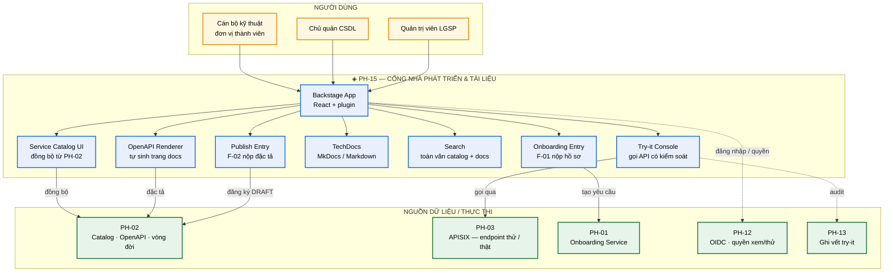
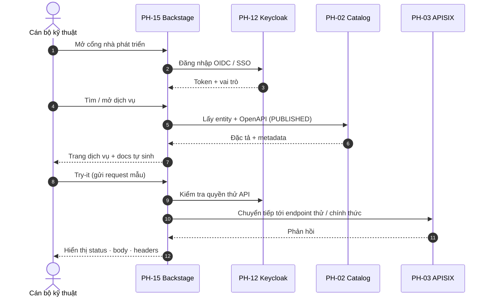
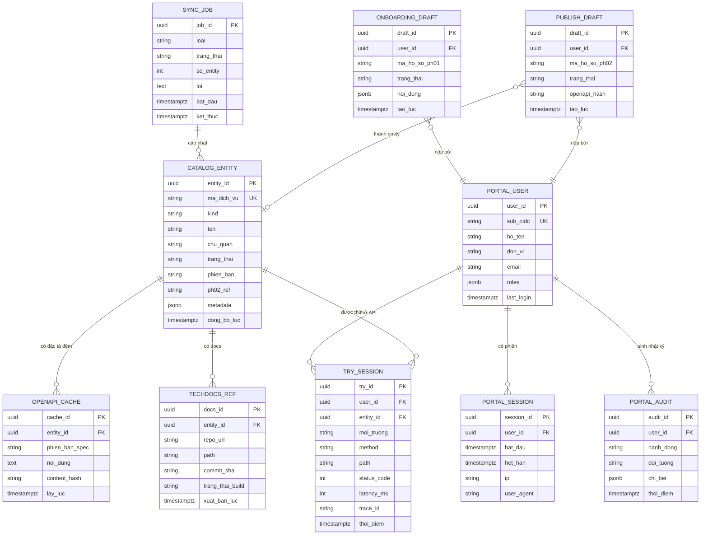

# SRS — PH-15: Cổng Nhà phát triển & Tài liệu

| Thuộc tính | Giá trị |
|---|---|
| **Mã phân hệ** | PH-15 |
| **Tên** | Cổng Nhà phát triển & Tài liệu (Developer Portal & Documentation) |
| **Nhóm** | Trải nghiệm |
| **Mức bắt buộc** | M — Bắt buộc |
| **Phiên bản** | 1.0 |
| **Ngày** | 03/8/2026 |
| **Công nghệ chủ đạo** | Backstage + React / Ant Design (ADR-006, ADR-016) |

---

## M1. Giới thiệu

### 1.1. Mục đích

PH-15 là **điểm vào duy nhất** để cán bộ kỹ thuật các đơn vị thành viên tra cứu dịch vụ chia sẻ dữ liệu đang có trên trục, đọc tài liệu kỹ thuật, thử gọi API, và theo dõi hồ sơ kết nạp / công bố. Phân hệ này biến danh mục kỹ thuật (PH-02) thành trải nghiệm tự phục vụ — giảm tải hỗ trợ thủ công và đáp ứng nghĩa vụ **công khai thông tin dịch vụ** tại NĐ 47/2020.

Đây là phân hệ hiện thực [ADR-006](../05-adr/README.md#adr-006): dùng **Backstage** làm Developer Portal kết hợp Service Catalog, tích hợp hiển thị đặc tả OpenAPI và sổ tay kỹ thuật (TechDocs).

| Điều | Nghĩa vụ | Vai trò của PH-15 |
|---|---|---|
| Điều 24 | Chủ quản CSDL **thiết lập và công bố** dịch vụ kèm tài liệu kỹ thuật | Hiển thị tài liệu OpenAPI tự sinh từ catalog — CMP-02 |
| Điều 25 | **Công khai** thông tin về dịch vụ chia sẻ dữ liệu | Cổng công khai trong phạm vi CQNN — CMP-02 |

### 1.2. Ba vai trò — phân biệt bản chất

Đây là điểm dễ nhầm lẫn nhất và cũng là lý do phải tách PH-15 khỏi PH-02 / PH-03:

| Vai trò | Phân hệ | Định nghĩa | Ví dụ |
|---|---|---|---|
| **Nguồn sự thật** | PH-02 | Giữ đặc tả, vòng đời, SLA, đăng ký sử dụng | API chuyển `PUBLISHED` |
| **Thực thi lúc chạy** | PH-03 | Định tuyến, hạn mức, bảo vệ tại gateway | APISIX áp rate-limit |
| **Trình bày & tự phục vụ** | PH-15 | Catalog UI, OpenAPI, try-it, TechDocs | Cán bộ đọc docs và thử API |

**Hệ quả thiết kế quan trọng.** PH-15 **không** thay API Manager. Quản lý vòng đời API, phê duyệt phát hành, đẩy cấu hình xuống gateway vẫn thuộc PH-02 / PH-03 ([ADR-006](../05-adr/README.md#adr-006) hệ quả tiêu cực). Portal chỉ đọc và trình bày — viết vào catalog qua API của PH-02, không tự quyết định trạng thái dịch vụ.

### 1.3. Phạm vi

**PH-15 chịu trách nhiệm:**

| # | Trách nhiệm |
|---|---|
| 1 | Cổng Backstage làm điểm vào cho lập trình viên và cán bộ kỹ thuật |
| 2 | Đồng bộ và hiển thị Service Catalog từ PH-02 (chỉ dịch vụ đã công bố / được phép xem) |
| 3 | Công bố tài liệu OpenAPI 3.1 tự sinh từ catalog/registry — luôn đồng bộ với đặc tả đã phát hành |
| 4 | Cho phép thử API (try-it) trong portal, gọi qua môi trường thử hoặc gateway có kiểm soát |
| 5 | TechDocs — sổ tay kỹ thuật đặt cạnh mã nguồn / kho tài liệu, không lạc hậu |
| 6 | Tìm kiếm toàn văn dịch vụ, API, tài liệu, entity Backstage |
| 7 | Điểm vào luồng [F-01](../03-flows/README.md#f-01--đăng-ký-và-kết-nạp-httt-thành-viên) (nộp hồ sơ kết nạp) và [F-02](../03-flows/README.md#f-02--công-bố-và-đăng-ký-dịch-vụ-chia-sẻ-dữ-liệu) (nộp đặc tả / theo dõi công bố) |
| 8 | Xác thực người dùng qua PH-12 (OIDC/SSO), phân quyền xem/thử theo vai trò |
| 9 | Ghi vết thao tác try-it và truy cập tài liệu nhạy cảm |
| 10 | Chuẩn bị mở rộng Architecture Registry (NAS) trên cùng nền Backstage — ghi chú thiết kế |

**PH-15 KHÔNG chịu trách nhiệm:**

| # | Không làm | Thuộc phân hệ |
|---|---|---|
| 1 | **Quản lý vòng đời API** (DRAFT→RETIRED), kiểm tra đặc tả, SLA, đồng bộ Bộ | PH-02 |
| 2 | **API Manager / Gateway** — định tuyến, throttling, WAF, mTLS lúc chạy | PH-03 |
| 3 | Thẩm định hồ sơ kết nạp, cấp credential | PH-01, PH-12 |
| 4 | Xử lý bản tin, chuyển đổi dữ liệu | PH-04 |
| 5 | KPI kiến trúc / NAS Connector đầy đủ | PH-16 |
| 6 | Lưu đặc tả OpenAPI gốc (nguồn sự thật) | PH-02 |

**Ranh giới số 1 — không thay API Manager.** Backstage không phải công cụ chuyên về API Management. Mọi thay đổi trạng thái dịch vụ, hạn mức, route phải đi qua PH-02 → PH-03. Portal chỉ hiển thị trạng thái và liên kết tới console quản trị khi người dùng có quyền.

**Ranh giới số 2 — phân vai với PH-02.** PH-02 là **nguồn dữ liệu**; PH-15 là **giao diện trình bày**. Tách hai vai trò cho phép thay đổi UX portal mà không đụng tới vòng đời API, và ngược lại ([SRS-PH-02](SRS-PH-02-api-catalog.md) ranh giới số 5).

### 1.4. Tài liệu tham chiếu

| Mã | Tài liệu |
|---|---|
| [KT] | [Kiến trúc ứng dụng — Control Plane](../02-architecture/README.md#4-kiến-trúc-ứng-dụng--phân-rã-thành-phần), bảng công nghệ API Portal |
| [LT] | [F-01 Kết nạp HTTT](../03-flows/README.md#f-01--đăng-ký-và-kết-nạp-httt-thành-viên), [F-02 Công bố dịch vụ](../03-flows/README.md#f-02--công-bố-và-đăng-ký-dịch-vụ-chia-sẻ-dữ-liệu) |
| [PL] | [Ma trận CMP](../01-legal/README.md) — NĐ 47/2020 Điều 24, 25 → CMP-02 |
| [TT] | [Tác động TTQGS M-04 Architecture Registry / NAS](../06-impact/README.md) |
| [ADR] | [ADR-006 Backstage](../05-adr/README.md#adr-006), [ADR-016 Ant Design](../05-adr/README.md#adr-016) |
| [SRS] | [PH-02 Catalog](SRS-PH-02-api-catalog.md), [PH-03 Gateway](SRS-PH-03-gateway.md), [PH-01 Onboarding](SRS-PH-01-onboarding.md), [PH-12 IAM](SRS-PH-12-iam.md) |

---

## M2. Mô tả tổng quan

### 2.1. Vị trí trong kiến trúc



**Thuyết minh sơ đồ.** PH-15 nằm ở **Control Plane / trải nghiệm**: không nằm trên đường dữ liệu lúc chạy. Cán bộ đọc catalog và docs dù PH-04 đang xử lý bản tin; try-it là lời gọi có chủ đích qua PH-03, không bypass gateway.

Hai điểm vào F-01 / F-02 trên portal **ủy thác** xử lý nghiệp vụ về PH-01 và PH-02 — portal không tự phê duyệt kết nạp hay phát hành dịch vụ.

### 2.2. Luồng trải nghiệm chính



**Thuyết minh.** Try-it **không** gọi thẳng hệ thống đích. Mọi lời gọi đi qua PH-03 để giữ hạn mức, TLS, ghi vết và chính sách — đúng nguyên tắc "mọi chia sẻ qua dịch vụ" (CMP-01) ngay cả khi người dùng thử tay.

### 2.3. Tác nhân

| Tác nhân | Loại | Tương tác |
|---|---|---|
| Cán bộ kỹ thuật đơn vị thành viên | Người | Tra cứu, đọc docs, try-it, nộp hồ sơ F-01 |
| Chủ quản CSDL | Người | Nộp đặc tả F-02, theo dõi trạng thái công bố, xem TechDocs |
| Quản trị viên LGSP | Người | Cấu hình plugin, phê duyệt (qua console liên kết), xem nhật ký try-it |
| PH-02 Danh mục dịch vụ | Hệ thống | Nguồn đặc tả OpenAPI và metadata catalog |
| PH-03 Gateway | Hệ thống | Endpoint thực thi try-it |
| PH-01 Onboarding | Hệ thống | Tiếp nhận hồ sơ kết nạp từ portal |
| PH-12 IAM | Hệ thống | Xác thực OIDC, quyết định quyền xem/thử |
| PH-13 Giám sát | Hệ thống | Nhận nhật ký try-it và truy cập |

### 2.4. Giả định

| Mã | Giả định |
|---|---|
| GD-01 | PH-02 đã phát hành ít nhất một dịch vụ `PUBLISHED` kèm OpenAPI 3.1 hợp lệ |
| GD-02 | PH-12 cung cấp realm OIDC và client cho Backstage |
| GD-03 | Môi trường thử (sandbox) của từng dịch vụ có sẵn trên PH-03 khi bật try-it |
| GD-04 | Tài liệu TechDocs nằm trong kho Git được Backstage quét (hoặc MinIO đồng bộ) |
| GD-05 | Người dùng portal thuộc CQNN hoặc đã được cấp quyền truy cập cổng |
| GD-06 | Ant Design dùng cho các màn React tùy biến / console nhúng theo [ADR-016](../05-adr/README.md#adr-016); lõi Backstage giữ Material UI gốc có thể theming |

### 2.5. Ràng buộc

| Mã | Ràng buộc | Nguồn |
|---|---|---|
| RB-01 | Mỗi dịch vụ công bố phải có tài liệu kỹ thuật hiển thị được | NĐ 47 Đ.24, CMP-02 |
| RB-02 | Thông tin dịch vụ công khai trong phạm vi CQNN | NĐ 47 Đ.25, CMP-02 |
| RB-03 | Đặc tả theo OpenAPI 3.1, tự sinh trang docs từ catalog | ADR-006, NT-01 API-first |
| RB-04 | Portal **không** thay API Manager / không tự đẩy cấu hình APISIX | ADR-006 |
| RB-05 | Try-it phải qua gateway, có xác thực và ghi vết | CMP-01, CMP-28 |
| RB-06 | Toàn bộ công nghệ mã nguồn mở | Yêu cầu dự án |
| RB-07 | Giao diện tùy biến bám Ant Design v6 + phong cách shadcn | ADR-016 |

### 2.6. Phụ thuộc phân hệ

| Phụ thuộc | Loại | Hành vi khi không khả dụng |
|---|---|---|
| PH-02 | **Cứng** cho catalog / docs | Hiển thị bản đệm gần nhất; đánh dấu "đồng bộ lỗi"; không nhận đặc tả mới |
| PH-03 | **Cứng** cho try-it | Vô hiệu nút Try-it; vẫn xem docs được |
| PH-01 | **Cứng** cho F-01 | Form kết nạp báo "dịch vụ kết nạp tạm gián đoạn" |
| PH-12 | **Cứng** | Không đăng nhập được → cổng chỉ hiện trang công khai tối thiểu (nếu cấu hình) hoặc chặn toàn bộ |
| PH-13 | **Mềm** | Try-it vẫn chạy nhưng cảnh báo thiếu audit; với API nhạy cảm → **từ chối** try-it (fail-safe) |
| PostgreSQL (Backstage) | **Cứng** | Portal không khởi động / mất entity nội bộ |
| Git / kho TechDocs | **Mềm** | Trang TechDocs báo lỗi tải; catalog vẫn hoạt động |

### 2.7. Ghi chú thiết kế — mở rộng Architecture Registry (NAS)

Backstage đã có mô hình **Software Catalog** (Component, API, System, Resource). Theo [tác động TTQGS M-04](../06-impact/README.md), có thể **mở rộng schema** thành Architecture Registry nội bộ làm nguồn cho NAS Connector (PH-16), thay vì xây sổ đăng ký riêng:

| Hạng mục | Hướng mở rộng | Ghi chú |
|---|---|---|
| Entity mới | `ArchitectureComponent`, `ComplianceStatus` | Bổ sung kind / annotation LGSP |
| Metadata | phiên bản kiến trúc, mức tuân thủ TTQGS, trạng thái vận hành | Đồng bộ từ PH-13 / GitOps |
| Liên kết F-02 | Sau khi `PUBLISHED`, đánh dấu đăng ký kiến trúc | Bước NAS do PH-16 thực hiện |
| Phạm vi PH-15 | Chỉ **chuẩn bị mô hình & hiển thị**; đẩy lên NAS thuộc PH-16 | Tránh chồng chéo trách nhiệm |

**Quyết định phạm vi bản 1.0:** PH-15 cung cấp catalog dịch vụ/API + TechDocs + hook annotation sẵn cho NAS. Connector NAS và KPI kiến trúc nằm ở PH-16.

---

## M3. Yêu cầu chức năng

### 3.1. Nhóm A — Catalog dịch vụ

#### FR-15-001 — Đồng bộ Service Catalog từ PH-02 · **M**

| Mục | Nội dung |
|---|---|
| **Mô tả** | Đồng bộ thực thể dịch vụ / API từ danh mục PH-02 vào Backstage Software Catalog |
| **Tác nhân** | Hệ thống (job đồng bộ), Quản trị viên |
| **Tiền điều kiện** | PH-02 khả dụng; credential đồng bộ đã cấp |
| **Đầu vào** | Danh sách dịch vụ + metadata (mã, tên, chủ quản, trạng thái, phiên bản, SLA, endpoint) |
| **Xử lý** | 1. Kéo định kỳ (mặc định 5 phút) hoặc nhận webhook khi PH-02 đổi trạng thái<br>2. Ánh xạ dịch vụ `PUBLISHED` / `DEPRECATED` thành entity Backstage (`kind: API` / `Component`)<br>3. Ẩn hoặc đánh dấu `DRAFT` / `TESTING` / `PENDING` theo quyền người xem<br>4. Gắn annotation: OpenAPI URL, owner, hệ thống thành viên, mức mật<br>5. Ghi thời điểm đồng bộ cuối |
| **Đầu ra** | Catalog Backstage cập nhật |
| **Ngoại lệ** | E1: PH-02 lỗi → giữ bản đệm, banner "đồng bộ chậm/lỗi"<br>E2: Entity xung đột mã → ưu tiên bản PH-02, ghi cảnh báo<br>E3: Dịch vụ `RETIRED` → ẩn khỏi danh mục mặc định, vẫn tra cứu được nếu bật lọc "đã ngừng" |

**Ghi chú.** Portal **không** là nguồn sự thật. Mọi sửa metadata nghiệp vụ phải thực hiện trên PH-02; lần đồng bộ sau ghi đè.

#### FR-15-002 — Duyệt và lọc danh mục dịch vụ · **M**

| Mục | Nội dung |
|---|---|
| **Mô tả** | Cho phép người dùng duyệt danh mục dịch vụ chia sẻ dữ liệu |
| **Tác nhân** | Cán bộ kỹ thuật, Chủ quản CSDL |
| **Đầu vào** | Bộ lọc: lĩnh vực, chủ quản, trạng thái, từ khóa, mức mật cho phép xem |
| **Xử lý** | 1. Áp dụng quyền xem từ PH-12 (một số dịch vụ nội bộ chỉ hiện với đơn vị được cấp)<br>2. Hiển thị thẻ/bảng: tên · mã · chủ quản · phiên bản · trạng thái · SLA tóm tắt<br>3. Nhãn màu theo trạng thái (`PUBLISHED` xanh, `DEPRECATED` vàng, `SUSPENDED` đỏ)<br>4. Liên kết tới trang chi tiết entity |
| **Đầu ra** | Danh sách dịch vụ đã lọc |
| **Ngoại lệ** | E1: Không có quyền xem → không liệt kê (không báo "tồn tại nhưng bị ẩn" với dịch vụ mật)<br>E2: Catalog rỗng → hướng dẫn liên hệ quản trị / nộp F-02 |

#### FR-15-003 — Trang chi tiết dịch vụ · **M**

| Mục | Nội dung |
|---|---|
| **Mô tả** | Trang tổng hợp thông tin một dịch vụ: mô tả nghiệp vụ, endpoint, SLA, liên hệ, docs, try-it |
| **Đầu vào** | Mã dịch vụ / entity ref |
| **Xử lý** | 1. Nạp metadata từ catalog đồng bộ<br>2. Nhúng tab OpenAPI (FR-15-004), Try-it (FR-15-007), TechDocs liên quan (FR-15-009)<br>3. Hiển thị trạng thái vòng đời chỉ đọc<br>4. Nếu người dùng là chủ quản: liên kết tới console PH-02 để sửa đặc tả / đề nghị phát hành<br>5. Hiển thị cảnh báo khi `DEPRECATED` (thời hạn chuyển đổi) |
| **Đầu ra** | Trang chi tiết dịch vụ |
| **Ngoại lệ** | E1: Entity không tồn tại → `404`<br>E2: Không đủ quyền → `403`, không tiết lộ metadata nhạy cảm |

### 3.2. Nhóm B — OpenAPI & tài liệu kỹ thuật

#### FR-15-004 — Hiển thị OpenAPI 3.1 tự sinh · **M**

| Mục | Nội dung |
|---|---|
| **Mô tả** | Sinh và hiển thị trang tài liệu kỹ thuật từ đặc tả OpenAPI 3.1 lấy từ PH-02 |
| **Tác nhân** | Cán bộ kỹ thuật |
| **Tiền điều kiện** | Dịch vụ có đặc tả hợp lệ trên PH-02 |
| **Đầu vào** | URL / nội dung OpenAPI từ registry catalog |
| **Xử lý** | 1. Tải đặc tả phiên bản đang phát hành (hoặc phiên bản người dùng chọn nếu được phép)<br>2. Render bằng plugin OpenAPI (Swagger UI / Redoc tương đương trong Backstage)<br>3. Hiển thị mô tả tiếng Việt, schema, ví dụ request/response, mã lỗi<br>4. Cho tải xuống file `.yaml` / `.json`<br>5. Hiển thị hash / thời điểm đặc tả để đối chiếu đồng bộ |
| **Đầu ra** | Trang docs API tương tác |
| **Ngoại lệ** | E1: Đặc tả thiếu hoặc không parse được → trang lỗi rõ, liên kết báo PH-02<br>E2: Phiên bản đặc tả lệch catalog → cảnh báo "đang đồng bộ" |

**Ghi chú về CMP-02.** NĐ 47 Điều 24 yêu cầu công bố "tài liệu kỹ thuật cần thiết phục vụ mục đích truy cập dữ liệu". Trang OpenAPI tự sinh từ đặc tả đã `PUBLISHED` là bằng chứng kiểm chứng chính của CMP-02 trên portal.

#### FR-15-005 — Đảm bảo đồng bộ docs với thực tế phát hành · **M**

| Mục | Nội dung |
|---|---|
| **Mô tả** | Bảo đảm tài liệu trên portal luôn phản ánh đặc tả đang phục vụ trên gateway |
| **Xử lý** | 1. Mỗi lần PH-02 phát hành / deprecated → webhook hoặc sự kiện làm mới entity<br>2. Không cho chỉnh sửa đặc tả trực tiếp trên portal<br>3. Khi `DEPRECATED`, docs vẫn hiện nhưng gắn banner bắt buộc chuyển phiên bản<br>4. Khi `RETIRED` / `SUSPENDED`, try-it tắt; docs có thể giữ để lịch sử nếu chính sách cho phép |
| **Đầu ra** | Docs đồng bộ với vòng đời |
| **Ngoại lệ** | E1: Webhook mất → job định kỳ bù; SLA đồng bộ ≤ 5 phút (NFR) |

#### FR-15-006 — Công bố thông tin dịch vụ trong phạm vi CQNN · **M**

| Mục | Nội dung |
|---|---|
| **Mô tả** | Công khai thông tin dịch vụ theo Điều 25 — tên, mục đích, chủ quản, cách truy cập, liên hệ |
| **Xử lý** | 1. Trang danh mục và chi tiết hiển thị các trường bắt buộc công khai<br>2. Không công khai credential, secret, endpoint nội bộ quản trị<br>3. Phân biệt vùng **công khai CQNN** (đã đăng nhập SSO cơ quan) và vùng **nội bộ vận hành** |
| **Đầu ra** | Thông tin công khai đúng phạm vi |
| **Ngoại lệ** | E1: Thiếu trường bắt buộc từ PH-02 → đánh dấu "thiếu metadata công bố", cảnh báo chủ quản |

### 3.3. Nhóm C — Try-it

#### FR-15-007 — Thử API trong portal · **M**

| Mục | Nội dung |
|---|---|
| **Mô tả** | Cho phép gửi request thử từ trang docs / tab Try-it |
| **Tác nhân** | Cán bộ kỹ thuật đã xác thực |
| **Tiền điều kiện** | Có quyền `portal.try-api`; dịch vụ không `SUSPENDED`/`RETIRED`; PH-03 khả dụng |
| **Đầu vào** | Method · path · headers · query · body · môi trường (sandbox / production nếu được phép) |
| **Xử lý** | 1. Kiểm tra quyền qua PH-12 (scope dịch vụ)<br>2. Gắn token người dùng hoặc client thử đã cấp (không nhúng secret cố định vào frontend)<br>3. Chuyển tiếp request tới endpoint sandbox (mặc định) hoặc production nếu có phê duyệt<br>4. Áp hạn mức try-it riêng (ví dụ 30 req/phút/người)<br>5. Hiển thị status, latency, headers, body (che dữ liệu nhạy cảm nếu PH-09 cấu hình mẫu)<br>6. Ghi vết try-it tới PH-13 |
| **Đầu ra** | Phản hồi thử nghiệm trên UI |
| **Ngoại lệ** | E1: Không đủ quyền → `403`<br>E2: Vượt hạn mức try-it → `429`, hướng dẫn chờ<br>E3: PH-03 lỗi → thông báo gateway; không thử đường tắt<br>E4: API mức mật / hạn chế → **cấm** try-it trên portal |

**Ghi chú thiết kế.** Try-it phục vụ học và tích hợp — không thay thế kiểm thử chính thức trên môi trường đơn vị. Production try-it mặc định tắt; bật theo từng dịch vụ sau phê duyệt quản trị.

#### FR-15-008 — Quản lý credential thử nghiệm trên portal · **M**

| Mục | Nội dung |
|---|---|
| **Mô tả** | Cho phép người dùng gắn / chọn credential thử (API key / token ngắn hạn) mà không lộ secret dài hạn |
| **Xử lý** | 1. Liên kết tới PH-01/PH-12 để cấp token thử thời hạn ngắn (≤ 24h)<br>2. Lưu tham chiếu phía server; UI chỉ hiện trạng thái "đã gắn"<br>3. Thu hồi token khi đăng xuất hoặc hết hạn<br>4. Không cho dán client_secret dài hạn vào ô try-it lưu trình duyệt |
| **Đầu ra** | Phiên try-it đã xác thực |
| **Ngoại lệ** | E1: Chưa kết nạp HTTT → hướng dẫn hoàn tất F-01 trước khi thử API thật |

### 3.4. Nhóm D — TechDocs

#### FR-15-009 — Xuất bản và đọc TechDocs · **M**

| Mục | Nội dung |
|---|---|
| **Mô tả** | Sổ tay kỹ thuật (hướng dẫn tích hợp, quy ước, runbook đơn vị) xuất bản cạnh entity |
| **Tác nhân** | Chủ quản / nhóm phát triển (viết); mọi người dùng có quyền (đọc) |
| **Đầu vào** | Nguồn Markdown/MkDocs trong Git hoặc artifact đã build |
| **Xử lý** | 1. Backstage TechDocs build hoặc dùng bản pre-built<br>2. Gắn docs với entity dịch vụ / hệ thống<br>3. Điều hướng mục lục, tìm trong docs<br>4. Hiển thị phiên bản commit / ngày xuất bản |
| **Đầu ra** | Trang TechDocs |
| **Ngoại lệ** | E1: Build lỗi → giữ bản trước, banner lỗi build<br>E2: Repo không truy cập được → `503` trên tab docs |

**Ghi chú.** TechDocs giải quyết vấn đề tài liệu lạc hậu: viết gần mã nguồn, xuất bản cùng pipeline — hệ quả tích cực của ADR-006.

#### FR-15-010 — Mẫu tài liệu tích hợp chuẩn · **S**

| Mục | Nội dung |
|---|---|
| **Mô tả** | Cung cấp template TechDocs: kết nối mTLS, lấy token, gọi API mẫu, xử lý lỗi chuẩn LGSP |
| **Xử lý** | 1. Kho template mặc định khi tạo entity mới<br>2. Checklist CMP-02 (trường bắt buộc trong mô tả dịch vụ)<br>3. Liên kết chéo tới OpenAPI và F-01/F-02 |
| **Đầu ra** | Template sẵn dùng |
| **Ngoại lệ** | — |

### 3.5. Nhóm E — Tìm kiếm, điều hướng F-01/F-02 & vận hành cổng

#### FR-15-011 — Tìm kiếm toàn văn · **M**

| Mục | Nội dung |
|---|---|
| **Mô tả** | Tìm dịch vụ, API, TechDocs, người sở hữu theo từ khóa |
| **Đầu vào** | Chuỗi tìm kiếm · bộ lọc loại entity |
| **Xử lý** | 1. Lập chỉ mục catalog + TechDocs<br>2. Trả kết quả xếp hạng, tôn trọng ACL<br>3. Gợi ý khi gõ (typeahead) |
| **Đầu ra** | Danh sách kết quả |
| **Ngoại lệ** | E1: Index lỗi → tìm kiếm metadata cơ bản; cảnh báo |

#### FR-15-012 — Điểm vào kết nạp F-01 · **M**

| Mục | Nội dung |
|---|---|
| **Mô tả** | Form / wizard nộp hồ sơ đăng ký HTTT thành viên trên portal |
| **Tác nhân** | Cán bộ kỹ thuật đơn vị thành viên |
| **Đầu vào** | Thông tin đơn vị, HTTT, mục đích, dữ liệu cần, căn cứ pháp lý |
| **Xử lý** | 1. Thu thập và kiểm tra sơ bộ phía client/server<br>2. Gọi PH-01 tạo yêu cầu kết nạp<br>3. Hiển thị trạng thái hồ sơ (chờ duyệt / từ chối / đã cấp)<br>4. Khi được duyệt: hướng dẫn nhận credential kênh an toàn (không hiện secret trên portal lâu dài) |
| **Đầu ra** | Mã hồ sơ + trạng thái |
| **Ngoại lệ** | E1: PH-01 từ chối validate → hiện lỗi theo trường<br>E2: Quá hạn chờ duyệt → hiện nhắc đã gửi cho quản trị (theo F-01) |

#### FR-15-013 — Điểm vào công bố F-02 · **M**

| Mục | Nội dung |
|---|---|
| **Mô tả** | Cho chủ quản nộp đặc tả OpenAPI và theo dõi vòng đời công bố |
| **Tác nhân** | Chủ quản CSDL |
| **Đầu vào** | File/URL OpenAPI 3.1 + mô tả nghiệp vụ |
| **Xử lý** | 1. Chuyển đặc tả sang PH-02 (trạng thái `DRAFT`)<br>2. Hiển thị kết quả lint từ PH-02<br>3. Theo dõi `TESTING` → `PENDING` → `PUBLISHED`<br>4. Khi `PUBLISHED`: tự xuất hiện trên catalog portal (FR-15-001) |
| **Đầu ra** | Hồ sơ công bố + liên kết entity |
| **Ngoại lệ** | E1: Đặc tả không hợp lệ → không tạo DRAFT hoặc DRAFT kèm lỗi chi tiết<br>E2: Người dùng không phải chủ quản → `403` |

**Ghi chú.** Portal **không** phê duyệt phát hành — bước Admin trong F-02 thuộc console PH-02 / vai trò quản trị.

#### FR-15-014 — Đăng nhập SSO và phân quyền portal · **M**

| Mục | Nội dung |
|---|---|
| **Mô tả** | Xác thực qua PH-12 (OIDC) và ánh xạ vai trò Backstage |
| **Xử lý** | 1. Đăng nhập / đăng xuất OIDC<br>2. Ánh xạ realm role → permission Backstage (xem catalog, try-it, nộp F-01/F-02, quản trị plugin)<br>3. Làm mới token; hết phiên → khóa try-it |
| **Đầu ra** | Phiên người dùng |
| **Ngoại lệ** | E1: IdP lỗi → trang bảo trì đăng nhập<br>E2: Tài khoản bị khóa → từ chối |

#### FR-15-015 — Ghi vết truy cập và try-it · **M**

| Mục | Nội dung |
|---|---|
| **Mô tả** | Ghi nhật ký phục vụ CMP-28 và hậu kiểm |
| **Xử lý** | Ghi: userId, entity, hành động (`VIEW_DOCS` / `TRY_API` / `DOWNLOAD_SPEC` / `SUBMIT_ONBOARDING` / `SUBMIT_PUBLISH`), thời điểm, kết quả, `traceId` nếu try-it<br>Gửi PH-13 |
| **Đầu ra** | Bản ghi audit |
| **Ngoại lệ** | E1: Không ghi được với API nhạy cảm → từ chối try-it |

#### FR-15-016 — Bảng điều khiển cá nhân · **S**

| Mục | Nội dung |
|---|---|
| **Mô tả** | Trang "của tôi": dịch vụ đang theo dõi, hồ sơ F-01/F-02, API đã thử gần đây |
| **Xử lý** | Tổng hợp từ PH-01, PH-02 và lịch sử portal |
| **Đầu ra** | Dashboard cá nhân |
| **Ngoại lệ** | — |

### 3.6. Bảng tổng hợp yêu cầu chức năng

| Nhóm | Mã | Tên | Ưu tiên |
|---|---|---|:-:|
| A | FR-15-001 | Đồng bộ Service Catalog từ PH-02 | M |
| A | FR-15-002 | Duyệt và lọc danh mục dịch vụ | M |
| A | FR-15-003 | Trang chi tiết dịch vụ | M |
| B | FR-15-004 | Hiển thị OpenAPI 3.1 tự sinh | M |
| B | FR-15-005 | Đồng bộ docs với thực tế phát hành | M |
| B | FR-15-006 | Công bố thông tin dịch vụ (Đ.25) | M |
| C | FR-15-007 | Thử API trong portal | M |
| C | FR-15-008 | Quản lý credential thử nghiệm | M |
| D | FR-15-009 | Xuất bản và đọc TechDocs | M |
| D | FR-15-010 | Mẫu tài liệu tích hợp chuẩn | S |
| E | FR-15-011 | Tìm kiếm toàn văn | M |
| E | FR-15-012 | Điểm vào kết nạp F-01 | M |
| E | FR-15-013 | Điểm vào công bố F-02 | M |
| E | FR-15-014 | Đăng nhập SSO và phân quyền | M |
| E | FR-15-015 | Ghi vết truy cập và try-it | M |
| E | FR-15-016 | Bảng điều khiển cá nhân | S |

**Tổng: 16 yêu cầu chức năng** — 14 bắt buộc (M), 2 cần có (S).

---

## M4. Mô hình dữ liệu

### 4.1. Sơ đồ thực thể



### 4.2. Đặc tả thực thể

#### EN-15-01 — CATALOG_ENTITY

| Trường | Kiểu | Bắt buộc | Ràng buộc | Mô tả |
|---|---|:-:|---|---|
| `entity_id` | UUID | ✓ | PK | |
| `ma_dich_vu` | VARCHAR(80) | ✓ | UNIQUE | Khớp mã trên PH-02 |
| `kind` | VARCHAR(32) | ✓ | ∈ {`API`,`Component`,`System`,`Resource`} | Kind Backstage |
| `ten` | VARCHAR(200) | ✓ | | Tên hiển thị |
| `chu_quan` | VARCHAR(200) | ✓ | | Đơn vị chủ quản |
| `trang_thai` | VARCHAR(24) | ✓ | Trạng thái vòng đời PH-02 | Chỉ đọc từ nguồn |
| `phien_ban` | VARCHAR(32) | ✓ | SemVer hoặc quy ước LGSP | |
| `ph02_ref` | VARCHAR(120) | ✓ | | Tham chiếu bản ghi PH-02 |
| `metadata` | JSONB | ✓ | | SLA tóm tắt, endpoint, annotations |
| `dong_bo_luc` | TIMESTAMPTZ | ✓ | | Thời điểm đồng bộ cuối |

**Ràng buộc.** Cấm cập nhật `trang_thai` từ UI portal — chỉ job đồng bộ ghi.

#### EN-15-02 — OPENAPI_CACHE

| Trường | Kiểu | Bắt buộc | Ràng buộc | Mô tả |
|---|---|:-:|---|---|
| `cache_id` | UUID | ✓ | PK | |
| `entity_id` | UUID | ✓ | FK → CATALOG_ENTITY | |
| `phien_ban_spec` | VARCHAR(32) | ✓ | | Phiên bản đặc tả |
| `noi_dung` | TEXT | ✓ | OpenAPI 3.1 | Có thể lưu MinIO + giữ hash |
| `content_hash` | VARCHAR(64) | ✓ | SHA-256 | Phát hiện lệch |
| `lay_luc` | TIMESTAMPTZ | ✓ | | |

**Chính sách lưu giữ.** Giữ tối thiểu 3 phiên bản gần nhất phục vụ đối chiếu; bản `RETIRED` theo chính sách lưu trữ tài liệu (≥ 5 năm khuyến nghị).

#### EN-15-03 — TECHDOCS_REF

| Trường | Kiểu | Bắt buộc | Ràng buộc | Mô tả |
|---|---|:-:|---|---|
| `docs_id` | UUID | ✓ | PK | |
| `entity_id` | UUID | ✓ | FK | |
| `repo_url` | VARCHAR(500) | ✓ | | Kho nguồn |
| `path` | VARCHAR(300) | | | Thư mục docs |
| `commit_sha` | VARCHAR(40) | | | |
| `trang_thai_build` | VARCHAR(24) | ✓ | ∈ {`OK`,`BUILDING`,`FAILED`} | |
| `xuat_ban_luc` | TIMESTAMPTZ | | | |

#### EN-15-04 — TRY_SESSION

| Trường | Kiểu | Bắt buộc | Ràng buộc | Mô tả |
|---|---|:-:|---|---|
| `try_id` | UUID | ✓ | PK | |
| `user_id` | UUID | ✓ | FK | |
| `entity_id` | UUID | ✓ | FK | |
| `moi_truong` | VARCHAR(16) | ✓ | ∈ {`SANDBOX`,`PRODUCTION`} | |
| `method` | VARCHAR(10) | ✓ | | |
| `path` | VARCHAR(500) | ✓ | | Không lưu body đầy đủ nếu có PII |
| `status_code` | INT | ✓ | | |
| `latency_ms` | INT | ✓ | | |
| `trace_id` | VARCHAR(64) | | | Liên kết PH-13 |
| `thoi_diem` | TIMESTAMPTZ | ✓ | | |

**Chính sách lưu giữ.** 90 ngày chi tiết; tổng hợp thống kê giữ dài hơn phục vụ báo cáo.

#### EN-15-05 — PORTAL_AUDIT

| Trường | Kiểu | Bắt buộc | Ràng buộc | Mô tả |
|---|---|:-:|---|---|
| `audit_id` | UUID | ✓ | PK | |
| `user_id` | UUID | ✓ | FK | |
| `hanh_dong` | VARCHAR(40) | ✓ | Enum hành động FR-15-015 | |
| `doi_tuong` | VARCHAR(120) | ✓ | | Mã dịch vụ / hồ sơ |
| `chi_tiet` | JSONB | | | Không chứa secret |
| `thoi_diem` | TIMESTAMPTZ | ✓ | | |

#### EN-15-06 — SYNC_JOB / bản nháp F-01·F-02

| Thực thể | Mục đích |
|---|---|
| **SYNC_JOB** | Theo dõi lần đồng bộ catalog (thành công/lỗi, số entity) |
| **ONBOARDING_DRAFT** | Bản nháp / tham chiếu hồ sơ F-01 phía portal |
| **PUBLISH_DRAFT** | Bản nháp / tham chiếu hồ sơ F-02 phía portal |
| **PORTAL_USER / PORTAL_SESSION** | Hồ sơ người dùng đồng bộ từ OIDC và phiên làm việc |

---

## M5. Giao diện API

> API của PH-15 phục vụ frontend Backstage/plugin và tích hợp nội bộ. Nguồn sự thật nghiệp vụ vẫn gọi tiếp PH-01/PH-02/PH-12.

### 5.1. Quy ước chung

| Mục | Quy ước |
|---|---|
| Base path | `/api/v1/portal` |
| Định dạng | JSON; OpenAPI download có `application/yaml` |
| Xác thực | Bearer JWT (OIDC PH-12) |
| Lỗi | RFC 7807 Problem Details |
| Phân trang | `page`, `size`, `sort` |

### 5.2. Danh mục endpoint

| Phương thức | Đường dẫn | Mô tả | FR |
|---|---|---|---|
| `GET` | `/api/v1/portal/catalog` | Duyệt danh mục dịch vụ | FR-15-002 |
| `GET` | `/api/v1/portal/catalog/{maDichVu}` | Chi tiết entity | FR-15-003 |
| `GET` | `/api/v1/portal/catalog/{maDichVu}/openapi` | Lấy / tải OpenAPI | FR-15-004 |
| `POST` | `/api/v1/portal/catalog/{maDichVu}/try` | Thử API | FR-15-007 |
| `GET` | `/api/v1/portal/search` | Tìm kiếm | FR-15-011 |
| `POST` | `/api/v1/portal/onboarding` | Nộp hồ sơ F-01 | FR-15-012 |
| `GET` | `/api/v1/portal/onboarding/{maHoSo}` | Trạng thái hồ sơ F-01 | FR-15-012 |
| `POST` | `/api/v1/portal/publish` | Nộp đặc tả F-02 | FR-15-013 |
| `GET` | `/api/v1/portal/publish/{maHoSo}` | Trạng thái công bố | FR-15-013 |
| `GET` | `/api/v1/portal/me` | Hồ sơ & quyền portal | FR-15-014, 016 |
| `POST` | `/api/v1/portal/sync/trigger` | Kích hoạt đồng bộ (admin) | FR-15-001 |
| `GET` | `/api/v1/portal/sync/status` | Trạng thái đồng bộ | FR-15-001 |

### 5.3. Yêu cầu xác thực

| Endpoint nhóm | Scope / quyền tối thiểu |
|---|---|
| Catalog đọc | `portal.catalog.read` |
| OpenAPI tải | `portal.catalog.read` |
| Try-it | `portal.try-api` (+ scope dịch vụ) |
| Nộp F-01 | `portal.onboarding.submit` |
| Nộp F-02 | `portal.publish.submit` |
| Sync trigger | `portal.admin` |

### 5.4. Ví dụ chi tiết

#### 5.4.1. `GET /api/v1/portal/catalog` — Duyệt danh mục

**Tham số:** `q`, `trangThai`, `chuQuan`, `page`, `size`

**Phản hồi `200 OK`:**

```json
{
  "items": [
    {
      "maDichVu": "DV-DANCU-TRA-CUU",
      "ten": "Tra cứu thông tin cư trú",
      "chuQuan": "Sở Tư pháp",
      "trangThai": "PUBLISHED",
      "phienBan": "1.2.0",
      "slaTomTat": "P99 ≤ 2s · 99,5%",
      "coTechDocs": true,
      "choPhepTryIt": true
    }
  ],
  "page": 0,
  "size": 20,
  "total": 42,
  "dongBoLuc": "2026-08-03T09:15:00+07:00"
}
```

#### 5.4.2. `GET /api/v1/portal/catalog/{maDichVu}/openapi`

**Phản hồi `200`:** thân OpenAPI 3.1 (JSON hoặc YAML theo `Accept`).

**Phản hồi `409` khi lệch đồng bộ:**

```json
{
  "type": "https://lgsp.local/errors/openapi-sync-stale",
  "title": "Đặc tả đang được đồng bộ",
  "status": 409,
  "detail": "Hash đặc tả trên portal chưa khớp PH-02; thử lại sau ít phút",
  "maDichVu": "DV-DANCU-TRA-CUU"
}
```

#### 5.4.3. `POST /api/v1/portal/catalog/{maDichVu}/try` — Try-it

**Yêu cầu:**

```json
{
  "moiTruong": "SANDBOX",
  "method": "POST",
  "path": "/v1/cu-tru/tra-cuu",
  "headers": { "Content-Type": "application/json" },
  "body": { "soDinhDanh": "001199001234" }
}
```

**Phản hồi `200 OK`:**

```json
{
  "tryId": "7c9e6679-7425-40de-944b-e07fc1f90ae7",
  "statusCode": 200,
  "latencyMs": 187,
  "traceId": "4bf92f3577b34da6a3ce929d0e0e4736",
  "responseHeaders": { "content-type": "application/json" },
  "responseBody": { "hoTen": "Nguyễn Văn A", "trangThaiCuTru": "THUONG_TRU" },
  "canhBao": []
}
```

**Phản hồi `403` khi cấm try-it:**

```json
{
  "type": "https://lgsp.local/errors/try-forbidden",
  "title": "Không được thử API này trên portal",
  "status": 403,
  "detail": "Dịch vụ thuộc nhóm hạn chế hoặc thiếu quyền portal.try-api"
}
```

#### 5.4.4. `POST /api/v1/portal/publish` — Nộp F-02

**Yêu cầu (multipart hoặc JSON + URL):**

```json
{
  "tenDichVu": "Tra cứu thông tin cư trú",
  "moTaNghiepVu": "Cung cấp thông tin cư trú cho thủ tục hành chính liên thông",
  "openapiUrl": "https://git.local/sotp/cu-tru/openapi.yaml",
  "mucDich": "CHIA_SE_NOI_BO"
}
```

**Phản hồi `201 Created`:**

```json
{
  "maHoSo": "PUB-2026-00087",
  "trangThai": "DRAFT",
  "ph02Ref": "svc-87",
  "ketQuaLint": { "hopLe": true, "canhBao": [] }
}
```

---

## M6. Giao diện người dùng

### 6.1. Danh mục màn hình

| Mã | Tên màn hình | Đối tượng | Mockup |
|---|---|---|---|
| **UI-15-01** | Trang chủ cổng nhà phát triển | Mọi người dùng | [`portal.html`](../../mockup/pages/portal.html) *(kế hoạch)* |
| **UI-15-02** | Danh mục dịch vụ / catalog | Cán bộ kỹ thuật | `portal.html` tab Catalog |
| **UI-15-03** | Chi tiết dịch vụ + OpenAPI | Cán bộ kỹ thuật | `portal.html` chi tiết |
| **UI-15-04** | Try-it console | Cán bộ kỹ thuật | `portal.html` tab Thử API |
| **UI-15-05** | TechDocs reader | Cán bộ kỹ thuật, Chủ quản | `portal.html` tab Tài liệu |
| **UI-15-06** | Nộp hồ sơ kết nạp F-01 | Cán bộ đơn vị | `portal.html` / onboarding |
| **UI-15-07** | Nộp / theo dõi công bố F-02 | Chủ quản CSDL | `portal.html` tab Công bố |
| **UI-15-08** | Tìm kiếm toàn văn | Mọi người dùng | Ô tìm kiếm toàn cục |
| **UI-15-09** | Bảng điều khiển cá nhân | Người dùng đã đăng nhập | `portal.html` /me |

> Nền tảng UI: Backstage + plugin; phần tùy biến LGSP dùng **React + Ant Design v6** ([ADR-016](../05-adr/README.md#adr-016)). Mockup HTML sẽ dựng khi tới giai đoạn 6 mockup.

### 6.2. UI-15-01 — Trang chủ cổng

| Thành phần | Mô tả |
|---|---|
| Hero / tiêu đề thương hiệu LGSP | Tên cổng, một câu mô tả mục đích |
| Ô tìm kiếm nổi | Chuyển UI-15-08 |
| Lối tắt | Catalog · Kết nạp · Công bố · TechDocs chung |
| Thẻ dịch vụ mới / cập nhật | Top dịch vụ `PUBLISHED` gần đây |
| Banner trạng thái đồng bộ | Chỉ hiện khi sync lỗi |

**Quy tắc tương tác:**

| # | Quy tắc |
|---|---|
| 1 | Chưa đăng nhập: chỉ xem nội dung công khai CQNN được cấu hình |
| 2 | Đã đăng nhập: hiện lối tắt theo vai trò |
| 3 | Không đặt thẻ thống kê vận hành gateway trên trang chủ portal (thuộc PH-13) |

### 6.3. UI-15-02 — Danh mục dịch vụ

| Thành phần | Mô tả |
|---|---|
| Bộ lọc | Chủ quản · lĩnh vực · trạng thái · có TechDocs · cho phép try-it |
| Bảng / lưới thẻ | Tên · mã · phiên bản · trạng thái · SLA |
| Nhãn trạng thái | Màu theo vòng đời |
| Nút chi tiết | Mở UI-15-03 |

**Quy tắc tương tác:**

| # | Quy tắc |
|---|---|
| 1 | `DEPRECATED` luôn hiện cảnh báo trên thẻ |
| 2 | Không liệt kê dịch vụ người dùng không có quyền xem |
| 3 | Lọc mặc định: `PUBLISHED` + `DEPRECATED` |

### 6.4. UI-15-03 / UI-15-04 — Chi tiết & Try-it

| Thành phần | Mô tả |
|---|---|
| Tab Tổng quan | Mô tả, chủ quản, SLA, liên hệ, trạng thái |
| Tab OpenAPI | Renderer đặc tả, nút tải về |
| Tab Thử API | Chọn operation, điền tham số, gửi, xem phản hồi |
| Tab TechDocs | Nhúng UI-15-05 |
| Banner ranh giới | "Quản lý vòng đời API tại PH-02 — portal chỉ trình bày" |

**Quy tắc tương tác Try-it:**

| # | Quy tắc |
|---|---|
| 1 | Mặc định môi trường `SANDBOX` |
| 2 | Nút gửi vô hiệu nếu thiếu quyền hoặc dịch vụ cấm try-it |
| 3 | Hiện `traceId` để người dùng gửi hỗ trợ |
| 4 | Không lưu body chứa dữ liệu mẫu thật vào localStorage |

### 6.5. UI-15-06 / UI-15-07 — F-01 và F-02

| Màn | Thành phần chính | Quy tắc |
|---|---|---|
| F-01 | Wizard nhiều bước, tải tệp căn cứ, theo dõi trạng thái | Secret cấp sau duyệt **không** hiện lâu trên UI; dùng liên kết một lần |
| F-02 | Upload OpenAPI, hiện kết quả lint, timeline trạng thái | Không có nút "Phê duyệt phát hành" trên portal thường |

### 6.6. UI-15-08 — Tìm kiếm

| Thành phần | Mô tả |
|---|---|
| Ô tìm + phím tắt | `/` hoặc `Ctrl+K` |
| Nhóm kết quả | API · Component · Docs · Hồ sơ của tôi |
| Empty state | Gợi ý từ khóa / liên hệ quản trị |

---

## M7. Yêu cầu phi chức năng

### 7.1. Hiệu năng

| Mã | Yêu cầu | Chỉ tiêu | Cách đo |
|---|---|---|---|
| **NFR-15-001** | Thời gian tải trang chủ (TTFB + LCP) | LCP ≤ 2,5s trên mạng nội bộ | Lighthouse / RUM |
| **NFR-15-002** | Độ trễ API duyệt catalog | P99 ≤ 300ms | Đo tại API portal |
| **NFR-15-003** | Độ trễ render OpenAPI (spec ≤ 2MB) | ≤ 3s lần đầu; ≤ 1s khi đã đệm | Đo UI |
| **NFR-15-004** | Độ trễ proxy try-it (không kể backend) | P99 ≤ 100ms overhead | So sánh trực tiếp GW |
| **NFR-15-005** | Tìm kiếm typeahead | ≤ 200ms cho gợi ý | Đo API search |
| **NFR-15-006** | Chu kỳ đồng bộ catalog | ≤ 5 phút hoặc tức thì qua webhook | Giám sát SYNC_JOB |

### 7.2. Tính sẵn sàng

| Mã | Yêu cầu | Chỉ tiêu |
|---|---|---|
| **NFR-15-007** | Tỷ lệ sẵn sàng cổng | ≥ 99,5% (Control Plane — thấp hơn Data Plane) |
| **NFR-15-008** | PH-02 sự cố | Vẫn đọc được catalog đệm + docs đã cache |
| **NFR-15-009** | PH-03 sự cố | Docs vẫn đọc; try-it báo bảo trì |
| **NFR-15-010** | Số replica Backstage tối thiểu | 2 |
| **NFR-15-011** | RTO khôi phục portal | ≤ 1 giờ |

### 7.3. Bảo mật

| Mã | Yêu cầu |
|---|---|
| **NFR-15-012** | Mọi API portal yêu cầu TLS 1.2+ và JWT hợp lệ (trừ health) |
| **NFR-15-013** | Không lưu client_secret / private key trên trình duyệt hoặc localStorage |
| **NFR-15-014** | Try-it bị hạn mức và không bypass PH-03 |
| **NFR-15-015** | CSP, chống XSS trên renderer OpenAPI / Markdown |
| **NFR-15-016** | Phân tách quyền xem dịch vụ mật / hạn chế theo PH-12 |
| **NFR-15-017** | Nhật ký audit không chứa body có PII đầy đủ |
| **NFR-15-018** | Session hết hạn theo chính sách IdP; làm mới token an toàn |

### 7.4. Khả năng mở rộng & tương thích

| Mã | Yêu cầu |
|---|---|
| **NFR-15-019** | Hỗ trợ ≥ 500 entity catalog mà tìm kiếm vẫn đạt NFR-15-005 |
| **NFR-15-020** | Plugin Backstage có thể tắt/bật độc lập (OpenAPI, TechDocs, Search) |
| **NFR-15-021** | Schema annotation sẵn cho Architecture Registry / NAS (mở rộng PH-16) |
| **NFR-15-022** | Giao diện tùy biến LGSP tuân Ant Design token ([ADR-016](../05-adr/README.md#adr-016)), hỗ trợ sáng/tối |

### 7.5. Khả năng quan sát

| Mã | Yêu cầu |
|---|---|
| **NFR-15-023** | Chỉ số: `portal_catalog_sync_success`, `portal_catalog_entities`, `portal_try_total{status}`, `portal_try_latency`, `portal_search_latency`, `portal_openapi_render_errors` |
| **NFR-15-024** | Trace try-it gắn `traceId` xuyên PH-03 |
| **NFR-15-025** | Cảnh báo khi sync thất bại > 2 chu kỳ liên tiếp |
| **NFR-15-026** | Cảnh báo khi tỷ lệ lỗi try-it > 10% trong 15 phút |

---

## M8. Quy tắc nghiệp vụ

| Mã | Quy tắc | Lý do | Cách thực thi | Khi vi phạm |
|---|---|---|---|---|
| **BR-15-001** | Portal không thay đổi trạng thái vòng đời API | Ranh giới API Manager / PH-02 | UI chỉ đọc; API ghi trạng thái bị từ chối | `403` / bỏ qua |
| **BR-15-002** | Đặc tả OpenAPI trên portal phải lấy từ PH-02 đã phát hành | CMP-02, nguồn sự thật duy nhất | FR-15-004, 005 | Không hiện docs giả |
| **BR-15-003** | Mọi try-it đi qua PH-03 | CMP-01, không đường tắt | FR-15-007 | Từ chối / lỗi thiết kế |
| **BR-15-004** | Cấm try-it với dịch vụ `SUSPENDED` / `RETIRED` / mật | An toàn vận hành | FR-15-007 E4 | Nút vô hiệu + `403` |
| **BR-15-005** | Không lưu secret dài hạn trên trình duyệt | Bảo mật credential | FR-15-008, NFR-15-013 | Chặn lưu |
| **BR-15-006** | Thông tin công bố đủ trường Điều 25 | CMP-02 / Đ.25 | FR-15-006 | Cảnh báo thiếu metadata |
| **BR-15-007** | F-01 chỉ tạo yêu cầu; phê duyệt thuộc PH-01/admin | Phân tách nhiệm vụ | FR-15-012 | Không có nút duyệt trên portal thường |
| **BR-15-008** | F-02 chỉ nộp đặc tả; phê duyệt phát hành thuộc PH-02 | ADR-006, F-02 | FR-15-013 | Không duyệt phát hành tại portal |
| **BR-15-009** | Người không đủ quyền không thấy entity bị ẩn | Need-to-know | FR-15-002 E1 | Không liệt kê |
| **BR-15-010** | `DEPRECATED` phải có banner cảnh báo | Bảo vệ bên khai thác | FR-15-003 | — |
| **BR-15-011** | Đồng bộ tối đa 5 phút hoặc webhook | Docs không lạc hậu | NFR-15-006 | Cảnh báo sync |
| **BR-15-012** | Try-it production mặc định tắt | Giảm rủi ro dữ liệu thật | FR-15-007 | Chỉ bật khi cấu hình |
| **BR-15-013** | Thiếu audit với API nhạy cảm → từ chối try-it | CMP-28 | FR-15-015 E1 | Từ chối |
| **BR-15-014** | TechDocs lỗi build không xóa bản đã xuất bản tốt | Khả dụng tài liệu | FR-15-009 E1 | Giữ bản cũ |
| **BR-15-015** | Annotation NAS chỉ chuẩn bị dữ liệu; không đẩy NAS từ PH-15 | Phân vai PH-16 | Mục 2.7 | — |

---

## M9. Tuân thủ

### 9.1. Ánh xạ yêu cầu pháp lý

| Mã CMP | Yêu cầu | FR/NFR/BR đáp ứng | Cách kiểm chứng |
|---|---|---|---|
| **CMP-02** | Công bố dịch vụ + tài liệu kỹ thuật (NĐ 47 Đ.24, Đ.25) | FR-15-001…006, 013; BR-15-002, 006 | Mỗi API `PUBLISHED` có trang OpenAPI trên portal; tải được đặc tả; thông tin công khai đủ trường |
| **CMP-01** | Chia sẻ qua dịch vụ / không đường tắt | FR-15-007; BR-15-003 | Try-it bắt buộc qua PH-03 — bắt gói tin xác nhận |
| **CMP-05** | Vòng đời API + throttling *(gián tiếp)* | BR-15-001; phụ thuộc PH-02/03 | Xác nhận portal không tự đổi lifecycle / rate-limit |
| **CMP-06** | SSO OIDC | FR-15-014 | Đăng nhập qua Keycloak thành công |
| **CMP-28** | Ghi vết truy cập | FR-15-015; BR-15-013 | Đối chiếu nhật ký try-it / xem docs |

### 9.2. Thuyết minh CMP-02 — điểm nghiệm thu

NĐ 47/2020:

- **Điều 24** — thiết lập và công bố dịch vụ kèm tài liệu kỹ thuật → PH-02 giữ hợp đồng; **PH-15 công bố trang tài liệu tự sinh** từ OpenAPI 3.1.
- **Điều 25** — công khai thông tin dịch vụ → **catalog và trang chi tiết** trong phạm vi CQNN.

Bằng chứng nghiệm thu đề xuất: biên bản duyệt ngẫu nhiên N dịch vụ `PUBLISHED` — 100% có docs mở được, hash khớp PH-02, try-it sandbox hoạt động (nếu được phép).

### 9.3. Ánh xạ nguyên tắc / ADR

| Nguyên tắc / ADR | Cách PH-15 đáp ứng |
|---|---|
| **ADR-006** | Backstage = Developer Portal + Service Catalog + OpenAPI + TechDocs |
| **ADR-016** | Tùy biến UI LGSP bằng Ant Design v6 + sáng/tối |
| **API-first (NT-01)** | Docs sinh từ OpenAPI, không viết tay tách rời đặc tả |
| **Tách Control/Data Plane** | Portal thuộc trải nghiệm/Control; không nằm đường dữ liệu chính |
| **Modular Design** | Tách trình bày (PH-15) / nguồn (PH-02) / thực thi (PH-03) |

---

## M10. Kiểm thử chấp nhận

### 10.1. Kiểm thử chức năng

| Mã | Kịch bản | Dữ liệu thử | Kết quả mong đợi | Tiêu chí đạt |
|---|---|---|---|---|
| **AT-15-001** | Đồng bộ dịch vụ mới `PUBLISHED` | PH-02 phát hành API mẫu | Xuất hiện trên catalog ≤ 5 phút | FR-15-001, NFR-15-006 |
| **AT-15-002** | Ẩn `DRAFT` với user thường | API ở `DRAFT` | User thường không thấy | FR-15-002 |
| **AT-15-003** | Trang chi tiết đủ tab | Entity đã sync | Có Tổng quan · OpenAPI · Try-it · Docs | FR-15-003 |
| **AT-15-004** | Render OpenAPI 3.1 | Spec hợp lệ tiếng Việt | Hiển thị operation, schema, ví dụ | FR-15-004, CMP-02 |
| **AT-15-005** | Tải xuống đặc tả | Nút download | File YAML/JSON parse được, khớp PH-02 | CMP-02 |
| **AT-15-006** | Docs cập nhật khi nâng phiên bản | PH-02 phát hành v1.3 | Portal hiện v1.3, hash mới | FR-15-005 |
| **AT-15-007** | Banner `DEPRECATED` | API deprecated | Banner cảnh báo + hạn chuyển đổi | BR-15-010 |
| **AT-15-008** | Thông tin công khai Đ.25 | Entity thiếu liên hệ | Cảnh báo thiếu metadata | FR-15-006, BR-15-006 |
| **AT-15-009** | Try-it sandbox thành công | User có `portal.try-api` | `200`/`4xx` từ GW, có `traceId` | FR-15-007 |
| **AT-15-010** | Try-it không bypass gateway | Theo dõi network | Chỉ gọi host PH-03 | BR-15-003 |
| **AT-15-011** | Cấm try-it khi `SUSPENDED` | API suspended | Nút vô hiệu, `403` | BR-15-004 |
| **AT-15-012** | Từ chối try-it thiếu quyền | User chỉ `catalog.read` | `403` | FR-15-007 E1 |
| **AT-15-013** | Hạn mức try-it | Gửi > hạn mức | `429` | FR-15-007 E2 |
| **AT-15-014** | Không lưu secret trên browser | DevTools Application | Không có client_secret | BR-15-005 |
| **AT-15-015** | TechDocs hiển thị | Repo docs hợp lệ | Đọc được mục lục và trang | FR-15-009 |
| **AT-15-016** | TechDocs build lỗi giữ bản cũ | Push docs lỗi | Banner lỗi + nội dung cũ còn | BR-15-014 |
| **AT-15-017** | Tìm kiếm theo mã dịch vụ | Từ khóa `DV-DANCU` | Trả đúng entity | FR-15-011 |
| **AT-15-018** | Nộp hồ sơ F-01 | Form hợp lệ | Tạo hồ sơ trên PH-01, hiện trạng thái | FR-15-012 |
| **AT-15-019** | Portal không duyệt F-01 | User thường | Không có nút phê duyệt | BR-15-007 |
| **AT-15-020** | Nộp OpenAPI F-02 | Spec hợp lệ | `DRAFT` trên PH-02, hiện lint OK | FR-15-013 |
| **AT-15-021** | Spec F-02 lỗi | Spec sai chuẩn | Hiện lỗi lint, không `PUBLISHED` | FR-15-013 E1 |
| **AT-15-022** | Portal không phê duyệt phát hành | Chủ quản | Không có nút Approve publish | BR-15-008 |
| **AT-15-023** | Đăng nhập OIDC | Tài khoản Keycloak | Vào được cổng, role đúng | FR-15-014, CMP-06 |
| **AT-15-024** | Audit try-it | Một lần thử | Có bản ghi PH-13/portal audit | FR-15-015 |
| **AT-15-025** | User không quyền không thấy API hạn chế | API nội bộ đơn vị khác | Không liệt kê | BR-15-009 |
| **AT-15-026** | PH-02 down vẫn xem đệm | Dừng PH-02 | Catalog đệm + banner sync lỗi | NFR-15-008 |
| **AT-15-027** | PH-03 down tắt try-it | Dừng gateway | Docs OK, try-it báo bảo trì | NFR-15-009 |
| **AT-15-028** | Sau `PUBLISHED` hiện trên portal | Hoàn tất F-02 | Entity searchable + OpenAPI mở được | CMP-02 |

### 10.2. Kiểm thử phi chức năng

| Mã | Kịch bản | Tiêu chí đạt |
|---|---|---|
| **AT-15-029** | LCP trang chủ | ≤ 2,5s (NFR-15-001) |
| **AT-15-030** | P99 catalog API | ≤ 300ms |
| **AT-15-031** | Đồng bộ webhook / job | ≤ 5 phút từ lúc `PUBLISHED` |
| **AT-15-032** | 500 entity — search | Typeahead ≤ 200ms |
| **AT-15-033** | Overhead try-it | ≤ 100ms so với gọi GW trực tiếp |
| **AT-15-034** | Quét bảo mật XSS renderer | Không thực thi script trong mô tả OpenAPI độc hại |
| **AT-15-035** | HA 2 replica | Kill 1 pod — cổng vẫn phục vụ |

### 10.3. Điều kiện nghiệm thu phân hệ

| # | Điều kiện |
|---|---|
| 1 | 14/14 yêu cầu mức **M** được cài đặt và kiểm chứng |
| 2 | ≥ 95% kịch bản AT-15 đạt (toàn bộ AT mức CMP-02 bắt buộc đạt) |
| 3 | Thuyết minh CMP-02 (Đ.24–25) được hội đồng nghiệm thu chấp thuận |
| 4 | Xác nhận bằng văn bản: portal **không** thay API Manager (BR-15-001) |
| 5 | F-01 và F-02 thao tác được từ portal tới PH-01/PH-02 |
| 6 | SSO PH-12 hoạt động; phân quyền try-it kiểm chứng |
| 7 | Ít nhất một dịch vụ mẫu có OpenAPI + TechDocs + try-it sandbox |
| 8 | Ghi chú thiết kế Architecture Registry / NAS đã chuyển giao cho PH-16 |

---

## Liên kết

- Danh mục phân hệ → [README.md](README.md)
- Luồng nghiệp vụ → [F-01 Kết nạp](../03-flows/README.md#f-01--đăng-ký-và-kết-nạp-httt-thành-viên), [F-02 Công bố dịch vụ](../03-flows/README.md#f-02--công-bố-và-đăng-ký-dịch-vụ-chia-sẻ-dữ-liệu)
- Kiến trúc Control Plane / API Portal → [02-architecture](../02-architecture/README.md#4-kiến-trúc-ứng-dụng--phân-rã-thành-phần)
- Ma trận tuân thủ CMP-02 → [01-legal](../01-legal/README.md)
- Tác động NAS / Architecture Registry → [06-impact M-04](../06-impact/README.md)
- Quyết định công nghệ → [ADR-006 Backstage](../05-adr/README.md#adr-006), [ADR-016 Ant Design](../05-adr/README.md#adr-016)
- Phân hệ liên quan → [PH-02 Catalog](SRS-PH-02-api-catalog.md), [PH-03 Gateway](SRS-PH-03-gateway.md), [PH-01 Onboarding](SRS-PH-01-onboarding.md), [PH-12 IAM](SRS-PH-12-iam.md), [PH-16 NAS/KPI](README.md)
- Checklist tiến độ → [CHECKLIST.md](CHECKLIST.md#43--srs-ph-15-cổng-nhà-phát-triển--tài-liệu--m)
