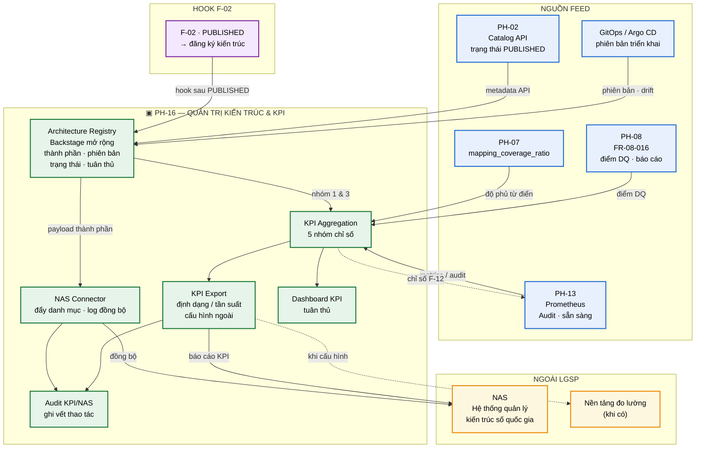
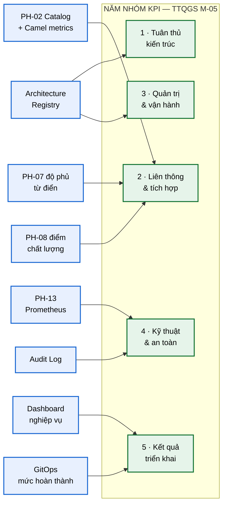
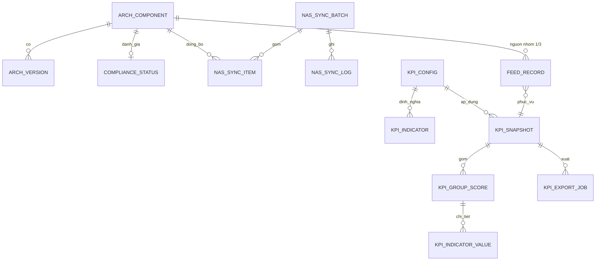

# SRS — PH-16: Quản trị Kiến trúc & Báo cáo KPI

| Thuộc tính | Giá trị |
|---|---|
| **Mã phân hệ** | PH-16 |
| **Tên** | Quản trị Kiến trúc & Báo cáo KPI (Architecture Governance & KPI Reporting) |
| **Nhóm** | Control Plane / Tuân thủ |
| **Mức bắt buộc** | M — Bắt buộc |
| **Phiên bản** | 1.0 |
| **Ngày** | 03/8/2026 |
| **Công nghệ chủ đạo** | PostgreSQL + Backstage Registry + NAS Connector |

---

## M1. Giới thiệu

### 1.1. Mục đích

PH-16 là **lớp quản trị và báo cáo tuân thủ** của LGSP. Phân hệ này biến danh mục thành phần kiến trúc, trạng thái vận hành và chỉ số thu thập từ các phân hệ khác thành **sổ đăng ký kiến trúc** nội bộ và **báo cáo KPI tự động** — đẩy lên Hệ thống quản lý kiến trúc số quốc gia (NAS) mà không cần tổng hợp thủ công.

Đây là phân hệ đáp ứng hai yêu cầu mới từ TTQGS: **đăng ký kiến trúc lên NAS** (CMP-33, tác động M-04) và **cung cấp dữ liệu KPI tự động theo năm nhóm chỉ số** (CMP-34, tác động M-05). Hai yêu cầu này là nghĩa vụ báo cáo mới ở tầng kiến trúc — tương tự nghĩa vụ đồng bộ danh mục dịch vụ lên Bộ TT&TT (CMP-03), nhưng phạm vi rộng hơn: thành phần, phiên bản, trạng thái vận hành và mức tuân thủ.

### 1.2. Hai trụ cột — phân biệt bản chất

Đây là điểm dễ nhầm lẫn và cũng là lý do gộp hai năng lực vào cùng một phân hệ:

| Trụ cột | Định nghĩa | Đầu ra chính | Kiểm chứng |
|---|---|---|---|
| **Architecture Registry + NAS Connector** | Sổ đăng ký thành phần kiến trúc LGSP; đẩy tự động lên NAS | Bản ghi thành phần · phiên bản · trạng thái · mức tuân thủ trên NAS | Log đồng bộ thành công (CMP-33) |
| **KPI Aggregation + Export** | Tổng hợp năm nhóm chỉ số từ nhiều nguồn; xuất theo cấu hình ngoài | Báo cáo KPI tự sinh · dashboard tuân thủ · gói xuất NAS/đo lường | Báo cáo KPI tự sinh (CMP-34) |

**Hệ quả thiết kế quan trọng.** Registry là **nguồn sự thật nội bộ**; NAS Connector chỉ là **kênh xuất**. KPI Aggregation **không tự sinh dữ liệu thô** — chỉ tổng hợp theo công thức từ PH-02, PH-07, PH-08, PH-13 và Registry. Nhầm lẫn hai vai trò dẫn tới trùng catalog với PH-02 hoặc trùng giám sát realtime với PH-13.

### 1.3. Phạm vi

**PH-16 chịu trách nhiệm:**

| # | Trách nhiệm |
|---|---|
| 1 | Duy trì Architecture Registry (mở rộng schema Backstage theo ADR-006): thành phần, phiên bản, trạng thái vận hành, mức tuân thủ |
| 2 | NAS Connector đẩy danh mục thành phần · phiên bản · trạng thái · mức tuân thủ lên NAS |
| 3 | Ghi log đồng bộ NAS làm bằng chứng kiểm chứng CMP-33 |
| 4 | Hook sau khi dịch vụ/API chuyển `PUBLISHED` trên luồng F-02 — đăng ký kiến trúc lên NAS |
| 5 | KPI Aggregation theo **5 nhóm** chỉ số TTQGS |
| 6 | KPI Export theo định dạng và tần suất **cấu hình ngoài** (chưa hard-code chuẩn quốc gia chưa ban hành) |
| 7 | Thu thập feed từ PH-08 ([FR-08-016](SRS-PH-08-dq.md)), PH-02, PH-07, PH-13/Prometheus |
| 8 | Dashboard KPI tuân thủ (nhóm thứ năm bên cạnh bốn nhóm giám sát vận hành của PH-13) |
| 9 | Tham gia luồng F-12 với vai trò ● (báo cáo KPI / tuân thủ) |
| 10 | Ghi vết thao tác đăng ký kiến trúc, tổng hợp và xuất KPI |

**PH-16 KHÔNG chịu trách nhiệm:**

| # | Không làm | Thuộc phân hệ |
|---|---|---|
| 1 | **Thay** catalog dịch vụ/API và vòng đời DRAFT→RETIRED | PH-02 |
| 2 | Cổng nhà phát triển, TechDocs, try-it API | PH-15 |
| 3 | Giám sát realtime, trace, cảnh báo vận hành | PH-13 |
| 4 | Chấm điểm chất lượng dữ liệu nguồn | PH-08 |
| 5 | Ánh xạ từ điển / độ phủ CDM nguồn | PH-07 |
| 6 | Đồng bộ danh mục dịch vụ lên Bộ TT&TT (CMP-03) | PH-02 / PH-14 |

**Ranh giới số 1 — phân vai với PH-02 và PH-15.** PH-02 sở hữu catalog API nghiệp vụ. PH-15 hiển thị catalog/TechDocs trên Backstage và **chuẩn bị** annotation NAS. PH-16 **mở rộng** cùng nền Backstage thành Architecture Registry và **đẩy** lên NAS. Ba phân hệ dùng chung hạ tầng catalog nhưng trách nhiệm khác nhau — tránh xây sổ đăng ký riêng trùng lặp.

**Ranh giới số 2 — phân vai với PH-13.** PH-13 thu thập chỉ số realtime và cảnh báo. PH-16 **đọc** Prometheus/Audit qua feed định kỳ để tính KPI tuân thủ theo chu kỳ báo cáo — không thay dashboard vận hành thời gian thực.

### 1.4. Tài liệu tham chiếu

| Mã | Tài liệu |
|---|---|
| [KT] | [Kiến trúc tổng thể](../02-architecture/README.md), [ADR-006 Backstage](../05-adr/README.md#adr-006), [ADR-007 Quan sát](../05-adr/README.md#adr-007), [ADR-014 Control/Data Plane](../05-adr/README.md#adr-014) |
| [LT] | [F-02 Công bố dịch vụ](../03-flows/README.md#f-02--công-bố-và-đăng-ký-dịch-vụ-chia-sẻ-dữ-liệu), [F-12 Giám sát vận hành](../03-flows/README.md#f-12--giám-sát-và-cảnh-báo-vận-hành) |
| [PL] | [Ma trận CMP](../01-legal/README.md) — CMP-33, CMP-34 |
| [TT] | [Tác động TTQGS M-04 NAS](../06-impact/README.md#35-m-04--tích-hợp-hệ-thống-quản-lý-kiến-trúc-số-quốc-gia-nas), [M-05 Bộ KPI](../06-impact/README.md#36-m-05--bộ-chỉ-số-kpi-thu-thập-tự-động), bước [N7](../06-impact/README.md)/[N8](../06-impact/README.md) |
| [SRS] | [PH-02 Catalog](SRS-PH-02-api-catalog.md), [PH-07 RDM](SRS-PH-07-rdm.md), [PH-08 DQ](SRS-PH-08-dq.md), [PH-13 Giám sát](README.md), [PH-15 Portal](SRS-PH-15-portal.md) |
| [UI] | Mockup tương lai [`kpi.html`](../../mockup/pages/kpi.html) — Giai đoạn 6.8 |

---

## M2. Mô tả tổng quan

### 2.1. Vị trí trong kiến trúc



**Thuyết minh sơ đồ.** PH-16 đứng ở Control Plane, nhận feed từ Data Plane và các phân hệ danh mục/chất lượng. Hai đường xuất ra NAS: (1) **NAS Connector** đẩy sổ đăng ký kiến trúc; (2) **KPI Export** đẩy báo cáo năm nhóm. Cả hai đều ghi log làm bằng chứng tuân thủ. Hook F-02 bảo đảm mỗi lần công bố dịch vụ có bước đăng ký kiến trúc — không phụ thuộc thao tác thủ công.

### 2.2. Năm nhóm KPI



**Thuyết minh.** Năm nhóm phản ánh đúng bảng M-05 trong tài liệu tác động. Công thức chỉ số và trọng số nằm trong **cấu hình ngoài** — khi cơ quan có thẩm quyền ban hành chuẩn đo lường chính thức, chỉ nạp lại cấu hình, không sửa mã cứng.

### 2.3. Tác nhân

| Tác nhân | Loại | Tương tác |
|---|---|---|
| Cán bộ kiến trúc / tuân thủ | Người | Duyệt thành phần Registry, mức tuân thủ, phê duyệt báo cáo KPI |
| Cán bộ vận hành | Người | Theo dõi log đồng bộ NAS, xử lý lệch phiên bản / drift |
| Lãnh đạo đơn vị | Người | Xem dashboard KPI, phê duyệt báo cáo chính thức |
| PH-02 Catalog | Hệ thống | Sự kiện `PUBLISHED` / metadata API cho Registry và feed KPI |
| PH-07 RDM | Hệ thống | Chỉ số `mapping_coverage_ratio` |
| PH-08 DQ | Hệ thống | Feed theo [FR-08-016](SRS-PH-08-dq.md) |
| PH-13 Observability | Hệ thống | Prometheus metrics, audit tóm tắt, sức khỏe dịch vụ |
| PH-15 Portal | Hệ thống | Annotation Backstage sẵn cho NAS; không đẩy NAS |
| NAS | Hệ thống ngoài | Nhận payload đăng ký kiến trúc và gói KPI |
| F-02 / F-12 | Luồng | Hook đăng ký sau PUBLISHED; tham gia giám sát/báo cáo |

### 2.4. Giả định

| Mã | Giả định |
|---|---|
| GD-01 | Backstage (ADR-006) đã triển khai; PH-15 đã chuẩn bị annotation NAS trên schema catalog |
| GD-02 | Endpoint / đặc tả NAS sẽ được cung cấp; trước đó dùng stub + cấu hình ngoài |
| GD-03 | Chuẩn định dạng KPI quốc gia **chưa ban hành** — hệ thống dùng template cấu hình phiên bản hóa |
| GD-04 | PH-02, PH-07, PH-08, PH-13 phát chỉ số/feed theo hợp đồng đã thỏa thuận |
| GD-05 | GitOps (Argo CD) phản ánh đúng phiên bản đang chạy trên môi trường sản xuất |
| GD-06 | Đồng hồ thời gian các phân hệ đồng bộ (NTP) để snapshot KPI nhất quán theo kỳ |

### 2.5. Ràng buộc

| Mã | Ràng buộc | Nguồn |
|---|---|---|
| RB-01 | Đăng ký kiến trúc lên NAS: thành phần, phiên bản, trạng thái, mức tuân thủ | TTQGS M-04, CMP-33 |
| RB-02 | Cung cấp dữ liệu KPI tự động, hạn chế tổng hợp thủ công | TTQGS M-05, CMP-34 |
| RB-03 | Năm nhóm KPI bắt buộc theo khung TTQGS | M-05 |
| RB-04 | Định dạng/tần suất xuất **không hard-code** chuẩn chưa ban hành | Nguyên tắc cấu hình ngoài |
| RB-05 | Không thay catalog PH-02, portal PH-15, giám sát realtime PH-13 | Phân vai kiến trúc |
| RB-06 | Log đồng bộ NAS là bằng chứng kiểm chứng CMP-33 | Ma trận tuân thủ |
| RB-07 | Toàn bộ công nghệ mã nguồn mở | Yêu cầu dự án |
| RB-08 | Hook NAS sau F-02 `PUBLISHED` không được bỏ qua im lặng | Luồng F-02 mở rộng |

### 2.6. Phụ thuộc phân hệ

| Phụ thuộc | Loại | Hành vi khi không khả dụng |
|---|---|---|
| Backstage Registry | **Cứng** | Không đọc/ghi thành phần → dừng đồng bộ NAS mới; cảnh báo vận hành |
| PostgreSQL (metadata KPI/NAS) | **Cứng** | Không lưu snapshot/log → từ chối xuất báo cáo chính thức |
| PH-02 | **Cứng** cho hook F-02 | Không nhận `PUBLISHED` → hàng đợi chờ; cảnh báo thành phần chưa đăng ký NAS |
| PH-07 | **Mềm** | Nhóm KPI 2 thiếu độ phủ từ điển → đánh dấu `PARTIAL`, vẫn xuất các chỉ số khác |
| PH-08 | **Mềm** | Thiếu điểm DQ → `PARTIAL` theo [FR-08-016](SRS-PH-08-dq.md) outbox phía nguồn |
| PH-13 / Prometheus | **Mềm** cho KPI; **Cứng** nếu thiếu dữ liệu nhóm 4 trong kỳ chính thức | Dùng bản đệm kỳ trước + cảnh báo; báo cáo OFFICIAL yêu cầu đủ nguồn đã cấu hình bắt buộc |
| NAS endpoint | **Mềm** khi stub | Ghi outbox, thử lại; log trạng thái `PENDING`/`FAILED` |
| PH-15 | **Mềm** | Annotation thiếu → cảnh cấu hình; không chặn Registry nội bộ |

**Ghi chú về fail-soft với KPI.** Khác với chốt bảo mật (fail-closed), tổng hợp KPI ưu tiên **xuất được phần đã có** kèm nhãn đầy đủ/thiếu nguồn — lãnh đạo thấy rõ khoảng trống thay vì báo cáo trống hoặc số liệu bị bịa.

---

## M3. Yêu cầu chức năng

### 3.1. Nhóm A — Architecture Registry

#### FR-16-001 — Quản lý thành phần kiến trúc trong Registry · **M**

| Mục | Nội dung |
|---|---|
| **Mô tả** | Đăng ký và cập nhật thành phần kiến trúc LGSP trên Architecture Registry (mở rộng Backstage) |
| **Tác nhân** | Cán bộ kiến trúc, hệ thống (đồng bộ từ PH-02 / GitOps) |
| **Đầu vào** | Mã thành phần · tên · loại (System/Component/API/Resource) · mô tả · đơn vị sở hữu · liên kết PH-02 (nếu có) |
| **Xử lý** | 1. Tạo hoặc cập nhật entity Backstage kind mở rộng (`ArchitectureComponent`)<br>2. Gán nhãn lớp kiến trúc (Control/Data/Experience/AI…)<br>3. Liên kết tới API/Catalog PH-02 và annotation PH-15 nếu có<br>4. Ghi phiên bản schema Registry<br>5. Đánh dấu cần đồng bộ NAS (`syncStatus=PENDING`) |
| **Đầu ra** | Bản ghi thành phần trong Registry |
| **Ngoại lệ** | E1: Trùng mã thành phần → từ chối hoặc cập nhật theo chiến lược idempotent<br>E2: Thiếu đơn vị sở hữu → cảnh báo cấu hình, vẫn lưu ở trạng thái `INCOMPLETE` |

#### FR-16-002 — Quản lý phiên bản thành phần · **M**

| Mục | Nội dung |
|---|---|
| **Mô tả** | Theo dõi phiên bản kiến trúc / phần mềm của từng thành phần |
| **Tác nhân** | GitOps, Cán bộ vận hành |
| **Đầu vào** | Mã thành phần · số phiên bản · commit/image digest · môi trường · thời điểm triển khai |
| **Xử lý** | 1. Ghi lịch sử phiên bản (append-only)<br>2. Đặt phiên bản hiện hành theo môi trường sản xuất<br>3. So khớp với GitOps mong muốn → phát hiện drift<br>4. Cập nhật metadata đẩy NAS |
| **Đầu ra** | Lịch sử phiên bản + cờ drift |
| **Ngoại lệ** | E1: Drift phát hiện → cảnh báo, `complianceHint=DRIFT`<br>E2: Không đọc được GitOps → giữ phiên bản cuối, đánh dấu `STALE` |

#### FR-16-003 — Cập nhật trạng thái vận hành · **M**

| Mục | Nội dung |
|---|---|
| **Mô tả** | Đồng bộ trạng thái vận hành thành phần từ nguồn quan sát / catalog |
| **Tác nhân** | Hệ thống (PH-13, PH-02) |
| **Đầu vào** | Mã thành phần · trạng thái (`ACTIVE` · `DEGRADED` · `INACTIVE` · `RETIRED`) · nguồn cập nhật |
| **Xử lý** | 1. Ánh xạ trạng thái từ health PH-13 và vòng đời PH-02<br>2. Không ghi đè `RETIRED` bằng health tạm thời<br>3. Ghi thời điểm cập nhật cuối<br>4. Đưa vào hàng đợi đồng bộ NAS nếu thay đổi |
| **Đầu ra** | Trạng thái vận hành cập nhật |
| **Ngoại lệ** | E1: Nguồn mâu thuẫn (PH-02 RETIRED nhưng PH-13 UP) → ưu tiên vòng đời catalog, cảnh báo<br>E2: Mất feed > ngưỡng → trạng thái `UNKNOWN`, cảnh báo |

#### FR-16-004 — Đánh giá và gắn mức tuân thủ · **M**

| Mục | Nội dung |
|---|---|
| **Mô tả** | Gắn mức tuân thủ TTQGS / khung kiến trúc cơ quan cho từng thành phần |
| **Tác nhân** | Cán bộ kiến trúc / tuân thủ |
| **Đầu vào** | Mã thành phần · mức tuân thủ · checklist tiêu chí · căn cứ · người duyệt |
| **Xử lý** | 1. Áp thang mức: `FULL` · `PARTIAL` · `NON_COMPLIANT` · `NOT_ASSESSED`<br>2. Lưu checklist và bằng chứng tham chiếu<br>3. Yêu cầu phê duyệt khi nâng từ `NON_COMPLIANT` lên cao hơn<br>4. Phát chỉ số phục vụ nhóm KPI 1 |
| **Đầu ra** | Mức tuân thủ gắn thành phần |
| **Ngoại lệ** | E1: Thành phần `NOT_ASSESSED` quá hạn chu kỳ → cảnh báo tuân thủ<br>E2: Hạ mức xuống `NON_COMPLIANT` → bắt buộc lý do + thông báo lãnh đạo |

**Thang mức tuân thủ:**

| Mức | Ý nghĩa | Hệ quả NAS / KPI |
|---|---|---|
| `FULL` | Đáp ứng đủ tiêu chí đã ban hành trong phạm vi thành phần | Đóng góp dương nhóm 1 |
| `PARTIAL` | Đáp ứng một phần, có kế hoạch khắc phục | Đóng góp có trọng số giảm |
| `NON_COMPLIANT` | Chưa đáp ứng | Cảnh báo; bắt buộc lộ trình |
| `NOT_ASSESSED` | Chưa đánh giá | Không tính đủ mẫu; cảnh báo cấu hình |

#### FR-16-005 — Tra cứu và xuất sổ đăng ký nội bộ · **S**

| Mục | Nội dung |
|---|---|
| **Mô tả** | Cho phép tra cứu Registry và xuất danh mục nội bộ (không thay portal PH-15) |
| **Tác nhân** | Cán bộ kiến trúc, vận hành |
| **Đầu vào** | Bộ lọc: lớp · trạng thái · mức tuân thủ · đơn vị |
| **Xử lý** | 1. Truy vấn Registry<br>2. Xuất CSV/JSON nội bộ phục vụ đối soát<br>3. Không đẩy NAS từ thao tác xuất nội bộ |
| **Đầu ra** | Danh sách / tệp xuất |
| **Ngoại lệ** | E1: Quá nhiều bản ghi → phân trang bắt buộc |

### 3.2. Nhóm B — NAS Connector

#### FR-16-006 — Đẩy danh mục thành phần lên NAS · **M**

| Mục | Nội dung |
|---|---|
| **Mô tả** | Đồng bộ lên NAS: danh mục thành phần · phiên bản · trạng thái vận hành · mức tuân thủ |
| **Tác nhân** | Hệ thống NAS Connector |
| **Tiền điều kiện** | Thành phần có đủ trường bắt buộc theo schema cấu hình NAS hiện hành |
| **Đầu vào** | Tập thành phần `syncStatus=PENDING` hoặc yêu cầu đồng bộ thủ công |
| **Xử lý** | 1. Đọc cấu hình endpoint, chứng thư, schema phiên bản từ **cấu hình ngoài**<br>2. Ánh xạ Registry → payload NAS (không hard-code field quốc gia chưa chốt)<br>3. Gửi theo lô, idempotent theo `componentId` + `version` + `contentHash`<br>4. Nhận biên nhận / mã đồng bộ từ NAS (hoặc stub)<br>5. Cập nhật `syncStatus=SYNCED` hoặc `FAILED`<br>6. Ghi log đồng bộ đầy đủ (FR-16-008) |
| **Đầu ra** | Trạng thái đồng bộ từng thành phần |
| **Ngoại lệ** | E1: NAS không khả dụng → outbox, thử lại theo backoff, không mất bản ghi<br>E2: Schema NAS đổi → từ chối lô, cảnh báo nâng phiên bản ánh xạ<br>E3: Payload thiếu trường bắt buộc → `FAILED` có lý do, không gửi dở |

**Ghi chú.** Bốn trường bắt buộc theo M-04/N7: **thành phần, phiên bản, trạng thái, mức tuân thủ**. Mọi trường mở rộng khác nằm trong cấu hình schema — sẵn sàng khi NAS công bố đặc tả chính thức.

#### FR-16-007 — Hook đăng ký kiến trúc sau F-02 PUBLISHED · **M**

| Mục | Nội dung |
|---|---|
| **Mô tả** | Sau khi dịch vụ/API chuyển trạng thái `PUBLISHED` trên F-02, tự động đăng ký/ cập nhật thành phần kiến trúc và xếp hàng đẩy NAS |
| **Tác nhân** | PH-02 (sự kiện), PH-16 |
| **Đầu vào** | Sự kiện `API_PUBLISHED` · mã API · phiên bản · đơn vị · annotation NAS (nếu có từ PH-15) |
| **Xử lý** | 1. Nhận sự kiện từ PH-02 (webhook/outbox)<br>2. Upsert thành phần liên kết API vào Registry<br>3. Gán phiên bản và trạng thái `ACTIVE`<br>4. Nếu chưa có mức tuân thủ → `NOT_ASSESSED`, cảnh báo<br>5. Đặt `syncStatus=PENDING` và kích hoạt Connector (FR-16-006)<br>6. Ghi liên kết `f02PublishId` để truy vết |
| **Đầu ra** | Thành phần đã đăng ký + lệnh đồng bộ NAS |
| **Ngoại lệ** | E1: Sự kiện trùng → idempotent, không tạo bản ghi kép<br>E2: PH-16 down lúc PUBLISHED → PH-02 giữ outbox; khi sống lại PH-16 bắt kịp<br>E3: Thiếu annotation → vẫn đăng ký tối thiểu, cảnh báo bổ sung metadata |

**Ghi chú.** Đây là bước "đăng ký kiến trúc lên NAS" bổ sung vào F-02 theo M-04. PH-15 chỉ chuẩn bị annotation; **không** đẩy NAS từ portal.

#### FR-16-008 — Log đồng bộ NAS (kiểm chứng CMP-33) · **M**

| Mục | Nội dung |
|---|---|
| **Mô tả** | Ghi nhật ký mọi lần đẩy/đồng bộ lên NAS làm bằng chứng tuân thủ |
| **Tác nhân** | NAS Connector |
| **Đầu vào** | Kết quả gửi · mã lô · thành phần · hash nội dung · phản hồi NAS |
| **Xử lý** | 1. Ghi append-only: thời điểm, hướng, số bản ghi, thành công/thất bại, mã lỗi, `traceId`<br>2. Lưu tham chiếu payload (không lưu bí mật)<br>3. Cho phép đối soát số liệu Registry ↔ NAS<br>4. Xuất báo cáo kiểm chứng CMP-33 theo kỳ |
| **Đầu ra** | Bản ghi log đồng bộ WORM-oriented |
| **Ngoại lệ** | E1: Không ghi được log → **không** coi lần đồng bộ là thành công chứng minh được; đánh dấu `UNVERIFIED`<br>E2: Lệch số liệu đối soát → cảnh báo tuân thủ |

**Ghi chú.** Ma trận tuân thủ ghi rõ cách kiểm chứng CMP-33 là **log đồng bộ thành công**. Không có log đạt chuẩn thì không nghiệm thu CMP-33 dù NAS đã nhận dữ liệu.

#### FR-16-009 — Đồng bộ lại và xử lý lỗi NAS · **S**

| Mục | Nội dung |
|---|---|
| **Mô tả** | Đồng bộ lại thành phần lỗi hoặc toàn bộ theo yêu cầu |
| **Tác nhân** | Cán bộ vận hành |
| **Đầu vào** | Bộ lọc thành phần `FAILED` / khoảng thời gian / toàn bộ |
| **Xử lý** | 1. Đưa lại hàng đợi PENDING<br>2. Giữ nguyên lịch sử lần thất bại<br>3. Có chế độ dry-run kiểm tra ánh xạ schema |
| **Đầu ra** | Kết quả đồng bộ lại |
| **Ngoại lệ** | E1: Vượt hạn mức thử lại → dừng, yêu cầu can thiệp thủ công |

### 3.3. Nhóm C — KPI Aggregation

#### FR-16-010 — Định nghĩa công thức KPI cấu hình ngoài · **M**

| Mục | Nội dung |
|---|---|
| **Mô tả** | Quản lý bộ công thức, trọng số, ngưỡng của 5 nhóm KPI bằng cấu hình phiên bản hóa — không hard-code chuẩn quốc gia chưa ban hành |
| **Tác nhân** | Cán bộ tuân thủ |
| **Đầu vào** | File/bản ghi cấu hình: nhóm · mã chỉ số · nguồn · công thức · trọng số · đơn vị · tần suất |
| **Xử lý** | 1. Nạp cấu hình có `schemaVersion`<br>2. Kiểm tra tham chiếu nguồn feed tồn tại<br>3. Xuất bản cấu hình (`PUBLISHED`) sau phê duyệt<br>4. Giữ cấu hình cũ để tái tính lịch sử |
| **Đầu ra** | Bộ cấu hình KPI hiệu lực |
| **Ngoại lệ** | E1: Công thức tham chiếu nguồn không có → từ chối xuất bản<br>E2: Đổi trọng số giữa kỳ → cảnh báo ảnh hưởng so sánh kỳ |

**Năm nhóm bắt buộc (nội dung khung — chi tiết chỉ số trong cấu hình):**

| # | Nhóm | Nội dung khung | Nguồn chính |
|---|---|---|---|
| 1 | Tuân thủ kiến trúc | Mức tuân thủ TTQGS và khung kiến trúc cơ quan | Architecture Registry |
| 2 | Liên thông & tích hợp | Kết nối, chia sẻ, đồng bộ, khai thác; tuân thủ từ điển | PH-02, Camel metrics, PH-07, PH-08 |
| 3 | Quản trị & vận hành | Cập nhật, duy trì, giám sát khung kiến trúc | Registry + GitOps |
| 4 | Kỹ thuật & an toàn | Hiệu năng, sẵn sàng, an ninh, bảo vệ dữ liệu | PH-13 Prometheus + Audit |
| 5 | Kết quả triển khai | Mức hoàn thành mục tiêu, chỉ tiêu | Dashboard nghiệp vụ / GitOps milestone |

#### FR-16-011 — Tổng hợp KPI theo kỳ · **M**

| Mục | Nội dung |
|---|---|
| **Mô tả** | Chạy job tổng hợp KPI Aggregation Service theo kỳ cấu hình |
| **Tác nhân** | Bộ lập lịch hệ thống |
| **Đầu vào** | Kỳ báo cáo · bộ cấu hình hiệu lực · snapshot feed |
| **Xử lý** | 1. Thu thập feed đã chuẩn hóa (nhóm D)<br>2. Tính từng chỉ số theo công thức<br>3. Tổng hợp điểm nhóm và điểm tổng (nếu cấu hình có)<br>4. Gắn cờ `COMPLETE` / `PARTIAL` theo đủ nguồn bắt buộc<br>5. Lưu `KpiSnapshot` bất biến theo kỳ<br>6. Phát sự kiện sẵn sàng xuất / dashboard |
| **Đầu ra** | Snapshot KPI kỳ |
| **Ngoại lệ** | E1: Thiếu nguồn mềm → `PARTIAL` + danh sách thiếu<br>E2: Thiếu nguồn cứng của kỳ OFFICIAL → không chuyển OFFICIAL<br>E3: Job trùng kỳ → idempotent theo `periodId` + `configVersion` |

#### FR-16-012 — Chấm điểm nhóm và xu hướng · **S**

| Mục | Nội dung |
|---|---|
| **Mô tả** | Tính xu hướng so với kỳ trước, ngưỡng cảnh báo |
| **Tác nhân** | Hệ thống |
| **Đầu vào** | Snapshot hiện tại · snapshot kỳ trước · ngưỡng |
| **Xử lý** | 1. Delta tuyệt đối / tương đối<br>2. Đánh dấu chỉ số dưới ngưỡng<br>3. Sinh khuyến nghị cấu hình (không tự ý sửa nguồn) |
| **Đầu ra** | Bản phân tích xu hướng |
| **Ngoại lệ** | E1: Không có kỳ trước → bỏ xu hướng, ghi chú baseline |

### 3.4. Nhóm D — Tích hợp feed

#### FR-16-013 — Nhận feed PH-08 (FR-08-016) · **M**

| Mục | Nội dung |
|---|---|
| **Mô tả** | Tiếp nhận chỉ số chất lượng và trạng thái tuân thủ CMP-22 từ PH-08 |
| **Tác nhân** | PH-08 → PH-16 |
| **Đầu vào** | ScoreSnapshot · báo cáo OFFICIAL · thống kê ticket (theo hợp đồng FR-08-016) |
| **Xử lý** | 1. Xác thực schema phiên bản payload<br>2. Lưu feed idempotent theo `snapshotId` / `reportId`<br>3. Ánh xạ vào chỉ số nhóm 2 (và nhóm liên quan nếu cấu hình)<br>4. ACK cho phía outbox PH-08 |
| **Đầu ra** | Feed DQ sẵn sàng cho Aggregation |
| **Ngoại lệ** | E1: Schema không tương thích → DLQ feed, cảnh báo<br>E2: Trùng id → bỏ qua, ACK |

#### FR-16-014 — Nhận feed PH-02 Catalog · **M**

| Mục | Nội dung |
|---|---|
| **Mô tả** | Thu thập chỉ số danh mục dịch vụ/API phục vụ nhóm liên thông và kết quả triển khai |
| **Tác nhân** | PH-02 |
| **Đầu vào** | Số API theo trạng thái · tỷ lệ PUBLISHED · số đơn vị kết nối · sự kiện vòng đời |
| **Xử lý** | 1. Kéo định kỳ hoặc nhận sự kiện<br>2. Chuẩn hóa về chỉ số cấu hình<br>3. Không sửa dữ liệu catalog nguồn |
| **Đầu ra** | Feed catalog |
| **Ngoại lệ** | E1: PH-02 down → dùng snapshot gần nhất + `STALE` |

#### FR-16-015 — Nhận feed PH-07 độ phủ từ điển · **M**

| Mục | Nội dung |
|---|---|
| **Mô tả** | Thu thập `mapping_coverage_ratio` và phân loại độ phủ ánh xạ |
| **Tác nhân** | PH-07 |
| **Đầu vào** | Chỉ số độ phủ · tỷ lệ trường bắt buộc đã ánh xạ · số ánh xạ `PROVISIONAL` |
| **Xử lý** | 1. Lưu theo kỳ<br>2. Gắn vào nhóm KPI 2 (tuân thủ từ điển dữ liệu)<br>3. Cảnh báo khi độ phủ bắt buộc < ngưỡng cấu hình |
| **Đầu ra** | Feed RDM |
| **Ngoại lệ** | E1: Thiếu chỉ số → nhóm 2 `PARTIAL` |

#### FR-16-016 — Nhận feed PH-13 / Prometheus · **M**

| Mục | Nội dung |
|---|---|
| **Mô tả** | Truy vấn chỉ số kỹ thuật & an toàn từ Prometheus và tóm tắt audit |
| **Tác nhân** | PH-16 (kéo), PH-13 (cung cấp) |
| **Đầu vào** | PromQL/recording rules đã thỏa thuận · tóm tắt audit theo kỳ |
| **Xử lý** | 1. Kéo chỉ số sẵn sàng, độ trễ, lỗi, cảnh báo ATTT tóm tắt<br>2. **Không** thay pipeline cảnh báo realtime<br>3. Lưu chuỗi thời gian đã làm tròn theo kỳ KPI |
| **Đầu ra** | Feed kỹ thuật/an toàn |
| **Ngoại lệ** | E1: Prometheus lỗ hổng dữ liệu kỳ → `PARTIAL` hoặc chặn OFFICIAL tùy cấu hình<br>E2: Trùng với dashboard PH-13 → chỉ đọc, không ghi ngược |

#### FR-16-017 — Tham gia luồng F-12 · **S**

| Mục | Nội dung |
|---|---|
| **Mô tả** | Cung cấp góc nhìn KPI/tuân thủ trong hệ quan sát tổng thể (vai trò ● trên ma trận F-12) |
| **Tác nhân** | PH-16, PH-13 |
| **Đầu vào** | Snapshot KPI · trạng thái đồng bộ NAS |
| **Xử lý** | 1. Phát metric `lgsp_kpi_*`, `lgsp_nas_sync_*`<br>2. Cảnh báo khi đồng bộ NAS thất bại kéo dài hoặc KPI dưới ngưỡng<br>3. Liên kết runbook tuân thủ (không thay runbook sự cố hạ tầng) |
| **Đầu ra** | Chỉ số/cảnh báo trên mặt phẳng quan sát |
| **Ngoại lệ** | E1: PH-13 down → đệm metric cục bộ |

### 3.5. Nhóm E — Xuất KPI và dashboard

#### FR-16-018 — Xuất KPI tự động theo cấu hình · **M**

| Mục | Nội dung |
|---|---|
| **Mô tả** | KPI Export Connector đẩy báo cáo theo **định dạng** và **tần suất** cấu hình ngoài tới NAS / nền tảng đo lường |
| **Tác nhân** | Hệ thống |
| **Tiền điều kiện** | Có `KpiSnapshot` trạng thái phù hợp; cấu hình export đã PUBLISHED |
| **Đầu vào** | Snapshot · template xuất · đích (NAS/measure) · lịch |
| **Xử lý** | 1. Render payload theo template phiên bản hóa (JSON/XML/CSV… do cấu hình)<br>2. Ký số gói xuất nếu cấu hình yêu cầu<br>3. Gửi tới đích, ghi biên nhận<br>4. Cập nhật `exportStatus`<br>5. Log xuất phục vụ CMP-34 |
| **Đầu ra** | Gói KPI đã xuất |
| **Ngoại lệ** | E1: Đích down → outbox + thử lại<br>E2: Template không khớp snapshot → fail rõ ràng<br>E3: Chuẩn QG mới ban hành → chỉ nạp template mới, không sửa mã Aggregation |

**Ghi chú thiết kế then chốt.** Tài liệu tác động nhấn mạnh: với phần phụ thuộc văn bản chưa ban hành (định dạng KPI), xây **khung có cấu hình ngoài**. PH-16 tuân thủ nguyên tắc này ở mọi lớp xuất.

#### FR-16-019 — Phê duyệt báo cáo KPI chính thức · **M**

| Mục | Nội dung |
|---|---|
| **Mô tả** | Chuyển snapshot từ `DRAFT`/`COMPLETE` sang `OFFICIAL` sau phê duyệt lãnh đạo |
| **Tác nhân** | Lãnh đạo đơn vị, Cán bộ tuân thủ |
| **Đầu vào** | Mã snapshot · chữ ký/phê duyệt · ghi chú |
| **Xử lý** | 1. Kiểm tra đủ nguồn bắt buộc<br>2. Khóa snapshot (immutable)<br>3. Ghi người phê duyệt, thời điểm<br>4. Tự kích hoạt export nếu lịch cấu hình `onOfficial` |
| **Đầu ra** | Báo cáo OFFICIAL |
| **Ngoại lệ** | E1: `PARTIAL` khi chính sách cấm → từ chối OFFICIAL<br>E2: Đã OFFICIAL → không sửa; chỉ tạo bản điều chỉnh kỳ mới |

#### FR-16-020 — Dashboard KPI tuân thủ · **M**

| Mục | Nội dung |
|---|---|
| **Mô tả** | Hiển thị năm nhóm KPI, mức tuân thủ CMP liên quan, trạng thái xuất/NAS |
| **Tác nhân** | Lãnh đạo, cán bộ tuân thủ/vận hành |
| **Đầu vào** | Snapshot hiện hành · lịch sử kỳ · log NAS |
| **Xử lý** | 1. Vẽ thẻ 5 nhóm + điểm tổng (nếu có)<br>2. Drill-down chỉ số và nguồn feed<br>3. Hiển thị CMP-33/34 trạng thái kiểm chứng<br>4. Liên kết tới mockup `kpi.html` (Giai đoạn 6.8) |
| **Đầu ra** | Giao diện dashboard |
| **Ngoại lệ** | E1: Chưa có snapshot → trạng thái trống có hướng dẫn cấu hình |

#### FR-16-021 — Xuất thủ công / tải báo cáo · **S**

| Mục | Nội dung |
|---|---|
| **Mô tả** | Cho phép tải báo cáo kỳ phục vụ họp giao ban khi kênh tự động chưa sẵn |
| **Tác nhân** | Cán bộ tuân thủ |
| **Đầu vào** | Mã snapshot · định dạng cho phép |
| **Xử lý** | 1. Render từ cùng template cấu hình<br>2. Ghi vết ai tải<br>3. Không bỏ qua quy tắc OFFICIAL nếu cấu hình yêu cầu |
| **Đầu ra** | Tệp báo cáo |
| **Ngoại lệ** | E1: Định dạng không nằm trong whitelist cấu hình → từ chối |

#### FR-16-022 — Đối soát Registry ↔ NAS ↔ KPI · **S**

| Mục | Nội dung |
|---|---|
| **Mô tả** | Báo cáo đối soát số thành phần đã SYNCED, lệch phiên bản, KPI thiếu nguồn |
| **Tác nhân** | Cán bộ tuân thủ |
| **Đầu vào** | Log NAS · Registry · snapshot KPI |
| **Xử lý** | 1. So khớp số lượng / hash<br>2. Liệt kê lệch<br>3. Đề xuất đồng bộ lại |
| **Đầu ra** | Báo cáo đối soát |
| **Ngoại lệ** | E1: NAS không hỗ trợ đọc lại → đối soát một chiều theo log biên nhận |

---

## M4. Mô hình dữ liệu

### 4.1. Sơ đồ thực thể



### 4.2. Thực thể

#### EN-16-01 — `ARCH_COMPONENT` (Thành phần kiến trúc)

| Thuộc tính | Kiểu | Ràng buộc | Mô tả |
|---|---|---|---|
| `id` | UUID | PK | Định danh nội bộ |
| `code` | VARCHAR(64) | UNIQUE, NOT NULL | Mã thành phần ổn định |
| `name` | VARCHAR(256) | NOT NULL | Tên hiển thị |
| `kind` | ENUM | NOT NULL | SYSTEM / COMPONENT / API / RESOURCE / OTHER |
| `layer` | VARCHAR(64) | | Control / Data / Experience / AI… |
| `ownerOrg` | VARCHAR(128) | NOT NULL | Đơn vị sở hữu |
| `apiRef` | VARCHAR(128) | | Tham chiếu PH-02 (nullable) |
| `opsStatus` | ENUM | NOT NULL | ACTIVE / DEGRADED / INACTIVE / RETIRED / UNKNOWN |
| `syncStatus` | ENUM | NOT NULL | PENDING / SYNCED / FAILED / UNVERIFIED |
| `backstageRef` | VARCHAR(256) | | Entity ref Backstage |
| `contentHash` | CHAR(64) | | Hash nội dung đẩy NAS |
| `createdAt` / `updatedAt` | TIMESTAMPTZ | NOT NULL | |

#### EN-16-02 — `ARCH_VERSION`

| Thuộc tính | Kiểu | Ràng buộc | Mô tả |
|---|---|---|---|
| `id` | UUID | PK | |
| `componentId` | UUID | FK → ARCH_COMPONENT | |
| `version` | VARCHAR(64) | NOT NULL | SemVer / tag |
| `digest` | VARCHAR(128) | | Image/commit digest |
| `environment` | VARCHAR(32) | NOT NULL | prod / staging… |
| `deployedAt` | TIMESTAMPTZ | | |
| `isCurrent` | BOOLEAN | NOT NULL | Phiên bản hiện hành môi trường |
| `drift` | BOOLEAN | DEFAULT FALSE | Lệch GitOps |

#### EN-16-03 — `COMPLIANCE_STATUS`

| Thuộc tính | Kiểu | Ràng buộc | Mô tả |
|---|---|---|---|
| `id` | UUID | PK | |
| `componentId` | UUID | FK, UNIQUE | Một mức hiện hành / thành phần |
| `level` | ENUM | NOT NULL | FULL / PARTIAL / NON_COMPLIANT / NOT_ASSESSED |
| `checklistJson` | JSONB | | Tiêu chí & bằng chứng |
| `assessedBy` | VARCHAR(128) | | |
| `assessedAt` | TIMESTAMPTZ | | |
| `rationale` | TEXT | | Bắt buộc khi NON_COMPLIANT |

#### EN-16-04 — `NAS_SYNC_BATCH` / `NAS_SYNC_ITEM` / `NAS_SYNC_LOG`

| Thuộc tính chính | Kiểu | Mô tả |
|---|---|---|
| `batchId` | UUID | Lô đồng bộ |
| `itemId` | UUID | Từng thành phần trong lô |
| `componentId` | UUID | |
| `requestHash` | CHAR(64) | Idempotency |
| `responseCode` | VARCHAR(64) | Biên nhận NAS / stub |
| `status` | ENUM | SUCCESS / FAILED / RETRYING |
| `logId` | UUID | Bản ghi kiểm chứng CMP-33 |
| `payloadRef` | VARCHAR(256) | Tham chiếu object lưu trữ (không secret) |
| `traceId` | VARCHAR(64) | Tương quan quan sát |
| `createdAt` | TIMESTAMPTZ | Append-only |

#### EN-16-05 — `KPI_CONFIG` / `KPI_INDICATOR`

| Thuộc tính chính | Kiểu | Mô tả |
|---|---|---|
| `configId` | UUID | Bộ cấu hình |
| `schemaVersion` | VARCHAR(32) | Phiên bản schema công thức |
| `status` | ENUM | DRAFT / PUBLISHED / RETIRED |
| `indicatorCode` | VARCHAR(64) | Mã chỉ số ổn định |
| `groupNo` | SMALLINT | 1…5 |
| `formula` | TEXT | Biểu thức / tham chiếu DSL |
| `weight` | NUMERIC | Trọng số |
| `sourceBindings` | JSONB | PH-02/07/08/13/Registry… |
| `exportTemplateRef` | VARCHAR(128) | Template xuất gắn config |

#### EN-16-06 — `KPI_SNAPSHOT` / `KPI_GROUP_SCORE` / `KPI_INDICATOR_VALUE` / `KPI_EXPORT_JOB` / `FEED_RECORD`

| Thuộc tính chính | Kiểu | Mô tả |
|---|---|---|
| `snapshotId` | UUID | Snapshot kỳ |
| `periodId` | VARCHAR(32) | Ví dụ `2026-Q3`, `2026-08` |
| `configVersion` | VARCHAR(32) | |
| `completeness` | ENUM | COMPLETE / PARTIAL |
| `lifecycle` | ENUM | DRAFT / COMPLETE / OFFICIAL |
| `groupNo` / `groupScore` | | Điểm từng nhóm |
| `indicatorCode` / `value` / `unit` | | Giá trị chỉ số |
| `missingSources` | JSONB | Danh sách nguồn thiếu |
| `exportJobId` | UUID | Việc xuất |
| `exportStatus` | ENUM | PENDING / SENT / FAILED |
| `feedId` / `sourceSystem` / `payload` | | Feed thô đã chuẩn hóa |
| `approvedBy` / `approvedAt` | | Khi OFFICIAL |

### 4.3. Chính sách lưu giữ

| Dữ liệu | Lưu giữ | Ghi chú |
|---|---|---|
| `NAS_SYNC_LOG` | ≥ 5 năm hoặc theo quy định lưu trữ hồ sơ số | Bằng chứng CMP-33 |
| `KPI_SNAPSHOT` OFFICIAL | ≥ 5 năm | Bằng chứng CMP-34 |
| Feed thô | ≥ 13 tháng (cuộn) | Đủ tái tính 4 quý + buffer |
| Version history thành phần | Toàn vòng đời thành phần | Audit kiến trúc |
| Export artifact | Theo chính sách lưu trữ tệp báo cáo | Object storage |

---

## M5. Giao diện API

### 5.1. Quy ước chung

| Hạng mục | Giá trị |
|---|---|
| Base path | `/api/v1/arch-kpi` |
| Xác thực | OAuth2/OIDC qua PH-12; mTLS trong cụm |
| Định dạng | `application/json` |
| Phân trang | `page`, `size` |
| Lỗi | RFC 7807 (`type`, `title`, `status`, `detail`, `traceId`) |

### 5.2. Danh mục endpoint

| Phương thức | Đường dẫn | Mã FR | Mô tả |
|---|---|---|---|
| `GET` | `/components` | FR-16-001, 005 | Liệt kê Registry |
| `POST` | `/components` | FR-16-001 | Tạo thành phần |
| `PATCH` | `/components/{code}` | FR-16-001…004 | Cập nhật metadata / trạng thái / tuân thủ |
| `GET` | `/components/{code}/versions` | FR-16-002 | Lịch sử phiên bản |
| `POST` | `/nas/sync` | FR-16-006, 009 | Kích hoạt đồng bộ NAS |
| `GET` | `/nas/sync/logs` | FR-16-008 | Log kiểm chứng CMP-33 |
| `POST` | `/hooks/f02-published` | FR-16-007 | Hook sau PUBLISHED |
| `GET/PUT` | `/kpi/configs/{id}` | FR-16-010 | Cấu hình KPI |
| `POST` | `/kpi/aggregate` | FR-16-011 | Chạy tổng hợp kỳ |
| `GET` | `/kpi/snapshots/{periodId}` | FR-16-011, 020 | Đọc snapshot |
| `POST` | `/kpi/snapshots/{id}/approve` | FR-16-019 | Phê duyệt OFFICIAL |
| `POST` | `/kpi/export` | FR-16-018, 021 | Xuất / tải |
| `POST` | `/feeds/dq` | FR-16-013 | Nhận feed PH-08 |
| `POST` | `/feeds/catalog` | FR-16-014 | Nhận feed PH-02 |
| `POST` | `/feeds/rdm` | FR-16-015 | Nhận feed PH-07 |
| `GET` | `/reconciliation` | FR-16-022 | Đối soát |

### 5.3. Ví dụ — Hook F-02 PUBLISHED

`POST /api/v1/arch-kpi/hooks/f02-published`

```json
{
  "eventId": "evt-f02-9c21",
  "apiCode": "API-HO-SO-001",
  "apiVersion": "1.2.0",
  "status": "PUBLISHED",
  "ownerOrg": "Sở TT&TT",
  "publishedAt": "2026-08-03T10:15:00+07:00",
  "nasAnnotations": {
    "architectureLayer": "DATA_PLANE",
    "componentCode": "CMP-API-HO-SO-001"
  }
}
```

**Phản hồi `202 Accepted`:**

```json
{
  "componentCode": "CMP-API-HO-SO-001",
  "registryUpsert": "CREATED",
  "syncStatus": "PENDING",
  "nasBatchQueued": true,
  "traceId": "4bf92f3577b34da6a3ce929d0e0e4736"
}
```

### 5.4. Ví dụ — Đồng bộ NAS

`POST /api/v1/arch-kpi/nas/sync`

```json
{
  "mode": "PENDING_ONLY",
  "dryRun": false
}
```

**Phản hồi `200 OK`:**

```json
{
  "batchId": "b-20260803-01",
  "total": 12,
  "success": 11,
  "failed": 1,
  "failures": [
    { "componentCode": "CMP-X", "reason": "MISSING_COMPLIANCE_LEVEL" }
  ],
  "logIds": ["log-001", "log-002"]
}
```

### 5.5. Ví dụ — Snapshot KPI

`GET /api/v1/arch-kpi/kpi/snapshots/2026-Q3`

```json
{
  "snapshotId": "snap-2026q3",
  "periodId": "2026-Q3",
  "lifecycle": "COMPLETE",
  "completeness": "PARTIAL",
  "missingSources": ["PH-08"],
  "groups": [
    { "groupNo": 1, "name": "Tuân thủ kiến trúc", "score": 82.5 },
    { "groupNo": 2, "name": "Liên thông & tích hợp", "score": 76.0 },
    { "groupNo": 3, "name": "Quản trị & vận hành", "score": 88.0 },
    { "groupNo": 4, "name": "Kỹ thuật & an toàn", "score": 91.2 },
    { "groupNo": 5, "name": "Kết quả triển khai", "score": 70.0 }
  ],
  "configVersion": "kpi-schema-0.9.1",
  "generatedAt": "2026-08-03T18:00:00+07:00"
}
```

### 5.6. Mã lỗi tiêu biểu

| HTTP | `type` | Khi nào |
|---|---|---|
| `400` | `validation-error` | Payload thiếu trường bắt buộc |
| `401` / `403` | `unauthorized` / `forbidden` | Thiếu token / quyền |
| `409` | `conflict-idempotency` | Xung đột sự kiện/feed |
| `422` | `kpi-incomplete-for-official` | Phê duyệt OFFICIAL khi thiếu nguồn cứng |
| `502` | `nas-upstream-error` | NAS trả lỗi |
| `503` | `registry-unavailable` | Backstage/PG không sẵn sàng |

---

## M6. Giao diện người dùng

### 6.1. Danh mục màn hình

| Mã | Tên màn hình | Đối tượng | Mockup |
|---|---|---|---|
| **UI-16-01** | Sổ đăng ký kiến trúc (Registry) | Cán bộ kiến trúc | [`kpi.html`](../../mockup/pages/kpi.html) — Giai đoạn **6.8** |
| **UI-16-02** | Đồng bộ NAS & log CMP-33 | Cán bộ vận hành / tuân thủ | [`kpi.html`](../../mockup/pages/kpi.html) (tab NAS) |
| **UI-16-03** | Dashboard 5 nhóm KPI | Lãnh đạo, tuân thủ | [`kpi.html`](../../mockup/pages/kpi.html) (tab KPI) |
| **UI-16-04** | Cấu hình công thức & lịch xuất | Cán bộ tuân thủ | [`kpi.html`](../../mockup/pages/kpi.html) (tab Cấu hình) |
| **UI-16-05** | Phê duyệt báo cáo OFFICIAL | Lãnh đạo | [`kpi.html`](../../mockup/pages/kpi.html) (tab Phê duyệt) |
| **UI-16-06** | Đối soát Registry ↔ NAS ↔ Feed | Tuân thủ | [`kpi.html`](../../mockup/pages/kpi.html) (tab Đối soát) |

> Mockup `pages/kpi.html` thuộc **Giai đoạn 6.8** checklist: 5 nhóm KPI · mức tuân thủ CMP · xuất báo cáo. Bản SRS này chốt yêu cầu UI; HTML dựng sau.

### 6.2. UI-16-01 — Sổ đăng ký kiến trúc

| Thành phần | Mô tả |
|---|---|
| Bảng thành phần | Mã · Tên · Lớp · Phiên bản · Trạng thái vận hành · Mức tuân thủ · Sync NAS |
| Bộ lọc | Lớp · trạng thái · tuân thủ · đơn vị · sync |
| Chi tiết | Phiên bản lịch sử, drift GitOps, liên kết PH-02 |
| Form đánh giá tuân thủ | Checklist + căn cứ |

**Quy tắc tương tác:**

| # | Quy tắc |
|---|---|
| 1 | `NOT_ASSESSED` quá hạn → badge cảnh báo |
| 2 | Drift = true → tô sáng, link GitOps |
| 3 | Không chỉnh catalog API nghiệp vụ tại đây (điều hướng PH-02) |

### 6.3. UI-16-02 — Đồng bộ NAS

| Thành phần | Mô tả |
|---|---|
| Trạng thái Connector | UP / DEGRADED / DOWN · phiên bản schema ánh xạ |
| Nút đồng bộ | PENDING_ONLY / FAILED_RETRY / FULL (có xác nhận) |
| Bảng log | Thời điểm · lô · thành công/thất bại · traceId · biên nhận |
| Dry-run | Xem payload trước khi gửi |

**Quy tắc tương tác:**

| # | Quy tắc |
|---|---|
| 1 | Log **chỉ đọc** phục vụ kiểm chứng CMP-33 |
| 2 | Đồng bộ FULL yêu cầu quyền nâng cao + lý do |
| 3 | Hiển thị rõ khi đang dùng **stub NAS** (môi trường chưa có endpoint thật) |

### 6.4. UI-16-03 — Dashboard 5 nhóm KPI

| Thành phần | Mô tả |
|---|---|
| Năm thẻ nhóm | Điểm · delta kỳ trước · đèn ngưỡng |
| Biểu đồ xu hướng | Theo kỳ |
| Drill-down chỉ số | Nguồn feed · thời điểm cập nhật · `STALE`/`PARTIAL` |
| Trạng thái CMP-33/34 | Đã có log sync / đã có báo cáo tự sinh |
| Nút xuất | Theo template cấu hình |

**Quy tắc tương tác:**

| # | Quy tắc |
|---|---|
| 1 | `PARTIAL` phải hiện danh sách nguồn thiếu — không giấu |
| 2 | Không trộn widget cảnh báo realtime PH-13 vào dashboard này |
| 3 | Click chỉ số DQ → deep-link báo cáo PH-08 (nếu có quyền) |

### 6.5. UI-16-04 — Cấu hình công thức & xuất

| Thành phần | Mô tả |
|---|---|
| Editor cấu hình phiên bản | JSON/YAML có validate schema |
| Ánh xạ nguồn | Binding PH-02/07/08/13/Registry |
| Lịch xuất | Cron / `onOfficial` / thủ công |
| Template xuất | Danh sách template, không hard-code một chuẩn QG |

**Quy tắc tương tác:**

| # | Quy tắc |
|---|---|
| 1 | Xuất bản cấu hình cần phê duyệt |
| 2 | Cảnh báo khi đổi trọng số giữa kỳ đang mở |

### 6.6. UI-16-05 — Phê duyệt OFFICIAL

| Thành phần | Mô tả |
|---|---|
| Tóm tắt snapshot | 5 nhóm + completeness |
| Danh sách blocker | Nguồn cứng thiếu |
| Xác nhận phê duyệt | MFA nếu cấu hình bảo mật yêu cầu |
| Lịch sử phê duyệt | Append-only |

---

## M7. Yêu cầu phi chức năng

### 7.1. Hiệu năng

| Mã | Yêu cầu | Chỉ tiêu | Cách đo |
|---|---|---|---|
| **NFR-16-001** | Đồng bộ NAS 1.000 thành phần | ≤ 5 phút (không kể độ trễ NAS) | Job đo |
| **NFR-16-002** | Hook F-02 xử lý sự kiện | P99 ≤ 2s đến lúc queue sync | Trace |
| **NFR-16-003** | Job tổng hợp KPI kỳ tháng | ≤ 15 phút với bộ chỉ số mặc định | Job |
| **NFR-16-004** | API đọc snapshot | P99 ≤ 300ms | APM |
| **NFR-16-005** | Tiếp nhận feed PH-08 | P99 ≤ 500ms ACK | |

### 7.2. Tính sẵn sàng

| Mã | Yêu cầu | Chỉ tiêu |
|---|---|---|
| **NFR-16-006** | Tỷ lệ sẵn sàng Control Plane PH-16 | ≥ 99,5% |
| **NFR-16-007** | NAS down | Outbox không mất; tự thử lại |
| **NFR-16-008** | Backstage sự cố ngắn | Đọc đệm metadata tối thiểu cho sync đang chạy; không nhận đăng ký mới nếu không ghi được |

### 7.3. Bảo mật

| Mã | Yêu cầu |
|---|---|
| **NFR-16-009** | Kết nối NAS dùng mTLS / kênh được phê duyệt |
| **NFR-16-010** | Bí mật endpoint/token lưu Vault; không ghi log |
| **NFR-16-011** | Phân quyền tách: xem KPI · sửa Registry · kích hoạt NAS · phê duyệt OFFICIAL |
| **NFR-16-012** | Log đồng bộ và snapshot OFFICIAL không sửa/xóa bởi API thường |
| **NFR-16-013** | Feed nội bộ mTLS trong cụm |

### 7.4. Độ đúng & toàn vẹn

| Mã | Yêu cầu | Chỉ tiêu |
|---|---|---|
| **NFR-16-014** | Idempotent sync NAS | Cùng hash → không tạo bản ghi kép phía NAS stub/thật |
| **NFR-16-015** | Idempotent feed | Theo `snapshotId`/`eventId` 100% |
| **NFR-16-016** | Snapshot OFFICIAL bất biến | Mọi sửa bị từ chối |
| **NFR-16-017** | Tái tính KPI với cùng config+feed | Cho cùng kết quả (sai số làm tròn công bố) |

### 7.5. Mở rộng & cấu hình

| Mã | Yêu cầu |
|---|---|
| **NFR-16-018** | Toàn bộ schema NAS & template KPI nằm ngoài mã nguồn (ConfigMap/CR/DB phiên bản hóa) |
| **NFR-16-019** | Thêm chỉ số mới trong nhóm 1…5 không cần phát hành phiên bản dịch vụ nếu đủ nguồn feed |
| **NFR-16-020** | Hỗ trợ nhiều đích export song song (NAS + đo lường) |

### 7.6. Khả năng quan sát

| Mã | Yêu cầu |
|---|---|
| **NFR-16-021** | Metric: `lgsp_nas_sync_total{result}`, `lgsp_nas_sync_lag_seconds`, `lgsp_kpi_aggregate_duration_seconds`, `lgsp_kpi_snapshot_completeness`, `lgsp_kpi_export_total{result}`, `lgsp_arch_components{opsStatus,compliance}` |
| **NFR-16-022** | Cảnh báo: sync FAILED liên tục > N lần; hook F-02 trễ; KPI dưới ngưỡng; feed STALE |
| **NFR-16-023** | Mọi API gắn `traceId`; log NAS chứa `traceId` |
| **NFR-16-024** | Dashboard vận hành PH-13 có thể scrape metric PH-16 (F-12) mà không đảo vai trò |

---

## M8. Quy tắc nghiệp vụ

| Mã | Quy tắc | Lý do | Cách thực thi | Khi vi phạm |
|---|---|---|---|---|
| **BR-16-001** | Mọi thành phần đẩy NAS phải có đủ: thành phần · phiên bản · trạng thái · mức tuân thủ | M-04, CMP-33 | FR-16-006 E3 | `FAILED`, không gửi dở |
| **BR-16-002** | Sau F-02 `PUBLISHED` phải có hook đăng ký kiến trúc | M-04 mở rộng F-02 | FR-16-007 | Cảnh báo tuân thủ, outbox bắt kịp |
| **BR-16-003** | Log đồng bộ là điều kiện cần để chứng minh CMP-33 | Ma trận tuân thủ | FR-16-008 E1 | Đánh `UNVERIFIED` |
| **BR-16-004** | PH-16 không sửa/thay catalog PH-02 | Phân vai | Ranh giới M1 | Từ chối API lệch phạm vi |
| **BR-16-005** | PH-16 không thay giám sát realtime PH-13 | Phân vai | FR-16-016 | — |
| **BR-16-006** | PH-15 không đẩy NAS; chỉ annotation | PH-15 mục 2.7 | FR-16-007 | — |
| **BR-16-007** | Không hard-code định dạng KPI quốc gia chưa ban hành | Nguyên tắc cấu hình ngoài | FR-16-010, 018 | Lỗi thiết kế nếu hard-code |
| **BR-16-008** | Báo cáo KPI gồm đủ khung 5 nhóm | M-05, CMP-34 | FR-16-010 | Từ chối xuất bản config thiếu nhóm |
| **BR-16-009** | Snapshot `PARTIAL` phải công bố nguồn thiếu | Minh bạch lãnh đạo | FR-16-011, UI-16-03 | — |
| **BR-16-010** | OFFICIAL bất biến | Toàn vẹn hồ sơ | FR-16-019 E2 | Từ chối sửa |
| **BR-16-011** | Feed PH-08 idempotent theo FR-08-016 | Tránh nhân đôi điểm DQ | FR-16-013 | Bỏ qua trùng |
| **BR-16-012** | Hạ mức tuân thủ xuống `NON_COMPLIANT` cần lý do + thông báo | Quản trị rủi ro | FR-16-004 E2 | Từ chối |
| **BR-16-013** | Không coi sync thành công nếu không ghi được log | CMP-33 | FR-16-008 | `UNVERIFIED` |
| **BR-16-014** | Xuất KPI tự động theo lịch/template cấu hình | CMP-34 hạn chế thủ công | FR-16-018 | Cảnh báo nếu chỉ còn kênh thủ công kéo dài |
| **BR-16-015** | Drift GitOps phải nhìn thấy trên Registry | Nhóm KPI 3 | FR-16-002 | Cảnh báo |

---

## M9. Tuân thủ

### 9.1. Ánh xạ yêu cầu pháp lý / TTQGS

| Mã CMP | Yêu cầu | FR/NFR đáp ứng | Cách kiểm chứng |
|---|---|---|---|
| **CMP-33** | Đăng ký kiến trúc lên NAS | FR-16-001…004, 006…008; NFR-16-014; BR-16-001…003 | Có **log đồng bộ thành công**; đối soát Registry ↔ biên nhận NAS |
| **CMP-34** | Cung cấp dữ liệu KPI tự động | FR-16-010…016, 018…020; BR-16-007…008, 014 | **Báo cáo KPI tự sinh** theo 5 nhóm; lịch xuất chạy không cần tổng hợp tay |

### 9.2. Ánh xạ tác động & lộ trình

| Hạng mục | Cách PH-16 đáp ứng |
|---|---|
| **M-04** | Architecture Registry + NAS Connector; hook F-02 |
| **M-05** | KPI Aggregation + Export; dashboard nhóm thứ năm |
| **N7** | Mở rộng Backstage; connector; tiêu chí ra: đồng bộ danh mục thành công |
| **N8** | Aggregation từ Prometheus/Audit/Catalog/Registry; export; dashboard; tiêu chí ra: báo cáo 5 nhóm tự động |
| **F-02** | Bước đăng ký kiến trúc sau `PUBLISHED` |
| **F-12** | Vai trò ● — metric/cảnh báo KPI & NAS sync |

### 9.3. Ánh xạ nguyên tắc TTQGS

| Nguyên tắc | Cách PH-16 đáp ứng |
|---|---|
| **Quản trị & giám sát tuân thủ** | Registry tập trung + đẩy NAS |
| **Ưu tiên thu thập tự động** | Feed + Aggregation + Export |
| **Hạn chế báo cáo thủ công** | Lịch xuất cấu hình; tải tay chỉ dự phòng |
| **Tận dụng thành phần đã chọn** | Backstage (ADR-006), Prometheus/OTel (ADR-007), PostgreSQL |

---

## M10. Kiểm thử chấp nhận

### 10.1. Kiểm thử chức năng

| Mã | Kịch bản | Dữ liệu thử | Kết quả mong đợi | Tiêu chí đạt |
|---|---|---|---|---|
| **AT-16-001** | Tạo thành phần Registry | Metadata đủ | Lưu được, `syncStatus=PENDING` | FR-16-001 |
| **AT-16-002** | Ghi phiên bản + drift | GitOps lệch digest | `drift=true`, cảnh báo | FR-16-002 |
| **AT-16-003** | Cập nhật trạng thái vận hành | Health DEGRADED | `opsStatus=DEGRADED` | FR-16-003 |
| **AT-16-004** | Gắn mức tuân thủ | Checklist FULL | `level=FULL` | FR-16-004 |
| **AT-16-005** | Chặn đẩy NAS thiếu mức tuân thủ | Thành phần thiếu compliance | `FAILED`, không gửi | BR-16-001 |
| **AT-16-006** | Đẩy NAS đủ 4 trường | Thành phần hợp lệ | SYNCED + có log | FR-16-006, CMP-33 |
| **AT-16-007** | Hook sau PUBLISHED | Sự kiện F-02 | Upsert + queue sync | FR-16-007, BR-16-002 |
| **AT-16-008** | Hook idempotent | Gửi trùng `eventId` | Không tạo kép | FR-16-007 E1 |
| **AT-16-009** | Log đồng bộ không ghi được | Fake lỗi ghi log | Không `SYNCED` chứng minh; `UNVERIFIED` | BR-16-003, 013 |
| **AT-16-010** | NAS down vẫn không mất hàng đợi | Dừng stub NAS | Outbox + retry thành công khi bật | NFR-16-007 |
| **AT-16-011** | Nạp cấu hình 5 nhóm | Config đủ nhóm 1…5 | PUBLISHED được | BR-16-008 |
| **AT-16-012** | Từ chối config thiếu nhóm | Thiếu nhóm 4 | Từ chối xuất bản | BR-16-008 |
| **AT-16-013** | Tổng hợp KPI kỳ | Feed đủ | Snapshot COMPLETE | FR-16-011 |
| **AT-16-014** | Tổng hợp thiếu PH-08 | Cắt feed DQ | `PARTIAL` + `missingSources` chứa PH-08 | BR-16-009 |
| **AT-16-015** | Nhận feed FR-08-016 | Payload snapshot DQ | ACK, giá trị vào nhóm 2 | FR-16-013 |
| **AT-16-016** | Feed trùng snapshotId | Gửi 2 lần | Một bản ghi, ACK cả hai | BR-16-011 |
| **AT-16-017** | Feed PH-07 coverage | `mapping_coverage_ratio` | Chỉ số nhóm 2 cập nhật | FR-16-015 |
| **AT-16-018** | Feed Prometheus | Recording rules mẫu | Nhóm 4 có giá trị | FR-16-016 |
| **AT-16-019** | Xuất theo template cấu hình | Template v0.9 | Gói đúng schema template | FR-16-018, BR-16-007 |
| **AT-16-020** | Đổi template không sửa mã Aggregation | Template v1.0 mới | Xuất được sau nạp config | NFR-16-018 |
| **AT-16-021** | Phê duyệt OFFICIAL | Snapshot COMPLETE | Immutable + export nếu cấu hình | FR-16-019 |
| **AT-16-022** | Chặn OFFICIAL khi thiếu nguồn cứng | PARTIAL + policy cấm | `422` | FR-16-019 E1 |
| **AT-16-023** | Dashboard hiển thị 5 nhóm | Snapshot mẫu | Đủ 5 thẻ | UI-16-03, FR-16-020 |
| **AT-16-024** | Đối soát lệch sync | 1 thành phần FAILED | Báo cáo liệt kê lệch | FR-16-022 |
| **AT-16-025** | Không đẩy NAS từ thao tác giống portal | Chỉ annotation PH-15 | Không gọi Connector từ PH-15 | BR-16-006 |

### 10.2. Kiểm thử phi chức năng

| Mã | Kịch bản | Tiêu chí đạt |
|---|---|---|
| **AT-16-026** | Đồng bộ 1.000 thành phần | ≤ 5 phút (NFR-16-001) |
| **AT-16-027** | Hook F-02 P99 | ≤ 2s đến queue (NFR-16-002) |
| **AT-16-028** | Aggregate kỳ tháng | ≤ 15 phút |
| **AT-16-029** | Idempotent sync cùng hash | Không nhân bản phía stub |
| **AT-16-030** | OFFICIAL không sửa được | API PATCH bị từ chối |
| **AT-16-031** | Secret không lộ log | Quét log sync/export |
| **AT-16-032** | Metric F-12 scrape được | `lgsp_nas_sync_total`, `lgsp_kpi_*` tồn tại |

### 10.3. Điều kiện nghiệm thu phân hệ

| # | Điều kiện |
|---|---|
| 1 | Toàn bộ yêu cầu mức **M** được cài đặt và kiểm chứng |
| 2 | 32/32 kịch bản AT đạt (hoặc tỷ lệ thỏa thuận có biên bản) |
| 3 | CMP-33: có bằng chứng **log đồng bộ thành công** đối soát được |
| 4 | CMP-34: có **báo cáo KPI 5 nhóm tự sinh** theo lịch cấu hình |
| 5 | Hook F-02 PUBLISHED → Registry → NAS hoạt động end-to-end (stub chấp nhận ở môi trường chưa có NAS thật) |
| 6 | Xác nhận ranh giới: không thay PH-02 catalog, không thay PH-13 realtime, không đẩy NAS từ PH-15 |
| 7 | Cấu hình ngoài cho schema NAS + template KPI đã bàn giao kèm hướng dẫn nạp khi văn bản QG ban hành |
| 8 | Mockup `kpi.html` (Giai đoạn 6.8) bám UI-16-01…06 hoặc có biên bản chưa dựng |

---

## Liên kết

- Danh mục phân hệ → [README.md](README.md)
- Checklist hạng mục 5.1 / mockup 6.8 → [CHECKLIST.md](CHECKLIST.md)
- Tác động TTQGS M-04 / M-05 · bước N7 / N8 → [06-impact](../06-impact/README.md)
- Luồng F-02 · F-12 → [03-flows](../03-flows/README.md)
- ADR-006 Backstage · ADR-007 Quan sát · ADR-014 Control Plane → [05-adr](../05-adr/README.md)
- Phân hệ liên quan → [PH-02](SRS-PH-02-api-catalog.md), [PH-07](SRS-PH-07-rdm.md), [PH-08](SRS-PH-08-dq.md) ([FR-08-016](SRS-PH-08-dq.md)), [PH-15](SRS-PH-15-portal.md), [PH-13](README.md)
- Mockup tương lai → [`mockup/pages/kpi.html`](../../mockup/pages/kpi.html) (Giai đoạn 6.8)
