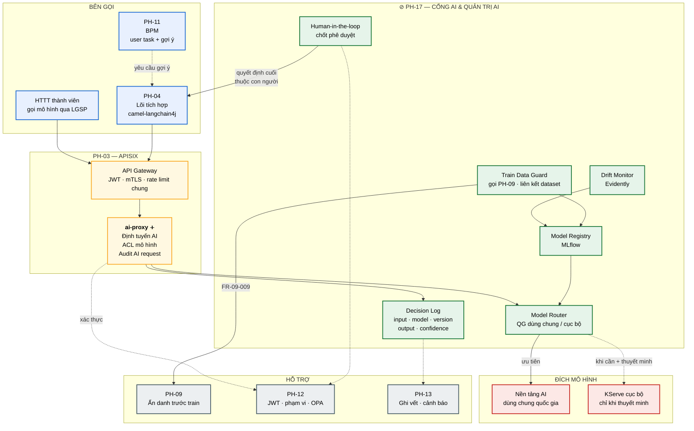
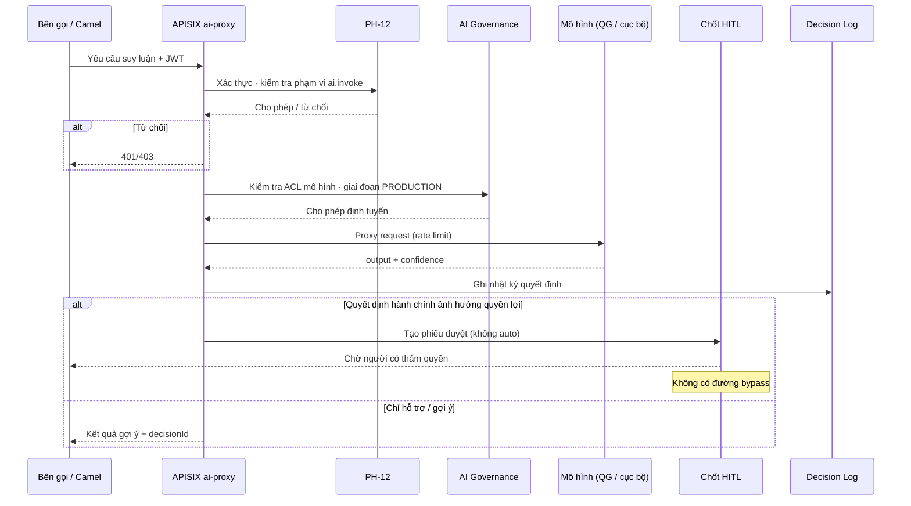
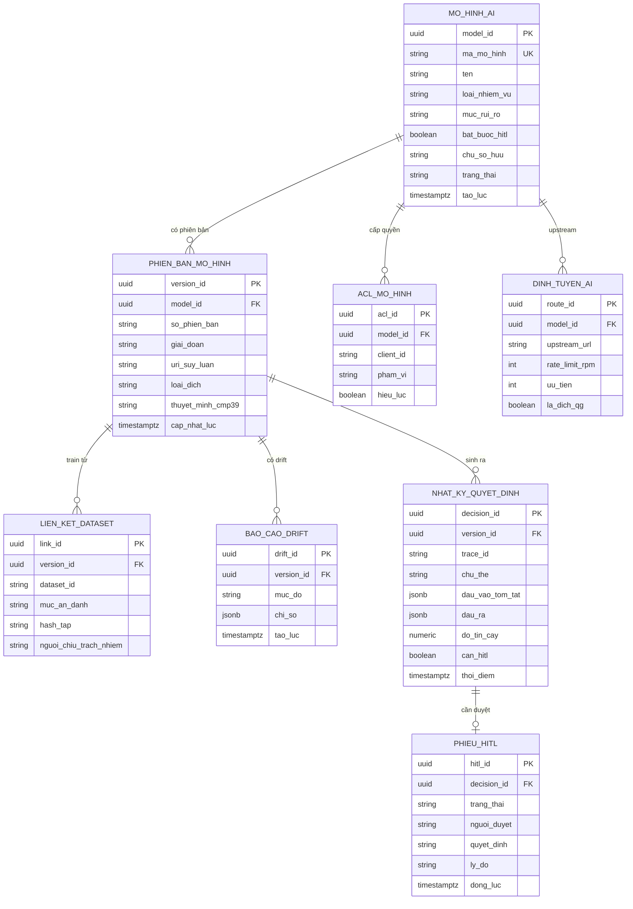

# SRS — PH-17: Cổng AI & Quản trị AI

| Thuộc tính | Giá trị |
|---|---|
| **Mã phân hệ** | PH-17 |
| **Tên** | Cổng AI & Quản trị AI (AI Gateway & AI Governance) |
| **Nhóm** | AI |
| **Mức bắt buộc** | S — Ưu tiên cao |
| **Phiên bản** | 1.0 |
| **Ngày** | 03/8/2026 |
| **Công nghệ chủ đạo** | APISIX ai-proxy + MLflow + Evidently + camel-langchain4j |

---

## M1. Giới thiệu

### 1.1. Mục đích

PH-17 là **lớp kiểm soát tập trung** cho mọi lời gọi mô hình trí tuệ nhân tạo đi qua LGSP. Phân hệ này biến năng lực AI từ “tùy từng ứng dụng tự nối” thành một đường ống có định tuyến, giới hạn quyền, ghi vết đầy đủ và chốt phê duyệt của con người — đúng yêu cầu **AI First** và **AI Governance by Design** của TTQGS ([M-06](../06-impact/README.md#37-m-06--lớp-ai-và-ai-governance-by-design)).

Đây không phải nền tảng huấn luyện hay kho mô hình quốc gia. LGSP đóng vai trò **cầu nối có quản trị**: mọi yêu cầu AI đi qua cổng, mọi mô hình có hồ sơ vòng đời, mọi quyết định ảnh hưởng quyền lợi công dân phải có người có thẩm quyền xác nhận.

### 1.2. Ba nguyên tắc thiết kế — không được làm mờ

Đây là điểm dễ nhầm lẫn nhất và cũng là lý do phân hệ này tồn tại độc lập với PH-03, PH-04 và PH-11:

| Nguyên tắc | Phát biểu | Hệ quả thiết kế |
|---|---|---|
| **AI chỉ hỗ trợ** | Với quyết định ảnh hưởng quyền, lợi ích hợp pháp của tổ chức/cá nhân, AI **chỉ có tính chất hỗ trợ** | Đầu ra AI là gợi ý, không phải lệnh thi hành |
| **Người quyết định cuối** | Cơ quan, người có thẩm quyền chịu trách nhiệm xem xét và quyết định cuối cùng | Chốt Human-in-the-loop **không thể bypass** (CMP-37) |
| **Ưu tiên nền tảng dùng chung** | Ưu tiên hạ tầng AI / HPC / phân tích dữ liệu lớn quốc gia; chỉ tự xây khi chưa có thành phần dùng chung | KServe cục bộ chỉ khi cần + thuyết minh (CMP-39) |

**Hệ quả pháp lý quan trọng.** Một luồng “tự động phê duyệt hồ sơ vì độ tin cậy AI ≥ 0,95” là **vi phạm thiết kế**, kể cả khi độ chính xác mô hình rất cao. Cơ chế kỹ thuật phải làm cho đường tắt đó **không tồn tại**, chứ không chỉ “khuyên không dùng”.

### 1.3. Phạm vi

**PH-17 chịu trách nhiệm:**

| # | Trách nhiệm |
|---|---|
| 1 | Bật và vận hành AI Gateway trên APISIX (`ai-proxy`) — định tuyến tới mô hình |
| 2 | Kiểm soát truy cập mô hình (ACL), giới hạn tần suất, ghi vết mọi yêu cầu AI |
| 3 | Quản trị vòng đời mô hình qua MLflow (đăng ký, phiên bản, giai đoạn, thu hồi) |
| 4 | Phát hiện sai lệch (drift) mô hình bằng Evidently |
| 5 | Nhật ký quyết định AI: đầu vào · mô hình · phiên bản · đầu ra · độ tin cậy |
| 6 | Chốt Human-in-the-loop cho quyết định hành chính ảnh hưởng quyền lợi |
| 7 | Kiểm soát dữ liệu huấn luyện: bắt buộc gọi PH-09 trước train; liên kết model ↔ dataset |
| 8 | Tích hợp `camel-langchain4j` qua PH-04 cho các luồng cần AI |
| 9 | Ưu tiên định tuyến tới nền tảng AI dùng chung quốc gia; thuyết minh khi dùng cục bộ |

**PH-17 KHÔNG chịu trách nhiệm:**

| # | Không làm | Thuộc phân hệ |
|---|---|---|
| 1 | **Ẩn danh hóa / giả danh hóa / che dữ liệu** trước khi huấn luyện | PH-09 |
| 2 | **Thay thế** điều phối quy trình nghiệp vụ BPMN | PH-11 |
| 3 | Xác thực người dùng / cấp JWT / quyết định OPA | PH-12 |
| 4 | Cổng API nghiệp vụ thông thường (không phải AI) | PH-03 |
| 5 | Lõi định tuyến bản tin tích hợp tổng quát | PH-04 |
| 6 | Giám sát hạ tầng và lưu vết toàn hệ thống | PH-13 |

**Ranh giới số 1 — phân vai với PH-09.** PH-17 **không** tự ẩn danh. Trước mọi bước huấn luyện, PH-17 gọi [FR-09-009](SRS-PH-09-privacy.md#fr-09-009--ẩn-danh-hóa-dữ-liệu-huấn-luyện-ai--m) để chuẩn bị tập dữ liệu. PH-17 chỉ **ghi nhận liên kết** mô hình ↔ tập đã xử lý (CMP-38).

**Ranh giới số 2 — phân vai với PH-11.** AI có thể **gợi ý** trên user task BPM; PH-11 vẫn sở hữu quy trình và trạng thái hồ sơ. PH-17 cung cấp gợi ý + chốt HITL; không tự chuyển trạng thái quy trình.

**Ranh giới số 3 — phân vai với PH-12.** Mọi lời gọi AI Gateway yêu cầu JWT hợp lệ; ACL mô hình và quyền phê duyệt HITL do PH-12 cấp phạm vi (`ai.invoke`, `ai.approve`, …). PH-17 thực thi, không tự cấp danh tính.

### 1.4. Tài liệu tham chiếu

| Mã | Tài liệu |
|---|---|
| [KT] | [Kiến trúc tổng thể](../02-architecture/README.md), [Kiến trúc an toàn thông tin](../02-architecture/README.md#8-kiến-trúc-an-toàn-thông-tin) |
| [TT] | [Tác động TTQGS — M-06 Lớp AI](../06-impact/README.md#37-m-06--lớp-ai-và-ai-governance-by-design), bước [N9](../06-impact/README.md)·[N10](../06-impact/README.md) |
| [PL] | [Ma trận CMP](../01-legal/README.md) — CMP-36, CMP-37, CMP-38, CMP-39 |
| [ADR] | [ADR-003 APISIX](../05-adr/README.md#adr-003), [ADR-001 Camel](../05-adr/README.md#adr-001), [ADR-004 OPA](../05-adr/README.md#adr-004) |
| [SRS] | [PH-03 Gateway](SRS-PH-03-gateway.md), [PH-04 Lõi tích hợp](SRS-PH-04-integration-core.md), [PH-09 Privacy](SRS-PH-09-privacy.md), [PH-11 BPM](SRS-PH-11-bpm.md), [PH-12 IAM](SRS-PH-12-iam.md) |
| [MK] | Mockup Giai đoạn 6.10 → [`pages/ai.html`](../../mockup/pages/ai.html) |

---

## M2. Mô tả tổng quan

### 2.1. Vị trí trong kiến trúc



**Thuyết minh sơ đồ.** Ba điểm kiểm soát bắt buộc trên mọi đường AI:

**Chốt thứ nhất — AI Gateway (`ai-proxy`).** Mọi lời gọi mô hình đi qua APISIX đã có (ADR-003). Không cho ứng dụng nối thẳng tới endpoint mô hình — nếu nối tắt thì không có ACL, rate limit và audit (vi phạm tiêu chí ra bước N9).

**Chốt thứ hai — Decision Log.** Mỗi lần suy luận ghi đủ: đầu vào (đã chuẩn hóa/che theo chính sách), mã mô hình, phiên bản, đầu ra, độ tin cậy, `traceId`. Đây là nền cho giải trình và thanh tra (CMP-36).

**Chốt thứ ba — Human-in-the-loop.** Khi kết quả AI gắn với quyết định hành chính ảnh hưởng quyền lợi, luồng **bắt buộc** dừng ở chốt người duyệt. Cơ chế kỹ thuật từ chối cấu hình “auto-approve” cho lớp quyết định này (CMP-37).

### 2.2. Luồng suy luận có quản trị



**Thuyết minh.** Nhánh HITL không phải tùy chọn cấu hình phía ứng dụng: cờ `requiresHumanApproval` được gắn theo **loại quyết định** trong sổ đăng ký mô hình / chính sách OPA, không do bên gọi tự tắt.

### 2.3. Tác nhân

| Tác nhân | Loại | Tương tác |
|---|---|---|
| Cán bộ quản trị AI | Người | Đăng ký mô hình, duyệt giai đoạn, cấu hình ACL/rate limit, xem drift |
| Người có thẩm quyền (HITL) | Người | Phê duyệt / từ chối gợi ý AI trên quyết định hành chính |
| Cán bộ an toàn thông tin | Người | Phê duyệt liên kết dữ liệu huấn luyện, kiểm tra tuân thủ CMP-38 |
| Cán bộ khoa học dữ liệu | Người | Đăng ký thí nghiệm MLflow, gắn dataset sau khi PH-09 xử lý |
| PH-04 Lõi tích hợp | Hệ thống | Gọi AI qua `camel-langchain4j` / AI Gateway |
| PH-11 BPM | Hệ thống | Nhận gợi ý AI trên user task; không ủy quyền quyết định cuối cho AI |
| PH-03 APISIX | Hệ thống | Chạy plugin `ai-proxy`, thực thi định tuyến và giới hạn |
| PH-09 Privacy | Hệ thống | Chuẩn bị dữ liệu huấn luyện (FR-09-009) |
| PH-12 IAM | Hệ thống | JWT, phạm vi, quyết định OPA |
| PH-13 Giám sát | Hệ thống | Nhận audit AI, cảnh báo drift / rate limit |
| Nền tảng AI dùng chung QG | Hệ thống | Đích suy luận ưu tiên |
| KServe cục bộ | Hệ thống | Đích suy luận khi có thuyết minh CMP-39 |

### 2.4. Giả định

| Mã | Giả định |
|---|---|
| GD-01 | APISIX (PH-03) đã triển khai; có thể bật plugin `ai-proxy` không thay Gateway |
| GD-02 | PH-12 cấp được phạm vi `ai.invoke`, `ai.manage`, `ai.approve` |
| GD-03 | PH-09 sẵn sàng endpoint chuẩn bị dữ liệu huấn luyện |
| GD-04 | Nền tảng AI dùng chung quốc gia có lộ trình kết nối; trong lúc chờ vẫn dùng mock/adapter |
| GD-05 | Mọi mô hình đưa vào PRODUCTION đã có hồ sơ rủi ro và phân loại “có/không cần HITL” |
| GD-06 | Camel Runtime (PH-04) hỗ trợ nạp component `camel-langchain4j-*` |

### 2.5. Ràng buộc

| Mã | Ràng buộc | Nguồn |
|---|---|---|
| RB-01 | AI Governance toàn vòng đời mô hình | TTQGS, CMP-36 |
| RB-02 | Con người quyết định cuối với QĐ hành chính | TTQGS, CMP-37 |
| RB-03 | Kiểm soát và truy vết dữ liệu huấn luyện AI | TTQGS, CMP-38 |
| RB-04 | Ưu tiên hạ tầng AI dùng chung quốc gia | TTQGS, CMP-39 |
| RB-05 | Mọi yêu cầu AI đi qua Gateway, được xác thực và ghi vết | Bước N9 |
| RB-06 | Không tự xây nền tảng AI trùng năng lực quốc gia nếu đã có dùng chung | TTQGS |
| RB-07 | Toàn bộ công nghệ mã nguồn mở | Yêu cầu dự án |
| RB-08 | Auth/ủy quyền qua PH-12; không tự quản lý mật khẩu mô hình phía ứng dụng | ADR-004 |

### 2.6. Phụ thuộc phân hệ

| Phụ thuộc | Loại | Hành vi khi không khả dụng |
|---|---|---|
| PH-03 (APISIX + ai-proxy) | **Cứng** | Không suy luận được → từ chối yêu cầu AI |
| PH-12 | **Cứng** | Không xác thực được → `401` / fail-closed |
| PH-09 | **Cứng** với huấn luyện | Không chuẩn bị được dữ liệu → **chặn train** |
| PH-04 | **Cứng** với luồng Camel AI | Luồng AI trong Camel không chạy; API trực tiếp qua Gateway vẫn dùng được |
| PH-11 | **Mềm** | Không có gợi ý trên user task; quy trình BPM vẫn chạy thủ công |
| PH-13 | **Cứng** với ghi vết quyết định | Không ghi được Decision Log → **từ chối** trả kết quả (CMP-28/36) |
| Nền tảng AI QG | **Mềm** (ưu tiên) | Chuyển sang đích dự phòng đã thuyết minh hoặc xếp hàng; không im lặng failover sang mô hình chưa đăng ký |

---

## M3. Yêu cầu chức năng

### 3.1. Nhóm A — AI Gateway (APISIX ai-proxy)

#### FR-17-001 — Bật và cấu hình AI Gateway trên APISIX · **M**

| Mục | Nội dung |
|---|---|
| **Mô tả** | Kích hoạt plugin `ai-proxy` trên APISIX (ADR-003) để mọi lời gọi mô hình đi qua một cổng kiểm soát |
| **Tác nhân** | Cán bộ quản trị AI, PH-03 |
| **Tiền điều kiện** | Cụm APISIX hoạt động; có quyền cấu hình route/plugin |
| **Đầu vào** | Cấu hình route AI · upstream mô hình · chính sách TLS · nhãn môi trường |
| **Xử lý** | 1. Bật plugin `ai-proxy` trên các route tiền tố `/ai/` (hoặc tương đương)<br>2. Gắn xác thực JWT/mTLS dùng chung với PH-03<br>3. Cấm publish route AI không qua plugin (kiểm tra cấu hình)<br>4. Đồng bộ cấu hình qua GitOps; không sửa tay trên pod PROD<br>5. Kiểm chứng health: probe gọi mô hình thử qua Gateway |
| **Đầu ra** | AI Gateway sẵn sàng nhận lưu lượng |
| **Ngoại lệ** | E1: Plugin không nạp được → cảnh báo nghiêm trọng, **không** mở upstream lộ thiên<br>E2: Route AI thiếu JWT → từ chối áp dụng cấu hình |

**Ghi chú.** Đây là bước N9: tận dụng APISIX đã có thay vì thêm gateway AI riêng — nhất quán NT-09 (không khóa nhà cung cấp) và giảm bề mặt vận hành.

#### FR-17-002 — Định tuyến yêu cầu tới mô hình · **M**

| Mục | Nội dung |
|---|---|
| **Mô tả** | Định tuyến lời gọi tới upstream đúng mô hình/phiên bản theo sổ đăng ký |
| **Tác nhân** | PH-04, HTTT thành viên, APISIX |
| **Tiền điều kiện** | Mô hình đã đăng ký; giai đoạn cho phép suy luận |
| **Đầu vào** | `modelId` · `version` (tuỳ chọn) · payload · `traceId` · JWT |
| **Xử lý** | 1. Tra cứu Model Registry (MLflow) lấy upstream và giai đoạn<br>2. Nếu không chỉ định version → dùng phiên bản `Production` hiện hành<br>3. Ưu tiên upstream nền tảng AI dùng chung QG<br>4. Chỉ dùng KServe/cục bộ khi hồ sơ mô hình có thuyết minh CMP-39 còn hiệu lực<br>5. Proxy request/response; gắn header truy vết |
| **Đầu ra** | Phản hồi mô hình + metadata định tuyến |
| **Ngoại lệ** | E1: Mô hình không tồn tại / đã thu hồi → `404`<br>E2: Version không ở giai đoạn cho phép suy luận → `409`<br>E3: Upstream QG lỗi và không có đích dự phòng hợp lệ → `503` + ghi sự cố |

#### FR-17-003 — Kiểm soát truy cập mô hình (ACL) · **M**

| Mục | Nội dung |
|---|---|
| **Mô tả** | Chỉ cho phép chủ thể có quyền gọi đúng mô hình đã cấp |
| **Tác nhân** | PH-12, AI Gateway |
| **Tiền điều kiện** | JWT hợp lệ; mô hình có bảng ACL |
| **Đầu vào** | `clientId` / chủ thể · `modelId` · phạm vi token |
| **Xử lý** | 1. Kiểm tra phạm vi `ai.invoke` (hoặc hẹp hơn theo mô hình)<br>2. Đối chiếu ACL: hệ thống thành viên ↔ mô hình<br>3. Từ chối nếu mô hình gắn nhãn rủi ro cao mà chủ thể thiếu thuộc tính bắt buộc<br>4. Ghi quyết định ACL vào audit |
| **Đầu ra** | Cho phép hoặc từ chối |
| **Ngoại lệ** | E1: Không có trong ACL → `403`, cảnh báo<br>E2: Token hết hạn → `401`<br>E3: OPA/PH-12 không khả dụng → **fail-closed** |

#### FR-17-004 — Giới hạn tần suất và bảo vệ tải AI · **M**

| Mục | Nội dung |
|---|---|
| **Mô tả** | Áp hạn mức gọi theo chủ thể và theo mô hình để bảo vệ chi phí và ổn định |
| **Tác nhân** | AI Gateway |
| **Đầu vào** | Định danh chủ thể · `modelId` · hạn mức cấu hình |
| **Xử lý** | 1. Áp rate limit / quota theo cửa sổ thời gian (phút, ngày)<br>2. Hạn mức riêng cho mô hình chi phí cao<br>3. Trả header còn lại (`X-RateLimit-*`)<br>4. Cảnh báo PH-13 khi chạm ngưỡng 80% và 100% |
| **Đầu ra** | Cho qua hoặc `429` |
| **Ngoại lệ** | E1: Vượt hạn mức → `429` kèm thời điểm thử lại<br>E2: Burst bất thường → tạm khóa ngắn + cảnh báo an ninh |

#### FR-17-005 — Ghi vết mọi yêu cầu AI · **M**

| Mục | Nội dung |
|---|---|
| **Mô tả** | Audit bắt buộc cho mọi request/response đi qua AI Gateway |
| **Tác nhân** | AI Gateway, PH-13 |
| **Tiền điều kiện** | Kênh gửi audit khả dụng |
| **Đầu vào** | Metadata lời gọi · mã trạng thái · độ trễ · (tham chiếu) decision log |
| **Xử lý** | 1. Ghi: thời điểm, chủ thể, `modelId`, version, `traceId`, mã HTTP, latency, bytes<br>2. **Không** ghi nguyên văn dữ liệu cá nhân nhạy cảm vào audit thô — chỉ tham chiếu / che<br>3. Liên kết tới Decision Log khi có suy luận thành công<br>4. Gửi PH-13; lưu WORM theo chính sách |
| **Đầu ra** | Bản ghi audit AI |
| **Ngoại lệ** | E1: Không ghi được audit → **từ chối** hoàn tất lời gọi (không “chạy âm thầm”)<br>E2: Payload quá lớn → lưu tóm tắt + hash nội dung |

### 3.2. Nhóm B — AI Governance / MLflow & Evidently

#### FR-17-006 — Đăng ký mô hình và siêu dữ liệu · **M**

| Mục | Nội dung |
|---|---|
| **Mô tả** | Đưa mô hình vào sổ đăng ký MLflow với hồ sơ quản trị đầy đủ |
| **Tác nhân** | Cán bộ khoa học dữ liệu, Cán bộ quản trị AI |
| **Đầu vào** | Tên mô hình · mô tả · chủ sở hữu · loại nhiệm vụ · phân loại rủi ro · cờ HITL · đích upstream · thuyết minh CMP-39 (nếu cục bộ) |
| **Xử lý** | 1. Tạo đăng ký trong MLflow Model Registry<br>2. Bắt buộc điền: mục đích sử dụng, dữ liệu đầu vào dự kiến, rủi ro, cần HITL hay không<br>3. Gắn nhãn môi trường đích (QG dùng chung / KServe)<br>4. Trạng thái ban đầu `Registered` — chưa cho suy luận PRODUCTION<br>5. Ghi vết người đăng ký |
| **Đầu ra** | `modelId` trong registry |
| **Ngoại lệ** | E1: Thiếu thuyết minh khi chọn cục bộ → từ chối đăng ký upstream cục bộ<br>E2: Trùng tên mô hình trong cùng không gian → `409` |

#### FR-17-007 — Quản lý vòng đời phiên bản mô hình · **M**

| Mục | Nội dung |
|---|---|
| **Mô tả** | Chuyển giai đoạn phiên bản theo quy trình có kiểm soát (CMP-36) |
| **Tác nhân** | Cán bộ quản trị AI |
| **Tiền điều kiện** | Phiên bản đã gắn artifact / URI suy luận; có liên kết dataset nếu là bản train nội bộ |
| **Đầu vào** | `modelId` · `version` · giai đoạn đích · lý do · người duyệt |
| **Xử lý** | 1. Giai đoạn: `None` → `Staging` → `Production` → `Archived`<br>2. Lên `Production` bắt buộc: có phê duyệt · có kiểm thử · drift baseline đã thiết lập · (nếu train nội bộ) có liên kết dataset hợp lệ<br>3. Chỉ một phiên bản `Production` “current” tại một thời điểm (trừ chiến lược canary được khai báo)<br>4. Thu hồi / `Archived`: cắt ACL suy luận, giữ hồ sơ để truy vết<br>5. Ghi toàn bộ chuyển giai đoạn vào nhật ký quản trị |
| **Đầu ra** | Phiên bản ở giai đoạn mới |
| **Ngoại lệ** | E1: Lên Production thiếu liên kết dataset (khi bắt buộc) → chặn (CMP-38)<br>E2: Mô hình rủi ro cao thiếu cờ HITL = true → chặn<br>E3: Rollback khẩn → cho phép hạ Production kèm lý do sự cố, ghi vết đặc biệt |

**Sơ đồ giai đoạn:**

| Giai đoạn | Cho phép suy luận qua Gateway? | Điều kiện chính |
|---|---|---|
| `None` / Registered | Không (trừ môi trường lab tách biệt) | Hồ sơ tối thiểu |
| `Staging` | Chỉ client kiểm thử | Có bộ kiểm thử |
| `Production` | Có (theo ACL) | Duyệt + baseline drift + dataset link (nếu áp dụng) |
| `Archived` | Không | Giữ hồ sơ lịch sử |

#### FR-17-008 — Giám sát sai lệch mô hình (Evidently) · **M**

| Mục | Nội dung |
|---|---|
| **Mô tả** | Phát hiện data/concept drift và cảnh báo khi mô hình lệch khỏi baseline |
| **Tác nhân** | Hệ thống Evidently, Cán bộ quản trị AI |
| **Tiền điều kiện** | Baseline đã gắn với phiên bản Production |
| **Đầu vào** | Mẫu suy luận gần đây · baseline · ngưỡng cảnh báo |
| **Xử lý** | 1. Thu thập đặc trưng đầu vào/đầu ra theo lô (tuân thủ che dữ liệu)<br>2. Chạy báo cáo Evidently định kỳ hoặc theo sự kiện<br>3. Phân loại: bình thường · cảnh báo · nghiêm trọng<br>4. Nghiêm trọng → đề xuất hạ Staging / hạn chế traffic; thông báo PH-13<br>5. Lưu báo cáo gắn `modelId` + version |
| **Đầu ra** | Báo cáo drift + sự kiện cảnh báo |
| **Ngoại lệ** | E1: Không thu thập được mẫu → cảnh báo quan sát mù<br>E2: Drift nghiêm trọng kéo dài → tự động giảm weight canary hoặc chặn client mới |

### 3.3. Nhóm C — Nhật ký quyết định AI

#### FR-17-009 — Ghi nhật ký quyết định AI · **M**

| Mục | Nội dung |
|---|---|
| **Mô tả** | Lưu đủ ngữ cảnh để giải trình mọi lần suy luận: input · model · version · output · confidence |
| **Tác nhân** | AI Gateway, PH-04 |
| **Tiền điều kiện** | Suy luận đã có kết quả (thành công hoặc lỗi mô hình có ngữ cảnh) |
| **Đầu vào** | Payload đã chuẩn hóa · metadata mô hình · output · `confidence` · `traceId` · chủ thể |
| **Xử lý** | 1. Tạo `decisionId`<br>2. Lưu cấu trúc chuẩn: đầu vào (che/tham chiếu), `modelId`, version, output, confidence, thời điểm, latency<br>3. Đánh dấu `requiresHumanApproval` theo hồ sơ mô hình / loại quyết định<br>4. Ghi liên kết `traceId` tới PH-13<br>5. Không cho sửa/xóa bản ghi sau khi commit (WORM logic) |
| **Đầu ra** | `decisionId` |
| **Ngoại lệ** | E1: Thiếu model/version trong metadata → từ chối commit log, coi lời gọi thất bại<br>E2: Không ghi được log → không trả kết quả cho bên gọi |

**Ghi chú.** Đây là trái tim của “giám sát–lưu vết–truy vết–kiểm toán” trong M-06. Không có Decision Log thì không có AI Governance — chỉ có gọi API mô hình.

#### FR-17-010 — Tra cứu và xuất nhật ký quyết định · **M**

| Mục | Nội dung |
|---|---|
| **Mô tả** | Cho phép truy vết và xuất bằng chứng khi thanh tra / khiếu nại |
| **Tác nhân** | Cán bộ quản trị AI, Thanh tra, Người có thẩm quyền |
| **Đầu vào** | Bộ lọc: `decisionId`, `traceId`, khoảng thời gian, mô hình, chủ thể, trạng thái HITL |
| **Xử lý** | 1. Truy vấn có phân quyền (PH-12)<br>2. Che trường nhạy cảm theo vai trò người xem<br>3. Xuất gói bằng chứng (JSON/PDF tóm tắt) kèm chữ ký thời gian |
| **Đầu ra** | Danh sách / chi tiết / gói xuất |
| **Ngoại lệ** | E1: Không đủ quyền → `403`<br>E2: Yêu cầu xuất hàng loạt → duyệt và giới hạn tốc độ |

### 3.4. Nhóm D — Human-in-the-loop

#### FR-17-011 — Tạo chốt phê duyệt bắt buộc · **M**

| Mục | Nội dung |
|---|---|
| **Mô tả** | Với quyết định hành chính ảnh hưởng quyền lợi, tạo phiếu HITL mà AI không thể tự hoàn tất |
| **Tác nhân** | AI Gateway / PH-04, Người có thẩm quyền |
| **Tiền điều kiện** | Decision Log có `requiresHumanApproval = true` |
| **Đầu vào** | `decisionId` · nội dung gợi ý · hồ sơ nghiệp vụ tham chiếu · danh sách người duyệt đủ thẩm quyền |
| **Xử lý** | 1. Tạo phiếu trạng thái `PENDING`<br>2. **Cấm** cấu hình auto-approve / timeout-auto-approve cho loại quyết định này<br>3. Thông báo người có thẩm quyền (và PH-11 nếu gắn user task)<br>4. Bên gọi chỉ nhận trạng thái “chờ duyệt”, không nhận quyết định cuối |
| **Đầu ra** | Phiếu HITL `PENDING` |
| **Ngoại lệ** | E1: Không xác định được người có thẩm quyền → giữ PENDING + cảnh báo vận hành<br>E2: Thử gọi API “force complete” → `403`, cảnh báo an ninh (CMP-37) |

**Ghi chú.** Kiểm thử chấp nhận phải chứng minh **không tồn tại** đường cấu hình bỏ qua chốt — đây là tiêu chí ra bước N10.

#### FR-17-012 — Phê duyệt / từ chối bởi người có thẩm quyền · **M**

| Mục | Nội dung |
|---|---|
| **Mô tả** | Người có thẩm quyền xem gợi ý AI và ra quyết định cuối |
| **Tác nhân** | Người có thẩm quyền (`ai.approve`) |
| **Tiền điều kiện** | Phiếu `PENDING`; JWT có phạm vi phê duyệt; (khuyến nghị) MFA với quyết định rủi ro cao |
| **Đầu vào** | `hitlId` · quyết định `APPROVE` / `REJECT` / `MODIFY` · lý do · ghi chú |
| **Xử lý** | 1. Xác thực quyền qua PH-12<br>2. Hiển thị gợi ý AI + confidence + liên kết hồ sơ — **không** điền sẵn quyết định cuối dạng ẩn<br>3. Ghi quyết định người + thời điểm + lý do vào phiếu và Decision Log<br>4. Phát sự kiện cho PH-04/PH-11 tiếp tục quy trình theo quyết định **của người**<br>5. AI output gốc vẫn giữ để đối chiếu sau này |
| **Đầu ra** | Phiếu `APPROVED` / `REJECTED` / `MODIFIED` |
| **Ngoại lệ** | E1: Người duyệt chính là hệ thống dịch vụ (client credentials) → từ chối<br>E2: Sửa nội dung quyết định → bắt buộc nhập lý do<br>E3: Phiếu đã đóng → `409` |

#### FR-17-013 — Chống bypass Human-in-the-loop · **M**

| Mục | Nội dung |
|---|---|
| **Mô tả** | Bảo đảm không có đường tắt kỹ thuật bỏ qua chốt người duyệt (CMP-37) |
| **Tác nhân** | Nền tảng (kiểm soát thiết kế) |
| **Đầu vào** | Mọi API/cấu hình liên quan hoàn tất quyết định AI |
| **Xử lý** | 1. Không cung cấp cờ `skipHitl`, `autoApprove` cho loại quyết định hành chính<br>2. Policy OPA từ chối hoàn tất khi thiếu chữ ký người duyệt hợp lệ<br>3. Gateway từ chối trả “quyết định cuối” nếu phiếu còn PENDING<br>4. Kiểm thử tự động thường xuyên cố tình bypass và kỳ vọng thất bại<br>5. Ghi cảnh báo an ninh khi phát hiện cố bỏ qua |
| **Đầu ra** | Bằng chứng kiểm soát còn hiệu lực |
| **Ngoại lệ** | E1: Phát hiện endpoint/cấu hình bypass → sự cố mức nghiêm trọng, vô hiệu hóa endpoint |

### 3.5. Nhóm E — Kiểm soát dữ liệu huấn luyện

#### FR-17-014 — Chuẩn bị dữ liệu huấn luyện qua PH-09 · **M**

| Mục | Nội dung |
|---|---|
| **Mô tả** | Bắt buộc gọi PH-09 trước khi đưa dữ liệu vào huấn luyện / tinh chỉnh |
| **Tác nhân** | Cán bộ khoa học dữ liệu, PH-17 |
| **Tiền điều kiện** | Có tập dữ liệu nguồn; PH-09 khả dụng |
| **Đầu vào** | Tham chiếu tập nguồn · mục đích huấn luyện · `modelId` dự kiến |
| **Xử lý** | 1. Gọi [FR-09-009](SRS-PH-09-privacy.md#fr-09-009--ẩn-danh-hóa-dữ-liệu-huấn-luyện-ai--m) / `prepare-training`<br>2. Nhận tập đã ẩn danh + siêu dữ liệu mức bảo vệ<br>3. **Từ chối** tiếp tục nếu PH-09 trả lỗi hoặc rủi ro cao<br>4. Lưu `datasetId` kết quả để liên kết mô hình<br>5. Ghi vết yêu cầu chuẩn bị |
| **Đầu ra** | Tập sẵn sàng huấn luyện + `datasetId` |
| **Ngoại lệ** | E1: Bỏ qua bước PH-09 (gửi dữ liệu thô) → chặn pipeline train<br>E2: PH-09 sự cố → không train |

**Ghi chú.** PH-17 không tái hiện thuật toán ẩn danh — chỉ cưỡng bức cổng gọi và lưu bằng chứng.

#### FR-17-015 — Liên kết mô hình ↔ tập dữ liệu huấn luyện · **M**

| Mục | Nội dung |
|---|---|
| **Mô tả** | Truy vết được phiên bản mô hình được train từ dataset nào, ẩn danh mức nào (CMP-38) |
| **Tác nhân** | Hệ thống registry, Cán bộ quản trị AI |
| **Tiền điều kiện** | Có `datasetId` từ FR-17-014 hoặc lý do ngoại lệ được ATTT duyệt (hiếm) |
| **Đầu vào** | `modelId` · `version` · `datasetId` · cấu hình ẩn danh · hash tập |
| **Xử lý** | 1. Tạo bản ghi liên kết bắt buộc trước khi lên Staging/Production (với mô hình train nội bộ)<br>2. Lưu: dataset, mức k / cấu hình, thời điểm, người chịu trách nhiệm<br>3. Cho phép truy ngược: từ model → dataset; từ dataset → danh sách model<br>4. Khi thanh tra: xuất gói liên kết |
| **Đầu ra** | Liên kết bền vững model–dataset |
| **Ngoại lệ** | E1: Thiếu liên kết → chặn thăng Production<br>E2: Dataset bị thu hồi vì rủi ro → cảnh báo mọi model phụ thuộc |

### 3.6. Nhóm F — Tích hợp Camel (camel-langchain4j)

#### FR-17-016 — Thành phần Camel gọi AI qua Gateway · **M**

| Mục | Nội dung |
|---|---|
| **Mô tả** | Luồng Camel dùng `camel-langchain4j` nhưng **thoát ra** qua AI Gateway, không nối thẳng mô hình |
| **Tác nhân** | PH-04, Cán bộ tích hợp |
| **Tiền điều kiện** | Route Camel đã triển khai; credential gọi Gateway |
| **Đầu vào** | Exchange Camel · `modelId` · prompt/payload đã chuẩn hóa |
| **Xử lý** | 1. Component AI trong Camel gọi endpoint Gateway (`/ai/v1/...`)<br>2. Truyền `traceId` / baggage OTel xuyên suốt<br>3. Nhận `decisionId` + kết quả (hoặc trạng thái chờ HITL)<br>4. Không nhúng API key nhà cung cấp mô hình vào route YAML lộ thiên — lấy từ Vault/secret<br>5. Lỗi Gateway ánh xạ sang EIP xử lý lỗi của PH-04 |
| **Đầu ra** | Exchange bổ sung kết quả AI / chờ HITL |
| **Ngoại lệ** | E1: Phát hiện URI mô hình trực tiếp trong route Production → chặn duyệt route (BR)<br>E2: HITL PENDING → route không được coi là thành công nghiệp vụ cuối |

#### FR-17-017 — Mẫu tích hợp gợi ý AI cho quy trình BPM · **S**

| Mục | Nội dung |
|---|---|
| **Mô tả** | Cung cấp mẫu gọi AI hỗ trợ user task PH-11 mà không thay quyết định quy trình |
| **Tác nhân** | PH-04, PH-11 |
| **Đầu vào** | Ngữ cảnh hồ sơ (đã lọc) · `modelId` gợi ý |
| **Xử lý** | 1. Camel lấy ngữ cảnh tối thiểu cần cho gợi ý<br>2. Gọi Gateway; nhận gợi ý + confidence<br>3. Đẩy gợi ý lên user task PH-11 dạng thông tin hỗ trợ<br>4. Quyết định hoàn thành task chỉ do người dùng BPM / HITL<br>5. Ghi `decisionId` vào biến quy trình để truy vết |
| **Đầu ra** | Gợi ý hiển thị trên task; quy trình chờ người |
| **Ngoại lệ** | E1: AI lỗi → task vẫn mở, hiển thị “không có gợi ý”<br>E2: Cấu hình tự hoàn thành task khi AI đồng ý → **cấm**, fail review |

### 3.7. Bảng tổng hợp yêu cầu chức năng

| Nhóm | Mã | Tên | Ưu tiên |
|---|---|---|:-:|
| A | FR-17-001 | Bật và cấu hình AI Gateway trên APISIX | M |
| A | FR-17-002 | Định tuyến yêu cầu tới mô hình | M |
| A | FR-17-003 | Kiểm soát truy cập mô hình (ACL) | M |
| A | FR-17-004 | Giới hạn tần suất và bảo vệ tải AI | M |
| A | FR-17-005 | Ghi vết mọi yêu cầu AI | M |
| B | FR-17-006 | Đăng ký mô hình và siêu dữ liệu | M |
| B | FR-17-007 | Quản lý vòng đời phiên bản mô hình | M |
| B | FR-17-008 | Giám sát sai lệch mô hình (Evidently) | M |
| C | FR-17-009 | Ghi nhật ký quyết định AI | M |
| C | FR-17-010 | Tra cứu và xuất nhật ký quyết định | M |
| D | FR-17-011 | Tạo chốt phê duyệt bắt buộc | M |
| D | FR-17-012 | Phê duyệt / từ chối bởi người có thẩm quyền | M |
| D | FR-17-013 | Chống bypass Human-in-the-loop | M |
| E | FR-17-014 | Chuẩn bị dữ liệu huấn luyện qua PH-09 | M |
| E | FR-17-015 | Liên kết mô hình ↔ tập dữ liệu huấn luyện | M |
| F | FR-17-016 | Thành phần Camel gọi AI qua Gateway | M |
| F | FR-17-017 | Mẫu tích hợp gợi ý AI cho quy trình BPM | S |

**Tổng: 17 yêu cầu chức năng** — 16 bắt buộc (M), 1 cần có (S).

---

## M4. Mô hình dữ liệu

### 4.1. Sơ đồ thực thể



### 4.2. Chi tiết thực thể

#### EN-17-01 — MO_HINH_AI

| Trường | Kiểu | Bắt buộc | Mô tả |
|---|---|:-:|---|
| `model_id` | UUID | ✓ | PK |
| `ma_mo_hinh` | VARCHAR(100) | ✓ | Mã ổn định, UK |
| `ten` | VARCHAR(200) | ✓ | Tên hiển thị |
| `loai_nhiem_vu` | VARCHAR(50) | ✓ | Phân loại / trích xuất / gợi ý / … |
| `muc_rui_ro` | VARCHAR(20) | ✓ | `THAP` · `TRUNG_BINH` · `CAO` |
| `bat_buoc_hitl` | BOOLEAN | ✓ | Bắt buộc với quyết định hành chính |
| `chu_so_huu` | VARCHAR(100) | ✓ | Đơn vị chịu trách nhiệm |
| `mo_ta_muc_dich` | TEXT | ✓ | Mục đích sử dụng khai báo |
| `trang_thai` | VARCHAR(30) | ✓ | `ACTIVE` · `SUSPENDED` · `RETIRED` |

#### EN-17-02 — PHIEN_BAN_MO_HINH

| Trường | Kiểu | Bắt buộc | Mô tả |
|---|---|:-:|---|
| `version_id` | UUID | ✓ | PK |
| `model_id` | UUID | ✓ | FK → MO_HINH_AI |
| `so_phien_ban` | VARCHAR(32) | ✓ | Khớp MLflow version |
| `giai_doan` | VARCHAR(20) | ✓ | `NONE` · `STAGING` · `PRODUCTION` · `ARCHIVED` |
| `uri_suy_luan` | VARCHAR(500) | ✓ | Endpoint / URI |
| `loai_dich` | VARCHAR(30) | ✓ | `QG_DUNG_CHUNG` · `KSERVE_CUC_BO` |
| `thuyet_minh_cmp39` | TEXT | | **Bắt buộc** nếu `KSERVE_CUC_BO` |
| `mlflow_run_id` | VARCHAR(64) | | Tham chiếu thí nghiệm |
| `baseline_drift_id` | UUID | | Baseline Evidently |

#### EN-17-03 — NHAT_KY_QUYET_DINH

| Trường | Kiểu | Bắt buộc | Mô tả |
|---|---|:-:|---|
| `decision_id` | UUID | ✓ | PK |
| `version_id` | UUID | ✓ | FK |
| `trace_id` | VARCHAR(64) | ✓ | Tương thích OTel |
| `chu_the` | VARCHAR(100) | ✓ | clientId / user |
| `dau_vao_tom_tat` | JSONB | ✓ | Đã che / tham chiếu — không lưu PII thô |
| `dau_ra` | JSONB | ✓ | Output mô hình |
| `do_tin_cay` | NUMERIC(5,4) | | 0–1 nếu có |
| `can_hitl` | BOOLEAN | ✓ | |
| `http_status` | SMALLINT | ✓ | |
| `latency_ms` | INTEGER | ✓ | |
| `thoi_diem` | TIMESTAMPTZ | ✓ | |

**Ghi chú.** Bản ghi này là bằng chứng giải trình — lưu tối thiểu theo chính sách pháp lý, **WORM**.

#### EN-17-04 — PHIEU_HITL

| Trường | Kiểu | Bắt buộc | Mô tả |
|---|---|:-:|---|
| `hitl_id` | UUID | ✓ | PK |
| `decision_id` | UUID | ✓ | FK, UK (1–1 với quyết định cần duyệt) |
| `trang_thai` | VARCHAR(20) | ✓ | `PENDING` · `APPROVED` · `REJECTED` · `MODIFIED` |
| `nguoi_duyet` | VARCHAR(100) | | Bắt buộc khi đóng phiếu |
| `quyet_dinh` | VARCHAR(20) | | |
| `ly_do` | TEXT | | Bắt buộc với REJECT / MODIFY |
| `noi_dung_cuoi` | JSONB | | Quyết định cuối của người (có thể khác gợi ý AI) |
| `tao_luc` | TIMESTAMPTZ | ✓ | |
| `dong_luc` | TIMESTAMPTZ | | |

#### EN-17-05 — LIEN_KET_DATASET

| Trường | Kiểu | Bắt buộc | Mô tả |
|---|---|:-:|---|
| `link_id` | UUID | ✓ | PK |
| `version_id` | UUID | ✓ | FK |
| `dataset_id` | VARCHAR(100) | ✓ | ID từ PH-09 / kho dữ liệu |
| `muc_an_danh` | VARCHAR(50) | ✓ | Ví dụ `K10_AI` |
| `hash_tap` | VARCHAR(128) | ✓ | Toàn vẹn tập |
| `cau_hinh_an_danh_ref` | VARCHAR(100) | ✓ | Tham chiếu cấu hình PH-09 |
| `nguoi_chiu_trach_nhiem` | VARCHAR(100) | ✓ | |
| `tao_luc` | TIMESTAMPTZ | ✓ | |

#### EN-17-06 — BAO_CAO_DRIFT / DINH_TUYEN_AI / ACL_MO_HINH

| Thực thể | Trường chính | Mô tả |
|---|---|---|
| **BAO_CAO_DRIFT** | `drift_id`, `version_id`, `muc_do`, `chi_so`, `tao_luc` | Kết quả Evidently |
| **DINH_TUYEN_AI** | `route_id`, `model_id`, `upstream_url`, `rate_limit_rpm`, `uu_tien`, `la_dich_qg` | Cấu hình proxy |
| **ACL_MO_HINH** | `acl_id`, `model_id`, `client_id`, `pham_vi`, `hieu_luc` | Ai được gọi mô hình |

### 4.3. Chính sách lưu giữ

| Thực thể | Thời hạn | Ghi chú |
|---|---|---|
| MO_HINH_AI, PHIEN_BAN_MO_HINH | Vĩnh viễn (kể cả Archived) | Hồ sơ vòng đời CMP-36 |
| LIEN_KET_DATASET | Vĩnh viễn | Bằng chứng CMP-38 |
| **NHAT_KY_QUYET_DINH** | **≥ 5 năm** (hoặc theo văn bản ngành) | WORM |
| **PHIEU_HITL** | **≥ 5 năm** | Bằng chứng người quyết định cuối |
| BAO_CAO_DRIFT | 3 năm | Có thể tổng hợp sau đó |
| ACL_MO_HINH, DINH_TUYEN_AI | Theo hiệu lực + lịch sử 2 năm | Giữ bản ghi thu hồi |

---

## M5. Giao diện API

### 5.1. Nguyên tắc chung

| Khía cạnh | Quy định |
|---|---|
| Đường dẫn suy luận | `/ai/v1/...` (qua APISIX ai-proxy) |
| Đường dẫn quản trị | `/api/admin/v1/ai` |
| Xác thực | Bearer JWT (PH-12); mTLS nội cụm |
| Phạm vi điển hình | `ai.invoke` · `ai.manage` · `ai.approve` · `ai.audit.read` |
| Mã lỗi | RFC 9457 Problem Details |
| Truy vết | Bắt buộc `traceparent` / `X-Trace-Id` |

### 5.2. Điểm cuối suy luận và HITL

| Phương thức | Đường dẫn | Chức năng | FR |
|---|---|---|---|
| `POST` | `/ai/v1/models/{modelId}/invoke` | Suy luận qua Gateway | FR-17-002…005, 009 |
| `POST` | `/ai/v1/models/{modelId}/versions/{ver}/invoke` | Suy luận đúng phiên bản | FR-17-002 |
| `GET` | `/ai/v1/decisions/{decisionId}` | Lấy nhật ký quyết định (che theo quyền) | FR-17-010 |
| `GET` | `/ai/v1/hitl/{hitlId}` | Trạng thái phiếu HITL | FR-17-011 |
| `POST` | `/ai/v1/hitl/{hitlId}/decide` | Người duyệt quyết định | FR-17-012 |

### 5.3. Điểm cuối quản trị

| Phương thức | Đường dẫn | Chức năng | FR |
|---|---|---|---|
| `GET/POST` | `/api/admin/v1/ai/models` | Danh sách / đăng ký mô hình | FR-17-006 |
| `POST` | `/api/admin/v1/ai/models/{id}/versions/{ver}/stage` | Chuyển giai đoạn | FR-17-007 |
| `PUT` | `/api/admin/v1/ai/models/{id}/acl` | Cập nhật ACL | FR-17-003 |
| `PUT` | `/api/admin/v1/ai/models/{id}/routes` | Định tuyến & rate limit | FR-17-002, 004 |
| `POST` | `/api/admin/v1/ai/training/prepare` | Ủy quyền gọi PH-09 chuẩn bị data | FR-17-014 |
| `POST` | `/api/admin/v1/ai/models/{id}/versions/{ver}/datasets` | Gắn liên kết dataset | FR-17-015 |
| `GET` | `/api/admin/v1/ai/models/{id}/versions/{ver}/drift` | Báo cáo drift | FR-17-008 |
| `GET` | `/api/admin/v1/ai/decisions` | Tra cứu Decision Log | FR-17-010 |
| `GET` | `/api/admin/v1/ai/compliance/export` | Xuất bằng chứng CMP-36…38 | FR-17-010, 015 |

### 5.4. Đặc tả chi tiết điểm cuối chính

#### 5.4.1. `POST /ai/v1/models/{modelId}/invoke` — Suy luận

**Yêu cầu:**

```json
{
  "traceId": "4bf92f3577b34da6a3ce929d0e0e4736",
  "mucDich": "GOI_Y_THAM_DINH_HO_SO",
  "input": {
    "maHoSo": "HS-2026-000123",
    "tomTat": "Hồ sơ đề nghị xác nhận điều kiện kinh doanh…",
    "dacTrung": { "soNgayXuLy": 3, "loaiThuTuc": "KINH_DOANH" }
  },
  "tuyChon": {
    "version": "production",
    "timeoutMs": 8000
  }
}
```

**Phản hồi `200 OK` (chỉ gợi ý, không cần HITL):**

```json
{
  "decisionId": "d7c1e2a0-....",
  "modelId": "goiy-tham-dinh-hs",
  "version": "12",
  "output": {
    "khuyenNghi": "DU_DIEU_KIEN_CO_DIEU_KIEN",
    "lyDoTomTat": ["Đủ giấy tờ cơ bản", "Cần xác minh thêm giấy phép con"],
    "goiYCanBo": "Ưu tiên kiểm tra điều 5.2"
  },
  "confidence": 0.86,
  "requiresHumanApproval": false,
  "route": { "loaiDich": "QG_DUNG_CHUNG", "upstream": "national-ai://..." }
}
```

**Phản hồi `202 Accepted` (bắt buộc HITL):**

```json
{
  "decisionId": "d7c1e2a0-....",
  "hitlId": "h9f0....",
  "status": "PENDING_HUMAN_APPROVAL",
  "confidence": 0.91,
  "message": "Kết quả AI chỉ là gợi ý. Quyết định cuối chờ người có thẩm quyền.",
  "requiresHumanApproval": true
}
```

**Ghi chú.** Với quyết định hành chính, Gateway **không** trả `200` kèm “quyết định đã ban hành”. `202` + phiếu HITL là hành vi đúng.

**Phản hồi vượt hạn mức `429`:**

```json
{
  "type": "https://lgsp.local/errors/ai-rate-limited",
  "title": "Vượt hạn mức gọi mô hình",
  "status": 429,
  "detail": "client HT-ABC vượt 100 rpm với mô hình goiy-tham-dinh-hs",
  "retryAfterSeconds": 12,
  "traceId": "4bf92f3577b34da6a3ce929d0e0e4736"
}
```

#### 5.4.2. `POST /ai/v1/hitl/{hitlId}/decide` — Người quyết định cuối

**Yêu cầu:**

```json
{
  "quyetDinh": "MODIFY",
  "lyDo": "Đồng ý một phần; yêu cầu bổ sung giấy phép con trước khi cấp",
  "noiDungCuoi": {
    "ketLuan": "YEU_CAU_BO_SUNG",
    "hanBoSungNgay": 5
  }
}
```

**Phản hồi `200 OK`:**

```json
{
  "hitlId": "h9f0....",
  "decisionId": "d7c1e2a0-....",
  "trangThai": "MODIFIED",
  "nguoiDuyet": "canbo.a@tinh.gov.vn",
  "dongLuc": "2026-08-03T10:15:00+07:00",
  "aiOutputGocGiuNguyen": true
}
```

**Phản hồi cố bypass `403`:**

```json
{
  "type": "https://lgsp.local/errors/hitl-bypass-forbidden",
  "title": "Không được bỏ qua chốt phê duyệt của người",
  "status": 403,
  "detail": "Yêu cầu hoàn tất quyết định hành chính thiếu chữ ký người có thẩm quyền",
  "canhBaoAnNinh": true
}
```

#### 5.4.3. `POST /api/admin/v1/ai/training/prepare` — Ủy quyền chuẩn bị dữ liệu

**Yêu cầu:**

```json
{
  "modelId": "phan-loai-ho-so-v2",
  "tapNguonRef": "minio://datasets/raw/hs-2026-q2/",
  "mucDich": "HUAN_LUYEN",
  "yeuCauAnDanh": "AI_DEFAULT"
}
```

**Phản hồi `200 OK`:**

```json
{
  "datasetId": "ds-anon-ai-9f3a",
  "privacyRef": {
    "fr": "FR-09-009",
    "kThucTe": 12,
    "mucRuiRo": "THAP"
  },
  "sanSangHuanLuyen": true
}
```

---

## M6. Giao diện người dùng

### 6.1. Danh mục màn hình

| Mã | Tên màn hình | Đối tượng | Mockup |
|---|---|---|---|
| **UI-17-01** | Danh mục mô hình & vòng đời | Cán bộ quản trị AI | [`ai.html`](../../mockup/pages/ai.html) |
| **UI-17-02** | Cấu hình AI Gateway (ACL, rate limit, upstream) | Cán bộ quản trị AI | [`ai.html`](../../mockup/pages/ai.html) (tab Gateway) |
| **UI-17-03** | Nhật ký quyết định AI | Quản trị AI, Thanh tra | [`ai.html`](../../mockup/pages/ai.html) (tab Quyết định) |
| **UI-17-04** | Hàng đợi Human-in-the-loop | Người có thẩm quyền | [`ai.html`](../../mockup/pages/ai.html) (tab HITL) |
| **UI-17-05** | Liên kết dữ liệu huấn luyện | Quản trị AI, ATTT | [`ai.html`](../../mockup/pages/ai.html) (tab Dữ liệu train) |
| **UI-17-06** | Giám sát drift & tuân thủ | Quản trị AI | [`ai.html`](../../mockup/pages/ai.html) (tab Drift) |

> Mockup thuộc **Giai đoạn 6.10** — `pages/ai.html`. Các tab phải điều hướng thực tế trong khung mockup chung.

### 6.2. UI-17-01 — Danh mục mô hình & vòng đời

| Thành phần | Mô tả |
|---|---|
| Bảng mô hình | Mã · Tên · Rủi ro · HITL · Giai đoạn version hiện hành · Loại đích (QG/cục bộ) |
| Chi tiết phiên bản | Timeline Staging → Production → Archived |
| Cảnh báo thiếu dataset link | Banner đỏ nếu bản Production thiếu liên kết (khi bắt buộc) |
| Form đăng ký | Bắt buộc mục đích, rủi ro, thuyết minh CMP-39 nếu cục bộ |
| Nút thăng/hạ giai đoạn | Chỉ hiện với quyền `ai.manage` |

**Quy tắc tương tác:**

| # | Quy tắc |
|---|---|
| 1 | Mô hình `muc_rui_ro = CAO` mà `bat_buoc_hitl = false` → không lưu được |
| 2 | Chọn đích `KSERVE_CUC_BO` → bắt buộc nhập thuyết minh + tệp/căn cứ |
| 3 | Thăng Production mở hộp kiểm tra điều kiện (dataset, baseline, duyệt) |

### 6.3. UI-17-04 — Hàng đợi Human-in-the-loop

**Mục đích.** Đây là màn hình người có thẩm quyền ra quyết định cuối — AI chỉ hiển thị như gợi ý.

| Thành phần | Mô tả |
|---|---|
| Hàng đợi phiếu | Thời điểm · Mô hình · Độ tin cậy · Hồ sơ tham chiếu · Hạn xử lý |
| Khung gợi ý AI | Output + confidence — nhãn rõ “GỢI Ý — KHÔNG PHẢI QUYẾT ĐỊNH” |
| Form quyết định | Đồng ý / Từ chối / Điều chỉnh + lý do bắt buộc khi không đồng ý nguyên văn |
| Lịch sử | Các lần AI trước đó trên cùng hồ sơ (nếu có) |

**Quy tắc tương tác:**

| # | Quy tắc |
|---|---|
| 1 | **Không** có nút “Chấp nhận tự động theo AI” / “Bỏ qua duyệt” |
| 2 | Confidence cao **không** đổi màu thành “đủ điều kiện tự ban hành” |
| 3 | Đóng phiếu cần xác nhận lại khi REJECT/MODIFY |
| 4 | Người duyệt phải là tài khoản người (không phải service account) |

### 6.4. UI-17-03 — Nhật ký quyết định AI

| Thành phần | Mô tả |
|---|---|
| Bộ lọc | Thời gian · model · version · chủ thể · có HITL · trạng thái |
| Bảng | decisionId · traceId · model/version · confidence · HITL · kết quả người |
| Chi tiết | Input tóm tắt (đã che) · output · liên kết phiếu HITL · audit Gateway |
| Xuất bằng chứng | Gói JSON phục vụ thanh tra |

**Quy tắc tương tác:**

| # | Quy tắc |
|---|---|
| 1 | Nhật ký chỉ đọc |
| 2 | Vai trò không đủ quyền thấy input rút gọn hơn |
| 3 | Click `traceId` điều hướng sang ngữ cảnh PH-13 (khi mockup/giám sát sẵn) |

### 6.5. UI-17-05 — Liên kết dữ liệu huấn luyện

| Thành phần | Mô tả |
|---|---|
| Bảng liên kết | model/version · datasetId · mức ẩn danh · hash · người chịu trách nhiệm |
| Nút “Chuẩn bị qua PH-09” | Khởi tạo FR-17-014 |
| Cảnh báo orphan | Version sắp Production mà chưa có link |

---

## M7. Yêu cầu phi chức năng

### 7.1. Hiệu năng

| Mã | Yêu cầu | Chỉ tiêu | Cách đo |
|---|---|---|---|
| **NFR-17-001** | Độ trễ thêm của AI Gateway (không kể suy luận) | P99 ≤ 20ms | Đo span Gateway |
| **NFR-17-002** | Ghi Decision Log không chặn quá mức | P99 overhead ≤ 15ms | — |
| **NFR-17-003** | Thông lượng lời gọi AI qua Gateway | ≥ 500 RPS/cụm (môi trường chuẩn) | Kiểm thử tải |
| **NFR-17-004** | Thời gian tạo phiếu HITL | P99 ≤ 200ms | API |
| **NFR-17-005** | Tra cứu Decision Log theo decisionId | P99 ≤ 100ms | — |
| **NFR-17-006** | Báo cáo drift định kỳ 100k mẫu | ≤ 30 phút / lần chạy | Job Evidently |

### 7.2. Sẵn sàng & mở rộng

| Mã | Yêu cầu | Chỉ tiêu |
|---|---|---|
| **NFR-17-007** | Tỷ lệ sẵn sàng AI Gateway | ≥ 99,9% |
| **NFR-17-008** | MLflow / registry sự cố | Suy luận Production dùng bản đệm metadata; **cấm** đăng ký mới / đổi stage |
| **NFR-17-009** | Scale ngang Gateway | Thêm replica APISIX không mất cấu hình GitOps |
| **NFR-17-010** | Đích QG lỗi | Failover chỉ tới upstream đã đăng ký và còn thuyết minh |

### 7.3. Bảo mật

| Mã | Yêu cầu |
|---|---|
| **NFR-17-011** | Mọi lời gọi AI yêu cầu JWT hợp lệ; fail-closed khi PH-12 lỗi |
| **NFR-17-012** | Không lưu PII thô trong Decision Log — chỉ bản che / tham chiếu |
| **NFR-17-013** | Bí mật gọi mô hình (API key) chỉ trong Vault/K8s secret, không trong Git lộ thiên |
| **NFR-17-014** | Endpoint bypass HITL không được tồn tại; quét cấu hình định kỳ |
| **NFR-17-015** | Phân tách quyền `ai.invoke` / `ai.manage` / `ai.approve` |
| **NFR-17-016** | Audit AI và HITL lưu WORM / append-only |
| **NFR-17-017** | Tách mạng: ứng dụng không route trực tiếp tới IP mô hình nội bộ |

### 7.4. Quan sát & vận hành

| Mã | Yêu cầu |
|---|---|
| **NFR-17-018** | Chỉ số: `ai_invoke_total{model,version,status}`, `ai_invoke_latency_ms`, `ai_rate_limited_total`, `ai_hitl_pending`, `ai_drift_severity`, `ai_gateway_audit_fail_total` |
| **NFR-17-019** | Cảnh báo khi audit/Decision Log ghi thất bại |
| **NFR-17-020** | Cảnh báo drift `NGHIEM_TRONG` |
| **NFR-17-021** | Cảnh báo hàng đợi HITL quá hạn SLA |
| **NFR-17-022** | Dashboard vận hành AI trên Grafana (qua PH-13) |

### 7.5. Tuân thủ & dữ liệu

| Mã | Yêu cầu | Chỉ tiêu |
|---|---|---|
| **NFR-17-023** | 100% phiên bản Production (train nội bộ) có LIEN_KET_DATASET | Kiểm kê registry = 0 thiếu |
| **NFR-17-024** | 100% lời gọi Production có Decision Log | Đối chiếu đếm Gateway vs Log |
| **NFR-17-025** | Không có quyết định hành chính đóng mà thiếu chữ ký người | Truy vấn PHIEU_HITL = 0 vi phạm |
| **NFR-17-026** | Ưu tiên đích QG: tỷ lệ traffic cục bộ có thuyết minh | Báo cáo định kỳ CMP-39 |

---

## M8. Quy tắc nghiệp vụ

| Mã | Quy tắc | Lý do | Cách thực thi | Khi vi phạm |
|---|---|---|---|---|
| **BR-17-001** | Mọi lời gọi mô hình Production phải qua APISIX `ai-proxy` | N9, kiểm soát tập trung | FR-17-001, 016 | Chặn route/duyệt |
| **BR-17-002** | Không cấp ACL mặc định “mọi client” cho mô hình rủi ro cao | Giảm lạm dụng | FR-17-003 | Từ chối cấu hình |
| **BR-17-003** | Vượt rate limit → từ chối, không xếp hàng vô hạn ẩn | Bảo vệ hạ tầng/chi phí | FR-17-004 | `429` |
| **BR-17-004** | Không ghi được audit/Decision Log → không trả kết quả | CMP-36, giải trình | FR-17-005, 009 | Từ chối lời gọi |
| **BR-17-005** | Chỉ một phiên bản Production current (trừ canary khai báo) | Tránh mơ hồ truy vết | FR-17-007 | Chặn thăng hạng |
| **BR-17-006** | Lên Production với train nội bộ bắt buộc có liên kết dataset | CMP-38 | FR-17-015 | Chặn |
| **BR-17-007** | Dữ liệu train bắt buộc qua PH-09 (FR-09-009) | CMP-38, Privacy by Design | FR-17-014 | Chặn train |
| **BR-17-008** | AI không ban hành quyết định hành chính ảnh hưởng quyền lợi | TTQGS, CMP-37 | FR-17-011…013 | `403` / giữ PENDING |
| **BR-17-009** | Cấm auto-approve / skip HITL cho loại quyết định hành chính | CMP-37 | FR-17-013 | Sự cố an ninh |
| **BR-17-010** | Người duyệt HITL phải là người thật có thẩm quyền | Trách nhiệm pháp lý | FR-17-012 E1 | Từ chối |
| **BR-17-011** | REJECT/MODIFY bắt buộc có lý do | Giải trình | FR-17-012 | Từ chối đóng phiếu |
| **BR-17-012** | Ưu tiên nền tảng AI dùng chung QG | CMP-39 | FR-17-002, 006 | Chặn đăng ký cục bộ thiếu thuyết minh |
| **BR-17-013** | KServe cục bộ chỉ khi có thuyết minh còn hiệu lực | CMP-39 | EN-17-02 | Không định tuyến |
| **BR-17-014** | Camel Production không được trỏ URI mô hình trực tiếp | N9, BR-17-001 | FR-17-016 E1 | Fail review route |
| **BR-17-015** | Mô hình rủi ro cao bắt buộc `bat_buoc_hitl = true` | CMP-37 | FR-17-006, UI-17-01 | Không lưu |
| **BR-17-016** | Drift nghiêm trọng → hạn chế traffic / đề xuất hạ giai đoạn | An toàn vận hành | FR-17-008 | Cảnh báo + hạn chế |
| **BR-17-017** | PH-17 không thay PH-11 hoàn thành user task | Ranh giới phân hệ | FR-17-017 | Fail review |

---

## M9. Tuân thủ CMP

### 9.1. Ánh xạ yêu cầu pháp lý / TTQGS

| Mã CMP | Yêu cầu | FR/NFR/BR đáp ứng | Cách kiểm chứng |
|---|---|---|---|
| **CMP-36** | AI Governance toàn vòng đời | FR-17-006, 007, 008, 009; NFR-17-023, 024 | Hồ sơ MLflow đủ giai đoạn; Decision Log đủ trường; drift có báo cáo |
| **CMP-37** | Con người quyết định cuối với QĐ hành chính | FR-17-011, 012, 013; BR-17-008, 009; NFR-17-025 | Kiểm thử cố bypass phải thất bại; không có auto-approve |
| **CMP-38** | Kiểm soát dữ liệu huấn luyện AI | FR-17-014, 015; BR-17-006, 007; liên kết FR-09-009 | Truy được model ↔ dataset ↔ mức ẩn danh |
| **CMP-39** *(ghi chú thiết kế)* | Ưu tiên hạ tầng dùng chung quốc gia | FR-17-002, 006; BR-17-012, 013; NFR-17-026 | Mọi đích cục bộ có thuyết minh trong hồ sơ đầu tư / registry |

**Ghi chú CMP-39.** Không phải chức năng “cài đặt phần mềm” thuần túy mà là ràng buộc lựa chọn kiến trúc. PH-17 hiện thực bằng trường bắt buộc `thuyet_minh_cmp39` và ưu tiên định tuyến QG.

### 9.2. Ánh xạ nguyên tắc TTQGS

| Nguyên tắc | Cách PH-17 đáp ứng |
|---|---|
| **AI First** | Cổng và quản trị AI là năng lực nền tảng, không để mỗi HTTT tự nối |
| **AI Governance by Design** | Registry · drift · Decision Log · HITL gắn vào đường đi mặc định |
| **Privacy by Design** | Train bắt buộc qua PH-09; log không chứa PII thô |
| **Security by Design** | Fail-closed auth, cấm bypass HITL, audit bắt buộc |
| **Không trùng nền tảng quốc gia** | Ưu tiên dùng chung; cục bộ có thuyết minh |

### 9.3. Ánh xạ bước nâng cấp

| Bước | Tiêu chí ra | FR phủ |
|---|---|---|
| **N9** — Kích hoạt AI Gateway | Yêu cầu AI qua gateway, xác thực, giới hạn, ghi vết | FR-17-001…005, 016 |
| **N10** — AI Governance + HITL | Hồ sơ vòng đời; không bypass HITL; truy vết dataset | FR-17-006…015 |
| **N11** — Kết nối AI dùng chung QG | Có adapter/đích QG; thuyết minh phần tự xây | FR-17-002, 006; BR-17-012 |

---

## M10. Kiểm thử chấp nhận

### 10.1. Kiểm thử chức năng

| Mã | Kịch bản | Dữ liệu thử | Kết quả mong đợi | Tiêu chí đạt |
|---|---|---|---|---|
| **AT-17-001** | Bật ai-proxy và gọi qua Gateway | Route `/ai/` có plugin | Lời gọi thành công có audit | FR-17-001, 005 |
| **AT-17-002** | Chặn gọi thẳng upstream mô hình | Client gọi IP mô hình bỏ Gateway | Bị mạng/chính sách chặn | BR-17-001 |
| **AT-17-003** | Định tuyến đúng version Production | 2 version, 1 Production | Chỉ bản Production được chọn mặc định | FR-17-002 |
| **AT-17-004** | ACL từ chối client lạ | client không trong ACL | `403` | FR-17-003 |
| **AT-17-005** | Rate limit | Vượt rpm cấu hình | `429` + retry | FR-17-004 |
| **AT-17-006** | Audit bắt buộc | Dừng kênh audit | Lời gọi **không** hoàn tất thành công | BR-17-004 |
| **AT-17-007** | Đăng ký mô hình thiếu mục đích | Form thiếu mô tả mục đích | Từ chối tạo | FR-17-006 |
| **AT-17-008** | Đăng ký cục bộ thiếu thuyết minh CMP-39 | `loai_dich=KSERVE` không thuyết minh | Từ chối | BR-17-012 |
| **AT-17-009** | Thăng Production thiếu dataset link | Model train nội bộ | Chặn thăng hạng | BR-17-006 |
| **AT-17-010** | Chuyển giai đoạn có ghi vết | Staging→Production | Nhật ký quản trị đủ người/lý do | CMP-36 |
| **AT-17-011** | Drift nghiêm trọng cảnh báo | Mẫu lệch baseline | `muc_do=NGHIEM_TRONG`, có alert | FR-17-008 |
| **AT-17-012** | Decision Log đủ 5 thành phần | 1 lời gọi thành công | Có input tóm tắt, model, version, output, confidence | FR-17-009 |
| **AT-17-013** | Quyết định hành chính → 202 + HITL | Model `bat_buoc_hitl=true` | Không trả quyết định cuối dạng 200 ban hành | FR-17-011 |
| **AT-17-014** | Người duyệt APPROVE | Phiếu PENDING + quyền `ai.approve` | Phiếu APPROVED, có người thật | FR-17-012 |
| **AT-17-015** | MODIFY bắt buộc lý do | MODIFY không lý do | Từ chối | BR-17-011 |
| **AT-17-016** | Cố bypass HITL | Gọi force-complete / skipHitl | `403` + cảnh báo an ninh | FR-17-013, CMP-37 |
| **AT-17-017** | Service account không được duyệt HITL | Token client credentials | Từ chối | BR-17-010 |
| **AT-17-018** | Không tồn tại auto-approve | Rà cấu hình + API | Không có cờ/hành vi auto-approve | NFR-17-014 |
| **AT-17-019** | Chuẩn bị train qua PH-09 | Gọi prepare-training | Có datasetId + metadata FR-09-009 | FR-17-014 |
| **AT-17-020** | Chặn train dữ liệu thô | Bỏ qua PH-09 | Pipeline train dừng | BR-17-007 |
| **AT-17-021** | Truy vết model↔dataset | Version đã train | Truy ngược đủ mức ẩn danh | CMP-38 |
| **AT-17-022** | Camel gọi qua Gateway | Route camel-langchain4j | Traffic quan sát thấy tại ai-proxy | FR-17-016 |
| **AT-17-023** | Chặn URI mô hình trực tiếp trong Camel PROD | Route trỏ thẳng | Fail review | BR-17-014 |
| **AT-17-024** | Gợi ý AI trên BPM không tự đóng task | PH-11 + AI | Task vẫn chờ người | BR-17-017 |
| **AT-17-025** | JWT hết hạn | Token expire | `401` | NFR-17-011 |
| **AT-17-026** | Fail-closed khi IAM lỗi | Dừng PH-12 | Từ chối invoke | NFR-17-011 |
| **AT-17-027** | Ưu tiên đích QG | Model có cả QG + cục bộ | Chọn QG khi khỏe | BR-17-012 |
| **AT-17-028** | Xuất bằng chứng thanh tra | Khoảng thời gian + model | Gói có decision + HITL + dataset link | FR-17-010 |

### 10.2. Kiểm thử phi chức năng

| Mã | Kịch bản | Tiêu chí đạt |
|---|---|---|
| **AT-17-029** | Overhead Gateway | P99 ≤ 20ms (NFR-17-001) |
| **AT-17-030** | Tải 500 RPS | Lỗi < 0,1%, không mất audit |
| **AT-17-031** | Decision Log không chứa PII thô | Quét mẫu log: không có số ĐDCN/họ tên đầy đủ |
| **AT-17-032** | WORM Decision Log / HITL | Thử UPDATE/DELETE → thất bại |
| **AT-17-033** | Đối chiếu số liệu Gateway vs Log | 10.000 lời gọi khớp 100% (NFR-17-024) |
| **AT-17-034** | Cảnh báo HITL quá hạn | Phiếu treo > SLA → có alert PH-13 |
| **AT-17-035** | Registry sự cố | Dừng MLflow: invoke Production vẫn chạy từ đệm; đổi stage bị chặn |

### 10.3. Điều kiện nghiệm thu phân hệ

| # | Điều kiện |
|---|---|
| 1 | 16/16 yêu cầu mức **M** được cài đặt và kiểm chứng |
| 2 | 35/35 kịch bản kiểm thử chấp nhận đạt |
| 3 | Toàn bộ chỉ tiêu phi chức năng cốt lõi đạt ngưỡng |
| 4 | CMP-36, CMP-37, CMP-38 có bằng chứng được chấp nhận; CMP-39 có thuyết minh trong hồ sơ |
| 5 | Kiểm thử độc lập chứng minh **không thể** bypass HITL với quyết định hành chính |
| 6 | 100% mô hình Production (train nội bộ) truy được dataset và mức ẩn danh |
| 7 | Plugin `ai-proxy` hoạt động trên APISIX; không còn lộ URI mô hình trực tiếp ở PROD |
| 8 | Mockup [`ai.html`](../../mockup/pages/ai.html) phủ các màn UI-17-01…06 (Giai đoạn 6.10) hoặc ghi rõ phần chưa dựng |
| 9 | Tài liệu vận hành: runbook drift, sự cố Gateway, hàng đợi HITL đã ban hành |

---

## Liên kết

- Danh mục phân hệ → [README.md](README.md)
- Checklist tiến độ → [CHECKLIST.md](CHECKLIST.md) (hạng mục 5.2, mockup 6.10)
- Tác động TTQGS M-06 / N9 / N10 → [06-impact](../06-impact/README.md#37-m-06--lớp-ai-và-ai-governance-by-design)
- Quyết định công nghệ → [ADR-003 APISIX](../05-adr/README.md#adr-003), [ADR-001 Camel](../05-adr/README.md#adr-001), [ADR-004 OPA/IAM](../05-adr/README.md#adr-004)
- Phân hệ liên quan → [PH-03 Gateway](SRS-PH-03-gateway.md), [PH-04 Lõi tích hợp](SRS-PH-04-integration-core.md), [PH-09 Privacy](SRS-PH-09-privacy.md) ([FR-09-009](SRS-PH-09-privacy.md#fr-09-009--ẩn-danh-hóa-dữ-liệu-huấn-luyện-ai--m)), [PH-11 BPM](SRS-PH-11-bpm.md), [PH-12 IAM](SRS-PH-12-iam.md), [PH-13 Giám sát](README.md)
- Mockup → [`pages/ai.html`](../../mockup/pages/ai.html) (Giai đoạn 6.10)
