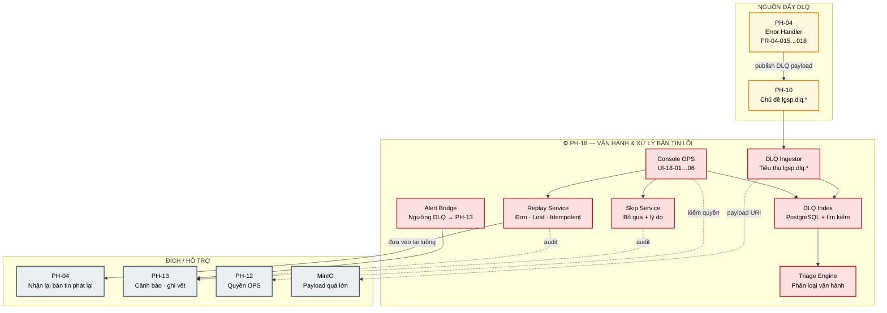
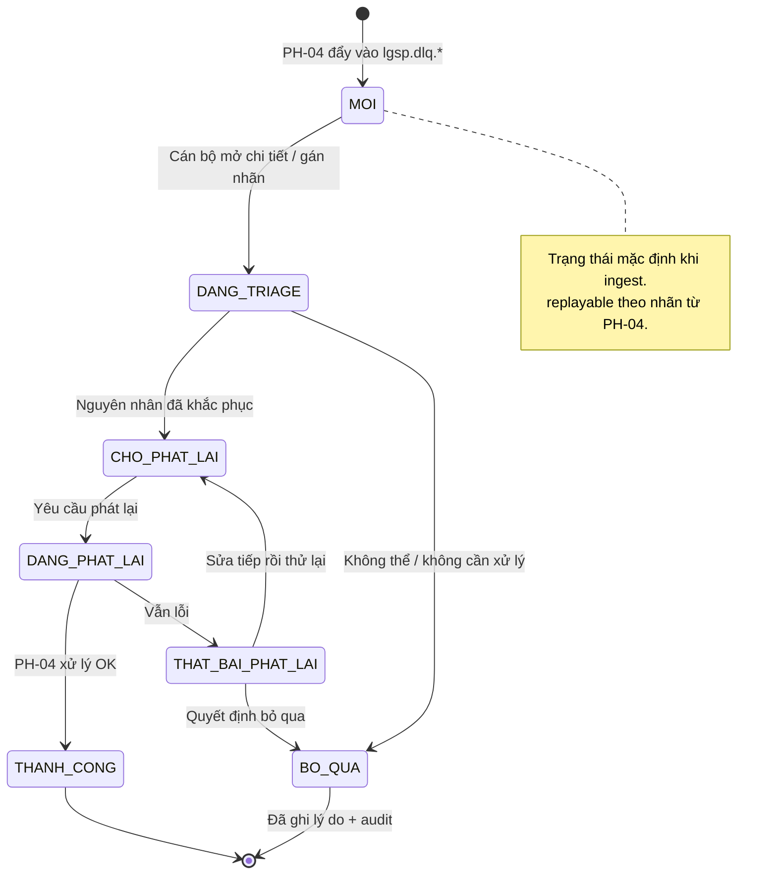
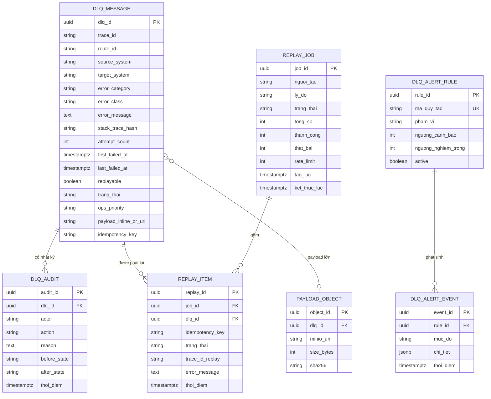

# SRS — PH-18: Vận hành & Xử lý bản tin lỗi

| Thuộc tính | Giá trị |
|---|---|
| **Mã phân hệ** | PH-18 |
| **Tên** | Vận hành & Xử lý bản tin lỗi (Operations & Dead Letter Handling) |
| **Nhóm** | Vận hành |
| **Mức bắt buộc** | M — Bắt buộc |
| **Phiên bản** | 1.0 |
| **Ngày** | 03/8/2026 |
| **Công nghệ chủ đạo** | Kafka DLQ (`lgsp.dlq.*`) + console OPS (Quarkus + React) |

---

## M1. Giới thiệu

### 1.1. Mục đích

PH-18 là **công cụ xử lý bản tin lỗi** của LGSP. Khi luồng tích hợp không thể hoàn tất một bản tin — vì lỗi tạm thời đã hết lần thử, hệ thống đích hỏng kéo dài, hoặc dữ liệu sai nghiệp vụ — bản tin không được bỏ quên. Nó phải vào hàng đợi lỗi (Dead Letter Queue — DLQ) kèm **đủ ngữ cảnh** để cán bộ vận hành chẩn đoán, phát lại khi nguyên nhân đã khắc phục, hoặc đánh dấu bỏ qua có lý do.

Phân hệ này hiện thực luồng [F-10](../03-flows/README.md#f-10--xử-lý-lỗi-và-phát-lại-bản-tin) và tiếp nhận hợp đồng DLQ đã định nghĩa tại [FR-04-018](SRS-PH-04-integration-core.md#m3-yêu-cầu-chức-năng) của PH-04. PH-04 **đẩy** bản tin lỗi; PH-18 **quản lý vòng đời** sau khi bản tin đã nằm trong DLQ.

### 1.2. Ba lớp xử lý lỗi — phân vai với PH-04

Đây là điểm dễ nhầm lẫn: phần lớn logic **phân loại và thử lại** thuộc PH-04; PH-18 chỉ nhận kết quả cuối cùng.

| Lớp | Nơi thực thi | Việc làm | Kết quả nếu thất bại |
|---|---|---|---|
| **Thử lại backoff** | PH-04 ([FR-04-016](SRS-PH-04-integration-core.md#m3-yêu-cầu-chức-năng)) | Lỗi tạm thời: ≤ 3 lần, chờ 1s → 2s → 4s | Đẩy DLQ |
| **Ngắt mạch** | PH-04 ([FR-04-017](SRS-PH-04-integration-core.md#m3-yêu-cầu-chức-năng)) | Đích hỏng kéo dài: mở mạch, không gọi vô ích | Đẩy DLQ trực tiếp + cảnh báo |
| **Quản lý DLQ** | **PH-18** (tài liệu này) | Liệt kê · triage · phát lại · bỏ qua · audit | Bản tin được xử lý thủ công hoặc có quyết định |

**Hệ quả thiết kế.** PH-18 **không** thay PH-04 làm retry hay circuit breaker. Nếu đưa logic đó vào PH-18, mọi bản tin lỗi phải chờ OPS phản hồi trước khi quyết định — phá vỡ trần 30 giây (CMP-16) và nguyên tắc không mất bản tin trên đường chính.

### 1.3. Phạm vi

**PH-18 chịu trách nhiệm:**

| # | Trách nhiệm |
|---|---|
| 1 | Tiếp nhận và lập chỉ mục bản ghi DLQ từ chủ đề `lgsp.dlq.*` |
| 2 | Bảo toàn ngữ cảnh tối thiểu theo hợp đồng FR-04-018 |
| 3 | Cung cấp console OPS: danh sách, lọc, chi tiết lỗi + ngữ cảnh |
| 4 | Triage / phân loại vận hành (xác nhận hoặc điều chỉnh nhãn lỗi) |
| 5 | Phát lại đơn lẻ và hàng loạt vào lại luồng PH-04 — **idempotent** |
| 6 | Đánh dấu bỏ qua kèm lý do bắt buộc và ghi vết |
| 7 | Phát cảnh báo khi DLQ phình to hoặc phát lại thất bại hàng loạt |
| 8 | Thống kê DLQ phục vụ giám sát thời gian thực (CMP-10) và KPI vận hành |
| 9 | Ghi vết mọi thao tác OPS (phát lại, bỏ qua, thay đổi phân loại) |

**PH-18 KHÔNG chịu trách nhiệm:**

| # | Không làm | Thuộc phân hệ |
|---|---|---|
| 1 | Thử lại backoff và phân loại lỗi kỹ thuật lúc xử lý bản tin | PH-04 (FR-04-015…017) |
| 2 | Ngắt mạch bảo vệ hệ thống đích | PH-04 (FR-04-017) |
| 3 | Tạo / quản lý chủ đề Kafka và Schema Registry | PH-10 |
| 4 | Dashboard sức khỏe tổng thể, trace toàn hệ thống, alert routing hạ tầng | PH-13 |
| 5 | Sửa dữ liệu nghiệp vụ sai trong bản tin gốc | Chủ quản dữ liệu nguồn / hệ thống thành viên |
| 6 | Quyết định quyền ai được phát lại / bỏ qua | PH-12 (cấp quyền; PH-18 chỉ thực thi) |

**Ranh giới số 1 — PH-18 sập không chặn luồng chính (PR-06).** Khi console OPS hoặc dịch vụ chỉ mục DLQ của PH-18 không khả dụng, PH-04 **vẫn ghi được** bản tin vào chủ đề Kafka `lgsp.dlq.*`. Bản tin chỉ dồn lại; xử lý thủ công diễn ra sau khi PH-18 phục hồi. Đây là hiện thực nguyên tắc [PR-06](README.md#1-nguyên-tắc-phân-rã-phân-hệ) đã nêu tại danh mục phân hệ.

**Ranh giới số 2 — không có CMP riêng cho DLQ.** Tuân thủ gắn với CMP-10 (giám sát), CMP-15 (24/7), CMP-16 (≤ 30s trên đường chính — DLQ không nằm trên đường đó), CMP-28 (ghi vết thao tác). Không bịa mã CMP mới cho DLQ.

### 1.4. Tài liệu tham chiếu

| Mã | Tài liệu |
|---|---|
| [KT] | [Kiến trúc tổng thể](../02-architecture/README.md) — Lớp vận hành, DLQ & Retry Store |
| [LT] | [F-10 Xử lý lỗi và phát lại bản tin](../03-flows/README.md#f-10--xử-lý-lỗi-và-phát-lại-bản-tin), [F-05](../03-flows/README.md#f-05--đồng-bộ-dữ-liệu-bất-đồng-bộ-theo-sự-kiện), [F-12](../03-flows/README.md#f-12--giám-sát-và-cảnh-báo-vận-hành) |
| [PL] | [Ma trận CMP](../01-legal/README.md) — CMP-10, CMP-15, CMP-16, CMP-28 |
| [SRS] | [PH-04 Lõi tích hợp](SRS-PH-04-integration-core.md) (FR-04-015…018), [PH-10 Sự kiện](README.md), [PH-13 Giám sát](README.md), [PH-12 IAM](SRS-PH-12-iam.md) |
| [MK] | Mockup tương lai [`mockup/pages/dlq.html`](../../mockup/pages/dlq.html) — Giai đoạn 6 mục 6.7 |

---

## M2. Mô tả tổng quan

### 2.1. Vị trí trong kiến trúc



**Thuyết minh sơ đồ.** Đường đẩy DLQ đi qua Kafka trước khi vào PH-18. Hệ quả: sự cố console OPS **không chặn** PH-04 ghi DLQ. Replay Service đưa bản tin về PH-04 — không gọi thẳng hệ thống đích — để mọi bước kiểm soát (quyền, chuẩn hóa, che dữ liệu…) chạy lại đầy đủ.

### 2.2. Vòng đời bản tin trong DLQ



**Thuyết minh.** Trạng thái `BO_QUA` là **quyết định có chủ đích**, không phải mất bản tin. Mọi chuyển trạng thái đều ghi vết (ai, khi nào, lý do) để đáp ứng CMP-28.

### 2.3. Chủ đề Kafka DLQ

| Quy ước | Giá trị |
|---|---|
| Tiền tố | `lgsp.dlq.` — mọi chủ đề DLQ |
| Theo miền / route | `lgsp.dlq.{domain}` hoặc `lgsp.dlq.{routeId}` |
| Retention Kafka | ≥ 14 ngày (đệm nếu chỉ mục PH-18 chậm) |
| Retention chỉ mục | Bản mở giữ đến khi đóng; bản đã xử lý mặc định 90 ngày |

PH-10 sở hữu chủ đề và ACL. PH-18 là consumer nhóm `lgsp-ops-dlq`; không ghi đè payload gốc trên DLQ.

### 2.4. Tác nhân

| Tác nhân | Loại | Tương tác |
|---|---|---|
| Cán bộ vận hành (OPS) | Người | Triage, phát lại, bỏ qua |
| Quản trị viên nền tảng | Người | Ngưỡng cảnh báo, quyền phát lại loạt |
| Chủ quản dữ liệu nguồn | Người | Nhận cảnh báo lỗi nghiệp vụ |
| PH-04 / PH-10 / PH-13 / PH-12 | Hệ thống | Đẩy DLQ · chủ đề · cảnh báo/audit · quyền |

### 2.5. Giả định

| Mã | Giả định |
|---|---|
| GD-01 | PH-04 đẩy DLQ đúng hợp đồng FR-04-018 |
| GD-02 | `lgsp.dlq.*` đã tạo và cấp ACL trước khi route ACTIVE |
| GD-03 | Đích / bên tiêu thụ hỗ trợ idempotent (F-05 / BR-04-008) |
| GD-04 | OPS có runbook theo loại lỗi phổ biến |
| GD-05 | PH-13 nhận cảnh báo nghiêm trọng (nếu không → đệm cục bộ) |

### 2.6. Ràng buộc

| Mã | Ràng buộc | Nguồn |
|---|---|---|
| RB-01 | Payload DLQ đủ ngữ cảnh — thiếu trường bắt buộc → poison + cảnh báo | F-10, FR-04-018 |
| RB-02 | Phát lại idempotent | F-10, F-05 |
| RB-03 | PH-18 sự cố không chặn đường chính | PR-06, CMP-15 |
| RB-04 | Bỏ qua có lý do; mọi thao tác OPS ghi vết | CMP-28 |
| RB-05 | Đường chính ≤ 30s — xử lý DLQ không nằm trên đường đồng bộ | CMP-16 |
| RB-06 | Công nghệ mã nguồn mở | Yêu cầu dự án |

### 2.7. Phụ thuộc phân hệ

| Phụ thuộc | Loại | Hành vi khi không khả dụng |
|---|---|---|
| PH-04 | **Cứng** cho phát lại | Không phát lại được; vẫn xem/bỏ qua |
| PH-10 | **Cứng** cho ingest | Bản tin vẫn nằm trên Kafka |
| PH-13 | **Mềm** | Đệm cảnh báo / audit |
| PH-12 | **Cứng** cho console | Từ chối thao tác không xác thực |
| MinIO | **Mềm** | Chỉ ảnh hưởng payload oversized |

**Ghi chú.** Tại SRS PH-04, phụ thuộc PH-18 "cứng" nghĩa là *không ghi được Kafka DLQ thì không xác nhận offset* — thuộc PH-04 + PH-10, **không** phụ thuộc console/chỉ mục PH-18.

---

## M3. Yêu cầu chức năng

### 3.1. Nhóm A — Tiếp nhận DLQ

#### FR-18-001 — Tiêu thụ chủ đề `lgsp.dlq.*` · **M**

| Mục | Nội dung |
|---|---|
| **Mô tả** | Tiêu thụ bản ghi DLQ từ mọi chủ đề khớp tiền tố `lgsp.dlq.` |
| **Tác nhân** | PH-10 (sự kiện), dịch vụ Ingestor |
| **Tiền điều kiện** | Nhóm consumer `lgsp-ops-dlq` đã đăng ký; lược đồ DLQ đã đăng ký Schema Registry |
| **Đầu vào** | Bản ghi Kafka: khóa · giá trị (payload DLQ) · header (`traceId`, `routeId`, `errorCategory`, `schemaId`) · phân vùng · offset |
| **Xử lý** | 1. Giải mã theo `schemaId`<br>2. Kiểm tra đủ trường bắt buộc (FR-18-002)<br>3. Ghi vào chỉ mục (EN-18-01) trạng thái `MOI`<br>4. Nếu payload oversized → tải từ MinIO theo URI trong bản ghi<br>5. Chỉ commit offset **sau khi** chỉ mục bền vững<br>6. Phát chỉ số `lgsp_ops_dlq_ingested_total` |
| **Đầu ra** | Bản ghi DLQ đã lập chỉ mục, sẵn sàng trên console |
| **Ngoại lệ** | E1: Thiếu trường bắt buộc → ghi bảng `DLQ_REJECTED`, **không** commit mù quáng — đẩy sang chủ đề `lgsp.dlq._poison` kèm lý do, rồi commit để không kẹt partition<br>E2: Schema Registry lỗi → tạm dừng consumer, backoff, cảnh báo PH-13<br>E3: Trùng `dlqId` → bỏ qua insert, commit (idempotent ingest) |

**Ghi chú.** E1 tách "poison message" khỏi hàng đợi nghiệp vụ — tránh một bản ghi hỏng chặn cả partition.

#### FR-18-002 — Kiểm chứng hợp đồng ngữ cảnh DLQ · **M**

| Mục | Nội dung |
|---|---|
| **Mô tả** | Bảo đảm mọi bản ghi DLQ đủ ngữ cảnh theo hợp đồng PH-04 FR-04-018 |
| **Đầu vào** | Payload DLQ |
| **Xử lý** | Kiểm tra **bắt buộc đủ** các trường: `dlqId`, `traceId`, `routeId`, `originalPayload` (hoặc URI), `currentPayload` (hoặc URI), `errorClass`, `errorMessage`, `stackTraceHash`, `attemptCount`, `firstFailedAt`, `lastFailedAt`, `sourceSystem`, `targetSystem`, `errorCategory`, `replayable` |
| **Đầu ra** | Hợp lệ / không hợp lệ kèm danh sách trường thiếu |
| **Ngoại lệ** | E1: Thiếu bất kỳ trường nào → từ chối chỉ mục nghiệp vụ (xem FR-18-001 E1) |

**Ghi chú.** Danh sách này **không được rút gọn**. Thiếu `traceId` hoặc `routeId` khiến OPS không chẩn đoán được; thiếu `replayable` khiến UI không biết có được phép phát lại hay không.

#### FR-18-003 — Lưu trữ payload oversized · **M**

| Mục | Nội dung |
|---|---|
| **Mô tả** | Hỗ trợ bản tin vượt kích thước tối đa của Kafka message |
| **Đầu vào** | URI MinIO trong trường payload · `dlqId` |
| **Xử lý** | 1. Tải object theo URI khi OPS mở chi tiết hoặc khi phát lại<br>2. Không cache lâu dài nội dung nhạy cảm trên đĩa local pod<br>3. Ghi vết truy cập payload đầy đủ |
| **Đầu ra** | Payload đầy đủ phục vụ chi tiết / phát lại |
| **Ngoại lệ** | E1: Object không tồn tại → đánh dấu `PAYLOAD_MISSING`, không cho phát lại cho đến khi khôi phục<br>E2: MinIO sự cố → cho xem metadata; chặn phát lại tạm thời |

#### FR-18-004 — Đồng bộ đối soát Kafka ↔ chỉ mục · **S**

| Mục | Nội dung |
|---|---|
| **Mô tả** | Đối soát định kỳ consumer lag và số bản ghi mở trên chỉ mục |
| **Xử lý** | Job định kỳ; lệch > 15 phút → cảnh báo mức CAO tới PH-13 |
| **Đầu ra** | Báo cáo đối soát |
| **Ngoại lệ** | E1: Không đọc được lag → cảnh báo hạ tầng PH-10 |

### 3.2. Nhóm B — Phân loại / Triage

#### FR-18-005 — Hiển thị và kế thừa phân loại lỗi từ PH-04 · **M**

| Mục | Nội dung |
|---|---|
| **Mô tả** | Tiếp nhận nhãn `errorCategory` do PH-04 gắn và hiển thị nhất quán trên console |
| **Đầu vào** | `errorCategory` ∈ {`TRANSIENT`, `DESTINATION_DOWN`, `BUSINESS`, `SECURITY`, `UNKNOWN`} |
| **Xử lý** | Ánh xạ sang nhãn tiếng Việt và chiến lược gợi ý:<br>· `TRANSIENT` — Lỗi tạm thời (đã hết ≤ 3 lần thử) → ưu tiên phát lại sau khi đích ổn<br>· `DESTINATION_DOWN` — Đích hỏng / mạch mở → chờ đích phục hồi, không spam phát lại<br>· `BUSINESS` — Lỗi nghiệp vụ → **không** phát lại cho đến khi sửa dữ liệu nguồn<br>· `SECURITY` — Lỗi bảo mật → chuyển ATTT, mặc định `replayable=false`<br>· `UNKNOWN` — Không xác định → triage thủ công |
| **Đầu ra** | Nhãn hiển thị + gợi ý hành động |
| **Ngoại lệ** | E1: Nhãn lạ → coi như `UNKNOWN`, cảnh báo cấu hình PH-04 |

**Bảng chiến lược (đối chiếu F-10):**

| Loại lỗi | Ví dụ | Đã xảy ra ở PH-04 | Việc OPS nên làm |
|---|---|---|---|
| **Tạm thời** | Timeout, 503 | Retry backoff ≤ 3 lần rồi DLQ | Kiểm tra đích đã ổn → phát lại |
| **Đích hỏng** | Circuit breaker MỞ | Đẩy DLQ trực tiếp, không thử vô ích | Chờ cảnh báo CB đóng → phát lại có kiểm soát |
| **Nghiệp vụ** | 400, sai lược đồ | **Không retry** → DLQ | Sửa nguồn / bỏ qua có lý do |

#### FR-18-006 — Triage thủ công bởi cán bộ OPS · **M**

| Mục | Nội dung |
|---|---|
| **Mô tả** | Cho phép OPS xác nhận, điều chỉnh nhãn vận hành và ghi chú chẩn đoán |
| **Tác nhân** | Cán bộ vận hành |
| **Tiền điều kiện** | Có quyền `ops.dlq.triage` |
| **Đầu vào** | `dlqId` · nhãn vận hành · ghi chú · mức ưu tiên |
| **Xử lý** | 1. Chuyển trạng thái `MOI` → `DANG_TRIAGE` (nếu chưa)<br>2. Cập nhật nhãn vận hành (có thể khác nhãn kỹ thuật gốc — giữ cả hai)<br>3. Ghi chú chẩn đoán bắt buộc khi đổi nhãn<br>4. Ghi vết |
| **Đầu ra** | Bản ghi đã triage |
| **Ngoại lệ** | E1: Không có quyền → `403`<br>E2: Bản ghi đã `THANH_CONG` / `BO_QUA` → không cho triage lại trừ khi mở lại có lý do |

#### FR-18-007 — Lọc, tìm kiếm và gán ưu tiên hàng đợi · **M**

| Mục | Nội dung |
|---|---|
| **Mô tả** | Cho phép OPS tìm nhanh bản tin cần xử lý trong khối lượng lớn |
| **Đầu vào** | Bộ lọc: `routeId`, `errorCategory`, `sourceSystem`, `targetSystem`, khoảng thời gian, `traceId`, `replayable`, trạng thái, từ khóa trong `errorMessage` |
| **Xử lý** | Truy vấn chỉ mục có phân trang; sắp xếp mặc định theo `lastFailedAt` giảm dần; hỗ trợ gán mức ưu tiên `P1`…`P4` |
| **Đầu ra** | Danh sách phân trang |
| **Ngoại lệ** | E1: Truy vấn quá rộng (> 10.000) → yêu cầu thu hẹp bộ lọc |

#### FR-18-008 — Liên kết sang trace giám sát · **S**

| Mục | Nội dung |
|---|---|
| **Mô tả** | Từ chi tiết DLQ mở deep-link PH-13 theo `traceId` |
| **Xử lý** | Sinh URL; thiếu trace → ẩn nút / thông báo lấy mẫu |
| **Đầu ra** | Liên kết hoặc thông báo |
| **Ngoại lệ** | E1: PH-13 không khả dụng → vẫn xem được metadata DLQ |

### 3.3. Nhóm C — Phát lại

#### FR-18-009 — Phát lại đơn lẻ · **M**

| Mục | Nội dung |
|---|---|
| **Mô tả** | Đưa một bản tin DLQ vào lại luồng xử lý của PH-04 |
| **Tác nhân** | Cán bộ vận hành |
| **Tiền điều kiện** | `replayable = true`; trạng thái ∈ {`MOI`,`DANG_TRIAGE`,`CHO_PHAT_LAI`,`THAT_BAI_PHAT_LAI`}; có quyền `ops.dlq.replay` |
| **Đầu vào** | `dlqId` · lý do phát lại (bắt buộc) |
| **Xử lý** | 1. Khóa bản ghi (optimistic lock) — tránh hai OPS phát lại cùng lúc<br>2. Dựng lệnh phát lại: payload gốc/hiện tại + header gốc + `replayOf=dlqId` + `replayId` mới + `idempotencyKey` = hash(`businessKey` + `eventType` + `version` hoặc `dlqId` nếu thiếu)<br>3. Gửi vào điểm nhận phát lại của PH-04 (API nội bộ hoặc chủ đề `lgsp.replay.in`)<br>4. Chuyển trạng thái `DANG_PHAT_LAI`<br>5. Chờ kết quả (đồng bộ timeout hoặc callback sự kiện)<br>6. Cập nhật `THANH_CONG` hoặc `THAT_BAI_PHAT_LAI`<br>7. Ghi vết đầy đủ |
| **Đầu ra** | Kết quả phát lại |
| **Ngoại lệ** | E1: `replayable=false` → `409`, hướng dẫn bỏ qua hoặc đổi nhãn có phê duyệt<br>E2: PH-04 không nhận lệnh → giữ nguyên trạng thái, `503`, thử lại lệnh (không nhân bản nghiệp vụ nhờ idempotency key)<br>E3: Bản ghi đang `DANG_PHAT_LAI` → từ chối phát lại trùng |

**Ghi chú về idempotent.** Khóa idempotency đi cùng lệnh phát lại. PH-04 / bên tiêu thụ đã xử lý thành công trước đó sẽ bỏ qua lần phát lại — đây là điều kiện bắt buộc của F-10, không phải tùy chọn.

#### FR-18-010 — Phát lại hàng loạt · **M**

| Mục | Nội dung |
|---|---|
| **Mô tả** | Phát lại nhiều bản tin theo bộ lọc hoặc danh sách chọn |
| **Tiền điều kiện** | Quyền `ops.dlq.replay.batch`; xác nhận hai bước trên UI |
| **Đầu vào** | Danh sách `dlqId` **hoặc** bộ lọc + trần số lượng · lý do · tốc độ phát (`rateLimit`) |
| **Xử lý** | 1. Tạo job phát lại (EN-18-03) trạng thái `QUEUED`<br>2. Giới hạn mặc định ≤ 500 bản tin / job (cấu hình được)<br>3. Phát tuần tự hoặc song song có giới hạn worker; tôn trọng `rateLimit` để không đánh sập đích vừa phục hồi<br>4. Với mỗi phần tử: cùng logic FR-18-009<br>5. Tổng hợp thành công / thất bại<br>6. Cho phép hủy job đang chạy |
| **Đầu ra** | Báo cáo job |
| **Ngoại lệ** | E1: Vượt trần → yêu cầu tách job<br>E2: Tỷ lệ thất bại > 30% trong 50 bản đầu → **tự dừng** job, cảnh báo<br>E3: Circuit breaker đích đang MỞ (tín hiệu từ PH-13/PH-04) → từ chối tạo job hoặc tạm dừng |

**Ghi chú.** Tự dừng khi thất bại hàng loạt là biện pháp chống "phát lại bão" — lỗi thiết kế phổ biến khi OPS bấm phát lại tất cả ngay sau sự cố chưa ổn định.

#### FR-18-011 — Bảo đảm idempotent khi phát lại · **M**

| Mục | Nội dung |
|---|---|
| **Mô tả** | Bảo đảm phát lại an toàn khi lặp |
| **Xử lý** | 1. Mọi lệnh phát lại mang `idempotencyKey` ổn định theo bản tin nghiệp vụ<br>2. Lưu `replayId` ↔ `dlqId` để truy vết<br>3. Nếu nhận kết quả thành công trùng khóa → đánh dấu `THANH_CONG` mà không gửi thêm<br>4. Kiểm thử bắt buộc với kịch bản "phát lại 2 lần liên tiếp" |
| **Đầu ra** | Không nhân bản nghiệp vụ |
| **Ngoại lệ** | E1: Thiếu `idempotencyKey` và không suy ra được → **chặn** phát lại, yêu cầu bổ sung cấu hình route |

#### FR-18-012 — Nhận kết quả phát lại từ PH-04 · **M**

| Mục | Nội dung |
|---|---|
| **Mô tả** | Cập nhật trạng thái DLQ theo kết quả xử lý lại |
| **Đầu vào** | Sự kiện / callback: `replayId`, `dlqId`, `status`, `error` (nếu có), `traceId` mới |
| **Xử lý** | Cập nhật bản ghi; gắn `traceId` của lần phát lại để OPS so sánh với lần gốc; ghi chỉ số |
| **Đầu ra** | Trạng thái mới |
| **Ngoại lệ** | E1: `replayId` không tồn tại → ghi cảnh báo, bỏ qua<br>E2: Timeout chờ kết quả → chuyển `THAT_BAI_PHAT_LAI` với lý do `REPLAY_RESULT_TIMEOUT` (có thể Tra cứu lại) |

### 3.4. Nhóm D — Bỏ qua & Audit

#### FR-18-013 — Đánh dấu bỏ qua kèm lý do · **M**

| Mục | Nội dung |
|---|---|
| **Mô tả** | Đóng bản tin DLQ khi không thể hoặc không cần xử lý tiếp |
| **Tác nhân** | Cán bộ vận hành |
| **Tiền điều kiện** | Quyền `ops.dlq.skip`; trạng thái chưa phải `THANH_CONG` |
| **Đầu vào** | `dlqId` · lý do bỏ qua (**bắt buộc**, ≥ 20 ký tự) · mã lý do ∈ danh mục |
| **Xử lý** | 1. Xác nhận hai bước trên UI<br>2. Chuyển `BO_QUA`<br>3. Ghi vết kèm lý do, người thực hiện, thời điểm<br>4. Phát chỉ số `lgsp_ops_dlq_skipped_total`<br>5. **Không** xóa payload — vẫn tra cứu được |
| **Đầu ra** | Bản ghi đã bỏ qua |
| **Ngoại lệ** | E1: Lý do trống / quá ngắn → `400`<br>E2: Bỏ qua hàng loạt > 50 → yêu cầu quyền `ops.dlq.skip.batch` + phê duyệt |

**Danh mục mã lý do mặc định:**

| Mã | Ý nghĩa |
|---|---|
| `DUPLICATE_BUSINESS` | Bản tin trùng nghiệp vụ, đã xử lý bằng kênh khác |
| `DATA_UNRECOVERABLE` | Dữ liệu nguồn sai không sửa được / hết hiệu lực |
| `TEST_NOISE` | Bản tin thử nghiệm lẫn vào |
| `ROUTE_RETIRED` | Route đã gỡ, không còn đích hợp lệ |
| `OTHER` | Khác — bắt buộc mô tả chi tiết |

#### FR-18-014 — Ghi vết thao tác OPS · **M**

| Mục | Nội dung |
|---|---|
| **Mô tả** | Ghi lại mọi thao tác trên DLQ phục vụ thanh tra và hậu kiểm |
| **Xử lý** | Ghi: `auditId`, `dlqId`, `actor`, `action` ∈ {`TRIAGE`,`REPLAY_SINGLE`,`REPLAY_BATCH`,`SKIP`,`REOPEN`,`VIEW_PAYLOAD`}, `reason`, `beforeState`, `afterState`, `traceId`, thời điểm<br>Gửi bản sao sang PH-13 (WORM khi thuộc nhóm kiểm toán) |
| **Đầu ra** | Bản ghi kiểm toán |
| **Ngoại lệ** | E1: Không gửi được PH-13 → đệm cục bộ; **vẫn cho** thao tác OPS (khác PH-09 với dữ liệu nhạy cảm — DLQ OPS không được kẹt vì giám sát) nhưng cảnh báo độ bền audit |

**Ghi chú thiết kế E1.** Đây là đánh đổi có chủ đích theo PR-06: mất tạm thời đường audit phụ không được phép làm OPS không xử lý được sự cố đang diễn ra. Đệm phải được gửi bù và cảnh báo nếu đệm đầy.

#### FR-18-015 — Mở lại bản ghi đã bỏ qua · **S**

| Mục | Nội dung |
|---|---|
| **Mô tả** | Mở lại khi bỏ qua nhầm (`BO_QUA` → `DANG_TRIAGE`) |
| **Tiền điều kiện** | Quyền `ops.dlq.reopen`; lý do bắt buộc |
| **Xử lý** | Đổi trạng thái + ghi vết |
| **Đầu ra** | Bản ghi mở lại |
| **Ngoại lệ** | E1: Payload hết hạn lưu giữ → không phát lại được |

#### FR-18-016 — Báo cáo thống kê DLQ · **S**

| Mục | Nội dung |
|---|---|
| **Mô tả** | Tổng hợp theo route / category / ngày: số mới, tuổi thọ, tỷ lệ phát lại / bỏ qua |
| **Xử lý** | API thống kê cho console, PH-13 và PH-16 |
| **Đầu ra** | Báo cáo |
| **Ngoại lệ** | — |

### 3.5. Nhóm E — Cảnh báo

#### FR-18-017 — Cảnh báo ngưỡng độ sâu DLQ · **M**

| Mục | Nội dung |
|---|---|
| **Mô tả** | Cảnh báo khi DLQ phình to |
| **Xử lý** | Mặc định: cảnh báo > 100 bản mở/route hoặc tuổi thọ > 4 giờ; nghiêm trọng > 1.000 hoặc > 24 giờ. Gửi PH-13 kèm deep-link |
| **Đầu ra** | Cảnh báo |
| **Ngoại lệ** | E1: PH-13 sự cố → đệm + log cục bộ |

#### FR-18-018 — Cảnh báo phát lại thất bại hàng loạt · **M**

| Mục | Nội dung |
|---|---|
| **Mô tả** | Báo khi job tự dừng hoặc tỷ lệ thất bại cao |
| **Xử lý** | Cảnh báo mức CAO kèm `jobId`, tỷ lệ, mẫu lỗi |
| **Đầu ra** | Cảnh báo |
| **Ngoại lệ** | — |

#### FR-18-019 — Cảnh báo poison / hợp đồng DLQ vi phạm · **M**

| Mục | Nội dung |
|---|---|
| **Mô tả** | Báo khi có bản ghi thiếu trường bắt buộc |
| **Xử lý** | `lgsp.dlq._poison` > 0 trong 5 phút → cảnh báo quản trị nền tảng |
| **Đầu ra** | Cảnh báo |
| **Ngoại lệ** | — |

#### FR-18-020 — Thông báo chủ quản khi lỗi nghiệp vụ · **S**

| Mục | Nội dung |
|---|---|
| **Mô tả** | Thông báo chủ quản `sourceSystem` khi `errorCategory=BUSINESS` |
| **Xử lý** | Gửi qua PH-13 kèm `dlqId` + tóm tắt — **không** gửi payload nhạy cảm |
| **Đầu ra** | Thông báo đã gửi |
| **Ngoại lệ** | E1: Không có liên hệ → ghi việc cập nhật danh bạ PH-01 |

### 3.6. Bảng tổng hợp yêu cầu chức năng

| Nhóm | Mã | Tên | Ưu tiên |
|---|---|---|:-:|
| A | FR-18-001 | Tiêu thụ chủ đề `lgsp.dlq.*` | M |
| A | FR-18-002 | Kiểm chứng hợp đồng ngữ cảnh DLQ | M |
| A | FR-18-003 | Lưu trữ / truy xuất payload oversized | M |
| A | FR-18-004 | Đồng bộ đối soát Kafka ↔ chỉ mục | S |
| B | FR-18-005 | Hiển thị phân loại lỗi từ PH-04 | M |
| B | FR-18-006 | Triage thủ công | M |
| B | FR-18-007 | Lọc, tìm kiếm, ưu tiên | M |
| B | FR-18-008 | Liên kết sang trace PH-13 | S |
| C | FR-18-009 | Phát lại đơn lẻ | M |
| C | FR-18-010 | Phát lại hàng loạt | M |
| C | FR-18-011 | Bảo đảm idempotent khi phát lại | M |
| C | FR-18-012 | Nhận kết quả phát lại | M |
| D | FR-18-013 | Đánh dấu bỏ qua kèm lý do | M |
| D | FR-18-014 | Ghi vết thao tác OPS | M |
| D | FR-18-015 | Mở lại bản ghi đã bỏ qua | S |
| D | FR-18-016 | Báo cáo thống kê DLQ | S |
| E | FR-18-017 | Cảnh báo ngưỡng độ sâu DLQ | M |
| E | FR-18-018 | Cảnh báo phát lại thất bại hàng loạt | M |
| E | FR-18-019 | Cảnh báo poison / vi phạm hợp đồng | M |
| E | FR-18-020 | Thông báo chủ quản lỗi nghiệp vụ | S |

**Tổng: 20 yêu cầu chức năng** — 15 bắt buộc (M), 5 cần có (S).

---

## M4. Mô hình dữ liệu

### 4.1. Sơ đồ thực thể



### 4.2. Đặc tả thực thể

#### EN-18-01 — DLQ_MESSAGE

| Trường | Kiểu | Bắt buộc | Ràng buộc | Mô tả |
|---|---|:-:|---|---|
| `dlq_id` | UUID | ✓ | PK | Khớp `dlqId` từ PH-04 |
| `trace_id` | VARCHAR(64) | ✓ | Có chỉ mục | W3C Trace Context |
| `route_id` | VARCHAR(80) | ✓ | Có chỉ mục | Route nguồn |
| `topic` | VARCHAR(120) | ✓ | | Chủ đề `lgsp.dlq.*` gốc |
| `partition` | INTEGER | ✓ | | |
| `record_offset` | BIGINT | ✓ | | |
| `source_system` | VARCHAR(80) | ✓ | | |
| `target_system` | VARCHAR(80) | ✓ | | |
| `error_category` | VARCHAR(24) | ✓ | ∈ enum FR-18-005 | Nhãn kỹ thuật từ PH-04 |
| `ops_category` | VARCHAR(24) | | | Nhãn vận hành sau triage |
| `error_class` | VARCHAR(200) | ✓ | | |
| `error_message` | TEXT | ✓ | | |
| `stack_trace_hash` | VARCHAR(64) | ✓ | | Gom nhóm lỗi giống nhau |
| `attempt_count` | SMALLINT | ✓ | ≥ 0 | Số lần PH-04 đã thử |
| `first_failed_at` | TIMESTAMPTZ | ✓ | | |
| `last_failed_at` | TIMESTAMPTZ | ✓ | | |
| `replayable` | BOOLEAN | ✓ | | |
| `trang_thai` | VARCHAR(24) | ✓ | ∈ {`MOI`,`DANG_TRIAGE`,`CHO_PHAT_LAI`,`DANG_PHAT_LAI`,`THANH_CONG`,`THAT_BAI_PHAT_LAI`,`BO_QUA`} | |
| `ops_priority` | VARCHAR(4) | | ∈ {`P1`,`P2`,`P3`,`P4`} | |
| `original_payload` | JSONB | | | Null nếu dùng URI |
| `current_payload` | JSONB | | | |
| `payload_uri` | VARCHAR(500) | | | MinIO khi oversized |
| `idempotency_key` | VARCHAR(200) | ✓ | | Suy ra khi ingest nếu thiếu |
| `skip_reason_code` | VARCHAR(40) | | | Khi `BO_QUA` |
| `skip_reason_text` | TEXT | | | |
| `ghi_chu_triage` | TEXT | | | |
| `cap_nhat_luc` | TIMESTAMPTZ | ✓ | | |

**Ràng buộc.** UNIQUE (`topic`, `partition`, `record_offset`) để ingest idempotent. UNIQUE (`dlq_id`).

#### EN-18-02 — DLQ_AUDIT

| Trường | Kiểu | Bắt buộc | Mô tả |
|---|---|:-:|---|
| `audit_id` | UUID | ✓ | PK |
| `dlq_id` | UUID | ✓ | FK |
| `actor` | VARCHAR(100) | ✓ | Tài khoản OPS |
| `action` | VARCHAR(30) | ✓ | |
| `reason` | TEXT | ✓ | Bắt buộc với REPLAY/SKIP/REOPEN |
| `before_state` | VARCHAR(24) | ✓ | |
| `after_state` | VARCHAR(24) | ✓ | |
| `metadata` | JSONB | | Chi tiết bổ sung (jobId, rateLimit…) |
| `thoi_diem` | TIMESTAMPTZ | ✓ | |

**Chính sách.** Append-only — không UPDATE/DELETE từ ứng dụng.

#### EN-18-03 — REPLAY_JOB

| Trường | Kiểu | Bắt buộc | Mô tả |
|---|---|:-:|---|
| `job_id` | UUID | ✓ | PK |
| `nguoi_tao` | VARCHAR(100) | ✓ | |
| `ly_do` | TEXT | ✓ | |
| `bo_loc` | JSONB | | Bộ lọc gốc nếu tạo theo filter |
| `trang_thai` | VARCHAR(20) | ✓ | ∈ {`QUEUED`,`RUNNING`,`COMPLETED`,`CANCELLED`,`ABORTED`} |
| `tong_so` | INTEGER | ✓ | |
| `thanh_cong` | INTEGER | ✓ | Mặc định 0 |
| `that_bai` | INTEGER | ✓ | Mặc định 0 |
| `rate_limit` | INTEGER | ✓ | Bản tin / phút |
| `tao_luc` | TIMESTAMPTZ | ✓ | |
| `ket_thuc_luc` | TIMESTAMPTZ | | |

#### EN-18-04 — REPLAY_ITEM

| Trường | Kiểu | Bắt buộc | Mô tả |
|---|---|:-:|---|
| `replay_id` | UUID | ✓ | PK |
| `job_id` | UUID | | FK — null nếu phát lại đơn |
| `dlq_id` | UUID | ✓ | FK |
| `idempotency_key` | VARCHAR(200) | ✓ | |
| `trang_thai` | VARCHAR(20) | ✓ | ∈ {`SENT`,`SUCCESS`,`FAILED`,`SKIPPED_DUP`} |
| `trace_id_replay` | VARCHAR(64) | | Trace lần phát lại |
| `error_message` | TEXT | | |
| `thoi_diem` | TIMESTAMPTZ | ✓ | |

#### EN-18-05 — PAYLOAD_OBJECT

| Trường | Kiểu | Bắt buộc | Mô tả |
|---|---|:-:|---|
| `object_id` | UUID | ✓ | PK |
| `dlq_id` | UUID | ✓ | FK |
| `minio_uri` | VARCHAR(500) | ✓ | |
| `size_bytes` | INTEGER | ✓ | |
| `sha256` | VARCHAR(64) | ✓ | Toàn vẹn |
| `loai` | VARCHAR(20) | ✓ | ∈ {`ORIGINAL`,`CURRENT`} |

#### EN-18-06 — DLQ_ALERT_RULE

| Trường | Kiểu | Bắt buộc | Mô tả |
|---|---|:-:|---|
| `rule_id` | UUID | ✓ | PK |
| `ma_quy_tac` | VARCHAR(60) | ✓ | UNIQUE |
| `pham_vi` | VARCHAR(80) | ✓ | `GLOBAL` hoặc `routeId` |
| `nguong_canh_bao` | INTEGER | ✓ | |
| `nguong_nghiem_trong` | INTEGER | ✓ | |
| `tuoi_tho_canh_bao_gio` | INTEGER | ✓ | Mặc định 4 |
| `active` | BOOLEAN | ✓ | |

### 4.3. Chính sách lưu giữ

| Thực thể | Thời hạn | Ghi chú |
|---|---|---|
| DLQ_MESSAGE (đang mở) | Đến khi đóng | Không TTL khi chưa xử lý |
| DLQ_MESSAGE (đã `THANH_CONG`/`BO_QUA`) | 90 ngày mặc định | Có thể kéo dài theo ngành |
| DLQ_AUDIT | **≥ 5 năm** | CMP-28 |
| REPLAY_JOB / REPLAY_ITEM | 90 ngày | |
| PAYLOAD_OBJECT | Khớp vòng đời DLQ_MESSAGE | Xóa object MinIO khi hết hạn bản ghi |
| DLQ_ALERT_EVENT | 90 ngày | |

---

## M5. Giao diện API

### 5.1. Nguyên tắc chung

| Khía cạnh | Quy định |
|---|---|
| Đường dẫn quản trị | `/api/admin/v1/ops/dlq` |
| Đường dẫn nội bộ | `/api/internal/v1/ops/dlq` (callback từ PH-04) |
| Xác thực | Bearer JWT; phạm vi `ops.dlq.*` |
| Giao thức nội bộ | mTLS trong cụm |
| Mã lỗi | RFC 9457 Problem Details |

### 5.2. Điểm cuối quản trị

| Phương thức | Đường dẫn | Chức năng | FR |
|---|---|---|---|
| `GET` | `/api/admin/v1/ops/dlq/messages` | Danh sách / lọc / phân trang | FR-18-007 |
| `GET` | `/api/admin/v1/ops/dlq/messages/{dlqId}` | Chi tiết + ngữ cảnh | FR-18-002, 005 |
| `GET` | `/api/admin/v1/ops/dlq/messages/{dlqId}/payload` | Lấy payload đầy đủ | FR-18-003 |
| `POST` | `/api/admin/v1/ops/dlq/messages/{dlqId}/triage` | Triage | FR-18-006 |
| `POST` | `/api/admin/v1/ops/dlq/messages/{dlqId}/replay` | Phát lại đơn | FR-18-009 |
| `POST` | `/api/admin/v1/ops/dlq/replay-jobs` | Tạo job phát lại loạt | FR-18-010 |
| `GET` | `/api/admin/v1/ops/dlq/replay-jobs/{jobId}` | Trạng thái job | FR-18-010 |
| `POST` | `/api/admin/v1/ops/dlq/replay-jobs/{jobId}/cancel` | Hủy job | FR-18-010 |
| `POST` | `/api/admin/v1/ops/dlq/messages/{dlqId}/skip` | Bỏ qua | FR-18-013 |
| `POST` | `/api/admin/v1/ops/dlq/messages/{dlqId}/reopen` | Mở lại | FR-18-015 |
| `GET` | `/api/admin/v1/ops/dlq/messages/{dlqId}/audit` | Nhật ký thao tác | FR-18-014 |
| `GET` | `/api/admin/v1/ops/dlq/stats` | Thống kê | FR-18-016 |
| `GET` | `/api/admin/v1/ops/dlq/alert-rules` | Quy tắc cảnh báo | FR-18-017 |
| `PUT` | `/api/admin/v1/ops/dlq/alert-rules/{id}` | Cập nhật ngưỡng | FR-18-017 |

### 5.3. Điểm cuối nội bộ

| Phương thức | Đường dẫn | Chức năng | FR |
|---|---|---|---|
| `POST` | `/api/internal/v1/ops/dlq/replay-results` | Callback kết quả phát lại | FR-18-012 |
| `GET` | `/api/internal/v1/ops/dlq/health` | Sức khỏe chỉ mục (không dùng để chặn PH-04) | — |

### 5.4. Đặc tả chi tiết điểm cuối chính

#### 5.4.1. `GET /api/admin/v1/ops/dlq/messages` — Danh sách DLQ

**Tham số truy vấn:** `routeId`, `errorCategory`, `trangThai`, `replayable`, `sourceSystem`, `targetSystem`, `traceId`, `q`, `from`, `to`, `page`, `size`, `sort`.

**Phản hồi `200 OK`:**

```json
{
  "page": 0,
  "size": 50,
  "totalElements": 1284,
  "content": [
    {
      "dlqId": "7c9e6679-7425-40de-944b-e07fc1f90ae7",
      "traceId": "4bf92f3577b34da6a3ce929d0e0e4736",
      "routeId": "route-ho-so-lien-thong",
      "errorCategory": "TRANSIENT",
      "errorMessage": "Upstream timeout after 3000ms",
      "attemptCount": 3,
      "targetSystem": "HT-TUPHAP",
      "replayable": true,
      "trangThai": "MOI",
      "opsPriority": "P2",
      "lastFailedAt": "2026-08-03T09:15:22+07:00",
      "ageMinutes": 42
    }
  ]
}
```

#### 5.4.2. `GET .../messages/{dlqId}` — Chi tiết

Trả đủ metadata hợp đồng FR-04-018, `payloadPreview`, `payloadUri` (nếu oversized), `goiYHanhDong`, `traceDeepLink`. Không trả stack trace đầy đủ trên API danh sách — chỉ hash + message.

#### 5.4.3. `POST .../messages/{dlqId}/replay` — Phát lại đơn

**Yêu cầu:** `{ "lyDo": "...", "dungPayload": "CURRENT" }`  
**`202`:** `{ "replayId", "dlqId", "trangThai": "DANG_PHAT_LAI", "idempotencyKey" }`  
**`409`:** khi `replayable=false` — type `dlq-not-replayable`.

#### 5.4.4. `POST .../replay-jobs` — Phát lại loạt

**Yêu cầu:** `{ "lyDo", "dlqIds" | bộ lọc, "rateLimit", "dungPayload" }` → **`202`** với `jobId`, `tongSo`.

#### 5.4.5. `POST .../messages/{dlqId}/skip` — Bỏ qua

**Yêu cầu:** `{ "maLyDo", "lyDo" }` (≥ 20 ký tự) → **`200`** `{ "trangThai": "BO_QUA", "auditId" }`.

#### 5.4.6. `POST /api/internal/v1/ops/dlq/replay-results` — Callback

**Yêu cầu:** `{ "replayId", "dlqId", "status": "SUCCESS"|"FAILED", "traceId", "error?" }`.
### 5.5. Mã lỗi thường gặp

| HTTP | `type` | Khi nào |
|---|---|---|
| 400 | `dlq-skip-reason-required` | Bỏ qua thiếu lý do |
| 401 / 403 | `unauthorized` / `forbidden` | Token / scope |
| 404 | `dlq-not-found` | Sai `dlqId` |
| 409 | `dlq-not-replayable` / `dlq-replay-in-progress` | Xung đột trạng thái |
| 422 | `dlq-batch-limit-exceeded` | Vượt trần job |
| 503 | `replay-target-unavailable` | PH-04 không nhận lệnh |

---

## M6. Giao diện người dùng

> Mockup HTML sẽ dựng tại [`mockup/pages/dlq.html`](../../mockup/pages/dlq.html) trong **Giai đoạn 6 mục 6.7**. Các màn dưới đây là đặc tả bắt buộc cho mockup đó.

### 6.1. Tổng quan màn hình

| Mã | Màn hình | Mục đích | Mockup |
|---|---|---|---|
| **UI-18-01** | Danh sách DLQ | Hàng đợi lỗi, lọc, chọn hàng loạt | `dlq.html#list` |
| **UI-18-02** | Chi tiết lỗi + ngữ cảnh | Chẩn đoán một bản tin | `dlq.html#detail` |
| **UI-18-03** | Phát lại đơn | Xác nhận và theo dõi | `dlq.html#replay` |
| **UI-18-04** | Phát lại hàng loạt | Tạo / theo dõi job | `dlq.html#batch` |
| **UI-18-05** | Bỏ qua có lý do | Đóng bản tin có kiểm soát | `dlq.html#skip` |
| **UI-18-06** | Thống kê & cảnh báo DLQ | Độ sâu hàng đợi, tỷ lệ xử lý | `dlq.html#stats` |

### 6.2. Đặc tả màn hình

#### UI-18-01 — Danh sách DLQ · **M**

| Mục | Nội dung |
|---|---|
| **Mục đích** | Cho OPS thấy nhanh điểm đang tồn đọng |
| **Thành phần** | Thanh lọc (route, loại lỗi, trạng thái, thời gian, `traceId`/`errorMessage`); bảng: ưu tiên, thời điểm, route, đích, loại lỗi, số lần thử, tuổi thọ, trạng thái, `replayable`; chọn nhiều dòng; nút **Phát lại loạt** / **Bỏ qua loạt** |
| **Quy tắc tương tác** | Click dòng → UI-18-02; xác nhận trước thao tác loạt; màu nhấn theo `errorCategory` |
| **Trạng thái** | Trống / đang tải / lỗi / có dữ liệu; badge khi vượt ngưỡng |
| **Liên kết mockup** | Giai đoạn 6.7 — danh sách DLQ |

#### UI-18-02 — Chi tiết lỗi + ngữ cảnh · **M**

| Mục | Nội dung |
|---|---|
| **Mục đích** | Đủ thông tin quyết định phát lại / bỏ qua mà không cần pod log |
| **Thành phần** | Metadata (`dlqId`, `traceId`, route, nguồn/đích, timestamps, attemptCount); khối lỗi; tab payload gốc/hiện tại (che theo quyền); gợi ý hành động; deep-link PH-13; audit rút gọn |
| **Quy tắc tương tác** | **Phát lại** chỉ khi `replayable`; **Bỏ qua** luôn cần lý do; payload đầy đủ cần `ops.dlq.payload.read` |
| **Trạng thái** | Đang triage / đang phát lại (khóa nút) / đã bỏ qua (read-only + mở lại) |
| **Liên kết mockup** | Giai đoạn 6.7 — chi tiết lỗi + ngữ cảnh |

#### UI-18-03 — Phát lại đơn · **M**

| Mục | Nội dung |
|---|---|
| **Mục đích** | Xác nhận có chủ đích trước khi đưa bản tin vào lại luồng |
| **Thành phần** | Dialog: tóm tắt, lý do bắt buộc, chọn `ORIGINAL`/`CURRENT`, hiện `idempotencyKey` |
| **Quy tắc tương tác** | Lý do ≥ 20 ký tự; sau `202` theo dõi trên chi tiết |
| **Trạng thái** | Form / đang gửi / thành công / thất bại |
| **Liên kết mockup** | Giai đoạn 6.7 |

#### UI-18-04 — Phát lại hàng loạt · **M**

| Mục | Nội dung |
|---|---|
| **Mục đích** | Xử lý sự cố hàng loạt sau khi đích phục hồi |
| **Thành phần** | Wizard: chọn tập → `rateLimit` → lý do → xác nhận số lượng → tiến độ job |
| **Quy tắc tương tác** | Xác nhận hai bước; cảnh báo nếu CB mở; nút **Dừng job** |
| **Trạng thái** | Queued / Running / Completed / Aborted |
| **Liên kết mockup** | Giai đoạn 6.7 — phát lại hàng loạt |

#### UI-18-05 — Bỏ qua có lý do · **M**

| Mục | Nội dung |
|---|---|
| **Mục đích** | Đóng bản tin không xử lý được, vẫn giữ dấu vết |
| **Thành phần** | Mã lý do; mô tả; cảnh báo "không xóa payload"; xác nhận |
| **Quy tắc tương tác** | `OTHER` bắt buộc mô tả chi tiết; ghi audit ngay |
| **Trạng thái** | Form / đã bỏ qua |
| **Liên kết mockup** | Giai đoạn 6.7 |

#### UI-18-06 — Thống kê & cảnh báo DLQ · **S**

| Mục | Nội dung |
|---|---|
| **Mục đích** | Nhìn sức khỏe hàng đợi lỗi theo thời gian |
| **Thành phần** | Biểu đồ độ sâu theo route; tỷ lệ phát lại; tuổi thọ P95; cảnh báo gần đây; link PH-13 |
| **Quy tắc tương tác** | Click biểu đồ → lọc UI-18-01 |
| **Trạng thái** | Có dữ liệu / chưa đủ dữ liệu |
| **Liên kết mockup** | Giai đoạn 6.7 |

### 6.3. Điều hướng liên phân hệ

| Từ | Đến | Khi nào |
|---|---|---|
| UI-18-02 | Mockup giám sát PH-13 | Bấm "Xem trace" |
| UI-18-01 | `routes.html` (PH-04) | Bấm `routeId` |
| Cảnh báo PH-13 | UI-18-01 đã lọc | Deep-link từ alert |

---

## M7. Yêu cầu phi chức năng

### 7.1. Hiệu năng

| Mã | Yêu cầu |
|---|---|
| **NFR-18-001** | Ingest DLQ: bền vững ≥ 200 bản ghi/giây / phân vùng consumer |
| **NFR-18-002** | API danh sách P99 ≤ 500ms với bộ lọc có chỉ mục (page size 50) |
| **NFR-18-003** | API chi tiết P99 ≤ 300ms khi payload inline; ≤ 2s khi tải MinIO |
| **NFR-18-004** | Phát lại đơn: chấp nhận lệnh ≤ 1s; hoàn tất phụ thuộc PH-04 (không tính vào NFR đường chính CMP-16) |
| **NFR-18-005** | Job phát lại loạt duy trì `rateLimit` đã cấu hình ±10% |

### 7.2. Sẵn sàng & cách ly lỗi

| Mã | Yêu cầu |
|---|---|
| **NFR-18-006** | Sự cố PH-18 **không** làm PH-04 dừng ghi `lgsp.dlq.*` (PR-06, CMP-15) |
| **NFR-18-007** | Tối thiểu 2 replica console/API OPS; PDB `minAvailable=1` |
| **NFR-18-008** | RTO chỉ mục DLQ ≤ 15 phút; bản tin Kafka còn trong retention vẫn ingest bù được |
| **NFR-18-009** | Khi PH-13 sự cố: đệm audit/alert ≥ 10.000 sự kiện |
| **NFR-18-010** | Health endpoint tách: liveness ≠ readiness (readiness phụ thuộc PostgreSQL) |

### 7.3. Bảo mật

| Mã | Yêu cầu |
|---|---|
| **NFR-18-011** | Mọi API quản trị qua JWT + RBAC (`ops.dlq.*`) |
| **NFR-18-012** | Xem payload đầy đủ là quyền riêng; mặc định che trường nhạy cảm |
| **NFR-18-013** | Không ghi bí mật (token, mật khẩu) vào audit lý do hoặc log |
| **NFR-18-014** | Kết nối Kafka / DB / MinIO qua mTLS hoặc TLS 1.2+ |
| **NFR-18-015** | Thao tác phát lại loạt và bỏ qua loạt yêu cầu xác nhận lại phiên (step-up) nếu vượt ngưỡng |

### 7.4. Khả năng quan sát

| Mã | Yêu cầu |
|---|---|
| **NFR-18-016** | Chỉ số bắt buộc: `lgsp_ops_dlq_open`, `lgsp_ops_dlq_ingested_total`, `lgsp_ops_dlq_replay_total{result}`, `lgsp_ops_dlq_skipped_total`, `lgsp_ops_dlq_poison_total`, `lgsp_ops_replay_job_in_progress` |
| **NFR-18-017** | Độ trễ chỉ số lên dashboard ≤ 15 giây (CMP-10) |
| **NFR-18-018** | 100% thao tác REPLAY/SKIP có bản ghi audit (CMP-28) |
| **NFR-18-019** | Log JSON kèm `dlqId`, `traceId`, `actor`, `action` |

### 7.5. Mở rộng & lưu trữ

| Mã | Yêu cầu |
|---|---|
| **NFR-18-020** | Mở rộng ngang consumer theo số phân vùng Kafka |
| **NFR-18-021** | Chỉ mục PostgreSQL hỗ trợ ≥ 5 triệu bản ghi lịch sử mà vẫn đạt NFR-18-002 với partition theo tháng |
| **NFR-18-022** | Job dọn dữ liệu hết hạn chạy hằng ngày, không khóa bảng nóng quá 30 giây |

### 7.6. Khả năng bảo trì

| Mã | Yêu cầu |
|---|---|
| **NFR-18-023** | Runbook gắn với từng `errorCategory` phổ biến, liên kết từ UI |
| **NFR-18-024** | Cấu hình ngưỡng cảnh báo thay được lúc chạy, không cần dựng lại ảnh |

---

## M8. Quy tắc nghiệp vụ

| Mã | Phát biểu | Lý do | Cách thực thi | Khi vi phạm |
|---|---|---|---|---|
| **BR-18-001** | Payload DLQ thiếu trường bắt buộc không được vào hàng đợi nghiệp vụ | F-10 — thiếu ngữ cảnh thì OPS không chẩn đoán được | FR-18-002 → poison topic | Cảnh báo cấu hình PH-04 |
| **BR-18-002** | Lỗi nghiệp vụ mặc định `replayable=false` | Thử lại vô ích | Kế thừa từ PH-04; UI chặn phát lại | `409` |
| **BR-18-003** | Phát lại bắt buộc mang `idempotencyKey` | Tránh nhân bản nghiệp vụ | FR-18-011 | Chặn phát lại |
| **BR-18-004** | Phát lại đi qua PH-04, không gọi thẳng đích | Giữ đủ kiểm soát trên trục | Replay Service chỉ gọi hợp đồng PH-04 | Lỗi thiết kế — chặn khi rà soát |
| **BR-18-005** | Bỏ qua bắt buộc có lý do ≥ 20 ký tự | CMP-28, hậu kiểm | FR-18-013 | `400` |
| **BR-18-006** | Không xóa vật lý bản ghi DLQ khi bỏ qua | Cần truy vết | Soft-state `BO_QUA` | — |
| **BR-18-007** | PH-18 sự cố không được back-pressure đường chính | PR-06, CMP-15 | Kafka là đệm; PH-04 không gọi sync PH-18 khi đẩy DLQ | Chaos test bắt buộc |
| **BR-18-008** | Job phát lại tự dừng nếu tỷ lệ thất bại > 30% / 50 bản đầu | Chống bão phát lại | FR-18-010 E2 | Cảnh báo CAO |
| **BR-18-009** | Hai OPS không phát lại cùng một bản ghi đồng thời | Tránh race | Optimistic lock / trạng thái `DANG_PHAT_LAI` | `409` |
| **BR-18-010** | Đổi nhãn triage khác nhãn kỹ thuật phải ghi chú | Minh bạch quyết định người | FR-18-006 | `400` |
| **BR-18-011** | Xem payload nhạy cảm phải có quyền riêng | Bảo vệ dữ liệu | RBAC + che mặc định | `403` |
| **BR-18-012** | Cảnh báo khi độ sâu DLQ vượt ngưỡng | CMP-10 | FR-18-017 | — |
| **BR-18-013** | Không phát lại loạt khi biết circuit breaker đích đang MỞ | Bảo vệ đích vừa sự cố | Kiểm tra tín hiệu PH-04/PH-13 | Từ chối / tạm dừng job |
| **BR-18-014** | Audit append-only | CMP-28 | EN-18-02 không UPDATE/DELETE | Chặn ở tầng DB |
| **BR-18-015** | Bỏ qua hàng loạt > 50 cần quyền nâng cao | Giảm rủi ro thao tác nhầm | FR-18-013 E2 | `403` |

---

## M9. Tuân thủ CMP

### 9.1. Ánh xạ yêu cầu pháp lý / kỹ thuật

> Không có CMP riêng cho DLQ. PH-18 đóng góp gián tiếp qua bốn mã sau.

| Mã CMP | Yêu cầu | FR/NFR/BR đáp ứng | Cách kiểm chứng |
|---|---|---|---|
| **CMP-10** | Giám sát thời gian thực | FR-18-016, 017; NFR-18-016, 017; UI-18-06 | Dashboard DLQ cập nhật ≤ 15s; cảnh báo khi vượt ngưỡng |
| **CMP-15** | Hoạt động 24/7 | NFR-18-006…008; BR-18-007; PR-06 | Chaos: tắt PH-18, PH-04 vẫn ghi DLQ; bật lại ingest bù |
| **CMP-16** | Phản hồi ≤ 30s | RB-05; tách đường DLQ khỏi đường đồng bộ | Đo P99 đường chính không tăng khi OPS phát lại loạt |
| **CMP-28** | Ghi vết truy cập / thao tác | FR-18-014; NFR-18-018; BR-18-005, 014 | Đối chiếu số REPLAY/SKIP với số bản audit |

### 9.2. Ánh xạ nguyên tắc kiến trúc

| Nguyên tắc | Cách PH-18 đáp ứng |
|---|---|
| **PR-06 Ranh giới lỗi** | Console/chỉ mục sập → bản tin chỉ dồn Kafka DLQ |
| **Không mất bản tin** | Offset Kafka chỉ commit sau chỉ mục bền vững; poison tách riêng |
| **Idempotent end-to-end** | `idempotencyKey` bắt buộc trên mọi phát lại |
| **Observability by default** | Mọi thao tác OPS có audit + metric |

### 9.3. Phân vai với PH-04 về tuân thủ đường chính

PH-04 chịu trách nhiệm không để lỗi tạm thời / ngắt mạch phá vỡ CMP-16 trên đường đồng bộ. PH-18 chịu trách nhiệm **sau sự cố**: không để bản tin lỗi trở thành "rác vô chủ", và không để thao tác OPS tạo sự cố mới (bão phát lại).

---

## M10. Kiểm thử chấp nhận

### 10.1. Kiểm thử chức năng

| Mã | Kịch bản | Dữ liệu thử | Kết quả mong đợi | Tiêu chí đạt |
|---|---|---|---|---|
| **AT-18-001** | Ingest bản ghi DLQ đủ trường | Payload khớp FR-04-018 | Vào chỉ mục trạng thái `MOI` | FR-18-001, 002 |
| **AT-18-002** | Từ chối payload thiếu `traceId` | Bỏ `traceId` | Vào poison topic + cảnh báo | BR-18-001 |
| **AT-18-003** | Ingest trùng `dlqId` | Gửi 2 lần cùng id | Chỉ một bản ghi nghiệp vụ | FR-18-001 E3 |
| **AT-18-004** | Hiển thị đúng 3 loại lỗi F-10 | TRANSIENT / DESTINATION_DOWN / BUSINESS | Nhãn + gợi ý hành động đúng | FR-18-005 |
| **AT-18-005** | Lỗi nghiệp vụ không cho phát lại mặc định | `replayable=false` | Nút phát lại khóa, API `409` | BR-18-002 |
| **AT-18-006** | Triage có ghi chú khi đổi nhãn | Đổi BUSINESS → TRANSIENT không ghi chú | `400` | BR-18-010 |
| **AT-18-007** | Phát lại đơn thành công | Đích mock OK | `THANH_CONG`, có `replayId` | FR-18-009 |
| **AT-18-008** | Phát lại 2 lần liên tiếp không nhân bản | Cùng `idempotencyKey` | Lần 2 không tạo bản ghi nghiệp vụ mới | FR-18-011, BR-18-003 |
| **AT-18-009** | Phát lại khi PH-04 tạm lỗi | PH-04 `503` | Trạng thái không mất; có thể thử lại lệnh | FR-18-009 E2 |
| **AT-18-010** | Phát lại loạt có rate limit | 100 bản, rate 30/phút | Nhịp phát khớp ±10% | NFR-18-005 |
| **AT-18-011** | Tự dừng job khi thất bại cao | Mock 40% fail đầu | Job `ABORTED` + cảnh báo | BR-18-008 |
| **AT-18-012** | Chặn phát lại loạt khi CB mở | Tín hiệu CB=MỞ | Từ chối hoặc tạm dừng | BR-18-013 |
| **AT-18-013** | Bỏ qua bắt buộc lý do | Lý do trống | `400` | BR-18-005 |
| **AT-18-014** | Bỏ qua vẫn tra cứu được | Sau skip | Chi tiết read-only, payload còn | BR-18-006 |
| **AT-18-015** | Audit ghi đủ REPLAY và SKIP | Thực hiện cả hai | 2 bản EN-18-02 | CMP-28 |
| **AT-18-016** | Race hai OPS phát lại cùng bản | Song song 2 request | Một thành công, một `409` | BR-18-009 |
| **AT-18-017** | Payload oversized qua MinIO | URI hợp lệ | Chi tiết tải được; phát lại OK | FR-18-003 |
| **AT-18-018** | Cảnh báo độ sâu DLQ | > 100 bản mở / route | Cảnh báo tới PH-13 | FR-18-017 |
| **AT-18-019** | Cảnh báo poison | 1 bản thiếu trường | Cảnh báo cấu hình | FR-18-019 |
| **AT-18-020** | Deep-link trace | Có `traceId` | Mở được UI giám sát | FR-18-008 |
| **AT-18-021** | Lọc theo `traceId` | Danh sách lớn | Trả đúng 1 bản | FR-18-007 |
| **AT-18-022** | Mở lại bản đã bỏ qua | Quyền reopen | Về `DANG_TRIAGE` | FR-18-015 |
| **AT-18-023** | Callback kết quả thất bại | `status=FAILED` | `THAT_BAI_PHAT_LAI` + message | FR-18-012 |
| **AT-18-024** | Không quyền xem payload | User thiếu scope | `403`, chỉ thấy preview che | BR-18-011 |

### 10.2. Kiểm thử phi chức năng / cách ly

| Mã | Kịch bản | Tiêu chí đạt |
|---|---|---|
| **AT-18-025** | Tắt toàn bộ pod PH-18 | PH-04 vẫn publish `lgsp.dlq.*` thành công; không tăng lỗi đường chính | NFR-18-006, BR-18-007, CMP-15 |
| **AT-18-026** | Bật lại PH-18 sau 10 phút | Ingest bù đủ bản ghi trong retention | NFR-18-008 |
| **AT-18-027** | Đo P99 đường đồng bộ khi đang replay loạt | P99 đường chính vẫn ≤ 30s | CMP-16, RB-05 |
| **AT-18-028** | Tải danh sách 50k bản có chỉ mục | P99 ≤ 500ms | NFR-18-002 |
| **AT-18-029** | Tắt PH-13 khi skip | Thao tác skip vẫn OK; audit được đệm | FR-18-014 E1 |
| **AT-18-030** | Ingest 200 msg/s trong 10 phút | Không mất offset; chỉ mục khớp | NFR-18-001 |
| **AT-18-031** | Metric xuất hiện trên dashboard | Độ trễ ≤ 15s | NFR-18-017, CMP-10 |
| **AT-18-032** | Thử xóa/sửa bản audit qua API | Không thực hiện được | BR-18-014 |

### 10.3. Điều kiện nghiệm thu phân hệ

| # | Điều kiện |
|---|---|
| 1 | 15/15 yêu cầu mức **M** được cài đặt và kiểm chứng |
| 2 | 32/32 kịch bản kiểm thử chấp nhận đạt |
| 3 | Chaos test AT-18-025 được chứng nhận (PH-18 sập không chặn luồng chính) |
| 4 | 4/4 mục CMP tại M9 có bằng chứng được chấp nhận |
| 5 | Hợp đồng payload DLQ khớp 100% trường bắt buộc với FR-04-018 |
| 6 | Mockup `dlq.html` (Giai đoạn 6.7) phủ UI-18-01…05 |
| 7 | Runbook OPS cho ba loại lỗi F-10 đã ban hành |
| 8 | Kiểm thử idempotent phát lại có biên bản kết quả |

---

## Liên kết

- Danh mục phân hệ → [README.md](README.md)
- Luồng nghiệp vụ F-10 → [03-flows](../03-flows/README.md#f-10--xử-lý-lỗi-và-phát-lại-bản-tin)
- Hợp đồng đẩy DLQ → [PH-04 FR-04-015…018](SRS-PH-04-integration-core.md#m3-yêu-cầu-chức-năng)
- Phụ thuộc sự kiện → [PH-10](README.md) (SRS sẽ bổ sung), chủ đề `lgsp.dlq.*`
- Giám sát & cảnh báo → [PH-13](README.md), [F-12](../03-flows/README.md#f-12--giám-sát-và-cảnh-báo-vận-hành)
- Quyền thao tác OPS → [PH-12 IAM](SRS-PH-12-iam.md)
- Ma trận CMP → [01-legal](../01-legal/README.md) — CMP-10, CMP-15, CMP-16, CMP-28
- Nguyên tắc PR-06 → [README.md §1](README.md#1-nguyên-tắc-phân-rã-phân-hệ)
- Checklist tiến độ → [CHECKLIST.md](CHECKLIST.md) mục 4.4 và mockup 6.7
- Mockup tương lai → [`mockup/pages/dlq.html`](../../mockup/pages/dlq.html)
