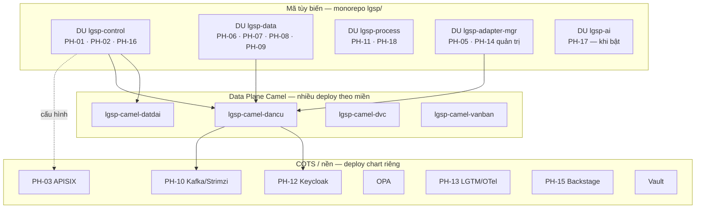

# IP-01 — Mô hình phát triển: Microservice hay Modular Monolith?

> Trả lời câu hỏi: LGSP nên phát triển theo microservice thuần, modular monolith thuần, hay mô hình lai?
> Cơ sở: [02-architecture](../02-architecture/README.md), [PR-01…06](../07-srs/README.md), ADR-002/010/014, thực hành GiaPhaHub (`00.family_tree`).

---

## 1. Hai cực và tiêu chí so sánh

| Tiêu chí | Modular monolith | Microservice thuần (1 PH = 1 service) |
|---|---|---|
| Số artifact deploy | Ít (1–vài) | Nhiều (hàng chục) |
| Ranh giới module | Package + test (Modulith) | Process + mạng |
| Schema DB | Có thể chung DB, schema/schema-per-module | Schema/DB riêng bắt buộc |
| Latency nội bộ | Gọi in-process / event nội bộ | HTTP/gRPC/Kafka |
| Scale độc lập | Hạn chế (scale cả app) | Theo service |
| Chi phí vận hành K8s/GitOps | Thấp | Cao (nhiều pipeline, mesh, SLO) |
| Phù hợp team nhỏ giai đoạn đầu | Cao | Thấp |
| Phù hợp tách vòng đời Control/Data | Cần tách tối thiểu 2 deploy | Tự nhiên |

---

## 2. Ràng buộc LGSP (đã chốt — không đàm phán lại)

Các ràng buộc sau **loại bỏ monolith một khối duy nhất**:

| Nguồn | Ràng buộc |
|---|---|
| **PR-01…06** | Mỗi PH phát triển / triển khai / scale / sở hữu dữ liệu độc lập |
| **ADR-014** | Control Plane và Data Plane **pod & vòng đời riêng** |
| **§10.2 kiến trúc** | Cấm gom mọi route Camel vào một app — tách `lgsp-dancu`, `lgsp-datdai`, … |
| **COTS** | APISIX, Keycloak, Kafka, Vault, Backstage, Flowable đã là process riêng |
| **NFR-04-019** | Scale Camel theo miền / tải |

Các ràng buộc sau **cảnh báo chống microservice hóa quá sớm**:

| Nguồn | Ràng buộc / bài học |
|---|---|
| Giai đoạn dự án | SRS + mockup đang hoàn thiện; team lập trình chưa cần 18 pipeline song song |
| GiaPhaHub TK-01 | *Modular monolith trước, microservice khi cần* — ranh giới cưỡng chế bằng test |
| Vận hành tỉnh/bộ | Số người vận hành hạn chế; mỗi service thêm = thêm SLO, dashboard, on-call |
| SRS-19 | Ma trận RBAC **không** phải microservice riêng |

---

## 3. Phân tích theo nhóm phân hệ

| Nhóm | PH | Khuyến nghị mô hình | Lý do |
|---|---|---|---|
| **Nền tảng COTS** | PH-03, 10, 12, 13 (gateway, Kafka, IAM, obs) | **Service / chart riêng** (đã là microservice vận hành) | Sản phẩm sẵn; vòng đời nâng cấp riêng nhà cung cấp |
| **Control Plane tùy biến** | PH-01, 02, 16 (+ API quản trị chung) | **Một DU modular monolith** `lgsp-control` | Cùng người dùng quản trị, cùng nhịp thay đổi, tải thấp hơn Data Plane |
| **Lõi tích hợp** | PH-04 (Camel), PH-05, PH-14 | **Nhiều deploy Camel theo miền** + service quản trị adapter/national | Đã bắt buộc bởi §10.2; không gộp một Camel |
| **Dữ liệu dùng chung** | PH-06, 07, 08, 09 | **Một DU modular monolith** `lgsp-data` giai đoạn 1; tách PH-06 khi tải MDM lớn | Schema logic riêng từng module; cùng PostgreSQL cluster khác schema |
| **Quy trình & vận hành** | PH-11, 18 | DU `lgsp-process` (Flowable + Ops/DLQ API) | BPM dài hạn khác nhịp Camel ngắn |
| **Portal** | PH-15 | Backstage (COTS) + plugin LGSP | ADR-006 |
| **AI** | PH-17 | DU riêng khi kích hoạt | Ưu tiên cao nhưng không chặn lõi |
| **Xuyên suốt tài liệu** | SRS-19 | Không deploy | Chỉ ma trận + policy OPA |

---

## 4. Quyết định: Hybrid DU — production-first

> Chuẩn hóa production = **tách đúng biên đã cứng** + **khuôn mẫu giống microservice bên trong DU**.
> Không tối đa hóa số process custom ngày 1 (xem ADR-018).

### 4.0. Biên tách ngay từ đầu (bắt buộc)

| Biên | Hiện thực deploy | Lý do chuẩn hóa |
|---|---|---|
| COTS nền | Chart/Helm riêng: APISIX, Keycloak, OPA, Kafka, Vault, LGTM, Backstage | Vòng đời nhà cung cấp; không nhét vào app |
| Control ≠ Data Plane | Namespace / pipeline / scale riêng (ADR-014) | Quản trị không làm gián đoạn đường tin |
| Camel theo miền | `lgsp-camel-dancu`, `…-datdai`, `…-dvc`, `…-vanban` | Scale & cô lập lỗi (§10.2) |
| Console / Portal | FE tĩnh + Backstage | Vòng đời UI khác API |

**Không** tách ngay từng PH-01…18 thành service riêng chỉ để “đủ số microservice”.

### 4.1. Định nghĩa

```text
PH (phân hệ nghiệp vụ)     = ranh giới SRS / sở hữu dữ liệu / hợp đồng API
DU (đơn vị triển khai)     = 1 (hoặc cụm) artifact/container deploy được
Module (trong DU)          = Spring Modulith package: api/ · events/ · internal/
```

- **PR-01…06 áp ở mức PH** (hợp đồng & dữ liệu).
- **Deploy độc lập áp ở mức DU** (+ các biên §4.0).
- Runtime: **Spring Boot 4 + Modulith** cho DU ứng dụng; **Camel Quarkus** cho PH-04 ([ADR-019](../05-adr/README.md#adr-019), [ADR-002](../05-adr/README.md#adr-002)).
- Khi một module trong DU cần scale/vòng đời riêng → **tách thành DU mới**.

### 4.2. Bản đồ DU giai đoạn 1



| DU | PH chứa (module) | Runtime | Namespace gợi ý |
|---|---|---|---|
| *(charts — tách ngay)* | PH-03, 10, 12, 13, 15 | COTS | `lgsp-edge` / `lgsp-security` / `lgsp-observability` |
| `lgsp-control` | PH-01, 02, 16 | **Spring Boot 4 + Modulith** | `lgsp-core` |
| `lgsp-data` | PH-06, 07, 08, 09 | **Spring Boot 4 + Modulith** | `lgsp-data` |
| `lgsp-process` | PH-11, 18 | **Spring Boot 4** + Flowable | `lgsp-core` |
| `lgsp-adapter-mgr` | PH-05, 14 (quản trị kết nối) | **Spring Boot 4 + Modulith** | `lgsp-core` |
| `lgsp-camel-<mien>` *(tách ngay)* | PH-04 routes | **Camel Quarkus native** | `lgsp-core` |
| `lgsp-ai` | PH-17 | Spring Boot 4 / Python sidecar tùy chọn | `lgsp-core` |
| `lgsp-console` | UI quản trị (Ant Design) | React/Vite | static / BFF nhẹ |

### 4.3. Tiêu chí tách module → DU mới

Tách khi **một** trong các điều kiện đúng:

1. Scale CPU/memory lệch ≥ 3× so với phần còn lại của DU trong 30 ngày.
2. Đội phụ trách khác nhau và nhịp release xung đột ≥ 2 sprint liên tiếp.
3. Yêu cầu tuân thủ / cấp độ ATTT buộc cô lập mạng hoặc CSDL.
4. Lỗi một module làm downtime SLA của module khác (vi phạm PR-06 trong thực tế).

**Không tách** chỉ vì “trông giống microservice” hoặc vì số PH trên giấy.

### 4.4. So với GiaPhaHub

| GiaPhaHub | LGSP |
|---|---|
| 1 BE Modulith cho gần hết nghiệp vụ | Nhiều DU: biên cứng tách ngay + Modulith trong từng DU ứng dụng |
| Tách microservice *khi cần* | COTS + Camel miền + Control/Data *tách ngay*; PH trong DU tách thêm theo §4.3 |
| Spring Boot 4 + Modulith | **Cùng stack** cho DU ứng dụng (ADR-019); thêm Camel Quarkus cho PH-04 |
| FE Portal + Admin | Console LGSP + Backstage (PH-15) |

---

## 5. Ma trận quyết định nhanh

| Câu hỏi | Trả lời cho LGSP |
|---|---|
| Có nên 1 repo monolith Java chứa mọi PH? | **Không** (vòng đời & scale) |
| Có nên 18 repo / 18 service custom ngày 1? | **Không** — không giúp chuẩn hóa |
| Production-first tách gì ngay? | COTS · Control≠Data · Camel theo miền (§4.0) |
| Spring Boot 4 thay Quarkus toàn bộ? | **DU ứng dụng: Boot 4** (ADR-019); **Camel: giữ Quarkus** (ADR-002) |
| Có nên monorepo? | **Có** — một repo `lgsp/` nhiều DU (học GiaPhaHub) |
| PH có schema riêng khi chung DU không? | **Có** — schema PostgreSQL riêng / quyền DB riêng (PR-02) |
| Gọi chéo module trong cùng DU? | Chỉ qua `api/` hoặc event nội bộ; **cấm** import `internal/` |
| Gọi giữa DU? | OpenAPI hoặc Kafka (schema Apicurio) |

---

## 6. Hệ quả

**Tích cực**
- Khớp kiến trúc đã công bố (Control/Data, Camel theo miền) mà vẫn giảm độ phức hợp ngày 1.
- Giữ đường thoát tách microservice khi tải thật xuất hiện.
- Áp dụng được kỷ luật Modulith / gates / contract-first từ GiaPhaHub.

**Tiêu cực / rủi ro**
- Cần kỷ luật: không để `lgsp-data` trở thành “big ball of mud” — bắt buộc ArchUnit / Modulith-verify tương đương.
- Ranh giới PH trên giấy vs DU trên cluster phải được ghi trong README từng DU (tránh hiểu nhầm “1 PH = 1 pod”).
- Review kiến trúc định kỳ mỗi quý theo §4.3.

---

## 7. Liên kết

- Quyết định chính thức → [ADR-018](../05-adr/README.md#adr-018)
- Chuẩn lập trình & monorepo → [IP-02](02-huong-dan-lap-trinh.md)
- Ranh giới PH → [07-srs/README](../07-srs/README.md)
