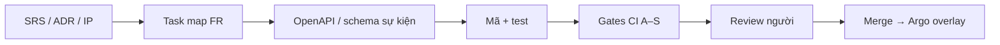

# IP-02 — Hướng dẫn lập trình LGSP

> Chuẩn tổ chức mã, API, sự kiện, bảo mật và quy trình phát triển.
> Học từ GiaPhaHub (`CLAUDE.md`, `instruction/08`, `11`, gates CI) — **Spring Boot 4 + Modulith** cho DU ứng dụng; **Camel Quarkus** cho PH-04 (ADR-019 / ADR-002).

---

## 1. Cấu trúc monorepo đề xuất

```text
lgsp/
├── docs/                          # kiến trúc, ADR, SRS, IP (đã có)
├── wiki/
├── mockup/                        # UI minh họa (Vite/React)
├── apps/
│   ├── control/                   # DU lgsp-control (Spring Boot 4 + Modulith)
│   ├── data/                      # DU lgsp-data
│   ├── process/                   # DU lgsp-process (+ Flowable)
│   ├── adapter-mgr/               # DU lgsp-adapter-mgr
│   ├── ai/                        # DU lgsp-ai (khi bật)
│   └── console/                   # FE quản trị (Vite + Ant Design)
├── camel/                         # PH-04 — Camel Quarkus (ADR-002), tách theo miền
│   ├── runtime-common/            # Java thuần / API ổn định — không phụ thuộc Spring
│   ├── dancu/                     # deploy lgsp-camel-dancu
│   ├── datdai/
│   ├── dvc/
│   └── vanban/
├── routes/                        # Camel YAML DSL — nguồn GitOps (theo routeId)
│   └── <route-id>/route.camel.yaml
├── policies/                      # OPA Rego, APISIX declarative
├── deploy/
│   ├── base/                      # Kustomize base
│   └── overlays/{dev,test,staging,prod}/
├── packages/                      # (tuỳ chọn) OpenAPI generated TS, design tokens
├── .github/workflows/             # hoặc GitLab CI tương đương
└── AGENTS.md / CLAUDE.md          # luật agent (bắt buộc trước khi AI viết mã hàng loạt)
```

**Quy ước:** một DU = một module build độc lập (Maven/Gradle). Thư viện dùng chung đặt `camel/runtime-common` hoặc `libs/` — **không** circular dependency giữa DU.

---

## 2. Module hóa trong một DU (Spring Modulith)

Mỗi phân hệ PH trong DU là một **Spring Modulith module** (`@ApplicationModule`):

```text
vn.lgsp.control/
├── shared/                    # kernel: security, error, audit, tracing
├── onboarding/                # PH-01
│   ├── api/                   # @NamedInterface — công bố trong DU
│   ├── events/                # sự kiện versioned (*.v1)
│   └── internal/              # entity, repo, service — CẤM import từ ngoài
├── catalog/                   # PH-02
└── nas/                       # PH-16
```

| Luật | Chi tiết |
|---|---|
| Import | Chỉ `api/` + `events/`; cấm `internal/` xuyên module |
| Dữ liệu | Schema PostgreSQL `ph01`, `ph02`, … — không join cross-schema |
| Giao tiếp nội bộ DU | Modulith events + transactional outbox |
| Giao tiếp liên DU | REST OpenAPI 3.1 hoặc Kafka (schema Apicurio) |
| Kiểm chứng | `ApplicationModules.verify()` + ArchUnit trong CI Gate A |
| Camel | Không nhét route nghiệp vụ vào Boot; YAML thuộc `routes/` + deploy `camel/<mien>` |

---

## 3. Hợp đồng API & sự kiện

### 3.1. API

| Quy tắc | Chuẩn |
|---|---|
| Spec | OpenAPI 3.1 — nguồn sự thật; sinh stub/server hoặc client |
| Lỗi | RFC 9457 Problem Details |
| Phân trang | Keyset (cursor) cho danh sách lớn; offset chỉ báo cáo |
| Idempotency | Header `Idempotency-Key` cho POST tạo credential / phê duyệt |
| Version | `/api/v1/...`; phá vỡ tương thích → `/v2` |
| FE | Typegen TypeScript từ OpenAPI — cấm gọi path ngoài types |

### 3.2. Sự kiện

| Quy tắc | Chuẩn |
|---|---|
| Tên | `<bounded-context>.<event>.v1` (ví dụ `onboarding.system-approved.v1`) |
| Schema | Đăng ký Apicurio; consumer **tolerant reader** |
| Outbox | Ghi DB + relay ra Kafka — không publish trước commit |
| Trace | Mọi bản tin mang `traceId` (FR-04-023 / W3C Trace Context) |

### 3.3. Camel route

| Quy tắc | Chuẩn |
|---|---|
| Định nghĩa | YAML DSL trong `routes/<id>/` |
| Đường vào PROD | Duyệt → merge Git → Argo CD (ADR-010) |
| Designer | Chỉ sinh YAML; không apply cluster (ADR-015/017) |
| Deploy | Nhóm theo miền `camel/<mien>` — không một uber-JAR |

---

## 4. Bảo mật & phân quyền trong mã

| Luật | Thực hiện |
|---|---|
| Deny-by-default | Endpoint mới phải gắn permission SRS-19; thiếu = 403 trong test |
| PEP | Mỗi DU gọi OPA hoặc enforce JWT + policy cục bộ theo SRS-19 |
| Secret | External Secrets → env/file; **cấm** hardcode; gitleaks Gate S |
| SQL | Parameterized / Panache / jOOQ — cấm nối chuỗi |
| PII | Mask qua PH-09 trước khi log / pin designer |
| mTLS | Tin cậy mesh Istio; service không tự ý mở NodePort |

Ánh xạ vai trò → [SRS-19](../07-srs/SRS-19-rbac-matrix.md).

---

## 5. Frontend console

| Luật | Chi tiết |
|---|---|
| Stack | React + TypeScript + Vite + Ant Design v6 (ADR-016) |
| Designer | XYFlow + catalog Camel (ADR-017); popup NDV cố định (UI-04-10) |
| Copy UI | Tiếng Việt nghiệp vụ; hạn chế jargon lộ ra người dùng cuối |
| Theme | Token CSS từ design system mockup — không hardcode màu rải rác |
| Portal ngoài | Backstage (PH-15) — plugin, không viết portal thứ hai |

---

## 6. Quy trình phát triển (chống vibe coding)

Học vòng **spec → code → gate → review** của GiaPhaHub TK-11:



| Bước | Bắt buộc |
|---|---|
| Trước khi viết mã | Có mã `FR-*` hoặc ADR; cập nhật OpenAPI nếu đổi hợp đồng |
| Commit | Tiếng Việt ngắn, nêu *vì sao*; tham chiếu FR/ADR khi liên quan |
| PR | Checklist: test · contract · không secret · ảnh hưởng PH nào |
| Học sau sửa tay | Nếu AI sai pattern → vá `AGENTS.md` / ArchUnit rule trong tuần |

---

## 7. Quality gates (máy chặn trước)

| Gate | Nội dung | Chặn merge? |
|---|---|---|
| **A** | Compile + unit + ArchUnit module boundaries + Camel route test (nếu đụng `routes/`) | Có |
| **B** | OpenAPI lint / breaking-change check (nếu đụng contract) | Có với breaking |
| **C** | (Console) lint + typecheck + unit component | Có |
| **D** | (Tuỳ UI) a11y smoke cho màn mới | Cảnh báo → bắt buộc từ STAGING |
| **S** | gitleaks + SAST (Semgrep/Trivy image) — CRITICAL chặn | Có |

Môi trường: DEV/TEST auto; STAGING/PROD cần duyệt ([04-deployment](../04-deployment/README.md)).

---

## 8. Thứ tự xây mã (khớp bước triển khai)

| Ưu tiên | Việc lập trình | PH / DU |
|---|---|---|
| 0 | Skeleton monorepo + Gate A/S + `AGENTS.md` | — |
| 1 | IAM bridge + OPA policies từ SRS-19 | PH-12 |
| 2 | `lgsp-control` (kết nạp + catalog tối thiểu) | PH-01, 02 |
| 3 | Camel runtime-common + 1 miền thí điểm + GitOps routes | PH-04 |
| 4 | Adapter manager + 1 adapter HTTT | PH-05 |
| 5 | `lgsp-data` (RDM → MDM) | PH-07, 06 |
| 6 | Console designer (từ mockup) | UI PH-04 |
| 7 | Process/DLQ, Portal plugin, AI | PH-11, 18, 15, 17 |

Không bắt đầu bằng microservice hóa từng PH; bắt đầu bằng **skeleton DU + một luồng end-to-end** (kết nạp → route → adapter giả).

---

## 9. Việc cần tạo ngay khi mở pha lập trình

| Artifact | Mục đích |
|---|---|
| `AGENTS.md` / `CLAUDE.md` | Luật AI: map FR, cấm secret, cấm phá ranh giới module |
| ArchUnit rules mẫu | Import `internal/` bị fail CI |
| Template OpenAPI + Problem Details | Đồng bộ mọi DU |
| Pipeline Gate A + S | Trước khi có tính năng nghiệp vụ lớn |
| Kustomize overlay `dev` | Một DU control + một Camel miền |

---

## 10. Liên kết

- Mô hình DU → [IP-01](01-mo-hinh-phat-trien.md)
- ADR mô hình → [ADR-018](../05-adr/README.md#adr-018)
- GiaPhaHub tham chiếu: `instruction/01-kien-truc-he-thong.md`, `08-api-va-module-hoa.md`, `11-quy-trinh-phat-trien-voi-ai.md`, `CLAUDE.md`
