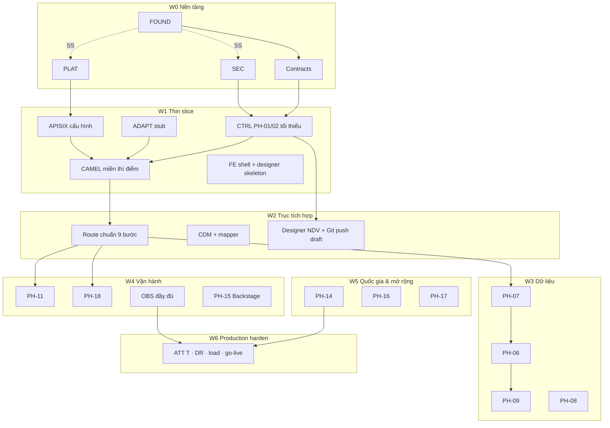

# IP-04 — Kế hoạch phát triển ứng dụng LGSP (chi tiết · đa agent)

> **Vai trò.** Checklist thực thi từ skeleton → thin-slice chạy được → mở rộng PH → production.
> Bám [IP-01](01-mo-hinh-phat-trien.md) · [IP-02](02-huong-dan-lap-trinh.md) · [IP-03](03-stack-cong-nghe.md) · ADR-018/019 · [04-deployment](../04-deployment/README.md).
>
> **Quy ước**
> - `- [ ]` đánh dấu khi xong + ghi PR/commit.
> - **[SS]** = được làm song song với các mục cùng nhóm (không phụ thuộc artifact của nhau).
> - **WP-xx** = gói việc giao một agent / một PR stream.
> - Không ước lượng ngày — chỉ thứ tự & điều kiện vào/ra.
> - Mỗi WP phải map ≥ 1 `FR-*` / ADR / IP khi đụng nghiệp vụ.

---

## 1. Nguyên tắc chia cho nhiều agent

| # | Luật | Lý do |
|---|---|---|
| 1 | **Một agent = một lane sở hữu thư mục** (bảng §2) | Tránh xung đột git & kiến trúc |
| 2 | **Hợp đồng trước mã** — OpenAPI / CloudEvent / topic Kafka / OPA package | Agent khác integrate không đoán |
| 3 | **PR nhỏ** — 1 WP hoặc 1 slice vertical (API + test + migrate) | Review được; revert được |
| 4 | **Không đụng `internal/` module khác** | Modulith / PR-02 |
| 5 | **Cấm mở rộng scope** — hết DoD WP thì dừng; WP mới = issue mới | Chống vibe coding |
| 6 | **Stub có nhãn** — `@Profile("dev")` / feature flag; không để stub làm đường PROD | Production-first |
| 7 | **Gate xanh trước claim xong** — A (+ S nếu đụng secret/auth); C nếu đụng FE | IP-02 |
| 8 | **Coordinator** (người hoặc agent dẫn) chỉ merge hợp đồng & cắt wave** | Không viết nghiệp vụ thay lane |

### 1.1. Giao diện giữa agent (handoff)

```text
Agent A xuất bản artifact  →  ghi vào contracts/ + CHANGELOG WP
Agent B chỉ phụ thuộc artifact đã tag (ví dụ openapi control v0.1.0)
Cấm B import mã nguồn A ngoài api công bố
```

Thư mục hợp đồng bắt buộc từ W0:

```text
contracts/
├── openapi/          # {du}-{ph}-v1.yaml
├── asyncapi/         # hoặc schemas/events/*.json
├── opa/              # package.rego + tests
└── camel-catalog/    # subset component phiên bản khóa
```

---

## 2. Lane agent & quyền sở hữu

| Lane | Agent ID gợi ý | Sở hữu path | Không được sửa |
|---|---|---|---|
| **L-FOUND** | `agent-found` | `AGENTS.md`, root README, `.github/`, `contracts/` (scaffold), `libs/common-java/` | `apps/*`, `camel/*` nghiệp vụ |
| **L-PLAT** | `agent-plat` | `deploy/` (Kustomize/Helm COTS), compose DEV | mã Java/TS nghiệp vụ |
| **L-SEC** | `agent-sec` | Keycloak realm, `contracts/opa/`, Vault policies mẫu, External Secrets | logic PH ngoài authz |
| **L-CTRL** | `agent-ctrl` | `apps/control/` (PH-01, 02, 16) | `apps/data`, `camel/*` |
| **L-ADAPT** | `agent-adapt` | `apps/adapter-mgr/` (PH-05, 14 quản trị) | route Camel runtime |
| **L-CAMEL** | `agent-camel` | `camel/`, `routes/` | UI console (trừ contract YAML schema) |
| **L-DATA** | `agent-data` | `apps/data/` (PH-06…09) | control / camel |
| **L-PROC** | `agent-proc` | `apps/process/` (PH-11, 18) | — |
| **L-FE** | `agent-fe` | `apps/console/`, `packages/` FE | BE trừ OpenAPI typegen |
| **L-OBS** | `agent-obs` | dashboards, OTel collectors, alert rules | nghiệp vụ |
| **L-AI** | `agent-ai` | `apps/ai/` (PH-17) — sau W4 | — |
| **L-QA** | `agent-qa` | `tests/e2e/`, kịch bản AT, báo cáo gate | không “vá” production bằng hack |

> Có thể gộp lane nếu ít người (ví dụ L-CTRL+L-ADAPT), nhưng **không** gộp L-CAMEL với L-CTRL trên cùng PR.

---

## 3. Bản đồ phụ thuộc các wave



**Cổng chuyển wave:** bảng §10.

---

## 4. W0 — Nền tảng (chặn mọi nghiệp vụ lớn)

**Mục tiêu.** Repo + CI + contracts + DEV infra + IAM skeleton chạy được; chưa cần luồng nghiệp vụ đầy đủ.

### WP-00 — FOUND: monorepo & luật agent  **[SS với WP-01, WP-02 sau khi có skeleton thư mục]**

**Lane:** L-FOUND  
**DoD:**
- [x] Cấu trúc thư mục đúng [IP-02 §1](02-huong-dan-lap-trinh.md)
- [x] `AGENTS.md` / `CLAUDE.md`: map FR, cấm secret, lane ownership, DoD
- [x] EditorConfig + `.gitignore` (không commit `.env`)
- [x] README: chạy local, link IP-01…04 + wiki
- [x] `contracts/` rỗng có README quy ước phiên bản

### WP-01 — PLAT: DEV compose / Kustomize base  **[SS với WP-00 sau skeleton]**

**Lane:** L-PLAT  
**DoD:**
- [x] Compose hoặc kind/k3d: Postgres, Valkey, (Kafka optional W0), Mailhog/stub
- [x] `deploy/base` + overlay `dev`
- [x] `.env.example` đủ biến; script `make up-dev`
- [x] Tài liệu cổng/port không đụng nhau
- [ ] **Khóa baseline phiên bản thật** ([ADR-020](../05-adr/README.md#adr-020) phần A): xác nhận trên cụm đích
      bản **CloudNativePG** (→ PG major 17 hay 18) · bản **Strimzi** (→ Kafka/KRaft) · **GraalVM** khớp Camel Quarkus 4.18.
      Ghi số chốt vào bảng ghim [IP-03](03-stack-cong-nghe.md); lệch với tài liệu thì sửa tài liệu, không sửa ngầm ở code.
- [x] **Chọn & kiểm chứng object storage** ([ADR-020](../05-adr/README.md#adr-020) phần B): dựng Garage/SeaweedFS/Ceph RGW trên DEV
      và **thử thật object-lock/retention (WORM)** — điều kiện bắt buộc cho nhật ký kiểm toán theo CMP-28.
      **Không dùng MinIO.** Ghi biên bản kiểm chứng vào `deploy/README`.
      *(2026-08-04: Garage 2.1 **không** Object Lock → SeaweedFS 3.97 COMPLIANCE retention chặn xóa — biên bản trong `deploy/README`)*

### WP-02 — SEC: Keycloak + OPA skeleton  **[SS với WP-01]**

**Lane:** L-SEC · SRS: PH-12, SRS-19  
**DoD:**
- [x] Realm DEV: client console, client `lgsp-control`, roles chuẩn SRS-19 (tối thiểu 5 role lõi)
- [x] `contracts/opa/authz.rego` + ≥ 3 unit test OPA
- [x] Tài liệu: cách lấy token DEV
- [x] External Secrets mẫu (fake backend DEV được)

### WP-03 — FOUND: libs & Gate A/S  **[sau WP-00]**

**Lane:** L-FOUND  
**DoD:**
- [x] `libs/common-java`: Problem Details, traceId filter, page cursor — **không** phụ thuộc Spring/Quarkus nặng (hoặc tách boot-starter / quarkus-ext mỏng)
- [x] CI: compile placeholder + gitleaks + (tuỳ) Semgrep
- [x] Branch protection checklist (ghi trong README dù bật sau)

### WP-04 — Contracts bootstrap  **[SS với WP-03; SEC cung cấp claim JWT]**

**Lane:** L-FOUND (+ review L-CTRL/L-CAMEL)  
**DoD:**
- [x] OpenAPI stub: `control-onboarding-v0.yaml`, `control-catalog-v0.yaml`
- [x] Event schema stub: `onboarding.system-approved.v1`
- [x] Async topic naming doc trong `contracts/README.md`

### WP-05 — CTRL skeleton Modulith  **[sau WP-03, WP-02]**

**Lane:** L-CTRL · ADR-019  
**DoD:**
- [x] `apps/control` Spring Boot 4 + Modulith: module `shared`, `onboarding`, `catalog` (empty api)
- [x] `ApplicationModules.verify()` xanh
- [x] Health `/actuator/health` + OIDC resource server DEV
- [x] Liquibase/Flyway: schema `ph01`, `ph02` rỗng

### WP-06 — CAMEL skeleton 1 miền  **[SS với WP-05; sau WP-01]**

**Lane:** L-CAMEL · ADR-001/002  
**DoD:**
- [x] `camel/dancu` Quarkus: 1 route ping `direct:health` → log
- [x] Build JVM DEV; pipeline native (có thể `manual`/nightly ở W0) *(profile `native` trong pom; CI W0 = JVM)*
- [x] Kustomize deploy DEV
- [x] `routes/_examples/ping.camel.yaml`

### WP-07 — FE shell  **[SS với WP-05; sau ADR-016 tokens mockup]**

**Lane:** L-FE  
**DoD:**
- [x] `apps/console` Vite+React+Ant Design: layout shell lấy từ mockup
- [x] Login OIDC DEV (Keycloak)
- [x] Trang placeholder: Luồng · Kết nạp · Catalog
- [x] Typegen pipeline trỏ `contracts/openapi` (có thể fail-soft nếu stub)

**Cổng W0:** WP-00…07 DoD ✓ · CI Gate A+S xanh · token Keycloak lấy được · control health OK · camel ping OK · console login OK ·
**baseline phiên bản đã khóa theo cụm thật** · **object storage đã kiểm chứng WORM** (ADR-020).

---

## 5. W1 — Thin slice end-to-end (HTTT giả → LGSP → HTTT giả)

**Mục tiêu.** Một luồng: đăng ký client (PH-01) → catalog API (PH-02) → APISIX → Camel → adapter HTTP mock → trả kết quả; có `traceId`.

### WP-10 — CTRL: PH-01 kết nạp tối thiểu

**Lane:** L-CTRL · FR: `FR-01-*` (luồng duyệt rút gọn DEV)  
**Phụ thuộc:** W0  
**DoD:**
- [x] API: nộp hồ sơ / duyệt giả (role `INTEGRATION_REVIEWER`) / cấp clientId (secret qua Vault stub hoặc sealed DEV)
- [x] Event `onboarding.system-approved.v1` outbox → Kafka (hoặc bus DEV) *(JDBC outbox + log dispatcher DEV)*
- [x] OpenAPI v0.1 khóa; AT khói: 2 test
- [x] Permission SRS-19 trên mọi endpoint

### WP-11 — CTRL: PH-02 catalog tối thiểu  **[SS với WP-10 nếu contract tách file]**

**Lane:** L-CTRL · FR: `FR-02-*`  
**DoD:**
- [x] Đăng ký 1 OpenAPI dịch vụ mẫu; trạng thái DRAFT→PUBLISHED (rút gọn)
- [x] Đồng bộ route APISIX **qua file declarative** trong Git (không gọi Admin API tay)
- [x] OpenAPI v0.1

### WP-12 — PLAT/SEC: APISIX + Coraza DEV

**Lane:** L-PLAT (+ L-SEC JWT) · PH-03  
**DoD:**
- [x] APISIX DEV đứng trước control + camel
- [x] Plugin OIDC/JWT + rate-limit cơ bản *(openid-connect bearer_only + limit-count)*
- [x] 1 route `/demo/tra-cuu` → camel
- [x] WAF CRS mức paranoia thấp DEV *(Coraza wasm + CRS paranoia 1 DetectionOnly; probe `/demo/waf-probe` deny)*

### WP-13 — ADAPT: registry + HTTP mock

**Lane:** L-ADAPT · PH-05  
**DoD:**
- [x] CRUD adapter “HTTP_MOCK” (URL wiremock/MockServer)
- [x] Connection ref **không** lưu secret plaintext (Vault path)
- [x] API cho Camel resolve endpoint theo `adapterId`

### WP-14 — CAMEL: route thí điểm tra cứu

**Lane:** L-CAMEL · PH-04 · phụ thuộc WP-12, WP-13  
**DoD:**
- [x] YAML: from platform-http → validate tối thiểu → to adapter HTTP_MOCK → response *(Java RouteBuilder + ví dụ YAML)*
- [x] Propagate `traceId` (W3C)
- [x] Fault tolerance: timeout + 1 retry
- [x] Test Camel JVM xanh

### WP-15 — FE: màn kết nạp + danh sách luồng (đọc API thật)

**Lane:** L-FE · phụ thuộc WP-10, WP-11  
**DoD:**
- [x] UI kết nạp tối thiểu (form + trạng thái)
- [x] UI danh sách route (đọc catalog/control)
- [x] Không hardcode màu ngoài token

### WP-16 — QA: E2E thin slice

**Lane:** L-QA  
**DoD:**
- [x] Script: token → tạo hồ sơ → duyệt → gọi `/demo/tra-cuu` → 200 + header trace
- [x] Ghi bằng chứng vào `tests/e2e/README.md`

**Cổng W1:** E2E WP-16 xanh trên DEV · 1 HTTT giả xuyên APISIX→Camel→mock · secret không có trong Git.

---

## 6. W2 — Lõi tích hợp chuẩn (PH-04 đầy đủ khung)

**Mục tiêu.** Khung chín bước, designer→Git, chạy thử, validate, multi-miền scaffold.

### WP-20 — CAMEL: khung route chuẩn & error handler

**Lane:** L-CAMEL · FR-04-001…025 (subset M)  
**DoD:**
- [x] Template route: tiếp nhận → schema → authz → transform → enrich → route → deliver → audit *(StandardPipelineRoute + `routes/_templates/standard-9-stage.camel.yaml`; TraCuu gắn 9 chặng)*
- [x] Chặng bắt buộc không gỡ (metadata) *(StageIds + header `X-Lgsp-Stages`)*
- [x] DLQ topic + header lỗi chuẩn (chưa UI PH-18) *(seda:dlq + `LgspErrorCode` / `LgspStage`)*
- [x] Native build CI cho `camel/dancu` *(`-Pnative` + workflow `camel-native.yml`)*

### WP-21 — CAMEL: miền thứ 2 skeleton  **[SS với WP-20 sau template]**

**Lane:** L-CAMEL  
**DoD:**
- [x] `camel/datdai` copy khung; 0 route nghiệp vụ hoặc 1 ping
- [x] Kustomize riêng; HPA/KEDA annotation mẫu

### WP-22 — CDM: registry + 1 mapper

**Lane:** L-CAMEL (+ L-DATA review) · ADR-013  
**DoD:**
- [x] Schema CDM mẫu (JSON Schema) trong `contracts/` *(`contracts/cdm/person.v1.json`)*
- [x] 1 XSLT/JQ mapper đăng ký *(`legacy-citizen-to-person.jq` + Java mapper đồng bộ)*
- [x] Route thí điểm dùng mapper *(`POST /demo/cdm/person`, hook `direct:pipeline-transform`)*

### WP-23 — CTRL: phiên bản route + GitOps hook

**Lane:** L-CTRL · FR-04-020…025  
**DoD:**
- [x] API lưu DRAFT định nghĩa YAML (metadata + content) *(`POST/PUT /api/admin/v1/routes…`, schema `ph04`)*
- [x] “Gửi duyệt” / “Publish” tạo MR hoặc commit nhánh `routes/` (token bot DEV) *(`submit`/`publish` → `routes/<code>/route.camel.yaml`; `LGSP_GITOPS_COMMIT=true` để git commit)*
- [x] Chặn publish khi validate lỗi *(`CamelYamlValidator` → HTTP 422 + findings)*

### WP-24 — FE: Designer production-path

**Lane:** L-FE · UI-04-07/10 · FR-04-026…037  
**DoD:**
- [ ] Port mockup `designer-src` → `apps/console` (NDV cố định, LR canvas)
- [ ] Lưu nháp qua API WP-23
- [ ] Validate findings panel
- [ ] Chạy thử giả lập (stub kết quả nếu backend chưa sẵn — gắn cờ)

### WP-25 — CAMEL: test runner API  **[SS một phần với WP-24]**

**Lane:** L-CAMEL · FR-04-028/035  
**DoD:**
- [ ] Endpoint chạy thử (giả lập đích)
- [ ] Trả waterfall theo chặng + pin data
- [ ] Không ghi secret vào log

### WP-26 — QA: AT lõi PH-04

**Lane:** L-QA · AT-04-* chọn lọc (≥ 10 AT mức M)  
**DoD:**
- [ ] Tự động hóa được trên CI nightly
- [ ] Báo cáo ánh xạ AT ↔ FR

**Cổng W2:** Designer tạo route → Git → Argo sync DEV → chạy thử có waterfall · 2 miền Camel deploy được.

---

## 7. W3 — Dữ liệu dùng chung (DU `lgsp-data`)

**Thứ tự cứng trong DU:** PH-07 → PH-06 → PH-09 → PH-08 (RDM trước MDM).

### WP-30 — DATA skeleton Modulith

**Lane:** L-DATA  
**DoD:**
- [ ] Modules `rdm`, `mdm`, `privacy`, `dq` + verify
- [ ] Schema `ph06`…`ph09`
- [ ] OIDC + OPA enforce

### WP-31 — PH-07 RDM

**Lane:** L-DATA · SRS PH-07  
**DoD:**
- [ ] CRUD danh mục + version
- [ ] API resolve mã ánh xạ
- [ ] OpenAPI khóa v1
- [ ] Seed 1 danh mục dùng cho route thí điểm

### WP-32 — PH-06 MDM  **[sau WP-31]**

**Lane:** L-DATA · SRS PH-06  
**DoD:**
- [ ] Golden record tối thiểu 1 entity
- [ ] Match rule đơn giản + API tra cứu
- [ ] Event thay đổi master (schema)

### WP-33 — PH-09 Privacy  **[SS với WP-32 nếu chỉ mask library]**

**Lane:** L-DATA · SRS PH-09  
**DoD:**
- [ ] Service mask/anonymize API
- [ ] Camel processor gọi được (contract)
- [ ] Cấm log PII thô (test)

### WP-34 — PH-08 DQ  **[sau WP-31]**

**Lane:** L-DATA · SRS PH-08  
**DoD:**
- [ ] Rule engine tối thiểu + điểm chất lượng
- [ ] API chấm 1 payload
- [ ] Tích hợp optional vào route thí điểm

### WP-35 — FE: màn RDM/MDM đọc API

**Lane:** L-FE  
**DoD:**
- [ ] Danh mục + tra cứu golden (theo mockup)
- [ ] Typegen cập nhật

### WP-36 — CAMEL: enrich từ RDM/MDM

**Lane:** L-CAMEL · phụ thuộc WP-31/32  
**DoD:**
- [ ] Route thí điểm enrich mã danh mục + (tuỳ) MDM
- [ ] Timeout/bulkhead tới `lgsp-data`

**Cổng W3:** Route thí điểm enrich RDM · mask PH-09 trên nhánh có PII · OpenAPI data v1 ổn định.

---

## 8. W4 — Vận hành, quan sát, portal, BPM

### WP-40 — PROC skeleton + PH-18 DLQ API

**Lane:** L-PROC · SRS PH-18  
**DoD:**
- [ ] Consumes DLQ topic; API danh sách/replay/discard
- [ ] RBAC SRS-19
- [ ] FE màn DLQ (L-FE **[SS]** sau API)

### WP-41 — PH-11 Flowable tối thiểu  **[SS với WP-40]**

**Lane:** L-PROC · SRS PH-11 · ADR-009  
**DoD:**
- [ ] Nhúng Flowable; 1 quy trình mẫu (duyệt kết nạp dài hạn — optional thay duyệt DEV)
- [ ] Camel không thay BPM cho wait người dùng
- [ ] PostgreSQL schema `ph11`

### WP-42 — OBS đầy đủ

**Lane:** L-OBS · PH-13  
**DoD:**
- [ ] OTel collector; dashboard Grafana: RED Camel, APISIX, JVM Boot
- [ ] Log correlation `traceId`
- [ ] Alert mẫu: consumer lag, 5xx gateway

### WP-43 — PH-15 Backstage

**Lane:** L-PLAT + L-FE · ADR-006  
**DoD:**
- [ ] Backstage DEV; plugin/catalog nạp API từ PH-02
- [ ] TechDocs trỏ docs/

### WP-44 — FE: monitoring + DLQ + duyệt

**Lane:** L-FE  
**DoD:**
- [ ] Màn theo mockup monitoring/dlq (API thật hoặc BFF)
- [ ] Không jargon lộ UI

**Cổng W4:** DLQ replay được · dashboard có trace xuyên APISIX→Camel · Backstage liệt kê ≥ 1 API.

---

## 9. W5 — Quốc gia, NAS/KPI, AI

### WP-50 — ADAPT/NAT: PH-14 connector

**Lane:** L-ADAPT (+ L-CAMEL) · SRS PH-14  
**DoD:**
- [ ] Adapter NDXP/NGSP (sandbox/mock trước)
- [ ] Route miền gọi national connector
- [ ] Chính sách PH-09 trước khi ra ngoài

### WP-51 — CTRL: PH-16 NAS/KPI

**Lane:** L-CTRL · SRS PH-16  
**DoD:**
- [ ] Architecture registry tối thiểu + KPI 1 nhóm
- [ ] Export báo cáo stub→file

### WP-52 — AI: PH-17 gateway  **[SS; không chặn W6 lõi]**

**Lane:** L-AI · SRS PH-17  
**DoD:**
- [ ] DU `lgsp-ai` health + policy chặn PII
- [ ] 1 use-case (ví dụ gợi ý mapping) qua API
- [ ] Audit gọi model

### WP-53 — CAMEL: thêm miền dvc/vanban skeleton

**Lane:** L-CAMEL  
**DoD:**
- [ ] `camel/dvc`, `camel/vanban` deploy DEV
- [ ] HPA/KEDA annotation

**Cổng W5:** Có đường ra national mock · KPI ghi nhận được · AI không bắt buộc cho go-live lõi.

---

## 10. W6 — Production harden & go-live

### WP-60 — PLAT: STAGING/PROD overlays

**Lane:** L-PLAT · ADR-010  
**DoD:**
- [ ] Overlay staging/prod; seal secrets
- [ ] Argo AppOfApps; sync policy đúng duyệt
- [ ] Backup CNPG + diễn tập restore (biên bản)

### WP-61 — SEC: cứng hóa

**Lane:** L-SEC  
**DoD:**
- [ ] Tắt client DEV; MFA bắt buộc role quản trị
- [ ] OPA đầy đủ SRS-19 cho PH đã ship
- [ ] Pentest nội bộ / checklist ASVS subset
- [ ] Vault production path; không secret trong env plaintext

### WP-62 — QA: hồi quy AT + tải

**Lane:** L-QA  
**DoD:**
- [ ] Bộ AT M của PH-01,02,03,04,05,12 xanh trên STAGING
- [ ] Load test mục tiêu kiến trúc (subset TPS) — báo cáo
- [ ] Chaos nhẹ: kill 1 camel pod, đối soát DLQ/retry

### WP-63 — CAMEL: native PROD + scale

**Lane:** L-CAMEL  
**DoD:**
- [ ] Image native trên Harbor đã quét Trivy
- [ ] KEDA lag rule thật
- [ ] Runbook sự cố route

### WP-64 — FE: parity mockup & a11y

**Lane:** L-FE  
**DoD:**
- [ ] Màn P0 parity mockup
- [ ] Gate a11y smoke
- [ ] Loại bỏ mọi stub UI đường chính

### WP-65 — Go-live checklist

**Lane:** Coordinator + tất cả  
**DoD:**
- [ ] Đối chiếu [04-deployment](../04-deployment/README.md) bước 13–17
- [ ] Hồ sơ CMP / cấp độ ATTT (phần kỹ thuật)
- [ ] Đào tạo vận hành (runbook)
- [ ] Quyết định cutover & rollback

**Cổng W6:** STAGING = ứng viên PROD · E2E + backup restore + security checklist ký · go-live.

---

## 11. Ma trận song song tối đa (gợi ý sprint)

| Thời điểm | Agent chạy đồng thời an toàn |
|---|---|
| Đầu W0 | FOUND · PLAT · SEC |
| Cuối W0 | CTRL skeleton · CAMEL skeleton · FE shell |
| W1 | CTRL(PH-01) \|\| CTRL(PH-02) *nếu 2 người* · PLAT APISIX · ADAPT · (CAMEL chờ contract adapter) · FE sau OpenAPI |
| W2 | CAMEL template · FE designer · CTRL gitops API |
| W3 | Trong DATA: tuần tự 07→06; PRIV/DQ song song sau RDM API |
| W4 | PROC DLQ \|\| Flowable · OBS · Backstage · FE |
| W5 | NAT · NAS · AI (AI không chặn) · camel miền mới |
| W6 | PLAT · SEC · QA · FE parity — phối hợp chặt, ít SS |

---

## 12. Definition of Done — mọi WP

Checklist bắt buộc trong mô tả PR:

- [ ] Map FR/ADR/IP (hoặc “nền tảng — WP-0x”)
- [ ] OpenAPI/event cập nhật nếu đổi hợp đồng + semver contracts
- [ ] Test tự động (unit và/hoặc slice)
- [ ] Modulith/ArchUnit xanh (nếu Java DU)
- [ ] Không secret; gitleaks sạch
- [ ] RBAC deny-by-default (nếu có endpoint)
- [ ] Tài liệu ngắn: cách chạy / breaking change
- [ ] Lane ownership đúng — không sửa path ngoài lane (trừ contracts đã thỏa thuận)

---

## 13. Backlog tài liệu còn thiếu (chạy **[SS]** với W0–W1)

| ID | Việc | Lane | Ghi chú |
|---|---|---|---|
| ~~DOC-01~~ | ~~SRS PH-10 Event~~ | — | ✅ **Đã xong** — [SRS-PH-10-event.md](../07-srs/SRS-PH-10-event.md) |
| ~~DOC-02~~ | ~~SRS PH-13 Observability~~ | — | ✅ **Đã xong** — [SRS-PH-13-observability.md](../07-srs/SRS-PH-13-observability.md) |
| ~~DOC-03~~ | ~~Từ điển dữ liệu dùng chung~~ | — | ✅ **Đã xong** — [SRS-00-data-dictionary.md](../07-srs/SRS-00-data-dictionary.md) |
| DOC-04 | OpenAPI đầy đủ từng PH (sinh từ code + review) | Mỗi lane BE | Liên tục |
| DOC-05 | Rà soát vòng đời phiên bản trước khi khóa baseline | Coordinator | [ADR-020](../05-adr/README.md#adr-020) phần A — lặp lại mỗi pha |

> **Trạng thái tài liệu nền:** SRS 39/39 hạng mục ✓ · mockup 124/124 màn ✓ (xem [07-srs/CHECKLIST](../07-srs/CHECKLIST.md) và [mockup/CHECKLIST-MOCKUP](../../mockup/CHECKLIST-MOCKUP.md)).
> Không còn tài liệu nền nào chặn W0–W4.

---

## 14. Điều phối đa agent (protocol)

1. **Board:** mỗi WP = 1 issue (`WP-xx`, label lane, wave).
2. **Hợp đồng:** PR vào `contracts/` cần approve lane tiêu thụ (ví dụ CAMEL approve adapter API).
3. **Sync điểm:** cuối mỗi wave — meeting/async: cổng wave §4–10; cập nhật file này `[x]`.
4. **Xung đột:** path ngoài lane → PR bị reject; tách WP.
5. **Agent prompt tối thiểu khi giao việc:**
   ```text
   Đọc: wiki/00-INDEX → IP-03 → IP-04 (WP-xx) → SRS liên quan → AGENTS.md
   Chỉ sửa path của lane …
   DoD = mục DoD trong IP-04 WP-xx
   Không mở rộng sang WP khác
   ```

---

## 15. Thứ tự ưu tiên tuyệt đối nếu thiếu người

Rút còn **3 lane**: FOUND+PLAT+SEC · CTRL+ADAPT+CAMEL · FE(+QA nhẹ)

1. W0 đầy đủ  
2. W1 thin slice  
3. W2 designer+GitOps  
4. W3 chỉ PH-07 + mask tối thiểu  
5. W4 DLQ + OBS  
6. W6 subset (staging harden)  
7. W5 khi có nguồn lực  

---

## 16. Liên kết

| Tài liệu | Dùng khi |
|---|---|
| [IP-01](01-mo-hinh-phat-trien.md) | Phân vân tách DU/PH |
| [IP-02](02-huong-dan-lap-trinh.md) | Chuẩn mã / gate |
| [IP-03](03-stack-cong-nghe.md) | Chọn thư viện |
| [04-deployment](../04-deployment/README.md) | Hạ tầng & go-live bước 1–19 |
| [07-srs/CHECKLIST](../07-srs/CHECKLIST.md) | Trạng thái SRS/mockup |
| [SRS-19](../07-srs/SRS-19-rbac-matrix.md) | Mọi endpoint |

---

## 17. Lịch sử

| Ngày | Thay đổi |
|---|---|
| 2026-08-03 | Khởi tạo IP-04 — wave W0–W6, WP, lane đa agent |
| 2026-08-04 | Đóng DOC-01/02/03 (SRS PH-10, PH-13, từ điển dữ liệu **đã xong**) · thêm DOC-05 rà soát vòng đời phiên bản · WP-01 thêm DoD khóa baseline theo cụm thật + kiểm chứng WORM lưu trữ đối tượng ([ADR-020](../05-adr/README.md#adr-020)) · cập nhật cổng W0 |
